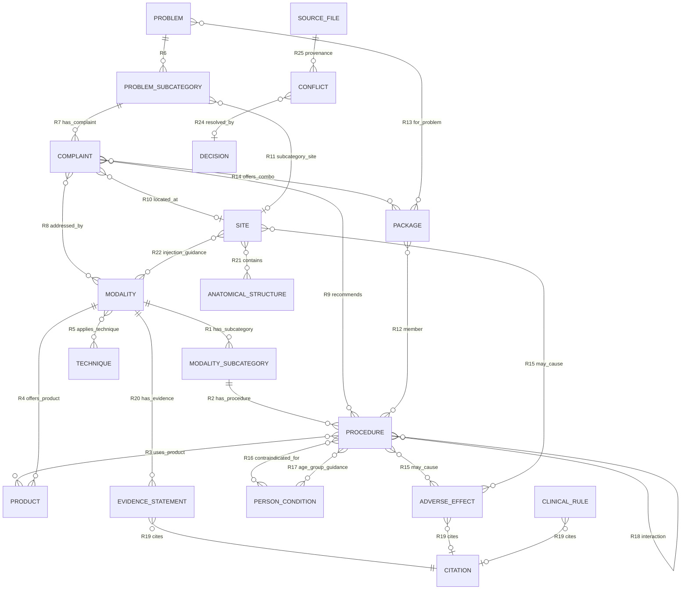

# ERD v1 — 피부과 시술 허브 메달리온 시맨틱 정의

작성 2026-11-04 · 상태 **초안(사용자 승인 전)** · 브론즈 스냅샷 2026-10-26 · 발주서 `erd-v1-brief.md`

기계용 동본 `erd-v1.json` · 값 사전 `erd-v1-dictionaries.json` · 잎 키 행선지 `erd-v1-column-map.md` · 검산 `erd-v1-check.py` (결과 §10)

## 1. 범위와 층

| 층 | 무엇 | 규칙 |
|---|---|---|
| 브론즈 | 원장 21개 JSON 그대로 | 바이트 보존·수정 금지. 파일 SHA256 이 식별자(§6 표). 스냅샷 2026-10-26 |
| 시맨틱 | 이 ERD + 값 사전 | 문서. 사용자 승인이 정본 조건. 버전으로 개정(v1 → v2 …) |
| 실버 | ERD 를 따르는 정규화 레코드 | **모든 값은 (파일, 잎 키 경로) 출처를 가진다.** 출처 없는 값 금지. 충돌은 둘 다 보관 |
| 골드 | 실버 조합 뷰 | 실버에 없는 사실을 만들지 않는다. 충돌 미판정 레코드 제외 |

지식은 원장 21개와 컬럼 리포트에서만 가져왔다. step*·source-map·DATA-001·DEC-*·silver-*·`_archive/` 는 열지 않았다.

### 1.1 정규화(「같은 것」판정)와 식별자

- 정규화 `norm_v1`: unicodedata.normalize('NFKC') → str.casefold() → 모든 공백 문자 제거 (스페이스·탭·전각공백) → 그 외 문자(괄호·슬래시·하이픈·점 포함)는 그대로 둔다 — 괄호 안이 부위·용량·제품을 구분하는 경우가 있어 벗기지 않는다
- 정규화 결과가 완전히 같을 때만 「같은 것」. 괄호만 다른 표면형(리포트 §3.10)은 ⑦ 유사도 후보로만 올린다.
- 식별자: `<PREFIX>-<sha256(canonical_key)[:10]>`. canonical_key 는 개체별(§2 각 표의 「식별자」). 개체별로 정의 (각 개체의 identity 항목). 원장 id·이름·코드는 전부 aliases 로 보존한다 (질문 4·6 기본값)
- 「같은 것」 = 정규화 완전 일치(①) + 사전 동의어(②)만 자동. 유사도·추측 매칭은 ⑦ 후보로만 남긴다.

### 1.2 다이어그램 (개체·관계만)

## 2. 개체 목록

개체 19개. 발주서 최소 목록(제품·계열·부위·기법·단위 시술·고민·부작용·금기 조건·문헌 인용·충돌·결정) 11 + 추가 6(표시 ★). 설명문·FAQ·가격·환자 교육문·고지문은 전부 속성이다.

### 2.1 `source_file` — 원장 파일 ★ (접두 `SRC`)

- 정의: 브론즈 스냅샷(2026-10-26)의 원장 JSON 파일 하나. 실버의 모든 값이 가리키는 출처의 뿌리.
- 식별자(canonical_key): 파일 SHA256
- aliases: 없음

| 속성 | 타입 | 필수 | 출처 원장 키 | 정규화·규칙 |
|---|---|---|---|---|
| file_name | str | ○ | (파생/ERD 정의) | 파일명 |
| sha256 | str | ○ | (파생/ERD 정의) | 바이트 해시 = 식별자 |
| bytes | int | ○ | (파생/ERD 정의) |  |
| snapshot_date | date | ○ | (파생/ERD 정의) | 2026-10-26 고정 |
| trust_tier | int(1~4) | ○ | (파생/ERD 정의) | §5 신뢰 순위 표 |
| trust_basis | str | ○ | (파생/ERD 정의) | 순위 근거 키 |
| version | str\|null |  | `*:version` | 없는 파일(taxonomy·extracted·complications)은 null |
| updated | date\|null |  | `*:updated` |  |
| description | str\|null |  | `*:description` |  |
| method | str\|null |  | `*:consensus_method` `literature-evidence.json:source_method` |  |
| currency | str\|null |  | `market-pricing.json:currency` | 가격 단위 사전과 연결 |
| note | str\|null |  | `market-pricing.json:note` |  |

### 2.2 `modality` — 계열 (접두 `MOD`)

- 정의: 시술 계열 M1~M17. 정본 코드·이름은 taxonomy.json (질문 1).
- 식별자(canonical_key): taxonomy modality[].id (M 코드)
- aliases: extracted.json {code}.procedure_id (M1-BOTOX 형) · post-procedure-timeline id(timeline name 이 계열명과 정규화 일치할 때만) · products.json 섹션 키(category_id 가 단일 코드일 때)

| 속성 | 타입 | 필수 | 출처 원장 키 | 정규화·규칙 |
|---|---|---|---|---|
| code | str | ○ | `taxonomy.json:modality[].id` | M1~M17 |
| name | str | ○ | `taxonomy.json:modality[].category` | 정본 한글명 |
| name_en | str | ○ | `taxonomy.json:modality[].category_en` |  |
| group | dict:modality_group | ○ | `taxonomy.json:modality[].group` |  |
| overview | str[src] |  | `extracted.json:{code}.overview` `taxonomy.json:modality[].extracted.overview` | 두 출처 모두 보존, 다르면 충돌 (질문 2) |
| mechanism | str[src] |  | `extracted.json:{code}.mechanism` `taxonomy.json:modality[].extracted.mechanism` | 질문 2 |
| indications_primary | str[][src] |  | `extracted.json:{code}.indications.primary[]` `taxonomy.json:modality[].extracted.indications.primary[]` | 자유 텍스트. 주호소 연결은 사전 일치만 |
| indications_extended | str[][src] |  | `extracted.json:{code}.indications.extended[]` `taxonomy.json:modality[].extracted.indications.extended[]` |  |
| onset | str[src] |  | `extracted.json:{code}.onset_duration.onset` `taxonomy.json:modality[].extracted.onset_duration.onset` |  |
| peak | str[src] |  | `extracted.json:{code}.onset_duration.peak` `taxonomy.json:modality[].extracted.onset_duration.peak` |  |
| duration | str[src] |  | `extracted.json:{code}.onset_duration.duration` `taxonomy.json:modality[].extracted.onset_duration.duration` |  |
| aftercare | str[][src] |  | `extracted.json:{code}.aftercare[]` `taxonomy.json:modality[].extracted.aftercare[]` `procedure-profiles.json:profiles[].aftercare[]` |  |
| related_techniques | str[][src] |  | `extracted.json:{code}.related_techniques[]` `taxonomy.json:modality[].extracted.related_techniques[]` | 설명 문장. 기법 사전 연결은 하지 않음 |
| extracted_meta | obj |  | `extracted.json:{code}.source_type` `extracted.json:{code}.extracted_at` `extracted.json:{code}.guardrail_version` `extracted.json:{code}.updated` | extracted.json 레코드 메타. source(교과서)는 citation 개체 |
| patient_name | str |  | `patient-education.json:categories[].patient_name` | 환자용 별칭 — 사전 동의어로도 등록 |
| patient_simple_explanation | str |  | `patient-education.json:categories[].simple_explanation` |  |
| patient_how_it_works | str |  | `patient-education.json:categories[].how_it_works` |  |
| patient_duration_simple | str |  | `patient-education.json:categories[].duration_simple` |  |
| patient_pain_level | str |  | `patient-education.json:categories[].pain_level` |  |
| patient_downtime | str |  | `patient-education.json:categories[].downtime` |  |
| faq | obj |  | `patient-education.json:categories[].common_concerns[].q` `patient-education.json:categories[].common_concerns[].a` | FAQ = 속성 |
| mandatory_disclosures | str[] |  | `consent-checklist.json:categories[].mandatory_disclosures[]` | 고지문 = 속성 |
| floor_phase | dict:floor_phase |  | `procedure-profiles.json:profiles[].phase` |  |
| floor_phase_order | int |  | `procedure-profiles.json:profiles[].phaseOrder` | 중복값 있음(95·90·85) — 원문 보존 |
| flags | obj(bool) |  | `procedure-profiles.json:profiles[].hasProtein` `procedure-profiles.json:profiles[].hasHA` `procedure-profiles.json:profiles[].usesGel` `procedure-profiles.json:profiles[].createsWound` `procedure-profiles.json:profiles[].createsChannel` `procedure-profiles.json:profiles[].needsCleansing` |  |
| risk_scores | obj(int 0~3) |  | `procedure-profiles.json:profiles[].thermalLoad` `procedure-profiles.json:profiles[].bleedingRisk` `procedure-profiles.json:profiles[].swellingRisk` |  |
| anesthesia | dict:anesthesia |  | `procedure-profiles.json:profiles[].needsAnesthesia` |  |
| position | dict:position |  | `procedure-profiles.json:profiles[].position` |  |
| prep_time_min | int |  | `procedure-profiles.json:profiles[].prepTime` | 단위 분 |
| prep_notes | str |  | `procedure-profiles.json:profiles[].prepNotes` |  |
| duration_min | int |  | `procedure-profiles.json:profiles[].durationMin` | 단위 분 |
| duration_max | int |  | `procedure-profiles.json:profiles[].durationMax` | 단위 분 |
| moa_summary | str |  | `procedure-profiles.json:profiles[].moa_summary` |  |
| practical_notes | str[] |  | `procedure-profiles.json:profiles[].practicalNotes[]` |  |
| price_items | obj |  | `market-pricing.json:categories[].items[].name` `market-pricing.json:categories[].items[].unit` `market-pricing.json:categories[].items[].low` `market-pricing.json:categories[].items[].mid` `market-pricing.json:categories[].items[].high` | 가격 = 속성. label 의 시술/제품 연결은 사전 일치만(질문 11) |
| pih_note | str |  | `pih-risk.json:notes.{code}` | `M1_to_M7` 범위 키는 M1~M7 일곱 계열에 같은 값을 둔다(③ 형식 교정) |
| same_session_order | obj(order,phase,reason) |  | `treatment-sequence.json:sequence_order[].order` `treatment-sequence.json:sequence_order[].phase` `treatment-sequence.json:sequence_order[].reason` | categories[] 가 가리키는 계열/하위분류에 둔다. 미해결 참조는 ⑨ |
| evidence_statement_count | obj\|null |  | `literature-evidence.json:categories.{code}.moa` `literature-evidence.json:categories.{code}.adverse_effects` `literature-evidence.json:categories.{code}.effects` | 빈 배열 = null(미입력) (질문 13) |
| products_present | bool\|null |  | `taxonomy.json:modality[].products` | 빈 배열 = null(미입력) (질문 15) |

### 2.3 `modality_subcategory` — 계열 하위분류 ★ (접두 `SUB`)

- 정의: taxonomy modality[].subcategories 74. 계열 아래, 단위 시술 위의 분류 층. 참조 깊이 「하위분류」의 대상.
- 식별자(canonical_key): 계열 코드 + 정규화 label
- aliases: taxonomy subcategories[].id · treatment-sequence/post-procedure-timeline 의 코드+라벨 합성값(실존 하위분류 id 와 일치할 때만, 질문 7)

| 속성 | 타입 | 필수 | 출처 원장 키 | 정규화·규칙 |
|---|---|---|---|---|
| code | str | ○ | `taxonomy.json:modality[].subcategories[].id` | M1-2 형 56 + 기타 18 형식 혼재 — alias 로도 보존 |
| label | str | ○ | `taxonomy.json:modality[].subcategories[].label` | 중복 `기타`·`추가` 는 계열 코드로 구분 |
| description | str\|null |  | `taxonomy.json:modality[].subcategories[].description` |  |
| items_present | bool\|null |  | `taxonomy.json:modality[].subcategories[].items` | 빈 배열 = null(미입력) |
| same_session_order | obj |  | (파생/ERD 정의) | treatment-sequence categories[] 가 하위분류를 가리킬 때(M15-도포·M15-팩) |

### 2.4 `procedure` — 단위 시술 (접두 `PRC`)

- 정의: 무엇을(계열/제품) × 어디에(부위) × 어떻게(기법) 의 가장 작은 행위 단위. 원천은 taxonomy modality 항목 521. 다른 파일의 자유 텍스트 시술명은 사전 일치할 때만 이 개체에 연결되고, 아니면 「미해결 참조」(⑨) 다 (질문 10·11).
- 식별자(canonical_key): 계열 코드 + 정규화 항목 이름
- aliases: taxonomy items[].id (M1-2-1 · auto-M4-… · auto-63-… 전부) — 외부 참조 여부 무관하게 alias (질문 4)

| 속성 | 타입 | 필수 | 출처 원장 키 | 정규화·규칙 |
|---|---|---|---|---|
| name | str | ○ | `taxonomy.json:modality[].subcategories[].items[].name` | 중복 `볼뉴머`(M4·M9) 는 계열 코드로 구분 → ⑦ 후보 |
| detail | str\|null |  | `taxonomy.json:modality[].subcategories[].items[].detail` | 빈 문자열 20 = null |
| overview | str |  | `taxonomy.json:modality[].subcategories[].items[].extracted.overview` |  |
| mechanism | str |  | `taxonomy.json:modality[].subcategories[].items[].extracted.mechanism` |  |
| indications_primary | str[] |  | `taxonomy.json:modality[].subcategories[].items[].extracted.indications.primary[]` |  |
| indications_extended | str[] |  | `taxonomy.json:modality[].subcategories[].items[].extracted.indications.extended[]` `taxonomy.json:modality[].subcategories[].items[].extracted.indications.secondary[]` | `secondary` 는 동의 키로 합친다(질문 20 기본값) — 재검토 §8-3 |
| onset | str |  | `taxonomy.json:modality[].subcategories[].items[].extracted.onset_duration.onset` |  |
| duration | str |  | `taxonomy.json:modality[].subcategories[].items[].extracted.onset_duration.duration` |  |
| peak | str |  | `taxonomy.json:modality[].subcategories[].items[].extracted.onset_duration.peak` `taxonomy.json:modality[].subcategories[].items[].extracted.onset_duration.peak_effect` | `peak_effect` 동의 키 (질문 20) |
| maintenance | str |  | `taxonomy.json:modality[].subcategories[].items[].extracted.onset_duration.maintenance` |  |
| aftercare | str[] |  | `taxonomy.json:modality[].subcategories[].items[].extracted.aftercare[]` |  |
| safety_note | str |  | `taxonomy.json:modality[].subcategories[].items[].extracted.safety.note` |  |
| is_marketing_name | bool |  | `taxonomy.json:modality[].subcategories[].items[].is_marketing_name` |  |
| ingredient_basis | str |  | `taxonomy.json:modality[].subcategories[].items[].ingredient_basis` |  |
| naming_caveat | str |  | `taxonomy.json:modality[].subcategories[].items[].naming_caveat` |  |

### 2.5 `product` — 제품 (접두 `PRD`)

- 정의: 제조사 기준 제품(약제·기기·실). products.json 59 와 taxonomy modality[].products 59 를 합치되 어긋난 3건은 충돌 (질문 3).
- 식별자(canonical_key): 계열 코드 + 정규화 제품명
- aliases: taxonomy products[].id (M1-P-0 형) · products.json 의 섹션 키(소속)

| 속성 | 타입 | 필수 | 출처 원장 키 | 정규화·규칙 |
|---|---|---|---|---|
| name | str | ○ | `products.json:*.products[].name` `taxonomy.json:modality[].products[].name` |  |
| name_en | str |  | `products.json:*.products[].name_en` `taxonomy.json:modality[].products[].name_en` |  |
| manufacturer | dict:manufacturer |  | `products.json:*.products[].manufacturer` `taxonomy.json:modality[].products[].manufacturer` | `-` 자리표시자 = null |
| country | dict:country |  | `products.json:*.products[].country` `taxonomy.json:modality[].products[].country` | `-` = null |
| mfds | bool\|null |  | `products.json:*.products[].mfds` `taxonomy.json:modality[].products[].mfds` | 신뢰 2(식약처). 키 없음/null = null(미입력) (질문 16) |
| ingredient_material | dict:ingredient_material |  | `products.json:*.products[].ingredient` `products.json:*.products[].material` `taxonomy.json:modality[].products[].ingredient` `taxonomy.json:modality[].products[].material` |  |
| product_type | dict:product_type |  | `products.json:*.products[].type` `taxonomy.json:modality[].products[].type` |  |
| note | str |  | `products.json:*.products[].note` `taxonomy.json:modality[].products[].note` | 스킨보톡스 「별도 제품 아님」 → not_separate_product 플래그 (질문 18) |
| not_separate_product | bool |  | (파생/ERD 정의) | note 가 「별도 제품 아님」일 때 true (질문 18) |
| legal_warning | str |  | `products.json:prp_exosome.products[].legal_warning` |  |
| regulatory_status | str |  | `products.json:prp_exosome.products[].regulatory_status` |  |
| overview | str |  | `taxonomy.json:modality[].products[].extracted.overview` |  |
| mechanism | str |  | `taxonomy.json:modality[].products[].extracted.mechanism` |  |
| indications_primary | str[] |  | `taxonomy.json:modality[].products[].extracted.indications.primary[]` |  |
| indications_extended | str[] |  | `taxonomy.json:modality[].products[].extracted.indications.secondary[]` | secondary → extended 동의 키 |
| onset | str |  | `taxonomy.json:modality[].products[].extracted.onset_duration.onset` |  |
| duration | str |  | `taxonomy.json:modality[].products[].extracted.onset_duration.duration` |  |
| peak | str |  | `taxonomy.json:modality[].products[].extracted.onset_duration.peak_effect` | peak_effect → peak |
| diffusion | str |  | `taxonomy.json:modality[].products[].extracted.onset_duration.diffusion` |  |
| aftercare | str[] |  | `taxonomy.json:modality[].products[].extracted.aftercare[]` |  |
| safety_note | str |  | `taxonomy.json:modality[].products[].extracted.safety.note` |  |
| contraindication_notes | str[] |  | `taxonomy.json:modality[].products[].extracted.safety.contraindications[]` | 병합 금기 문장(PDO+비가교HA). 시술↔시술 엣지로의 변환은 사람 결정 |

### 2.6 `technique` — 기법 (접두 `TEC`)

- 정의: 에너지원·작용 방식·시술 방법 단위(injection·thermal·HIFU·RF·프락셔널 …). 사전 `technique` 의 정준값이 곧 개체.
- 식별자(canonical_key): 정규화 정준값
- aliases: 사전 동의어

| 속성 | 타입 | 필수 | 출처 원장 키 | 정규화·규칙 |
|---|---|---|---|---|
| name | str | ○ | `procedure-profiles.json:profiles[].mechanism[]` `products.json:energy_device.products[].type` `pih-risk.json:procedures[].subcategory` `taxonomy.json:modality[].subcategories[].label` | 사전 technique 참조. 하위분류 label 중 분류축 값(수입·국산·용도별·기타·추가·재질별·형태별·브랜드)은 기법이 아님 — 재검토 §8-4 |

### 2.7 `site` — 부위 (접두 `SIT`)

- 정의: 해부학적 부위. 뼈대는 anatomy-danger-zones 11 zone, 그 위에 taxonomy problem 하위분류 한글 라벨과 problem-packages cc_group 52 를 동의어로 얹는다 (질문 24).
- 식별자(canonical_key): 정규화 정준값 (뼈대는 zone id)
- aliases: zone id(영문 슬러그) · 사전 동의어

| 속성 | 타입 | 필수 | 출처 원장 키 | 정규화·규칙 |
|---|---|---|---|---|
| name_ko | str | ○ | `anatomy-danger-zones.json:zones[].name_ko` |  |
| name_en | str |  | `anatomy-danger-zones.json:zones[].name_en` |  |
| is_backbone | bool | ○ | (파생/ERD 정의) | anatomy 11 = true, 확장 정준값 = false |
| danger_level | dict:danger_level |  | `anatomy-danger-zones.json:zones[].danger_level` | danger_color·filler risk_level 과 같은 값 — color 는 사전 라벨 |
| safe_injection_depth | str |  | `anatomy-danger-zones.json:zones[].safe_injection_depth` |  |
| tissue_data | obj(키 보존) |  | `anatomy-danger-zones.json:zones[].tissue_data.*` | 부위마다 키가 다른 자유 구조 — 키 이름 그대로 보존. `rhinion_data_source` 는 citation 개체로도 등록 |
| clinical_pearls | str[] |  | `anatomy-danger-zones.json:zones[].clinical_pearls[]` |  |

### 2.8 `anatomical_structure` — 해부 구조(혈관·신경) ★ (접두 `ANA`)

- 정의: 부위 안의 혈관·신경. 같은 혈관이 여러 부위에 반복되므로 부위↔구조 엣지에 깊이·주행을 싣는다.
- 식별자(canonical_key): 정규화 이름(한글 (영문) 합성 원문)
- aliases: 원문 합성 이름

| 속성 | 타입 | 필수 | 출처 원장 키 | 정규화·규칙 |
|---|---|---|---|---|
| name_raw | str | ○ | `anatomy-danger-zones.json:zones[].vessels[].name` `anatomy-danger-zones.json:zones[].nerves[].name` | `한글 (영문)` 합성 — name_ko/name_en 분리는 ③ 형식 교정, 원문은 alias |
| kind | enum(vessel\|nerve) | ○ | (파생/ERD 정의) | 키 이름(vessels/nerves)에서 |
| nerve_type | dict:nerve_type |  | `anatomy-danger-zones.json:zones[].nerves[].type` | 신경만 |

### 2.9 `problem` — 고민 (접두 `PRB`)

- 정의: 환자 고민 축 P1~P14. 정본은 taxonomy problem (질문 12). 다른 파일의 분류(treatment-optimization concern·procedure-comparison id·combo-recipes goal·synergy target)는 동의어가 아니면 미해결 후보.
- 식별자(canonical_key): taxonomy problem[].id
- aliases: problem-packages/problem-combos problem 이름(코드 연결)

| 속성 | 타입 | 필수 | 출처 원장 키 | 정규화·규칙 |
|---|---|---|---|---|
| code | str | ○ | `taxonomy.json:problem[].id` |  |
| name | str | ○ | `taxonomy.json:problem[].category` |  |
| name_en | str | ○ | `taxonomy.json:problem[].category_en` |  |

### 2.10 `problem_subcategory` — 고민 하위분류 ★ (접두 `PSB`)

- 정의: taxonomy problem[].subcategories 53. 라벨은 부위 사전의 동의어 원천이기도 하다 (질문 24).
- 식별자(canonical_key): 고민 코드 + 정규화 label
- aliases: subcategories[].id

| 속성 | 타입 | 필수 | 출처 원장 키 | 정규화·규칙 |
|---|---|---|---|---|
| code | str | ○ | `taxonomy.json:problem[].subcategories[].id` | P1-1 형. problem-combos packages[].id 와 문자열 충돌 — 그쪽은 패키지 alias 로만 (질문 6) |
| label | str | ○ | `taxonomy.json:problem[].subcategories[].label` |  |

### 2.11 `complaint` — 주호소(cc) (접두 `CMP`)

- 정의: 고민 하위분류 아래의 구체 호소(코필러·코실리프팅 …). taxonomy problem 항목 117 이 원천, problem-packages complaints 115 는 이름 일치가 유일할 때만 자동 결합 (질문 9).
- 식별자(canonical_key): 고민 코드 + 하위분류 label + 정규화 이름
- aliases: taxonomy items[].id (auto-#-timestamp)

| 속성 | 타입 | 필수 | 출처 원장 키 | 정규화·규칙 |
|---|---|---|---|---|
| name | str | ○ | `taxonomy.json:problem[].subcategories[].items[].name` `problem-packages.json:problems[].complaints[].cc` | 중복 6 (아그네스·스킨보톡스·프락셔널레이저·니들RF·서브시전·브이올렛) = 충돌 |
| detail | str |  | `taxonomy.json:problem[].subcategories[].items[].detail` `problem-packages.json:problems[].complaints[].cc_detail` |  |
| alternatives | str[] |  | `problem-packages.json:problems[].complaints[].alternatives[]` | 대안 문장 = 속성 |
| combos_present | bool\|null |  | `problem-packages.json:problems[].complaints[].combos` | 빈 배열 = null |
| modality_ref_present | bool\|null |  | `taxonomy.json:problem[].subcategories[].items[].modality_ref` | 빈 배열 26 = null → 질문 14 두 묶음 |

### 2.12 `package` — 묶음(패키지·조합·비교·플랜) (접두 `PKG`)

- 정의: 단위 시술(또는 계열) 묶음. 상담 패키지·레시피·세션 조합·cc 조합·중증도별 최적 조합·연간 플랜·비교표를 `kind` 로 구분한다. 멤버는 R12 엣지. id 는 새로 발급하고 옛 id 는 alias (질문 6).
- 식별자(canonical_key): kind + 출처 파일 + 정규화 이름(+ 상위 키: 고민/주호소/연령)
- aliases: problem-combos packages[].id (P1-1 …) · combo-recipes id (R1~R7) · procedure-comparison id (lifting …)

| 속성 | 타입 | 필수 | 출처 원장 키 | 정규화·규칙 |
|---|---|---|---|---|
| kind | enum(consult_package\|recipe\|session_combo\|cc_combo\|optimization_plan\|annual_plan\|comparison) | ○ | (파생/ERD 정의) | 출처 파일별 고정 |
| name | str | ○ | `problem-combos.json:combos[].packages[].name` `combo-recipes.json:recipes[].name` `treatment-sequence.json:common_combos[].name` `problem-packages.json:problems[].complaints[].combos[].name` `treatment-optimization.json:annual_plans[].plan_name` `procedure-comparison.json:comparisons[].title` | optimization_plan 은 concern+level 합성 이름 |
| subtitle | str |  | `combo-recipes.json:recipes[].subtitle` `procedure-comparison.json:comparisons[].subtitle` |  |
| tier | dict:package_tier |  | `problem-combos.json:combos[].packages[].tier` `problem-combos.json:combos[].packages[].tierLabel` `combo-recipes.json:recipes[].intensity` |  |
| product_tier | dict:product_tier |  | `problem-combos.json:combos[].packages[].productTier` |  |
| purpose | dict:purpose_label |  | `combo-recipes.json:recipes[].goal` |  |
| products_text | str |  | `problem-combos.json:combos[].packages[].products[]` | 조합 문장 1개. 제품 사전 일치는 자동 아님(합성 문장) |
| price_range | str |  | `problem-combos.json:combos[].packages[].priceRange` `treatment-optimization.json:annual_plans[].annual_budget_range` | 원문 보존 + 단위 정규화(질문 22) |
| expected_result | str |  | `problem-combos.json:combos[].packages[].expectedResult` `combo-recipes.json:recipes[].expectedResults` |  |
| sales_pitch | str |  | `problem-combos.json:combos[].packages[].salesPitch` |  |
| upsell_hook | str |  | `problem-combos.json:combos[].packages[].upsellHook` |  |
| clinical_rationale | str |  | `problem-combos.json:combos[].packages[].clinicalRationale` `treatment-optimization.json:by_concern[].severity_levels[].rationale` |  |
| risk_benefit | str |  | `problem-combos.json:combos[].packages[].riskBenefit` |  |
| patient_explanation | str |  | `combo-recipes.json:recipes[].patientExplanation` |  |
| analogy | str |  | `combo-recipes.json:recipes[].analogy` |  |
| repeat_cycle | str |  | `combo-recipes.json:recipes[].repeatCycle` |  |
| follow_up | obj |  | `combo-recipes.json:recipes[].followUp[].week` `combo-recipes.json:recipes[].followUp[].action` |  |
| sequence_text | str |  | `treatment-optimization.json:by_concern[].severity_levels[].sequence` |  |
| expected_sessions | str |  | `treatment-optimization.json:by_concern[].severity_levels[].expected_sessions` |  |
| total_duration | str |  | `treatment-optimization.json:by_concern[].severity_levels[].total_duration` `treatment-sequence.json:common_combos[].total_time` |  |
| evidence_level | dict:evidence_level |  | `treatment-optimization.json:by_concern[].severity_levels[].evidence_level` |  |
| contraindicated_combos | str[]\|null |  | `treatment-optimization.json:by_concern[].severity_levels[].contraindicated_combos[]` `treatment-optimization.json:by_concern[].severity_levels[].contraindicated_combos` | 빈 배열 = null. 시술↔시술 엣지 변환은 사전 일치만 |
| caveats | str[] |  | `treatment-optimization.json:by_concern[].severity_levels[].caveats[]` |  |
| age_group | dict:age_group |  | `treatment-optimization.json:annual_plans[].age_group` |  |
| focus | str |  | `treatment-optimization.json:annual_plans[].focus` |  |
| note | str |  | `treatment-sequence.json:common_combos[].note` |  |
| evidence_notes | str[] |  | `procedure-comparison.json:comparisons[].evidence_notes[]` |  |

### 2.13 `adverse_effect` — 부작용(합병증) (접두 `ADV`)

- 정의: 독립 개체. 시술·계열·제품·부위와 엣지(R15)로만 연결되고 등급·발생률·시기·대처는 엣지 속성. complications · literature adverse_effects · consent emergency_signs · post-procedure-timeline 증상 · pih-risk(PIH) · extracted/taxonomy safety 를 전부 여기로 모은다.
- 식별자(canonical_key): 정규화 이름 (literature_claim 은 statement 원문)
- aliases: 표면형 전부

| 속성 | 타입 | 필수 | 출처 원장 키 | 정규화·규칙 |
|---|---|---|---|---|
| name | str | ○ | `complications.json:categories[].complications[].name` `literature-evidence.json:categories.{code}.adverse_effects[].statement` `consent-checklist.json:categories[].emergency_signs[]` `post-procedure-timeline.json:timelines[].phases[].normal[]` `post-procedure-timeline.json:timelines[].phases[].abnormal[]` `post-procedure-timeline.json:timelines[].phases[].caution[]` `post-procedure-timeline.json:timelines[].phases[].emergency[]` `extracted.json:{code}.safety.common[]` `extracted.json:{code}.safety.uncommon[]` `extracted.json:{code}.safety.serious[]` `extracted.json:{code}.safety.emergency[]` `taxonomy.json:modality[].extracted.safety.common[]` `taxonomy.json:modality[].extracted.safety.uncommon[]` `taxonomy.json:modality[].extracted.safety.serious[]` `taxonomy.json:modality[].subcategories[].items[].extracted.safety.common[]` `taxonomy.json:modality[].subcategories[].items[].extracted.safety.serious[]` `taxonomy.json:modality[].subcategories[].items[].extracted.safety.common_adverse_effects[]` `taxonomy.json:modality[].subcategories[].items[].extracted.safety.serious_adverse_effects[]` `taxonomy.json:modality[].subcategories[].items[].extracted.safety.long_term[]` `taxonomy.json:modality[].products[].extracted.safety.common[]` `taxonomy.json:modality[].products[].extracted.safety.serious[]` `taxonomy.json:modality[].products[].extracted.safety.common_side_effects[]` | 정규화 완전 일치만 병합. 홍반 3표기 등은 ⑦ 후보. PIH 는 pih-risk 가 가리키는 고정 개체 `PIH` |
| kind | enum(named\|literature_claim\|symptom\|emergency_sign) | ○ | (파생/ERD 정의) | 출처 키에서 |
| patient_text | obj(ko,en,zh,ja) |  | `literature-evidence.json:categories.{code}.adverse_effects[].patient_ko` `literature-evidence.json:categories.{code}.adverse_effects[].patient_en` `literature-evidence.json:categories.{code}.adverse_effects[].patient_zh` `literature-evidence.json:categories.{code}.adverse_effects[].patient_ja` | 각주 `[n]`·언어 섞임은 실버에서 정제, 원문은 브론즈 (질문 19) |
| accuracy_score | int |  | `literature-evidence.json:categories.{code}.adverse_effects[].accuracy_score` |  |
| accuracy_note | str |  | `literature-evidence.json:categories.{code}.adverse_effects[].accuracy_note` |  |
| added_at | date |  | `literature-evidence.json:categories.{code}.adverse_effects[].added_at` |  |

### 2.14 `person_condition` — 사람 조건(금기·주의·확인·연령) (접두 `CND`)

- 정의: 시술 대상자의 상태·병력·복용·체질·연령대. 금기(절대/상대)·동의서 금기·시술 전 확인 항목·연령대 권고가 모두 이 개체와의 엣지.
- 식별자(canonical_key): 정규화 이름
- aliases: pre-procedure universal_checks[].id (allergies …)

| 속성 | 타입 | 필수 | 출처 원장 키 | 정규화·규칙 |
|---|---|---|---|---|
| name | str | ○ | `consent-checklist.json:categories[].contraindications[]` `extracted.json:{code}.contraindications.absolute[]` `extracted.json:{code}.contraindications.relative[]` `taxonomy.json:modality[].extracted.contraindications.absolute[]` `taxonomy.json:modality[].extracted.contraindications.relative[]` `taxonomy.json:modality[].subcategories[].items[].extracted.safety.contraindications[]` `pre-procedure-checklist.json:universal_checks[].label` `pre-procedure-checklist.json:category_specific[].checks[].label` `treatment-optimization.json:by_age_group[].age` | 반복 문자열(임신 및 수유 중 15회)은 하나로 병합 |
| kind | enum(condition\|check\|age_group) | ○ | (파생/ERD 정의) |  |
| description | str |  | `pre-procedure-checklist.json:universal_checks[].description` |  |
| universal | bool |  | (파생/ERD 정의) | pre-procedure universal_checks = true (계열 엣지 없이 전 계열 적용) |
| universal_level | dict:condition_level |  | `pre-procedure-checklist.json:universal_checks[].type` |  |
| maintenance | str |  | `treatment-optimization.json:by_age_group[].maintenance` | 연령대만 |
| annual_focus | str |  | `treatment-optimization.json:by_age_group[].annual_focus` | 연령대만 |
| note | str |  | `treatment-optimization.json:by_age_group[].note` |  |

### 2.15 `citation` — 문헌 인용 (접두 `CIT`)

- 정의: 논문·URL·교과서·가이드라인 문자열. literature-evidence 인용은 PMID 로 동일성 판정(20종/119회).
- 식별자(canonical_key): pmid > doi > url > 정규화 원문
- aliases: 없음

| 속성 | 타입 | 필수 | 출처 원장 키 | 정규화·규칙 |
|---|---|---|---|---|
| kind | enum(pubmed\|url\|textbook\|guideline_text) | ○ | (파생/ERD 정의) |  |
| pmid | str |  | `literature-evidence.json:categories.{code}.moa[].citations[].pmid` `literature-evidence.json:categories.{code}.adverse_effects[].citations[].pmid` `literature-evidence.json:categories.{code}.effects[].citations[].pmid` |  |
| doi | str |  | `literature-evidence.json:categories.{code}.moa[].citations[].doi` `literature-evidence.json:categories.{code}.adverse_effects[].citations[].doi` `literature-evidence.json:categories.{code}.effects[].citations[].doi` |  |
| pmc | str |  | `literature-evidence.json:categories.{code}.moa[].citations[].pmc` `literature-evidence.json:categories.{code}.adverse_effects[].citations[].pmc` `literature-evidence.json:categories.{code}.effects[].citations[].pmc` |  |
| oa_url | str |  | `literature-evidence.json:categories.{code}.moa[].citations[].oa_url` `literature-evidence.json:categories.{code}.adverse_effects[].citations[].oa_url` `literature-evidence.json:categories.{code}.effects[].citations[].oa_url` |  |
| title | str |  | `literature-evidence.json:categories.{code}.moa[].citations[].title` `literature-evidence.json:categories.{code}.adverse_effects[].citations[].title` `literature-evidence.json:categories.{code}.effects[].citations[].title` |  |
| authors | str |  | `literature-evidence.json:categories.{code}.moa[].citations[].authors` `literature-evidence.json:categories.{code}.adverse_effects[].citations[].authors` `literature-evidence.json:categories.{code}.effects[].citations[].authors` |  |
| journal | str |  | `literature-evidence.json:categories.{code}.moa[].citations[].journal` `literature-evidence.json:categories.{code}.adverse_effects[].citations[].journal` `literature-evidence.json:categories.{code}.effects[].citations[].journal` |  |
| year | int |  | `literature-evidence.json:categories.{code}.moa[].citations[].year` `literature-evidence.json:categories.{code}.adverse_effects[].citations[].year` `literature-evidence.json:categories.{code}.effects[].citations[].year` |  |
| url | str |  | `complications.json:categories[].complications[].evidence` | `;` 로 이어진 복수 URL 은 분리(③) — 원문은 브론즈 |
| text | str |  | `extracted.json:{code}.source` `treatment-optimization.json:combination_rules[].evidence` `treatment-sequence.json:minimum_intervals[].source` `anatomy-danger-zones.json:zones[].tissue_data.rhinion_data_source` | 교과서 장·가이드라인 문자열. `일반 의학 지식`·`임상 가이드` 도 값 그대로 |

### 2.16 `evidence_statement` — 문헌 근거 문장 ★ (접두 `EVS`)

- 정의: literature-evidence 의 moa·effects 문장(87). 인용 개체와 연결되고 환자용 4개 국어 문장을 가진다. adverse_effects 문장(32)은 부작용 개체로 간다.
- 식별자(canonical_key): 계열 코드 + kind + 정규화 statement
- aliases: 없음

| 속성 | 타입 | 필수 | 출처 원장 키 | 정규화·규칙 |
|---|---|---|---|---|
| kind | enum(moa\|effect) | ○ | (파생/ERD 정의) |  |
| statement | str | ○ | `literature-evidence.json:categories.{code}.moa[].statement` `literature-evidence.json:categories.{code}.effects[].statement` |  |
| patient_text | obj(ko,en,zh,ja) |  | `literature-evidence.json:categories.{code}.moa[].patient_ko` `literature-evidence.json:categories.{code}.moa[].patient_en` `literature-evidence.json:categories.{code}.moa[].patient_zh` `literature-evidence.json:categories.{code}.moa[].patient_ja` `literature-evidence.json:categories.{code}.effects[].patient_ko` `literature-evidence.json:categories.{code}.effects[].patient_en` `literature-evidence.json:categories.{code}.effects[].patient_zh` `literature-evidence.json:categories.{code}.effects[].patient_ja` | 질문 19 정제 |
| accuracy_score | int |  | `literature-evidence.json:categories.{code}.moa[].accuracy_score` `literature-evidence.json:categories.{code}.effects[].accuracy_score` |  |
| accuracy_note | str |  | `literature-evidence.json:categories.{code}.moa[].accuracy_note` `literature-evidence.json:categories.{code}.effects[].accuracy_note` |  |
| added_at | date |  | `literature-evidence.json:categories.{code}.moa[].added_at` `literature-evidence.json:categories.{code}.effects[].added_at` |  |

### 2.17 `clinical_rule` — 임상 규칙 문장 ★ (접두 `RUL`)

- 정의: 특정 개체에 자동으로 붙일 수 없는 원칙·규칙·안전 사실 문장(29). 사람이 결정 개체로 시술 쌍·부작용에 연결할 때까지 독립 개체로 둔다.
- 식별자(canonical_key): kind + 정규화 문장
- aliases: 없음

| 속성 | 타입 | 필수 | 출처 원장 키 | 정규화·규칙 |
|---|---|---|---|---|
| kind | enum(principle\|combination_rule\|critical_safety_fact) | ○ | (파생/ERD 정의) |  |
| text | str | ○ | `treatment-sequence.json:principles[]` `treatment-optimization.json:optimization_principles[]` `treatment-optimization.json:combination_rules[].rule` `anatomy-danger-zones.json:critical_safety_facts.minimum_filler_for_blindness` `anatomy-danger-zones.json:critical_safety_facts.blindness_highest_risk_zones` `anatomy-danger-zones.json:critical_safety_facts.mechanism` `anatomy-danger-zones.json:critical_safety_facts.caveat` | critical_safety_facts 는 키 이름을 topic 으로 |
| topic | str |  | (파생/ERD 정의) | critical_safety_facts 의 키 이름 |
| detail | str |  | `treatment-optimization.json:combination_rules[].detail` |  |
| consensus | dict:consensus |  | `treatment-optimization.json:combination_rules[].consensus` |  |
| priority | dict:rule_priority |  | `treatment-optimization.json:combination_rules[].priority` |  |

### 2.18 `conflict` — 충돌 (접두 `CFL`)

- 정의: 같은 사실에 원장 값이 다르거나(⑥), 유사도만 높은 중복(⑦), 사전 밖 값(⑧), 참조 깨짐·미해결(⑨)을 기계가 남기는 레코드. 실버에 둘 다 보관, 골드 제외.
- 식별자(canonical_key): 대상 id + 속성/엣지 + 출처 집합 해시
- aliases: 없음

| 속성 | 타입 | 필수 | 출처 원장 키 | 정규화·규칙 |
|---|---|---|---|---|
| kind | enum(value_conflict\|duplicate_candidate\|unregistered_value\|unresolved_reference) | ○ | (파생/ERD 정의) | ⑥⑦⑧⑨ |
| target_type | str | ○ | (파생/ERD 정의) | 개체 키 또는 관계 번호 |
| target_id | str\|null | ○ | (파생/ERD 정의) | 미해결 참조는 null |
| field | str | ○ | (파생/ERD 정의) |  |
| values | obj | ○ | (파생/ERD 정의) |  |
| resolution_rule | str | ○ | (파생/ERD 정의) | 적용 시도한 규칙(①~⑤) 과 결과 |
| status | enum(open\|resolved\|dismissed) | ○ | (파생/ERD 정의) | 사람 판정 전 open |
| decision_id | str\|null |  | (파생/ERD 정의) |  |

### 2.19 `decision` — 결정 (접두 `DEC`)

- 정의: 사람이 판정한 레코드(무엇을·왜·누가·언제·적용 대상). 원장은 고치지 않고 결정만 쌓는다. taxonomy 안의 교정 메모 키는 원장 내 결정 레코드로 적용하고 여기 기록한다 (질문 23).
- 식별자(canonical_key): 적용일 + 일련
- aliases: 없음

| 속성 | 타입 | 필수 | 출처 원장 키 | 정규화·규칙 |
|---|---|---|---|---|
| kind | enum(conflict_resolution\|ledger_correction_note\|reclassification\|verification_hold\|canonical_mapping\|scope_review) | ○ | (파생/ERD 정의) |  |
| what | str | ○ | `taxonomy.json:modality[].subcategories[].items[].classification_issue` `taxonomy.json:modality[].subcategories[].items[].correction_note` `taxonomy.json:modality[].subcategories[].items[].verification_needed` |  |
| why | str | ○ | (파생/ERD 정의) |  |
| who | str | ○ | (파생/ERD 정의) | 원장 메모는 `원장 작성자(taxonomy.json)` |
| when | date\|null | ○ | (파생/ERD 정의) | 원장 메모는 null(원장에 일자 없음) |
| applies_to | obj | ○ | (파생/ERD 정의) |  |
| new_value | str\|null |  | `taxonomy.json:modality[].subcategories[].items[].reclassified_to` `taxonomy.json:modality[].subcategories[].items[].canonical_category` | reclassified_to → 계열 재배치, canonical_category → 하위분류 매핑(사전 일치만 자동) |
| resolves_conflict_id | str\|null |  | (파생/ERD 정의) |  |

## 3. 관계 목록

관계 25개. `proc_axis` = modality | modality_subcategory | procedure | product 중 하나(엣지 속성 `target_depth` 로 깊이 기록). 시너지·순서·간격·시술간 금기는 **R18 하나**의 `kind` 속성이다.

### R1 `has_subcategory` — modality → modality_subcategory (1:N)

- 출처: `taxonomy.json:modality[].subcategories[].id`
- 규칙: taxonomy 트리

### R2 `has_procedure` — modality_subcategory → procedure (1:N)

- 출처: `taxonomy.json:modality[].subcategories[].items[].id`
- 규칙: 결정(reclassified_to)으로 재배치될 수 있음

### R3 `uses_product` — procedure → product (N:M)

- 출처: `taxonomy.json:modality[].subcategories[].items[].name`
- 규칙: 항목 이름 = 같은 계열 제품명(정규화 완전 일치)일 때만 자동

### R4 `offers_product` — modality → product (1:N)

| 엣지 속성 | 타입 | 비고 |
|---|---|---|
| section_key | str | products.json 섹션 키 |

- 출처: `products.json:botulinum_toxin.category_id`, `products.json:filler_ha.category_id`, `products.json:biostimulator.category_id`, `products.json:skin_booster.category_id`, `products.json:thread_lift.category_id`, `products.json:energy_device.category_id[]`, `products.json:prp_exosome.category_id`, `products.json:stem_cell.category_id`, `taxonomy.json:modality[].products[].id`
- 규칙: energy_device 는 category_id 가 [M8,M9,M11] 집합 — 개별 제품의 계열은 taxonomy modality[].products 소속으로 확정, products.json 쪽 집합은 검증 제약

### R5 `applies_technique` — modality|modality_subcategory|product → technique (N:M)

- 출처: `procedure-profiles.json:profiles[].mechanism[]`, `products.json:energy_device.products[].type`, `taxonomy.json:modality[].subcategories[].label`
- 규칙: 사전 technique 일치만. pih-risk subcategory 는 R15 엣지 속성으로

### R6 `has_problem_subcategory` — problem → problem_subcategory (1:N)

- 출처: `taxonomy.json:problem[].subcategories[].id`

### R7 `has_complaint` — problem_subcategory → complaint (1:N)

- 출처: `taxonomy.json:problem[].subcategories[].items[].id`, `problem-packages.json:problems[].complaints[].cc`
- 규칙: problem-packages 는 problem_id + cc 이름 유일 일치로 결합 (질문 9)

### R8 `addressed_by_modality` — complaint → modality (N:M)

- 출처: `taxonomy.json:problem[].subcategories[].items[].modality_ref[]`, `taxonomy.json:problem[].subcategories[].items[].modality_ref`
- 규칙: 빈 배열 26 = null → 질문 14 두 묶음(매핑 후보 / 계열 없음 격리 + 범위 검토)

### R9 `recommends` — complaint → proc_axis (N:M)

| 엣지 속성 | 타입 | 비고 |
|---|---|---|
| target_label | str | procedures[].name 원문 — 「시술 종류」층 (질문 10) |
| target_depth | enum(modality\|subcategory\|procedure) | 해결된 깊이 |
| modality_code | str | procedures[].category |
| role | str | 자유 텍스트 |
| products | str[]\|null | 제품 사전 일치 → product id, 미일치 → ⑨. 빈 배열 = null |

- 출처: `problem-packages.json:problems[].complaints[].procedures[].name`, `problem-packages.json:problems[].complaints[].procedures[].category`, `problem-packages.json:problems[].complaints[].procedures[].role`, `problem-packages.json:problems[].complaints[].procedures[].products[]`, `problem-packages.json:problems[].complaints[].procedures[].products`
- 규칙: name 이 사전 일치하면 그 깊이, 아니면 category 계열에 붙이고 ⑨ 기록

### R10 `located_at` — complaint → site (N:1)

| 엣지 속성 | 타입 | 비고 |
|---|---|---|
| label_raw | str | cc_group 원문 |

- 출처: `problem-packages.json:problems[].complaints[].cc_group`
- 규칙: 부위 사전 일치만 (질문 24). 부위가 아닌 라벨은 재검토 §8-2

### R11 `subcategory_site` — problem_subcategory → site (N:1)

- 출처: `taxonomy.json:problem[].subcategories[].label`
- 규칙: 라벨이 부위 사전에 있을 때만

### R12 `member` — package → proc_axis (N:M)

| 엣지 속성 | 타입 | 비고 |
|---|---|---|
| target_label | str | 원문 멤버 문자열 |
| target_depth | enum |  |
| order | int\|null | 순서(sequence·schedule) |
| month | int\|null | annual_plans schedule |
| modality_code | str\|null | comparison procedures[].category |
| mechanism_simple | str | comparison |
| pain | dict:pain_scale | comparison |
| downtime | str | comparison |
| onset | str | comparison |
| duration | str | comparison |
| cost_range | str | comparison |
| best_for | str | comparison |
| limitations | str | comparison |
| pih_risk | dict:pih_risk_level | comparison |
| asian_skin_note | str | comparison |

- 출처: `combo-recipes.json:recipes[].procedures[]`, `problem-combos.json:combos[].packages[].procedures[]`, `problem-packages.json:problems[].complaints[].combos[].combo[]`, `treatment-optimization.json:by_concern[].severity_levels[].optimal_combo[]`, `treatment-optimization.json:annual_plans[].schedule[].month`, `treatment-optimization.json:annual_plans[].schedule[].procedures[]`, `treatment-sequence.json:common_combos[].sequence[]`, `procedure-comparison.json:comparisons[].procedures[].name`, `procedure-comparison.json:comparisons[].procedures[].category`, `procedure-comparison.json:comparisons[].procedures[].mechanism_simple`, `procedure-comparison.json:comparisons[].procedures[].pain`, `procedure-comparison.json:comparisons[].procedures[].downtime`, `procedure-comparison.json:comparisons[].procedures[].onset`, `procedure-comparison.json:comparisons[].procedures[].duration`, `procedure-comparison.json:comparisons[].procedures[].cost_range`, `procedure-comparison.json:comparisons[].procedures[].best_for`, `procedure-comparison.json:comparisons[].procedures[].limitations`, `procedure-comparison.json:comparisons[].procedures[].pih_risk`, `procedure-comparison.json:comparisons[].procedures[].asian_skin_note`
- 규칙: M 코드 멤버는 계열 깊이로 확정. 자유 텍스트 멤버는 사전 일치만, 나머지 ⑨

### R13 `package_for_problem` — package → problem (N:M)

| 엣지 속성 | 타입 | 비고 |
|---|---|---|
| problem_label | str | concern / comparison id 원문 |
| severity | dict:concern_severity | optimization_plan |
| severity_detail | str | level 괄호 안(③ 형식 교정) |

- 출처: `problem-combos.json:combos[].problem_id`, `treatment-optimization.json:by_concern[].concern`, `treatment-optimization.json:by_concern[].concern_en`, `treatment-optimization.json:by_concern[].icon`, `treatment-optimization.json:by_concern[].severity_levels[].level`, `procedure-comparison.json:comparisons[].id`
- 규칙: problem_id 는 확정. concern·comparison id 는 고민 사전 일치만(질문 12), 나머지 ⑨

### R14 `offers_combo` — complaint → package (N:M)

| 엣지 속성 | 타입 | 비고 |
|---|---|---|
| reason | str |  |
| evidence | str | 근거 문장(인용 아님) |

- 출처: `problem-packages.json:problems[].complaints[].combos[].name`, `problem-packages.json:problems[].complaints[].combos[].reason`, `problem-packages.json:problems[].complaints[].combos[].evidence`
- 규칙: cc_combo 패키지는 이름+멤버 집합으로 동일성 판정

### R15 `may_cause` — proc_axis|site → adverse_effect (N:M)

| 엣지 속성 | 타입 | 비고 |
|---|---|---|
| target_depth | enum |  |
| source_label | str | pih name · timeline name 등 원문 라벨 |
| frequency_class | dict:frequency_class | common/uncommon/serious/emergency/long_term |
| severity | dict:severity | complications |
| incidence | str |  |
| onset | str |  |
| duration | str |  |
| mechanism | str |  |
| management | str |  |
| prevention | str |  |
| risk_factors | str[]\|null | 빈 배열 = null |
| evidence_ref | citation[] | URL 인용 |
| period | dict:period | timeline |
| phase_label | dict:phase_label | timeline |
| reaction_level | dict:reaction_level | timeline |
| pih_risk | dict:pih_risk_level | pih-risk |
| pih_rate | str | pih-risk |
| fitzpatrick_note | str | pih-risk |
| technique_label | dict:technique | pih-risk subcategory |

- 출처: `complications.json:categories[].id`, `complications.json:categories[].complications[].severity`, `complications.json:categories[].complications[].incidence`, `complications.json:categories[].complications[].onset`, `complications.json:categories[].complications[].mechanism`, `complications.json:categories[].complications[].management`, `complications.json:categories[].complications[].prevention`, `complications.json:categories[].complications[].duration`, `complications.json:categories[].complications[].risk_factors`, `complications.json:categories[].complications[].risk_factors[]`, `extracted.json:{code}.safety.serious`, `pih-risk.json:procedures[].category`, `pih-risk.json:procedures[].subcategory`, `pih-risk.json:procedures[].name`, `pih-risk.json:procedures[].procedure_ref`, `pih-risk.json:procedures[].pih_risk`, `pih-risk.json:procedures[].pih_rate`, `pih-risk.json:procedures[].fitzpatrick_note`, `pih-risk.json:procedures[].risk_factors[]`, `pih-risk.json:procedures[].prevention`, `post-procedure-timeline.json:timelines[].category`, `post-procedure-timeline.json:timelines[].name`, `post-procedure-timeline.json:timelines[].phases[].period`, `post-procedure-timeline.json:timelines[].phases[].label`
- 규칙: pih procedure_ref 는 가장 구체 수준 그대로 + target_depth (질문 5). extracted safety.serious null = 미입력

### R16 `contraindicated_for` — proc_axis → person_condition (N:M)

| 엣지 속성 | 타입 | 비고 |
|---|---|---|
| level | dict:condition_level | absolute/relative/consent/must_check … |
| target_depth | enum |  |

- 출처: `consent-checklist.json:categories[].id`, `pre-procedure-checklist.json:category_specific[].id`, `pre-procedure-checklist.json:category_specific[].checks[].type`
- 규칙: universal_checks 는 엣지 없이 person_condition.universal=true

### R17 `age_group_guidance` — person_condition(age_group) → proc_axis|problem (N:M)

| 엣지 속성 | 타입 | 비고 |
|---|---|---|
| relation_kind | enum(primary_concern\|recommended_base\|avoid\|upgrade) |  |
| target_label | str | 원문 |

- 출처: `treatment-optimization.json:by_age_group[].primary_concerns[]`, `treatment-optimization.json:by_age_group[].recommended_base[]`, `treatment-optimization.json:by_age_group[].avoid[]`, `treatment-optimization.json:by_age_group[].upgrade[]`
- 규칙: 자유 텍스트 → 사전 일치만, 나머지 ⑨

### R18 `interaction` — proc_axis|person_condition → proc_axis (N:M (방향 있음))

| 엣지 속성 | 타입 | 비고 |
|---|---|---|
| kind | enum(synergy_together\|synergy_after\|synergy_instead\|pair_rule\|incompatible_same_day\|minimum_interval) | 시너지·순서·간격·시술간 금기 전부 이 엣지 하나 |
| from_label | str |  |
| to_label | str |  |
| from_modality | str |  |
| to_modality | str |  |
| level | dict:interaction_level | contraindications |
| interval_text | str |  |
| min_interval_value | int\|null |  |
| min_interval_unit | dict:unit | day/month 원문 단위 보존 (질문 22) |
| reason | str |  |
| timing | str | synergy |
| target | dict:purpose_label | synergy |
| note | str |  |
| source_ref | citation | minimum_intervals source |

- 출처: `synergy.json:links[].from`, `synergy.json:links[].from_category`, `synergy.json:links[].to`, `synergy.json:links[].to_category`, `synergy.json:links[].type`, `synergy.json:links[].reason`, `synergy.json:links[].timing`, `synergy.json:links[].target`, `contraindications.json:rules[].from`, `contraindications.json:rules[].to`, `contraindications.json:rules[].level`, `contraindications.json:rules[].interval`, `contraindications.json:rules[].note`, `treatment-sequence.json:incompatible_same_day[].pair[]`, `treatment-sequence.json:incompatible_same_day[].reason`, `treatment-sequence.json:minimum_intervals[].from`, `treatment-sequence.json:minimum_intervals[].to`, `treatment-sequence.json:minimum_intervals[].min_days`, `treatment-sequence.json:minimum_intervals[].min_months`, `treatment-sequence.json:minimum_intervals[].reason`
- 규칙: synergy 노드 `M코드-이름` 은 코드로 계열 확정, 이름은 같은 계열 안 항목/제품 사전 일치만(⑨ 나머지). 자유 텍스트 쌍은 사전 일치만

### R19 `cites` — evidence_statement|adverse_effect|clinical_rule → citation (N:1)

- 출처: `literature-evidence.json:categories.{code}.moa[].citations[].pmid`, `literature-evidence.json:categories.{code}.effects[].citations[].pmid`, `literature-evidence.json:categories.{code}.adverse_effects[].citations[].pmid`, `treatment-optimization.json:combination_rules[].evidence`, `extracted.json:{code}.source`

### R20 `has_evidence` — modality → evidence_statement|adverse_effect(literature_claim) (1:N)

- 출처: `literature-evidence.json:categories.{code}.name`
- 규칙: 코드 키로 확정

### R21 `contains_structure` — site → anatomical_structure (N:M)

| 엣지 속성 | 타입 | 비고 |
|---|---|---|
| depth_mm | float\|null |  |
| depth_range_mm | float[2]\|null | 단일값/범위 두 형태 원문 보존 |
| diameter_mm | float |  |
| course | str |  |
| danger | str |  |
| note | str |  |
| significance | str | 신경 |

- 출처: `anatomy-danger-zones.json:zones[].vessels[].depth_mm`, `anatomy-danger-zones.json:zones[].vessels[].depth_range_mm[]`, `anatomy-danger-zones.json:zones[].vessels[].diameter_mm`, `anatomy-danger-zones.json:zones[].vessels[].course`, `anatomy-danger-zones.json:zones[].vessels[].danger`, `anatomy-danger-zones.json:zones[].vessels[].note`, `anatomy-danger-zones.json:zones[].nerves[].significance`

### R22 `injection_guidance` — site → modality (N:M)

| 엣지 속성 | 타입 | 비고 |
|---|---|---|
| target_muscle | str | M1 |
| risk_text | str | 자유 문장(부작용 개체 추출은 자동 아님) |
| safe_zone | str | M1 |
| diffusion_range_cm | str | M1 |
| key_warning | str | M1 |
| dose_range | str | M1 |
| risk_level | dict:danger_level | M2 |
| primary_risk | str | M2 |
| safe_technique | str | M2 |
| max_per_point_ml | float | M2 |
| preferred_product | str | M2 — 제품 연결은 사전 일치만 |
| emergency_protocol | str | M2 |

- 출처: `anatomy-danger-zones.json:zones[].botox_specific.target_muscle`, `anatomy-danger-zones.json:zones[].botox_specific.risk`, `anatomy-danger-zones.json:zones[].botox_specific.safe_zone`, `anatomy-danger-zones.json:zones[].botox_specific.diffusion_range_cm`, `anatomy-danger-zones.json:zones[].botox_specific.key_warning`, `anatomy-danger-zones.json:zones[].botox_specific.dose_range`, `anatomy-danger-zones.json:zones[].filler_specific.risk_level`, `anatomy-danger-zones.json:zones[].filler_specific.primary_risk`, `anatomy-danger-zones.json:zones[].filler_specific.safe_technique`, `anatomy-danger-zones.json:zones[].filler_specific.max_per_point_ml`, `anatomy-danger-zones.json:zones[].filler_specific.preferred_product`, `anatomy-danger-zones.json:zones[].filler_specific.emergency_protocol`
- 규칙: 키 이름 botox_specific → M1, filler_specific → M2 (사전 동의어 botox·filler). 재검토 §8-13

### R23 `concerns` — conflict → (임의 개체|엣지) (N:1)

- 출처: (ERD 정의 · 실버 빌더 생성)
- 규칙: 다형 참조 (target_type, target_id)

### R24 `applies_to` — decision → (임의 개체|엣지|충돌) (N:M)

- 출처: (ERD 정의 · 실버 빌더 생성)
- 규칙: 다형 참조. resolves_conflict_id 로 충돌 종결

### R25 `provenance` — (모든 개체·엣지·속성값) → source_file (N:1)

| 엣지 속성 | 타입 | 비고 |
|---|---|---|
| path | str | 잎 키 경로 |
| record_locator | str | 배열 인덱스·코드 키 |

- 출처: (ERD 정의 · 실버 빌더 생성)
- 규칙: 실버 모든 값의 출처. 다이어그램에는 그리지 않는다

### 3.1 ERD 정의 열거형 (원장 출처 없음 — 값 사전과 구분)

| 열거형 | 값 |
|---|---|
| target_depth | modality, subcategory, procedure, product |
| package.kind | consult_package, recipe, session_combo, cc_combo, optimization_plan, annual_plan, comparison |
| adverse_effect.kind | named, literature_claim, symptom, emergency_sign |
| person_condition.kind | condition, check, age_group |
| citation.kind | pubmed, url, textbook, guideline_text |
| evidence_statement.kind | moa, effect |
| clinical_rule.kind | principle, combination_rule, critical_safety_fact |
| conflict.kind | value_conflict, duplicate_candidate, unregistered_value, unresolved_reference |
| conflict.status | open, resolved, dismissed |
| decision.kind | conflict_resolution, ledger_correction_note, reclassification, verification_hold, canonical_mapping, scope_review |
| R17.relation_kind | primary_concern, recommended_base, avoid, upgrade |
| R18.kind | synergy_together, synergy_after, synergy_instead, pair_rule, incompatible_same_day, minimum_interval |
| anatomical_structure.kind | vessel, nerve |

## 4. 값 사전 목록

전부 `erd-v1-dictionaries.json`. 정준값·동의어마다 출처(파일·키·횟수·kind value/key)가 붙는다. 「후보」는 정준값에 자동 연결되지 않은 값(사람 결정 대기).

| 사전 | 라벨 | 정준값 | 동의어 | 후보 | 출처 키 |
|---|---|---|---|---|---|
| modality | 계열 | 17 | 118 | 6 | `complications.json:categories[].name`, `consent-checklist.json:categories[].name`, `contraindications.json:rules[].from_name`, `contraindications.json:rules[].to_name`, `extracted.json:{code}.name_en`, `extracted.json:{code}.name` … |
| problem | 고민 | 14 | 30 | 29 | `problem-combos.json:combos[].problem`, `problem-packages.json:problems[].problem`, `procedure-comparison.json:comparisons[].id`, `taxonomy.json:problem[].category_en`, `taxonomy.json:problem[].category`, `taxonomy.json:problem[].id` |
| site | 부위 | 62 | 15 | 0 | `anatomy-danger-zones.json:zones[].id`, `anatomy-danger-zones.json:zones[].name_en`, `anatomy-danger-zones.json:zones[].name_ko`, `problem-packages.json:problems[].complaints[].cc_group`, `taxonomy.json:problem[].subcategories[].label` |
| technique | 기법 | 95 | 0 | 0 | `pih-risk.json:procedures[].subcategory`, `procedure-profiles.json:profiles[].mechanism[]`, `products.json:energy_device.products[].type`, `taxonomy.json:modality[].subcategories[].label` |
| severity | 부작용 등급 | 4 | 0 | 0 | `complications.json:categories[].complications[].severity` |
| reaction_level | 시술 후 반응 등급(timeline) | 4 | 0 | 0 | `post-procedure-timeline.json:timelines[].phases[].abnormal[]`, `post-procedure-timeline.json:timelines[].phases[].caution[]`, `post-procedure-timeline.json:timelines[].phases[].emergency[]`, `post-procedure-timeline.json:timelines[].phases[].normal[]` |
| pih_risk_level | PIH 위험도 | 6 | 0 | 0 | `pih-risk.json:procedures[].pih_risk`, `procedure-comparison.json:comparisons[].procedures[].pih_risk` |
| interaction_level | 시술 쌍 규칙 등급 | 3 | 0 | 0 | `contraindications.json:rules[].level` |
| condition_level | 사람 조건 등급(금기·확인) | 7 | 2 | 0 | `consent-checklist.json:categories[].contraindications[]`, `extracted.json:{code}.contraindications.absolute[]`, `extracted.json:{code}.contraindications.relative[]`, `pre-procedure-checklist.json:category_specific[].checks[].type`, `pre-procedure-checklist.json:universal_checks[].type`, `taxonomy.json:modality[].subcategories[].items[].extracted.safety.contraindications[]` |
| synergy_type | 시너지 종류 | 3 | 0 | 0 | `synergy.json:links[].type` |
| package_tier | 패키지 등급 | 6 | 4 | 0 | `combo-recipes.json:recipes[].intensity`, `problem-combos.json:combos[].packages[].tierLabel`, `problem-combos.json:combos[].packages[].tier` |
| product_tier | 제품 등급(국산/수입) | 7 | 0 | 0 | `problem-combos.json:combos[].packages[].productTier` |
| unit | 단위 | 26 | 0 | 0 | `anatomy-danger-zones.json:zones[].botox_specific.diffusion_range_cm`, `anatomy-danger-zones.json:zones[].filler_specific.max_per_point_ml`, `anatomy-danger-zones.json:zones[].tissue_data.within_5mm_percent`, `anatomy-danger-zones.json:zones[].vessels[].depth_mm`, `combo-recipes.json:recipes[].followUp[].week`, `market-pricing.json:categories[].items[].unit` … |
| period | 시술 후 시기 구간 | 12 | 0 | 0 | `post-procedure-timeline.json:timelines[].phases[].period` |
| phase_label | 시술 후 시기 라벨 | 24 | 0 | 0 | `post-procedure-timeline.json:timelines[].phases[].label` |
| evidence_level | 근거 수준 | 2 | 0 | 0 | `treatment-optimization.json:by_concern[].severity_levels[].evidence_level` |
| rule_priority | 규칙 우선도 | 4 | 0 | 0 | `treatment-optimization.json:combination_rules[].priority` |
| consensus | 합의 표시 | 3 | 0 | 0 | `treatment-optimization.json:combination_rules[].consensus` |
| accuracy_rubric | 문헌 정확도 점수 구간 | 5 | 0 | 0 | `literature-evidence.json:accuracy_summary.rubric` |
| anesthesia | 마취 | 6 | 0 | 0 | `procedure-profiles.json:profiles[].needsAnesthesia` |
| position | 체위 | 2 | 0 | 0 | `procedure-profiles.json:profiles[].position` |
| floor_phase | 플로어 단계 | 9 | 0 | 0 | `procedure-profiles.json:profiles[].phase` |
| session_phase | 동일 세션 순서 단계 | 11 | 0 | 0 | `treatment-sequence.json:sequence_order[].phase` |
| modality_group | 계열 묶음 | 3 | 0 | 0 | `taxonomy.json:modality[].group` |
| source_type | extracted 출처 유형 | 3 | 0 | 0 | `extracted.json:{code}.source_type` |
| nerve_type | 신경 종류 | 2 | 0 | 0 | `anatomy-danger-zones.json:zones[].nerves[].type` |
| danger_level | 부위 위험 등급 | 4 | 4 | 0 | `anatomy-danger-zones.json:zones[].danger_color`, `anatomy-danger-zones.json:zones[].danger_level`, `anatomy-danger-zones.json:zones[].filler_specific.risk_level` |
| purpose_label | 목적 라벨 | 33 | 0 | 0 | `combo-recipes.json:recipes[].goal`, `procedure-comparison.json:comparisons[].id`, `synergy.json:links[].target`, `treatment-optimization.json:by_concern[].icon` |
| country | 제조국 | 7 | 0 | 1 | `products.json:biostimulator.products[].country`, `products.json:botulinum_toxin.products[].country`, `products.json:energy_device.products[].country`, `products.json:filler_ha.products[].country`, `products.json:prp_exosome.products[].country`, `products.json:skin_booster.products[].country` … |
| manufacturer | 제조사 | 39 | 0 | 1 | `products.json:biostimulator.products[].manufacturer`, `products.json:botulinum_toxin.products[].manufacturer`, `products.json:energy_device.products[].manufacturer`, `products.json:filler_ha.products[].manufacturer`, `products.json:prp_exosome.products[].manufacturer`, `products.json:skin_booster.products[].manufacturer` … |
| ingredient_material | 성분·재질 | 10 | 0 | 0 | `products.json:biostimulator.products[].ingredient`, `products.json:skin_booster.products[].ingredient`, `products.json:thread_lift.products[].material`, `taxonomy.json:modality[].products[].ingredient`, `taxonomy.json:modality[].products[].material` |
| product_type | 제품 유형 | 15 | 0 | 0 | `products.json:energy_device.products[].type`, `products.json:prp_exosome.products[].type`, `products.json:stem_cell.products[].type`, `taxonomy.json:modality[].products[].type` |
| age_group | 연령대 | 5 | 0 | 0 | `treatment-optimization.json:annual_plans[].age_group`, `treatment-optimization.json:by_age_group[].age` |
| concern_severity | 고민 중증도 | 3 | 24 | 0 | `treatment-optimization.json:by_concern[].severity_levels[].level` |
| pain_scale | 통증 별점 | 4 | 0 | 0 | `procedure-comparison.json:comparisons[].procedures[].pain` |
| frequency_class | 부작용 빈도 분류(키 이름) | 5 | 3 | 0 | `consent-checklist.json:categories[].emergency_signs[]`, `extracted.json:{code}.safety.common[]`, `extracted.json:{code}.safety.emergency[]`, `extracted.json:{code}.safety.serious[]`, `extracted.json:{code}.safety.uncommon[]`, `taxonomy.json:modality[].products[].extracted.safety.common_side_effects[]` |

사전 하나에 비고가 있는 것:

- `modality`: 정준값 = taxonomy modality[].category. 동의어는 원장에 코드 연결(같은 레코드의 id/코드 키)이 있는 이름 키만 자동 등록 (질문 1)
- `problem`: 정준값 = taxonomy problem[].category (질문 12). 코드 연결 동의어만 자동, 다른 분류는 후보
- `site`: 뼈대 = anatomy 11 zone (is_backbone). taxonomy problem 하위분류 라벨 + cc_group 52 는 정규화 일치면 동의어, 아니면 확장 정준값(is_backbone=false) (질문 24 · 재검토 §8-2)
- `technique`: 출처 4곳의 distinct 값. 정규화 일치만 병합. taxonomy 하위분류 label 중 분류축 값은 재검토 §8-4
- `pih_risk_level`: `none` 은 procedure-comparison 에만, `very_high` 는 pih-risk 에만 — 합집합. 재검토 §8-7
- `condition_level`: 키 이름(absolute/relative/contraindication) + pre-procedure type 값. absolute_contraindication→absolute, relative_contraindication→relative 는 동의 정규화(③)
- `synergy_type`: R18.kind 매핑: 함께→synergy_together, 다음에→synergy_after, 대신→synergy_instead
- `package_tier`: problem-combos tier↔tierLabel 은 같은 레코드 쌍 → 동의어. combo-recipes intensity 는 정규화 일치만 병합
- `product_tier`: 7 표면형 전부 정준값. 병합은 사람 결정 (재검토 §8-6)
- `unit`: 값 단위 17 + 통화 + 키 이름에서 오는 단위(day/month/week/mm/ml/cm/percent)
- `accuracy_rubric`: literature accuracy_summary.rubric 문자열에서 구간 분해(③)
- `danger_level`: 정수 level 과 color 는 zone 마다 1:1 쌍 → color 를 동의어로. filler_specific.risk_level 도 같은 값
- `purpose_label`: 영/한 슬러그 혼재. 고민 사전과는 정규화 일치만 (질문 12). 비슷한 값(안티에이징/안티에이징 패키지 등)은 ⑦ 후보
- `country`: `-` 자리표시자는 null 로 (질문 18) — 정준값 아님
- `manufacturer`: `클래시스`/`클래시스(Classys)` 는 병합하지 않음(⑦). `-` 는 null
- `age_group`: `40대+` 와 `40대`·`50대+` 는 입도가 다름 — 병합 안 함 (재검토 §8-12)
- `concern_severity`: `경미 (fine lines)` 합성값에서 괄호 앞을 정준값으로(③). 괄호 안은 R13.severity_detail
- `frequency_class`: 동의 키 정규화 (질문 20)

## 5. 충돌·결정 개체 정의 + 규칙 ①~⑩ + 신뢰 순위

충돌(`conflict`)·결정(`decision`) 개체 정의는 §2.18·§2.19. 충돌은 기계가 남기고(대상·값들·출처들·해결 규칙·상태), 결정은 사람이 남긴다(무엇을·왜·누가·언제·적용 대상). 원장은 고치지 않고 결정만 쌓는다.

| # | 분류 | 규칙 |
|---|---|---|
| ① | 자동 확정 | 정규화(norm_v1) 완전 일치 병합 |
| ② | 자동 확정 | 사전 동의어 병합 (erd-v1-dictionaries.json 의 synonyms 만) |
| ③ | 자동 확정 | 형식 교정: 타입(bool/int/float 문자열화 금지)·단위(min_days/min_months 는 값+단위로)·날짜(ISO)·동의 키(secondary→extended, peak_effect→peak, *_adverse_effects/*_side_effects→common/serious)·범위 키(M1_to_M7 → M1..M7)·구분자 분리(`;` URL)·합성 문자열 분해(`한글 (영문)`, `경미 (설명)`, `M코드-이름`). 원문은 브론즈 |
| ④ | 자동 확정 | 신뢰 순위로 풀리는 충돌: 순위가 다른 출처끼리 값이 다르면 높은 순위 채택, 낮은 값은 실버에 보관 |
| ⑤ | 자동 확정 | 빈값 = null(미입력). 추측 보완 금지. 명시적으로 없다고 적힌 것만 빈 목록 |
| ⑥ | 자동 탐지·표시 | 순위로 안 풀리는 값 충돌 → 충돌 개체(value_conflict), 실버에 둘 다 보관, 골드 제외 |
| ⑦ | 자동 탐지·표시 | 유사도만 높은 중복 후보(괄호·공백·영/한만 다른 표면형) → duplicate_candidate |
| ⑧ | 자동 탐지·표시 | 사전 밖 값 → unregistered_value 격리 |
| ⑨ | 자동 탐지·표시 | 참조 깨짐·미해결 참조 → unresolved_reference |
| ⑩ | 사람만 | 임상 내용의 참·거짓. ⑥~⑨ 목록만 본다 |

빈값과 「없음」: 안 적힌 것(키 없음·null·빈 배열·빈 문자열) = null(미입력). 명시적으로 없다고 적힌 것만 빈 목록. 단계 끝 = 컬럼 행선지 미정 0 · 충돌 미판정 0.

### 5.1 원장 신뢰 순위 (파일별)

| 순위 | 파일 | 근거 키 | 비고 |
|---|---|---|---|
| 1 | `literature-evidence.json` | source_method | PubMed 인용(pmid/doi) 있음. 계열 17 단위. 파일 스스로 전문의 검토 별도 필요 명시 |
| 3 | `combo-recipes.json` | description |  |
| 3 | `complications.json` | (없음) | 발주서 §5 목록은 4 이나 원장에 source_method·consensus_method 키가 없다. 규칙(확신 없으면 3 으로 두고 표시)에 따라 3 + 표시. 재검토 §8-1 |
| 3 | `consent-checklist.json` | description |  |
| 3 | `contraindications.json` | description |  |
| 3 | `extracted.json` | {code}.source | 교과서 장 번호 또는 일반 의학 지식. 사람 원장 |
| 3 | `market-pricing.json` | note | 시장 범위 가격, 정가 아님 |
| 3 | `patient-education.json` | - |  |
| 3 | `pih-risk.json` | description |  |
| 3 | `pre-procedure-checklist.json` | description |  |
| 3 | `problem-combos.json` | description |  |
| 3 | `problem-packages.json` | description | taxonomy P1~P14 기반 자동 생성이라 적혀 있으나 사람 원장으로 둔다 |
| 3 | `procedure-comparison.json` | - |  |
| 3 | `procedure-profiles.json` | description |  |
| 3 | `products.json` | - | 제품 목록 자체는 사람 원장(3). `products[].mfds` 필드만 2(식약처 허가 정보)로 격상 |
| 3 | `synergy.json` | - |  |
| 3 | `taxonomy.json` | - | version/updated 없음. 정본 이름·코드 원천(질문 1) |
| 3 | `treatment-sequence.json` | description |  |
| 4 | `anatomy-danger-zones.json` | consensus_method | `consensus_method` = 3-AI Expert Consensus → 4 확정 |
| 4 | `post-procedure-timeline.json` | consensus_method | `consensus_method` = Perplexity+Gemini+Claude 3-AI → 4 확정 |
| 4 | `treatment-optimization.json` | consensus_method | `consensus_method` = 3-AI Expert Panel Consensus → 4 확정 |

`products.json` 의 `products[].mfds` 필드만 2(식약처 허가)로 격상한다. 4등급 파일 안의 「교과서」표현은 AI 합의 라벨이지 실제 교과서가 아니다. 순위가 같은 출처끼리 값이 다르면 ⑥ 충돌.

## 6. 원장 파일 21 → 개체 매핑 요약

| 파일 | 순위 | sha256(12) | 잎 | 주 개체 | 부 개체·엣지 | 사전 | 브론즈만/버림 |
|---|---|---|---|---|---|---|---|
| `anatomy-danger-zones.json` | 4 | 34b2a2de737a | 67 | site(36), clinical_rule(4), anatomical_structure(3) | citation(1); R22(12), R21(7) | danger_level | 0 |
| `combo-recipes.json` | 3 | 1bb7c309e8ec | 15 | package(9) | R12(1) | purpose_label, package_tier | 0 |
| `complications.json` | 3 | 7bf0573efa95 | 17 | adverse_effect(1), citation(1) | R15(10) | severity, modality | 0 |
| `consent-checklist.json` | 3 | 4e138ffb6441 | 8 | modality(1), person_condition(1), adverse_effect(1) | R16(1) | modality | 0 |
| `contraindications.json` | 3 | 964b729594b1 | 10 | — | R18(5) | modality | 0 |
| `extracted.json` | 3 | b829d499e3e3 | 24 | modality(14), adverse_effect(4), person_condition(2) | citation(1); R15(1) | modality | 0 |
| `literature-evidence.json` | 1 | 6e179872a9c2 | 68 | citation(24), evidence_statement(16), adverse_effect(8) | modality(3) | accuracy_rubric, modality | 12: `accuracy_summary.scored_by`, `accuracy_summary.overall_average`, `accuracy_summary.n_scored` … |
| `market-pricing.json` | 3 | 601d7e7b4db2 | 11 | modality(5) | — | unit, modality | 0 |
| `patient-education.json` | 3 | 6c96520c514b | 12 | modality(7), modality(소속)(1) | — | modality | 0 |
| `pih-risk.json` | 3 | cb6e9305113d | 18 | modality(1) | R15(9) | pih_risk_level | 0 |
| `post-procedure-timeline.json` | 4 | d04c9fe494ac | 16 | adverse_effect(4), modality(1) | R15(4) | reaction_level | 0 |
| `pre-procedure-checklist.json` | 3 | 0de87bff91f7 | 11 | person_condition(5) | R16(2) | modality | 0 |
| `problem-combos.json` | 3 | 74453c724800 | 18 | package(9) | R13(1), R12(1) | problem, package_tier, product_tier | 0 |
| `problem-packages.json` | 3 | e44fa7216e0e | 19 | complaint(4), problem(소속)(1), package(1) | R9(5), R14(2), R12(1) | problem, site | 0 |
| `procedure-comparison.json` | 3 | eba7ae5af919 | 18 | package(4) | R12(12) | — | 0 |
| `procedure-profiles.json` | 3 | a1fe389d8343 | 27 | modality(20), modality(소속)(1) | — | modality, technique | 0 |
| `products.json` | 3 | 090955cccd35 | 61 | product(28) | R4(8) | manufacturer, country, ingredient_material, product_type | 0 |
| `synergy.json` | 3 | 5b17a72f2ff3 | 10 | — | R18(6) | synergy_type, purpose_label | 0 |
| `taxonomy.json` | 3 | 7e92abcd81b3 | 87 | procedure(18), product(16), modality(13) | adverse_effect(11), decision(5), modality_subcategory(4), person_condition(3), problem(3), complaint(3), problem_subcategory(2); R8(2) | modality_group, manufacturer, country, ingredient_material, product_type | 1: `modality[].name` |
| `treatment-optimization.json` | 4 | 70efff35f35a | 36 | package(11), person_condition(4), clinical_rule(3) | citation(1); R17(4), R12(3), R13(2) | problem, purpose_label, consensus, rule_priority, age_group | 0 |
| `treatment-sequence.json` | 3 | 13e3d39658e5 | 20 | modality(3), package(3), clinical_rule(1) | citation(1); R18(7), R12(1) | session_phase | 0 |

## 7. 질문 25 답

| # | 답 (발주서 §6 기본값 적용) |
|---|---|
| 1 | 정본 이름 = taxonomy.json 코드·이름. 다른 표기는 사전 `modality`·`problem` 의 동의어(코드 연결이 있는 키만 자동 등록). |
| 2 | extracted.json 과 taxonomy modality[].extracted 양쪽을 계열 속성에 출처 붙여 보존. 본문이 다른 8계열(M2·M3·M5·M8·M10·M12·M13·M17)은 value_conflict 개체. extracted.json 만의 메타(source·source_type·procedure_id·extracted_at·guardrail_version)는 보존(source 는 citation, procedure_id 는 alias). |
| 3 | products.json 과 taxonomy products 를 제품 개체로 합친다. 어긋난 3건(티엠버스/타임버스 · 신펄 · 볼뉴머)은 충돌 개체. |
| 4 | 모든 개체에 결정론 새 ID 발급. taxonomy 의 M1-2-1·auto-… id 는 전부 aliases 로 보존(외부 참조 여부 무관). |
| 5 | pih procedure_ref 는 가리키는 가장 구체 수준(항목/하위분류/계열) 그대로 R15 엣지의 끝으로 두고 target_depth 속성을 둔다. 중복 ref 4건은 각각 별개 엣지(source_label 로 구분). |
| 6 | problem-combos packages[].id(P1-1 …)는 패키지 개체의 alias 로만 보존하고 새 id 발급. taxonomy P1-1(고민 하위분류)과는 무관. |
| 7 | 코드+라벨 합성값(M16-DCA·M15-도포·M15-팩)은 실존 하위분류 id 이면 그 하위분류로 연결. M15-클렌징·M15-LED·M9-HIFU·M9-RF·M8-IPL·M8-토닝·M8-프락셔널·M8-혈관은 하위분류 id 가 아니므로 라벨을 계열 안 하위분류 label 사전 일치로 시도하고, 나머지는 「미해결 참조」. |
| 8 | synergy 노드는 코드로 계열 확정, 이름은 같은 계열의 항목/제품과 사전 일치만 자동. 나머지는 미해결 참조. from_category/to_category 는 엣지 속성으로 보존. |
| 9 | problem-packages cc ↔ taxonomy 항목은 (problem_id, 이름) 일치가 유일할 때만 자동 결합. 중복 6건은 충돌 개체. cc_group ≠ taxonomy label 2건(P9)도 충돌. |
| 10 | problem-packages procedures[].name 29종(「시술 종류」층)은 단위 시술 개체로의 사전 일치만 자동. 일치하면 그 깊이(계열명이면 계열·하위분류 label 이면 하위분류·항목이면 시술), 아니면 category 계열에 붙이고 미해결 참조 기록. |
| 11 | 자유 텍스트 시술명(treatment-optimization·treatment-sequence·procedure-comparison·market-pricing·problem-combos products 문장)은 사전 일치만 연결, 나머지 「미해결 참조」 목록(§9). |
| 12 | 고민 축 정본 = taxonomy P1~P14. problem-combos 의 다른 이름은 코드 연결 동의어. treatment-optimization concern·procedure-comparison id·combo-recipes goal·synergy target 은 사전 `purpose_label` 에 값으로 두고 고민과는 정규화 일치만 — 나머지 미해결. |
| 13 | literature 빈 섹션 · complications 10계열 · timeline 10 · contraindications 11 · problem-combos 8고민: 빠진 것은 null(미입력). 「없음」 아님. |
| 14 | modality_ref 빈 26 항목은 두 묶음 — ① 기존 계열 매핑 후보(서브시전·에어서브시전·윤곽주사·지방분해주사·HPL·BNLS·브이올렛·컷슬린·두피메조) ② 계열 없음 격리(반영구 4·경구약 4·FUE·FUT·미라드라이·실리콘시트·스테로이드주사·경화요법·엔더몰로지), 격리 묶음에 「범위 검토」 표시. 실제 26 이름과 대조한 결과는 §8-5. |
| 15 | complications risk_factors · problem-packages products · treatment-optimization contraindicated_combos · taxonomy products 의 빈 배열 = null(미입력). |
| 16 | 기기 mfds null / 키 없음 = null(미입력). 「해당 없음」으로 바꾸지 않는다. |
| 17 | extracted safety.serious null(M10·M13) = null(미입력). |
| 18 | 스킨보톡스는 제품 개체로 유지 + not_separate_product=true 플래그. manufacturer/country `-` 는 null. |
| 19 | patient_* 의 각주 `[n]` 과 언어 섞임은 실버에서 정제(③), 원문은 브론즈. 정제 규칙은 실버 빌더 명세. |
| 20 | 동의 키 정규화: secondary→extended, peak_effect→peak, common_adverse_effects/common_side_effects→common, serious_adverse_effects→serious. 원문 키는 출처 경로로 보존. secondary≡extended 가정은 §8-3. |
| 21 | procedure-profiles mechanism[] 의 regenerative/regeneration 은 사전에 둘 다 정준값으로 두고 ⑦ 후보 표시. phaseOrder 중복은 원문 보존(정렬 키 아님). |
| 22 | 단위 정규화: min_days/min_months → (값, 단위), market-pricing unit 17종은 사전 `unit`, priceRange `/회` 는 unit 속성 분리. 원문 보존. |
| 23 | taxonomy 교정 메모(classification_issue 2·reclassified_to 1·correction_note 1·verification_needed 1·canonical_category 6)는 결정 개체(kind=ledger_correction_note 등)로 기록하고 적용한다: reclassified_to → R2 재배치(M9-2-4 소프라노 티타늄 → M8), classification_issue(볼뉴머 M4) → ⑦ 후보 + 결정, canonical_category → 하위분류 사전 일치만 자동. is_marketing_name·ingredient_basis·naming_caveat 는 시술 속성. |
| 24 | 부위 사전 새로: anatomy 11 zone 뼈대 + taxonomy problem 하위분류 한글 라벨 + problem-packages cc_group 52 동의어. 뼈대와 정규화 일치하지 않는 라벨은 확장 정준값(is_backbone=false)으로 두고 §8-2 에 목록. |
| 25 | 브론즈 기준 스냅샷 2026-10-26. 파일별 version/updated/description/method 는 source_file 개체 속성. |

## 8. 기본값 재검토

기준·기본값에 없거나 원장과 맞지 않는 판단. 바꾸지 않고 사유만 적는다. 사용자 결정이 나면 결정 개체로 기록하고 v2 에 반영.

### 8-1. complications.json 의 신뢰 순위 — 발주서 목록은 4, 원장엔 판단 키가 없다

- 관련: 발주서 §5 · 질문 25
- 원장 사실: complications.json 에는 version/updated/source_method/consensus_method 가 전혀 없다(21개 중 taxonomy·extracted 와 함께 3개).
- v1 에서 한 것(기본값대로): 규칙 「키로 판단, 확신 없으면 3 으로 두고 표시」를 따라 3 + 표시. 다른 4등급 세 파일은 consensus_method 로 4 확정.
- 물을 것: complications.json 을 4 로 고정할 근거(원장 밖 지식)가 있으면 결정 개체로 내려 주면 v2 에서 4 로 바꾼다.

### 8-2. cc_group 52 를 부위 사전 동의어로 — 절반 가까이가 부위가 아니다

- 관련: 질문 24
- 원장 사실: cc_group 52 중 뼈대 11 과 정규화 일치하는 것은 소수(코·입술·팔자주름 등). 표정주름·깊은주름·기미·피지과다형·주사치료·약물치료 같은 값은 부위가 아니라 증상·치료 유형 라벨이다. taxonomy problem 하위분류 label 53 도 같은 성격.
- v1 에서 한 것(기본값대로): 기본값대로 전부 부위 사전에 넣되, 뼈대 불일치 값은 is_backbone=false 확장 정준값으로 두고 §9.1 에 표시.
- 물을 것: 확장 정준값 중 「부위」로 남길 것과 「고민 하위분류 라벨」로 되돌릴 것을 가르는 결정. 이마/관자놀이·턱/턱선·볼/광대 같은 복합 라벨은 뼈대 두 개로 쪼갤지.

### 8-3. taxonomy 항목 `indications.secondary` ≡ `extended` 가정

- 관련: 질문 20
- 원장 사실: modality 층은 extended 만, 항목 층은 extended 4 / secondary 9 로 갈린다. 같은 뜻인지 원장에 근거 없음.
- v1 에서 한 것(기본값대로): 동의 키 정규화 기본값대로 secondary → extended 로 합치고 원문 키는 출처 경로로 남긴다.
- 물을 것: secondary 를 별도 속성으로 둘지.

### 8-4. 기법 사전의 경계 — taxonomy 하위분류 label 전부를 기법 후보로 넣었다

- 관련: §4 기법 개체
- 원장 사실: 하위분류 label 72 중 수입·국산·용도별·국산 HA·수입 HA·재질별·형태별·브랜드·기타·추가·시그니처 프로그램 등은 분류축이지 기법이 아니다. 에너지/방법을 뜻하는 label(프락셔널·IPL·HIFU (초음파) …)만 기법이다.
- v1 에서 한 것(기본값대로): 네 출처(mechanism·energy_device type·pih subcategory·하위분류 label)의 distinct 값을 전부 정준값으로 두고, taxonomy 에서만 나온 값에 `only_in_taxonomy_subcategory` 플래그를 붙였다(사전 JSON).
- 물을 것: 플래그 붙은 값 중 기법으로 인정할 것의 목록. 나머지는 사전에서 뺀다.

### 8-5. 질문 14 두 묶음과 실제 26 항목 이름의 대조

- 관련: 질문 14
- 원장 사실: §9.2 표. 발주서 목록과 원장 항목 이름을 부분 일치로 대조하면 ① 11 · ② 11 · 미배정 4 (P6 약물치료 · P13 미녹시딜·피나스테리드·두타스테리드). 발주서의 「경구약 4」가 이 4개를 가리키는지는 원장에 근거가 없다(수만 같다). 브이올렛은 P11·P12 두 곳에 있어 ① 에 2행.
- v1 에서 한 것(기본값대로): 묶음 배정을 이름 부분 일치로만 하고 미배정 4 는 그대로 남김. ② 묶음 전부에 「범위 검토」 표시.
- 물을 것: 미배정 항목의 묶음, 그리고 ① 묶음의 「기존 계열 매핑」 대상 계열(원장에 근거 없음).

### 8-6. product_tier 7 표면형 병합

- 관련: 질문 22
- 원장 사실: `국산+수입 혼합`·`수입+국산`·`국산/수입`·`혼합` 은 같은 뜻으로 보이나 원장에 근거 없음.
- v1 에서 한 것(기본값대로): 7개 전부 정준값.
- 물을 것: 병합 규칙.

### 8-7. pih_risk_level 에 `none`(procedure-comparison) 을 합집합으로 넣었다

- 관련: 사전 pih_risk_level
- 원장 사실: pih-risk 5단계(very_low~very_high)에 `none` 은 없고, comparison 5값에는 `very_high` 가 없다.
- v1 에서 한 것(기본값대로): 합집합 6값. `none` 의 정의문은 없음(null).
- 물을 것: `none` = very_low 동의어인지, 별도 등급인지.

### 8-8. literature adverse_effects 문장 32 를 부작용 개체(문장 이름)로

- 관련: §4 부작용 개체
- 원장 사실: 발주서는 literature adverse_effects 를 부작용 개체로 모으라 했다. 문장(영문 한 줄)이 곧 이름이 되어 complications 의 이름형 부작용과 모양이 다르고, 자동 병합은 0 이다.
- v1 에서 한 것(기본값대로): kind=literature_claim 으로 부작용 개체에 두고, 이름형 부작용과의 연결은 ⑦ 후보/사람 결정.
- 물을 것: 이대로 둘지, moa/effects 와 같이 evidence_statement 로 옮기고 부작용 개체와는 「근거 문장→부작용」 엣지로 할지.

### 8-9. post-procedure-timeline `name` 의 구체 수준

- 관련: 질문 7·11
- 원장 사실: timeline name 10 중 계열명과 일치하는 것은 일부(보톡스·실리프팅·스킨부스터·바이오스티뮬레이터/콜라겐부스터). `프락셔널 CO2 레이저`·`HA 필러`·`HIFU/RF 리프팅`·`케미컬 필링 (중간 깊이)` 는 계열보다 좁다.
- v1 에서 한 것(기본값대로): R15 엣지는 category 계열(또는 M16-DCA 하위분류)에 붙이고 name 은 source_label. 더 좁은 대상은 사전 일치 시도 → §9.2 미해결.
- 물을 것: 좁은 이름을 항목/하위분류에 사람이 매핑할지, 계열 수준으로 둘지.

### 8-10. treatment-optimization concern 8 · procedure-comparison 9 ↔ 고민 14

- 관련: 질문 12
- 원장 사실: 정규화 일치하는 것만 자동(§9.2). 주름 개선·볼륨 손실·바디컨투어링·rejuvenation 등은 불일치.
- v1 에서 한 것(기본값대로): 사전 `problem` 후보로 두고 패키지→고민 엣지(R13)는 미해결.
- 물을 것: 후보별 고민 코드 결정(또는 「별개 축」 결정).

### 8-11. synergy 노드 이름이 항목과 제품 양쪽에 있을 때 항목 우선

- 관련: 질문 8
- 원장 사실: 울쎄라·써마지FLX·포텐자 등 29종은 taxonomy 항목이면서 제품이다.
- v1 에서 한 것(기본값대로): R18 끝점은 procedure(항목) 우선, 제품은 R3 로 따라감. 결과 태그 `item+product 겹침` 으로 표시.
- 물을 것: 제품을 끝점으로 둘지.

### 8-12. age_group `40대+`(annual_plans) vs `40대`·`50대+`(by_age_group)

- 관련: 사전 age_group
- 원장 사실: 입도가 다른 두 체계.
- v1 에서 한 것(기본값대로): 5값 전부 정준값, 병합 안 함.
- 물을 것: `40대+` = {40대, 50대+} 로 전개할지.

### 8-13. anatomy botox_specific → M1, filler_specific → M2 (키 이름으로 계열 지정)

- 관련: R22
- 원장 사실: 원장에 M 코드가 없다. 키 이름 botox/filler 가 사전 동의어(botox: timeline id, filler_ha: products 섹션)와 겹쳐 계열을 지정했다.
- v1 에서 한 것(기본값대로): R22 엣지의 계열 끝을 키 이름으로 고정.
- 물을 것: 지정 승인.

### 8-14. pih-risk `notes.M1_to_M7` 범위 키 전개

- 관련: ③ 형식 교정
- 원장 사실: 키가 범위 표기. 값 문장도 M1~M7 를 열거한다.
- v1 에서 한 것(기본값대로): M1..M7 일곱 계열의 pih_note 로 전개.
- 물을 것: 승인.

### 8-15. market-pricing 항목 122 · problem-combos products 문장 24 는 자동 연결이 거의 0

- 관련: 질문 11
- 원장 사실: `이마 주름 (수입)`·`울쎄라 (풀페이스)` 처럼 괄호 보충이 붙어 정규화 일치가 안 된다(§9.2). products 문장은 `A or B + C` 합성.
- v1 에서 한 것(기본값대로): 계열 속성(price_items)·패키지 속성(products_text)으로 보존, 시술/제품 연결 없음.
- 물을 것: 괄호 앞 토큰 일치 같은 완화 규칙을 허용할지(허용하면 ⑦이 아니라 ②가 된다).

### 8-16. complications evidence URL `;` 분리, literature 각주·언어 섞임 정제 — 정제 규칙의 위치

- 관련: 질문 19 · ③
- 원장 사실: ERD 는 「정제한다」까지만 정하고 정제 규칙(정규식)은 실버 빌더 명세로 남겼다.
- v1 에서 한 것(기본값대로): 원문은 브론즈, 정제값은 실버 속성.
- 물을 것: 정제 규칙을 ERD v2 에 넣을지 빌더 명세로 둘지.

### 8-17. universal_checks 12 는 계열 엣지 없이 person_condition.universal=true

- 관련: R16
- 원장 사실: 원장은 공통 체크를 계열과 묶지 않는다.
- v1 에서 한 것(기본값대로): 속성 플래그.
- 물을 것: 17계열 전부에 R16 엣지를 펼칠지.

### 8-18. 주호소 이름 중복 — 이름만으로 6, (problem_id, 이름) 결합이면 2

- 관련: 질문 9
- 원장 사실: problem-packages 의 cc 는 problem_id 와 함께 온다. 이름만 보면 6개(아그네스·스킨보톡스·프락셔널레이저·니들RF·서브시전·브이올렛)가 여러 고민에 반복되지만, (problem_id, 이름) 으로 결합하면 P9 안의 니들RF·프락셔널레이저 2건만 모호하다.
- v1 에서 한 것(기본값대로): 기본값대로 6건을 충돌 개체로 예상(§9.3). 결합 키는 (problem_id, 이름) 으로 ERD 에 적었다.
- 물을 것: 충돌을 6으로 둘지 2로 줄일지.

### 8-19. procedure-comparison 의 시술별 비교값(통증·다운타임·비용 …)을 R12 엣지 속성에

- 관련: R12
- 원장 사실: 같은 시술이 두 비교표에 다른 값으로 들어갈 수 있다(히알루론산 필러 2회).
- v1 에서 한 것(기본값대로): 비교표(package kind=comparison)→멤버 엣지 속성.
- 물을 것: 시술 개체 속성으로 올리고 값 충돌을 ⑥으로 다룰지.

## 9. ERD 승인 때 사용자가 볼 것

### 9.1 사전 표 (정준값 수 · 동의어 · 후보)

| 사전 | 정준값 | 동의어 | 후보(미연결) |
|---|---|---|---|
| modality | 17 | 118 | ha-filler; hifu-rf; fractional-co2; dca-injection; needle-rf; chemical-peel-mid |
| problem | 14 | 30 | 주름 개선; 볼륨 손실; 피부결/모공; 색소/기미; 여드름/흉터; 바디컨투어링; Wrinkle Reduction; Sagging / Elasticity; Volume Loss; Skin Texture / Pores; Pigmentation / Melasma; Acne / Acne Scars; Body Contouring; lifting; volume; skin_texture; pigment; hair_removal; body_contouring; rejuvenation; 리프팅 비교; 주름 개선 비교; 볼륨 회복 비교; 피부결 개선 비교; 색소 치료 비교; 제모 비교; 바디 컨투어링 비교; 여드름 치료 비교; 피부 재생 비교 |
| site | 62 | 15 | — |
| technique | 95 | 0 | — |
| severity | 4 | 0 | — |
| reaction_level | 4 | 0 | — |
| pih_risk_level | 6 | 0 | — |
| interaction_level | 3 | 0 | — |
| condition_level | 7 | 2 | — |
| synergy_type | 3 | 0 | — |
| package_tier | 6 | 4 | — |
| product_tier | 7 | 0 | — |
| unit | 26 | 0 | — |
| period | 12 | 0 | — |
| phase_label | 24 | 0 | — |
| evidence_level | 2 | 0 | — |
| rule_priority | 4 | 0 | — |
| consensus | 3 | 0 | — |
| accuracy_rubric | 5 | 0 | — |
| anesthesia | 6 | 0 | — |
| position | 2 | 0 | — |
| floor_phase | 9 | 0 | — |
| session_phase | 11 | 0 | — |
| modality_group | 3 | 0 | — |
| source_type | 3 | 0 | — |
| nerve_type | 2 | 0 | — |
| danger_level | 4 | 4 | — |
| purpose_label | 33 | 0 | — |
| country | 7 | 0 | - |
| manufacturer | 39 | 0 | - |
| ingredient_material | 10 | 0 | — |
| product_type | 15 | 0 | — |
| age_group | 5 | 0 | — |
| concern_severity | 3 | 24 | — |
| pain_scale | 4 | 0 | — |
| frequency_class | 5 | 3 | — |

핵심 사전 정준값 전체:

- `modality` (17): 보톡스[M1] · 필러[M2] · 바이오스티뮬레이터/콜라겐부스터[M3] · 스킨부스터[M4] · PRP/자가혈[M5] · 지방이식[M6] · 실리프팅[M7] · 레이저[M8] · 기기 리프팅[M9] · HIFES/EMS[M10] · 니들RF[M11] · 마이크로니들링(MTS)[M12] · 플라즈마[M13] · 크라이오리포라이시스[M14] · 메디컬스킨케어[M15] · 수액치료[M16] · 줄기세포치료[M17]
- `problem` (14): 쁘띠시술[P1] · 주름[P2] · 쳐짐[P3] · 항노화[P4] · 색소/미백[P5] · 여드름[P6] · 모공[P7] · 홍조/혈관[P8] · 흉터[P9] · 제모[P10] · 얼굴윤곽[P11] · 바디[P12] · 두피/탈모[P13] · 기타[P14]
- `site` (62): 이마 · 미간 · 관자놀이 · 눈 주변 · 코 · 팔자주름 · 볼 · 입술 · 턱 · 턱선 · 목 · 이마/관자놀이(확장) · 턱/턱선(확장) · 눈가(확장) · 볼/광대(확장) · 반영구화장(확장) · 표정주름(확장) · 깊은주름(확장) · 잔주름(확장) · 얼굴 쳐짐(확장) · 눈가 쳐짐(확장) · 바디 쳐짐(확장) · 피부재생/탄력(확장) · 볼륨회복(확장) · 전신항노화(확장) · 기미(확장) · 주근깨/잡티(확장) · 오타모반/ABNOM(확장) · 전체미백(확장) · 급성(활성) 여드름(확장) · 피지/모공(확장) · 여드름자국(PIH/PIE)(확장) · 피지과다형(확장) · 탄력저하형(확장) · 흉터형(열린모공)(확장) · 안면홍조(확장) · 모세혈관확장(확장) · 하지정맥류(확장) · 여드름흉터(확장) · 켈로이드/비후성(확장) · 수술흉터/화상흉터(확장) · 튼살(확장) · 얼굴(확장) · 바디(여성)(확장) · 남성(확장) · 사각턱(확장) · 이중턱/턱밑(확장) · 승모근(확장) · 광대(확장) · 볼/관자놀이(확장) · 지방감소(확장) · 근육강화(확장) · 바디탄력(확장) · 셀룰라이트(확장) · 주사치료(확장) · 장비치료(확장) · 약물치료(확장) · 모발이식(확장) · 점/사마귀(확장) · 문신제거(확장) · 다한증(확장) · 피부질환(확장)
- `technique` (95): injection · regenerative · mechanical · thermal · ablative · electromagnetic_stimulation · plasma_energy · cooling · topical · infusion · intravenous · regeneration · HIFU · RF · 모노폴라 RF · RF+EMS · 니들RF · 피코레이저 · Nd:YAG+알렉산드라이트 · 혈관레이저 · 프락셔널 · Nd:YAG · 초음파 · 색소/토닝 · IPL · 혈관 · 제모 · 복합 에너지 · MTS · 플라즈마 · 케미컬필링 · 수입 · 국산 · 용도별 · 국산 HA · 수입 HA · 비HA 필러 · PLLA (폴리-L-락틱산) · CaHA (칼슘하이드록시아파타이트) · 콜라겐 · PCL (폴리카프로락톤) · PDLLA (폴리-D,L-락틱산) · 무세포동종진피(hADM) · PDO (폴리디옥사논) · PN/PDRN · HA (물광) · 엑소좀/성장인자 · 콜라겐/신규 · PRP (혈소판풍부혈장) · PRF (피브린풍부혈장) · MCT (메타셀) · ACT · 마이크로지방이식 · 나노지방이식 · SVF지방이식 · 재질별 · 형태별 · 브랜드 · 기타 · 피코초(Picosecond) · HIFU (초음파) · RF (고주파) · 마이크로웨이브 · 시그니처 프로그램 · 페이셜 EMS · 바디 EMS · 니들RF 장비 · 수동 MTS · 전동 MTS · 핫플라즈마 · 콜드플라즈마 · 냉각지방분해 · 딥클렌징 · 광치료(LED) · 초음파관리 · 이온토포레시스 · 주입장비 · 추가 · 물광/메조건 · 탈모(비수술) · 약물/토피컬 · 흉터 전용 · 여드름 전용 · 약물 도포 관리 · 진정팩 관리 · 미백/항산화 · 피로회복 · 재생/면역 · 영양보충 · DCA (지방세포파괴) · 지방분해주사 (마케팅명) · 줄기세포배양액 · SVF (자가지방줄기세포) · 엑소좀 · 자가혈유래 줄기세포

### 9.2 격리 목록 (자동 연결 실패 → ⑨ unresolved_reference 예상)

| 참조 자리 | 건 | 해결 | 미해결 | 해결 깊이 | 비고 |
|---|---|---|---|---|---|
| synergy.links[].from/to (노드 52) | 52 | 31 | 21 | modality=10, procedure=16, product=3, subcategory=2 | 코드로 계열 확정 후 이름을 같은 계열 안에서 해결 |
| problem-packages.procedures[].name (시술 종류 29) | 29 | 14 | 15 | modality=11, procedure=2, subcategory=1 | 질문 10 |
| problem-packages.combos[].combo[] (멤버 29) | 29 | 13 | 16 | modality=9, procedure=3, subcategory=1 | 힌트 없음 |
| problem-packages.procedures[].products[] (제품 34) | 34 | 30 | 4 | product=30 | 제품 사전만 |
| procedure-comparison.procedures[].name (39) | 38 | 1 | 37 | procedure=1 | 질문 11 |
| treatment-optimization.optimal_combo[] (57) | 57 | 15 | 42 | procedure=8, modality=7 |  |
| treatment-optimization.by_age_group recommended_base/avoid/upgrade (22) | 22 | 6 | 16 | modality=5, procedure=1 |  |
| treatment-optimization.annual_plans.schedule[].procedures[] (29) | 29 | 3 | 26 | modality=2, procedure=1 | `토닝 4회` 횟수 섞임 |
| treatment-sequence.sequence_order[].categories[] (19) | 19 | 12 | 7 | procedure=1, subcategory=4, modality=7 | 질문 7: 실존 하위분류 id 는 id 로, 코드만은 계열로, 코드+라벨은 라벨을 계열 안에서 |
| treatment-sequence.incompatible_same_day[].pair[] (14 distinct) | 14 | 4 | 10 | procedure=1, modality=2, subcategory=1 |  |
| treatment-sequence.minimum_intervals from/to (14 distinct) | 12 | 4 | 8 | modality=3, procedure=1 |  |
| treatment-sequence.common_combos[].sequence[] (22 distinct) | 22 | 4 | 18 | procedure=3, modality=1 |  |
| post-procedure-timeline.timelines[].name (10) | 10 | 4 | 6 | modality=4 | category 계열에는 항상 붙고, 이름은 더 구체 대상 시도 |
| market-pricing.items[].name (122) | 122 | 2 | 120 | procedure=2 | 질문 11 |
| pih-risk.procedure_ref (26) | 26 | 26 | 0 | procedure=16, subcategory=7, modality=3 | 질문 5 깊이 |
| 고민 사전 일치 (concern 8 · comparison 9 · primary_concerns 17) | 34 | 5 | 29 | problem=5 | 질문 12 |
| 부위 사전 (뼈대 11 + 확장) | 62 | 11 | 51 | backbone=11, extension=51 | 질문 24 |
| taxonomy canonical_category → 하위분류 (6) | 6 | 0 | 6 | — | 질문 23 |

미해결 참조(⑨) 합계 **381** (자리별 distinct 라벨 기준, 부위 확장 정준값 51 은 제외 — 그건 §8-2). 목록:

- **synergy.links[].from/to (노드 52)** (21): `CO2레이저`@M8 · `HIFES`@M10 · `HIFES(바디)`@M10 · `MTS`@M12 · `MTS(두피)`@M12 · `다이오드`@M8 · `리쥬란`@M4 · `리프팅기기`@M9 · `보톡스(코끝)`@M1 · `사각턱보톡스`@M1 · `서브시전`@M8 · `써마지`@M9 · `인모드(바디)`@M9 · `저출력레이저(두피)`@M8 · `줄기세포`@M17 · `쥬베룩`@M4 · `코필러`@M2 · `크라이오`@M14 · `턱필러`@M2 · `필링`@M15 · `혈관레이저`@M8
- **problem-packages.procedures[].name (시술 종류 29)** (15): `HIFES`@M10 · `리프팅기기`@M9 · `모발이식`@M15 · `미라드라이`@M9 · `미백주사`@M16 · `반영구화장`@M15 · `병변내 스테로이드주사`@M15 · `서브시전`@M8 · `수액`@M16 · `약물치료`@M15 · `제모레이저`@M8 · `지방분해`@M14 · `크라이오`@M14 · `피코레이저`@M8 · `혈관레이저`@M8
- **problem-packages.combos[].combo[] (멤버 29)** (16): `HIFES` · `MTS` · `리프팅기기` · `모발이식` · `미라드라이` · `미백주사` · `반영구화장` · `병변내 스테로이드주사` · `수액` · `약물치료` · `제모레이저` · `지방분해` · `크라이오` · `피코레이저` · `필링` · `혈관레이저`
- **problem-packages.procedures[].products[] (제품 34)** (4): `CO2레이저` · `PDL(V빔)` · `트리암시놀론(±5-FU)` · `헤어맥스(LLLT)`
- **procedure-comparison.procedures[].name (39)** (37): `CO2 프랙셔널 레이저`@M8 · `IPL (광선치료)`@M9 · `IPL 제모`@M9 · `MTS (더마펜/더마스탬프)`@M12 · `Nd:YAG (1064nm)`@M8 · `PDT (광역동치료)`@M8 · `PRP (자가혈 재생)`@M5 · `Q-스위치 Nd:YAG`@M8 · `다이오드 (808nm/810nm)`@M8 · `레이저토닝 (저출력 Nd:YAG)`@M8 · `리쥬란 (PN주사)`@M4 · `리포셀 (HIFU 지방)`@M10 · `마이크로니들RF (시크릿/인모드)`@M11 · `물광주사 (메소테라피)`@M4 · `바넬라 (고주파 바디)`@M9 · `바이오스티뮬레이터 (쥬베룩볼륨)`@M3 · `보톡스 (보툴리눔톡신)`@M1 · `살리실릭 필링`@M15 · `스컬트라 (PLLA)`@M3 · `스컬프슈어 (레이저 지방분해)`@M8 · `스킨부스터 (쥬베룩/리쥬란)`@M4 · `실리콘피부관리 (아쿠아필/하이드라)`@M15 · `실리프팅 (PDO코그)`@M7 · `써마지FLX (RF)`@M9 · `아그네스 (RF 니들 피지선)`@M11 · `알렉산드라이트 (755nm)`@M8 · `압출+스킨스케일링`@M15 · `엑소좀 (줄기세포 유래)`@M17 · `엘란쎄 (PCL)`@M3 · `울쎄라 (HIFU)`@M9 · `인모드FX (RF마이크로니들)`@M11 · `자가지방이식`@M6 · `제네시스 (Nd:YAG 롱펄스)`@M8 · `쿨스컬프팅 (냉동지방분해)`@M14 · `프락셀 (프랙셔널 레이저)`@M8 · `피코 프랙셔널`@M8 · `히알루론산 필러`@M2
- **treatment-optimization.optimal_combo[] (57)** (42): `CaHA(레디에스)` · `HA 볼류마이징 스킨부스터` · `HA 필러` · `HA 필러(딥)` · `HIFU(슈링크/울쎄라)` · `HIFU/RF` · `IPL(유지)` · `LED(블루라이트)` · `MTS/니들RF` · `PRP (엑소좀은 보조·근거 제한적)` · `RF 타이트닝` · `TCA Cross` · `고주파 바디 RF` · `다이오드 레이저(810nm)` · `다이오드(810nm)` · `듀얼파장(알렉+다이오드 or 다이오드+Nd:YAG)` · `마이크로니들링+미백약물` · `바디 HIFU(리포셀)` · `바디 RF` · `바이오스티뮬레이터(스컬트라/엘란쎄)` · `바이오스티뮬레이터(쥬베룩)` · `보톡스(턱선/광대)` · `비타민C 이온토포레시스` · `서브시전(subcision)` · `스킨부스터(리쥬란)` · `스킨부스터(미백성분)` · `실리프팅(PDO/PCL)` · `써마지/RF` · `알렉산드라이트(755nm)` · `울쎄라 HIFU` · `저출력 IPL(병용 보조)` · `저출력 피코토닝` · `지방분해주사(데옥시콜산)` · `지방흡입(리포)` · `크라이오` · `크라이오(냉동지방분해)` · `트라넥삼산(경구+주사)` · `트라넥삼산(경구/국소)` · `프락셔널 레이저` · `필러(HA/CaHA)` · `필링(살리실산/글리콜산)` · `필링(약한 산)`
- **treatment-optimization.by_age_group recommended_base/avoid/upgrade (22)** (16): `HIFU(울쎄라급)` · `HIFU/RF` · `LED` · `과도한 시술 빈도(피부 회복력 저하 고려)` · `과도한 필러 (자연스러운 노화 중요)` · `과도한 필러(부자연스러운 외관)` · `과도한 필러량(자연스러움 유지)` · `목전용 HIFU/RF` · `바이오스티뮬레이터 (콜라겐 예방적 투자)` · `불필요한 보톡스(예방 목적 과잉 금지)` · `실리프팅(PCL/PDO)` · `토닝` · `프락셔널 CO2(피부결)` · `프락셔널 레이저` · `필링` · `회복력 초과 시술 빈도`
- **treatment-optimization.annual_plans.schedule[].procedures[] (29)** (26): `HIFU(울쎄라/슈링크)` · `HIFU/RF(하반기)` · `IPL(가을 색소 관리)` · `IPL(가을 색소)` · `IPL(색소 관리)` · `LED 집중(여름철)` · `바이오스티뮬레이터 1차` · `바이오스티뮬레이터 2차` · `바이오스티뮬레이터 3차` · `바이오스티뮬레이터(유지 1차)` · `보톡스 이마/미간` · `보톡스 터치업` · `보톡스 풀페이스` · `스킨부스터 1차` · `스킨부스터 2차` · `스킨부스터 3차` · `스킨부스터 4차` · `연말 리프팅 관리(RF/HIFU 터치)` · `연말 집중 케어(필링+LED)` · `연말 특별 관리(필링+LED)` · `토닝 2회` · `토닝 4회` · `프락셔널(피부결)` · `필러 터치업` · `필러(팔자/볼)` · `필링 1회`
- **treatment-sequence.sequence_order[].categories[] (19)** (7): `HIFU`@M9 · `LED`@M15 · `RF`@M9 · `국소마취` · `연고마취` · `클렌징`@M15 · `토닝`@M8
- **treatment-sequence.incompatible_same_day[].pair[] (14 distinct)** (10): `HA 필러` · `HA 필러 주입 후 RF/HIFU` · `PDO실` · `모든 시술` · `비가교HA` · `심부 필링(TCA 50%+/페놀)` · `심부 필링(페놀)` · `이소트레티노인 복용 중` · `프락셔널 레이저` · `프락셔널/필링`
- **treatment-sequence.minimum_intervals from/to (14 distinct)** (8): `HA 필러` · `RF/HIFU` · `박리성(ablative) 레이저/심부 필링` · `심부 필링` · `프락셔널 CO2` · `프락셔널/얕은 필링` · `필러 (동일 부위 재시술)` · `필러 (별도 세션)`
- **treatment-sequence.common_combos[].sequence[] (22 distinct)** (18): `ALA 도포·배양` · `HIFU 울쎄라` · `MTS` · `MTS(미세채널 오픈)` · `PRP 도포` · `광조사(PDT)` · `보톡스 이마/미간` · `보톡스 턱선` · `비타민C 이온토포레시스` · `슈링크 HIFU` · `스킨부스터 리쥬란` · `울쎄라 HIFU` · `진정팩` · `토닝` · `프락셔널 CO2` · `필러 볼/턱` · `필러 팔자` · `필러 팔자/볼`
- **post-procedure-timeline.timelines[].name (10)** (6): `DCA 지방분해 주사`@M16 · `HA 필러`@M2 · `HIFU/RF 리프팅`@M9 · `니들RF (미세침 고주파)`@M11 · `케미컬 필링 (중간 깊이)`@M15 · `프락셔널 CO2 레이저`@M8
- **market-pricing.items[].name (122)** (120): `CO2 프락셔널 (전체얼굴)`@M8 · `EMS 바디 (팔뚝/허벅지)`@M10 · `IPL (전체얼굴)`@M8 · `LDM 초음파 관리`@M15 · `LED 광선치료 (전체얼굴)`@M15 · `MTS (두피 탈모)`@M12 · `MTS (여드름 흉터 집중)`@M12 · `MTS (전체얼굴)`@M12 · `MTS + PRP (전체얼굴)`@M12 · `MTS + 스킨부스터`@M12 · `PDO 실 (10줄 기준)`@M7 · `PDRN 주사 (부위당)`@M5 · `PRP (두피)`@M5 · `PRP (전체얼굴)`@M5 · `PRP + MTS 콤보`@M5 · `감초주사 (간해독)`@M16 · `고농도 비타민C 수액`@M16 · `관자놀이 (HA 2cc)`@M2 · `관자놀이 지방이식`@M6 · `나노 지방이식 (전체얼굴)`@M6 · `눈가 주름 (국산)`@M1 · `눈가 주름 (수입)`@M1 · `눈밑 꺼짐 (HA 1cc)`@M2 · `눈밑 지방이식`@M6 · `니들RF (모공축소)`@M11 · `니들RF (목주름)`@M11 · `니들RF (여드름 흉터)`@M11 · `다이어트 수액`@M16 · `더마펜4 (전체얼굴)`@M12 · `더블로골드 (풀페이스)`@M9 · `래디에스 (1.5cc)`@M3 · `레이저 제모 (겨드랑이)`@M8 · `레이저 제모 (전신)`@M8 · `리쥬란 아이 (1cc)`@M4 · `리쥬란 힐러 (2cc)`@M4 · `마늘주사 (비타민B1)`@M16 · `면역 수액 (종합 비타민)`@M16 · `모피어스8 (전체얼굴)`@M11 · `목 실리프팅`@M7 · `목주름 (네페르티티)`@M1 · `몰딩 실 (V라인)`@M7 · `문신 제거 (10cm2)`@M8 · `미간 주름 (국산)`@M1 · `미간 주름 (수입)`@M1 · `민트 리프팅 (양쪽)`@M7 · `백옥주사 (글루타치온)`@M16 · `볼 볼륨 (HA 1cc)`@M2 · `볼 지방이식`@M6 · `사각턱 (국산)`@M1 · `사각턱 (수입)`@M1 · `슈링크 유니버스 (턱라인)`@M9 · `슈링크 유니버스 (풀페이스)`@M9 · `스컬트라 (1바이알)`@M3 · `스컬트라 (3회 패키지)`@M3 · `스킨부스터 물광주사 (전체얼굴)`@M4 · `시크릿 (전체얼굴)`@M11 · `신데렐라주사 (알파리포산)`@M16 · `써마지 FLX (눈가 450샷)`@M9 · `써마지 FLX (풀페이스 900샷)`@M9 · `아쿠아필 (전체얼굴)`@M15 · `안면 EMS (표정근 강화)`@M10 · `엑셀V (혈관/홍조)`@M8 · `엑소좀 (두피)`@M5 · `엑소좀 (전체얼굴)`@M5 · `엘란쎄 M (1cc)`@M3 · `엘란쎄 S (1cc)`@M3 · `울쎄라 (턱라인)`@M9 · `울쎄라 (풀페이스)`@M9 · `이마 볼륨 (HA 2cc)`@M2 · `이마 주름 (국산)`@M1 · `이마 주름 (수입)`@M1 · `이마 지방이식`@M6 · `이모드 (4회 패키지)`@M10 · `이모드 (복부)`@M10 · `이모드 (복부+힙 동시)`@M10 · `이모드 (힙)`@M10 · `이온토포레시스 (비타민C)`@M15 · `인모드 (풀페이스)`@M9 · `인피니 (전체얼굴)`@M11 · `입술 볼륨 (HA 1cc)`@M2 · `점 제거 (1개당)`@M8 · `제네시스 (전체얼굴)`@M8 · `줄기세포 + MTS (전체얼굴)`@M17 · `줄기세포 3회 패키지 (전체얼굴)`@M17 · `줄기세포 관절치료`@M17 · `줄기세포 두피치료 (탈모)`@M17 · `줄기세포 배양액 주입 (전체얼굴)`@M17 · `줄기세포 엑소좀 (전체얼굴)`@M17 · `쥬베룩 볼륨 (2cc)`@M3 · `쥬베룩 볼륨 (4cc)`@M3 · `쥬베룩 울트라 (2cc)`@M4 · `쥬베룩 파인 (2cc)`@M4 · `진정관리 (시술 후 재생팩)`@M15 · `코 실리프팅`@M7 · `코 필러 (HA 1cc)`@M2 · `코그 실 리프팅 (양쪽 8줄)`@M7 · `쿨미니 (소부위 1개)`@M14 · `쿨스컬프팅 (러브핸들 양쪽)`@M14 · `쿨스컬프팅 (복부 1부위)`@M14 · `쿨스컬프팅 (턱밑 이중턱)`@M14 · `쿨스컬프팅 (팔뚝 양쪽)`@M14 · `쿨스컬프팅 (허벅지 안쪽 양쪽)`@M14 · `태반주사 (라이넥)`@M16 · `턱 끝 볼륨 (HA 1cc)`@M2 · `턱 끝 지방이식`@M6 · `팔자주름 (HA 1cc)`@M2 · `포텐자 (전체얼굴)`@M11 · `풀페이스 실리프팅 (20줄 이상)`@M7 · `풀페이스 지방이식`@M6 · `프로파일로 (2ml)`@M4 · `프리미엄 스킨케어 (풀코스)`@M15 · `플라즈마 (눈가 주름)`@M13 · `플라즈마 (눈꺼풀 처짐 비수술)`@M13 · `플라즈마 (여드름 치료)`@M13 · `플라즈마 (쥐젖/사마귀 1개)`@M13 · `플라즈마 리프팅 (전체얼굴)`@M13 · `플라즈마 샤워 (진정/재생)`@M13 · `피코토닝 (전체얼굴)`@M8 · `피코프락셀 (전체얼굴)`@M8 · `화학 박피 (살리실산/글리콜산)`@M15
- **고민 사전 일치 (concern 8 · comparison 9 · primary_concerns 17)** (29): `body_contouring / 바디 컨투어링 비교` · `hair_removal / 제모 비교` · `lifting / 리프팅 비교` · `pigment / 색소 치료 비교` · `rejuvenation / 피부 재생 비교` · `skin_texture / 피부결 개선 비교` · `volume / 볼륨 회복 비교` · `깊은 주름`@50대+ · `눈가 노화`@30대 · `목주름`@50대+ · `바디컨투어링` · `볼륨 손실`@40대 · `볼륨 손실`@50대+ · `볼륨 손실` · `색소 심화`@40대 · `색소(기미 초기)`@20대 · `색소/기미`@30대 · `색소/기미` · `여드름/흉터`@20대 · `여드름/흉터` · `주름 개선` · `주름 심화`@40대 · `처짐`@40대 · `처짐`@50대+ · `초기 주름`@30대 · `탄력 저하`@30대 · `피부 노화`@50대+ · `피부결`@20대 · `피부결/모공`
- **부위 사전 (뼈대 11 + 확장)** (51): `이마/관자놀이` · `턱/턱선` · `눈가` · `볼/광대` · `반영구화장` · `표정주름` · `깊은주름` · `잔주름` · `얼굴 쳐짐` · `눈가 쳐짐` · `바디 쳐짐` · `피부재생/탄력` · `볼륨회복` · `전신항노화` · `기미` · `주근깨/잡티` · `오타모반/ABNOM` · `전체미백` · `급성(활성) 여드름` · `피지/모공` · `여드름자국(PIH/PIE)` · `피지과다형` · `탄력저하형` · `흉터형(열린모공)` · `안면홍조` · `모세혈관확장` · `하지정맥류` · `여드름흉터` · `켈로이드/비후성` · `수술흉터/화상흉터` · `튼살` · `얼굴` · `바디(여성)` · `남성` · `사각턱` · `이중턱/턱밑` · `승모근` · `광대` · `볼/관자놀이` · `지방감소` · `근육강화` · `바디탄력` · `셀룰라이트` · `주사치료` · `장비치료` · `약물치료` · `모발이식` · `점/사마귀` · `문신제거` · `다한증` · `피부질환`
- **taxonomy canonical_category → 하위분류 (6)** (6): `M16 수액치료 > 비타민 B 계열`@마늘주사 · `M16 수액치료 > 항산화 IV`@신데렐라주사 · `M16 수액치료 > 항산화·미백 IV`@백옥주사 · `M4 스킨부스터 > 비가교 HA 메조테라피`@꿀광주사 · `M4 스킨부스터 > 재생형 메조테라피`@아기주사 · `M4 스킨부스터 > 콜라겐 혼합 메조테라피`@벨벳주사

질문 14 두 묶음(modality_ref 빈 26 항목):

| 고민 | 하위분류 | 항목 | 묶음 | 발주서 목록 일치 |
|---|---|---|---|---|
| P1 | 반영구화장 | 눈썹반영구 | ② 계열 없음 격리(범위 검토) | 반영구 |
| P1 | 반영구화장 | 아이라인반영구 | ② 계열 없음 격리(범위 검토) | 반영구 |
| P1 | 반영구화장 | 입술반영구 | ② 계열 없음 격리(범위 검토) | 반영구 |
| P1 | 반영구화장 | 헤어라인반영구 | ② 계열 없음 격리(범위 검토) | 반영구 |
| P6 | 급성(활성) 여드름 | 약물치료 | 미배정(발주서 목록에 없음) | — |
| P7 | 흉터형(열린모공) | 서브시전 | ① 계열 매핑 후보 | 서브시전 |
| P8 | 하지정맥류 | 경화요법 | ② 계열 없음 격리(범위 검토) | 경화요법 |
| P9 | 여드름흉터 | 서브시전 | ① 계열 매핑 후보 | 서브시전 |
| P9 | 여드름흉터 | 에어서브시전 | ① 계열 매핑 후보 | 서브시전, 에어서브시전 |
| P9 | 켈로이드/비후성 | 스테로이드주사 | ② 계열 없음 격리(범위 검토) | 스테로이드주사 |
| P9 | 수술흉터/화상흉터 | 실리콘시트 | ② 계열 없음 격리(범위 검토) | 실리콘시트 |
| P11 | 이중턱/턱밑 | 윤곽주사 | ① 계열 매핑 후보 | 윤곽주사 |
| P11 | 이중턱/턱밑 | 브이올렛 | ① 계열 매핑 후보 | 브이올렛 |
| P12 | 지방감소 | 지방분해주사(PPC/DC) | ① 계열 매핑 후보 | 지방분해주사 |
| P12 | 지방감소 | HPL주사 | ① 계열 매핑 후보 | HPL |
| P12 | 지방감소 | BNLS주사 | ① 계열 매핑 후보 | BNLS |
| P12 | 지방감소 | 브이올렛 | ① 계열 매핑 후보 | 브이올렛 |
| P12 | 지방감소 | 컷슬린 | ① 계열 매핑 후보 | 컷슬린 |
| P12 | 셀룰라이트 | 엔더몰로지 | ② 계열 없음 격리(범위 검토) | 엔더몰로지 |
| P13 | 주사치료 | 두피메조 | ① 계열 매핑 후보 | 두피메조 |
| P13 | 약물치료 | 미녹시딜 | 미배정(발주서 목록에 없음) | — |
| P13 | 약물치료 | 피나스테리드 | 미배정(발주서 목록에 없음) | — |
| P13 | 약물치료 | 두타스테리드 | 미배정(발주서 목록에 없음) | — |
| P13 | 모발이식 | FUE | ② 계열 없음 격리(범위 검토) | FUE |
| P13 | 모발이식 | FUT | ② 계열 없음 격리(범위 검토) | FUT |
| P14 | 다한증 | 미라드라이 | ② 계열 없음 격리(범위 검토) | 미라드라이 |

### 9.3 충돌 예상 수

| 종류 | 무엇 | 건 |
|---|---|---|
| value_conflict | modality 본문 extracted.json vs taxonomy modality[].extracted (질문 2) | 8 |
| value_conflict | 제품 목록 products.json vs taxonomy products (질문 3: 티엠버스/타임버스 쌍 1 + 신펄 + 볼뉴머 = 3) | 3 |
| value_conflict | 주호소 이름 중복 — 발주서 기본값 9 (이름만으로 6) | 6 |
| value_conflict | cc_group ≠ taxonomy 하위분류 label | 0 |
| value_conflict | pih procedure_ref 가 가리키는 항목의 이름과 괄호를 벗겨도 다른 행 (같은 id 에 다른 이름) | 3 |
| duplicate_candidate | pih name 이 항목명과 괄호 보충만 다른 행 (source_label 로 보존, ⑦ 참고) | 13 |
| duplicate_candidate | taxonomy 항목 이름 중복(계열 간) | 1 |
| duplicate_candidate | 표면형 변형 묶음 (리포트 §3.10, 괄호·공백·영/한만 다른 것) | 149 |
| duplicate_candidate | procedure-profiles mechanism regenerative/regeneration · 제조사 클래시스/클래시스(Classys) · purpose_label 유사값(안티에이징/안티에이징 패키지 등 4쌍) | 6 |
| duplicate_candidate | complications 합병증 표기 변형(홍반 3 · 부종 2 · 화상 2 · 비대칭 2 · 감염 2 · 주사부위반응 2) | 6 |
| unregistered_value | 사전 밖 값 — pih_risk `none`(comparison) 은 합집합으로 등록, `-` 자리표시자 2 → null | 2 |

- modality 본문 extracted.json vs taxonomy modality[].extracted (질문 2): M2: mechanism,indications,safety,aftercare; M3: aftercare; M5: mechanism,aftercare; M8: safety; M10: safety; M12: overview,mechanism; M13: safety; M17: overview,mechanism
- 제품 목록 products.json vs taxonomy products (질문 3: 티엠버스/타임버스 쌍 1 + 신펄 + 볼뉴머 = 3): products.json 에만: ['티엠버스', '볼뉴머']; taxonomy 에만: ['타임버스', '신펄']
- 주호소 이름 중복 — 발주서 기본값 9 (이름만으로 6): 아그네스×2; 스킨보톡스×2; 프락셔널레이저×3; 니들RF×3; 서브시전×2; 브이올렛×2; (problem_id, 이름) 결합이면 남는 중복 2: ['P9:니들RF×2', 'P9:프락셔널레이저×2'] — 재검토 §8-18
- pih procedure_ref 가 가리키는 항목의 이름과 괄호를 벗겨도 다른 행 (같은 id 에 다른 이름): M8-1-1: pih `QS Nd:YAG 1064nm (표준 에너지, 색소 치료)` vs taxonomy `레이저토닝`; M8-4-2: pih `엑셀브이/더마브이 (LP 532+1064nm)` vs taxonomy `엑셀브이`; M8-5-3: pih `알렉산드라이트 제모 (755nm LP)` vs taxonomy `젠틀맥스프로+`
- pih name 이 항목명과 괄호 보충만 다른 행 (source_label 로 보존, ⑦ 참고): M8-1-1: pih `레이저 토닝 (QS Nd:YAG 1064nm 저에너지)` vs taxonomy `레이저토닝`; M8-1-2: pih `피코토닝 (피코초 Nd:YAG 1064nm)` vs taxonomy `피코토닝`; M8-1-3: pih `피코슈어 (755nm 피코초)` vs taxonomy `피코슈어`; M8-2-1: pih `CO2 프락셔널 (10600nm, 박리성)` vs taxonomy `CO2프락셔널`; M8-2-3: pih `어븀야그(Er:YAG) 프락셔널 (2940nm, 박리성)` vs taxonomy `어븀야그 프락셔널`; M8-2-4: pih `프락셀듀얼 (1550+1927nm, 비박리~얕은 박리)` vs taxonomy `프락셀듀얼`; M8-2-5: pih `피코프락셀 (비박리성 피코초)` vs taxonomy `피코프락셀`; M8-2-6: pih `피코슈어 프락셀 (755nm 비박리성)` vs taxonomy `피코슈어 프락셀`; M8-3-1: pih `IPL (560-950nm 광대역)` vs taxonomy `IPL`; M8-4-1: pih `브이빔 (PDL 595nm)` vs taxonomy `브이빔`; M9-2-5: pih `인모드 (바이폴라 RF + IPL/다이오드)` vs taxonomy `인모드`; M15-1-1: pih `AHA/BHA 필링 (표재성)` vs taxonomy `AHA/BHA 필링`; M15-1-2: pih `TCA 필링 (중간-심층)` vs taxonomy `TCA 필링`
- taxonomy 항목 이름 중복(계열 간): 볼뉴머
- 사전 밖 값 — pih_risk `none`(comparison) 은 합집합으로 등록, `-` 자리표시자 2 → null: products.json skin_booster 스킨보톡스 manufacturer/country `-`

합계: value_conflict 20 · duplicate_candidate 175 · unregistered_value 2 · unresolved_reference 381. 전부 사람 판정 전 `open`.

### 9.4 결정 개체로 미리 적재될 원장 메모 (질문 23)

| 계열 | 항목 id | 항목 | 키 | 값 |
|---|---|---|---|---|
| M1 | auto-M1-1775362462896 | 톡스온 | verification_needed | 식약처 허가 번호 및 임상시험 근거 확인 전까지 '신규 허가' 표현 사용 금지. 확인 전에는 임상·광고에 사용 지양 |
| M4 | auto-M4-1775362490962 | 볼뉴머 | classification_issue | 이 엔트리는 M4(스킨부스터) 섹션에 잘못 등재됨 — 볼뉴머는 클래시스(Classys)의 6.78MHz 모노폴라 RF 리프팅 … |
| M4 | auto-M4-1775402593549 | 꿀광주사 | canonical_category | M4 스킨부스터 > 비가교 HA 메조테라피 |
| M4 | auto-M4-1775402599755 | 아기주사 | canonical_category | M4 스킨부스터 > 재생형 메조테라피 |
| M4 | auto-M4-1775402606093 | 벨벳주사 | canonical_category | M4 스킨부스터 > 콜라겐 혼합 메조테라피 |
| M8 | auto-M8-1775362936434 | 리팟 | correction_note | 이전 데이터에 '808nm 다이오드 제모 레이저'로 잘못 기재돼 있었음. 실제 사양은 클래시스 공식 제품 페이지(https:/… |
| M9 | M9-2-4 | 소프라노 티타늄 | classification_issue | 본 엔트리는 현재 M9-2(RF/에너지) 섹션에 있으나 실제 에너지원은 레이저(다이오드·알렉산드라이트·Nd:YAG)이므로 M8… |
| M9 | M9-2-4 | 소프라노 티타늄 | reclassified_to | M8 |
| M16 | M16-1-1 | 백옥주사 | canonical_category | M16 수액치료 > 항산화·미백 IV |
| M16 | M16-2-1 | 마늘주사 | canonical_category | M16 수액치료 > 비타민 B 계열 |
| M16 | M16-2-2 | 신데렐라주사 | canonical_category | M16 수액치료 > 항산화 IV |

## 10. 검산 결과

`erd-v1-check.py` 를 독립 실행한 출력을 그대로 붙였다(같은 폴더에서 `python3 erd-v1-check.py` 로 재검산). 검사 A 잎 키 행선지 · B 사전 값 출처 · C ERD 출처 키·표적 · D 브론즈 sha256.
### A. 잎 키 행선지

- PASS — 행선지 행 573 = 스캔 잎 키 573 = 573
- PASS — 중복 행 0
- PASS — 스캔에만 0 · 표에만 0
- PASS — 행선지 범주 밖/표적 없음(미정) 0
- 행선지 분포: 개체 378 · 엣지 107 · 사전 75 · 브론즈 12 · 버림 1 (합 573)
- PASS — 표적이 ERD 에 정의되지 않은 행 0

### B. 사전 값 출처

- PASS — 출처 없는 사전 값 0 / 정준값 465 + 동의어 200
- PASS — 원장에서 확인 안 되는 출처 0
- 사전 36개 · 정준값 465 · 동의어 200 · 후보 37 · 출처 100% 확인

### C. ERD 출처 키·표적

- PASS — ERD 출처 키 426개 중 스캔 잎 키에 없는 것 0
- PASS — 행선지 표의 사전 23개 전부 사전 파일에 있음
- 개체 19 · 관계 25 · 사전 36 · 재검토 19

### D. 브론즈 바이트

- PASS — 원장 21 sha256 일치 (불일치 0)

**종합: PASS** — 잎 키 573/573 행선지 확정(미정 0) · 사전 값 출처 100% · ERD 출처 키 100% · 브론즈 sha256 일치
