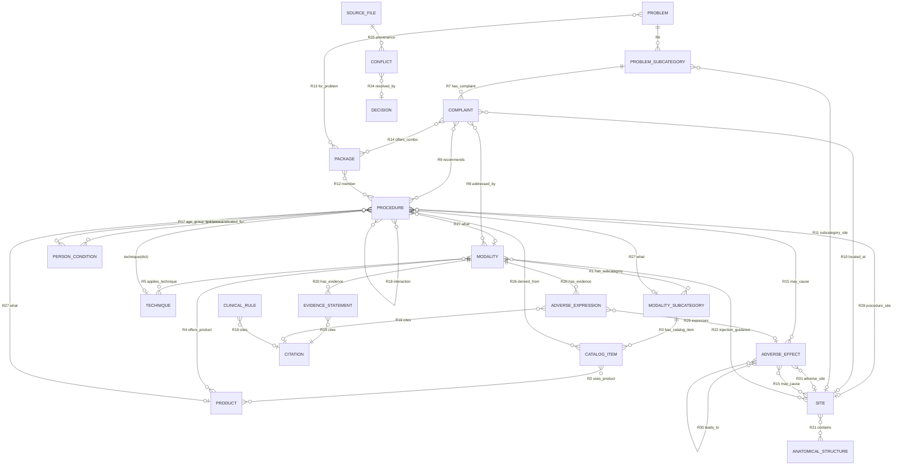

# ERD v2 — 피부과 시술 허브 메달리온 시맨틱 정의

작성 2026-11-04 · 상태 **초안(사용자 승인 전)** · 브론즈 스냅샷 2026-10-26 (+ 조사 산출물 step1 10-29) · 발주서 `erd-v2-brief.md` (v1 발주서 `erd-v1-brief.md` · v1.1 발주서 `erd-v1.1-brief.md` 의 입력·금지·기준·질문 기본값·처분 유지)

기계용 동본 `erd-v2.json` · 값 사전 `erd-v2-dictionaries.json` · 잎 키 행선지 `erd-v2-column-map.md` · 분해 규칙 실행 `erd-v1.1-resolve.py`(§9.2, v1.1 그대로 재실행) · 튜플 실측 `erd-v2-tuples.py`(결과 `erd-v2-tuples.json`, §9.5·§9.6) · 검산 `erd-v2-check.py` (결과 §10). v1·v1.1 산출물은 그대로 두었다. 변경 목록은 §11, v2 밖 관찰은 §12.

**v2 의 범위는 구조 변경 2건뿐이다.** ① 시술 축 = `catalog_item`(taxonomy 항목 그대로) 과 `procedure`(what × site × technique 튜플) 분리 ② 부작용 = 사건 사전 + 경과 사전 + `adverse_effect`(event × site × course 튜플) + `adverse_expression`(원문 표현) 분리. 그 밖은 v1.1 그대로. ERD 는 설계다 — 데이터는 안 고치고, 사전 값·동의어 추가는 이번 범위가 아니다(미등록은 목록만).

## 1. 범위와 층

| 층 | 무엇 | 규칙 |
|---|---|---|
| 브론즈 | 원장 21개 JSON 그대로 + `step1-products.json`(조사 산출물) | 바이트 보존·수정 금지. 파일 SHA256 이 식별자(§6 표). 원장 스냅샷 2026-10-26, step1 10-29 |
| 시맨틱 | 이 ERD + 값 사전 + 분해 규칙(참조 §1.3 · 튜플 §1.4/§1.5) | 문서. 사용자 승인이 정본 조건. 버전으로 개정(v1 → v1.1 → v2 → …) |
| 실버 | ERD 를 따르는 정규화 레코드 | **모든 값은 (파일, 잎 키 경로) 출처를 가진다.** 출처 없는 값 금지. 충돌은 둘 다 보관 |
| 골드 | 실버 조합 뷰 | 실버에 없는 사실을 만들지 않는다. 충돌 미판정 레코드 제외 |

지식은 원장 21개·컬럼 리포트·스캔 결과·v1/v1.1 산출물·`step1-products.json` 에서만 가져왔다. step2·step3·source-map·DATA-001·DEC-*·silver-*·`_archive/` 는 열지 않았다.

### 1.1 정규화(「같은 것」판정)와 식별자

- 정규화 `norm_v1`: unicodedata.normalize('NFKC') → str.casefold() → 모든 공백 문자 제거 (스페이스·탭·전각공백) → 그 외 문자(괄호·슬래시·하이픈·점 포함)는 그대로 둔다 — 괄호 안이 부위·용량·제품을 구분하는 경우가 있어 벗기지 않는다
- 정규화 결과가 완전히 같을 때만 「같은 것」. 괄호·조합 기호가 섞인 참조는 v1.1 분해 규칙(§1.3)으로 조각을 내어 조각 단위로 완전 일치만 본다. 유사도·추측 매칭은 하지 않는다.
- 식별자: `<PREFIX>-<sha256(canonical_key)[:10]>`. canonical_key 는 개체별(§2 각 표의 「식별자」). 개체별로 정의 (각 개체의 identity 항목). 원장 id·이름·코드는 전부 aliases 로 보존한다 (질문 4·6 기본값)
- survey 제품: step1 제품(origin=survey)은 PRD-<sha256(계열코드|norm(display_name))[:10]>, 계열 코드가 없으면 'survey' 를 계열 자리에. step1 ledger_id 는 alias
- **v2 튜플 식별자** — procedure: `PRC-<sha256(what_id|site_id|technique_id)[:10]>. what_id = MOD-/SUB-/PRD- 개체 id, site_id = site 개체 id 또는 'none', technique_id = 기법 사전 id 또는 'none'. 같은 튜플 = 같은 시술` · adverse_effect: `ADV-<sha256(event_id|site_id|course_id)[:10]>. event_id = 사건 사전 id, site_id = site 개체 id | 상대 부위 사전 id | 'none', course_id = 경과 사전 id('미상' 포함). 같은 튜플 = 같은 단위 부작용` · catalog_item: CAT-<sha256(계열 코드|norm(항목 이름))[:10]> — v1.1 procedure 의 식별자 규칙을 그대로 물려받는다 · adverse_expression: AEX-<sha256(출처 파일|잎 키 경로|레코드 위치|lang)[:10]> — 원문 레코드 하나가 표현 하나
- 「같은 것」 = 정규화 완전 일치(①) + 사전 동의어(②)만 자동. 참조 문자열은 §1.3 분해 규칙으로 조각내어 조각 단위로 같은 판정을 한다. 튜플은 조각이 가리키는 개체·사전 값의 조합이 같을 때 같은 것이다. 유사도·추측 매칭은 ⑦ 후보로만.

### 1.2 다이어그램 (개체·관계만)

### 1.3 참조 해결 — 결정론 분해 규칙 (v1.1 B · 그대로)

v1.1 의 세 단계를 **데이터**(`erd-v2.json → resolve_rules`)로 적고 `erd-v1.1-resolve.py` 가 그대로 실행한다. v2 에서 바뀐 것은 사전 순서의 「단위 시술」 자리가 `catalog_item_name`(분류 항목 이름 색인)을 읽는다는 것뿐이다(값·순서 동일). 유사도·추측은 없다.

1. **계열 확정** — 참조가 놓인 자리의 상위 계열 코드를 힌트로 쓴다. 없으면 조각 중 계열 사전(modality) 동의어에 닿는 첫 조각의 계열. 자리별 힌트: market-pricing.items[].name: `categories[].id` · synergy.links[].from/to: `노드 접두 M코드 (`M9-울쎄라` → M9)` · problem-packages.procedures[].name: `procedures[].category` · procedure-comparison.procedures[].name: `procedures[].category` · post-procedure-timeline.timelines[].name: `timelines[].category 의 M코드 부분` · treatment-sequence.sequence_order[].categories[]: ``M코드-라벨` 의 M코드` · pih-risk: `procedure_ref 가 id 이므로 분해 대상 아님(id 깊이 판정)` · step1-products.items[]: `family.code (M코드일 때만)` · 그 밖: `힌트 없음`. 코드 정규식 `^(M\d+)(?:[-_ ](.+))?$`
2. **이름 분해** — 괄호 안을 뗀다(`\(([^()]*)\)`). 조합 기호 `+` `/` `&` `,` 로 멤버를 나눈다. 조각마다 사전 순서 **product → modality_subcategory → procedure → site → spec → product_tier**(procedure = catalog_item_name) 로 완전 일치를 시도한다(계열 사전에 닿으면 kind=modality). 규격 정규식 `^(\d+(?:\.\d+)?)\s*(cc|ml|mL|바이알|줄|회|샷|개|부위|cm2|cm²|차|단위|U)(?:\s*(기준|이상|패키지|당|동시))?$` + unit 사전. 조각이 통째로 어느 사전에도 안 닿으면 공백으로 토큰을 나누고, 왼쪽부터 가장 긴 연속 토큰 구간을 사전 순서로 시도한다(정확 일치만). 남는 토큰 = 사전에 없는 조각. 계열이 확정되면 제품·하위분류·단위 시술은 그 계열 안에서 먼저 찾고, 없으면 전 계열에서 찾는다(다른 계열의 조합 멤버). 전 계열에서 둘 이상 계열에 닿으면 모호 → 사전에 없는 조각으로 센다. 한 조각이 단위 시술과 제품 양쪽에 닿으면 단위 시술(8-11 처분), 하위분류와 제품 양쪽이면 하위분류.
3. **조립** — 튜플 (family, primaries(product|modality_subcategory|procedure|modality), sites, specs, tiers). (a) resolved: 참조 전체가 하나의 사전 값과 통째로 일치(괄호·조합 없이) → 그 깊이(modality|subcategory|procedure|product)로 연결 (b) 분해 성공·항목 없음: 통째 일치는 아니지만 조각이 전부 사전에 닿음 → 「분해 성공·항목 없음」. 조합(튜플) 자체를 보존하고 가격·시너지는 그 조합에 단다. shape = single_primary_qualified(primary 1 + 부위/규격/등급) | combo(primary ≥2) | qualifier_only(primary 0) (c) unresolved: 사전에 없는 조각이 하나라도 있음 → unresolved_reference. 닿은 조각은 partial 로 기록

결과는 §9.2 에 v1 수치와 나란히(v1.1 과 같은 수치 — 사전 값이 같다). v2 에서 (a)·(b)·(c) 의 결과는 §1.4 의 튜플 규칙으로 한 번 더 내려가 procedure 튜플이 된다(§9.5.4).

### 1.4 시술 튜플 분해 규칙 (구조 변경 ① · 데이터 `erd-v2.json → tuple_rules.procedure` · `erd-v2-tuples.py` 실행)

- 입력: ① taxonomy.json modality[].subcategories[].items[].name 521 (family = 계열 코드, parent = 하위분류 id) · ② v1.1 §9.2 의 자유 텍스트 자리 전부(erd-v1.1-resolve.py slot_items — pih id·고민·부위·canonical_category·step1 제외) + market-pricing items[].name 122(③)
- 조각: v1.1 §1.3 2단계 그대로: 괄호 안을 떼고(outer / inner 묶음), 묶음 안을 조합 기호 `+ / & ,` 로 멤버로 나누고, 멤버마다 사전 순서 product → modality_subcategory → catalog_item_name → site → spec → product_tier 로 완전 일치. 통째로 안 닿으면 공백 토큰을 왼쪽부터 가장 긴 구간으로. 남는 토큰 = 미등록 조각. 분류 항목 자신의 이름은 catalog_item_name 색인에서 제외(자기 참조 금지)
- 조합: 같은 묶음(outer 또는 한 괄호) 안에서 조합 기호로 나뉜 멤버 중 primary(modality|modality_subcategory|product|catalog_item) 를 가진 멤버가 둘 이상 → package(kind=combo_ref). 멤버 각각을 튜플화. 괄호는 조합 기호가 아니다(괄호 안 멤버 하나는 수식 조각)
- what(필수): product 조각(계열 안 우선, 없으면 전 계열) → what=product / catalog_item 조각 → 그 항목의 튜플 what(분류 항목은 먼저 전부 튜플화) / modality_subcategory 조각 → what=modality_subcategory / modality 조각 또는 자리 힌트의 계열 → what=modality / 분류 항목(①)의 what: 이름(또는 outer 조각)이 제품 색인에 닿으면 product, 아니면 부모 하위분류(가장 구체적인 계열 층). 하위분류 라벨 조각이 따로 닿으면 그 하위분류 / primary 가 여럿이고 조합이 아니면 각 조각의 최종 what 종류로 product > modality_subcategory > modality 순(분류 항목 조각은 그 항목의 what 종류로 비교), 같은 종류면 텍스트 순서. 나머지는 extra_primaries 로 기록 / 조각이 계열 사전과 제품 색인 양쪽에 닿으면(보톡스·필러처럼 계열명이 제품명인 경우) what 은 product. 분류 항목(①)에서 타 계열·같은 계열의 계열 조각은 what 으로 쓰지 않는다(부모 하위분류가 더 구체적) — extra 로 기록 / primary 도 힌트도 없으면 튜플 불가(what 미확정 · 집계 「튜플 불가」)
- site: site 사전(21) 에 닿은 조각. 둘 이상이면 텍스트 순서의 첫 조각(나머지 extra_sites). 없으면 none. 사전에 없는 부위 같은 조각(전체얼굴 등)은 미등록 조각으로만 기록(어느 축인지 판정하지 않는다 — 사전 추가는 범위 밖)
- technique: 조각이 기법 사전(12)에 닿으면 그 값(fragment). 아니면 R5 계열→기법(procedure-profiles mechanism[]) 이 하나인 계열은 상속(inherited), 둘 이상인 계열은 none(상속 불가 · 어느 기법인지 추측 금지)
- 수식 조각: spec(규격)·product_tier·extra 조각은 튜플에 넣지 않고 참조 레코드(R9/R12/R18 target_label 등) 쪽에 남긴다
- 식별자: `PRC-sha256(what_id|site_id|technique_id)[:10]` · 상태: complete = 미등록 조각 0 · partial = 미등록 조각 ≥1 (튜플은 둘 다 만든다, what 이 확정됐으므로)

### 1.5 부작용 튜플 분해 규칙 (구조 변경 ② · 데이터 `erd-v2.json → tuple_rules.adverse`)

- 입력: complications.json categories[].complications[].name 65 (사전 뼈대 + 튜플 ①) · 표현: extracted/taxonomy safety.* 전 문구 · consent emergency_signs · literature adverse_effects statement(+patient_ko) 32 · post-procedure-timeline normal/abnormal/caution/emergency 전 문구
- 분해: 정규화 전 원문을 괄호로 outer/inner 묶음으로 나누고, 묶음 안을 `· / , + 및 또는 — -- :` 로 멤버로 나눈다. 멤버마다 공백 토큰을 왼쪽부터 가장 긴 구간으로 사전 순서 relative_site → site → course → adverse_event_type 에 완전 일치(정규화 norm_v1). 남는 토큰 = 미등록 조각
- 튜플: 멤버 안의 사건 조각 하나 = 튜플 하나(멤버에 사건이 둘이면 둘). site·course 는 멤버 → 같은 묶음 → outer 묶음 → (이름 전체에 그 축의 값이 하나뿐이면 그 값) 순으로 상속(멤버 자체 값이 우선). 없으면 site=none, course=미상
- 타임라인 normal: 타임라인 normal 문구는 사전 원천이 아니다. 같은 규칙으로 분해해 닿으면 R29 + R15(reaction_level=normal), 아니면 표현만
- 문헌: 문헌 레코드는 statement(영문)와 patient_ko(한글)를 각각 분해해 합집합 튜플에 닿는다(같은 레코드의 번역). patient_en/zh/ja 표현은 그 레코드의 튜플을 따라간다(basis 기록)
- 식별자: `ADV-sha256(event_id|site_id|course_id)[:10]` · 상태: complete = 문구에 미등록 조각 0 · partial = 미등록 조각 ≥1

## 2. 개체 목록

개체 21개 (v1.1 19 + `catalog_item` + `adverse_expression`). 발주서 최소 목록 11 + 추가 8(표시 ★). v2 에서 바뀐 개체: catalog_item(신설, v1.1 procedure 를 통째로) · procedure(튜플로 재정의) · adverse_effect(튜플로 재정의) · adverse_expression(신설) · evidence_statement(정의 문구) · technique·site(정의 문구) · package(kind combo_ref). 그 밖 15 개체는 v1.1 그대로.

### 2.1 `source_file` — 원장 파일 ★ (접두 `SRC`)

- 정의: 브론즈 스냅샷(2026-10-26)의 원장 JSON 21 + 조사 산출물 step1-products.json(10-29). 실버의 모든 값이 가리키는 출처의 뿌리.
- 식별자(canonical_key): 파일 SHA256
- aliases: 없음

| 속성 | 타입 | 필수 | 출처 원장 키 | 정규화·규칙 |
|---|---|---|---|---|
| file_name | str | ○ | (파생/ERD 정의) | 파일명 |
| sha256 | str | ○ | (파생/ERD 정의) | 바이트 해시 = 식별자 |
| bytes | int | ○ | (파생/ERD 정의) |  |
| snapshot_date | date | ○ | (파생/ERD 정의) | 2026-10-26 고정 |
| trust_tier | int(1~4) | ○ | (파생/ERD 정의) | §5 신뢰 순위 표 |
| kind | enum(ledger\|research_artifact) | ○ | (파생/ERD 정의) | 원장 21 = ledger, step1 = research_artifact |
| trust_basis | str | ○ | (파생/ERD 정의) | 순위 근거 키 |
| trust_flag | str\|null |  | (파생/ERD 정의) | 8-1 「AI 컨센서스 추정」 · step1 「허가 필드만 조건부 2」 |
| version | str\|null |  | `*:version` | 없는 파일(taxonomy·extracted·complications)은 null |
| updated | date\|null |  | `*:updated` |  |
| description | str\|null |  | `*:description` |  |
| method | str\|null |  | `*:consensus_method` `literature-evidence.json:source_method` |  |
| currency | str\|null |  | `market-pricing.json:currency` | 가격 단위 사전과 연결 |
| note | str\|null |  | `market-pricing.json:note` |  |

### 2.2 `modality` — 계열 (접두 `MOD`)

- 정의: 시술 계열 M1~M17. 정본 코드·이름은 taxonomy.json (질문 1).
- 식별자(canonical_key): taxonomy modality[].id (M 코드)
- aliases: extracted.json {code}.procedure_id (M1-BOTOX 형) · post-procedure-timeline id(timeline name 이 계열명과 정규화 일치할 때만) · products.json 섹션 키(category_id 가 단일 코드일 때)

| 속성 | 타입 | 필수 | 출처 원장 키 | 정규화·규칙 |
|---|---|---|---|---|
| code | str | ○ | `taxonomy.json:modality[].id` | M1~M17 |
| name | str | ○ | `taxonomy.json:modality[].category` | 정본 한글명 |
| name_en | str | ○ | `taxonomy.json:modality[].category_en` |  |
| group | dict:modality_group | ○ | `taxonomy.json:modality[].group` |  |
| overview | str[src] |  | `extracted.json:{code}.overview` `taxonomy.json:modality[].extracted.overview` | 두 출처 모두 보존, 다르면 충돌 (질문 2) |
| mechanism | str[src] |  | `extracted.json:{code}.mechanism` `taxonomy.json:modality[].extracted.mechanism` | 질문 2 |
| indications_primary | str[][src] |  | `extracted.json:{code}.indications.primary[]` `taxonomy.json:modality[].extracted.indications.primary[]` | 자유 텍스트. 주호소 연결은 사전 일치만 |
| indications_extended | str[][src] |  | `extracted.json:{code}.indications.extended[]` `taxonomy.json:modality[].extracted.indications.extended[]` |  |
| onset | str[src] |  | `extracted.json:{code}.onset_duration.onset` `taxonomy.json:modality[].extracted.onset_duration.onset` |  |
| peak | str[src] |  | `extracted.json:{code}.onset_duration.peak` `taxonomy.json:modality[].extracted.onset_duration.peak` |  |
| duration | str[src] |  | `extracted.json:{code}.onset_duration.duration` `taxonomy.json:modality[].extracted.onset_duration.duration` |  |
| aftercare | str[][src] |  | `extracted.json:{code}.aftercare[]` `taxonomy.json:modality[].extracted.aftercare[]` `procedure-profiles.json:profiles[].aftercare[]` |  |
| related_techniques | str[][src] |  | `extracted.json:{code}.related_techniques[]` `taxonomy.json:modality[].extracted.related_techniques[]` | 설명 문장. 기법 사전 연결은 하지 않음 |
| extracted_meta | obj |  | `extracted.json:{code}.source_type` `extracted.json:{code}.extracted_at` `extracted.json:{code}.guardrail_version` `extracted.json:{code}.updated` | extracted.json 레코드 메타. source(교과서)는 citation 개체 |
| patient_name | str |  | `patient-education.json:categories[].patient_name` | 환자용 별칭 — 사전 동의어로도 등록 |
| patient_simple_explanation | str |  | `patient-education.json:categories[].simple_explanation` |  |
| patient_how_it_works | str |  | `patient-education.json:categories[].how_it_works` |  |
| patient_duration_simple | str |  | `patient-education.json:categories[].duration_simple` |  |
| patient_pain_level | str |  | `patient-education.json:categories[].pain_level` |  |
| patient_downtime | str |  | `patient-education.json:categories[].downtime` |  |
| faq | obj |  | `patient-education.json:categories[].common_concerns[].q` `patient-education.json:categories[].common_concerns[].a` | FAQ = 속성 |
| mandatory_disclosures | str[] |  | `consent-checklist.json:categories[].mandatory_disclosures[]` | 고지문 = 속성 |
| floor_phase | dict:floor_phase |  | `procedure-profiles.json:profiles[].phase` |  |
| floor_phase_order | int |  | `procedure-profiles.json:profiles[].phaseOrder` | 중복값 있음(95·90·85) — 원문 보존 |
| flags | obj(bool) |  | `procedure-profiles.json:profiles[].hasProtein` `procedure-profiles.json:profiles[].hasHA` `procedure-profiles.json:profiles[].usesGel` `procedure-profiles.json:profiles[].createsWound` `procedure-profiles.json:profiles[].createsChannel` `procedure-profiles.json:profiles[].needsCleansing` |  |
| risk_scores | obj(int 0~3) |  | `procedure-profiles.json:profiles[].thermalLoad` `procedure-profiles.json:profiles[].bleedingRisk` `procedure-profiles.json:profiles[].swellingRisk` |  |
| anesthesia | dict:anesthesia |  | `procedure-profiles.json:profiles[].needsAnesthesia` |  |
| position | dict:position |  | `procedure-profiles.json:profiles[].position` |  |
| prep_time_min | int |  | `procedure-profiles.json:profiles[].prepTime` | 단위 분 |
| prep_notes | str |  | `procedure-profiles.json:profiles[].prepNotes` |  |
| duration_min | int |  | `procedure-profiles.json:profiles[].durationMin` | 단위 분 |
| duration_max | int |  | `procedure-profiles.json:profiles[].durationMax` | 단위 분 |
| moa_summary | str |  | `procedure-profiles.json:profiles[].moa_summary` |  |
| practical_notes | str[] |  | `procedure-profiles.json:profiles[].practicalNotes[]` |  |
| price_items | obj |  | `market-pricing.json:categories[].items[].name` `market-pricing.json:categories[].items[].unit` `market-pricing.json:categories[].items[].low` `market-pricing.json:categories[].items[].mid` `market-pricing.json:categories[].items[].high` | 가격 = 속성. label 의 시술/제품 연결은 사전 일치만(질문 11) |
| pih_note | str |  | `pih-risk.json:notes.{code}` | `M1_to_M7` 범위 키는 M1~M7 일곱 계열에 같은 값을 둔다(③ 형식 교정) |
| same_session_order | obj(order,phase,reason) |  | `treatment-sequence.json:sequence_order[].order` `treatment-sequence.json:sequence_order[].phase` `treatment-sequence.json:sequence_order[].reason` | categories[] 가 가리키는 계열/하위분류에 둔다. 미해결 참조는 ⑨ |
| evidence_statement_count | obj\|null |  | `literature-evidence.json:categories.{code}.moa` `literature-evidence.json:categories.{code}.adverse_effects` `literature-evidence.json:categories.{code}.effects` | 빈 배열 = null(미입력) (질문 13) |
| products_present | bool\|null |  | `taxonomy.json:modality[].products` | 빈 배열 = null(미입력) (질문 15) |

### 2.3 `modality_subcategory` — 계열 하위분류 ★ (접두 `SUB`)

- 정의: taxonomy modality[].subcategories 74. 계열 아래, 단위 시술 위의 분류 층. 참조 깊이 「하위분류」의 대상. 8-4 처분: 하위분류 label 64(distinct)는 기법이 아니라 이 개체의 label 로만 둔다. pih-risk subcategory 는 이 label 과 일치할 때만 연결.
- 식별자(canonical_key): 계열 코드 + 정규화 label
- aliases: taxonomy subcategories[].id · treatment-sequence/post-procedure-timeline 의 코드+라벨 합성값(실존 하위분류 id 와 일치할 때만, 질문 7)

| 속성 | 타입 | 필수 | 출처 원장 키 | 정규화·규칙 |
|---|---|---|---|---|
| code | str | ○ | `taxonomy.json:modality[].subcategories[].id` | M1-2 형 56 + 기타 18 형식 혼재 — alias 로도 보존 |
| label | str | ○ | `taxonomy.json:modality[].subcategories[].label` | 중복 `기타`·`추가` 는 계열 코드로 구분 |
| description | str\|null |  | `taxonomy.json:modality[].subcategories[].description` |  |
| items_present | bool\|null |  | `taxonomy.json:modality[].subcategories[].items` | 빈 배열 = null(미입력) |
| same_session_order | obj |  | (파생/ERD 정의) | treatment-sequence categories[] 가 하위분류를 가리킬 때(M15-도포·M15-팩) |

### 2.4 `catalog_item` — 분류 항목(taxonomy 항목) ★ (접두 `CAT`)

- 정의: taxonomy modality 항목 521 을 **있는 그대로** 담는 분류 항목. taxonomy 는 제품·마케팅명·부위 붙은 메뉴·기법이 섞인 분류 트리(10-27 결정)라 단위 시술이 아니다. v1.1 `procedure` 의 속성·alias·출처를 전부 여기로 옮겼다. 계층(계열→하위분류→항목)도 그대로(R1·R2). 각 항목은 분해 규칙(§1.4)으로 튜플 하나(procedure)로 내려가고 R26 derived_from 으로 매단다.
- 식별자(canonical_key): 계열 코드 + 정규화 항목 이름 (v1.1 procedure 와 같음)
- aliases: taxonomy items[].id (M1-2-1 · auto-M4-… · auto-63-… 전부) — 외부 참조 여부 무관하게 alias (질문 4). v1.1 PRC- id 는 CAT- 로 바뀐다(canonical_key 는 같음)

| 속성 | 타입 | 필수 | 출처 원장 키 | 정규화·규칙 |
|---|---|---|---|---|
| name | str | ○ | `taxonomy.json:modality[].subcategories[].items[].name` | 중복 `볼뉴머`(M4·M9) 는 계열 코드로 구분 → ⑦ 후보 |
| detail | str\|null |  | `taxonomy.json:modality[].subcategories[].items[].detail` | 빈 문자열 20 = null |
| overview | str |  | `taxonomy.json:modality[].subcategories[].items[].extracted.overview` |  |
| mechanism | str |  | `taxonomy.json:modality[].subcategories[].items[].extracted.mechanism` |  |
| indications_primary | str[] |  | `taxonomy.json:modality[].subcategories[].items[].extracted.indications.primary[]` |  |
| indications_extended | str[] |  | `taxonomy.json:modality[].subcategories[].items[].extracted.indications.extended[]` `taxonomy.json:modality[].subcategories[].items[].extracted.indications.secondary[]` | `secondary` 는 동의 키로 합친다(질문 20 기본값) — 재검토 §8-3 |
| onset | str |  | `taxonomy.json:modality[].subcategories[].items[].extracted.onset_duration.onset` |  |
| duration | str |  | `taxonomy.json:modality[].subcategories[].items[].extracted.onset_duration.duration` |  |
| peak | str |  | `taxonomy.json:modality[].subcategories[].items[].extracted.onset_duration.peak` `taxonomy.json:modality[].subcategories[].items[].extracted.onset_duration.peak_effect` | `peak_effect` 동의 키 (질문 20) |
| maintenance | str |  | `taxonomy.json:modality[].subcategories[].items[].extracted.onset_duration.maintenance` |  |
| aftercare | str[] |  | `taxonomy.json:modality[].subcategories[].items[].extracted.aftercare[]` |  |
| safety_note | str |  | `taxonomy.json:modality[].subcategories[].items[].extracted.safety.note` |  |
| is_marketing_name | bool |  | `taxonomy.json:modality[].subcategories[].items[].is_marketing_name` |  |
| ingredient_basis | str |  | `taxonomy.json:modality[].subcategories[].items[].ingredient_basis` |  |
| naming_caveat | str |  | `taxonomy.json:modality[].subcategories[].items[].naming_caveat` |  |
| tuple_status | enum(complete\|partial) | ○ | (파생/ERD 정의) | 분해 결과: complete = 미등록 조각 0, partial = 미등록 조각 ≥1 (procedure 는 둘 다 만든다, what 은 항상 확정) |
| unregistered_fragments | str[] |  | (파생/ERD 정의) | 이름 분해에서 어느 사전에도 닿지 않은 조각(공백 토큰 단위). 사전 추가는 이번 범위 아님 — 목록만 |

### 2.5 `procedure` — 단위 시술 (접두 `PRC`)

- 정의: **단위 시술 = 튜플 (what, site, technique)** — 무엇을 × 어디에 × 어떻게. what = modality | modality_subcategory | product 중 하나(필수): 분류 항목이 제품명이면 product, 아니면 가장 구체적인 계열 층. site = 부위 사전 값 | none(부위 미상 · 「전체얼굴」처럼 사전에 없는 조각은 미등록 조각 기록 + none). technique = 기법 사전 값 | 계열 기본값 상속(R5 계열→기법, 기법이 하나인 계열만) | none. 원천: ① 분류 항목 521 의 분해(§1.4) ② 자유 텍스트 참조(§9.2 자리 전부)의 분해 ③ market-pricing 메뉴 122. 같은 튜플 = 같은 시술이며 여러 분류 항목이 같은 튜플이면 R26 derived_from(1:N) 으로 매단다. 조합 기호(+·/)로 같은 묶음 안에 멤버(primary 조각)가 둘 이상이면 시술이 아니라 package(kind=combo_ref) 로 보내고 멤버 각각을 튜플화한다.
- 식별자(canonical_key): sha256(what_id|site_id|technique_id)[:10] — 튜플 자체가 식별자
- aliases: 없음 (분류 항목 id·이름은 catalog_item 의 alias. 참조 원문은 엣지 속성 target_label)

| 속성 | 타입 | 필수 | 출처 원장 키 | 정규화·규칙 |
|---|---|---|---|---|
| what_kind | enum(modality\|modality_subcategory\|product) | ○ | (파생/ERD 정의) | 무엇을. §1.4 what 규칙(제품 > 하위분류 > 계열 · 분류 항목 조각은 그 항목의 what 종류로 비교) |
| what_id | str | ○ | `taxonomy.json:modality[].subcategories[].items[].name` `market-pricing.json:categories[].items[].name` `synergy.json:links[].from` `synergy.json:links[].to` `problem-packages.json:problems[].complaints[].procedures[].name` `problem-packages.json:problems[].complaints[].combos[].combo[]` `problem-packages.json:problems[].complaints[].procedures[].products[]` `procedure-comparison.json:comparisons[].procedures[].name` `treatment-optimization.json:by_concern[].severity_levels[].optimal_combo[]` `treatment-optimization.json:by_age_group[].recommended_base[]` `treatment-optimization.json:by_age_group[].avoid[]` `treatment-optimization.json:by_age_group[].upgrade[]` `treatment-optimization.json:annual_plans[].schedule[].procedures[]` `treatment-sequence.json:sequence_order[].categories[]` `treatment-sequence.json:incompatible_same_day[].pair[]` `treatment-sequence.json:minimum_intervals[].from` `treatment-sequence.json:minimum_intervals[].to` `treatment-sequence.json:common_combos[].sequence[]` `post-procedure-timeline.json:timelines[].name` | MOD-/SUB-/PRD- 개체 id (R27). 출처 = 튜플을 만든 이름·참조 자리 |
| site_id | str\|none | ○ | (파생/ERD 정의) | site 개체 id 또는 none (R28). 부위 사전 21(v1.1 그대로, 공유 사전) |
| technique_id | dict:technique\|none | ○ | `procedure-profiles.json:profiles[].mechanism[]` | 기법 사전 값 또는 none. 이름 조각이 기법 사전에 닿으면 그 값, 아니면 계열의 R5 기법이 하나일 때만 상속, 둘 이상이면 none(상속 불가 · §9.5) |
| technique_origin | enum(fragment\|inherited\|none) | ○ | (파생/ERD 정의) | 기법이 어디서 왔는지 |
| origins | enum | ○ | (파생/ERD 정의) | ① ② ③ 중 이 튜플을 만든 원천(합집합) |
| status | enum(complete\|partial) | ○ | (파생/ERD 정의) | complete = 이 튜플을 만든 모든 이름이 미등록 조각 0 · partial = 하나라도 미등록 조각 있음 |
| unregistered_fragments | str[] |  | (파생/ERD 정의) | 이 튜플을 만든 이름들의 미등록 조각(합집합) |

### 2.6 `product` — 제품 (접두 `PRD`)

- 정의: 제조사 기준 제품(약제·기기·실). products.json 59 와 taxonomy modality[].products 59 를 합치되 어긋난 3건은 충돌 (질문 3). v1.1: step1-products.json 395 항목을 제품 속성(허가·공식명·허가권자·제조원·허가 상태·KPIC·출처 질의)의 **출처 키**로 편입한다. 원장 59 와의 대응은 B 분해 규칙(이름 분해·동의어)으로만 하고, 원장에 없는 제품은 origin=survey 로 올린다. step1 의 ledger_id·1_identity 같은 설계·식별자는 들이지 않는다(브론즈).
- 식별자(canonical_key): 계열 코드 + 정규화 제품명 (survey 제품은 계열 코드 없으면 'survey' + 정규화 display_name; 원장 대응이 되면 원장 제품 id 를 쓰고 step1 쪽은 alias)
- aliases: taxonomy products[].id (M1-P-0 형) · products.json 의 섹션 키(소속) · step1 ledger_id · step1 display_name/ledger_name/search_names

| 속성 | 타입 | 필수 | 출처 원장 키 | 정규화·규칙 |
|---|---|---|---|---|
| name | str | ○ | `products.json:*.products[].name` `taxonomy.json:modality[].products[].name` |  |
| name_en | str |  | `products.json:*.products[].name_en` `taxonomy.json:modality[].products[].name_en` |  |
| manufacturer | dict:manufacturer |  | `products.json:*.products[].manufacturer` `taxonomy.json:modality[].products[].manufacturer` | `-` 자리표시자 = null |
| country | dict:country |  | `products.json:*.products[].country` `taxonomy.json:modality[].products[].country` | `-` = null |
| mfds | bool\|null |  | `products.json:*.products[].mfds` `taxonomy.json:modality[].products[].mfds` | 신뢰 2(식약처). 키 없음/null = null(미입력) (질문 16) |
| ingredient_material | dict:ingredient_material |  | `products.json:*.products[].ingredient` `products.json:*.products[].material` `taxonomy.json:modality[].products[].ingredient` `taxonomy.json:modality[].products[].material` |  |
| product_type | dict:product_type |  | `products.json:*.products[].type` `taxonomy.json:modality[].products[].type` |  |
| note | str |  | `products.json:*.products[].note` `taxonomy.json:modality[].products[].note` | 스킨보톡스 「별도 제품 아님」 → not_separate_product 플래그 (질문 18) |
| not_separate_product | bool |  | (파생/ERD 정의) | note 가 「별도 제품 아님」일 때 true (질문 18) |
| legal_warning | str |  | `products.json:prp_exosome.products[].legal_warning` |  |
| regulatory_status | str |  | `products.json:prp_exosome.products[].regulatory_status` |  |
| overview | str |  | `taxonomy.json:modality[].products[].extracted.overview` |  |
| mechanism | str |  | `taxonomy.json:modality[].products[].extracted.mechanism` |  |
| indications_primary | str[] |  | `taxonomy.json:modality[].products[].extracted.indications.primary[]` |  |
| indications_extended | str[] |  | `taxonomy.json:modality[].products[].extracted.indications.secondary[]` | secondary → extended 동의 키 |
| onset | str |  | `taxonomy.json:modality[].products[].extracted.onset_duration.onset` |  |
| duration | str |  | `taxonomy.json:modality[].products[].extracted.onset_duration.duration` |  |
| peak | str |  | `taxonomy.json:modality[].products[].extracted.onset_duration.peak_effect` | peak_effect → peak |
| diffusion | str |  | `taxonomy.json:modality[].products[].extracted.onset_duration.diffusion` |  |
| aftercare | str[] |  | `taxonomy.json:modality[].products[].extracted.aftercare[]` |  |
| safety_note | str |  | `taxonomy.json:modality[].products[].extracted.safety.note` |  |
| contraindication_notes | str[] |  | `taxonomy.json:modality[].products[].extracted.safety.contraindications[]` | 병합 금기 문장(PDO+비가교HA). 시술↔시술 엣지로의 변환은 사람 결정 |
| origin | enum(ledger\|survey) | ○ | (파생/ERD 정의) | 원장 59 = ledger, step1 에만 있는 제품 = survey(원장 밖 · 현장/웹 조사) |
| survey_ledger_id | str\|null |  | `step1-products.json:items[].ledger_id` | step1 ledger_id 는 alias 로만 보존 (설계 식별자 아님) |
| survey_names | obj |  | `step1-products.json:items[].2_names.display_name` `step1-products.json:items[].2_names.ledger_name` `step1-products.json:items[].2_names.search_names[].name` `step1-products.json:items[].2_names.search_names[].lang` | aliases. 원장 대응은 이 이름들을 B 규칙으로 분해해 제품 사전 일치만 |
| survey_family_code | str\|null |  | `step1-products.json:items[].family.code` | B 규칙 1단계 계열 힌트. `현장 기기`·`원천 항목 없음` = null(계열 없음 → 이름의 계열 동의어로) |
| license_status | dict:license_status |  | `step1-products.json:items[].4_license.status` | 정상·확인 불가·허가 대상 아님·허가 취소(이력)·미허가·허가번호 미확인 — 「확인 불가」는 null 이 아니라 그 값 그대로. 신뢰 3(판정) |
| license_kind | dict:license_kind |  | `step1-products.json:items[].4_license.kind` | 의약품/의료기기. null = 미입력 |
| licenses | obj |  | `step1-products.json:items[].4_license.licenses[].license_no` `step1-products.json:items[].4_license.licenses[].kind` `step1-products.json:items[].4_license.licenses[].state` `step1-products.json:items[].4_license.licenses[].item` `step1-products.json:items[].4_license.licenses[].official_name` `step1-products.json:items[].4_license.licenses[].official_name_en` `step1-products.json:items[].4_license.licenses[].holder` `step1-products.json:items[].4_license.licenses[].holder_biz` `step1-products.json:items[].4_license.licenses[].manufacturer` `step1-products.json:items[].4_license.licenses[].date` `step1-products.json:items[].4_license.licenses[].pack_unit` `step1-products.json:items[].4_license.licenses[].models[]` `step1-products.json:items[].4_license.licenses[].model` `step1-products.json:items[].4_license.licenses[].company` `step1-products.json:items[].4_license.licenses[].key` `step1-products.json:items[].4_license.licenses[].source` `step1-products.json:items[].4_license.licenses[].kpic.drug_code` `step1-products.json:items[].4_license.licenses[].kpic.drug_name` `step1-products.json:items[].4_license.licenses[].kpic.ingredient` `step1-products.json:items[].4_license.licenses[].kpic.atc` | 허가 건(연결 허가). 잎 키 이름 그대로 보존. `source` 가 `식약처.*API` 에 맞는 건만 신뢰 2(식약처 공식), 아니면 3. kpic.drug_code = KPIC 코드 |
| license_history | obj |  | `step1-products.json:items[].4_license.history[].license_no` `step1-products.json:items[].4_license.history[].state` `step1-products.json:items[].4_license.history[].official_name` `step1-products.json:items[].4_license.history[].holder` `step1-products.json:items[].4_license.history[].date` | 취소·취하 이력 허가 건. 신뢰 규칙은 licenses 와 같다 |
| spec | obj |  | `step1-products.json:items[].5_spec.license[].license_no` `step1-products.json:items[].5_spec.license[].pack_unit` `step1-products.json:items[].5_spec.license[].content` `step1-products.json:items[].5_spec.license[].models_with_volume[]` `step1-products.json:items[].5_spec.license[].basis` `step1-products.json:items[].5_spec.license_spec[].license_key` `step1-products.json:items[].5_spec.license_spec[].pack_unit` `step1-products.json:items[].5_spec.license_spec[].content` | 허가 기준 포장단위·함량. 시장가 복사본(5_spec.market*)은 market-pricing.json 파생이라 브론즈 |
| companies | obj(manufacturer[], importer[], seller[], license_holder[], other[])(name, basis, original, role, period) |  | `step1-products.json:items[].6_companies.manufacturer[].name` `step1-products.json:items[].6_companies.manufacturer[].basis` `step1-products.json:items[].6_companies.importer[].name` `step1-products.json:items[].6_companies.importer[].basis` `step1-products.json:items[].6_companies.seller[].name` `step1-products.json:items[].6_companies.seller[].basis` `step1-products.json:items[].6_companies.license_holder[].name` `step1-products.json:items[].6_companies.other[].name` | 회사 역할별 이름 + 근거 문장. `근거 없음`·`해당 없음` 은 값 그대로(판정값, 신뢰 3). 제조사 사전(manufacturer)과는 정규화 일치만 |
| survey_note | str\|null |  | `step1-products.json:items[].note` | 조사 메모. 신뢰 3 |

### 2.7 `technique` — 기법 (접두 `TEC`)

- 정의: 에너지원·작용 방식 단위. 8-4 처분(사용자): 원장에서 기법 키(technique·mechanism·method 류)로 명시된 값만 — procedure-profiles `mechanism[]` 하나뿐이다. taxonomy 하위분류 label 은 `modality_subcategory` 개체로만, products energy_device `type` 은 product_type 사전으로만, pih-risk `subcategory` 는 하위분류 라벨 일치(R15.subcategory_label)로만. extracted `related_techniques[]` 는 키 이름에 technique 가 있으나 값이 설명 문장이라 기법 값이 아니다(v1 §2.2 유지). v2: procedure 튜플의 technique 축. 이름 조각이 닿지 않으면 R5 의 계열 기법을 상속하되 기법이 하나인 계열만(둘 이상이면 none).
- 식별자(canonical_key): 정규화 정준값
- aliases: 사전 동의어

| 속성 | 타입 | 필수 | 출처 원장 키 | 정규화·규칙 |
|---|---|---|---|---|
| name | str | ○ | `procedure-profiles.json:profiles[].mechanism[]` | 사전 technique 정준값(12) |

### 2.8 `site` — 부위 (접두 `SIT`)

- 정의: 해부학적 부위. 8-2 처분(사용자): anatomy-danger-zones 11 zone(뼈대) + taxonomy problem 하위분류 라벨 중 실제 부위만(10). 「(확장)」 51개 정준값은 없앴고, 부위가 아닌 41개는 고민 하위분류 라벨 사전(problem_subcategory_label)으로 재배치(§8-2 표). 복합 라벨(이마/관자놀이 등)은 `/` 분해로 뼈대 멤버를 기록한다. v2: procedure 튜플과 adverse_effect 튜플이 함께 쓰는 공유 사전(21 유지). 상대 부위(주사 부위·시술 부위)는 별도 사전 relative_site.
- 식별자(canonical_key): 정규화 정준값 (뼈대는 zone id)
- aliases: zone id(영문 슬러그) · 사전 동의어 · cc_group 원문(부위 라벨 10 에 한함)

| 속성 | 타입 | 필수 | 출처 원장 키 | 정규화·규칙 |
|---|---|---|---|---|
| name_ko | str | ○ | `anatomy-danger-zones.json:zones[].name_ko` |  |
| name_en | str |  | `anatomy-danger-zones.json:zones[].name_en` |  |
| site_kind | enum(backbone\|taxonomy_site_label) | ○ | (파생/ERD 정의) | anatomy 11 = backbone, taxonomy 부위 라벨 10 = taxonomy_site_label |
| members | site[]\|null |  | (파생/ERD 정의) | 복합 라벨을 `/` 로 분해해 모든 조각이 부위 사전에 닿을 때만 멤버(이마/관자놀이 → 이마, 관자놀이) |
| danger_level | dict:danger_level |  | `anatomy-danger-zones.json:zones[].danger_level` | danger_color·filler risk_level 과 같은 값 — color 는 사전 라벨 |
| safe_injection_depth | str |  | `anatomy-danger-zones.json:zones[].safe_injection_depth` |  |
| tissue_data | obj(키 보존) |  | `anatomy-danger-zones.json:zones[].tissue_data.*` | 부위마다 키가 다른 자유 구조 — 키 이름 그대로 보존. `rhinion_data_source` 는 citation 개체로도 등록 |
| clinical_pearls | str[] |  | `anatomy-danger-zones.json:zones[].clinical_pearls[]` |  |

### 2.9 `anatomical_structure` — 해부 구조(혈관·신경) ★ (접두 `ANA`)

- 정의: 부위 안의 혈관·신경. 같은 혈관이 여러 부위에 반복되므로 부위↔구조 엣지에 깊이·주행을 싣는다.
- 식별자(canonical_key): 정규화 이름(한글 (영문) 합성 원문)
- aliases: 원문 합성 이름

| 속성 | 타입 | 필수 | 출처 원장 키 | 정규화·규칙 |
|---|---|---|---|---|
| name_raw | str | ○ | `anatomy-danger-zones.json:zones[].vessels[].name` `anatomy-danger-zones.json:zones[].nerves[].name` | `한글 (영문)` 합성 — name_ko/name_en 분리는 ③ 형식 교정, 원문은 alias |
| kind | enum(vessel\|nerve) | ○ | (파생/ERD 정의) | 키 이름(vessels/nerves)에서 |
| nerve_type | dict:nerve_type |  | `anatomy-danger-zones.json:zones[].nerves[].type` | 신경만 |

### 2.10 `problem` — 고민 (접두 `PRB`)

- 정의: 환자 고민 축 P1~P14. 정본은 taxonomy problem (질문 12). 다른 파일의 분류(treatment-optimization concern·procedure-comparison id·combo-recipes goal·synergy target)는 동의어가 아니면 미해결 후보.
- 식별자(canonical_key): taxonomy problem[].id
- aliases: problem-packages/problem-combos problem 이름(코드 연결)

| 속성 | 타입 | 필수 | 출처 원장 키 | 정규화·규칙 |
|---|---|---|---|---|
| code | str | ○ | `taxonomy.json:problem[].id` |  |
| name | str | ○ | `taxonomy.json:problem[].category` |  |
| name_en | str | ○ | `taxonomy.json:problem[].category_en` |  |

### 2.11 `problem_subcategory` — 고민 하위분류 ★ (접두 `PSB`)

- 정의: taxonomy problem[].subcategories 53. 8-2 처분: 라벨 53 은 사전 problem_subcategory_label 의 정준값이고, problem-packages cc_group 은 (problem_id, label) 로 이 개체에 결합한다(R7 그룹). 부위인 라벨 10 은 부위 사전에도 있다(R11).
- 식별자(canonical_key): 고민 코드 + 정규화 label
- aliases: subcategories[].id

| 속성 | 타입 | 필수 | 출처 원장 키 | 정규화·규칙 |
|---|---|---|---|---|
| code | str | ○ | `taxonomy.json:problem[].subcategories[].id` | P1-1 형. problem-combos packages[].id 와 문자열 충돌 — 그쪽은 패키지 alias 로만 (질문 6) |
| label | str | ○ | `taxonomy.json:problem[].subcategories[].label` |  |

### 2.12 `complaint` — 주호소(cc) (접두 `CMP`)

- 정의: 고민 하위분류 아래의 구체 호소(코필러·코실리프팅 …). taxonomy problem 항목 117 이 원천, problem-packages complaints 115 는 이름 일치가 유일할 때만 자동 결합 (질문 9).
- 식별자(canonical_key): 고민 코드 + 하위분류 label + 정규화 이름
- aliases: taxonomy items[].id (auto-#-timestamp)

| 속성 | 타입 | 필수 | 출처 원장 키 | 정규화·규칙 |
|---|---|---|---|---|
| name | str | ○ | `taxonomy.json:problem[].subcategories[].items[].name` `problem-packages.json:problems[].complaints[].cc` | 중복 6 (아그네스·스킨보톡스·프락셔널레이저·니들RF·서브시전·브이올렛) = 충돌 |
| detail | str |  | `taxonomy.json:problem[].subcategories[].items[].detail` `problem-packages.json:problems[].complaints[].cc_detail` |  |
| alternatives | str[] |  | `problem-packages.json:problems[].complaints[].alternatives[]` | 대안 문장 = 속성 |
| combos_present | bool\|null |  | `problem-packages.json:problems[].complaints[].combos` | 빈 배열 = null |
| modality_ref_present | bool\|null |  | `taxonomy.json:problem[].subcategories[].items[].modality_ref` | 빈 배열 26 = null → 질문 14 두 묶음 |
| cc_group_raw | str |  | `problem-packages.json:problems[].complaints[].cc_group` | 원문 보존. 하위분류 결합은 사전 problem_subcategory_label (problem_id, label) 일치 |

### 2.13 `package` — 묶음(패키지·조합·비교·플랜) (접두 `PKG`)

- 정의: 단위 시술(또는 계열) 묶음. 상담 패키지·레시피·세션 조합·cc 조합·중증도별 최적 조합·연간 플랜·비교표를 `kind` 로 구분한다. 멤버는 R12 엣지. id 는 새로 발급하고 옛 id 는 alias (질문 6). v2: 분해에서 조합 기호로 멤버가 둘 이상인 참조는 kind=combo_ref 패키지로 보내고 멤버 각각을 procedure 튜플로 R12 에 매단다.
- 식별자(canonical_key): kind + 출처 파일 + 정규화 이름(+ 상위 키: 고민/주호소/연령)
- aliases: problem-combos packages[].id (P1-1 …) · combo-recipes id (R1~R7) · procedure-comparison id (lifting …)

| 속성 | 타입 | 필수 | 출처 원장 키 | 정규화·규칙 |
|---|---|---|---|---|
| kind | enum(consult_package\|recipe\|session_combo\|cc_combo\|optimization_plan\|annual_plan\|comparison\|combo_ref) | ○ | (파생/ERD 정의) | 출처 파일별 고정. v2: combo_ref = 이름 분해에서 조합 기호(+·/)로 멤버가 둘 이상인 참조(멤버는 각각 procedure 튜플, R12) |
| name | str | ○ | `problem-combos.json:combos[].packages[].name` `combo-recipes.json:recipes[].name` `treatment-sequence.json:common_combos[].name` `problem-packages.json:problems[].complaints[].combos[].name` `treatment-optimization.json:annual_plans[].plan_name` `procedure-comparison.json:comparisons[].title` | optimization_plan 은 concern+level 합성 이름 |
| subtitle | str |  | `combo-recipes.json:recipes[].subtitle` `procedure-comparison.json:comparisons[].subtitle` |  |
| tier | dict:package_tier |  | `problem-combos.json:combos[].packages[].tier` `problem-combos.json:combos[].packages[].tierLabel` `combo-recipes.json:recipes[].intensity` |  |
| product_tier | dict:product_tier |  | `problem-combos.json:combos[].packages[].productTier` |  |
| purpose | dict:purpose_label |  | `combo-recipes.json:recipes[].goal` |  |
| products_text | str |  | `problem-combos.json:combos[].packages[].products[]` | 조합 문장 1개. 제품 사전 일치는 자동 아님(합성 문장) |
| price_range | str |  | `problem-combos.json:combos[].packages[].priceRange` `treatment-optimization.json:annual_plans[].annual_budget_range` | 원문 보존 + 단위 정규화(질문 22) |
| expected_result | str |  | `problem-combos.json:combos[].packages[].expectedResult` `combo-recipes.json:recipes[].expectedResults` |  |
| sales_pitch | str |  | `problem-combos.json:combos[].packages[].salesPitch` |  |
| upsell_hook | str |  | `problem-combos.json:combos[].packages[].upsellHook` |  |
| clinical_rationale | str |  | `problem-combos.json:combos[].packages[].clinicalRationale` `treatment-optimization.json:by_concern[].severity_levels[].rationale` |  |
| risk_benefit | str |  | `problem-combos.json:combos[].packages[].riskBenefit` |  |
| patient_explanation | str |  | `combo-recipes.json:recipes[].patientExplanation` |  |
| analogy | str |  | `combo-recipes.json:recipes[].analogy` |  |
| repeat_cycle | str |  | `combo-recipes.json:recipes[].repeatCycle` |  |
| follow_up | obj |  | `combo-recipes.json:recipes[].followUp[].week` `combo-recipes.json:recipes[].followUp[].action` |  |
| sequence_text | str |  | `treatment-optimization.json:by_concern[].severity_levels[].sequence` |  |
| expected_sessions | str |  | `treatment-optimization.json:by_concern[].severity_levels[].expected_sessions` |  |
| total_duration | str |  | `treatment-optimization.json:by_concern[].severity_levels[].total_duration` `treatment-sequence.json:common_combos[].total_time` |  |
| evidence_level | dict:evidence_level |  | `treatment-optimization.json:by_concern[].severity_levels[].evidence_level` |  |
| contraindicated_combos | str[]\|null |  | `treatment-optimization.json:by_concern[].severity_levels[].contraindicated_combos[]` `treatment-optimization.json:by_concern[].severity_levels[].contraindicated_combos` | 빈 배열 = null. 시술↔시술 엣지 변환은 사전 일치만 |
| caveats | str[] |  | `treatment-optimization.json:by_concern[].severity_levels[].caveats[]` |  |
| age_group | dict:age_group |  | `treatment-optimization.json:annual_plans[].age_group` |  |
| focus | str |  | `treatment-optimization.json:annual_plans[].focus` |  |
| note | str |  | `treatment-sequence.json:common_combos[].note` |  |
| evidence_notes | str[] |  | `procedure-comparison.json:comparisons[].evidence_notes[]` |  |

### 2.14 `adverse_effect` — 부작용(합병증) (접두 `ADV`)

- 정의: **단위 부작용 = 튜플 (event, site, course)**. event = 사건 사전(adverse_event_type) 값, site = 공유 부위 사전 21 | 상대 부위 사전(주사 부위·시술 부위) | none, course = 경과 사전(일시·지연·영구·재발·미상). v1.1 은 정규화 문자열이 식별자라 「멍」 4표기가 4개체였다 — v2 는 같은 튜플 = 같은 단위 부작용. 원인 시술은 튜플에 넣지 않고 R15 may_cause 로만 연결하며 등급·빈도·발생 시기·지속·대처·예방·위험 요인·예상/이상/주의/응급 표시는 전부 R15 엣지 속성(v1.1 과 같음). 원문 문장·문구·환자 설명은 adverse_expression 이 담고 R29 expresses 로 닿는다. 「혈관 폐색」→「피부 괴사」같은 인과는 R30 leads_to.
- 식별자(canonical_key): sha256(event_id|site_id|course_id)[:10] — 튜플 자체가 식별자
- aliases: 없음 (표면형은 사건 사전 동의어 또는 adverse_expression.text)

| 속성 | 타입 | 필수 | 출처 원장 키 | 정규화·규칙 |
|---|---|---|---|---|
| event | dict:adverse_event_type | ○ | `complications.json:categories[].complications[].name` | 사건 사전 값. 뼈대 = complications.json 65 이름의 분해. 사전에 없는 조각은 미등록 |
| site_ref_kind | enum(site\|relative\|none) | ○ | (파생/ERD 정의) | site 개체(R31) \| 상대 부위 사전(relative_site) \| none |
| site_ref_id | str\|none | ○ | (파생/ERD 정의) | site 개체 id 또는 relative_site 사전 id 또는 none |
| course | dict:course | ○ | `complications.json:categories[].complications[].name` `complications.json:categories[].complications[].duration` | 이름 수식어(일시적·지연성·가역적·영구·재발)에서. 없으면 「미상」 |
| status | enum(complete\|partial) | ○ | (파생/ERD 정의) | 이 튜플을 만든 문구가 전부 미등록 조각 0 이면 complete |
| unregistered_fragments | str[] |  | (파생/ERD 정의) | 이 튜플을 만든 문구들의 미등록 조각(합집합) |
| origins | str[] | ○ | `complications.json:categories[].complications[].name` `literature-evidence.json:categories.{code}.adverse_effects[].statement` `literature-evidence.json:categories.{code}.adverse_effects[].patient_ko` `consent-checklist.json:categories[].emergency_signs[]` `post-procedure-timeline.json:timelines[].phases[].normal[]` `post-procedure-timeline.json:timelines[].phases[].abnormal[]` `post-procedure-timeline.json:timelines[].phases[].caution[]` `post-procedure-timeline.json:timelines[].phases[].emergency[]` `extracted.json:{code}.safety.common[]` `extracted.json:{code}.safety.uncommon[]` `extracted.json:{code}.safety.serious[]` `extracted.json:{code}.safety.emergency[]` `taxonomy.json:modality[].extracted.safety.common[]` `taxonomy.json:modality[].extracted.safety.uncommon[]` `taxonomy.json:modality[].extracted.safety.serious[]` `taxonomy.json:modality[].subcategories[].items[].extracted.safety.common[]` `taxonomy.json:modality[].subcategories[].items[].extracted.safety.serious[]` `taxonomy.json:modality[].subcategories[].items[].extracted.safety.common_adverse_effects[]` `taxonomy.json:modality[].subcategories[].items[].extracted.safety.serious_adverse_effects[]` `taxonomy.json:modality[].subcategories[].items[].extracted.safety.long_term[]` `taxonomy.json:modality[].products[].extracted.safety.common[]` `taxonomy.json:modality[].products[].extracted.safety.serious[]` `taxonomy.json:modality[].products[].extracted.safety.common_side_effects[]` | 이 튜플을 만든 문구의 출처 잎 키(합집합) |

### 2.15 `adverse_expression` — 부작용 표현(원문) ★ (접두 `AEX`)

- 정의: 문헌 부작용 문장(32) · 시술 후 타임라인 문구 · consent/extracted 응급 징후 · 환자 설명(4개 언어) · extracted/taxonomy safety 문구를 담는 원문 레코드. 분해 규칙(§1.5)으로 튜플에 닿으면 R29 expresses 로 연결, 아니면 null + 미등록 조각 기록. v1.1 evidence_statement 중 adverse_effects 섹션 분(v1.1 adverse_effect kind=literature_claim)은 여기로 옮겼고 moa/effects 섹션은 evidence_statement 그대로. 타임라인 normal 문구는 사건 사전의 원천이 아니며 표현(kind=symptom_phrase)으로만 두고 R15 엣지 속성 reaction_level=normal 로 표시한다.
- 식별자(canonical_key): 출처 파일 + 잎 키 경로 + 레코드 위치 + lang
- aliases: 없음

| 속성 | 타입 | 필수 | 출처 원장 키 | 정규화·규칙 |
|---|---|---|---|---|
| kind | enum(evidence_statement\|symptom_phrase\|emergency_sign\|patient_text\|safety_phrase) | ○ | (파생/ERD 정의) | 출처 키에서: literature adverse_effects statement → evidence_statement · timeline 문구 → symptom_phrase · consent emergency_signs → emergency_sign · literature patient_* → patient_text · extracted/taxonomy safety.* → safety_phrase |
| text | str | ○ | `literature-evidence.json:categories.{code}.adverse_effects[].statement` `post-procedure-timeline.json:timelines[].phases[].normal[]` `post-procedure-timeline.json:timelines[].phases[].abnormal[]` `post-procedure-timeline.json:timelines[].phases[].caution[]` `post-procedure-timeline.json:timelines[].phases[].emergency[]` `consent-checklist.json:categories[].emergency_signs[]` `extracted.json:{code}.safety.common[]` `extracted.json:{code}.safety.uncommon[]` `extracted.json:{code}.safety.serious[]` `extracted.json:{code}.safety.emergency[]` `taxonomy.json:modality[].extracted.safety.common[]` `taxonomy.json:modality[].extracted.safety.uncommon[]` `taxonomy.json:modality[].extracted.safety.serious[]` `taxonomy.json:modality[].subcategories[].items[].extracted.safety.common[]` `taxonomy.json:modality[].subcategories[].items[].extracted.safety.serious[]` `taxonomy.json:modality[].subcategories[].items[].extracted.safety.common_adverse_effects[]` `taxonomy.json:modality[].subcategories[].items[].extracted.safety.serious_adverse_effects[]` `taxonomy.json:modality[].subcategories[].items[].extracted.safety.long_term[]` `taxonomy.json:modality[].products[].extracted.safety.common[]` `taxonomy.json:modality[].products[].extracted.safety.serious[]` `taxonomy.json:modality[].products[].extracted.safety.common_side_effects[]` | 원문 그대로(브론즈 바이트). 각주 `[n]`·언어 섞임 정제는 실버 빌더(질문 19) |
| patient_text | str |  | `literature-evidence.json:categories.{code}.adverse_effects[].patient_ko` `literature-evidence.json:categories.{code}.adverse_effects[].patient_en` `literature-evidence.json:categories.{code}.adverse_effects[].patient_zh` `literature-evidence.json:categories.{code}.adverse_effects[].patient_ja` | kind=patient_text 는 언어별로 표현 레코드 하나(lang). 같은 문헌 레코드의 statement 표현과 같은 튜플에 닿는다(§1.5 문헌 규칙) |
| lang | enum(ko\|en\|zh\|ja)\|null |  | (파생/ERD 정의) | patient_text 만. 그 밖은 null(원문 언어 판정 안 함) |
| accuracy_score | int |  | `literature-evidence.json:categories.{code}.adverse_effects[].accuracy_score` | v1.1 adverse_effect 에서 이동 |
| accuracy_note | str |  | `literature-evidence.json:categories.{code}.adverse_effects[].accuracy_note` | v1.1 adverse_effect 에서 이동 |
| added_at | date |  | `literature-evidence.json:categories.{code}.adverse_effects[].added_at` | v1.1 adverse_effect 에서 이동 |
| modality_code | str\|null |  | (파생/ERD 정의) | 문구가 놓인 자리의 계열(코드 키·categories[].id·timeline category). R15 엣지의 from 끝 힌트 |
| context | obj(frequency_class\|reaction_level\|period\|phase_label\|item_name\|product_name) |  | (파생/ERD 정의) | 문구가 놓인 자리의 분류 키(동의 키 정규화 ③). 튜플에 닿으면 R15 엣지 속성으로도 복사, 못 닿으면 여기만 |
| citation_present | bool |  | (파생/ERD 정의) | 문헌 표현은 R19 cites |
| match_status | enum(linked\|unlinked) | ○ | (파생/ERD 정의) | R29 가 있으면 linked |
| unregistered_fragments | str[] |  | (파생/ERD 정의) | 분해에서 어느 사전에도 닿지 않은 조각 |

### 2.16 `person_condition` — 사람 조건(금기·주의·확인·연령) (접두 `CND`)

- 정의: 시술 대상자의 상태·병력·복용·체질·연령대. 금기(절대/상대)·동의서 금기·시술 전 확인 항목·연령대 권고가 모두 이 개체와의 엣지.
- 식별자(canonical_key): 정규화 이름
- aliases: pre-procedure universal_checks[].id (allergies …)

| 속성 | 타입 | 필수 | 출처 원장 키 | 정규화·규칙 |
|---|---|---|---|---|
| name | str | ○ | `consent-checklist.json:categories[].contraindications[]` `extracted.json:{code}.contraindications.absolute[]` `extracted.json:{code}.contraindications.relative[]` `taxonomy.json:modality[].extracted.contraindications.absolute[]` `taxonomy.json:modality[].extracted.contraindications.relative[]` `taxonomy.json:modality[].subcategories[].items[].extracted.safety.contraindications[]` `pre-procedure-checklist.json:universal_checks[].label` `pre-procedure-checklist.json:category_specific[].checks[].label` `treatment-optimization.json:by_age_group[].age` | 반복 문자열(임신 및 수유 중 15회)은 하나로 병합 |
| kind | enum(condition\|check\|age_group) | ○ | (파생/ERD 정의) |  |
| description | str |  | `pre-procedure-checklist.json:universal_checks[].description` |  |
| universal | bool |  | (파생/ERD 정의) | pre-procedure universal_checks = true (계열 엣지 없이 전 계열 적용) |
| universal_level | dict:condition_level |  | `pre-procedure-checklist.json:universal_checks[].type` |  |
| maintenance | str |  | `treatment-optimization.json:by_age_group[].maintenance` | 연령대만 |
| annual_focus | str |  | `treatment-optimization.json:by_age_group[].annual_focus` | 연령대만 |
| note | str |  | `treatment-optimization.json:by_age_group[].note` |  |

### 2.17 `citation` — 문헌 인용 (접두 `CIT`)

- 정의: 논문·URL·교과서·가이드라인 문자열. literature-evidence 인용은 PMID 로 동일성 판정(20종/119회).
- 식별자(canonical_key): pmid > doi > url > 정규화 원문
- aliases: 없음

| 속성 | 타입 | 필수 | 출처 원장 키 | 정규화·규칙 |
|---|---|---|---|---|
| kind | enum(pubmed\|url\|textbook\|guideline_text) | ○ | (파생/ERD 정의) |  |
| pmid | str |  | `literature-evidence.json:categories.{code}.moa[].citations[].pmid` `literature-evidence.json:categories.{code}.adverse_effects[].citations[].pmid` `literature-evidence.json:categories.{code}.effects[].citations[].pmid` |  |
| doi | str |  | `literature-evidence.json:categories.{code}.moa[].citations[].doi` `literature-evidence.json:categories.{code}.adverse_effects[].citations[].doi` `literature-evidence.json:categories.{code}.effects[].citations[].doi` |  |
| pmc | str |  | `literature-evidence.json:categories.{code}.moa[].citations[].pmc` `literature-evidence.json:categories.{code}.adverse_effects[].citations[].pmc` `literature-evidence.json:categories.{code}.effects[].citations[].pmc` |  |
| oa_url | str |  | `literature-evidence.json:categories.{code}.moa[].citations[].oa_url` `literature-evidence.json:categories.{code}.adverse_effects[].citations[].oa_url` `literature-evidence.json:categories.{code}.effects[].citations[].oa_url` |  |
| title | str |  | `literature-evidence.json:categories.{code}.moa[].citations[].title` `literature-evidence.json:categories.{code}.adverse_effects[].citations[].title` `literature-evidence.json:categories.{code}.effects[].citations[].title` |  |
| authors | str |  | `literature-evidence.json:categories.{code}.moa[].citations[].authors` `literature-evidence.json:categories.{code}.adverse_effects[].citations[].authors` `literature-evidence.json:categories.{code}.effects[].citations[].authors` |  |
| journal | str |  | `literature-evidence.json:categories.{code}.moa[].citations[].journal` `literature-evidence.json:categories.{code}.adverse_effects[].citations[].journal` `literature-evidence.json:categories.{code}.effects[].citations[].journal` |  |
| year | int |  | `literature-evidence.json:categories.{code}.moa[].citations[].year` `literature-evidence.json:categories.{code}.adverse_effects[].citations[].year` `literature-evidence.json:categories.{code}.effects[].citations[].year` |  |
| url | str |  | `complications.json:categories[].complications[].evidence` `step1-products.json:items[].evidence[].urls[]` `step1-products.json:items[].4_license.distribution_sources[].url` | `;` 로 이어진 복수 URL 은 분리(③) — 원문은 브론즈. step1 evidence/유통 근거 URL 도 kind=url |
| text | str |  | `extracted.json:{code}.source` `treatment-optimization.json:combination_rules[].evidence` `treatment-sequence.json:minimum_intervals[].source` `anatomy-danger-zones.json:zones[].tissue_data.rhinion_data_source` `step1-products.json:items[].4_license.distribution_sources[].text` | 교과서 장·가이드라인 문자열. `일반 의학 지식`·`임상 가이드` 도 값 그대로 |

### 2.18 `evidence_statement` — 문헌 근거 문장 ★ (접두 `EVS`)

- 정의: literature-evidence 의 moa·effects 문장(87). 인용 개체와 연결되고 환자용 4개 국어 문장을 가진다. adverse_effects 문장(32)은 v2 에서 adverse_expression(kind=evidence_statement)으로 간다.
- 식별자(canonical_key): 계열 코드 + kind + 정규화 statement
- aliases: 없음

| 속성 | 타입 | 필수 | 출처 원장 키 | 정규화·규칙 |
|---|---|---|---|---|
| kind | enum(moa\|effect) | ○ | (파생/ERD 정의) |  |
| statement | str | ○ | `literature-evidence.json:categories.{code}.moa[].statement` `literature-evidence.json:categories.{code}.effects[].statement` |  |
| patient_text | obj(ko,en,zh,ja) |  | `literature-evidence.json:categories.{code}.moa[].patient_ko` `literature-evidence.json:categories.{code}.moa[].patient_en` `literature-evidence.json:categories.{code}.moa[].patient_zh` `literature-evidence.json:categories.{code}.moa[].patient_ja` `literature-evidence.json:categories.{code}.effects[].patient_ko` `literature-evidence.json:categories.{code}.effects[].patient_en` `literature-evidence.json:categories.{code}.effects[].patient_zh` `literature-evidence.json:categories.{code}.effects[].patient_ja` | 질문 19 정제 |
| accuracy_score | int |  | `literature-evidence.json:categories.{code}.moa[].accuracy_score` `literature-evidence.json:categories.{code}.effects[].accuracy_score` |  |
| accuracy_note | str |  | `literature-evidence.json:categories.{code}.moa[].accuracy_note` `literature-evidence.json:categories.{code}.effects[].accuracy_note` |  |
| added_at | date |  | `literature-evidence.json:categories.{code}.moa[].added_at` `literature-evidence.json:categories.{code}.effects[].added_at` |  |

### 2.19 `clinical_rule` — 임상 규칙 문장 ★ (접두 `RUL`)

- 정의: 특정 개체에 자동으로 붙일 수 없는 원칙·규칙·안전 사실 문장(29). 사람이 결정 개체로 시술 쌍·부작용에 연결할 때까지 독립 개체로 둔다.
- 식별자(canonical_key): kind + 정규화 문장
- aliases: 없음

| 속성 | 타입 | 필수 | 출처 원장 키 | 정규화·규칙 |
|---|---|---|---|---|
| kind | enum(principle\|combination_rule\|critical_safety_fact) | ○ | (파생/ERD 정의) |  |
| text | str | ○ | `treatment-sequence.json:principles[]` `treatment-optimization.json:optimization_principles[]` `treatment-optimization.json:combination_rules[].rule` `anatomy-danger-zones.json:critical_safety_facts.minimum_filler_for_blindness` `anatomy-danger-zones.json:critical_safety_facts.blindness_highest_risk_zones` `anatomy-danger-zones.json:critical_safety_facts.mechanism` `anatomy-danger-zones.json:critical_safety_facts.caveat` | critical_safety_facts 는 키 이름을 topic 으로 |
| topic | str |  | (파생/ERD 정의) | critical_safety_facts 의 키 이름 |
| detail | str |  | `treatment-optimization.json:combination_rules[].detail` |  |
| consensus | dict:consensus |  | `treatment-optimization.json:combination_rules[].consensus` |  |
| priority | dict:rule_priority |  | `treatment-optimization.json:combination_rules[].priority` |  |

### 2.20 `conflict` — 충돌 (접두 `CFL`)

- 정의: 같은 사실에 원장 값이 다르거나(⑥), 유사도만 높은 중복(⑦), 사전 밖 값(⑧), 참조 깨짐·미해결(⑨)을 기계가 남기는 레코드. 실버에 둘 다 보관, 골드 제외.
- 식별자(canonical_key): 대상 id + 속성/엣지 + 출처 집합 해시
- aliases: 없음

| 속성 | 타입 | 필수 | 출처 원장 키 | 정규화·규칙 |
|---|---|---|---|---|
| kind | enum(value_conflict\|duplicate_candidate\|unregistered_value\|unresolved_reference) | ○ | (파생/ERD 정의) | ⑥⑦⑧⑨ |
| target_type | str | ○ | (파생/ERD 정의) | 개체 키 또는 관계 번호 |
| target_id | str\|null | ○ | (파생/ERD 정의) | 미해결 참조는 null |
| field | str | ○ | (파생/ERD 정의) |  |
| values | obj | ○ | `step1-products.json:items[].6_companies.conflicts[].field` `step1-products.json:items[].6_companies.conflicts[].license` `step1-products.json:items[].6_companies.conflicts[].other` `step1-products.json:items[].6_companies.conflicts[].source` `step1-products.json:items[].6_companies.conflicts[].note` | step1 6_companies.conflicts(12) 는 허가 값 vs 다른 출처 값의 value_conflict 로 그대로 적재(「덮어쓰지 않음」 유지) |
| resolution_rule | str | ○ | (파생/ERD 정의) | 적용 시도한 규칙(①~⑤) 과 결과 |
| status | enum(open\|resolved\|dismissed) | ○ | (파생/ERD 정의) | 사람 판정 전 open |
| decision_id | str\|null |  | (파생/ERD 정의) |  |

### 2.21 `decision` — 결정 (접두 `DEC`)

- 정의: 사람이 판정한 레코드(무엇을·왜·누가·언제·적용 대상). 원장은 고치지 않고 결정만 쌓는다. taxonomy 안의 교정 메모 키는 원장 내 결정 레코드로 적용하고 여기 기록한다 (질문 23).
- 식별자(canonical_key): 적용일 + 일련
- aliases: 없음

| 속성 | 타입 | 필수 | 출처 원장 키 | 정규화·규칙 |
|---|---|---|---|---|
| kind | enum(conflict_resolution\|ledger_correction_note\|reclassification\|verification_hold\|canonical_mapping\|scope_review) | ○ | (파생/ERD 정의) |  |
| what | str | ○ | `taxonomy.json:modality[].subcategories[].items[].classification_issue` `taxonomy.json:modality[].subcategories[].items[].correction_note` `taxonomy.json:modality[].subcategories[].items[].verification_needed` |  |
| why | str | ○ | (파생/ERD 정의) |  |
| who | str | ○ | (파생/ERD 정의) | 원장 메모는 `원장 작성자(taxonomy.json)` |
| when | date\|null | ○ | (파생/ERD 정의) | 원장 메모는 null(원장에 일자 없음) |
| applies_to | obj | ○ | (파생/ERD 정의) |  |
| new_value | str\|null |  | `taxonomy.json:modality[].subcategories[].items[].reclassified_to` `taxonomy.json:modality[].subcategories[].items[].canonical_category` | reclassified_to → 계열 재배치, canonical_category → 하위분류 매핑(사전 일치만 자동) |
| resolves_conflict_id | str\|null |  | (파생/ERD 정의) |  |

## 3. 관계 목록

관계 31개 (v1.1 25 + R26~R31). `proc_axis` = modality | modality_subcategory | catalog_item | procedure | product. 시너지·순서·간격·시술간 금기는 **R18 하나**의 `kind` 속성. 참조 끝점은 §1.3 규칙으로 정해지고, 「분해 성공·항목 없음」이면 엣지가 튜플(조합)을 가리킨다. v2 승격 규칙(R3·R9·R12·R15·R16·R17·R18): 참조가 분류 항목에 닿으면 target_depth=catalog_item, 그 항목의 튜플이 확정(complete)이면 procedure 로 승격(via_catalog_item 보존) — 규칙만 적고 값은 실버 빌드에서.

### R1 `has_subcategory` — modality → modality_subcategory (1:N)

- 출처: `taxonomy.json:modality[].subcategories[].id`
- 규칙: taxonomy 트리

### R2 `has_catalog_item` — modality_subcategory → catalog_item (1:N)

- 출처: `taxonomy.json:modality[].subcategories[].items[].id`
- 규칙: taxonomy 트리. v2: 끝이 catalog_item(v1.1 procedure). 결정(reclassified_to)으로 재배치될 수 있음

### R3 `uses_product` — catalog_item → product (N:M)

- 출처: `taxonomy.json:modality[].subcategories[].items[].name`
- 규칙: v2: 항목 이름 = 같은 계열 제품명(정규화 완전 일치)일 때만 자동. 그 항목의 튜플은 what=product. v2 승격 규칙: 참조가 분류 항목(catalog_item)에 닿으면 target_depth=catalog_item. 그 항목의 튜플이 확정(status=complete · what 확정 · 미등록 조각 0)이면 끝을 procedure 로 승격하고(target_depth=procedure) 항목 id 는 엣지 속성 via_catalog_item 으로 보존. partial 이면 catalog_item 에 머문다. 규칙만 적고 값은 실버 빌드에서 만든다

### R4 `offers_product` — modality → product (1:N)

| 엣지 속성 | 타입 | 비고 |
|---|---|---|
| section_key | str | products.json 섹션 키 |

- 출처: `products.json:botulinum_toxin.category_id`, `products.json:filler_ha.category_id`, `products.json:biostimulator.category_id`, `products.json:skin_booster.category_id`, `products.json:thread_lift.category_id`, `products.json:energy_device.category_id[]`, `products.json:prp_exosome.category_id`, `products.json:stem_cell.category_id`, `taxonomy.json:modality[].products[].id`, `step1-products.json:items[].family.code`
- 규칙: energy_device 는 category_id 가 [M8,M9,M11] 집합 — 개별 제품의 계열은 taxonomy modality[].products 소속으로 확정, products.json 쪽 집합은 검증 제약. step1 family.code 는 survey 제품의 계열 힌트(M 코드일 때만), `현장 기기`·`원천 항목 없음` 은 계열 없음

### R5 `applies_technique` — modality → technique (N:M)

- 출처: `procedure-profiles.json:profiles[].mechanism[]`
- 규칙: 8-4 처분: 기법 사전 = mechanism[] 12 값만. 하위분류 label·energy_device type·pih subcategory 는 기법이 아니다

### R6 `has_problem_subcategory` — problem → problem_subcategory (1:N)

- 출처: `taxonomy.json:problem[].subcategories[].id`

### R7 `has_complaint` — problem_subcategory → complaint (1:N)

- 출처: `taxonomy.json:problem[].subcategories[].items[].id`, `problem-packages.json:problems[].complaints[].cc`
- 규칙: problem-packages 는 problem_id + cc 이름 유일 일치로 결합 (질문 9)

### R8 `addressed_by_modality` — complaint → modality (N:M)

- 출처: `taxonomy.json:problem[].subcategories[].items[].modality_ref[]`, `taxonomy.json:problem[].subcategories[].items[].modality_ref`
- 규칙: 빈 배열 26 = null → 질문 14 두 묶음(매핑 후보 / 계열 없음 격리 + 범위 검토)

### R9 `recommends` — complaint → proc_axis (N:M)

| 엣지 속성 | 타입 | 비고 |
|---|---|---|
| target_label | str | procedures[].name 원문 — 「시술 종류」층 (질문 10) |
| target_depth | enum(modality\|subcategory\|catalog_item\|procedure\|product) | 해결된 깊이. v2: catalog_item 추가, 튜플 확정 시 procedure 로 승격 |
| modality_code | str | procedures[].category |
| role | str | 자유 텍스트 |
| products | str[]\|null | 제품 사전 일치 → product id, 미일치 → ⑨. 빈 배열 = null |
| via_catalog_item | str\|null | 승격 전 닿았던 분류 항목 id(CAT-) |

- 출처: `problem-packages.json:problems[].complaints[].procedures[].name`, `problem-packages.json:problems[].complaints[].procedures[].category`, `problem-packages.json:problems[].complaints[].procedures[].role`, `problem-packages.json:problems[].complaints[].procedures[].products[]`, `problem-packages.json:problems[].complaints[].procedures[].products`
- 규칙: name 을 B 분해 규칙으로 해결: 사전 일치면 그 깊이, 분해 성공·항목 없음이면 조합 보존, 조각이 사전에 없으면 ⑨. v2 승격 규칙: 참조가 분류 항목(catalog_item)에 닿으면 target_depth=catalog_item. 그 항목의 튜플이 확정(status=complete · what 확정 · 미등록 조각 0)이면 끝을 procedure 로 승격하고(target_depth=procedure) 항목 id 는 엣지 속성 via_catalog_item 으로 보존. partial 이면 catalog_item 에 머문다. 규칙만 적고 값은 실버 빌드에서 만든다

### R10 `located_at` — complaint → site (N:1)

| 엣지 속성 | 타입 | 비고 |
|---|---|---|
| label_raw | str | cc_group 원문 |

- 출처: `problem-packages.json:problems[].complaints[].cc_group`
- 규칙: 8-2 처분: cc_group 이 부위 사전(뼈대 11 + taxonomy 부위 라벨 10)에 있을 때만. 나머지 cc_group 은 R7 그룹(사전 problem_subcategory_label)

### R11 `subcategory_site` — problem_subcategory → site (N:1)

- 출처: `taxonomy.json:problem[].subcategories[].label`
- 규칙: 라벨이 부위 사전(taxonomy 부위 라벨 10)에 있을 때만

### R12 `member` — package → proc_axis (N:M)

| 엣지 속성 | 타입 | 비고 |
|---|---|---|
| target_label | str | 원문 멤버 문자열 |
| target_depth | enum(modality\|subcategory\|catalog_item\|procedure\|product) | 해결된 깊이. v2: catalog_item 추가, 튜플 확정 시 procedure 로 승격 |
| order | int\|null | 순서(sequence·schedule) |
| month | int\|null | annual_plans schedule |
| modality_code | str\|null | comparison procedures[].category |
| mechanism_simple | str | comparison |
| pain | dict:pain_scale | comparison |
| downtime | str | comparison |
| onset | str | comparison |
| duration | str | comparison |
| cost_range | str | comparison |
| best_for | str | comparison |
| limitations | str | comparison |
| pih_risk | dict:pih_risk_level | comparison |
| asian_skin_note | str | comparison |
| via_catalog_item | str\|null | 승격 전 닿았던 분류 항목 id(CAT-) |

- 출처: `combo-recipes.json:recipes[].procedures[]`, `problem-combos.json:combos[].packages[].procedures[]`, `problem-packages.json:problems[].complaints[].combos[].combo[]`, `treatment-optimization.json:by_concern[].severity_levels[].optimal_combo[]`, `treatment-optimization.json:annual_plans[].schedule[].month`, `treatment-optimization.json:annual_plans[].schedule[].procedures[]`, `treatment-sequence.json:common_combos[].sequence[]`, `procedure-comparison.json:comparisons[].procedures[].name`, `procedure-comparison.json:comparisons[].procedures[].category`, `procedure-comparison.json:comparisons[].procedures[].mechanism_simple`, `procedure-comparison.json:comparisons[].procedures[].pain`, `procedure-comparison.json:comparisons[].procedures[].downtime`, `procedure-comparison.json:comparisons[].procedures[].onset`, `procedure-comparison.json:comparisons[].procedures[].duration`, `procedure-comparison.json:comparisons[].procedures[].cost_range`, `procedure-comparison.json:comparisons[].procedures[].best_for`, `procedure-comparison.json:comparisons[].procedures[].limitations`, `procedure-comparison.json:comparisons[].procedures[].pih_risk`, `procedure-comparison.json:comparisons[].procedures[].asian_skin_note`
- 규칙: M 코드 멤버는 계열 깊이로 확정. 자유 텍스트 멤버는 B 분해 규칙(§1.3) — 사전 일치 · 분해 성공·항목 없음 · ⑨. v2 승격 규칙: 참조가 분류 항목(catalog_item)에 닿으면 target_depth=catalog_item. 그 항목의 튜플이 확정(status=complete · what 확정 · 미등록 조각 0)이면 끝을 procedure 로 승격하고(target_depth=procedure) 항목 id 는 엣지 속성 via_catalog_item 으로 보존. partial 이면 catalog_item 에 머문다. 규칙만 적고 값은 실버 빌드에서 만든다

### R13 `package_for_problem` — package → problem (N:M)

| 엣지 속성 | 타입 | 비고 |
|---|---|---|
| problem_label | str | concern / comparison id 원문 |
| severity | dict:concern_severity | optimization_plan |
| severity_detail | str | level 괄호 안(③ 형식 교정) |

- 출처: `problem-combos.json:combos[].problem_id`, `treatment-optimization.json:by_concern[].concern`, `treatment-optimization.json:by_concern[].concern_en`, `treatment-optimization.json:by_concern[].icon`, `treatment-optimization.json:by_concern[].severity_levels[].level`, `procedure-comparison.json:comparisons[].id`
- 규칙: problem_id 는 확정. concern·comparison id 는 고민 사전 일치만(질문 12), 나머지 ⑨

### R14 `offers_combo` — complaint → package (N:M)

| 엣지 속성 | 타입 | 비고 |
|---|---|---|
| reason | str |  |
| evidence | str | 근거 문장(인용 아님) |

- 출처: `problem-packages.json:problems[].complaints[].combos[].name`, `problem-packages.json:problems[].complaints[].combos[].reason`, `problem-packages.json:problems[].complaints[].combos[].evidence`
- 규칙: cc_combo 패키지는 이름+멤버 집합으로 동일성 판정

### R15 `may_cause` — proc_axis|site → adverse_effect (N:M)

| 엣지 속성 | 타입 | 비고 |
|---|---|---|
| target_depth | enum(modality\|subcategory\|catalog_item\|procedure\|product) | 해결된 깊이. v2: catalog_item 추가, 튜플 확정 시 procedure 로 승격 |
| source_label | str | pih name · timeline name 등 원문 라벨 |
| frequency_class | dict:frequency_class | common/uncommon/serious/emergency/long_term |
| severity | dict:severity | complications |
| incidence | str |  |
| onset | str |  |
| duration | str |  |
| mechanism | str |  |
| management | str |  |
| prevention | str |  |
| risk_factors | str[]\|null | 빈 배열 = null |
| evidence_ref | citation[] | URL 인용 |
| period | dict:period | timeline |
| phase_label | dict:phase_label | timeline |
| reaction_level | dict:reaction_level | timeline |
| pih_risk | dict:pih_risk_level | pih-risk |
| pih_rate | str | pih-risk |
| fitzpatrick_note | str | pih-risk |
| subcategory_label | str | pih-risk subcategory 원문 — modality_subcategory.label 정규화 일치 시 하위분류 연결, 아니면 라벨만 |
| via_catalog_item | str\|null | 승격 전 닿았던 분류 항목 id(CAT-) |
| expression_id | str\|null | 이 엣지를 만든 adverse_expression(원문) id. complications 레코드는 null(원문 = 사전 뼈대) |

- 출처: `complications.json:categories[].id`, `complications.json:categories[].complications[].severity`, `complications.json:categories[].complications[].incidence`, `complications.json:categories[].complications[].onset`, `complications.json:categories[].complications[].mechanism`, `complications.json:categories[].complications[].management`, `complications.json:categories[].complications[].prevention`, `complications.json:categories[].complications[].duration`, `complications.json:categories[].complications[].risk_factors`, `complications.json:categories[].complications[].risk_factors[]`, `extracted.json:{code}.safety.serious`, `pih-risk.json:procedures[].category`, `pih-risk.json:procedures[].subcategory`, `pih-risk.json:procedures[].name`, `pih-risk.json:procedures[].procedure_ref`, `pih-risk.json:procedures[].pih_risk`, `pih-risk.json:procedures[].pih_rate`, `pih-risk.json:procedures[].fitzpatrick_note`, `pih-risk.json:procedures[].risk_factors[]`, `pih-risk.json:procedures[].prevention`, `post-procedure-timeline.json:timelines[].category`, `post-procedure-timeline.json:timelines[].name`, `post-procedure-timeline.json:timelines[].phases[].period`, `post-procedure-timeline.json:timelines[].phases[].label`
- 규칙: pih procedure_ref 는 가장 구체 수준 그대로 + target_depth (질문 5). extracted safety.serious null = 미입력. v2: 끝은 adverse_effect 튜플이며 문구 하나가 사건을 둘 이상 담으면 튜플마다 엣지 하나(같은 엣지 속성). 타임라인 normal 문구는 reaction_level=normal 로 표시. 등급·빈도·시기·지속·대처·예방·위험 요인·예상/이상/주의/응급 표시는 전부 이 엣지 속성(튜플에 넣지 않는다). v2 승격 규칙: 참조가 분류 항목(catalog_item)에 닿으면 target_depth=catalog_item. 그 항목의 튜플이 확정(status=complete · what 확정 · 미등록 조각 0)이면 끝을 procedure 로 승격하고(target_depth=procedure) 항목 id 는 엣지 속성 via_catalog_item 으로 보존. partial 이면 catalog_item 에 머문다. 규칙만 적고 값은 실버 빌드에서 만든다

### R16 `contraindicated_for` — proc_axis → person_condition (N:M)

| 엣지 속성 | 타입 | 비고 |
|---|---|---|
| level | dict:condition_level | absolute/relative/consent/must_check … |
| target_depth | enum(modality\|subcategory\|catalog_item\|procedure\|product) | 해결된 깊이. v2: catalog_item 추가, 튜플 확정 시 procedure 로 승격 |
| via_catalog_item | str\|null | 승격 전 닿았던 분류 항목 id(CAT-) |

- 출처: `consent-checklist.json:categories[].id`, `pre-procedure-checklist.json:category_specific[].id`, `pre-procedure-checklist.json:category_specific[].checks[].type`
- 규칙: universal_checks 는 엣지 없이 person_condition.universal=true. v2 승격 규칙: 참조가 분류 항목(catalog_item)에 닿으면 target_depth=catalog_item. 그 항목의 튜플이 확정(status=complete · what 확정 · 미등록 조각 0)이면 끝을 procedure 로 승격하고(target_depth=procedure) 항목 id 는 엣지 속성 via_catalog_item 으로 보존. partial 이면 catalog_item 에 머문다. 규칙만 적고 값은 실버 빌드에서 만든다

### R17 `age_group_guidance` — person_condition(age_group) → proc_axis|problem (N:M)

| 엣지 속성 | 타입 | 비고 |
|---|---|---|
| relation_kind | enum(primary_concern\|recommended_base\|avoid\|upgrade) |  |
| target_label | str | 원문 |
| via_catalog_item | str\|null | 승격 전 닿았던 분류 항목 id(CAT-) |
| target_depth | enum(modality\|subcategory\|catalog_item\|procedure\|product) | v2: 시술 축 끝의 깊이 |

- 출처: `treatment-optimization.json:by_age_group[].primary_concerns[]`, `treatment-optimization.json:by_age_group[].recommended_base[]`, `treatment-optimization.json:by_age_group[].avoid[]`, `treatment-optimization.json:by_age_group[].upgrade[]`
- 규칙: 자유 텍스트 → B 분해 규칙, 고민 라벨은 고민 사전 일치만. v2 승격 규칙: 참조가 분류 항목(catalog_item)에 닿으면 target_depth=catalog_item. 그 항목의 튜플이 확정(status=complete · what 확정 · 미등록 조각 0)이면 끝을 procedure 로 승격하고(target_depth=procedure) 항목 id 는 엣지 속성 via_catalog_item 으로 보존. partial 이면 catalog_item 에 머문다. 규칙만 적고 값은 실버 빌드에서 만든다

### R18 `interaction` — proc_axis|person_condition → proc_axis (N:M (방향 있음))

| 엣지 속성 | 타입 | 비고 |
|---|---|---|
| kind | enum(synergy_together\|synergy_after\|synergy_instead\|pair_rule\|incompatible_same_day\|minimum_interval) | 시너지·순서·간격·시술간 금기 전부 이 엣지 하나 |
| from_label | str |  |
| to_label | str |  |
| from_modality | str |  |
| to_modality | str |  |
| level | dict:interaction_level | contraindications |
| interval_text | str |  |
| min_interval_value | int\|null |  |
| min_interval_unit | dict:unit | day/month 원문 단위 보존 (질문 22) |
| reason | str |  |
| timing | str | synergy |
| target | dict:purpose_label | synergy |
| note | str |  |
| source_ref | citation | minimum_intervals source |
| via_catalog_item | str\|null | 승격 전 닿았던 분류 항목 id(CAT-) |
| target_depth | enum(modality\|subcategory\|catalog_item\|procedure\|product) | v2: 시술 축 끝의 깊이 |

- 출처: `synergy.json:links[].from`, `synergy.json:links[].from_category`, `synergy.json:links[].to`, `synergy.json:links[].to_category`, `synergy.json:links[].type`, `synergy.json:links[].reason`, `synergy.json:links[].timing`, `synergy.json:links[].target`, `contraindications.json:rules[].from`, `contraindications.json:rules[].to`, `contraindications.json:rules[].level`, `contraindications.json:rules[].interval`, `contraindications.json:rules[].note`, `treatment-sequence.json:incompatible_same_day[].pair[]`, `treatment-sequence.json:incompatible_same_day[].reason`, `treatment-sequence.json:minimum_intervals[].from`, `treatment-sequence.json:minimum_intervals[].to`, `treatment-sequence.json:minimum_intervals[].min_days`, `treatment-sequence.json:minimum_intervals[].min_months`, `treatment-sequence.json:minimum_intervals[].reason`
- 규칙: synergy 노드 `M코드-이름` 은 코드로 계열 확정(B 1단계), 이름은 분해 규칙. 자유 텍스트 쌍도 같은 규칙. v2 승격 규칙: 참조가 분류 항목(catalog_item)에 닿으면 target_depth=catalog_item. 그 항목의 튜플이 확정(status=complete · what 확정 · 미등록 조각 0)이면 끝을 procedure 로 승격하고(target_depth=procedure) 항목 id 는 엣지 속성 via_catalog_item 으로 보존. partial 이면 catalog_item 에 머문다. 규칙만 적고 값은 실버 빌드에서 만든다

### R19 `cites` — evidence_statement|adverse_expression|clinical_rule → citation (N:1)

- 출처: `literature-evidence.json:categories.{code}.moa[].citations[].pmid`, `literature-evidence.json:categories.{code}.effects[].citations[].pmid`, `literature-evidence.json:categories.{code}.adverse_effects[].citations[].pmid`, `treatment-optimization.json:combination_rules[].evidence`, `extracted.json:{code}.source`
- 규칙: v2: 문헌 adverse_effects 인용은 adverse_expression(kind=evidence_statement)에서

### R20 `has_evidence` — modality → evidence_statement|adverse_expression(evidence_statement) (1:N)

- 출처: `literature-evidence.json:categories.{code}.name`
- 규칙: 코드 키로 확정. v2: adverse_effects 섹션은 adverse_expression

### R21 `contains_structure` — site → anatomical_structure (N:M)

| 엣지 속성 | 타입 | 비고 |
|---|---|---|
| depth_mm | float\|null |  |
| depth_range_mm | float[2]\|null | 단일값/범위 두 형태 원문 보존 |
| diameter_mm | float |  |
| course | str |  |
| danger | str |  |
| note | str |  |
| significance | str | 신경 |

- 출처: `anatomy-danger-zones.json:zones[].vessels[].depth_mm`, `anatomy-danger-zones.json:zones[].vessels[].depth_range_mm[]`, `anatomy-danger-zones.json:zones[].vessels[].diameter_mm`, `anatomy-danger-zones.json:zones[].vessels[].course`, `anatomy-danger-zones.json:zones[].vessels[].danger`, `anatomy-danger-zones.json:zones[].vessels[].note`, `anatomy-danger-zones.json:zones[].nerves[].significance`

### R22 `injection_guidance` — site → modality (N:M)

| 엣지 속성 | 타입 | 비고 |
|---|---|---|
| target_muscle | str | M1 |
| risk_text | str | 자유 문장(부작용 개체 추출은 자동 아님) |
| safe_zone | str | M1 |
| diffusion_range_cm | str | M1 |
| key_warning | str | M1 |
| dose_range | str | M1 |
| risk_level | dict:danger_level | M2 |
| primary_risk | str | M2 |
| safe_technique | str | M2 |
| max_per_point_ml | float | M2 |
| preferred_product | str | M2 — 제품 연결은 사전 일치만 |
| emergency_protocol | str | M2 |

- 출처: `anatomy-danger-zones.json:zones[].botox_specific.target_muscle`, `anatomy-danger-zones.json:zones[].botox_specific.risk`, `anatomy-danger-zones.json:zones[].botox_specific.safe_zone`, `anatomy-danger-zones.json:zones[].botox_specific.diffusion_range_cm`, `anatomy-danger-zones.json:zones[].botox_specific.key_warning`, `anatomy-danger-zones.json:zones[].botox_specific.dose_range`, `anatomy-danger-zones.json:zones[].filler_specific.risk_level`, `anatomy-danger-zones.json:zones[].filler_specific.primary_risk`, `anatomy-danger-zones.json:zones[].filler_specific.safe_technique`, `anatomy-danger-zones.json:zones[].filler_specific.max_per_point_ml`, `anatomy-danger-zones.json:zones[].filler_specific.preferred_product`, `anatomy-danger-zones.json:zones[].filler_specific.emergency_protocol`
- 규칙: 키 이름 botox_specific → M1, filler_specific → M2 (사전 동의어 botox·filler). 재검토 §8-13

### R23 `concerns` — conflict → (임의 개체|엣지) (N:1)

- 출처: (ERD 정의 · 실버 빌더 생성)
- 규칙: 다형 참조 (target_type, target_id)

### R24 `applies_to` — decision → (임의 개체|엣지|충돌) (N:M)

- 출처: (ERD 정의 · 실버 빌더 생성)
- 규칙: 다형 참조. resolves_conflict_id 로 충돌 종결

### R25 `provenance` — (모든 개체·엣지·속성값) → source_file (N:1)

| 엣지 속성 | 타입 | 비고 |
|---|---|---|
| path | str | 잎 키 경로 |
| record_locator | str | 배열 인덱스·코드 키 |

- 출처: (ERD 정의 · 실버 빌더 생성)
- 규칙: 실버 모든 값의 출처. 다이어그램에는 그리지 않는다

### R26 `derived_from` — procedure → catalog_item (1:N)

| 엣지 속성 | 타입 | 비고 |
|---|---|---|
| decomposition | obj(what_basis, site_fragment, technique_origin, qualifiers, unregistered_fragments) | 항목 이름을 어떻게 분해해 이 튜플이 됐는지(§1.4) |

- 출처: `taxonomy.json:modality[].subcategories[].items[].name`
- 규칙: 분류 항목 하나 → 튜플 하나. 여러 항목이 같은 튜플이면 같은 procedure 에 N 엣지(접힘). §9.5 접힌 표

### R27 `procedure_what` — procedure → modality|modality_subcategory|product (N:1)

| 엣지 속성 | 타입 | 비고 |
|---|---|---|
| what_kind | enum(modality\|modality_subcategory\|product) |  |

- 출처: (ERD 정의 · 실버 빌더 생성)
- 규칙: 튜플의 what 축. §1.4 what 규칙

### R28 `procedure_site` — procedure → site (N:1 (없으면 none))

- 출처: (ERD 정의 · 실버 빌더 생성)
- 규칙: 튜플의 site 축. 부위 사전 21 공유. 사전에 없는 부위 조각은 미등록 기록 + none

### R29 `expresses` — adverse_expression → adverse_effect (N:1 | null (문구 하나가 사건 둘 이상이면 N:M))

| 엣지 속성 | 타입 | 비고 |
|---|---|---|
| matched_fragments | obj(event, site, course) | 분해에서 닿은 조각 |
| basis | enum(statement\|patient_ko\|both) | 문헌 표현: 어느 텍스트에서 닿았는지(§1.5 문헌 규칙) |

- 출처: `literature-evidence.json:categories.{code}.adverse_effects[].statement`, `literature-evidence.json:categories.{code}.adverse_effects[].patient_ko`, `consent-checklist.json:categories[].emergency_signs[]`, `post-procedure-timeline.json:timelines[].phases[].normal[]`, `post-procedure-timeline.json:timelines[].phases[].abnormal[]`, `post-procedure-timeline.json:timelines[].phases[].caution[]`, `post-procedure-timeline.json:timelines[].phases[].emergency[]`, `extracted.json:{code}.safety.common[]`, `extracted.json:{code}.safety.uncommon[]`, `extracted.json:{code}.safety.serious[]`, `extracted.json:{code}.safety.emergency[]`
- 규칙: 튜플에 닿으면 연결, 아니면 null + 미등록 조각 기록. 사전 값·동의어 추가는 이번 범위 아님

### R30 `leads_to` — adverse_effect → adverse_effect (N:M (방향 있음))

| 엣지 속성 | 타입 | 비고 |
|---|---|---|
| basis | str | 근거 문장(출처 잎 키) |

- 출처: (ERD 정의 · 실버 빌더 생성)
- 규칙: 인과(혈관 폐색 → 피부 괴사). 원장은 인과를 구조화하지 않았다(incidence·mechanism 문장 안에만 있음) — 자동 생성 없음, 결정 개체(사람)로만 값이 생긴다

### R31 `adverse_site` — adverse_effect → site (N:1 (상대 부위는 사전 relative_site · 없으면 none))

- 출처: `complications.json:categories[].complications[].name`
- 규칙: 튜플의 site 축. 공유 부위 사전 21 + relative_site(주사 부위·시술 부위) + none

### 3.1 ERD 정의 열거형 (원장 출처 없음 — 값 사전과 구분)

| 열거형 | 값 |
|---|---|
| target_depth | modality, subcategory, catalog_item, procedure, product |
| package.kind | consult_package, recipe, session_combo, cc_combo, optimization_plan, annual_plan, comparison, combo_ref |
| person_condition.kind | condition, check, age_group |
| citation.kind | pubmed, url, textbook, guideline_text |
| evidence_statement.kind | moa, effect |
| clinical_rule.kind | principle, combination_rule, critical_safety_fact |
| conflict.kind | value_conflict, duplicate_candidate, unregistered_value, unresolved_reference |
| conflict.status | open, resolved, dismissed |
| decision.kind | conflict_resolution, ledger_correction_note, reclassification, verification_hold, canonical_mapping, scope_review |
| R17.relation_kind | primary_concern, recommended_base, avoid, upgrade |
| R18.kind | synergy_together, synergy_after, synergy_instead, pair_rule, incompatible_same_day, minimum_interval |
| anatomical_structure.kind | vessel, nerve |
| product.origin | ledger, survey |
| site.site_kind | backbone, taxonomy_site_label |
| source_file.kind | ledger, research_artifact |
| reference.status | resolved, decomposed, unresolved |
| reference.decomposed_shape | single_primary_qualified, combo, qualifier_only |
| adverse_expression.kind | evidence_statement, symptom_phrase, emergency_sign, patient_text, safety_phrase |
| adverse_expression.match_status | linked, unlinked |
| procedure.what_kind | modality, modality_subcategory, product |
| procedure.technique_origin | fragment, inherited, none |
| procedure.origins | catalog_item, reference, market_pricing |
| tuple.status | complete, partial |
| adverse_effect.site_ref_kind | site, relative, none |
| catalog_item.tuple_status | complete, partial |

## 4. 값 사전 목록

전부 `erd-v2-dictionaries.json`. 값 사전 43 + 개체 이름 색인 3(B 분해 규칙이 읽는 제품명·하위분류 라벨·분류 항목 이름) = 46. v1.1 43 → v2 46: 추가 adverse_event_type(사건) · course(경과) · relative_site(상대 부위) · 개명 procedure_name → catalog_item_name(값 동일). 부위 사전 21 · 기법 사전 12 유지(공유 사전).

| 사전 | 종류 | 라벨 | 정준값 | 동의어 | 후보 | 출처 키 |
|---|---|---|---|---|---|---|
| modality | value | 계열 | 17 | 118 | 6 | `complications.json:categories[].name`, `consent-checklist.json:categories[].name`, `contraindications.json:rules[].from_name`, `contraindications.json:rules[].to_name`, `extracted.json:{code}.name_en`, `extracted.json:{code}.name` … |
| problem | value | 고민 | 14 | 30 | 29 | `problem-combos.json:combos[].problem`, `problem-packages.json:problems[].problem`, `procedure-comparison.json:comparisons[].id`, `taxonomy.json:problem[].category_en`, `taxonomy.json:problem[].category`, `taxonomy.json:problem[].id` |
| site | value | 부위 | 21 | 15 | 0 | `anatomy-danger-zones.json:zones[].id`, `anatomy-danger-zones.json:zones[].name_en`, `anatomy-danger-zones.json:zones[].name_ko`, `problem-packages.json:problems[].complaints[].cc_group`, `taxonomy.json:problem[].subcategories[].label` |
| technique | value | 기법 | 12 | 0 | 0 | `procedure-profiles.json:profiles[].mechanism[]` |
| severity | value | 부작용 등급 | 4 | 0 | 0 | `complications.json:categories[].complications[].severity` |
| reaction_level | value | 시술 후 반응 등급(timeline) | 4 | 0 | 0 | `post-procedure-timeline.json:timelines[].phases[].abnormal[]`, `post-procedure-timeline.json:timelines[].phases[].caution[]`, `post-procedure-timeline.json:timelines[].phases[].emergency[]`, `post-procedure-timeline.json:timelines[].phases[].normal[]` |
| pih_risk_level | value | PIH 위험도 | 6 | 0 | 0 | `pih-risk.json:procedures[].pih_risk`, `procedure-comparison.json:comparisons[].procedures[].pih_risk` |
| interaction_level | value | 시술 쌍 규칙 등급 | 3 | 0 | 0 | `contraindications.json:rules[].level` |
| condition_level | value | 사람 조건 등급(금기·확인) | 7 | 2 | 0 | `consent-checklist.json:categories[].contraindications[]`, `extracted.json:{code}.contraindications.absolute[]`, `extracted.json:{code}.contraindications.relative[]`, `pre-procedure-checklist.json:category_specific[].checks[].type`, `pre-procedure-checklist.json:universal_checks[].type`, `taxonomy.json:modality[].subcategories[].items[].extracted.safety.contraindications[]` |
| synergy_type | value | 시너지 종류 | 3 | 0 | 0 | `synergy.json:links[].type` |
| package_tier | value | 패키지 등급 | 6 | 4 | 0 | `combo-recipes.json:recipes[].intensity`, `problem-combos.json:combos[].packages[].tierLabel`, `problem-combos.json:combos[].packages[].tier` |
| product_tier | value | 제품 등급(국산/수입) | 7 | 0 | 0 | `problem-combos.json:combos[].packages[].productTier` |
| unit | value | 단위 | 26 | 0 | 0 | `anatomy-danger-zones.json:zones[].botox_specific.diffusion_range_cm`, `anatomy-danger-zones.json:zones[].filler_specific.max_per_point_ml`, `anatomy-danger-zones.json:zones[].tissue_data.within_5mm_percent`, `anatomy-danger-zones.json:zones[].vessels[].depth_mm`, `combo-recipes.json:recipes[].followUp[].week`, `market-pricing.json:categories[].items[].unit` … |
| period | value | 시술 후 시기 구간 | 12 | 0 | 0 | `post-procedure-timeline.json:timelines[].phases[].period` |
| phase_label | value | 시술 후 시기 라벨 | 24 | 0 | 0 | `post-procedure-timeline.json:timelines[].phases[].label` |
| evidence_level | value | 근거 수준 | 2 | 0 | 0 | `treatment-optimization.json:by_concern[].severity_levels[].evidence_level` |
| rule_priority | value | 규칙 우선도 | 4 | 0 | 0 | `treatment-optimization.json:combination_rules[].priority` |
| consensus | value | 합의 표시 | 3 | 0 | 0 | `treatment-optimization.json:combination_rules[].consensus` |
| accuracy_rubric | value | 문헌 정확도 점수 구간 | 5 | 0 | 0 | `literature-evidence.json:accuracy_summary.rubric` |
| anesthesia | value | 마취 | 6 | 0 | 0 | `procedure-profiles.json:profiles[].needsAnesthesia` |
| position | value | 체위 | 2 | 0 | 0 | `procedure-profiles.json:profiles[].position` |
| floor_phase | value | 플로어 단계 | 9 | 0 | 0 | `procedure-profiles.json:profiles[].phase` |
| session_phase | value | 동일 세션 순서 단계 | 11 | 0 | 0 | `treatment-sequence.json:sequence_order[].phase` |
| modality_group | value | 계열 묶음 | 3 | 0 | 0 | `taxonomy.json:modality[].group` |
| source_type | value | extracted 출처 유형 | 3 | 0 | 0 | `extracted.json:{code}.source_type` |
| nerve_type | value | 신경 종류 | 2 | 0 | 0 | `anatomy-danger-zones.json:zones[].nerves[].type` |
| danger_level | value | 부위 위험 등급 | 4 | 4 | 0 | `anatomy-danger-zones.json:zones[].danger_color`, `anatomy-danger-zones.json:zones[].danger_level`, `anatomy-danger-zones.json:zones[].filler_specific.risk_level` |
| purpose_label | value | 목적 라벨 | 33 | 0 | 0 | `combo-recipes.json:recipes[].goal`, `procedure-comparison.json:comparisons[].id`, `synergy.json:links[].target`, `treatment-optimization.json:by_concern[].icon` |
| country | value | 제조국 | 7 | 0 | 1 | `products.json:biostimulator.products[].country`, `products.json:botulinum_toxin.products[].country`, `products.json:energy_device.products[].country`, `products.json:filler_ha.products[].country`, `products.json:prp_exosome.products[].country`, `products.json:skin_booster.products[].country` … |
| manufacturer | value | 제조사 | 39 | 0 | 1 | `products.json:biostimulator.products[].manufacturer`, `products.json:botulinum_toxin.products[].manufacturer`, `products.json:energy_device.products[].manufacturer`, `products.json:filler_ha.products[].manufacturer`, `products.json:prp_exosome.products[].manufacturer`, `products.json:skin_booster.products[].manufacturer` … |
| ingredient_material | value | 성분·재질 | 10 | 0 | 0 | `products.json:biostimulator.products[].ingredient`, `products.json:skin_booster.products[].ingredient`, `products.json:thread_lift.products[].material`, `taxonomy.json:modality[].products[].ingredient`, `taxonomy.json:modality[].products[].material` |
| product_type | value | 제품 유형 | 15 | 0 | 0 | `products.json:energy_device.products[].type`, `products.json:prp_exosome.products[].type`, `products.json:stem_cell.products[].type`, `taxonomy.json:modality[].products[].type` |
| age_group | value | 연령대 | 5 | 0 | 0 | `treatment-optimization.json:annual_plans[].age_group`, `treatment-optimization.json:by_age_group[].age` |
| concern_severity | value | 고민 중증도 | 3 | 24 | 0 | `treatment-optimization.json:by_concern[].severity_levels[].level` |
| pain_scale | value | 통증 별점 | 4 | 0 | 0 | `procedure-comparison.json:comparisons[].procedures[].pain` |
| frequency_class | value | 부작용 빈도 분류(키 이름) | 5 | 3 | 0 | `consent-checklist.json:categories[].emergency_signs[]`, `extracted.json:{code}.safety.common[]`, `extracted.json:{code}.safety.emergency[]`, `extracted.json:{code}.safety.serious[]`, `extracted.json:{code}.safety.uncommon[]`, `taxonomy.json:modality[].products[].extracted.safety.common_side_effects[]` |
| problem_subcategory_label | value | 고민 하위분류 라벨 | 53 | 53 | 0 | `problem-packages.json:problems[].complaints[].cc_group`, `taxonomy.json:problem[].subcategories[].id`, `taxonomy.json:problem[].subcategories[].label` |
| product_name | entity_name_index | 제품명 색인 | 61 | 63 | 0 | `products.json:biostimulator.products[].name_en`, `products.json:biostimulator.products[].name`, `products.json:botulinum_toxin.products[].name_en`, `products.json:botulinum_toxin.products[].name`, `products.json:energy_device.products[].name_en`, `products.json:energy_device.products[].name` … |
| modality_subcategory_label | entity_name_index | 계열 하위분류 라벨 색인 | 71 | 74 | 0 | `taxonomy.json:modality[].subcategories[].id`, `taxonomy.json:modality[].subcategories[].label` |
| license_status | value | 허가 상태(step1 판정) | 6 | 0 | 0 | `step1-products.json:items[].4_license.status` |
| license_kind | value | 허가 종류 | 2 | 0 | 0 | `step1-products.json:items[].4_license.history[].kind`, `step1-products.json:items[].4_license.kind`, `step1-products.json:items[].4_license.licenses[].kind` |
| license_state | value | 허가 건 상태 | 8 | 0 | 0 | `step1-products.json:items[].4_license.history[].state`, `step1-products.json:items[].4_license.licenses[].state` |
| catalog_item_name | entity_name_index | 분류 항목 이름 색인 | 520 | 0 | 0 | `taxonomy.json:modality[].subcategories[].items[].name` |
| adverse_event_type | value | 부작용 사건 | 40 | 72 | 0 | `complications.json:categories[].complications[].name` |
| course | value | 부작용 경과 | 5 | 11 | 0 | `(ERD 정의):(default)`, `complications.json:categories[].complications[].duration`, `complications.json:categories[].complications[].incidence`, `complications.json:categories[].complications[].name`, `post-procedure-timeline.json:timelines[].phases[].caution[]`, `post-procedure-timeline.json:timelines[].phases[].emergency[]` |
| relative_site | value | 상대 부위 | 2 | 1 | 0 | `complications.json:categories[].complications[].name`, `consent-checklist.json:categories[].emergency_signs[]`, `taxonomy.json:modality[].subcategories[].items[].extracted.safety.common[]` |

사전 하나에 비고가 있는 것:

- `modality`: 정준값 = taxonomy modality[].category. 동의어는 원장에 코드 연결(같은 레코드의 id/코드 키)이 있는 이름 키만 자동 등록 (질문 1)
- `problem`: 정준값 = taxonomy problem[].category (질문 12). 코드 연결 동의어만 자동, 다른 분류는 후보
- `site`: 8-2 처분: 뼈대 = anatomy 11 zone(kind=backbone) + taxonomy 부위 라벨 10(kind=taxonomy_site_label). 「(확장)」 정준값 0. 부위가 아닌 하위분류 라벨 41 은 problem_subcategory_label 로(§8-2 표). 복합 라벨은 `/` 분해 멤버
- `technique`: 8-4 처분: 원장에서 기법 키(mechanism)로 명시된 값만 — procedure-profiles mechanism[] 12. 하위분류 label·energy_device type·pih subcategory 는 뺐다
- `pih_risk_level`: `none` 은 procedure-comparison 에만, `very_high` 는 pih-risk 에만 — 합집합. 재검토 §8-7
- `condition_level`: 키 이름(absolute/relative/contraindication) + pre-procedure type 값. absolute_contraindication→absolute, relative_contraindication→relative 는 동의 정규화(③)
- `synergy_type`: R18.kind 매핑: 함께→synergy_together, 다음에→synergy_after, 대신→synergy_instead
- `package_tier`: problem-combos tier↔tierLabel 은 같은 레코드 쌍 → 동의어. combo-recipes intensity 는 정규화 일치만 병합
- `product_tier`: 7 표면형 전부 정준값. 병합은 사람 결정 (재검토 §8-6)
- `unit`: 값 단위 17 + 통화 + 키 이름에서 오는 단위(day/month/week/mm/ml/cm/percent)
- `accuracy_rubric`: literature accuracy_summary.rubric 문자열에서 구간 분해(③)
- `danger_level`: 정수 level 과 color 는 zone 마다 1:1 쌍 → color 를 동의어로. filler_specific.risk_level 도 같은 값
- `purpose_label`: 영/한 슬러그 혼재. 고민 사전과는 정규화 일치만 (질문 12). 비슷한 값(안티에이징/안티에이징 패키지 등)은 ⑦ 후보
- `country`: `-` 자리표시자는 null 로 (질문 18) — 정준값 아님
- `manufacturer`: `클래시스`/`클래시스(Classys)` 는 병합하지 않음(⑦). `-` 는 null
- `age_group`: `40대+` 와 `40대`·`50대+` 는 입도가 다름 — 병합 안 함 (재검토 §8-12)
- `concern_severity`: `경미 (fine lines)` 합성값에서 괄호 앞을 정준값으로(③). 괄호 안은 R13.severity_detail
- `frequency_class`: 동의 키 정규화 (질문 20)
- `problem_subcategory_label`: 정준값 = taxonomy problem[].subcategories[].label 53(코드 연결). problem-packages cc_group 은 (problem_id, label) 일치로 동의어 등록(= R7 그룹). 부위 라벨 10 은 site 사전에도
- `product_name`: B 규칙 사전 순서 1. 개체 product 의 이름 색인(taxonomy modality[].products + products.json). code = 계열(여러 계열이면 `|`). name_en 동의어
- `modality_subcategory_label`: B 규칙 사전 순서 2. 개체 modality_subcategory 의 label 색인. 같은 라벨이 여러 계열(기타·추가)이면 code `|`. 하위분류 id 는 link=code 동의어
- `license_status`: C: 「확인 불가」도 값 그대로(null 아님). 신뢰 3(판정)
- `license_kind`: 의약품/의료기기. null = 미입력
- `license_state`: 연결 허가는 전부 `정상`, 이력 허가는 취소·취하·만료. `취하 2013-06-30` 처럼 날짜가 붙은 값은 원문 보존(③ 분해는 실버 빌더)
- `catalog_item_name`: B 규칙 사전 순서 3(v1.1 의 procedure_name). 개체 catalog_item 의 이름 색인(taxonomy 항목 521). 중복 이름(볼뉴머)은 code `|`. v2: procedure 는 튜플이라 이름 색인이 없다
- `adverse_event_type`: 구조 변경 ②: 뼈대 = complications.json 65 이름을 분해해 얻는 사건 조각. 각 값에 category ∈ {국소 일시 반응, 염증/감염, 혈관, 신경, 색소, 구조/이물, 전신}. 표기 변형(한/영)은 동의어. 값·동의어 전부 65 이름의 부분 문자열(kind=derived). 사전에 없는 조각은 미등록(사전 추가는 실버 빌드의 결정 묶음)
- `course`: 구조 변경 ②: 일시 · 지연 · 영구 · 재발 · 미상. 원장 이름의 수식어(일시적·지연성·가역적·영구·재발)에서 분해(kind=derived). 「미상」 = 수식어가 없을 때의 정의값(출처 kind=default, 튜플의 course 축은 비지 않는다)
- `relative_site`: 구조 변경 ②: 해부 부위가 아닌 상대 위치(주사 부위·시술 부위). adverse_effect 튜플의 site 축에서 공유 부위 사전(site 21)과 함께 쓴다. 공백 변형·주입 부위 는 동의어

### 4.1 사건 사전(adverse_event_type) 전체 — 값 · 분류 · 동의어 · 출처 횟수

| # | 사건 | category | 동의어(표기 변형) | 65 이름 중 출현 | 분류 확인 필요 |
|---|---|---|---|---|---|
| 1 | 통증 | 국소 일시 반응 | 압통, Pain, 불편감, Discomfort | 7 |  |
| 2 | 멍 | 국소 일시 반응 | 타박상, 반상출혈, Bruising, Ecchymosis | 7 |  |
| 3 | 홍반 | 국소 일시 반응 | Erythema, Redness, 발적, 빨개짐 | 9 |  |
| 4 | 부종 | 국소 일시 반응 | 종창, Swelling, Edema, 붓기 | 9 |  |
| 5 | 혈종 | 국소 일시 반응 | Hematoma | 2 |  |
| 6 | 열감 | 국소 일시 반응 | — | 2 |  |
| 7 | 당김감 | 국소 일시 반응 | Tightness | 1 |  |
| 8 | 자극감 | 국소 일시 반응 | Stinging | 1 |  |
| 9 | 작열감 | 국소 일시 반응 | burning | 1 |  |
| 10 | 건조 | 국소 일시 반응 | Dryness | 1 |  |
| 11 | 낙설 | 국소 일시 반응 | 각질 박리, desquamation | 1 |  |
| 12 | 소양감 | 국소 일시 반응 | Pruritus, 가려움 | 1 |  |
| 13 | 두통 | 전신 | — | 1 | ○ |
| 14 | 독감 유사 증상 | 전신 | — | 1 |  |
| 15 | 항체 내성 | 전신 | 면역 저항 | 1 |  |
| 16 | 아나필락시스 | 전신 | 즉시형 과민반응, 과민반응 | 1 |  |
| 17 | 실신 | 전신 | 혈관미주신경성 반응, vasovagal | 1 |  |
| 18 | 전해질 과부하 | 전신 | — | 1 |  |
| 19 | 감염 | 염증/감염 | Infection | 5 |  |
| 20 | 바이오필름 | 염증/감염 | Biofilm | 1 |  |
| 21 | 정맥염 | 염증/감염 | — | 1 |  |
| 22 | 혈관 폐색 | 혈관 | Vascular Occlusion | 1 |  |
| 23 | 색전 | 혈관 | Embolism, 공기색전 | 2 |  |
| 24 | 혈관외유출 | 혈관 | extravasation | 1 |  |
| 25 | 감각 이상 | 신경 | 저림, 감각둔화, 감각저하, 따끔거림, Hypoesthesia, Paresthesia | 2 |  |
| 26 | 색소침착 | 색소 | PIH, 과색소침착, 염증후 색소침착, Post-inflammatory Hyperpigmentation, Hyperpigmentation | 4 |  |
| 27 | 결절 | 구조/이물 | Nodule | 3 |  |
| 28 | 육아종 | 구조/이물 | Granuloma | 2 |  |
| 29 | 이물반응 | 구조/이물 | Foreign Body Reaction | 1 |  |
| 30 | 경결 | 구조/이물 | 딱딱함, 섬유화 | 2 | ○ |
| 31 | 구형구축 | 구조/이물 | Capsular Contracture | 1 |  |
| 32 | 실 노출 | 구조/이물 | Thread Exposure | 1 |  |
| 33 | 실 이동 | 구조/이물 | Thread Migration | 1 |  |
| 34 | 딤플링 | 구조/이물 | 피부 딤플링, 주름짐, Dimpling, Puckering | 1 |  |
| 35 | 비대칭 | 구조/이물 | 안면 비대칭, Asymmetry | 3 | ○ |
| 36 | 반흔 | 구조/이물 | Scarring | 1 |  |
| 37 | 화상 | 구조/이물 | 열손상, Thermal Burn | 2 | ○ |
| 38 | 수포 | 구조/이물 | — | 1 | ○ |
| 39 | 괴사 | 구조/이물 | 피부 괴사, Skin Necrosis, 동상, 지방괴사, Frostbite, Fat Necrosis | 1 |  |
| 40 | PAH | 구조/이물 | 역설적 지방 증식, Paradoxical Adipose Hyperplasia | 1 |  |

분류 「확인 필요」 표시는 ERD 가 배정했지만 경계가 애매한 값(화상·수포·경결·비대칭·두통). 사용자가 다른 category 로 옮기면 사전 데이터만 바꾸면 된다.

### 4.2 경과 사전(course) · 상대 부위 사전(relative_site)

- `course`: 일시(동의어: 일시적, 일과성, 가역적, Transient · 출처 complications.json:categories[].complications[].name) · 지연(동의어: 지연성, Delayed, Late-Onset, LOP · 출처 complications.json:categories[].complications[].name) · 영구(동의어: 영구적, 비가역적 · 출처 complications.json:categories[].complications[].duration) · 재발(동의어: 재활성화 · 출처 post-procedure-timeline.json:timelines[].phases[].caution[]) · 미상(동의어: — · 출처 (ERD 정의):(default))
- `relative_site`: 주사 부위(동의어: 주입 부위) · 시술 부위(동의어: —)

## 5. 충돌·결정 개체 정의 + 규칙 ①~⑩ + 신뢰 순위

충돌(`conflict`)·결정(`decision`) 개체 정의는 §2. v1.1 의 재검토 처분 19 건은 결정 레코드 19 개로, v2 구조 변경 2건은 결정 레코드 2 개(DEC-2026-11-04-20·21)로 `erd-v2.json → decisions` 에 미리 적재한다.

| # | 분류 | 규칙 |
|---|---|---|
| ① | 자동 확정 | 정규화(norm_v1) 완전 일치 병합 |
| ② | 자동 확정 | 사전 동의어 병합 (erd-v1-dictionaries.json 의 synonyms 만) |
| ③ | 자동 확정 | 형식 교정: 타입(bool/int/float 문자열화 금지)·단위(min_days/min_months 는 값+단위로)·날짜(ISO)·동의 키(secondary→extended, peak_effect→peak, *_adverse_effects/*_side_effects→common/serious)·범위 키(M1_to_M7 → M1..M7)·구분자 분리(`;` URL)·합성 문자열 분해(`한글 (영문)`, `경미 (설명)`, `M코드-이름`). 원문은 브론즈 |
| ④ | 자동 확정 | 신뢰 순위로 풀리는 충돌: 순위가 다른 출처끼리 값이 다르면 높은 순위 채택, 낮은 값은 실버에 보관 |
| ⑤ | 자동 확정 | 빈값 = null(미입력). 추측 보완 금지. 명시적으로 없다고 적힌 것만 빈 목록 |
| ⑥ | 자동 탐지·표시 | 순위로 안 풀리는 값 충돌 → 충돌 개체(value_conflict), 실버에 둘 다 보관, 골드 제외 |
| ⑦ | 자동 탐지·표시 | 유사도만 높은 중복 후보(괄호·공백·영/한만 다른 표면형) → duplicate_candidate |
| ⑧ | 자동 탐지·표시 | 사전 밖 값 → unregistered_value 격리 |
| ⑨ | 자동 탐지·표시 | 참조 해결은 결정론 분해 규칙(§1.3): ① 계열 확정(자리의 상위 코드, 없으면 이름의 계열 동의어) ② 이름 분해(괄호 밖/안 · 조합 기호 `+ / & ,` · 공백) 후 조각마다 제품 → 하위분류 → 단위 시술 → 부위 → 규격(정규식) → product_tier 순으로 완전 일치만 ③ 조립: 통째 일치면 그 깊이로 연결, 조각이 전부 사전에 닿으면 「분해 성공·항목 없음」으로 조합 보존, 사전에 없는 조각이 하나라도 있으면 그때만 unresolved_reference(닿은 조각은 부분 결과로 기록). 유사도·추측 금지 |
| ⑩ | 사람만 | 임상 내용의 참·거짓. ⑥~⑨ 목록만 본다 |

빈값과 「없음」: 안 적힌 것(키 없음·null·빈 배열·빈 문자열) = null(미입력). 명시적으로 없다고 적힌 것만 빈 목록. step1 의 「확인 불가」·「근거 없음」·「해당 없음」은 값이다(null 아님). 튜플의 site none·technique none·course 미상은 「값이 없음」이 아니라 축의 정의값이다(튜플 식별자에 들어간다). 단계 끝 = 컬럼 행선지 미정 0 · 충돌 미판정 0.

### 5.1 원장 신뢰 순위 (파일별 · 21 + step1) — v1.1 그대로

| 순위 | 파일 | 종류 | 근거 키 | 표시 | 비고 |
|---|---|---|---|---|---|
| 1 | `literature-evidence.json` | ledger | source_method |  | PubMed 인용(pmid/doi) 있음. 계열 17 단위. 파일 스스로 전문의 검토 별도 필요 명시 |
| 3 | `combo-recipes.json` | ledger | description |  |  |
| 3 | `complications.json` | ledger | (없음) | AI 컨센서스 추정(8-1) | 발주서 §5 목록은 4 이나 원장에 source_method·consensus_method 키가 없다. 8-1 처분(사용자): 3 유지 + 「AI 컨센서스 추정」 표시 |
| 3 | `consent-checklist.json` | ledger | description |  |  |
| 3 | `contraindications.json` | ledger | description |  |  |
| 3 | `extracted.json` | ledger | {code}.source |  | 교과서 장 번호 또는 일반 의학 지식. 사람 원장 |
| 3 | `market-pricing.json` | ledger | note |  | 시장 범위 가격, 정가 아님 |
| 3 | `patient-education.json` | ledger | - |  |  |
| 3 | `pih-risk.json` | ledger | description |  |  |
| 3 | `pre-procedure-checklist.json` | ledger | description |  |  |
| 3 | `problem-combos.json` | ledger | description |  |  |
| 3 | `problem-packages.json` | ledger | description |  | taxonomy P1~P14 기반 자동 생성이라 적혀 있으나 사람 원장으로 둔다 |
| 3 | `procedure-comparison.json` | ledger | - |  |  |
| 3 | `procedure-profiles.json` | ledger | description |  |  |
| 3 | `products.json` | ledger | - |  | 제품 목록 자체는 사람 원장(3). `products[].mfds` 필드만 2(식약처 허가 정보)로 격상 |
| 3 | `step1-products.json` | research_artifact | items[].4_license.licenses[].source | 허가 필드만 조건부 2(C) | 조사 산출물(research artifact, 10-29 · 395 항목 · 식약처 허가 조사). 허가·회사·공식명 필드는 licenses[].source 가 `식약처.*API` 에 맞을 때만 2, 그 밖(판정·메모·search_names 등)은 3. 설계·식별자(ledger_id·1_identity 등)는 ERD 에 들이지 않고 출처 키로만 쓴다 |
| 3 | `synergy.json` | ledger | - |  |  |
| 3 | `taxonomy.json` | ledger | - |  | version/updated 없음. 정본 이름·코드 원천(질문 1) |
| 3 | `treatment-sequence.json` | ledger | description |  |  |
| 4 | `anatomy-danger-zones.json` | ledger | consensus_method |  | `consensus_method` = 3-AI Expert Consensus → 4 확정 |
| 4 | `post-procedure-timeline.json` | ledger | consensus_method |  | `consensus_method` = Perplexity+Gemini+Claude 3-AI → 4 확정 |
| 4 | `treatment-optimization.json` | ledger | consensus_method |  | `consensus_method` = 3-AI Expert Panel Consensus → 4 확정 |

`products.json` 의 `products[].mfds` 필드만 2(식약처 허가)로 격상한다. `complications.json` 은 8-1 처분으로 3 유지 + 「AI 컨센서스 추정」 — v2 의 사건 사전 뼈대가 이 파일이므로 사건 값에도 같은 표시가 따라간다. `step1-products.json` 은 조사 산출물: 허가 건 `licenses[].source` 가 `식약처.*API` 에 맞는 115/342 건의 허가·회사·공식명 필드만 2, 그 밖은 3.

## 6. 원장 파일 21 + step1 → 개체 매핑 요약

| 파일 | 순위 | sha256(12) | 잎 | 주 개체 | 부 개체·엣지 | 사전 | 브론즈만/버림 |
|---|---|---|---|---|---|---|---|
| `anatomy-danger-zones.json` | 4 | 34b2a2de737a | 67 | site(36), clinical_rule(4), anatomical_structure(3) | citation(1); R22(12), R21(7) | danger_level | 0 |
| `combo-recipes.json` | 3 | 1bb7c309e8ec | 15 | package(9) | R12(1) | purpose_label, package_tier | 0 |
| `complications.json` | 3 | 7bf0573efa95 | 17 | citation(1) | R15(10) | severity, modality, adverse_event_type | 0 |
| `consent-checklist.json` | 3 | 4e138ffb6441 | 8 | modality(1), person_condition(1), adverse_expression(1) | R16(1) | modality | 0 |
| `contraindications.json` | 3 | 964b729594b1 | 10 | — | R18(5) | modality | 0 |
| `extracted.json` | 3 | b829d499e3e3 | 24 | modality(14), adverse_expression(4), person_condition(2) | citation(1); R15(1) | modality | 0 |
| `literature-evidence.json` | 1 | 6e179872a9c2 | 68 | citation(24), evidence_statement(16), adverse_expression(8) | modality(3) | accuracy_rubric, modality | 12: `accuracy_summary.scored_by`, `accuracy_summary.overall_average`, `accuracy_summary.n_scored` … |
| `market-pricing.json` | 3 | 601d7e7b4db2 | 11 | modality(5) | — | unit, modality | 0 |
| `patient-education.json` | 3 | 6c96520c514b | 12 | modality(7), modality(소속)(1) | — | modality | 0 |
| `pih-risk.json` | 3 | cb6e9305113d | 18 | modality(1) | R15(9) | pih_risk_level | 0 |
| `post-procedure-timeline.json` | 4 | d04c9fe494ac | 16 | adverse_expression(4), modality(1) | R15(4) | reaction_level | 0 |
| `pre-procedure-checklist.json` | 3 | 0de87bff91f7 | 11 | person_condition(5) | R16(2) | modality | 0 |
| `problem-combos.json` | 3 | 74453c724800 | 18 | package(9) | R13(1), R12(1) | problem, package_tier, product_tier | 0 |
| `problem-packages.json` | 3 | e44fa7216e0e | 19 | complaint(4), problem(소속)(1), package(1) | R9(5), R14(2), R12(1) | problem, problem_subcategory_label | 0 |
| `procedure-comparison.json` | 3 | eba7ae5af919 | 18 | package(4) | R12(12) | — | 0 |
| `procedure-profiles.json` | 3 | a1fe389d8343 | 27 | modality(20), modality(소속)(1) | — | modality, technique | 0 |
| `products.json` | 3 | 090955cccd35 | 61 | product(28) | R4(8) | manufacturer, country, ingredient_material, product_type | 0 |
| `synergy.json` | 3 | 5b17a72f2ff3 | 10 | — | R18(6) | synergy_type, purpose_label | 0 |
| `taxonomy.json` | 3 | 7e92abcd81b3 | 87 | catalog_item(18), product(16), modality(13) | adverse_expression(11), decision(5), modality_subcategory(4), person_condition(3), problem(3), complaint(3), problem_subcategory(2); R8(2) | modality_group, manufacturer, country, ingredient_material, product_type | 1: `modality[].name` |
| `treatment-optimization.json` | 4 | 70efff35f35a | 36 | package(11), person_condition(4), clinical_rule(3) | citation(1); R17(4), R12(3), R13(2) | problem, purpose_label, consensus, rule_priority, age_group | 0 |
| `treatment-sequence.json` | 3 | 13e3d39658e5 | 20 | modality(3), package(3), clinical_rule(1) | citation(1); R18(7), R12(1) | session_phase | 0 |
| `step1-products.json` | 3 | 41128c7d5bce | 499 | product(127), conflict(6), citation(3) | R4(1) | license_status, license_kind, license_state | 353: `basis.frozen_input`, `basis.decisions[]`, `basis.research[]` … |

`step1-products.json` 전체 SHA256 `41128c7d5bce171bb186afdf13ec76d6f98adb092efb34be1af55461792354fd` · 1830115 bytes · 항목 395 · 잎 키 499. 브론즈만 353 은 설계·식별자·작업 상태·집계·파생 복사본(v1.1 §C 규칙).

### 6.1 옮긴 키 (v1.1 → v2 이동 표)

| # | 파일 | 경로 | v1.1 | v2 |
|---|---|---|---|---|
| 1 | `taxonomy.json` | `modality[].subcategories[].items[].id` | `개체:procedure.aliases` | `개체:catalog_item.aliases` |
| 2 | `taxonomy.json` | `modality[].subcategories[].items[].name` | `개체:procedure.name` | `개체:catalog_item.name` |
| 3 | `taxonomy.json` | `modality[].subcategories[].items[].detail` | `개체:procedure.detail` | `개체:catalog_item.detail` |
| 4 | `taxonomy.json` | `modality[].subcategories[].items[].extracted.overview` | `개체:procedure.overview` | `개체:catalog_item.overview` |
| 5 | `taxonomy.json` | `modality[].subcategories[].items[].extracted.mechanism` | `개체:procedure.mechanism` | `개체:catalog_item.mechanism` |
| 6 | `taxonomy.json` | `modality[].subcategories[].items[].extracted.indications.primary[]` | `개체:procedure.indications_primary` | `개체:catalog_item.indications_primary` |
| 7 | `taxonomy.json` | `modality[].subcategories[].items[].extracted.indications.extended[]` | `개체:procedure.indications_extended` | `개체:catalog_item.indications_extended` |
| 8 | `taxonomy.json` | `modality[].subcategories[].items[].extracted.indications.secondary[]` | `개체:procedure.indications_extended` | `개체:catalog_item.indications_extended` |
| 9 | `taxonomy.json` | `modality[].subcategories[].items[].extracted.safety.note` | `개체:procedure.safety_note` | `개체:catalog_item.safety_note` |
| 10 | `taxonomy.json` | `modality[].subcategories[].items[].extracted.onset_duration.onset` | `개체:procedure.onset` | `개체:catalog_item.onset` |
| 11 | `taxonomy.json` | `modality[].subcategories[].items[].extracted.onset_duration.duration` | `개체:procedure.duration` | `개체:catalog_item.duration` |
| 12 | `taxonomy.json` | `modality[].subcategories[].items[].extracted.onset_duration.peak` | `개체:procedure.peak` | `개체:catalog_item.peak` |
| 13 | `taxonomy.json` | `modality[].subcategories[].items[].extracted.onset_duration.peak_effect` | `개체:procedure.peak` | `개체:catalog_item.peak` |
| 14 | `taxonomy.json` | `modality[].subcategories[].items[].extracted.onset_duration.maintenance` | `개체:procedure.maintenance` | `개체:catalog_item.maintenance` |
| 15 | `taxonomy.json` | `modality[].subcategories[].items[].extracted.aftercare[]` | `개체:procedure.aftercare` | `개체:catalog_item.aftercare` |
| 16 | `taxonomy.json` | `modality[].subcategories[].items[].is_marketing_name` | `개체:procedure.is_marketing_name` | `개체:catalog_item.is_marketing_name` |
| 17 | `taxonomy.json` | `modality[].subcategories[].items[].ingredient_basis` | `개체:procedure.ingredient_basis` | `개체:catalog_item.ingredient_basis` |
| 18 | `taxonomy.json` | `modality[].subcategories[].items[].naming_caveat` | `개체:procedure.naming_caveat` | `개체:catalog_item.naming_caveat` |
| 19 | `complications.json` | `categories[].complications[].name` | `개체:adverse_effect.name` | `사전:dict:adverse_event_type` |
| 20 | `literature-evidence.json` | `categories.{code}.adverse_effects[].statement` | `개체:adverse_effect.name` | `개체:adverse_expression.text` |
| 21 | `literature-evidence.json` | `categories.{code}.adverse_effects[].patient_ko` | `개체:adverse_effect.patient_text.ko` | `개체:adverse_expression.patient_text` |
| 22 | `literature-evidence.json` | `categories.{code}.adverse_effects[].patient_en` | `개체:adverse_effect.patient_text.en` | `개체:adverse_expression.patient_text` |
| 23 | `literature-evidence.json` | `categories.{code}.adverse_effects[].patient_zh` | `개체:adverse_effect.patient_text.zh` | `개체:adverse_expression.patient_text` |
| 24 | `literature-evidence.json` | `categories.{code}.adverse_effects[].patient_ja` | `개체:adverse_effect.patient_text.ja` | `개체:adverse_expression.patient_text` |
| 25 | `literature-evidence.json` | `categories.{code}.adverse_effects[].accuracy_score` | `개체:adverse_effect.accuracy_score` | `개체:adverse_expression.accuracy_score` |
| 26 | `literature-evidence.json` | `categories.{code}.adverse_effects[].accuracy_note` | `개체:adverse_effect.accuracy_note` | `개체:adverse_expression.accuracy_note` |
| 27 | `literature-evidence.json` | `categories.{code}.adverse_effects[].added_at` | `개체:adverse_effect.added_at` | `개체:adverse_expression.added_at` |
| 28 | `consent-checklist.json` | `categories[].emergency_signs[]` | `개체:adverse_effect.name` | `개체:adverse_expression.text` |
| 29 | `post-procedure-timeline.json` | `timelines[].phases[].normal[]` | `개체:adverse_effect.name` | `개체:adverse_expression.text` |
| 30 | `post-procedure-timeline.json` | `timelines[].phases[].abnormal[]` | `개체:adverse_effect.name` | `개체:adverse_expression.text` |
| 31 | `post-procedure-timeline.json` | `timelines[].phases[].caution[]` | `개체:adverse_effect.name` | `개체:adverse_expression.text` |
| 32 | `post-procedure-timeline.json` | `timelines[].phases[].emergency[]` | `개체:adverse_effect.name` | `개체:adverse_expression.text` |
| 33 | `extracted.json` | `{code}.safety.common[]` | `개체:adverse_effect.name` | `개체:adverse_expression.text` |
| 34 | `extracted.json` | `{code}.safety.uncommon[]` | `개체:adverse_effect.name` | `개체:adverse_expression.text` |
| 35 | `extracted.json` | `{code}.safety.serious[]` | `개체:adverse_effect.name` | `개체:adverse_expression.text` |
| 36 | `extracted.json` | `{code}.safety.emergency[]` | `개체:adverse_effect.name` | `개체:adverse_expression.text` |
| 37 | `taxonomy.json` | `modality[].extracted.safety.common[]` | `개체:adverse_effect.name` | `개체:adverse_expression.text` |
| 38 | `taxonomy.json` | `modality[].extracted.safety.uncommon[]` | `개체:adverse_effect.name` | `개체:adverse_expression.text` |
| 39 | `taxonomy.json` | `modality[].extracted.safety.serious[]` | `개체:adverse_effect.name` | `개체:adverse_expression.text` |
| 40 | `taxonomy.json` | `modality[].subcategories[].items[].extracted.safety.common[]` | `개체:adverse_effect.name` | `개체:adverse_expression.text` |
| 41 | `taxonomy.json` | `modality[].subcategories[].items[].extracted.safety.serious[]` | `개체:adverse_effect.name` | `개체:adverse_expression.text` |
| 42 | `taxonomy.json` | `modality[].subcategories[].items[].extracted.safety.common_adverse_effects[]` | `개체:adverse_effect.name` | `개체:adverse_expression.text` |
| 43 | `taxonomy.json` | `modality[].subcategories[].items[].extracted.safety.serious_adverse_effects[]` | `개체:adverse_effect.name` | `개체:adverse_expression.text` |
| 44 | `taxonomy.json` | `modality[].subcategories[].items[].extracted.safety.long_term[]` | `개체:adverse_effect.name` | `개체:adverse_expression.text` |
| 45 | `taxonomy.json` | `modality[].products[].extracted.safety.common[]` | `개체:adverse_effect.name` | `개체:adverse_expression.text` |
| 46 | `taxonomy.json` | `modality[].products[].extracted.safety.serious[]` | `개체:adverse_effect.name` | `개체:adverse_expression.text` |
| 47 | `taxonomy.json` | `modality[].products[].extracted.safety.common_side_effects[]` | `개체:adverse_effect.name` | `개체:adverse_expression.text` |

## 7. 질문 25 답 — v1.1 그대로

| # | 답 (발주서 §6 기본값 적용 · v1.1 개정분 7·8·10·11·14·16·24 유지) |
|---|---|
| 1 | 정본 이름 = taxonomy.json 코드·이름. 다른 표기는 사전 `modality`·`problem` 의 동의어(코드 연결이 있는 키만 자동 등록). |
| 2 | extracted.json 과 taxonomy modality[].extracted 양쪽을 계열 속성에 출처 붙여 보존. 본문이 다른 8계열(M2·M3·M5·M8·M10·M12·M13·M17)은 value_conflict 개체. extracted.json 만의 메타(source·source_type·procedure_id·extracted_at·guardrail_version)는 보존(source 는 citation, procedure_id 는 alias). |
| 3 | products.json 과 taxonomy products 를 제품 개체로 합친다. 어긋난 3건(티엠버스/타임버스 · 신펄 · 볼뉴머)은 충돌 개체. |
| 4 | 모든 개체에 결정론 새 ID 발급. taxonomy 의 M1-2-1·auto-… id 는 전부 aliases 로 보존(외부 참조 여부 무관). |
| 5 | pih procedure_ref 는 가리키는 가장 구체 수준(항목/하위분류/계열) 그대로 R15 엣지의 끝으로 두고 target_depth 속성을 둔다. 중복 ref 4건은 각각 별개 엣지(source_label 로 구분). |
| 6 | problem-combos packages[].id(P1-1 …)는 패키지 개체의 alias 로만 보존하고 새 id 발급. taxonomy P1-1(고민 하위분류)과는 무관. |
| 7 | 코드+라벨 합성값(M16-DCA·M15-도포·M15-팩)은 실존 하위분류 id 이면 그 하위분류로 연결. 나머지는 라벨을 B 분해 규칙으로 계열 안에서 해결(§9.2 v1.1 열). |
| 8 | synergy 노드는 코드로 계열 확정(B 1단계), 이름은 B 분해 규칙. 분해 성공·항목 없음은 조합 보존, 사전에 없는 조각만 미해결. from_category/to_category 는 엣지 속성으로 보존. |
| 9 | problem-packages cc ↔ taxonomy 항목은 (problem_id, 이름) 일치가 유일할 때만 자동 결합. 중복 6건은 충돌 개체. cc_group ≠ taxonomy label 2건(P9)도 충돌. |
| 10 | problem-packages procedures[].name 29종은 B 분해 규칙으로 해결(통째 일치 → 깊이, 분해 성공 → 조합 보존, 사전 밖 조각 → 미해결). |
| 11 | 자유 텍스트 시술명(treatment-optimization·treatment-sequence·procedure-comparison·market-pricing)은 B 분해 규칙(§1.3). 결과는 §9.2 v1 vs v1.1. problem-combos products 문장은 여전히 속성(문장 합성, 분해 대상 아님). |
| 12 | 고민 축 정본 = taxonomy P1~P14. problem-combos 의 다른 이름은 코드 연결 동의어. treatment-optimization concern·procedure-comparison id·combo-recipes goal·synergy target 은 사전 `purpose_label` 에 값으로 두고 고민과는 정규화 일치만 — 나머지 미해결. |
| 13 | literature 빈 섹션 · complications 10계열 · timeline 10 · contraindications 11 · problem-combos 8고민: 빠진 것은 null(미입력). 「없음」 아님. |
| 14 | modality_ref 빈 26 항목은 두 묶음 — ① 기존 계열 매핑 후보(서브시전·에어서브시전·윤곽주사·지방분해주사·HPL·BNLS·브이올렛·컷슬린·두피메조) ② 계열 없음 격리(반영구 4·경구약 4(약물치료·미녹시딜·피나스테리드·두타스테리드 — 8-5 처분)·FUE·FUT·미라드라이·실리콘시트·스테로이드주사·경화요법·엔더몰로지), 격리 묶음은 「피부과 허브 범위 밖」 범위 검토 표시. 미배정 0. |
| 15 | complications risk_factors · problem-packages products · treatment-optimization contraindicated_combos · taxonomy products 의 빈 배열 = null(미입력). |
| 16 | 기기 mfds null / 키 없음 = null(미입력). v1.1: step1 허가 상태(license_status)는 별도 속성이며 「확인 불가」도 값 그대로. mfds 와 license_status 는 합치지 않는다. |
| 17 | extracted safety.serious null(M10·M13) = null(미입력). |
| 18 | 스킨보톡스는 제품 개체로 유지 + not_separate_product=true 플래그. manufacturer/country `-` 는 null. |
| 19 | patient_* 의 각주 `[n]` 과 언어 섞임은 실버에서 정제(③), 원문은 브론즈. 정제 규칙은 실버 빌더 명세. |
| 20 | 동의 키 정규화: secondary→extended, peak_effect→peak, common_adverse_effects/common_side_effects→common, serious_adverse_effects→serious. 원문 키는 출처 경로로 보존. secondary≡extended 가정은 §8-3. |
| 21 | procedure-profiles mechanism[] 의 regenerative/regeneration 은 사전에 둘 다 정준값으로 두고 ⑦ 후보 표시. phaseOrder 중복은 원문 보존(정렬 키 아님). |
| 22 | 단위 정규화: min_days/min_months → (값, 단위), market-pricing unit 17종은 사전 `unit`, priceRange `/회` 는 unit 속성 분리. 원문 보존. |
| 23 | taxonomy 교정 메모(classification_issue 2·reclassified_to 1·correction_note 1·verification_needed 1·canonical_category 6)는 결정 개체(kind=ledger_correction_note 등)로 기록하고 적용한다: reclassified_to → R2 재배치(M9-2-4 소프라노 티타늄 → M8), classification_issue(볼뉴머 M4) → ⑦ 후보 + 결정, canonical_category → 하위분류 사전 일치만 자동. is_marketing_name·ingredient_basis·naming_caveat 는 시술 속성. |
| 24 | 부위 사전 v1.1 = anatomy 11 zone 뼈대 + taxonomy 부위 라벨 10(코·이마/관자놀이·턱/턱선·입술·눈가·볼/광대·얼굴·사각턱·이중턱/턱밑·승모근·광대·볼/관자놀이 중 뼈대와 겹치지 않는 10). cc_group 52 중 부위 라벨만 부위 동의어, 나머지 41 은 사전 problem_subcategory_label(고민 하위분류 라벨)로 — 8-2 처분. |
| 25 | 브론즈 기준 스냅샷 2026-10-26. 파일별 version/updated/description/method 는 source_file 개체 속성. |

v2 에서 답이 바뀐 질문은 없다. 질문 10·11 의 「단위 시술 개체」는 v2 에서 분류 항목(catalog_item)을 뜻하고, 그 위에 튜플(procedure)이 §1.4 로 얹힌다.

## 8. 기본값 재검토 — 처분 결과 (v1.1 그대로)

v1 §8 의 19 건 처분은 v1.1 에서 확정됐고 v2 는 바꾸지 않는다. 각 건은 결정 레코드(`erd-v2.json → decisions`)로 남는다.

| # | 항목 | 처분 주체 | 처분(확정) | 반영 위치 |
|---|---|---|---|---|
| 8-1 | complications.json 의 신뢰 순위 — 발주서 목록은 4, 원장엔 판단 키가 없다 | 사용자 | 3 유지 + 「AI 컨센서스 추정」 표시(trust_flag) | §5.1 · source_file.trust_flag |
| 8-2 | cc_group 52 를 부위 사전 동의어로 — 절반 가까이가 부위가 아니다 | 사용자 | 부위 사전에서 「(확장)」 51 제거. 부위 = anatomy 11 + taxonomy 부위 라벨 10. 뺀 41 은 고민 하위분류 라벨 사전(problem_subcategory_label)으로 재배치(§8-2 표) | §4 site · problem_subcategory_label · R10/R11 · §9.1 |
| 8-3 | taxonomy 항목 `indications.secondary` ≡ `extended` 가정 | 워커 처리 확정 | secondary → extended 동의 키 정규화 유지 | §2 procedure.indications_extended |
| 8-4 | 기법 사전의 경계 — taxonomy 하위분류 label 전부를 기법 후보로 넣었다 | 사용자 | 하위분류 label 64 를 기법 사전에서 제거, modality_subcategory 개체로만. 기법 사전 = mechanism[] 12 값만(energy_device type → product_type 사전, pih subcategory → 하위분류 라벨 일치) | §4 technique · R5 · R15.subcategory_label |
| 8-5 | 질문 14 두 묶음과 실제 26 항목 이름의 대조 | 사용자 | 경구약 4(약물치료·미녹시딜·피나스테리드·두타스테리드) = ② 「피부과 허브 범위 밖」 격리 묶음, 범위 검토 표시. 미배정 0 | §9.2 질문 14 표 · q14_bundles |
| 8-6 | product_tier 7 표면형 병합 | 워커 처리 확정 | product_tier 7 표면형 전부 정준값, 병합 안 함 | §4 product_tier |
| 8-7 | pih_risk_level 에 `none`(procedure-comparison) 을 합집합으로 넣었다 | 워커 처리 확정 | pih_risk_level 합집합 6값, `none` 정의 null | §4 pih_risk_level |
| 8-8 | literature adverse_effects 문장 32 를 부작용 개체(문장 이름)로 | 워커 처리 확정 | literature adverse_effects 32 는 부작용 개체 kind=literature_claim, 이름형과의 연결은 ⑦/사람 | §2 adverse_effect |
| 8-9 | post-procedure-timeline `name` 의 구체 수준 | 워커 처리 확정 | timeline name 은 R15.source_label, 더 좁은 이름은 참조 해결(v1.1 은 B 규칙) | R15 · §9.2 |
| 8-10 | treatment-optimization concern 8 · procedure-comparison 9 ↔ 고민 14 | 워커 처리 확정 | concern·comparison id 는 고민 사전 일치만, 나머지 후보 | §4 problem · R13 |
| 8-11 | synergy 노드 이름이 항목과 제품 양쪽에 있을 때 항목 우선 | 워커 처리 확정 | 항목+제품 겹침은 procedure 우선(B overlap_rule 로 데이터화) | §1.3 overlap_rule · R18 |
| 8-12 | age_group `40대+`(annual_plans) vs `40대`·`50대+`(by_age_group) | 워커 처리 확정 | age_group 5값 전부 정준값, 병합 안 함 | §4 age_group |
| 8-13 | anatomy botox_specific → M1, filler_specific → M2 (키 이름으로 계열 지정) | 워커 처리 확정 | botox_specific → M1, filler_specific → M2 | R22 |
| 8-14 | pih-risk `notes.M1_to_M7` 범위 키 전개 | 워커 처리 확정 | M1_to_M7 → M1..M7 전개 | ③ · modality.pih_note |
| 8-15 | market-pricing 항목 122 · problem-combos products 문장 24 는 자동 연결이 거의 0 | 워커 처리 확정 | market-pricing 122·problem-combos products 24 는 속성 보존. v1.1: market-pricing 이름은 B 규칙으로 다시 센다(§9.2), products 문장은 분해 대상 아님 | modality.price_items · §9.2 |
| 8-16 | complications evidence URL `;` 분리, literature 각주·언어 섞임 정제 — 정제 규칙의 위치 | 워커 처리 확정 | 정제 규칙은 실버 빌더 명세, 원문 브론즈 | 질문 19 |
| 8-17 | universal_checks 12 는 계열 엣지 없이 person_condition.universal=true | 워커 처리 확정 | universal_checks 는 person_condition.universal=true, 엣지 없음 | R16 |
| 8-18 | 주호소 이름 중복 — 이름만으로 6, (problem_id, 이름) 결합이면 2 | 워커 처리 확정 | 주호소 중복은 6 으로 충돌 예상, 결합 키 (problem_id, 이름) | §9.3 · complaint |
| 8-19 | procedure-comparison 의 시술별 비교값(통증·다운타임·비용 …)을 R12 엣지 속성에 | 워커 처리 확정 | comparison 비교값은 R12 엣지 속성 | R12 |

### 8-2 표 — v1 부위 사전 「(확장)」 51 의 처분 (v1.1 그대로)

| 값 | cc_group 횟수 | 재배치 | 사유 |
|---|---|---|---|
| 이마/관자놀이 | 2 | 부위 사전 유지 (taxonomy 부위 라벨) · 멤버 이마+관자놀이 | 실제 해부 부위 |
| 턱/턱선 | 3 | 부위 사전 유지 (taxonomy 부위 라벨) · 멤버 턱+턱선 | 실제 해부 부위 |
| 눈가 | 3 | 부위 사전 유지 (taxonomy 부위 라벨) | 실제 해부 부위 |
| 볼/광대 | 2 | 부위 사전 유지 (taxonomy 부위 라벨) · 멤버 볼+광대 | 실제 해부 부위 |
| 반영구화장 | 4 | problem_subcategory_label (P1 하위분류 P1-7) | 증상·치료 유형·목적 라벨 — 부위 아님 |
| 표정주름 | 3 | problem_subcategory_label (P2 하위분류 P2-1) | 증상·치료 유형·목적 라벨 — 부위 아님 |
| 깊은주름 | 3 | problem_subcategory_label (P2 하위분류 P2-2) | 증상·치료 유형·목적 라벨 — 부위 아님 |
| 잔주름 | 1 | problem_subcategory_label (P2 하위분류 P2-3) | 증상·치료 유형·목적 라벨 — 부위 아님 |
| 얼굴 쳐짐 | 3 | problem_subcategory_label (P3 하위분류 P3-1) | 증상·치료 유형·목적 라벨 — 부위 아님 |
| 눈가 쳐짐 | 1 | problem_subcategory_label (P3 하위분류 P3-2) | 증상·치료 유형·목적 라벨 — 부위 아님 |
| 바디 쳐짐 | 1 | problem_subcategory_label (P3 하위분류 P3-3) | 증상·치료 유형·목적 라벨 — 부위 아님 |
| 피부재생/탄력 | 3 | problem_subcategory_label (P4 하위분류 P4-1) | 증상·치료 유형·목적 라벨 — 부위 아님 |
| 볼륨회복 | 2 | problem_subcategory_label (P4 하위분류 P4-2) | 증상·치료 유형·목적 라벨 — 부위 아님 |
| 전신항노화 | 2 | problem_subcategory_label (P4 하위분류 P4-3) | 증상·치료 유형·목적 라벨 — 부위 아님 |
| 기미 | 3 | problem_subcategory_label (P5 하위분류 P5-1) | 증상·치료 유형·목적 라벨 — 부위 아님 |
| 주근깨/잡티 | 2 | problem_subcategory_label (P5 하위분류 P5-2) | 증상·치료 유형·목적 라벨 — 부위 아님 |
| 오타모반/ABNOM | 1 | problem_subcategory_label (P5 하위분류 P5-3) | 증상·치료 유형·목적 라벨 — 부위 아님 |
| 전체미백 | 2 | problem_subcategory_label (P5 하위분류 P5-4) | 증상·치료 유형·목적 라벨 — 부위 아님 |
| 급성(활성) 여드름 | 3 | problem_subcategory_label (P6 하위분류 P6-1) | 증상·치료 유형·목적 라벨 — 부위 아님 |
| 피지/모공 | 3 | problem_subcategory_label (P6 하위분류 P6-2) | 증상·치료 유형·목적 라벨 — 부위 아님 |
| 여드름자국(PIH/PIE) | 2 | problem_subcategory_label (P6 하위분류 P6-3) | 증상·치료 유형·목적 라벨 — 부위 아님 |
| 피지과다형 | 2 | problem_subcategory_label (P7 하위분류 P7-1) | 증상·치료 유형·목적 라벨 — 부위 아님 |
| 탄력저하형 | 2 | problem_subcategory_label (P7 하위분류 P7-2) | 증상·치료 유형·목적 라벨 — 부위 아님 |
| 흉터형(열린모공) | 2 | problem_subcategory_label (P7 하위분류 P7-3) | 증상·치료 유형·목적 라벨 — 부위 아님 |
| 안면홍조 | 3 | problem_subcategory_label (P8 하위분류 P8-1) | 증상·치료 유형·목적 라벨 — 부위 아님 |
| 모세혈관확장 | 2 | problem_subcategory_label (P8 하위분류 P8-2) | 증상·치료 유형·목적 라벨 — 부위 아님 |
| 하지정맥류 | 0 | problem_subcategory_label (P8 하위분류 P8-3) | 증상·치료 유형·목적 라벨 — 부위 아님 |
| 여드름흉터 | 6 | problem_subcategory_label (P9 하위분류 P9-1) | 증상·치료 유형·목적 라벨 — 부위 아님 |
| 켈로이드/비후성 | 2 | problem_subcategory_label (P9 하위분류 P9-2) | 증상·치료 유형·목적 라벨 — 부위 아님 |
| 수술흉터/화상흉터 | 2 | problem_subcategory_label (P9 하위분류 P9-3) | 증상·치료 유형·목적 라벨 — 부위 아님 |
| 튼살 | 2 | problem_subcategory_label (P9 하위분류 P9-4) | 증상·치료 유형·목적 라벨 — 부위 아님 |
| 얼굴 | 1 | 부위 사전 유지 (taxonomy 부위 라벨) | 실제 해부 부위 |
| 바디(여성) | 2 | problem_subcategory_label (P10 하위분류 P10-2) | 증상·치료 유형·목적 라벨 — 부위 아님 |
| 남성 | 1 | problem_subcategory_label (P10 하위분류 P10-3) | 증상·치료 유형·목적 라벨 — 부위 아님 |
| 사각턱 | 1 | 부위 사전 유지 (taxonomy 부위 라벨) | 실제 해부 부위 |
| 이중턱/턱밑 | 2 | 부위 사전 유지 (taxonomy 부위 라벨) | 실제 해부 부위 |
| 승모근 | 1 | 부위 사전 유지 (taxonomy 부위 라벨) | 실제 해부 부위 |
| 광대 | 1 | 부위 사전 유지 (taxonomy 부위 라벨) | 실제 해부 부위 |
| 볼/관자놀이 | 2 | 부위 사전 유지 (taxonomy 부위 라벨) · 멤버 볼+관자놀이 | 실제 해부 부위 |
| 지방감소 | 7 | problem_subcategory_label (P12 하위분류 P12-1) | 증상·치료 유형·목적 라벨 — 부위 아님 |
| 근육강화 | 1 | problem_subcategory_label (P12 하위분류 P12-2) | 증상·치료 유형·목적 라벨 — 부위 아님 |
| 바디탄력 | 2 | problem_subcategory_label (P12 하위분류 P12-3) | 증상·치료 유형·목적 라벨 — 부위 아님 |
| 셀룰라이트 | 1 | problem_subcategory_label (P12 하위분류 P12-4) | 증상·치료 유형·목적 라벨 — 부위 아님 |
| 주사치료 | 3 | problem_subcategory_label (P13 하위분류 P13-1) | 증상·치료 유형·목적 라벨 — 부위 아님 |
| 장비치료 | 3 | problem_subcategory_label (P13 하위분류 P13-2) | 증상·치료 유형·목적 라벨 — 부위 아님 |
| 약물치료 | 3 | problem_subcategory_label (P13 하위분류 P13-3) | 증상·치료 유형·목적 라벨 — 부위 아님 |
| 모발이식 | 2 | problem_subcategory_label (P13 하위분류 P13-4) | 증상·치료 유형·목적 라벨 — 부위 아님 |
| 점/사마귀 | 2 | problem_subcategory_label (P14 하위분류 P14-1) | 증상·치료 유형·목적 라벨 — 부위 아님 |
| 문신제거 | 1 | problem_subcategory_label (P14 하위분류 P14-2) | 증상·치료 유형·목적 라벨 — 부위 아님 |
| 다한증 | 2 | problem_subcategory_label (P14 하위분류 P14-3) | 증상·치료 유형·목적 라벨 — 부위 아님 |
| 피부질환 | 2 | problem_subcategory_label (P14 하위분류 P14-4) | 증상·치료 유형·목적 라벨 — 부위 아님 |

부위 사전 유지 10 · problem_subcategory_label 로 41. 부위 사전 최종 = 뼈대 11 + taxonomy 부위 라벨 10 = **21** (확장 0) — v2 의 공유 부위 사전.

## 9. ERD 승인 때 사용자가 볼 것

### 9.1 사전 표 (정준값 수 · 동의어 · 후보)

| 사전 | 정준값 | 동의어 | 후보(미연결) |
|---|---|---|---|
| modality | 17 | 118 | ha-filler; hifu-rf; fractional-co2; dca-injection; needle-rf; chemical-peel-mid |
| problem | 14 | 30 | 주름 개선; 볼륨 손실; 피부결/모공; 색소/기미; 여드름/흉터; 바디컨투어링; Wrinkle Reduction; Sagging / Elasticity; Volume Loss; Skin Texture / Pores; Pigmentation / Melasma; Acne / Acne Scars; Body Contouring; lifting; volume; skin_texture; pigment; hair_removal; body_contouring; rejuvenation; 리프팅 비교; 주름 개선 비교; 볼륨 회복 비교; 피부결 개선 비교; 색소 치료 비교; 제모 비교; 바디 컨투어링 비교; 여드름 치료 비교; 피부 재생 비교 |
| site | 21 | 15 | — |
| technique | 12 | 0 | — |
| severity | 4 | 0 | — |
| reaction_level | 4 | 0 | — |
| pih_risk_level | 6 | 0 | — |
| interaction_level | 3 | 0 | — |
| condition_level | 7 | 2 | — |
| synergy_type | 3 | 0 | — |
| package_tier | 6 | 4 | — |
| product_tier | 7 | 0 | — |
| unit | 26 | 0 | — |
| period | 12 | 0 | — |
| phase_label | 24 | 0 | — |
| evidence_level | 2 | 0 | — |
| rule_priority | 4 | 0 | — |
| consensus | 3 | 0 | — |
| accuracy_rubric | 5 | 0 | — |
| anesthesia | 6 | 0 | — |
| position | 2 | 0 | — |
| floor_phase | 9 | 0 | — |
| session_phase | 11 | 0 | — |
| modality_group | 3 | 0 | — |
| source_type | 3 | 0 | — |
| nerve_type | 2 | 0 | — |
| danger_level | 4 | 4 | — |
| purpose_label | 33 | 0 | — |
| country | 7 | 0 | - |
| manufacturer | 39 | 0 | - |
| ingredient_material | 10 | 0 | — |
| product_type | 15 | 0 | — |
| age_group | 5 | 0 | — |
| concern_severity | 3 | 24 | — |
| pain_scale | 4 | 0 | — |
| frequency_class | 5 | 3 | — |
| problem_subcategory_label | 53 | 53 | — |
| product_name | 61 | 63 | — |
| modality_subcategory_label | 71 | 74 | — |
| license_status | 6 | 0 | — |
| license_kind | 2 | 0 | — |
| license_state | 8 | 0 | — |
| catalog_item_name | 520 | 0 | — |
| adverse_event_type | 40 | 72 | — |
| course | 5 | 11 | — |
| relative_site | 2 | 1 | — |

핵심 사전 정준값 전체:

- `modality` (17): 보톡스[M1] · 필러[M2] · 바이오스티뮬레이터/콜라겐부스터[M3] · 스킨부스터[M4] · PRP/자가혈[M5] · 지방이식[M6] · 실리프팅[M7] · 레이저[M8] · 기기 리프팅[M9] · HIFES/EMS[M10] · 니들RF[M11] · 마이크로니들링(MTS)[M12] · 플라즈마[M13] · 크라이오리포라이시스[M14] · 메디컬스킨케어[M15] · 수액치료[M16] · 줄기세포치료[M17]
- `problem` (14): 쁘띠시술[P1] · 주름[P2] · 쳐짐[P3] · 항노화[P4] · 색소/미백[P5] · 여드름[P6] · 모공[P7] · 홍조/혈관[P8] · 흉터[P9] · 제모[P10] · 얼굴윤곽[P11] · 바디[P12] · 두피/탈모[P13] · 기타[P14]
- `site` (21): 이마 · 미간 · 관자놀이 · 눈 주변 · 코 · 팔자주름 · 볼 · 입술 · 턱 · 턱선 · 목 · 이마/관자놀이(taxonomy_site_label) · 턱/턱선(taxonomy_site_label) · 눈가(taxonomy_site_label) · 볼/광대(taxonomy_site_label) · 얼굴(taxonomy_site_label) · 사각턱(taxonomy_site_label) · 이중턱/턱밑(taxonomy_site_label) · 승모근(taxonomy_site_label) · 광대(taxonomy_site_label) · 볼/관자놀이(taxonomy_site_label)
- `technique` (12): injection · regenerative · mechanical · thermal · ablative · electromagnetic_stimulation · plasma_energy · cooling · topical · infusion · intravenous · regeneration
- `course` (5): 일시 · 지연 · 영구 · 재발 · 미상
- `relative_site` (2): 주사 부위 · 시술 부위
- `license_status` (6): 정상 · 확인 불가 · 미허가 · 허가 취소(이력) · 허가 대상 아님 · 허가번호 미확인
- `license_kind` (2): 의약품 · 의료기기
- `license_state` (8): 정상 · 취소 · 만료(유효기간) · 취하 · 취하 2026-10-19 · 취하 2015-07-29 · 취하 2013-06-30 · 재제조(정품 아님)
- `adverse_event_type` (40): 통증[국소 일시 반응] · 멍[국소 일시 반응] · 홍반[국소 일시 반응] · 부종[국소 일시 반응] · 혈종[국소 일시 반응] · 열감[국소 일시 반응] · 당김감[국소 일시 반응] · 자극감[국소 일시 반응] · 작열감[국소 일시 반응] · 건조[국소 일시 반응] · 낙설[국소 일시 반응] · 소양감[국소 일시 반응] · 두통[전신] · 독감 유사 증상[전신] · 항체 내성[전신] · 아나필락시스[전신] · 실신[전신] · 전해질 과부하[전신] · 감염[염증/감염] · 바이오필름[염증/감염] · 정맥염[염증/감염] · 혈관 폐색[혈관] · 색전[혈관] · 혈관외유출[혈관] · 감각 이상[신경] · 색소침착[색소] · 결절[구조/이물] · 육아종[구조/이물] · 이물반응[구조/이물] · 경결[구조/이물] · 구형구축[구조/이물] · 실 노출[구조/이물] · 실 이동[구조/이물] · 딤플링[구조/이물] · 비대칭[구조/이물] · 반흔[구조/이물] · 화상[구조/이물] · 수포[구조/이물] · 괴사[구조/이물] · PAH[구조/이물]
- `problem_subcategory_label` (53): 코[P1](부위) · 이마/관자놀이[P1](부위) · 턱/턱선[P1](부위) · 입술[P1](부위) · 눈가[P1](부위) · 볼/광대[P1](부위) · 반영구화장[P1] · 표정주름[P2] · 깊은주름[P2] · 잔주름[P2] · 얼굴 쳐짐[P3] · 눈가 쳐짐[P3] · 바디 쳐짐[P3] · 피부재생/탄력[P4] · 볼륨회복[P4] · 전신항노화[P4] · 기미[P5] · 주근깨/잡티[P5] · 오타모반/ABNOM[P5] · 전체미백[P5] · 급성(활성) 여드름[P6] · 피지/모공[P6] · 여드름자국(PIH/PIE)[P6] · 피지과다형[P7] · 탄력저하형[P7] · 흉터형(열린모공)[P7] · 안면홍조[P8] · 모세혈관확장[P8] · 하지정맥류[P8] · 여드름흉터[P9] · 켈로이드/비후성[P9] · 수술흉터/화상흉터[P9] · 튼살[P9] · 얼굴[P10](부위) · 바디(여성)[P10] · 남성[P10] · 사각턱[P11](부위) · 이중턱/턱밑[P11](부위) · 승모근[P11](부위) · 광대[P11](부위) · 볼/관자놀이[P11](부위) · 지방감소[P12] · 근육강화[P12] · 바디탄력[P12] · 셀룰라이트[P12] · 주사치료[P13] · 장비치료[P13] · 약물치료[P13] · 모발이식[P13] · 점/사마귀[P14] · 문신제거[P14] · 다한증[P14] · 피부질환[P14]

### 9.2 격리 목록 — 참조 해결, v1 vs v1.1 규칙 (v2 재실행 · 같은 수치)

v1 = 완전 일치만. v1.1 규칙(§1.3)을 v2 사전으로 `erd-v1.1-resolve.py` 를 다시 돌린 수치 — 사전 값이 같으므로 v1.1 과 같다. 「분해 성공·항목 없음」은 조각이 전부 사전에 닿았지만 taxonomy 항목 하나로 떨어지지 않은 참조. 미해결은 사전에 없는 조각이 하나라도 있는 참조. v2 에서는 이 세 결과 모두 §1.4 로 procedure 튜플이 된다(§9.5.4 — what 이 확정되는 한 미등록 조각이 있어도 partial 튜플). 고민 자리·pih id 자리는 v1 규칙 그대로.

| 참조 자리 | 건 | v1 해결 | v1 미해결 | v1.1 해결(깊이) | v1.1 분해 성공·항목 없음(모양) | v1.1 미해결 | 미해결 사유 상위 조각 |
|---|---|---|---|---|---|---|---|
| synergy.links[].from/to (노드 52) | 52 | 31 | 21 | 33 (modality=10, procedure=18, product=3, subcategory=2) | 0 (—) | 19 | `HIFES`×2 · `MTS`×2 · `바디`×2 · `두피`×2 · `리프팅기기`×1 |
| problem-packages.procedures[].name (시술 종류 29) | 29 | 14 | 15 | 15 (modality=11, procedure=3, subcategory=1) | 0 (—) | 14 | `반영구화장`×1 · `리프팅기기`×1 · `크라이오`×1 · `수액`×1 · `미백주사`×1 |
| problem-packages.combos[].combo[] (멤버 29) | 29 | 13 | 16 | 13 (modality=9, procedure=3, subcategory=1) | 0 (—) | 16 | `반영구화장`×1 · `리프팅기기`×1 · `크라이오`×1 · `수액`×1 · `미백주사`×1 |
| problem-packages.procedures[].products[] (제품 34) | 34 | 30 | 4 | 30 (product=30) | 0 (—) | 4 | `트리암시놀론`×1 · `±5-FU`×1 · `PDL`×1 · `V빔`×1 · `헤어맥스`×1 |
| procedure-comparison.procedures[].name (39) | 38 | 1 | 37 | 1 (procedure=1) | 4 (combo=4) | 33 | `Nd:YAG`×4 · `프랙셔널`×3 · `HIFU`×2 · `RF`×2 · `리쥬란`×2 |
| treatment-optimization.optimal_combo[] (57) | 57 | 15 | 42 | 15 (procedure=8, modality=7) | 5 (single_primary_qualified=1, combo=4) | 37 | `RF`×5 · `HIFU`×4 · `HA`×4 · `다이오드`×4 · `바디`×3 |
| treatment-optimization.by_age_group recommended_base/avoid/upgrade (22) | 22 | 6 | 16 | 6 (modality=5, procedure=1) | 2 (combo=2) | 14 | `과도한`×4 · `HIFU`×3 · `RF`×2 · `시술`×2 · `빈도`×2 |
| treatment-optimization.annual_plans.schedule[].procedures[] (29) | 29 | 3 | 26 | 3 (modality=2, procedure=1) | 8 (single_primary_qualified=8) | 18 | `관리`×4 · `필링`×3 · `색소`×3 · `LED`×3 · `연말`×3 |
| treatment-sequence.sequence_order[].categories[] (19) | 19 | 12 | 7 | 12 (procedure=1, subcategory=4, modality=7) | 0 (—) | 7 | `클렌징`×1 · `국소마취`×1 · `연고마취`×1 · `HIFU`×1 · `RF`×1 |
| treatment-sequence.incompatible_same_day[].pair[] (14 distinct) | 14 | 4 | 10 | 4 (procedure=1, modality=2, subcategory=1) | 1 (combo=1) | 9 | `필링`×3 · `심부`×2 · `페놀`×2 · `HA`×2 · `PDO실`×1 |
| treatment-sequence.minimum_intervals from/to (14 distinct) | 12 | 4 | 8 | 4 (modality=3, procedure=1) | 0 (—) | 8 | `필링`×3 · `심부`×2 · `HA`×1 · `RF`×1 · `HIFU`×1 |
| treatment-sequence.common_combos[].sequence[] (22 distinct) | 22 | 4 | 18 | 4 (procedure=3, modality=1) | 3 (single_primary_qualified=3) | 15 | `HIFU`×3 · `팔자`×2 · `MTS`×2 · `미세채널`×1 · `오픈`×1 |
| post-procedure-timeline.timelines[].name (10) | 10 | 4 | 6 | 4 (modality=4) | 0 (—) | 6 | `HA`×1 · `HIFU`×1 · `RF`×1 · `리프팅`×1 · `CO2`×1 |
| market-pricing.items[].name (122) | 122 | 2 | 120 | 3 (procedure=3) | 22 (combo=9, single_primary_qualified=13) | 97 | `전체얼굴`×23 · `HA`×8 · `MTS`×7 · `풀페이스`×7 · `줄기세포`×5 |
| pih-risk.procedure_ref (26) | 26 | 26 | 0 | 26 (procedure=16, subcategory=7, modality=3) | 0 (—) | 0 | — |
| 고민 사전 일치 (concern 8 · comparison 9 · primary_concerns 17) | 34 | 5 | 29 | 5 (problem=5) | 0 (—) | 29 | `볼륨 손실`×3 · `색소/기미`×2 · `여드름/흉터`×2 · `처짐`×2 · `주름 개선`×1 |
| 부위 사전 (뼈대 11 + 확장) | 21 | 11 | 51 | 21 (backbone=11, taxonomy_site_label=10, extension=0) | 0 (—) | 0 | — |
| taxonomy canonical_category → 하위분류 (6) | 6 | 0 | 6 | 0 (—) | 0 (—) | 6 | `메조테라피`×3 · `IV`×2 · `비가교`×1 · `HA`×1 · `재생형`×1 |
| step1-products.items[] display/ledger/search 이름 → 원장 제품 (395) | 395 | — | — | 66 (product=66) | 272 (non_product_depth:procedure=272) | 57 | `프리미엄`×2 · `플러스`×2 · `덴서티`×2 · `프로`×2 · `피코라이트`×2 |

합계(부위 사전·step1 제외): 미해결 참조(⑨) v1 **381** → v1.1/v2 **332** · 분해 성공·항목 없음 **45** · 해결 **178**.

미해결 사유 상위 조각(전 자리 합산, 사전에 없는 조각): `전체얼굴`×23 · `HIFU`×19 · `HA`×17 · `필링`×15 · `RF`×15 · `MTS`×14 · `풀페이스`×8 · `바디`×7 · `줄기세포`×7 · `LED`×7 · `다이오드`×6 · `크라이오`×5 · `두피`×5 · `리쥬란`×5 · `수액`×5 · `CO2`×5 · `Nd:YAG`×5 · `토닝`×5 · `HIFES`×4 · `지방분해`×4 · `비타민C`×4 · `과도한`×4 · `시술`×4 · `관리`×4 · `리프팅`×4 · `심부`×4 · `볼륨`×4 · `이모드`×4 · `리프팅기기`×3 · `혈관레이저`×3 · `프랙셔널`×3 · `저출력`×3 · `810nm`×3 · `고주파`×3 · `주사`×3 · `유지`×3 · `피부결`×3 · `색소`×3 · `집중`×3 · `연말`×3

- **synergy.links[].from/to (노드 52)** 미해결 19: `리프팅기기`@M9(리프팅기기) · `사각턱보톡스`@M1(사각턱보톡스) · `턱필러`@M2(턱필러) · `HIFES`@M10(HIFES) · `MTS`@M12(MTS) · `필링`@M15(필링) · `크라이오`@M14(크라이오) · `HIFES(바디)`@M10(HIFES,바디) · `인모드(바디)`@M9(바디) · `줄기세포`@M17(줄기세포) · `저출력레이저(두피)`@M8(저출력레이저,두피) · `코필러`@M2(코필러) · `보톡스(코끝)`@M1(코끝) · `써마지`@M9(써마지) · `리쥬란`@M4(리쥬란) · `MTS(두피)`@M12(MTS,두피) · `혈관레이저`@M8(혈관레이저) · `다이오드`@M8(다이오드) · `CO2레이저`@M8(CO2레이저)
- **problem-packages.procedures[].name (시술 종류 29)** 미해결 14: `반영구화장`@M15(반영구화장) · `리프팅기기`@M9(리프팅기기) · `크라이오`@M14(크라이오) · `수액`@M16(수액) · `미백주사`@M16(미백주사) · `혈관레이저`@M8(혈관레이저) · `병변내 스테로이드주사`@M15(병변내,스테로이드주사) · `제모레이저`@M8(제모레이저) · `지방분해`@M14(지방분해) · `HIFES`@M10(HIFES) · `약물치료`@M15(약물치료) · `모발이식`@M15(모발이식) · `피코레이저`@M8(피코레이저) · `미라드라이`@M9(미라드라이)
- **problem-packages.combos[].combo[] (멤버 29)** 미해결 16: `반영구화장`(반영구화장) · `리프팅기기`(리프팅기기) · `크라이오`(크라이오) · `수액`(수액) · `미백주사`(미백주사) · `필링`(필링) · `혈관레이저`(혈관레이저) · `병변내 스테로이드주사`(병변내,스테로이드주사) · `제모레이저`(제모레이저) · `지방분해`(지방분해) · `HIFES`(HIFES) · `MTS`(MTS) · `약물치료`(약물치료) · `모발이식`(모발이식) · `피코레이저`(피코레이저) · `미라드라이`(미라드라이)
- **problem-packages.procedures[].products[] (제품 34)** 미해결 4: `트리암시놀론(±5-FU)`(트리암시놀론,±5-FU) · `PDL(V빔)`(PDL,V빔) · `헤어맥스(LLLT)`(헤어맥스,LLLT) · `CO2레이저`(CO2레이저)
- **procedure-comparison.procedures[].name (39)** 미해결 33: `울쎄라 (HIFU)`@M9(HIFU) · `써마지FLX (RF)`@M9(RF) · `실리프팅 (PDO코그)`@M7(PDO코그) · `인모드FX (RF마이크로니들)`@M11(인모드FX,RF마이크로니들) · `보톡스 (보툴리눔톡신)`@M1(보툴리눔톡신) · `히알루론산 필러`@M2(히알루론산) · `프락셀 (프랙셔널 레이저)`@M8(프랙셔널) · `리쥬란 (PN주사)`@M4(리쥬란,PN주사) · `자가지방이식`@M6(자가지방이식) · `마이크로니들RF (시크릿/인모드)`@M11(마이크로니들RF) · `CO2 프랙셔널 레이저`@M8(CO2,프랙셔널) · `MTS (더마펜/더마스탬프)`@M12(MTS,더마펜) · `피코 프랙셔널`@M8(피코,프랙셔널) · `실리콘피부관리 (아쿠아필/하이드라)`@M15(실리콘피부관리,하이드라) · `Q-스위치 Nd:YAG`@M8(Q-스위치,Nd:YAG) · `IPL (광선치료)`@M9(광선치료) · `레이저토닝 (저출력 Nd:YAG)`@M8(저출력,Nd:YAG) · `알렉산드라이트 (755nm)`@M8(755nm) · `다이오드 (808nm/810nm)`@M8(다이오드,808nm,810nm) · `Nd:YAG (1064nm)`@M8(Nd:YAG,1064nm) · `쿨스컬프팅 (냉동지방분해)`@M14(냉동지방분해) · `리포셀 (HIFU 지방)`@M10(리포셀,HIFU,지방) · `스컬프슈어 (레이저 지방분해)`@M8(스컬프슈어,지방분해) · `바넬라 (고주파 바디)`@M9(바넬라,고주파,바디) · `아그네스 (RF 니들 피지선)`@M11(RF,니들,피지선) · `PDT (광역동치료)`@M8(PDT,광역동치료) · `살리실릭 필링`@M15(살리실릭,필링) · `압출+스킨스케일링`@M15(압출,스킨스케일링) · `제네시스 (Nd:YAG 롱펄스)`@M8(제네시스,Nd:YAG,롱펄스) · `스킨부스터 (쥬베룩/리쥬란)`@M4(리쥬란) · `PRP (자가혈 재생)`@M5(자가혈,재생) · `엑소좀 (줄기세포 유래)`@M17(줄기세포,유래) · `물광주사 (메소테라피)`@M4(물광주사,메소테라피)
- **procedure-comparison.procedures[].name (39)** 분해 성공·항목 없음 4: `스컬트라 (PLLA)`@M3[combo] · `엘란쎄 (PCL)`@M3[combo] · `IPL 제모`@M9[combo] · `바이오스티뮬레이터 (쥬베룩볼륨)`@M3[combo]
- **treatment-optimization.optimal_combo[] (57)** 미해결 37: `스킨부스터(리쥬란)`(리쥬란) · `HIFU/RF`(HIFU,RF) · `써마지/RF`(써마지,RF) · `HIFU(슈링크/울쎄라)`(HIFU) · `울쎄라 HIFU`(HIFU) · `HA 볼류마이징 스킨부스터`(HA,볼류마이징) · `HA 필러`(HA) · `HA 필러(딥)`(HA,딥) · `CaHA(레디에스)`(CaHA,레디에스) · `필링(약한 산)`(필링,약한,산) · `MTS/니들RF`(MTS) · `PRP (엑소좀은 보조·근거 제한적)`(엑소좀은,보조·근거,제한적) · `비타민C 이온토포레시스`(비타민C) · `트라넥삼산(경구/국소)`(경구,국소) · `스킨부스터(미백성분)`(미백성분) · `저출력 IPL(병용 보조)`(저출력,병용,보조) · `저출력 피코토닝`(저출력) · `트라넥삼산(경구+주사)`(경구,주사) · `마이크로니들링+미백약물`(마이크로니들링,미백약물) · `필링(살리실산/글리콜산)`(필링,살리실산,글리콜산) · `LED(블루라이트)`(LED,블루라이트) · `서브시전(subcision)`(subcision) · `필러(HA/CaHA)`(HA,CaHA) · `TCA Cross`(TCA,Cross) · `다이오드 레이저(810nm)`(다이오드,810nm) · `알렉산드라이트(755nm)`(755nm) · `다이오드(810nm)`(다이오드,810nm) · `듀얼파장(알렉+다이오드 or 다이오드+Nd:YAG)`(듀얼파장,알렉,다이오드,or,다이오드,Nd:YAG) · `IPL(유지)`(유지) · `크라이오(냉동지방분해)`(크라이오,냉동지방분해) · `고주파 바디 RF`(고주파,바디,RF) · `지방분해주사(데옥시콜산)`(지방분해주사,데옥시콜산) · `크라이오`(크라이오) · `바디 RF`(바디,RF) · `지방흡입(리포)`(지방흡입,리포) · `바디 HIFU(리포셀)`(바디,HIFU,리포셀) · `RF 타이트닝`(RF,타이트닝)
- **treatment-optimization.optimal_combo[] (57)** 분해 성공·항목 없음 5: `보톡스(턱선/광대)`[single_primary_qualified] · `실리프팅(PDO/PCL)`[combo] · `바이오스티뮬레이터(쥬베룩)`[combo] · `바이오스티뮬레이터(스컬트라/엘란쎄)`[combo] · `프락셔널 레이저`[combo]
- **treatment-optimization.by_age_group recommended_base/avoid/upgrade (22)** 미해결 14: `필링`(필링) · `토닝`(토닝) · `LED`(LED) · `과도한 필러 (자연스러운 노화 중요)`(과도한,자연스러운,노화,중요) · `불필요한 보톡스(예방 목적 과잉 금지)`(불필요한,예방,목적,과잉,금지) · `과도한 필러량(자연스러움 유지)`(과도한,필러량,자연스러움,유지) · `바이오스티뮬레이터 (콜라겐 예방적 투자)`(예방적,투자) · `HIFU/RF`(HIFU,RF) · `과도한 시술 빈도(피부 회복력 저하 고려)`(과도한,시술,빈도,피부,회복력,저하,고려) · `HIFU(울쎄라급)`(HIFU,울쎄라급) · `과도한 필러(부자연스러운 외관)`(과도한,부자연스러운,외관) · `회복력 초과 시술 빈도`(회복력,초과,시술,빈도) · `프락셔널 CO2(피부결)`(CO2,피부결) · `목전용 HIFU/RF`(목전용,HIFU,RF)
- **treatment-optimization.by_age_group recommended_base/avoid/upgrade (22)** 분해 성공·항목 없음 2: `실리프팅(PCL/PDO)`[combo] · `프락셔널 레이저`[combo]
- **treatment-optimization.annual_plans.schedule[].procedures[] (29)** 미해결 18: `토닝 4회`(토닝) · `필링 1회`(필링) · `IPL(색소 관리)`(색소,관리) · `LED 집중(여름철)`(LED,집중,여름철) · `IPL(가을 색소 관리)`(가을,색소,관리) · `연말 집중 케어(필링+LED)`(연말,집중,케어,필링,LED) · `보톡스 터치업`(터치업) · `연말 특별 관리(필링+LED)`(연말,특별,관리,필링,LED) · `보톡스 풀페이스`(풀페이스) · `HIFU(울쎄라/슈링크)`(HIFU) · `토닝 2회`(토닝) · `필러(팔자/볼)`(팔자) · `프락셔널(피부결)`(피부결) · `HIFU/RF(하반기)`(HIFU,RF,하반기) · `필러 터치업`(터치업) · `IPL(가을 색소)`(가을,색소) · `바이오스티뮬레이터(유지 1차)`(유지) · `연말 리프팅 관리(RF/HIFU 터치)`(연말,리프팅,관리,RF,HIFU,터치)
- **treatment-optimization.annual_plans.schedule[].procedures[] (29)** 분해 성공·항목 없음 8: `스킨부스터 1차`[single_primary_qualified] · `스킨부스터 2차`[single_primary_qualified] · `스킨부스터 3차`[single_primary_qualified] · `스킨부스터 4차`[single_primary_qualified] · `보톡스 이마/미간`[single_primary_qualified] · `바이오스티뮬레이터 1차`[single_primary_qualified] · `바이오스티뮬레이터 2차`[single_primary_qualified] · `바이오스티뮬레이터 3차`[single_primary_qualified]
- **treatment-sequence.sequence_order[].categories[] (19)** 미해결 7: `클렌징`@M15(클렌징) · `국소마취`(국소마취) · `연고마취`(연고마취) · `HIFU`@M9(HIFU) · `RF`@M9(RF) · `토닝`@M8(토닝) · `LED`@M15(LED)
- **treatment-sequence.incompatible_same_day[].pair[] (14 distinct)** 미해결 9: `심부 필링(페놀)`(심부,필링,페놀) · `PDO실`(PDO실) · `비가교HA`(비가교HA) · `이소트레티노인 복용 중`(복용,중) · `프락셔널/필링`(필링) · `HA 필러 주입 후 RF/HIFU`(HA,주입,후,RF,HIFU) · `HA 필러`(HA) · `심부 필링(TCA 50%+/페놀)`(심부,필링,TCA,50%,페놀) · `모든 시술`(모든,시술)
- **treatment-sequence.incompatible_same_day[].pair[] (14 distinct)** 분해 성공·항목 없음 1: `프락셔널 레이저`[combo]
- **treatment-sequence.minimum_intervals from/to (14 distinct)** 미해결 8: `HA 필러`(HA) · `RF/HIFU`(RF,HIFU) · `프락셔널/얕은 필링`(얕은,필링) · `박리성(ablative) 레이저/심부 필링`(박리성,심부,필링,ablative) · `심부 필링`(심부,필링) · `프락셔널 CO2`(CO2) · `필러 (별도 세션)`(별도,세션) · `필러 (동일 부위 재시술)`(동일,부위,재시술)
- **treatment-sequence.common_combos[].sequence[] (22 distinct)** 미해결 15: `슈링크 HIFU`(HIFU) · `필러 팔자`(팔자) · `울쎄라 HIFU`(HIFU) · `MTS(미세채널 오픈)`(MTS,미세채널,오픈) · `ALA 도포·배양`(ALA,도포·배양) · `광조사(PDT)`(광조사,PDT) · `진정팩`(진정팩) · `비타민C 이온토포레시스`(비타민C) · `필러 팔자/볼`(팔자) · `스킨부스터 리쥬란`(리쥬란) · `HIFU 울쎄라`(HIFU) · `토닝`(토닝) · `프락셔널 CO2`(CO2) · `MTS`(MTS) · `PRP 도포`(도포)
- **treatment-sequence.common_combos[].sequence[] (22 distinct)** 분해 성공·항목 없음 3: `보톡스 이마/미간`[single_primary_qualified] · `보톡스 턱선`[single_primary_qualified] · `필러 볼/턱`[single_primary_qualified]
- **post-procedure-timeline.timelines[].name (10)** 미해결 6: `HA 필러`@M2(HA) · `HIFU/RF 리프팅`@M9(HIFU,RF,리프팅) · `프락셔널 CO2 레이저`@M8(CO2) · `DCA 지방분해 주사`@M16(DCA,지방분해,주사) · `니들RF (미세침 고주파)`@M11(미세침,고주파) · `케미컬 필링 (중간 깊이)`@M15(중간,깊이)
- **market-pricing.items[].name (122)** 미해결 97: `목주름 (네페르티티)`@M1(목주름,네페르티티) · `팔자주름 (HA 1cc)`@M2(HA) · `입술 볼륨 (HA 1cc)`@M2(볼륨,HA) · `코 필러 (HA 1cc)`@M2(HA) · `턱 끝 볼륨 (HA 1cc)`@M2(끝,볼륨,HA) · `이마 볼륨 (HA 2cc)`@M2(볼륨,HA) · `볼 볼륨 (HA 1cc)`@M2(볼륨,HA) · `눈밑 꺼짐 (HA 1cc)`@M2(눈밑,꺼짐,HA) · `관자놀이 (HA 2cc)`@M2(HA) · `엘란쎄 S (1cc)`@M3(S) · `엘란쎄 M (1cc)`@M3(M) · `래디에스 (1.5cc)`@M3(래디에스) · `쥬베룩 파인 (2cc)`@M4(파인) · `쥬베룩 울트라 (2cc)`@M4(울트라) · `스킨부스터 물광주사 (전체얼굴)`@M4(물광주사,전체얼굴) · `PRP (전체얼굴)`@M5(전체얼굴) · `PRP (두피)`@M5(두피) · `엑소좀 (전체얼굴)`@M5(전체얼굴) · `엑소좀 (두피)`@M5(두피) · `PDRN 주사 (부위당)`@M5(PDRN,주사,부위당) · `PRP + MTS 콤보`@M5(MTS,콤보) · `눈밑 지방이식`@M6(눈밑) · `풀페이스 지방이식`@M6(풀페이스) · `턱 끝 지방이식`@M6(끝) · `나노 지방이식 (전체얼굴)`@M6(전체얼굴) · `PDO 실 (10줄 기준)`@M7(실) · `코그 실 리프팅 (양쪽 8줄)`@M7(코그) · `민트 리프팅 (양쪽)`@M7(민트,리프팅) · `몰딩 실 (V라인)`@M7(몰딩,실,V라인) · `풀페이스 실리프팅 (20줄 이상)`@M7(풀페이스) · `피코토닝 (전체얼굴)`@M8(전체얼굴) · `피코프락셀 (전체얼굴)`@M8(전체얼굴) · `CO2 프락셔널 (전체얼굴)`@M8(전체얼굴) · `제네시스 (전체얼굴)`@M8(제네시스,전체얼굴) · `엑셀V (혈관/홍조)`@M8(홍조) · `IPL (전체얼굴)`@M8(전체얼굴) · `레이저 제모 (겨드랑이)`@M8(겨드랑이) · `레이저 제모 (전신)`@M8(전신) · `점 제거 (1개당)`@M8(점,제거) · `문신 제거 (10cm2)`@M8(문신,제거) · `울쎄라 (풀페이스)`@M9(풀페이스) · `울쎄라 (턱라인)`@M9(턱라인) · `슈링크 유니버스 (풀페이스)`@M9(풀페이스) · `슈링크 유니버스 (턱라인)`@M9(턱라인) · `더블로골드 (풀페이스)`@M9(풀페이스) · `써마지 FLX (풀페이스 900샷)`@M9(풀페이스) · `인모드 (풀페이스)`@M9(풀페이스) · `이모드 (복부)`@M10(이모드,복부) · `이모드 (힙)`@M10(이모드,힙) · `이모드 (복부+힙 동시)`@M10(이모드,복부,힙,동시) · `이모드 (4회 패키지)`@M10(이모드) · `안면 EMS (표정근 강화)`@M10(안면,EMS,표정근,강화) · `EMS 바디 (팔뚝/허벅지)`@M10(EMS,바디,팔뚝,허벅지) · `시크릿 (전체얼굴)`@M11(전체얼굴) · `인피니 (전체얼굴)`@M11(전체얼굴) · `모피어스8 (전체얼굴)`@M11(모피어스8,전체얼굴) · `포텐자 (전체얼굴)`@M11(전체얼굴) · `니들RF (여드름 흉터)`@M11(여드름,흉터) · `니들RF (모공축소)`@M11(모공축소) · `니들RF (목주름)`@M11(목주름) · `MTS (전체얼굴)`@M12(MTS,전체얼굴) · `MTS + PRP (전체얼굴)`@M12(MTS,전체얼굴) · `MTS + 스킨부스터`@M12(MTS) · `더마펜4 (전체얼굴)`@M12(전체얼굴) · `MTS (여드름 흉터 집중)`@M12(MTS,여드름,흉터,집중) · `MTS (두피 탈모)`@M12(MTS,두피,탈모) · `플라즈마 리프팅 (전체얼굴)`@M13(리프팅,전체얼굴) · `플라즈마 (여드름 치료)`@M13(여드름,치료) · `플라즈마 (쥐젖/사마귀 1개)`@M13(쥐젖,사마귀) · `플라즈마 (눈꺼풀 처짐 비수술)`@M13(눈꺼풀,처짐,비수술) · `플라즈마 샤워 (진정/재생)`@M13(샤워,진정,재생) · `쿨스컬프팅 (복부 1부위)`@M14(복부) · `쿨스컬프팅 (러브핸들 양쪽)`@M14(러브핸들) · `쿨스컬프팅 (턱밑 이중턱)`@M14(턱밑,이중턱) · `쿨스컬프팅 (허벅지 안쪽 양쪽)`@M14(허벅지,안쪽) · `쿨스컬프팅 (팔뚝 양쪽)`@M14(팔뚝) · `쿨미니 (소부위 1개)`@M14(소부위) · `아쿠아필 (전체얼굴)`@M15(전체얼굴) · `화학 박피 (살리실산/글리콜산)`@M15(화학,박피,살리실산,글리콜산) · `LED 광선치료 (전체얼굴)`@M15(LED,광선치료,전체얼굴) · `이온토포레시스 (비타민C)`@M15(비타민C) · `진정관리 (시술 후 재생팩)`@M15(진정관리,시술,후,재생팩) · `프리미엄 스킨케어 (풀코스)`@M15(프리미엄,스킨케어,풀코스) · `백옥주사 (글루타치온)`@M16(글루타치온) · `신데렐라주사 (알파리포산)`@M16(알파리포산) · `마늘주사 (비타민B1)`@M16(비타민B1) · `감초주사 (간해독)`@M16(감초주사,간해독) · `고농도 비타민C 수액`@M16(고농도,비타민C,수액) · `면역 수액 (종합 비타민)`@M16(면역,수액,종합,비타민) · `태반주사 (라이넥)`@M16(태반주사,라이넥) · `다이어트 수액`@M16(다이어트,수액) · `줄기세포 배양액 주입 (전체얼굴)`@M17(주입,전체얼굴) · `줄기세포 엑소좀 (전체얼굴)`@M17(줄기세포,전체얼굴) · `줄기세포 + MTS (전체얼굴)`@M17(줄기세포,MTS,전체얼굴) · `줄기세포 두피치료 (탈모)`@M17(줄기세포,두피치료,탈모) · `줄기세포 관절치료`@M17(줄기세포,관절치료) · `줄기세포 3회 패키지 (전체얼굴)`@M17(줄기세포,전체얼굴)
- **market-pricing.items[].name (122)** 분해 성공·항목 없음 22: `이마 주름 (수입)`@M1[combo] · `이마 주름 (국산)`@M1[combo] · `미간 주름 (수입)`@M1[combo] · `미간 주름 (국산)`@M1[combo] · `눈가 주름 (수입)`@M1[combo] · `눈가 주름 (국산)`@M1[combo] · `사각턱 (수입)`@M1[combo] · `사각턱 (국산)`@M1[combo] · `스컬트라 (1바이알)`@M3[single_primary_qualified] · `스컬트라 (3회 패키지)`@M3[single_primary_qualified] · `쥬베룩 볼륨 (2cc)`@M3[single_primary_qualified] · `쥬베룩 볼륨 (4cc)`@M3[single_primary_qualified] · `리쥬란 힐러 (2cc)`@M4[single_primary_qualified] · `리쥬란 아이 (1cc)`@M4[single_primary_qualified] · `프로파일로 (2ml)`@M4[single_primary_qualified] · `이마 지방이식`@M6[single_primary_qualified] · `볼 지방이식`@M6[single_primary_qualified] · `관자놀이 지방이식`@M6[single_primary_qualified] · `코 실리프팅`@M7[single_primary_qualified] · `목 실리프팅`@M7[single_primary_qualified] · `써마지 FLX (눈가 450샷)`@M9[single_primary_qualified] · `플라즈마 (눈가 주름)`@M13[combo]
- **고민 사전 일치 (concern 8 · comparison 9 · primary_concerns 17)** 미해결 29: `주름 개선`(주름 개선) · `볼륨 손실`(볼륨 손실) · `피부결/모공`(피부결/모공) · `색소/기미`(색소/기미) · `여드름/흉터`(여드름/흉터) · `바디컨투어링`(바디컨투어링) · `lifting / 리프팅 비교`(lifting) · `volume / 볼륨 회복 비교`(volume) · `skin_texture / 피부결 개선 비교`(skin_texture) · `pigment / 색소 치료 비교`(pigment) · `hair_removal / 제모 비교`(hair_removal) · `body_contouring / 바디 컨투어링 비교`(body_contouring) · `rejuvenation / 피부 재생 비교`(rejuvenation) · `여드름/흉터`@20대(여드름/흉터) · `피부결`@20대(피부결) · `색소(기미 초기)`@20대(색소(기미 초기)) · `초기 주름`@30대(초기 주름) · `탄력 저하`@30대(탄력 저하) · `색소/기미`@30대(색소/기미) · `눈가 노화`@30대(눈가 노화) · `주름 심화`@40대(주름 심화) · `처짐`@40대(처짐) · `볼륨 손실`@40대(볼륨 손실) · `색소 심화`@40대(색소 심화) · `처짐`@50대+(처짐) · `깊은 주름`@50대+(깊은 주름) · `볼륨 손실`@50대+(볼륨 손실) · `피부 노화`@50대+(피부 노화) · `목주름`@50대+(목주름)
- **taxonomy canonical_category → 하위분류 (6)** 미해결 6: `M4 스킨부스터 > 비가교 HA 메조테라피`@꿀광주사(비가교,HA,메조테라피) · `M4 스킨부스터 > 재생형 메조테라피`@아기주사(재생형,메조테라피) · `M4 스킨부스터 > 콜라겐 혼합 메조테라피`@벨벳주사(메조테라피) · `M16 수액치료 > 항산화·미백 IV`@백옥주사(항산화·미백,IV) · `M16 수액치료 > 비타민 B 계열`@마늘주사(비타민,B,계열) · `M16 수액치료 > 항산화 IV`@신데렐라주사(항산화,IV)

step1 395 → 원장 제품 대응(B 규칙만): 대응 66 (원장 제품 59 중 59종, 이름 역할 {'display_name': 53, 'ledger_name': 2, 'search_name': 11}) · 분해 성공·항목 없음 272 (non_product_depth:procedure=272) · 미해결 57 → **origin=survey 329** (그중 step1 active=false 41). `non_product_depth:procedure` 는 이름이 제품 목록 59 가 아니라 taxonomy 분류 항목(521)과 통째 일치한 것 — v2 에서는 catalog_item 에 닿은 것이며 제품 개체로는 survey 이고 R3(uses_product) 후보로 기록한다.

질문 14 두 묶음(modality_ref 빈 26 항목 · 8-5 처분 반영, 미배정 0) — v1.1 그대로:

| 고민 | 하위분류 | 항목 | 묶음 | 발주서 목록 일치 | 범위 |
|---|---|---|---|---|---|
| P1 | 반영구화장 | 눈썹반영구 | ② 계열 없음 격리(범위 검토) | 반영구 | 피부과 허브 범위 밖 — 범위 검토 |
| P1 | 반영구화장 | 아이라인반영구 | ② 계열 없음 격리(범위 검토) | 반영구 | 피부과 허브 범위 밖 — 범위 검토 |
| P1 | 반영구화장 | 입술반영구 | ② 계열 없음 격리(범위 검토) | 반영구 | 피부과 허브 범위 밖 — 범위 검토 |
| P1 | 반영구화장 | 헤어라인반영구 | ② 계열 없음 격리(범위 검토) | 반영구 | 피부과 허브 범위 밖 — 범위 검토 |
| P6 | 급성(활성) 여드름 | 약물치료 | ② 계열 없음 격리(범위 검토) | 경구약(8-5 처분) | 피부과 허브 범위 밖 — 범위 검토 |
| P7 | 흉터형(열린모공) | 서브시전 | ① 계열 매핑 후보 | 서브시전 |  |
| P8 | 하지정맥류 | 경화요법 | ② 계열 없음 격리(범위 검토) | 경화요법 | 피부과 허브 범위 밖 — 범위 검토 |
| P9 | 여드름흉터 | 서브시전 | ① 계열 매핑 후보 | 서브시전 |  |
| P9 | 여드름흉터 | 에어서브시전 | ① 계열 매핑 후보 | 서브시전, 에어서브시전 |  |
| P9 | 켈로이드/비후성 | 스테로이드주사 | ② 계열 없음 격리(범위 검토) | 스테로이드주사 | 피부과 허브 범위 밖 — 범위 검토 |
| P9 | 수술흉터/화상흉터 | 실리콘시트 | ② 계열 없음 격리(범위 검토) | 실리콘시트 | 피부과 허브 범위 밖 — 범위 검토 |
| P11 | 이중턱/턱밑 | 윤곽주사 | ① 계열 매핑 후보 | 윤곽주사 |  |
| P11 | 이중턱/턱밑 | 브이올렛 | ① 계열 매핑 후보 | 브이올렛 |  |
| P12 | 지방감소 | 지방분해주사(PPC/DC) | ① 계열 매핑 후보 | 지방분해주사 |  |
| P12 | 지방감소 | HPL주사 | ① 계열 매핑 후보 | HPL |  |
| P12 | 지방감소 | BNLS주사 | ① 계열 매핑 후보 | BNLS |  |
| P12 | 지방감소 | 브이올렛 | ① 계열 매핑 후보 | 브이올렛 |  |
| P12 | 지방감소 | 컷슬린 | ① 계열 매핑 후보 | 컷슬린 |  |
| P12 | 셀룰라이트 | 엔더몰로지 | ② 계열 없음 격리(범위 검토) | 엔더몰로지 | 피부과 허브 범위 밖 — 범위 검토 |
| P13 | 주사치료 | 두피메조 | ① 계열 매핑 후보 | 두피메조 |  |
| P13 | 약물치료 | 미녹시딜 | ② 계열 없음 격리(범위 검토) | 경구약(8-5 처분) | 피부과 허브 범위 밖 — 범위 검토 |
| P13 | 약물치료 | 피나스테리드 | ② 계열 없음 격리(범위 검토) | 경구약(8-5 처분) | 피부과 허브 범위 밖 — 범위 검토 |
| P13 | 약물치료 | 두타스테리드 | ② 계열 없음 격리(범위 검토) | 경구약(8-5 처분) | 피부과 허브 범위 밖 — 범위 검토 |
| P13 | 모발이식 | FUE | ② 계열 없음 격리(범위 검토) | FUE | 피부과 허브 범위 밖 — 범위 검토 |
| P13 | 모발이식 | FUT | ② 계열 없음 격리(범위 검토) | FUT | 피부과 허브 범위 밖 — 범위 검토 |
| P14 | 다한증 | 미라드라이 | ② 계열 없음 격리(범위 검토) | 미라드라이 | 피부과 허브 범위 밖 — 범위 검토 |

### 9.3 충돌 예상 수 (v1.1 그대로 재계산)

| 종류 | 무엇 | 건 |
|---|---|---|
| value_conflict | modality 본문 extracted.json vs taxonomy modality[].extracted (질문 2) | 8 |
| value_conflict | 제품 목록 products.json vs taxonomy products (질문 3: 티엠버스/타임버스 쌍 1 + 신펄 + 볼뉴머 = 3) | 3 |
| value_conflict | 주호소 이름 중복 — 발주서 기본값 9 (이름만으로 6) | 6 |
| value_conflict | cc_group ≠ taxonomy 하위분류 label | 0 |
| value_conflict | pih procedure_ref 가 가리키는 항목의 이름과 괄호를 벗겨도 다른 행 (같은 id 에 다른 이름) | 3 |
| duplicate_candidate | pih name 이 항목명과 괄호 보충만 다른 행 (source_label 로 보존, ⑦ 참고) | 13 |
| duplicate_candidate | taxonomy 항목 이름 중복(계열 간) | 1 |
| duplicate_candidate | 표면형 변형 묶음 (리포트 §3.10, 괄호·공백·영/한만 다른 것) | 149 |
| duplicate_candidate | procedure-profiles mechanism regenerative/regeneration · 제조사 클래시스/클래시스(Classys) · purpose_label 유사값(안티에이징/안티에이징 패키지 등 4쌍) | 6 |
| duplicate_candidate | complications 합병증 표기 변형(홍반 3 · 부종 2 · 화상 2 · 비대칭 2 · 감염 2 · 주사부위반응 2) | 6 |
| unregistered_value | 사전 밖 값 — pih_risk `none`(comparison) 은 합집합으로 등록, `-` 자리표시자 2 → null | 2 |
| value_conflict | step1 6_companies.conflicts — 허가 제조사 vs 다른 출처(「덮어쓰지 않음」 그대로 적재) | 12 |
| unresolved_reference | step1 이름이 둘 이상 계열의 원장 제품/항목에 닿아 모호(계열 힌트 없음) | 0 |

- modality 본문 extracted.json vs taxonomy modality[].extracted (질문 2): M2: mechanism,indications,safety,aftercare; M3: aftercare; M5: mechanism,aftercare; M8: safety; M10: safety; M12: overview,mechanism; M13: safety; M17: overview,mechanism
- 제품 목록 products.json vs taxonomy products (질문 3: 티엠버스/타임버스 쌍 1 + 신펄 + 볼뉴머 = 3): products.json 에만: ['티엠버스', '볼뉴머']; taxonomy 에만: ['타임버스', '신펄']
- 주호소 이름 중복 — 발주서 기본값 9 (이름만으로 6): 아그네스×2; 스킨보톡스×2; 프락셔널레이저×3; 니들RF×3; 서브시전×2; 브이올렛×2; (problem_id, 이름) 결합이면 남는 중복 2: ['P9:니들RF×2', 'P9:프락셔널레이저×2'] — 재검토 §8-18
- pih procedure_ref 가 가리키는 항목의 이름과 괄호를 벗겨도 다른 행 (같은 id 에 다른 이름): M8-1-1: pih `QS Nd:YAG 1064nm (표준 에너지, 색소 치료)` vs taxonomy `레이저토닝`; M8-4-2: pih `엑셀브이/더마브이 (LP 532+1064nm)` vs taxonomy `엑셀브이`; M8-5-3: pih `알렉산드라이트 제모 (755nm LP)` vs taxonomy `젠틀맥스프로+`
- pih name 이 항목명과 괄호 보충만 다른 행 (source_label 로 보존, ⑦ 참고): M8-1-1: pih `레이저 토닝 (QS Nd:YAG 1064nm 저에너지)` vs taxonomy `레이저토닝`; M8-1-2: pih `피코토닝 (피코초 Nd:YAG 1064nm)` vs taxonomy `피코토닝`; M8-1-3: pih `피코슈어 (755nm 피코초)` vs taxonomy `피코슈어`; M8-2-1: pih `CO2 프락셔널 (10600nm, 박리성)` vs taxonomy `CO2프락셔널`; M8-2-3: pih `어븀야그(Er:YAG) 프락셔널 (2940nm, 박리성)` vs taxonomy `어븀야그 프락셔널`; M8-2-4: pih `프락셀듀얼 (1550+1927nm, 비박리~얕은 박리)` vs taxonomy `프락셀듀얼`; M8-2-5: pih `피코프락셀 (비박리성 피코초)` vs taxonomy `피코프락셀`; M8-2-6: pih `피코슈어 프락셀 (755nm 비박리성)` vs taxonomy `피코슈어 프락셀`; M8-3-1: pih `IPL (560-950nm 광대역)` vs taxonomy `IPL`; M8-4-1: pih `브이빔 (PDL 595nm)` vs taxonomy `브이빔`; M9-2-5: pih `인모드 (바이폴라 RF + IPL/다이오드)` vs taxonomy `인모드`; M15-1-1: pih `AHA/BHA 필링 (표재성)` vs taxonomy `AHA/BHA 필링`; M15-1-2: pih `TCA 필링 (중간-심층)` vs taxonomy `TCA 필링`
- taxonomy 항목 이름 중복(계열 간): 볼뉴머
- 사전 밖 값 — pih_risk `none`(comparison) 은 합집합으로 등록, `-` 자리표시자 2 → null: products.json skin_booster 스킨보톡스 manufacturer/country `-`

합계: value_conflict 32 · duplicate_candidate 175 · unregistered_value 2 · unresolved_reference 332(+ step1 모호 0). 전부 사람 판정 전 `open`. v2 에서 「complications 합병증 표기 변형 6」은 사건 사전 동의어로 접히므로(§9.6.2) ⑦ 후보가 아니라 ② 동의어 병합이 된다 — 표의 수는 v1.1 그대로 두고 §12 에 적는다.

### 9.4 결정 개체로 미리 적재될 원장 메모 (질문 23) — v1 과 같음

| 계열 | 항목 id | 항목 | 키 | 값 |
|---|---|---|---|---|
| M1 | auto-M1-1775362462896 | 톡스온 | verification_needed | 식약처 허가 번호 및 임상시험 근거 확인 전까지 '신규 허가' 표현 사용 금지. 확인 전에는 임상·광고에 사용 지양 |
| M4 | auto-M4-1775362490962 | 볼뉴머 | classification_issue | 이 엔트리는 M4(스킨부스터) 섹션에 잘못 등재됨 — 볼뉴머는 클래시스(Classys)의 6.78MHz 모노폴라 RF 리프팅 … |
| M4 | auto-M4-1775402593549 | 꿀광주사 | canonical_category | M4 스킨부스터 > 비가교 HA 메조테라피 |
| M4 | auto-M4-1775402599755 | 아기주사 | canonical_category | M4 스킨부스터 > 재생형 메조테라피 |
| M4 | auto-M4-1775402606093 | 벨벳주사 | canonical_category | M4 스킨부스터 > 콜라겐 혼합 메조테라피 |
| M8 | auto-M8-1775362936434 | 리팟 | correction_note | 이전 데이터에 '808nm 다이오드 제모 레이저'로 잘못 기재돼 있었음. 실제 사양은 클래시스 공식 제품 페이지(https:/… |
| M9 | M9-2-4 | 소프라노 티타늄 | classification_issue | 본 엔트리는 현재 M9-2(RF/에너지) 섹션에 있으나 실제 에너지원은 레이저(다이오드·알렉산드라이트·Nd:YAG)이므로 M8… |
| M9 | M9-2-4 | 소프라노 티타늄 | reclassified_to | M8 |
| M16 | M16-1-1 | 백옥주사 | canonical_category | M16 수액치료 > 항산화·미백 IV |
| M16 | M16-2-1 | 마늘주사 | canonical_category | M16 수액치료 > 비타민 B 계열 |
| M16 | M16-2-2 | 신데렐라주사 | canonical_category | M16 수액치료 > 항산화 IV |

### 9.5 시술 튜플 실측 (구조 변경 ① · `erd-v2-tuples.py` 실제 실행 · 숫자는 목표가 아니다)

규칙은 §1.4. 분류 항목은 **자기 이름을 색인에서 제외**하고 분해했다(자기 참조 금지). 같은 튜플 = 같은 시술이며, 접힌 표(9.5.2)는 사용자가 「같은 게 맞다」고 볼 수 있도록 **전부** 보인다. 부위 사전 21 · 기법 사전 12 는 v1.1 그대로라 「전체얼굴」「풀페이스」같은 조각은 미등록이고, 기법은 R5 기법이 하나인 계열에서만 상속된다.

#### 9.5.1 분류 항목 521 → 튜플

| 항목 | 값 |
|---|---|
| 분류 항목 | 521 |
| 분해 결과 | tuple=521 |
| 튜플 수(distinct) | **110** (521 → N · 비율 0.211) |
| 둘 이상 항목이 접힌 튜플 | 63 개 튜플에 항목 474 개 (나머지 47 튜플은 항목 1개씩) |
| what 축 | product=40, modality_subcategory=481 · 근거: product=38, parent_subcategory=464, catalog_item=10, subcategory=9 |
| site 축 | none 518 / 항목 기준 none 비율 0.994 · 튜플 기준 none 비율 0.973 |
| technique 축 | inherited=225, none=296 · 항목 기준 none 비율 0.568 · 튜플 기준 none 비율 0.509 |
| 상속 불가 계열(R5 기법 둘 이상 또는 없음) | M11, M15, M17, M3, M4, M5, M6, M8 |
| 항목 상태 | partial=473, complete=48 |

#### 9.5.2 접힌 결과 — 둘 이상의 분류 항목이 같은 튜플로 간 것 전부 (사용자가 「같은 게 맞다」고 볼 것)

| # | what 종류 | what | site | technique | 상태 | 항목 수 | 접힌 분류 항목(전부) | 미등록 조각 |
|---|---|---|---|---|---|---|---|---|
| 1 | modality_subcategory | M15-1 케미컬필링 | none | none(none) | partial | 60 | AHA/BHA 필링[M15] · TCA 필링[M15] · 알라딘필링[M15] · 블랙필[M15] · GA필[M15] · 핑크필[M15] · 라라필[M15] · 호박필[M15] · 밀크필[M15] · 글리콜산 필링[M15] · 살리실산 필링[M15] · 만델릭산 필링[M15] · 락틱산 필링[M15] · 닥토필[M15] · 제스너필링[M15] · 페놀필링[M15] · 엔자이매틱필링[M15] · LHA필링[M15] · 미라필링[M15] · 블랙필링[M15] · 옐로우필링[M15] · 솔코세릴필링[M15] · 여우필[M15] · 플라필[M15] · 산소필[M15] · PRX필[M15] · CO2필[M15] · 예스필[M15] · PHA필[M15] · 해초필[M15] · 그린필[M15] · 퀸즈필[M15] · 살몬필[M15] · 미라클필링[M15] · FCR필[M15] · 아크네필[M15] · 디멜라필[M15] · 생크림필[M15] · 우유필[M15] · 베이비필[M15] · 골드필[M15] · 마꾸필[M15] · 알렉스필[M15] · 라라닥터[M15] · 도트필[M15] · 크리스탈필[M15] · 크랜베리필[M15] · 체리필[M15] · 소프트필[M15] · ASA필[M15] · 탄앤막필링[M15] · 이지피틱필[M15] · 아미노필[M15] · 쿰스필[M15] · 진주필[M15] · 콜라겐필[M15] · 엑소좀필[M15] · 줄기세포필[M15] · 물톡스[M15] · 런치필[M15] | AHA, BHA, 필링, TCA, 알라딘필링, 블랙필, GA필, 핑크필, 라라필, 호박필, 밀크필, 글리콜산, 살리실산, 만델릭산, 락틱산, 닥토필, 제스너필링, 페놀필링, 엔자이매틱필링, LHA필링, 미라필링, 블랙필링, 옐로우필링, 솔코세릴필링, 여우필, 플라필, 산소필, PRX필, CO2필, 예스필, PHA필, 해초필, 그린필, 퀸즈필, 살몬필, 미라클필링, FCR필, 아크네필, 디멜라필, 생크림필, 우유필, 베이비필, 골드필, 마꾸필, 알렉스필, 라라닥터, 도트필, 크리스탈필, 크랜베리필, 체리필, 소프트필, ASA필, 탄앤막필링, 이지피틱필, 아미노필, 쿰스필, 진주필, 콜라겐필, 엑소좀필, 줄기세포필, 물톡스, 런치필 |
| 2 | modality_subcategory | M7-3 브랜드 | none | mechanical(inherited) | partial | 21 | 잼버실[M7] · 미스코[M7] · 해피리프트[M7] · 리드파인[M7] · V리프트[M7] · 앵커리프트[M7] · 블루로즈클레어[M7] · 몰드리프트[M7] · N코그[M7] · 오메가리프트[M7] · 캐번실[M7] · 코그실루프[M7] · 투와이실[M7] · 울트라V[M7] · 프린스리프트[M7] · 레보실[M7] · 엘리실[M7] · 로즈실[M7] · 면사리프트[M7] · 텐선실[M7] · 허니콤실[M7] | 잼버실, 미스코, 해피리프트, 리드파인, V리프트, 앵커리프트, 블루로즈클레어, 몰드리프트, N코그, 오메가리프트, 캐번실, 코그실루프, 투와이실, 울트라V, 프린스리프트, 레보실, 엘리실, 로즈실, 면사리프트, 텐선실, 허니콤실 |
| 3 | modality_subcategory | M8-1 색소/토닝 | none | none(none) | partial | 16 | 레이저토닝[M8] · 피코토닝[M8] · 알렉스토닝[M8] · 제네시스토닝[M8] · 레블라이트SI[M8] · 피코케어[M8] · 루비레이저[M8] · 피코코어[M8] · 트루피코[M8] · 리레이저[M8] · 스타워커[M8] · 레이저토닝pro[M8] · 꿀광토닝[M8] · 브라이트닝레이저[M8] · 여신토닝[M8] · 주근깨토닝[M8] | 레이저토닝, 피코토닝, 알렉스토닝, 제네시스토닝, 레블라이트SI, 피코케어, 루비레이저, 피코코어, 트루피코, 리레이저, 스타워커, 레이저토닝pro, 꿀광토닝, 브라이트닝레이저, 여신토닝, 주근깨토닝 |
| 4 | modality_subcategory | M16-new-1774325959851 기타 | none | intravenous(inherited) | partial | 15 | 셀레늄[M16] · 셀레늄 주사[M16] · 지방분해주사(PPC)[M16] · 카복시테라피[M16] · HP주사(감초주사)[M16] · 미녹시딜 두피 메조[M16] · LDM초음파관리[M16] · 성장호르몬주사[M16] · 프로락틴주사[M16] · 콘드로이틴주사[M16] · 러브핸들주사[M16] · 셀룰라이트주사[M16] · 나드주사[M16] · 복부슬림주사[M16] · 등살주사[M16] | 셀레늄, 주사, 지방분해주사, PPC, 카복시테라피, HP주사, 감초주사, 미녹시딜, 두피, 메조, LDM초음파관리, 성장호르몬주사, 프로락틴주사, 콘드로이틴주사, 러브핸들주사, 셀룰라이트주사, 나드주사, 복부슬림주사, 등살주사 |
| 5 | modality_subcategory | M2-1 국산 HA | none | injection(inherited) | partial | 15 | 뉴라미스[M2] · 벨라스트[M2] · 에피티크[M2] · 아띠에르[M2] · 리쥬비엘[M2] · 셀레스텔라[M2] · 유스필[M2] · 큐젤[M2] · 큐젤MAX[M2] · 큐티필[M2] · 에피로크[M2] · 앨리필[M2] · 메테로[M2] · 엘라비에프라임[M2] · 더채움프리미어[M2] | 뉴라미스, 벨라스트, 에피티크, 아띠에르, 리쥬비엘, 셀레스텔라, 유스필, 큐젤, 큐젤MAX, 큐티필, 에피로크, 앨리필, 메테로, 엘라비에프라임, 더채움프리미어 |
| 6 | modality_subcategory | M4-2 HA (물광) | none | none(none) | partial | 15 | 스킨바이브[M4] · 리바이브[M4] · 릴리이드M[M4] · 힐로웨이브[M4] · 리바이브 글리세롤[M4] · NCTF 필로르가[M4] · 매쿰7[M4] · 프로파일로[M4] · 사이토케어[M4] · 필로르가135HA[M4] · 테오시알레디세스[M4] · 레스틸렌스킨부스터[M4] · 꿀광주사[M4] · 아기주사[M4] · 벨벳주사[M4] | 스킨바이브, 리바이브, 릴리이드M, 힐로웨이브, 글리세롤, NCTF, 필로르가, 매쿰7, 프로파일로, 사이토케어, 필로르가135HA, 테오시알레디세스, 레스틸렌스킨부스터, 꿀광주사, 아기주사, 벨벳주사 |
| 7 | modality_subcategory | auto-1775361777 약물/토피컬 | none | none(none) | partial | 15 | 레티놀[M15] · 레티놀 필링[M15] · 하이드로퀴논[M15] · 아젤라산[M15] · 아다팔렌[M15] · 트레티노인[M15] · 벤조일퍼옥사이드[M15] · 나이아신아마이드[M15] · 세라마이드[M15] · EGF크림[M15] · 코직산[M15] · 트라넥삼산[M15] · 알부틴[M15] · 글리콜산크림[M15] · 선크림SPF50[M15] | 레티놀, 필링, 하이드로퀴논, 아젤라산, 아다팔렌, 트레티노인, 벤조일퍼옥사이드, 나이아신아마이드, 세라마이드, EGF크림, 코직산, 트라넥삼산, 알부틴, 글리콜산크림, 선크림SPF50 |
| 8 | modality_subcategory | M8-6 기타 | none | none(none) | partial | 13 | 포토나SP다이나미스[M8] · 스텔라M22[M8] · 할리우드스펙트라[M8] · E-MAX[M8] · 알렉산드라이트[M8] · 스마트사이드[M8] · 클리어앤브릴리언트[M8] · 포토나4D[M8] · 바이탈라이즈[M8] · 포토나스타발브[M8] · 레이저토닝듀얼[M8] · 사파이어레이저[M8] · 로제라이트[M8] | 포토나SP다이나미스, 스텔라M22, 할리우드스펙트라, E-MAX, 알렉산드라이트, 스마트사이드, 클리어앤브릴리언트, 포토나4D, 바이탈라이즈, 포토나스타발브, 레이저토닝듀얼, 사파이어레이저, 로제라이트 |
| 9 | modality_subcategory | M9-1 HIFU (초음파) | none | thermal(inherited) | partial | 13 | 울쎄라피프라임[M9] · 슈링크[M9] · 더블로[M9] · 리프테라[M9] · 리니어펌[M9] · 텐쎄라[M9] · 쿨소닉[M9] · 울트라포머MPT[M9] · 울트라셀Q+[M9] · 울트라셀[M9] · 리프세라[M9] · 하이푸니[M9] · 더블로골드S[M9] | 울쎄라피프라임, 슈링크, 더블로, 리프테라, 리니어펌, 텐쎄라, 쿨소닉, 울트라포머MPT, 울트라셀Q, 울트라셀, 리프세라, 하이푸니, 더블로골드S |
| 10 | modality_subcategory | M9-2 RF (고주파) | none | thermal(inherited) | partial | 13 | 소프라노 티타늄[M9] · 쿨페이즈[M9] · 텐써마[M9] · 버츄RF[M9] · 올리지오X[M9] · 에이전[M9] · SUNNY[M9] · 시크릿맥스[M9] · 펠레베[M9] · 트릴리프트[M9] · 리저브[M9] · 볼뉴머RF[M9] · 아큐어[M9] | 소프라노, 티타늄, 쿨페이즈, 텐써마, 버츄RF, 올리지오X, 에이전, SUNNY, 시크릿맥스, 펠레베, 트릴리프트, 리저브, 볼뉴머RF, 아큐어 |
| 11 | modality_subcategory | M11-1 니들RF 장비 | none | none(none) | partial | 12 | 시크릿RF[M11] · 실펌X[M11] · 모르페우스8[M11] · 쿼드세이[M11] · 텍스쳐스무딩[M11] · 트윈픽셀[M11] · 스칼렛프로[M11] · 셀리뉴[M11] · 비바체[M11] · 아그네스[M11] · 인피니[M11] · 프라임RF[M11] | 시크릿RF, 실펌X, 모르페우스8, 쿼드세이, 텍스쳐스무딩, 트윈픽셀, 스칼렛프로, 셀리뉴, 비바체, 아그네스, 인피니, 프라임RF |
| 12 | modality_subcategory | M8-5 제모 | none | none(none) | partial | 12 | 젠틀맥스프로[M8] · 젠틀맥스프로+[M8] · 아발란체[M8] · 아포지엘리트플러스[M8] · 라이트쉬어듀엣[M8] · 트리니티[M8] · 슬렌더엑스[M8] · 젠틀레이즈[M8] · 메디오스타넥스트프로[M8] · 벡터스[M8] · 리팟[M8] · 스플렌더X[M8] | 젠틀맥스프로, 아발란체, 아포지엘리트플러스, 라이트쉬어듀엣, 트리니티, 슬렌더엑스, 젠틀레이즈, 메디오스타넥스트프로, 벡터스, 리팟, 스플렌더X |
| 13 | modality_subcategory | M15-6 주입장비 | none | none(none) | partial | 11 | 라라젯[M15] · 라라젯 (클렌징)[M15] · 큐어젯[M15] · 미라젯[M15] · 벨라소닉[M15] · 하이쿡스[M15] · 더마샤인[M15] · 에어젯[M15] · 노보젯[M15] · 아쿠아젯[M15] · 일렉트로포레이션[M15] | 라라젯, 클렌징, 큐어젯, 미라젯, 벨라소닉, 하이쿡스, 더마샤인, 에어젯, 노보젯, 아쿠아젯, 일렉트로포레이션 |
| 14 | modality_subcategory | M16-DCA DCA (지방세포파괴) | none | intravenous(inherited) | partial | 11 | 브이올렛[M16] · 벨카이라[M16] · 벨라콜린[M16] · 카이벨라[M16] · 올리핏주[M16] · 펜카이라주[M16] · 바이블주[M16] · 밀리핏주사[M16] · 원더브이[M16] · 리포린[M16] · 뉴비쥬[M16] | 브이올렛, 벨카이라, 벨라콜린, 카이벨라, 올리핏주, 펜카이라주, 바이블주, 밀리핏주사, 원더브이, 리포린, 뉴비쥬 |
| 15 | modality_subcategory | M1-1 국산 | none | injection(inherited) | partial | 10 | 코어톡스[M1] · 이노톡스[M1] · 원더톡스[M1] · 리즈톡신[M1] · 비비톡신[M1] · 톡스온[M1] · 에이비오톡신[M1] · 센독스[M1] · 보리톡스[M1] · 퓨어녹스[M1] | 코어톡스, 이노톡스, 원더톡스, 리즈톡신, 비비톡신, 톡스온, 에이비오톡신, 센독스, 보리톡스, 퓨어녹스 |
| 16 | modality_subcategory | M1-3 용도별 | none | injection(inherited) | partial | 9 | 주름[M1] · 종아리[M1] · 다한증[M1] · 입꼬리/잇몸미소/코끝[M1] · 턱선보톡스[M1] · 풀페이스큐레이션[M1] · 바디큐레이션[M1] · 넥큐레이션[M1] · 페이스앤넥큐레이션[M1] | 주름, 종아리, 다한증, 입꼬리, 잇몸미소, 코끝, 턱선보톡스, 풀페이스큐레이션, 바디큐레이션, 넥큐레이션, 페이스앤넥큐레이션 |
| 17 | modality_subcategory | M16-LIPO 지방분해주사 (마케팅명) | none | intravenous(inherited) | partial | 9 | V라인주사[M16] · 슈퍼투턱주사[M16] · 팻킬주사[M16] · 코조각주사[M16] · 매끈V주사[M16] · 다빼주사[M16] · 아큐주사[M16] · GPC주사[M16] · 빼당주사[M16] | V라인주사, 슈퍼투턱주사, 팻킬주사, 코조각주사, 매끈V주사, 다빼주사, 아큐주사, GPC주사, 빼당주사 |
| 18 | modality_subcategory | M8-2 프락셔널 | none | none(none) | partial | 9 | 프락셀듀얼[M8] · 피코프락셀[M8] · CO2프락셔널[M8] · 어븀야그 프락셔널[M8] · 모자이크[M8] · 에코2[M8] · 셀렉V[M8] · 에코2에볼루션[M8] · 울트라펄스[M8] | 프락셀듀얼, 피코프락셀, CO2프락셔널, 어븀야그, 모자이크, 에코2, 셀렉V, 에코2에볼루션, 울트라펄스 |
| 19 | modality_subcategory | M10-2 바디 EMS | none | electromagnetic_stimulation(inherited) | partial | 8 | 엠스컬프트[M10] · 엠스컬프트네오[M10] · 바넥스프로[M10] · 이볼브[M10] · 트루스컬프트[M10] · 쿨톤[M10] · 스팀슈어[M10] · 엠스컬프트NEO[M10] | 엠스컬프트, 엠스컬프트네오, 바넥스프로, 이볼브, 트루스컬프트, 쿨톤, 스팀슈어, 엠스컬프트NEO |
| 20 | modality_subcategory | M16-2 피로회복 | none | intravenous(inherited) | partial | 8 | 마늘주사[M16] · 신데렐라주사[M16] · 에너지부스트수액[M16] · 아르기닌주사[M16] · 징크주사[M16] · 비오틴주사[M16] · 마이어스칵테일[M16] · 종합아미노산수액[M16] | 마늘주사, 신데렐라주사, 에너지부스트수액, 아르기닌주사, 징크주사, 비오틴주사, 마이어스칵테일, 종합아미노산수액 |
| 21 | modality_subcategory | M16-3 재생/면역 | none | intravenous(inherited) | partial | 8 | 태반주사(라엔넥)[M16] · NAD+[M16] · 이뮨코어수액[M16] · NAD+ 주사[M16] · 고용량 비타민C 주사[M16] · 오메가3수액[M16] · 콜라겐수액[M16] · 태반주사멜스몬[M16] | 태반주사, 라엔넥, NAD, 이뮨코어수액, 주사, 고용량, 비타민C, 오메가3수액, 콜라겐수액, 태반주사멜스몬 |
| 22 | modality_subcategory | M8-4 혈관 | none | none(none) | partial | 8 | 브이빔[M8] · 엑셀브이[M8] · 더마브이[M8] · 노블린[M8] · KTP레이저[M8] · 시너론 아이플러스[M8] · 브이빔퍼펙타[M8] · 사이노슈어아이콘[M8] | 브이빔, 엑셀브이, 더마브이, 노블린, KTP레이저, 시너론, 아이플러스, 브이빔퍼펙타, 사이노슈어아이콘 |
| 23 | modality_subcategory | auto-1775402620 시그니처프로그램 | none | none(none) | partial | 8 | 유리피부관리[M15] · 제네오X[M15] · 도자기피부관리[M15] · 인형피부관리[M15] · 허니스킨관리[M15] · 리쥬하이[M15] · 스킨부스터오마카세[M15] · 올타이트[M15] | 유리피부관리, 제네오X, 도자기피부관리, 인형피부관리, 허니스킨관리, 리쥬하이, 스킨부스터오마카세, 올타이트 |
| 24 | modality_subcategory | M15-2 딥클렌징 | none | none(none) | partial | 7 | 아쿠아필[M15] · 하이드라페이셜[M15] · 수소필링[M15] · 옥시덤[M15] · 제트필[M15] · 아쿠아퓨어[M15] · 실크필[M15] | 아쿠아필, 하이드라페이셜, 수소필링, 옥시덤, 제트필, 아쿠아퓨어, 실크필 |
| 25 | modality_subcategory | M15-3 광치료(LED) | none | none(none) | partial | 7 | 옴니룩스[M15] · 힐라이트[M15] · 아스트로더[M15] · 옴니럭스[M15] · 셀라이트[M15] · 데마루치[M15] · 바이오프로톤[M15] | 옴니룩스, 힐라이트, 아스트로더, 옴니럭스, 셀라이트, 데마루치, 바이오프로톤 |
| 26 | modality_subcategory | M16-1 미백/항산화 | none | intravenous(inherited) | partial | 7 | 백옥주사[M16] · 고농도C[M16] · 셀디톡스수액[M16] · 알파리포산주사[M16] · 멀티비타민수액[M16] · 비타민D주사[M16] · 스노우주사[M16] | 백옥주사, 고농도C, 셀디톡스수액, 알파리포산주사, 멀티비타민수액, 비타민D주사, 스노우주사 |
| 27 | modality_subcategory | M9-4 복합 에너지 | none | thermal(inherited) | partial | 7 | 소프웨이브[M9] · 포커스듀얼[M9] · 듀오타이트[M9] · 튠페이스[M9] · 에브넥[M9] · 바이캐빈[M9] · 아폴로[M9] | 소프웨이브, 포커스듀얼, 듀오타이트, 튠페이스, 에브넥, 바이캐빈, 아폴로 |
| 28 | modality_subcategory | auto-1775361870 여드름 전용 | none | none(none) | partial | 7 | 이소트레티노인[M15] · 스피로노락톤[M15] · 아큐탄[M15] · 면포압출[M15] · ALA-PDT[M15] · PDT블루라이트[M15] · 레드라이트[M15] | 이소트레티노인, 스피로노락톤, 아큐탄, 면포압출, ALA-PDT, PDT블루라이트, 레드라이트 |
| 29 | modality_subcategory | auto-M15-1775360998 탈모(비수술) | none | none(none) | partial | 7 | LLLT (저출력 레이저)[M15] · 엑소좀 두피주사[M15] · 두피 메조테라피[M15] · 두피LED[M15] · 두피스케일링[M15] · 헤어셀[M15] · 피나스테리드도포[M15] | LLLT, 저출력, 두피주사, 두피, 메조테라피, 두피LED, 두피스케일링, 헤어셀, 피나스테리드도포 |
| 30 | modality_subcategory | M2-2 수입 HA | none | injection(inherited) | partial | 6 | 테오시알[M2] · 퍼펙타[M2] · 아말리안[M2] · 하모니카[M2] · 프린세스[M2] · 스타일에이지[M2] | 테오시알, 퍼펙타, 아말리안, 하모니카, 프린세스, 스타일에이지 |
| 31 | modality_subcategory | M3-new-1774324237649 무세포동종진피(hADM) | none | none(none) | partial | 6 | 리투오[M3] · 리투오파인[M3] · 셀르디엠[M3] · 쥬브아셀[M3] · 아디떼[M3] · 도프ECM[M3] | 리투오, 리투오파인, 셀르디엠, 쥬브아셀, 아디떼, 도프ECM |
| 32 | modality_subcategory | M4-1 PN/PDRN | none | none(none) | partial | 6 | 리쥬란HB+[M4] · 비타란[M4] · 인에이블[M4] · 스네일샷[M4] · 레나토S[M4] · 소노PDRN[M4] | 리쥬란HB, 비타란, 인에이블, 스네일샷, 레나토S, 소노PDRN |
| 33 | modality_subcategory | M7-1 재질별 | none | mechanical(inherited) | partial | 6 | PDO[M7] · PCL[M7] · PLCL[M7] · PLLA[M7] · PCA실[M7] · PLLA+PCL복합실[M7] | PDO, PCL, PLCL, PLLA, PCA실, PCL복합실 |
| 34 | modality_subcategory | M8-3 IPL | none | none(none) | partial | 6 | IPL[M8] · BBL[M8] · BBL포에버영[M8] · BBL히어로[M8] · BBL스킨타이트[M8] · BBL클리어[M8] | BBL, BBL포에버영, BBL히어로, BBL스킨타이트, BBL클리어 |
| 35 | modality_subcategory | auto-1775361850 흉터 전용 | none | none(none) | partial | 6 | 서브시전[M15] · 실리콘시트[M15] · 스테로이드 병변내 주사[M15] · 펀치시술[M15] · 실리콘겔[M15] · 양파추출물연고[M15] | 서브시전, 실리콘시트, 스테로이드, 병변내, 주사, 펀치시술, 실리콘겔, 양파추출물연고 |
| 36 | modality_subcategory | M14-1 냉각지방분해 | none | cooling(inherited) | partial | 5 | 쿨스컬프팅[M14] · 바넥스[M14] · 쿨미니[M14] · 크라이오듀얼[M14] · 쿨핏프로그램[M14] | 쿨스컬프팅, 바넥스, 쿨미니, 크라이오듀얼, 쿨핏프로그램 |
| 37 | modality_subcategory | M16-4 영양보충 | none | intravenous(inherited) | partial | 5 | 비타민D[M16] · 종합비타민수액[M16] · 멀티미네랄[M16] · 철분주사[M16] · 칼슘주사[M16] | 비타민D, 종합비타민수액, 멀티미네랄, 철분주사, 칼슘주사 |
| 38 | modality_subcategory | M4-3 엑소좀/성장인자 | none | none(none) | partial | 5 | ASCE+엑소좀[M4] · 기타 엑소좀[M4] · 셀엑소좀[M4] · 카탈리스트[M4] · 드원셀[M4] | ASCE, 기타, 셀엑소좀, 카탈리스트, 드원셀 |
| 39 | modality_subcategory | auto-new-M4-1775360442 콜라겐/신규 | none | none(none) | partial | 5 | 리듐[M4] · 엑소힐러[M4] · 투 (TU)[M4] · 바이리즌[M4] · SNP솔루션[M4] | 리듐, 엑소힐러, 투, TU, 바이리즌, SNP솔루션 |
| 40 | modality_subcategory | M12-2 전동 MTS | none | mechanical(inherited) | partial | 4 | 펜타입[M12] · 더마펜4[M12] · 스킨스탬프[M12] · 에이팩[M12] | 펜타입, 더마펜4, 스킨스탬프, 에이팩 |
| 41 | modality_subcategory | M3-5 콜라겐 | none | none(none) | partial | 4 | 콜라쥬[M3] · 레티젠[M3] · 미라콜[M3] · 콜라겐핀[M3] | 콜라쥬, 레티젠, 미라콜, 콜라겐핀 |
| 42 | modality_subcategory | M12-1 수동 MTS | none | mechanical(inherited) | partial | 3 | 더마롤러[M12] · 더마스탬프[M12] · MTS롤러[M12] | 더마롤러, 더마스탬프, MTS롤러 |
| 43 | modality_subcategory | M3-1 PLLA (폴리-L-락틱산) | none | none(none) | partial | 3 | 올리디아[M3] · 에스테필[M3] · PLLA-SCA[M3] | 올리디아, 에스테필, PLLA-SCA |
| 44 | modality_subcategory | M3-3 PCL (폴리카프로락톤) | none | none(none) | partial | 3 | 고우리[M3] · 라풀렌[M3] · 린피니[M3] | 고우리, 라풀렌, 린피니 |
| 45 | modality_subcategory | M7-2 형태별 | none | mechanical(inherited) | partial | 3 | 코그(Cog)[M7] · 모노[M7] · 볼륨실[M7] | 코그, Cog, 모노, 볼륨실 |
| 46 | modality_subcategory | auto-new-M8-1775360463 피코초(Picosecond) | none | none(none) | partial | 3 | 피코플러스[M8] · 디스커버리피코[M8] · 엔라이튼[M8] | 피코플러스, 디스커버리피코, 엔라이튼 |
| 47 | modality_subcategory | M10-1 페이셜 EMS | none | electromagnetic_stimulation(inherited) | partial | 2 | 엠페이스[M10] · 엠페이스(EMFACE)[M10] | 엠페이스, EMFACE |
| 48 | modality_subcategory | M13-1 핫플라즈마 | none | plasma_energy(inherited) | partial | 2 | 플라듀오[M13] · 뉴라클플라즈마[M13] | 플라듀오, 뉴라클플라즈마 |
| 49 | modality_subcategory | M13-2 콜드플라즈마 | none | plasma_energy(inherited) | partial | 2 | 콜드플라즈마[M13] · 플라스젠[M13] | 플라스젠 |
| 50 | modality_subcategory | M15-7 추가 | none | none(none) | partial | 2 | 파셀라 메디컬 경락[M15] · 크라이오셀[M15] | 파셀라, 메디컬, 경락, 크라이오셀 |
| 51 | modality_subcategory | M17-1 줄기세포배양액 | none | none(none) | partial | 2 | 줄기세포배양액[M17] · MPE[M17] | MPE |
| 52 | modality_subcategory | M17-3 엑소좀 | none | none(none) | partial | 2 | 줄기세포유래 엑소좀[M17] · AAPE[M17] | 줄기세포유래, AAPE |
| 53 | modality_subcategory | M17-new-1774325986969 자가혈유래 줄기세포 | none | none(none) | partial | 2 | 노바스템[M17] · 미라셀[M17] | 노바스템, 미라셀 |
| 54 | modality_subcategory | M2-3 비HA 필러 | none | injection(inherited) | partial | 2 | 아테콜[M2] · 아쿠아미드[M2] | 아테콜, 아쿠아미드 |
| 55 | modality_subcategory | M3-2 CaHA (칼슘하이드록시아파타이트) | none | none(none) | partial | 2 | 디클래씨[M3] · HArmonyCa[M3] | 디클래씨, HArmonyCa |
| 56 | modality_subcategory | M5-1 PRP (혈소판풍부혈장) | none | none(none) | partial | 2 | PRP[M5] · 두피 PRP[M15] | PRP, 두피 |
| 57 | modality_subcategory | M5-2 PRF (피브린풍부혈장) | none | none(none) | partial | 2 | PRF[M5] · CGF[M5] | PRF, CGF |
| 58 | modality_subcategory | M9-3 마이크로웨이브 | none | thermal(inherited) | partial | 2 | 온다[M9] · 클래리파이[M9] | 온다, 클래리파이 |
| 59 | modality_subcategory | M9-SIG 시그니처 프로그램 | none | thermal(inherited) | partial | 2 | 셀리부트프로그램[M9] · DNA리셋프로그램[M9] | 셀리부트프로그램, DNA리셋프로그램 |
| 60 | modality_subcategory | auto-M15-1775360912 물광/메조건 | none | none(none) | partial | 2 | 메소건[M15] · 비타인젝터[M15] | 메소건, 비타인젝터 |
| 61 | product | 볼뉴머 | none | none(none) | complete | 2 | 볼뉴머[M4] · 볼뉴머[M9] | — |
| 62 | product | 클라리티2 | none | none(none) | complete | 2 | 클라리티2[M8] · 클라리티2 (혈관)[M8] | — |
| 63 | product | 피코슈어 | none | none(none) | complete | 2 | 피코슈어[M8] · 피코슈어 프락셀[M8] | — |

#### 9.5.3 항목 하나짜리 튜플 (접히지 않은 것 전부)

| # | what 종류 | what | site | technique | 상태 | 분류 항목 | 미등록 조각 |
|---|---|---|---|---|---|---|---|
| 1 | modality_subcategory | M1-2 수입 | none | injection(inherited) | partial | 다복스[M1] | 다복스 |
| 2 | modality_subcategory | M1-3 용도별 | 사각턱 | injection(inherited) | complete | 사각턱[M1] | — |
| 3 | modality_subcategory | M1-3 용도별 | 승모근 | injection(inherited) | complete | 승모근[M1] | — |
| 4 | modality_subcategory | M1-3 용도별 | 턱선 | injection(inherited) | partial | 목주름/턱선[M1] | 목주름 |
| 5 | modality_subcategory | M15-4 초음파관리 | none | none(none) | partial | 소노퀸[M15] | 소노퀸 |
| 6 | modality_subcategory | M15-5 이온토포레시스 | none | none(none) | complete | 이온토포레시스[M15] | — |
| 7 | modality_subcategory | M17-2 SVF (자가지방줄기세포) | none | none(none) | partial | SVF[M17] | SVF |
| 8 | modality_subcategory | M3-new-1774324512965 PDO (폴리디옥사논) | none | none(none) | partial | 울트라콜[M3] | 울트라콜 |
| 9 | modality_subcategory | M5-3 MCT (메타셀) | none | none(none) | partial | CPR[M5] | CPR |
| 10 | modality_subcategory | M5-new-1774324656750 ACT | none | none(none) | partial | ACR[M5] | ACR |
| 11 | modality_subcategory | M6-1 마이크로지방이식 | none | none(none) | complete | 마이크로지방이식[M6] | — |
| 12 | modality_subcategory | M6-2 나노지방이식 | none | none(none) | complete | 나노지방이식[M6] | — |
| 13 | modality_subcategory | M6-3 SVF지방이식 | none | none(none) | complete | SVF지방이식[M6] | — |
| 14 | product | LDM | none | thermal(inherited) | complete | LDM[M15] | — |
| 15 | product | 나보타 | none | injection(inherited) | complete | 나보타[M1] | — |
| 16 | product | 더블로골드 | none | thermal(inherited) | complete | 더블로골드[M9] | — |
| 17 | product | 더채움 | none | injection(inherited) | complete | 더채움[M2] | — |
| 18 | product | 더톡신 | none | injection(inherited) | complete | 더톡신[M1] | — |
| 19 | product | 디스포트 | none | injection(inherited) | complete | 디스포트[M1] | — |
| 20 | product | 래디어스 | none | none(none) | complete | 래디어스[M3] | — |
| 21 | product | 레스틸렌 | none | injection(inherited) | complete | 레스틸렌[M2] | — |
| 22 | product | 리쥬란 힐러 | none | none(none) | complete | 리쥬란힐러[M4] | — |
| 23 | product | 리쥬란아이 | none | none(none) | complete | 리쥬란아이[M4] | — |
| 24 | product | 메디톡신 | none | injection(inherited) | complete | 메디톡신[M1] | — |
| 25 | product | 민트리프트 | none | mechanical(inherited) | complete | 민트리프트[M7] | — |
| 26 | product | 벨로테로 | none | injection(inherited) | complete | 벨로테로[M2] | — |
| 27 | product | 벨피엔 | none | none(none) | partial | 벨피엔 프로[M4] | 프로 |
| 28 | product | 보톡스 | none | injection(inherited) | partial | 보톡스(엘러간)[M1] | 엘러간 |
| 29 | product | 보툴렉스 | none | injection(inherited) | complete | 보툴렉스[M1] | — |
| 30 | product | 슈링크유니버스 | none | thermal(inherited) | complete | 슈링크유니버스[M9] | — |
| 31 | product | 스컬트라 | none | none(none) | complete | 스컬트라[M3] | — |
| 32 | product | 스킨보톡스 | none | none(none) | complete | 스킨보톡스[M1] | — |
| 33 | product | 실루엣소프트 | none | mechanical(inherited) | complete | 실루엣소프트[M7] | — |
| 34 | product | 써마지FLX | none | thermal(inherited) | complete | 써마지FLX[M9] | — |
| 35 | product | 엑셀V | none | none(none) | complete | 엑셀V+[M8] | — |
| 36 | product | 엘라비에 | none | injection(inherited) | complete | 엘라비에[M2] | — |
| 37 | product | 엘란쎄 | none | none(none) | complete | 엘란쎄[M3] | — |
| 38 | product | 올리지오 | none | thermal(inherited) | complete | 올리지오[M9] | — |
| 39 | product | 울쎄라 | none | thermal(inherited) | complete | 울쎄라[M9] | — |
| 40 | product | 이브아르 | none | injection(inherited) | complete | 이브아르[M2] | — |
| 41 | product | 인모드 | none | thermal(inherited) | complete | 인모드[M9] | — |
| 42 | product | 제오민 | none | injection(inherited) | complete | 제오민[M1] | — |
| 43 | product | 쥬베룩 | none | none(none) | complete | 쥬베룩[M3] | — |
| 44 | product | 쥬베룩볼륨 | none | none(none) | complete | 쥬베룩볼륨[M3] | — |
| 45 | product | 쥬비덤 | none | injection(inherited) | complete | 쥬비덤[M2] | — |
| 46 | product | 테스리프트 | none | mechanical(inherited) | complete | 테스리프트[M7] | — |
| 47 | product | 포텐자 | none | none(none) | complete | 포텐자[M11] | — |

#### 9.5.4 참조 자리 전부(②) + market-pricing(③) → 튜플

| 참조 자리 | 건 | 튜플 | combo_ref | 튜플 불가 | complete | partial | distinct 튜플 | ①에 없는 새 튜플 |
|---|---|---|---|---|---|---|---|---|
| synergy.links[].from/to (노드 52) | 52 | 52 | 0 | 0 | 33 | 19 | 38 | 19 |
| problem-packages.procedures[].name (시술 종류 29) | 29 | 29 | 0 | 0 | 12 | 17 | 18 | 13 |
| problem-packages.combos[].combo[] (멤버 29) | 29 | 13 | 0 | 16 | 12 | 1 | 12 | 7 |
| problem-packages.procedures[].products[] (제품 34) | 34 | 29 | 0 | 5 | 29 | 0 | 29 | 7 |
| procedure-comparison.procedures[].name (39) | 38 | 37 | 1 | 0 | 5 | 33 | 28 | 11 |
| treatment-optimization.optimal_combo[] (57) | 57 | 35 | 4 | 18 | 20 | 19 | 25 | 7 |
| treatment-optimization.by_age_group recommended_base/avoid/upgrade (22) | 22 | 12 | 1 | 9 | 8 | 5 | 9 | 4 |
| treatment-optimization.annual_plans.schedule[].procedures[] (29) | 29 | 20 | 1 | 8 | 11 | 10 | 10 | 5 |
| treatment-sequence.sequence_order[].categories[] (19) | 19 | 17 | 0 | 2 | 12 | 5 | 15 | 12 |
| treatment-sequence.incompatible_same_day[].pair[] (14 distinct) | 14 | 9 | 0 | 5 | 5 | 4 | 5 | 2 |
| treatment-sequence.minimum_intervals from/to (14 distinct) | 12 | 10 | 0 | 2 | 4 | 6 | 6 | 3 |
| treatment-sequence.common_combos[].sequence[] (22 distinct) | 22 | 16 | 0 | 6 | 7 | 9 | 12 | 5 |
| post-procedure-timeline.timelines[].name (10) | 10 | 10 | 0 | 0 | 3 | 7 | 10 | 7 |
| **② 합계** | 367 | 289 | 7 | 71 | 161 | 135 | 75 | 30 |
| **③ market-pricing.items[].name (122)** | 122 | 122 | 0 | 0 | 25 | 97 | 67 | 33 |

참조 행 전부 (라벨 → 결과):

- **synergy.links[].from/to (노드 52)**: `보톡스`@M1 → (product:보톡스 × none × injection) · `필러`@M2 → (modality:필러 × none × injection) · `스킨부스터`@M4 → (modality:스킨부스터 × none × none) · `리프팅기기`@M9 → (modality:기기 리프팅 × none × thermal) 미등록[리프팅기기] · `사각턱보톡스`@M1 → (modality:보톡스 × none × injection) 미등록[사각턱보톡스] · `턱필러`@M2 → (modality:필러 × none × injection) 미등록[턱필러] · `HIFES`@M10 → (modality:HIFES/EMS × none × electromagnetic_stimulation) 미등록[HIFES] · `포텐자`@M11 → (product:포텐자 × none × none) · `시크릿`@M11 → (product:시크릿 × none × none) · `인트라셀`@M11 → (product:인트라셀 × none × none) · `니들RF`@M11 → (modality:니들RF × none × none) · `MTS`@M12 → (modality:마이크로니들링(MTS) × none × mechanical) 미등록[MTS] · `필링`@M15 → (modality:메디컬스킨케어 × none × none) 미등록[필링] · `PRP`@M5 → (modality_subcategory:M5-1 PRP (혈소판풍부혈장) × none × none) · `엑소좀`@M17 → (modality_subcategory:M17-3 엑소좀 × none × none) · `플라즈마`@M13 → (modality:플라즈마 × none × plasma_energy) · `메디컬스킨케어`@M15 → (modality:메디컬스킨케어 × none × none) · `크라이오`@M14 → (modality:크라이오리포라이시스 × none × cooling) 미등록[크라이오] · `HIFES(바디)`@M10 → (modality:HIFES/EMS × none × electromagnetic_stimulation) 미등록[HIFES,바디] · `인모드(바디)`@M9 → (product:인모드 × none × thermal) 미등록[바디] · `수액치료`@M16 → (modality:수액치료 × none × intravenous) · `레이저토닝`@M8 → (modality_subcategory:M8-1 색소/토닝 × none × none) · `줄기세포`@M17 → (modality:줄기세포치료 × none × none) 미등록[줄기세포] · `저출력레이저(두피)`@M8 → (modality:레이저 × none × none) 미등록[저출력레이저,두피] · `실리프팅`@M7 → (modality:실리프팅 × none × mechanical) · `코필러`@M2 → (modality:필러 × none × injection) 미등록[코필러] · `보톡스(코끝)`@M1 → (product:보톡스 × none × injection) 미등록[코끝] · `엘란쎄`@M3 → (product:엘란쎄 × none × none) · `래디어스`@M3 → (product:래디어스 × none × none) · `스컬트라`@M3 → (product:스컬트라 × none × none) · `써마지`@M9 → (modality:기기 리프팅 × none × thermal) 미등록[써마지] · `울쎄라`@M9 → (product:울쎄라 × none × thermal) · `바이오스티뮬레이터`@M3 → (modality:바이오스티뮬레이터/콜라겐부스터 × none × none) · `리쥬란`@M4 → (modality:스킨부스터 × none × none) 미등록[리쥬란] · `쥬베룩`@M4 → (product:쥬베룩 × none × none) · `MTS(두피)`@M12 → (modality:마이크로니들링(MTS) × none × mechanical) 미등록[MTS,두피] · `프락셔널`@M8 → (modality_subcategory:M8-2 프락셔널 × none × none) · `지방이식`@M6 → (modality:지방이식 × none × none) · `서브시전`@M8 → (modality_subcategory:auto-1775361850 흉터 전용 × none × none) · `피코슈어`@M8 → (product:피코슈어 × none × none) · `피코웨이`@M8 → (product:피코웨이 × none × none) · `피코토닝`@M8 → (modality_subcategory:M8-1 색소/토닝 × none × none) · `혈관레이저`@M8 → (modality:레이저 × none × none) 미등록[혈관레이저] · `알렉산드라이트`@M8 → (modality_subcategory:M8-6 기타 × none × none) · `다이오드`@M8 → (modality:레이저 × none × none) 미등록[다이오드] · `IPL`@M8 → (modality_subcategory:M8-3 IPL × none × none) · `CO2레이저`@M8 → (modality:레이저 × none × none) 미등록[CO2레이저] · `더블로`@M9 → (modality_subcategory:M9-1 HIFU (초음파) × none × thermal) · `볼뉴머`@M9 → (product:볼뉴머 × none × none) · `슈링크`@M9 → (modality_subcategory:M9-1 HIFU (초음파) × none × thermal) · `올리지오`@M9 → (product:올리지오 × none × thermal) · `인모드`@M9 → (product:인모드 × none × thermal)
- **problem-packages.procedures[].name (시술 종류 29)**: `필러`@M2 → (modality:필러 × none × injection) · `보톡스`@M1 → (product:보톡스 × none × injection) · `실리프팅`@M7 → (modality:실리프팅 × none × mechanical) · `지방이식`@M6 → (modality:지방이식 × none × none) · `PRP/자가혈`@M5 → (modality_subcategory:M5-1 PRP (혈소판풍부혈장) × none × none) 미등록[자가혈] · `스킨부스터`@M4 → (modality:스킨부스터 × none × none) · `반영구화장`@M15 → (modality:메디컬스킨케어 × none × none) 미등록[반영구화장] · `리프팅기기`@M9 → (modality:기기 리프팅 × none × thermal) 미등록[리프팅기기] · `크라이오`@M14 → (modality:크라이오리포라이시스 × none × cooling) 미등록[크라이오] · `바이오스티뮬레이터/콜라겐부스터`@M3 → (modality:바이오스티뮬레이터/콜라겐부스터 × none × none) 미등록[콜라겐부스터] · `PRP`@M5 → (modality_subcategory:M5-1 PRP (혈소판풍부혈장) × none × none) · `수액`@M16 → (modality:수액치료 × none × intravenous) 미등록[수액] · `레이저`@M8 → (modality:레이저 × none × none) · `미백주사`@M16 → (modality:수액치료 × none × intravenous) 미등록[미백주사] · `니들RF`@M11 → (modality:니들RF × none × none) · `메디컬스킨케어`@M15 → (modality:메디컬스킨케어 × none × none) · `혈관레이저`@M8 → (modality:레이저 × none × none) 미등록[혈관레이저] · `프락셔널`@M8 → (modality_subcategory:M8-2 프락셔널 × none × none) · `서브시전`@M8 → (modality_subcategory:auto-1775361850 흉터 전용 × none × none) · `병변내 스테로이드주사`@M15 → (modality:메디컬스킨케어 × none × none) 미등록[병변내,스테로이드주사] · `제모레이저`@M8 → (modality:레이저 × none × none) 미등록[제모레이저] · `지방분해`@M14 → (modality:크라이오리포라이시스 × none × cooling) 미등록[지방분해] · `인모드`@M9 → (product:인모드 × none × thermal) · `HIFES`@M10 → (modality:HIFES/EMS × none × electromagnetic_stimulation) 미등록[HIFES] · `마이크로니들링(MTS)`@M12 → (modality:마이크로니들링(MTS) × none × mechanical) 미등록[마이크로니들링,MTS] · `약물치료`@M15 → (modality:메디컬스킨케어 × none × none) 미등록[약물치료] · `모발이식`@M15 → (modality:메디컬스킨케어 × none × none) 미등록[모발이식] · `피코레이저`@M8 → (modality:레이저 × none × none) 미등록[피코레이저] · `미라드라이`@M9 → (modality:기기 리프팅 × none × thermal) 미등록[미라드라이]
- **problem-packages.combos[].combo[] (멤버 29)**: `필러` → (modality:필러 × none × injection) · `보톡스` → (product:보톡스 × none × injection) · `실리프팅` → (modality:실리프팅 × none × mechanical) · `지방이식` → (modality:지방이식 × none × none) · `PRP` → (modality_subcategory:M5-1 PRP (혈소판풍부혈장) × none × none) · `스킨부스터` → (modality:스킨부스터 × none × none) · `반영구화장` → 튜플 불가 미등록[반영구화장] · `리프팅기기` → 튜플 불가 미등록[리프팅기기] · `크라이오` → 튜플 불가 미등록[크라이오] · `바이오스티뮬레이터/콜라겐부스터` → (modality:바이오스티뮬레이터/콜라겐부스터 × none × none) 미등록[콜라겐부스터] · `바이오스티뮬레이터` → (modality:바이오스티뮬레이터/콜라겐부스터 × none × none) · `수액` → 튜플 불가 미등록[수액] · `레이저` → (modality:레이저 × none × none) · `미백주사` → 튜플 불가 미등록[미백주사] · `니들RF` → (modality:니들RF × none × none) · `필링` → 튜플 불가 미등록[필링] · `혈관레이저` → 튜플 불가 미등록[혈관레이저] · `프락셔널` → (modality_subcategory:M8-2 프락셔널 × none × none) · `서브시전` → (modality_subcategory:auto-1775361850 흉터 전용 × none × none) · `병변내 스테로이드주사` → 튜플 불가 미등록[병변내,스테로이드주사] · `제모레이저` → 튜플 불가 미등록[제모레이저] · `지방분해` → 튜플 불가 미등록[지방분해] · `인모드` → (product:인모드 × none × thermal) · `HIFES` → 튜플 불가 미등록[HIFES] · `MTS` → 튜플 불가 미등록[MTS] · `약물치료` → 튜플 불가 미등록[약물치료] · `모발이식` → 튜플 불가 미등록[모발이식] · `피코레이저` → 튜플 불가 미등록[피코레이저] · `미라드라이` → 튜플 불가 미등록[미라드라이]
- **problem-packages.procedures[].products[] (제품 34)**: `쥬비덤` → (product:쥬비덤 × none × injection) · `이브아르` → (product:이브아르 × none × injection) · `보톡스` → (product:보톡스 × none × injection) · `나보타` → (product:나보타 × none × injection) · `민트리프트` → (product:민트리프트 × none × mechanical) · `테스리프트` → (product:테스리프트 × none × mechanical) · `실루엣소프트` → (product:실루엣소프트 × none × mechanical) · `레스틸렌` → (product:레스틸렌 × none × injection) · `셀피아` → (product:셀피아 × none × none) · `리젠ACR` → (product:리젠ACR × none × none) · `보툴렉스` → (product:보툴렉스 × none × injection) · `리쥬란 HB+` → 튜플 불가 미등록[리쥬란,HB] · `쥬베룩` → (product:쥬베룩 × none × none) · `울쎄라` → (product:울쎄라 × none × thermal) · `써마지FLX` → (product:써마지FLX × none × thermal) · `슈링크유니버스` → (product:슈링크유니버스 × none × thermal) · `리쥬란 힐러` → (product:리쥬란 힐러 × none × none) · `스컬트라` → (product:스컬트라 × none × none) · `엘란쎄` → (product:엘란쎄 × none × none) · `피코슈어` → (product:피코슈어 × none × none) · `피코웨이` → (product:피코웨이 × none × none) · `포텐자` → (product:포텐자 × none × none) · `제니스` → (product:제니스 × none × none) · `시크릿` → (product:시크릿 × none × none) · `엑셀V` → (product:엑셀V × none × none) · `프락셀` → (product:프락셀 × none × none) · `인트라셀` → (product:인트라셀 × none × none) · `트리암시놀론(±5-FU)` → 튜플 불가 미등록[트리암시놀론,±5-FU] · `PDL(V빔)` → 튜플 불가 미등록[PDL,V빔] · `클라리티2` → (product:클라리티2 × none × none) · `올리지오` → (product:올리지오 × none × thermal) · `인모드` → (product:인모드 × none × thermal) · `헤어맥스(LLLT)` → 튜플 불가 미등록[헤어맥스,LLLT] · `CO2레이저` → 튜플 불가 미등록[CO2레이저]
- **procedure-comparison.procedures[].name (39)**: `울쎄라 (HIFU)`@M9 → (product:울쎄라 × none × thermal) 미등록[HIFU] · `써마지FLX (RF)`@M9 → (product:써마지FLX × none × thermal) 미등록[RF] · `실리프팅 (PDO코그)`@M7 → (modality:실리프팅 × none × mechanical) 미등록[PDO코그] · `인모드FX (RF마이크로니들)`@M11 → (modality:니들RF × none × none) 미등록[인모드FX,RF마이크로니들] · `보톡스 (보툴리눔톡신)`@M1 → (product:보톡스 × none × injection) 미등록[보툴리눔톡신] · `히알루론산 필러`@M2 → (modality:필러 × none × injection) 미등록[히알루론산] · `프락셀 (프랙셔널 레이저)`@M8 → (product:프락셀 × none × none) 미등록[프랙셔널] · `리쥬란 (PN주사)`@M4 → (modality:스킨부스터 × none × none) 미등록[리쥬란,PN주사] · `스컬트라 (PLLA)`@M3 → (product:스컬트라 × none × none) · `엘란쎄 (PCL)`@M3 → (product:엘란쎄 × none × none) · `자가지방이식`@M6 → (modality:지방이식 × none × none) 미등록[자가지방이식] · `마이크로니들RF (시크릿/인모드)`@M11 → combo_ref[product:시크릿×none×none + product:인모드×none×thermal] 미등록[마이크로니들RF] · `CO2 프랙셔널 레이저`@M8 → (modality:레이저 × none × none) 미등록[CO2,프랙셔널] · `MTS (더마펜/더마스탬프)`@M12 → (modality_subcategory:M12-1 수동 MTS × none × mechanical) 미등록[MTS,더마펜] · `피코 프랙셔널`@M8 → (modality:레이저 × none × none) 미등록[피코,프랙셔널] · `실리콘피부관리 (아쿠아필/하이드라)`@M15 → (modality_subcategory:M15-2 딥클렌징 × none × none) 미등록[실리콘피부관리,하이드라] · `피코토닝`@M8 → (modality_subcategory:M8-1 색소/토닝 × none × none) · `Q-스위치 Nd:YAG`@M8 → (modality:레이저 × none × none) 미등록[Q-스위치,Nd:YAG] · `IPL (광선치료)`@M9 → (modality_subcategory:M8-3 IPL × none × none) 미등록[광선치료] · `레이저토닝 (저출력 Nd:YAG)`@M8 → (modality_subcategory:M8-1 색소/토닝 × none × none) 미등록[저출력,Nd:YAG] · `알렉산드라이트 (755nm)`@M8 → (modality_subcategory:M8-6 기타 × none × none) 미등록[755nm] · `다이오드 (808nm/810nm)`@M8 → (modality:레이저 × none × none) 미등록[다이오드,808nm,810nm] · `Nd:YAG (1064nm)`@M8 → (modality:레이저 × none × none) 미등록[Nd:YAG,1064nm] · `IPL 제모`@M9 → (modality_subcategory:M8-3 IPL × none × none) · `쿨스컬프팅 (냉동지방분해)`@M14 → (modality_subcategory:M14-1 냉각지방분해 × none × cooling) 미등록[냉동지방분해] · `리포셀 (HIFU 지방)`@M10 → (modality:HIFES/EMS × none × electromagnetic_stimulation) 미등록[리포셀,HIFU,지방] · `스컬프슈어 (레이저 지방분해)`@M8 → (modality:레이저 × none × none) 미등록[스컬프슈어,지방분해] · `바넬라 (고주파 바디)`@M9 → (modality:기기 리프팅 × none × thermal) 미등록[바넬라,고주파,바디] · `아그네스 (RF 니들 피지선)`@M11 → (modality_subcategory:M11-1 니들RF 장비 × none × none) 미등록[RF,니들,피지선] · `PDT (광역동치료)`@M8 → (modality:레이저 × none × none) 미등록[PDT,광역동치료] · `살리실릭 필링`@M15 → (modality:메디컬스킨케어 × none × none) 미등록[살리실릭,필링] · `압출+스킨스케일링`@M15 → (modality:메디컬스킨케어 × none × none) 미등록[압출,스킨스케일링] · `제네시스 (Nd:YAG 롱펄스)`@M8 → (modality:레이저 × none × none) 미등록[제네시스,Nd:YAG,롱펄스] · `스킨부스터 (쥬베룩/리쥬란)`@M4 → (product:쥬베룩 × none × none) 미등록[리쥬란] · `PRP (자가혈 재생)`@M5 → (modality_subcategory:M5-1 PRP (혈소판풍부혈장) × none × none) 미등록[자가혈,재생] · `엑소좀 (줄기세포 유래)`@M17 → (modality_subcategory:M17-3 엑소좀 × none × none) 미등록[줄기세포,유래] · `물광주사 (메소테라피)`@M4 → (modality:스킨부스터 × none × none) 미등록[물광주사,메소테라피] · `바이오스티뮬레이터 (쥬베룩볼륨)`@M3 → (product:쥬베룩볼륨 × none × none)
- **treatment-optimization.optimal_combo[] (57)**: `레이저토닝` → (modality_subcategory:M8-1 색소/토닝 × none × none) · `스킨부스터(리쥬란)` → (modality:스킨부스터 × none × none) 미등록[리쥬란] · `보톡스` → (product:보톡스 × none × injection) · `필러` → (modality:필러 × none × injection) · `스킨부스터` → (modality:스킨부스터 × none × none) · `HIFU/RF` → 튜플 불가 미등록[HIFU,RF] · `써마지/RF` → 튜플 불가 미등록[써마지,RF] · `HIFU(슈링크/울쎄라)` → combo_ref[modality_subcategory:M9-1 HIFU (초음파)×none×thermal + product:울쎄라×none×thermal] 미등록[HIFU] · `보톡스(턱선/광대)` → (product:보톡스 × 턱선 × injection) · `바이오스티뮬레이터` → (modality:바이오스티뮬레이터/콜라겐부스터 × none × none) · `울쎄라 HIFU` → (product:울쎄라 × none × thermal) 미등록[HIFU] · `실리프팅(PDO/PCL)` → combo_ref[modality_subcategory:M7-1 재질별×none×mechanical] · `HA 볼류마이징 스킨부스터` → (modality:스킨부스터 × none × none) 미등록[HA,볼류마이징] · `바이오스티뮬레이터(쥬베룩)` → (product:쥬베룩 × none × none) · `HA 필러` → (modality:필러 × none × injection) 미등록[HA] · `바이오스티뮬레이터(스컬트라/엘란쎄)` → combo_ref[product:스컬트라×none×none + product:엘란쎄×none×none] · `HA 필러(딥)` → (modality:필러 × none × injection) 미등록[HA,딥] · `CaHA(레디에스)` → 튜플 불가 미등록[CaHA,레디에스] · `지방이식` → (modality:지방이식 × none × none) · `필링(약한 산)` → 튜플 불가 미등록[필링,약한,산] · `프락셔널 레이저` → (modality_subcategory:M8-2 프락셔널 × none × none) · `MTS/니들RF` → (modality:니들RF × none × none) 미등록[MTS] · `CO2 프락셔널` → (modality_subcategory:M8-2 프락셔널 × none × none) · `PRP (엑소좀은 보조·근거 제한적)` → (modality_subcategory:M5-1 PRP (혈소판풍부혈장) × none × none) 미등록[엑소좀은,보조·근거,제한적] · `니들RF` → (modality:니들RF × none × none) · `피코토닝` → (modality_subcategory:M8-1 색소/토닝 × none × none) · `IPL` → (modality_subcategory:M8-3 IPL × none × none) · `비타민C 이온토포레시스` → (modality_subcategory:M15-5 이온토포레시스 × none × none) 미등록[비타민C] · `트라넥삼산(경구/국소)` → (modality_subcategory:auto-1775361777 약물/토피컬 × none × none) 미등록[경구,국소] · `스킨부스터(미백성분)` → (modality:스킨부스터 × none × none) 미등록[미백성분] · `저출력 IPL(병용 보조)` → (modality_subcategory:M8-3 IPL × none × none) 미등록[저출력,병용,보조] · `저출력 피코토닝` → (modality_subcategory:M8-1 색소/토닝 × none × none) 미등록[저출력] · `트라넥삼산(경구+주사)` → (modality_subcategory:auto-1775361777 약물/토피컬 × none × none) 미등록[경구,주사] · `마이크로니들링+미백약물` → 튜플 불가 미등록[마이크로니들링,미백약물] · `ALA-PDT` → (modality_subcategory:auto-1775361870 여드름 전용 × none × none) · `필링(살리실산/글리콜산)` → 튜플 불가 미등록[필링,살리실산,글리콜산] · `LED(블루라이트)` → 튜플 불가 미등록[LED,블루라이트] · `서브시전(subcision)` → (modality_subcategory:auto-1775361850 흉터 전용 × none × none) 미등록[subcision] · `PRP` → (modality_subcategory:M5-1 PRP (혈소판풍부혈장) × none × none) · `서브시전` → (modality_subcategory:auto-1775361850 흉터 전용 × none × none) · `필러(HA/CaHA)` → (modality:필러 × none × injection) 미등록[HA,CaHA] · `TCA Cross` → 튜플 불가 미등록[TCA,Cross] · `PRP/엑소좀` → combo_ref[modality_subcategory:M5-1 PRP (혈소판풍부혈장)×none×none + modality_subcategory:M17-3 엑소좀×none×none] · `다이오드 레이저(810nm)` → (modality:레이저 × none × none) 미등록[다이오드,810nm] · `알렉산드라이트(755nm)` → (modality_subcategory:M8-6 기타 × none × none) 미등록[755nm] · `다이오드(810nm)` → 튜플 불가 미등록[다이오드,810nm] · `듀얼파장(알렉+다이오드 or 다이오드+Nd:YAG)` → 튜플 불가 미등록[듀얼파장,알렉,다이오드,or,다이오드,Nd:YAG] · `IPL(유지)` → (modality_subcategory:M8-3 IPL × none × none) 미등록[유지] · `크라이오(냉동지방분해)` → 튜플 불가 미등록[크라이오,냉동지방분해] · `고주파 바디 RF` → 튜플 불가 미등록[고주파,바디,RF] · `지방분해주사(데옥시콜산)` → 튜플 불가 미등록[지방분해주사,데옥시콜산] · `크라이오` → 튜플 불가 미등록[크라이오] · `바디 RF` → 튜플 불가 미등록[바디,RF] · `카복시테라피` → (modality_subcategory:M16-new-1774325959851 기타 × none × intravenous) · `지방흡입(리포)` → 튜플 불가 미등록[지방흡입,리포] · `바디 HIFU(리포셀)` → 튜플 불가 미등록[바디,HIFU,리포셀] · `RF 타이트닝` → 튜플 불가 미등록[RF,타이트닝]
- **treatment-optimization.by_age_group recommended_base/avoid/upgrade (22)**: `스킨부스터` → (modality:스킨부스터 × none × none) · `필링` → 튜플 불가 미등록[필링] · `토닝` → 튜플 불가 미등록[토닝] · `LED` → 튜플 불가 미등록[LED] · `과도한 필러 (자연스러운 노화 중요)` → (modality:필러 × none × injection) 미등록[과도한,자연스러운,노화,중요] · `불필요한 보톡스(예방 목적 과잉 금지)` → (product:보톡스 × none × injection) 미등록[불필요한,예방,목적,과잉,금지] · `보톡스` → (product:보톡스 × none × injection) · `IPL` → (modality_subcategory:M8-3 IPL × none × none) · `과도한 필러량(자연스러움 유지)` → 튜플 불가 미등록[과도한,필러량,자연스러움,유지] · `바이오스티뮬레이터 (콜라겐 예방적 투자)` → (modality_subcategory:M3-5 콜라겐 × none × none) 미등록[예방적,투자] · `필러` → (modality:필러 × none × injection) · `HIFU/RF` → 튜플 불가 미등록[HIFU,RF] · `바이오스티뮬레이터` → (modality:바이오스티뮬레이터/콜라겐부스터 × none × none) · `과도한 시술 빈도(피부 회복력 저하 고려)` → 튜플 불가 미등록[과도한,시술,빈도,피부,회복력,저하,고려] · `실리프팅(PCL/PDO)` → combo_ref[modality_subcategory:M7-1 재질별×none×mechanical] · `프락셔널 레이저` → (modality_subcategory:M8-2 프락셔널 × none × none) · `HIFU(울쎄라급)` → 튜플 불가 미등록[HIFU,울쎄라급] · `실리프팅` → (modality:실리프팅 × none × mechanical) · `과도한 필러(부자연스러운 외관)` → (modality:필러 × none × injection) 미등록[과도한,부자연스러운,외관] · `회복력 초과 시술 빈도` → 튜플 불가 미등록[회복력,초과,시술,빈도] · `프락셔널 CO2(피부결)` → (modality_subcategory:M8-2 프락셔널 × none × none) 미등록[CO2,피부결] · `목전용 HIFU/RF` → 튜플 불가 미등록[목전용,HIFU,RF]
- **treatment-optimization.annual_plans.schedule[].procedures[] (29)**: `토닝 4회` → 튜플 불가 미등록[토닝] · `필링 1회` → 튜플 불가 미등록[필링] · `스킨부스터 1차` → (modality:스킨부스터 × none × none) · `IPL(색소 관리)` → (modality_subcategory:M8-3 IPL × none × none) 미등록[색소,관리] · `스킨부스터 2차` → (modality:스킨부스터 × none × none) · `LED 집중(여름철)` → 튜플 불가 미등록[LED,집중,여름철] · `스킨부스터 3차` → (modality:스킨부스터 × none × none) · `IPL(가을 색소 관리)` → (modality_subcategory:M8-3 IPL × none × none) 미등록[가을,색소,관리] · `스킨부스터 4차` → (modality:스킨부스터 × none × none) · `연말 집중 케어(필링+LED)` → 튜플 불가 미등록[연말,집중,케어,필링,LED] · `보톡스 이마/미간` → (product:보톡스 × 이마 × injection) · `스킨부스터` → (modality:스킨부스터 × none × none) · `보톡스 터치업` → (product:보톡스 × none × injection) 미등록[터치업] · `IPL` → (modality_subcategory:M8-3 IPL × none × none) · `보톡스` → (product:보톡스 × none × injection) · `바이오스티뮬레이터 1차` → (modality:바이오스티뮬레이터/콜라겐부스터 × none × none) · `바이오스티뮬레이터 2차` → (modality:바이오스티뮬레이터/콜라겐부스터 × none × none) · `바이오스티뮬레이터 3차` → (modality:바이오스티뮬레이터/콜라겐부스터 × none × none) · `연말 특별 관리(필링+LED)` → 튜플 불가 미등록[연말,특별,관리,필링,LED] · `보톡스 풀페이스` → (product:보톡스 × none × injection) 미등록[풀페이스] · `HIFU(울쎄라/슈링크)` → combo_ref[product:울쎄라×none×thermal + modality_subcategory:M9-1 HIFU (초음파)×none×thermal] 미등록[HIFU] · `토닝 2회` → 튜플 불가 미등록[토닝] · `필러(팔자/볼)` → (modality:필러 × 볼 × injection) 미등록[팔자] · `프락셔널(피부결)` → (modality_subcategory:M8-2 프락셔널 × none × none) 미등록[피부결] · `HIFU/RF(하반기)` → 튜플 불가 미등록[HIFU,RF,하반기] · `필러 터치업` → (modality:필러 × none × injection) 미등록[터치업] · `IPL(가을 색소)` → (modality_subcategory:M8-3 IPL × none × none) 미등록[가을,색소] · `바이오스티뮬레이터(유지 1차)` → (modality:바이오스티뮬레이터/콜라겐부스터 × none × none) 미등록[유지] · `연말 리프팅 관리(RF/HIFU 터치)` → 튜플 불가 미등록[연말,리프팅,관리,RF,HIFU,터치]
- **treatment-sequence.sequence_order[].categories[] (19)**: `클렌징`@M15 → (modality:메디컬스킨케어 × none × none) 미등록[클렌징] · `국소마취` → 튜플 불가 미등록[국소마취] · `연고마취` → 튜플 불가 미등록[연고마취] · `HIFU`@M9 → (modality:기기 리프팅 × none × thermal) 미등록[HIFU] · `RF`@M9 → (modality:기기 리프팅 × none × thermal) 미등록[RF] · `IPL`@M8 → (modality_subcategory:M8-3 IPL × none × none) · `토닝`@M8 → (modality:레이저 × none × none) 미등록[토닝] · `프락셔널`@M8 → (modality_subcategory:M8-2 프락셔널 × none × none) · `혈관`@M8 → (modality_subcategory:M8-4 혈관 × none × none) · `M11`@M11 → (modality:니들RF × none × none) · `M12`@M12 → (modality:마이크로니들링(MTS) × none × mechanical) · `M2`@M2 → (modality:필러 × none × injection) · `M3`@M3 → (modality:바이오스티뮬레이터/콜라겐부스터 × none × none) · `M4`@M4 → (modality:스킨부스터 × none × none) · `M1`@M1 → (modality:보톡스 × none × injection) · `M5`@M5 → (modality:PRP/자가혈 × none × none) · `M15-도포`@M15 → (modality_subcategory:M15-도포 약물 도포 관리 × none × none) · `LED`@M15 → (modality:메디컬스킨케어 × none × none) 미등록[LED] · `M15-팩`@M15 → (modality_subcategory:M15-팩 진정팩 관리 × none × none)
- **treatment-sequence.incompatible_same_day[].pair[] (14 distinct)**: `CO2 프락셔널` → (modality_subcategory:M8-2 프락셔널 × none × none) · `필러` → (modality:필러 × none × injection) · `심부 필링(페놀)` → 튜플 불가 미등록[심부,필링,페놀] · `레이저` → (modality:레이저 × none × none) · `PDO실` → 튜플 불가 미등록[PDO실] · `비가교HA` → 튜플 불가 미등록[비가교HA] · `이소트레티노인 복용 중` → (modality_subcategory:auto-1775361870 여드름 전용 × none × none) 미등록[복용,중] · `프락셔널/필링` → (modality_subcategory:M8-2 프락셔널 × none × none) 미등록[필링] · `HA 필러 주입 후 RF/HIFU` → (modality:필러 × none × injection) 미등록[HA,주입,후,RF,HIFU] · `HA 필러` → (modality:필러 × none × injection) 미등록[HA] · `심부 필링(TCA 50%+/페놀)` → 튜플 불가 미등록[심부,필링,TCA,50%,페놀] · `모든 시술` → 튜플 불가 미등록[모든,시술] · `프락셔널 레이저` → (modality_subcategory:M8-2 프락셔널 × none × none) · `케미컬 필링` → (modality_subcategory:M15-1 케미컬필링 × none × none)
- **treatment-sequence.minimum_intervals from/to (14 distinct)**: `HA 필러` → (modality:필러 × none × injection) 미등록[HA] · `RF/HIFU` → 튜플 불가 미등록[RF,HIFU] · `레이저` → (modality:레이저 × none × none) · `이소트레티노인` → (modality_subcategory:auto-1775361870 여드름 전용 × none × none) · `프락셔널/얕은 필링` → (modality_subcategory:M8-2 프락셔널 × none × none) 미등록[얕은,필링] · `박리성(ablative) 레이저/심부 필링` → (modality:레이저 × none × ablative) 미등록[박리성,심부,필링] · `심부 필링` → 튜플 불가 미등록[심부,필링] · `프락셔널 CO2` → (modality_subcategory:M8-2 프락셔널 × none × none) 미등록[CO2] · `필러` → (modality:필러 × none × injection) · `보톡스` → (product:보톡스 × none × injection) · `필러 (별도 세션)` → (modality:필러 × none × injection) 미등록[별도,세션] · `필러 (동일 부위 재시술)` → (modality:필러 × none × injection) 미등록[동일,부위,재시술]
- **treatment-sequence.common_combos[].sequence[] (22 distinct)**: `슈링크 HIFU` → (modality_subcategory:M9-1 HIFU (초음파) × none × thermal) 미등록[HIFU] · `보톡스 이마/미간` → (product:보톡스 × 이마 × injection) · `필러 팔자` → (modality:필러 × none × injection) 미등록[팔자] · `IPL` → (modality_subcategory:M8-3 IPL × none × none) · `레이저토닝` → (modality_subcategory:M8-1 색소/토닝 × none × none) · `스킨부스터` → (modality:스킨부스터 × none × none) · `울쎄라 HIFU` → (product:울쎄라 × none × thermal) 미등록[HIFU] · `보톡스 턱선` → (product:보톡스 × 턱선 × injection) · `필러 볼/턱` → (modality:필러 × 볼 × injection) · `MTS(미세채널 오픈)` → 튜플 불가 미등록[MTS,미세채널,오픈] · `ALA 도포·배양` → 튜플 불가 미등록[ALA,도포·배양] · `광조사(PDT)` → 튜플 불가 미등록[광조사,PDT] · `진정팩` → 튜플 불가 미등록[진정팩] · `피코토닝` → (modality_subcategory:M8-1 색소/토닝 × none × none) · `비타민C 이온토포레시스` → (modality_subcategory:M15-5 이온토포레시스 × none × none) 미등록[비타민C] · `필러 팔자/볼` → (modality:필러 × 볼 × injection) 미등록[팔자] · `스킨부스터 리쥬란` → (modality:스킨부스터 × none × none) 미등록[리쥬란] · `HIFU 울쎄라` → (product:울쎄라 × none × thermal) 미등록[HIFU] · `토닝` → 튜플 불가 미등록[토닝] · `프락셔널 CO2` → (modality_subcategory:M8-2 프락셔널 × none × none) 미등록[CO2] · `MTS` → 튜플 불가 미등록[MTS] · `PRP 도포` → (modality_subcategory:M5-1 PRP (혈소판풍부혈장) × none × none) 미등록[도포]
- **post-procedure-timeline.timelines[].name (10)**: `보톡스`@M1 → (product:보톡스 × none × injection) · `HA 필러`@M2 → (modality:필러 × none × injection) 미등록[HA] · `HIFU/RF 리프팅`@M9 → (modality:기기 리프팅 × none × thermal) 미등록[HIFU,RF,리프팅] · `프락셔널 CO2 레이저`@M8 → (modality_subcategory:M8-2 프락셔널 × none × none) 미등록[CO2] · `실리프팅`@M7 → (modality:실리프팅 × none × mechanical) · `DCA 지방분해 주사`@M16 → (modality:수액치료 × none × intravenous) 미등록[DCA,지방분해,주사] · `니들RF (미세침 고주파)`@M11 → (modality:니들RF × none × none) 미등록[미세침,고주파] · `스킨부스터`@M4 → (modality:스킨부스터 × none × none) · `바이오스티뮬레이터/콜라겐부스터`@M3 → (modality:바이오스티뮬레이터/콜라겐부스터 × none × none) 미등록[콜라겐부스터] · `케미컬 필링 (중간 깊이)`@M15 → (modality_subcategory:M15-1 케미컬필링 × none × none) 미등록[중간,깊이]
- **market-pricing.items[].name (122)**: `이마 주름 (수입)`@M1 → (modality_subcategory:M1-3 용도별 × 이마 × injection) · `이마 주름 (국산)`@M1 → (modality_subcategory:M1-3 용도별 × 이마 × injection) · `미간 주름 (수입)`@M1 → (modality_subcategory:M1-3 용도별 × 미간 × injection) · `미간 주름 (국산)`@M1 → (modality_subcategory:M1-3 용도별 × 미간 × injection) · `눈가 주름 (수입)`@M1 → (modality_subcategory:M1-3 용도별 × 눈가 × injection) · `눈가 주름 (국산)`@M1 → (modality_subcategory:M1-3 용도별 × 눈가 × injection) · `사각턱 (수입)`@M1 → (modality_subcategory:M1-3 용도별 × 사각턱 × injection) · `사각턱 (국산)`@M1 → (modality_subcategory:M1-3 용도별 × 사각턱 × injection) · `승모근`@M1 → (modality_subcategory:M1-3 용도별 × 승모근 × injection) · `목주름 (네페르티티)`@M1 → (modality:보톡스 × none × injection) 미등록[목주름,네페르티티] · `팔자주름 (HA 1cc)`@M2 → (modality:필러 × 팔자주름 × injection) 미등록[HA] · `입술 볼륨 (HA 1cc)`@M2 → (modality:필러 × 입술 × injection) 미등록[볼륨,HA] · `코 필러 (HA 1cc)`@M2 → (modality:필러 × 코 × injection) 미등록[HA] · `턱 끝 볼륨 (HA 1cc)`@M2 → (modality:필러 × 턱 × injection) 미등록[끝,볼륨,HA] · `이마 볼륨 (HA 2cc)`@M2 → (modality:필러 × 이마 × injection) 미등록[볼륨,HA] · `볼 볼륨 (HA 1cc)`@M2 → (modality:필러 × 볼 × injection) 미등록[볼륨,HA] · `눈밑 꺼짐 (HA 1cc)`@M2 → (modality:필러 × none × injection) 미등록[눈밑,꺼짐,HA] · `관자놀이 (HA 2cc)`@M2 → (modality:필러 × 관자놀이 × injection) 미등록[HA] · `스컬트라 (1바이알)`@M3 → (product:스컬트라 × none × none) · `스컬트라 (3회 패키지)`@M3 → (product:스컬트라 × none × none) · `엘란쎄 S (1cc)`@M3 → (product:엘란쎄 × none × none) 미등록[S] · `엘란쎄 M (1cc)`@M3 → (product:엘란쎄 × none × none) 미등록[M] · `쥬베룩 볼륨 (2cc)`@M3 → (product:쥬베룩볼륨 × none × none) · `쥬베룩 볼륨 (4cc)`@M3 → (product:쥬베룩볼륨 × none × none) · `래디에스 (1.5cc)`@M3 → (modality:바이오스티뮬레이터/콜라겐부스터 × none × none) 미등록[래디에스] · `리쥬란 힐러 (2cc)`@M4 → (product:리쥬란 힐러 × none × none) · `리쥬란 아이 (1cc)`@M4 → (product:리쥬란아이 × none × none) · `쥬베룩 파인 (2cc)`@M4 → (product:쥬베룩 × none × none) 미등록[파인] · `쥬베룩 울트라 (2cc)`@M4 → (product:쥬베룩 × none × none) 미등록[울트라] · `프로파일로 (2ml)`@M4 → (modality_subcategory:M4-2 HA (물광) × none × none) · `볼뉴머`@M4 → (product:볼뉴머 × none × none) · `스킨부스터 물광주사 (전체얼굴)`@M4 → (modality:스킨부스터 × none × none) 미등록[물광주사,전체얼굴] · `PRP (전체얼굴)`@M5 → (modality_subcategory:M5-1 PRP (혈소판풍부혈장) × none × none) 미등록[전체얼굴] · `PRP (두피)`@M5 → (modality_subcategory:M5-1 PRP (혈소판풍부혈장) × none × none) 미등록[두피] · `엑소좀 (전체얼굴)`@M5 → (modality_subcategory:M17-3 엑소좀 × none × none) 미등록[전체얼굴] · `엑소좀 (두피)`@M5 → (modality_subcategory:M17-3 엑소좀 × none × none) 미등록[두피] · `PDRN 주사 (부위당)`@M5 → (modality:PRP/자가혈 × none × none) 미등록[PDRN,주사,부위당] · `PRP + MTS 콤보`@M5 → (modality_subcategory:M5-1 PRP (혈소판풍부혈장) × none × none) 미등록[MTS,콤보] · `이마 지방이식`@M6 → (modality:지방이식 × 이마 × none) · `볼 지방이식`@M6 → (modality:지방이식 × 볼 × none) · `눈밑 지방이식`@M6 → (modality:지방이식 × none × none) 미등록[눈밑] · `풀페이스 지방이식`@M6 → (modality:지방이식 × none × none) 미등록[풀페이스] · `관자놀이 지방이식`@M6 → (modality:지방이식 × 관자놀이 × none) · `턱 끝 지방이식`@M6 → (modality:지방이식 × 턱 × none) 미등록[끝] · `나노 지방이식 (전체얼굴)`@M6 → (modality_subcategory:M6-2 나노지방이식 × none × none) 미등록[전체얼굴] · `PDO 실 (10줄 기준)`@M7 → (modality_subcategory:M7-1 재질별 × none × mechanical) 미등록[실] · `코그 실 리프팅 (양쪽 8줄)`@M7 → (modality:실리프팅 × none × mechanical) 미등록[코그] · `민트 리프팅 (양쪽)`@M7 → (modality:실리프팅 × none × mechanical) 미등록[민트,리프팅] · `몰딩 실 (V라인)`@M7 → (modality:실리프팅 × none × mechanical) 미등록[몰딩,실,V라인] · `코 실리프팅`@M7 → (modality:실리프팅 × 코 × mechanical) · `풀페이스 실리프팅 (20줄 이상)`@M7 → (modality:실리프팅 × none × mechanical) 미등록[풀페이스] · `목 실리프팅`@M7 → (modality:실리프팅 × 목 × mechanical) · `피코토닝 (전체얼굴)`@M8 → (modality_subcategory:M8-1 색소/토닝 × none × none) 미등록[전체얼굴] · `피코프락셀 (전체얼굴)`@M8 → (modality_subcategory:M8-2 프락셔널 × none × none) 미등록[전체얼굴] · `CO2 프락셔널 (전체얼굴)`@M8 → (modality_subcategory:M8-2 프락셔널 × none × none) 미등록[전체얼굴] · `제네시스 (전체얼굴)`@M8 → (modality:레이저 × none × none) 미등록[제네시스,전체얼굴] · `엑셀V (혈관/홍조)`@M8 → (product:엑셀V × none × none) 미등록[홍조] · `IPL (전체얼굴)`@M8 → (modality_subcategory:M8-3 IPL × none × none) 미등록[전체얼굴] · `레이저 제모 (겨드랑이)`@M8 → (modality_subcategory:M8-5 제모 × none × none) 미등록[겨드랑이] · `레이저 제모 (전신)`@M8 → (modality_subcategory:M8-5 제모 × none × none) 미등록[전신] · `점 제거 (1개당)`@M8 → (modality:레이저 × none × none) 미등록[점,제거] · `문신 제거 (10cm2)`@M8 → (modality:레이저 × none × none) 미등록[문신,제거] · `울쎄라 (풀페이스)`@M9 → (product:울쎄라 × none × thermal) 미등록[풀페이스] · `울쎄라 (턱라인)`@M9 → (product:울쎄라 × none × thermal) 미등록[턱라인] · `슈링크 유니버스 (풀페이스)`@M9 → (product:슈링크유니버스 × none × thermal) 미등록[풀페이스] · `슈링크 유니버스 (턱라인)`@M9 → (product:슈링크유니버스 × none × thermal) 미등록[턱라인] · `더블로골드 (풀페이스)`@M9 → (product:더블로골드 × none × thermal) 미등록[풀페이스] · `써마지 FLX (풀페이스 900샷)`@M9 → (product:써마지FLX × none × thermal) 미등록[풀페이스] · `써마지 FLX (눈가 450샷)`@M9 → (product:써마지FLX × 눈가 × thermal) · `인모드 (풀페이스)`@M9 → (product:인모드 × none × thermal) 미등록[풀페이스] · `이모드 (복부)`@M10 → (modality:HIFES/EMS × none × electromagnetic_stimulation) 미등록[이모드,복부] · `이모드 (힙)`@M10 → (modality:HIFES/EMS × none × electromagnetic_stimulation) 미등록[이모드,힙] · `이모드 (복부+힙 동시)`@M10 → (modality:HIFES/EMS × none × electromagnetic_stimulation) 미등록[이모드,복부,힙,동시] · `이모드 (4회 패키지)`@M10 → (modality:HIFES/EMS × none × electromagnetic_stimulation) 미등록[이모드] · `안면 EMS (표정근 강화)`@M10 → (modality:HIFES/EMS × none × electromagnetic_stimulation) 미등록[안면,EMS,표정근,강화] · `EMS 바디 (팔뚝/허벅지)`@M10 → (modality:HIFES/EMS × none × electromagnetic_stimulation) 미등록[EMS,바디,팔뚝,허벅지] · `시크릿 (전체얼굴)`@M11 → (product:시크릿 × none × none) 미등록[전체얼굴] · `인피니 (전체얼굴)`@M11 → (modality_subcategory:M11-1 니들RF 장비 × none × none) 미등록[전체얼굴] · `모피어스8 (전체얼굴)`@M11 → (modality:니들RF × none × none) 미등록[모피어스8,전체얼굴] · `포텐자 (전체얼굴)`@M11 → (product:포텐자 × none × none) 미등록[전체얼굴] · `니들RF (여드름 흉터)`@M11 → (modality:니들RF × none × none) 미등록[여드름,흉터] · `니들RF (모공축소)`@M11 → (modality:니들RF × none × none) 미등록[모공축소] · `니들RF (목주름)`@M11 → (modality:니들RF × none × none) 미등록[목주름] · `MTS (전체얼굴)`@M12 → (modality:마이크로니들링(MTS) × none × mechanical) 미등록[MTS,전체얼굴] · `MTS + PRP (전체얼굴)`@M12 → (modality_subcategory:M5-1 PRP (혈소판풍부혈장) × none × none) 미등록[MTS,전체얼굴] · `MTS + 스킨부스터`@M12 → (modality:스킨부스터 × none × none) 미등록[MTS] · `더마펜4 (전체얼굴)`@M12 → (modality_subcategory:M12-2 전동 MTS × none × mechanical) 미등록[전체얼굴] · `MTS (여드름 흉터 집중)`@M12 → (modality:마이크로니들링(MTS) × none × mechanical) 미등록[MTS,여드름,흉터,집중] · `MTS (두피 탈모)`@M12 → (modality:마이크로니들링(MTS) × none × mechanical) 미등록[MTS,두피,탈모] · `플라즈마 리프팅 (전체얼굴)`@M13 → (modality:플라즈마 × none × plasma_energy) 미등록[리프팅,전체얼굴] · `플라즈마 (눈가 주름)`@M13 → (modality_subcategory:M1-3 용도별 × 눈가 × injection) · `플라즈마 (여드름 치료)`@M13 → (modality:플라즈마 × none × plasma_energy) 미등록[여드름,치료] · `플라즈마 (쥐젖/사마귀 1개)`@M13 → (modality:플라즈마 × none × plasma_energy) 미등록[쥐젖,사마귀] · `플라즈마 (눈꺼풀 처짐 비수술)`@M13 → (modality:플라즈마 × none × plasma_energy) 미등록[눈꺼풀,처짐,비수술] · `플라즈마 샤워 (진정/재생)`@M13 → (modality:플라즈마 × none × plasma_energy) 미등록[샤워,진정,재생] · `쿨스컬프팅 (복부 1부위)`@M14 → (modality_subcategory:M14-1 냉각지방분해 × none × cooling) 미등록[복부] · `쿨스컬프팅 (러브핸들 양쪽)`@M14 → (modality_subcategory:M14-1 냉각지방분해 × none × cooling) 미등록[러브핸들] · `쿨스컬프팅 (턱밑 이중턱)`@M14 → (modality_subcategory:M14-1 냉각지방분해 × none × cooling) 미등록[턱밑,이중턱] · `쿨스컬프팅 (허벅지 안쪽 양쪽)`@M14 → (modality_subcategory:M14-1 냉각지방분해 × none × cooling) 미등록[허벅지,안쪽] · `쿨스컬프팅 (팔뚝 양쪽)`@M14 → (modality_subcategory:M14-1 냉각지방분해 × none × cooling) 미등록[팔뚝] · `쿨미니 (소부위 1개)`@M14 → (modality_subcategory:M14-1 냉각지방분해 × none × cooling) 미등록[소부위] · `아쿠아필 (전체얼굴)`@M15 → (modality_subcategory:M15-2 딥클렌징 × none × none) 미등록[전체얼굴] · `화학 박피 (살리실산/글리콜산)`@M15 → (modality:메디컬스킨케어 × none × none) 미등록[화학,박피,살리실산,글리콜산] · `LDM 초음파 관리`@M15 → (modality_subcategory:M16-new-1774325959851 기타 × none × intravenous) · `LED 광선치료 (전체얼굴)`@M15 → (modality:메디컬스킨케어 × none × none) 미등록[LED,광선치료,전체얼굴] · `이온토포레시스 (비타민C)`@M15 → (modality_subcategory:M15-5 이온토포레시스 × none × none) 미등록[비타민C] · `진정관리 (시술 후 재생팩)`@M15 → (modality:메디컬스킨케어 × none × none) 미등록[진정관리,시술,후,재생팩] · `프리미엄 스킨케어 (풀코스)`@M15 → (modality:메디컬스킨케어 × none × none) 미등록[프리미엄,스킨케어,풀코스] · `백옥주사 (글루타치온)`@M16 → (modality_subcategory:M16-1 미백/항산화 × none × intravenous) 미등록[글루타치온] · `신데렐라주사 (알파리포산)`@M16 → (modality_subcategory:M16-2 피로회복 × none × intravenous) 미등록[알파리포산] · `마늘주사 (비타민B1)`@M16 → (modality_subcategory:M16-2 피로회복 × none × intravenous) 미등록[비타민B1] · `감초주사 (간해독)`@M16 → (modality:수액치료 × none × intravenous) 미등록[감초주사,간해독] · `고농도 비타민C 수액`@M16 → (modality:수액치료 × none × intravenous) 미등록[고농도,비타민C,수액] · `면역 수액 (종합 비타민)`@M16 → (modality:수액치료 × none × intravenous) 미등록[면역,수액,종합,비타민] · `태반주사 (라이넥)`@M16 → (modality:수액치료 × none × intravenous) 미등록[태반주사,라이넥] · `다이어트 수액`@M16 → (modality:수액치료 × none × intravenous) 미등록[다이어트,수액] · `줄기세포 배양액 주입 (전체얼굴)`@M17 → (modality_subcategory:M17-1 줄기세포배양액 × none × none) 미등록[주입,전체얼굴] · `줄기세포 엑소좀 (전체얼굴)`@M17 → (modality_subcategory:M17-3 엑소좀 × none × none) 미등록[줄기세포,전체얼굴] · `줄기세포 + MTS (전체얼굴)`@M17 → (modality:줄기세포치료 × none × none) 미등록[줄기세포,MTS,전체얼굴] · `줄기세포 두피치료 (탈모)`@M17 → (modality:줄기세포치료 × none × none) 미등록[줄기세포,두피치료,탈모] · `줄기세포 관절치료`@M17 → (modality:줄기세포치료 × none × none) 미등록[줄기세포,관절치료] · `줄기세포 3회 패키지 (전체얼굴)`@M17 → (modality:줄기세포치료 × none × none) 미등록[줄기세포,전체얼굴]

#### 9.5.5 튜플 전체 집계 (① ② ③ 합집합)

| 항목 | 값 |
|---|---|
| 튜플 수 | **156** |
| 원천별 | catalog_item=110, reference=75, market_pricing=67 |
| what 종류 | product=47, modality_subcategory=78, modality=31 |
| 상태 | partial=108, complete=48 |
| site none 비율 | 0.859 |
| technique none 비율 | 0.494 · 출처 inherited=78, none=77, fragment=1 |
| 미등록 조각 | distinct 735 · 총 1026 |

#### 9.5.6 미등록 조각 상위 30 (어느 축인지는 판정하지 않는다 — 사전 추가는 실버 빌드의 결정 묶음)

- 전체: `전체얼굴`×23 · `필링`×22 · `HIFU`×19 · `HA`×16 · `MTS`×15 · `RF`×15 · `두피`×8 · `풀페이스`×8 · `주사`×7 · `바디`×7 · `줄기세포`×7 · `LED`×7 · `리쥬란`×6 · `다이오드`×6 · `비타민C`×5 · `크라이오`×5 · `수액`×5 · `CO2`×5 · `Nd:YAG`×5 · `토닝`×5 · `저출력`×4 · `HIFES`×4 · `지방분해`×4 · `과도한`×4 · `시술`×4 · `관리`×4 · `리프팅`×4 · `심부`×4 · `볼륨`×4 · `이모드`×4
- catalog_item: `필링`×7 · `주사`×4 · `두피`×3 · `NAD`×2 · `엘러간`×1 · `다복스`×1 · `코어톡스`×1 · `이노톡스`×1 · `원더톡스`×1 · `리즈톡신`×1 · `비비톡신`×1 · `톡스온`×1 · `에이비오톡신`×1 · `센독스`×1 · `보리톡스`×1 · `퓨어녹스`×1 · `주름`×1 · `종아리`×1 · `다한증`×1 · `입꼬리`×1 · `잇몸미소`×1 · `코끝`×1 · `턱선보톡스`×1 · `목주름`×1 · `풀페이스큐레이션`×1 · `바디큐레이션`×1 · `넥큐레이션`×1 · `페이스앤넥큐레이션`×1 · `뉴라미스`×1 · `벨라스트`×1
- reference: `HIFU`×19 · `필링`×15 · `RF`×15 · `MTS`×8 · `HA`×8 · `바디`×6 · `리쥬란`×6 · `다이오드`×6 · `LED`×6 · `크라이오`×5 · `CO2`×5 · `Nd:YAG`×5 · `토닝`×5 · `HIFES`×4 · `지방분해`×4 · `과도한`×4 · `관리`×4 · `심부`×4 · `리프팅기기`×3 · `혈관레이저`×3 · `콜라겐부스터`×3 · `프랙셔널`×3 · `저출력`×3 · `810nm`×3 · `고주파`×3 · `유지`×3 · `시술`×3 · `색소`×3 · `연말`×3 · `팔자`×3
- market_pricing: `전체얼굴`×23 · `HA`×8 · `MTS`×7 · `풀페이스`×7 · `줄기세포`×5 · `볼륨`×4 · `이모드`×4 · `두피`×3 · `복부`×3 · `여드름`×3 · `수액`×3 · `목주름`×2 · `끝`×2 · `눈밑`×2 · `실`×2 · `리프팅`×2 · `제거`×2 · `턱라인`×2 · `힙`×2 · `EMS`×2 · `팔뚝`×2 · `허벅지`×2 · `흉터`×2 · `탈모`×2 · `비타민C`×2 · `네페르티티`×1 · `꺼짐`×1 · `S`×1 · `M`×1 · `래디에스`×1

### 9.6 부작용 튜플 실측 (구조 변경 ② · `erd-v2-tuples.py` 실제 실행)

규칙은 §1.5. 사건 사전 뼈대는 complications 65 이름의 분해 조각(§4.1)이고, 다른 파일의 문구는 그 사전으로만 분해했다(사전 추가 없음). 접힌 표(9.6.2)는 65 이름이 어느 튜플로 갔는지 **전부** 보인다.

#### 9.6.1 complications 65 → 튜플

| 항목 | 값 |
|---|---|
| 이름 | 65 |
| 튜플이 생긴 이름 | 65 |
| 튜플이 안 생긴 이름(사건 조각 없음) | 0 |
| 사건이 둘 이상인 이름 | 19 |
| 튜플 수(distinct) | **50** (65 → N · 비율 0.769) |
| 둘 이상 이름이 접힌 튜플 | 19 |
| 경과 | 미상=43, 지연=3, 일시=4 |
| 부위 | relative=5, none=45 |
| 분류 | 국소 일시 반응=19, 전신=6, 구조/이물=17, 염증/감염=3, 혈관=3, 색소=1, 신경=1 |
| 사건 사전 최종 값 | **40** (65 이름이 쓴 값 40 · 안 쓰인 값: 없음) |
| 경과 사전 값 | 5 |
| 상대 부위 사전 값 | 2 |

#### 9.6.2 65 가 접힌 결과 — 튜플마다 어떤 이름들이 갔는지 전부

| # | 분류 | event | site | course | 상태 | 이름 수 | 접힌 complications 이름(전부) | 미등록 조각 |
|---|---|---|---|---|---|---|---|---|
| 1 | 국소 일시 반응 | 멍 | none(none) | 미상 | complete | 5 | 멍 (타박상) [M1] · 멍 / 반상출혈 (Bruising / Ecchymosis) [M2] · 부종·멍(혈종) (Edema / Bruising / Hematoma) [M7] · 멍·타박상 (Bruising) [M14] · 멍·혈종 [M16] | — |
| 2 | 국소 일시 반응 | 부종 | none(none) | 미상 | complete | 5 | 부종 / 종창 (Swelling / Edema) [M2] · 부종·멍(혈종) (Edema / Bruising / Hematoma) [M7] · 부종 (Edema) [M8] · 부종 (붓기) [M9] · 부종·종창 [M16] | — |
| 3 | 염증/감염 | 감염 | none(none) | 미상 | partial | 5 | 감염 (Infection, 기저 위험) [M2] · 감염 및 바이오필름 (Infection / Biofilm) [M3] · 감염 [M7] · 감염 [M11] · 공기색전·카테터 관련 감염 [M16] | 기저, 위험, 카테터, 관련 |
| 4 | 국소 일시 반응 | 통증 | none(none) | 미상 | partial | 4 | 주사 통증 / 불편감 (Injection Pain / Discomfort) [M2] · 통증·당김감 (Pain / Tightness) [M7] · 통증·열감 (시술 중/후) [M9] · 통증·압통 [M16] | 주사, Injection, 시술, 중, 후 |
| 5 | 국소 일시 반응 | 홍반 | none(none) | 미상 | partial | 4 | 홍반 (Erythema / Redness) [M2] · 홍반 (Erythema) [M8] · 홍반 (시술 직후 빨개짐) [M9] · 홍반·발적·가려움 [M16] | 시술, 직후 |
| 6 | 색소 | 색소침착 | none(none) | 미상 | partial | 4 | PIH (시술 후 과색소침착) [M8] · 색소침착 (염증후 과색소침착, PIH) [M9] · PIH (시술 후 과색소침착) [M11] · 염증후 색소침착 (Post-inflammatory Hyperpigmentation, PIH) [M14] | 시술, 후, 염증후 |
| 7 | 구조/이물 | 비대칭 | none(none) | 미상 | complete | 3 | 안면 비대칭 [M1] · 비대칭 (Asymmetry) [M2] · 비대칭 [M7] | — |
| 8 | 국소 일시 반응 | 통증 | 주사 부위(relative) | 미상 | partial | 3 | 주사 부위 통증 [M1] · 주사 부위 반응 (부종·압통·멍·홍반) [M3] · 주사부위 반응 (통증·발적·멍·경결) [M16] | 반응 |
| 9 | 국소 일시 반응 | 홍반 | 주사 부위(relative) | 미상 | partial | 3 | 주사 부위 홍반·부종 [M1] · 주사 부위 반응 (부종·압통·멍·홍반) [M3] · 주사부위 반응 (통증·발적·멍·경결) [M16] | 반응 |
| 10 | 국소 일시 반응 | 홍반 | none(none) | 일시 | complete | 3 | 일시적 홍반·부종 (Transient Erythema/Edema) [M11] · 일시적 홍반·부종 (Erythema / Edema) [M14] · 일시적 홍반 (Transient erythema) [M15] | — |
| 11 | 신경 | 감각 이상 | none(none) | 일시 | partial | 3 | 일시적 감각이상 (따끔거림·저림·감각둔화) [M9] · 일시적 감각저하·저림 (Transient Hypoesthesia / Paresthesia) [M14] · 감각이상·저림 (표재 감각신경, 가역적) [M16] | 표재, 감각신경 |
| 12 | 구조/이물 | 결절 | none(none) | 미상 | partial | 2 | 결절 (Nodule) [M3] · 구형구축 (Capsular Contracture-like Reaction / 섬유성 결절) [M7] | Capsular, Contracture-like, Reaction, 섬유성 |
| 13 | 구조/이물 | 화상 | none(none) | 미상 | partial | 2 | 화상 (수포 포함) [M9] · 화상 (열손상, Thermal Burn) [M11] | 포함 |
| 14 | 국소 일시 반응 | 멍 | 주사 부위(relative) | 미상 | partial | 2 | 주사 부위 반응 (부종·압통·멍·홍반) [M3] · 주사부위 반응 (통증·발적·멍·경결) [M16] | 반응 |
| 15 | 국소 일시 반응 | 부종 | 주사 부위(relative) | 미상 | partial | 2 | 주사 부위 홍반·부종 [M1] · 주사 부위 반응 (부종·압통·멍·홍반) [M3] | 반응 |
| 16 | 국소 일시 반응 | 부종 | none(none) | 일시 | complete | 2 | 일시적 홍반·부종 (Transient Erythema/Edema) [M11] · 일시적 홍반·부종 (Erythema / Edema) [M14] | — |
| 17 | 국소 일시 반응 | 소양감 | none(none) | 미상 | complete | 2 | 소양감 (Pruritus) [M15] · 홍반·발적·가려움 [M16] | — |
| 18 | 국소 일시 반응 | 혈종 | none(none) | 미상 | complete | 2 | 부종·멍(혈종) (Edema / Bruising / Hematoma) [M7] · 멍·혈종 [M16] | — |
| 19 | 혈관 | 색전 | none(none) | 미상 | partial | 2 | 혈관폐색/색전 (Vascular Occlusion/Embolism) [M3] · 공기색전·카테터 관련 감염 [M16] | 카테터, 관련 |
| 20 | 구조/이물 | PAH | none(none) | 미상 | complete | 1 | PAH (역설적 지방 증식, Paradoxical Adipose Hyperplasia) [M14] | — |
| 21 | 구조/이물 | 결절 | none(none) | 지연 | partial | 1 | 육아종 / 지연성 염증성 결절 (Granuloma / Delayed Inflammatory Nodule) [M2] | 염증성, Inflammatory |
| 22 | 구조/이물 | 경결 | none(none) | 일시 | complete | 1 | 경결·딱딱함(일시적 섬유화) [M16] | — |
| 23 | 구조/이물 | 경결 | 주사 부위(relative) | 미상 | partial | 1 | 주사부위 반응 (통증·발적·멍·경결) [M16] | 반응 |
| 24 | 구조/이물 | 괴사 | none(none) | 미상 | complete | 1 | 피부 괴사 (Skin Necrosis / 동상·지방괴사, Frostbite·Fat Necrosis) [M14] | — |
| 25 | 구조/이물 | 구형구축 | none(none) | 미상 | partial | 1 | 구형구축 (Capsular Contracture-like Reaction / 섬유성 결절) [M7] | Capsular, Contracture-like, Reaction, 섬유성 |
| 26 | 구조/이물 | 딤플링 | none(none) | 미상 | partial | 1 | 피부 딤플링/주름짐 (Skin Dimpling/Puckering) [M7] | Skin |
| 27 | 구조/이물 | 반흔 | none(none) | 미상 | complete | 1 | 반흔 (Scarring) [M11] | — |
| 28 | 구조/이물 | 수포 | none(none) | 미상 | partial | 1 | 화상 (수포 포함) [M9] | 포함 |
| 29 | 구조/이물 | 실 노출 | none(none) | 미상 | complete | 1 | 실 노출 (Thread Exposure) [M7] | — |
| 30 | 구조/이물 | 실 이동 | none(none) | 미상 | complete | 1 | 실 이동 (Thread Migration) [M7] | — |
| 31 | 구조/이물 | 육아종 | none(none) | 지연 | partial | 1 | 육아종 / 지연성 염증성 결절 (Granuloma / Delayed Inflammatory Nodule) [M2] | 염증성, Inflammatory |
| 32 | 구조/이물 | 육아종 | none(none) | 미상 | complete | 1 | 육아종 (Granuloma) [M3] | — |
| 33 | 구조/이물 | 이물반응 | none(none) | 미상 | complete | 1 | 이물반응 (Foreign Body Reaction) [M3] | — |
| 34 | 국소 일시 반응 | 건조 | none(none) | 미상 | complete | 1 | 건조·낙설(각질 박리) (Dryness/desquamation) [M15] | — |
| 35 | 국소 일시 반응 | 낙설 | none(none) | 미상 | complete | 1 | 건조·낙설(각질 박리) (Dryness/desquamation) [M15] | — |
| 36 | 국소 일시 반응 | 당김감 | none(none) | 미상 | complete | 1 | 통증·당김감 (Pain / Tightness) [M7] | — |
| 37 | 국소 일시 반응 | 열감 | none(none) | 미상 | partial | 1 | 통증·열감 (시술 중/후) [M9] | 시술, 중, 후 |
| 38 | 국소 일시 반응 | 자극감 | none(none) | 미상 | complete | 1 | 자극감·작열감 (Stinging/burning) [M15] | — |
| 39 | 국소 일시 반응 | 작열감 | none(none) | 미상 | complete | 1 | 자극감·작열감 (Stinging/burning) [M15] | — |
| 40 | 국소 일시 반응 | 통증 | none(none) | 지연 | partial | 1 | 통증·불편감 및 지연성 통증 (Procedural Pain & Late-Onset Pain, LOP) [M14] | Procedural, & |
| 41 | 염증/감염 | 바이오필름 | none(none) | 미상 | complete | 1 | 감염 및 바이오필름 (Infection / Biofilm) [M3] | — |
| 42 | 염증/감염 | 정맥염 | none(none) | 미상 | complete | 1 | 정맥염·혈관외유출(extravasation) [M16] | — |
| 43 | 전신 | 독감 유사 증상 | none(none) | 미상 | complete | 1 | 독감 유사 증상 [M1] | — |
| 44 | 전신 | 두통 | none(none) | 미상 | complete | 1 | 두통 [M1] | — |
| 45 | 전신 | 실신 | none(none) | 미상 | complete | 1 | 혈관미주신경성 반응·실신 (vasovagal) [M16] | — |
| 46 | 전신 | 아나필락시스 | none(none) | 미상 | partial | 1 | 아나필락시스·즉시형 과민반응 (일반 baseline) [M16] | 일반, baseline |
| 47 | 전신 | 전해질 과부하 | none(none) | 미상 | partial | 1 | 수분·전해질 과부하 (심부전·신부전) [M16] | 수분, 심부전, 신부전 |
| 48 | 전신 | 항체 내성 | none(none) | 미상 | complete | 1 | 항체 내성 (면역 저항) [M1] | — |
| 49 | 혈관 | 혈관 폐색 | none(none) | 미상 | complete | 1 | 혈관폐색/색전 (Vascular Occlusion/Embolism) [M3] | — |
| 50 | 혈관 | 혈관외유출 | none(none) | 미상 | complete | 1 | 정맥염·혈관외유출(extravasation) [M16] | — |

#### 9.6.3 표현(adverse_expression) → 튜플

| kind | 표현 수 | linked(R29) | unlinked(null) | distinct 튜플 | 65 에 없던 새 튜플 |
|---|---|---|---|---|---|
| safety_phrase | 2285 | 1486 | 799 | 78 | 40 |
| emergency_sign | 55 | 30 | 25 | 22 | 10 |
| symptom_phrase | 435 | 270 | 165 | 50 | 19 |
| evidence_statement | 32 | 11 | 21 | 10 | 1 |
| **합계** | 2807 | 1797 | 1010 |  |  |

- 출처별: consent 30/55 · timeline.normal 72/162 · timeline.abnormal 59/86 · timeline.caution 68/93 · timeline.emergency 71/94 · extracted.safety 81/143 · taxonomy.modality.safety 81/141 · taxonomy.item.safety 1114/1713 · taxonomy.product.safety 210/288 · literature 11/32
- 문헌 32: statement/patient_ko 어느 쪽에서 닿았나 — none=21, patient_ko=1, both=2, statement=8 · patient_text 표현 레코드 128(4개 언어 × 32, 같은 레코드의 튜플을 따라감)

#### 9.6.4 튜플 전체 집계 (65 + 표현 전부)

| 항목 | 값 |
|---|---|
| 튜플 수 | **110** |
| 원천별 | complications=50, consent=22, timeline.normal=19, extracted.safety=34, taxonomy.modality.safety=34, taxonomy.item.safety=71, taxonomy.product.safety=40, timeline.abnormal=15, literature=9, timeline.caution=24, timeline.emergency=21, literature.patient_ko=3 |
| 상태 | partial=86, complete=24 |
| 경과 | 미상=71, 지연=10, 일시=25, 재발=3, 영구=1 |
| 부위 | relative=36, none=69, site=5 |
| 분류 | 국소 일시 반응=47, 전신=9, 구조/이물=33, 염증/감염=5, 혈관=7, 색소=5, 신경=4 |
| 미등록 조각 | distinct 1541 · 총 5739 |

표현에서 새로 생긴 튜플 전부(65 에 없던 것):

| # | 분류 | event | site | course | 상태 | 원천 | 표현 수 |
|---|---|---|---|---|---|---|---|
| 1 | 혈관 | 혈관 폐색 | 시술 부위(relative) | 미상 | partial | consent | 1 |
| 2 | 구조/이물 | 경결 | 시술 부위(relative) | 미상 | partial | consent | 1 |
| 3 | 구조/이물 | 결절 | 시술 부위(relative) | 미상 | partial | consent, timeline.normal | 4 |
| 4 | 국소 일시 반응 | 홍반 | 시술 부위(relative) | 미상 | partial | consent, extracted.safety, taxonomy.item.safety, taxonomy.product.safety, taxonomy.modality.safety | 18 |
| 5 | 염증/감염 | 감염 | 시술 부위(relative) | 미상 | partial | consent | 9 |
| 6 | 국소 일시 반응 | 부종 | 시술 부위(relative) | 미상 | partial | consent, taxonomy.item.safety | 20 |
| 7 | 국소 일시 반응 | 통증 | 시술 부위(relative) | 미상 | partial | consent, timeline.normal, extracted.safety, taxonomy.item.safety, taxonomy.modality.safety | 11 |
| 8 | 구조/이물 | 수포 | 시술 부위(relative) | 미상 | partial | consent | 3 |
| 9 | 구조/이물 | 화상 | 시술 부위(relative) | 미상 | partial | consent | 3 |
| 10 | 혈관 | 혈관외유출 | 주사 부위(relative) | 미상 | partial | consent | 1 |
| 11 | 국소 일시 반응 | 당김감 | 눈가(site) | 미상 | complete | timeline.normal | 1 |
| 12 | 혈관 | 혈관 폐색 | none(none) | 지연 | partial | timeline.emergency | 1 |
| 13 | 전신 | 두통 | 주사 부위(relative) | 미상 | partial | timeline.emergency | 1 |
| 14 | 구조/이물 | 결절 | 주사 부위(relative) | 미상 | partial | timeline.abnormal, taxonomy.item.safety | 3 |
| 15 | 국소 일시 반응 | 부종 | none(none) | 지연 | complete | timeline.caution | 1 |
| 16 | 염증/감염 | 감염 | none(none) | 지연 | partial | timeline.emergency, timeline.caution | 10 |
| 17 | 국소 일시 반응 | 홍반 | none(none) | 지연 | partial | timeline.emergency | 1 |
| 18 | 전신 | 아나필락시스 | none(none) | 지연 | complete | timeline.caution | 2 |
| 19 | 국소 일시 반응 | 부종 | none(none) | 재발 | complete | timeline.caution | 1 |
| 20 | 국소 일시 반응 | 홍반 | none(none) | 재발 | complete | timeline.caution | 1 |
| 21 | 신경 | 감각 이상 | 시술 부위(relative) | 미상 | partial | timeline.normal, extracted.safety, taxonomy.modality.safety, taxonomy.item.safety | 4 |
| 22 | 신경 | 감각 이상 | none(none) | 미상 | partial | timeline.abnormal, timeline.normal, timeline.caution, extracted.safety, taxonomy.item.safety, taxonomy.product.safety, taxonomy.modality.safety | 54 |
| 23 | 구조/이물 | 경결 | none(none) | 미상 | partial | timeline.caution, timeline.abnormal, extracted.safety, taxonomy.item.safety, taxonomy.product.safety, taxonomy.modality.safety | 16 |
| 24 | 구조/이물 | 수포 | none(none) | 재발 | partial | timeline.emergency | 2 |
| 25 | 국소 일시 반응 | 작열감 | 주사 부위(relative) | 미상 | partial | timeline.normal | 1 |
| 26 | 국소 일시 반응 | 열감 | 주사 부위(relative) | 미상 | complete | timeline.normal | 1 |
| 27 | 구조/이물 | 화상 | none(none) | 지연 | partial | timeline.caution | 1 |
| 28 | 국소 일시 반응 | 통증 | none(none) | 일시 | partial | extracted.safety, taxonomy.item.safety, taxonomy.product.safety, taxonomy.modality.safety | 14 |
| 29 | 구조/이물 | PAH | 시술 부위(relative) | 미상 | partial | extracted.safety, taxonomy.modality.safety | 2 |
| 30 | 국소 일시 반응 | 멍 | none(none) | 일시 | partial | extracted.safety, taxonomy.item.safety, taxonomy.product.safety, taxonomy.modality.safety | 11 |
| 31 | 구조/이물 | 괴사 | 시술 부위(relative) | 미상 | partial | extracted.safety, taxonomy.modality.safety | 2 |
| 32 | 국소 일시 반응 | 열감 | none(none) | 일시 | partial | extracted.safety, taxonomy.item.safety, taxonomy.modality.safety | 4 |
| 33 | 국소 일시 반응 | 부종 | 주사 부위(relative) | 일시 | partial | taxonomy.item.safety | 12 |
| 34 | 국소 일시 반응 | 멍 | 주사 부위(relative) | 일시 | partial | taxonomy.item.safety | 6 |
| 35 | 전신 | 두통 | 주사 부위(relative) | 일시 | partial | taxonomy.item.safety | 1 |
| 36 | 구조/이물 | 비대칭 | none(none) | 일시 | partial | taxonomy.item.safety, taxonomy.product.safety | 13 |
| 37 | 국소 일시 반응 | 자극감 | none(none) | 일시 | partial | taxonomy.item.safety, taxonomy.product.safety, literature | 7 |
| 38 | 구조/이물 | 비대칭 | 얼굴(site) | 미상 | complete | taxonomy.product.safety | 1 |
| 39 | 국소 일시 반응 | 홍반 | 주사 부위(relative) | 일시 | partial | taxonomy.item.safety | 8 |
| 40 | 국소 일시 반응 | 부종 | 시술 부위(relative) | 일시 | partial | taxonomy.item.safety | 41 |
| 41 | 국소 일시 반응 | 홍반 | 시술 부위(relative) | 일시 | partial | taxonomy.item.safety | 32 |
| 42 | 혈관 | 색전 | 미간(site) | 미상 | partial | taxonomy.item.safety | 1 |
| 43 | 국소 일시 반응 | 통증 | 주사 부위(relative) | 일시 | complete | taxonomy.item.safety | 2 |
| 44 | 구조/이물 | 결절 | none(none) | 일시 | complete | taxonomy.product.safety, taxonomy.item.safety | 2 |
| 45 | 구조/이물 | 이물반응 | none(none) | 지연 | complete | taxonomy.item.safety | 1 |
| 46 | 국소 일시 반응 | 부종 | 눈가(site) | 미상 | complete | taxonomy.product.safety | 1 |
| 47 | 국소 일시 반응 | 멍 | 시술 부위(relative) | 일시 | complete | taxonomy.item.safety | 4 |
| 48 | 국소 일시 반응 | 당김감 | none(none) | 일시 | complete | taxonomy.item.safety | 2 |
| 49 | 국소 일시 반응 | 멍 | 시술 부위(relative) | 미상 | partial | taxonomy.item.safety | 10 |
| 50 | 국소 일시 반응 | 당김감 | 시술 부위(relative) | 미상 | complete | taxonomy.item.safety | 1 |
| 51 | 색소 | 색소침착 | none(none) | 일시 | partial | taxonomy.item.safety, taxonomy.product.safety | 17 |
| 52 | 색소 | 색소침착 | none(none) | 영구 | partial | taxonomy.item.safety | 1 |
| 53 | 국소 일시 반응 | 건조 | none(none) | 일시 | complete | taxonomy.item.safety | 1 |
| 54 | 신경 | 감각 이상 | 시술 부위(relative) | 일시 | complete | taxonomy.item.safety | 1 |
| 55 | 색소 | 색소침착 | 시술 부위(relative) | 미상 | partial | taxonomy.item.safety | 1 |
| 56 | 구조/이물 | 화상 | none(none) | 일시 | partial | taxonomy.item.safety | 1 |
| 57 | 구조/이물 | 괴사 | none(none) | 일시 | partial | taxonomy.item.safety | 1 |
| 58 | 국소 일시 반응 | 건조 | 입술(site) | 미상 | partial | taxonomy.item.safety | 1 |
| 59 | 색소 | 색소침착 | 주사 부위(relative) | 미상 | partial | taxonomy.item.safety | 1 |
| 60 | 국소 일시 반응 | 통증 | 시술 부위(relative) | 일시 | complete | taxonomy.item.safety | 2 |

#### 9.6.5 미등록 조각 전부 (출처별 · 횟수) — 사전 추가는 실버 빌드의 결정 묶음

- **complications** (29): `시술`×4 · `후`×3 · `반응`×2 · `주사`×1 · `Injection`×1 · `염증성`×1 · `Inflammatory`×1 · `기저`×1 · `위험`×1 · `Capsular`×1 · `Contracture-like`×1 · `Reaction`×1 · `섬유성`×1 · `Skin`×1 · `포함`×1 · `직후`×1 · `중`×1 · `염증후`×1 · `Procedural`×1 · `&`×1 · `표재`×1 · `감각신경`×1 · `일반`×1 · `baseline`×1 · `카테터`×1 · `관련`×1 · `수분`×1 · `심부전`×1 · `신부전`×1
- **emergency_sign** (127): `심한`×28 · `의심`×11 · `반응`×8 · `알레르기`×7 · `고열`×7 · `호흡곤란`×6 · `변화`×6 · `시력`×5 · `점점`×5 · `징후`×5 · `농`×5 · `커지는`×4 · `두드러기`×3 · `급격한`×3 · `시`×3 · `후`×3 · `안면`×3 · `시술`×3 · `농성`×3 · `분비물`×3 · `흉터`×3 · `궤양`×3 · `곤란`×2 · `장애`×2 · `피부`×2 · `동통`×2 · `발열`×2 · `흉통`×2 · `이상`×2 · `경우`×2 · `형성`×2 · `넓어지는`×2 · `감각`×2 · `소실`×2 · `부종이`×2 · `악화`×2 · `증상`×2 · `봉와직염`×2 · `상승`×2 · `저하`×2 · `호흡`×1 · `연하`×1 · `삼키기`×1 · `어려움`×1 · `발음`×1 · `백색`×1 · `blanching`×1 · `주입`×1 · `통상적`×1 · `수준을`×1 · `초과하는`×1 · `시야`×1 · `안동맥`×1 · `폐색`×1 · `즉시`×1 · `응급실`×1 · `청색증`×1 · `그물반`×1 · `livedo`×1 · `reticularis`×1 · `수일`×1 · `점진적으로`×1 · `딱딱한`×1 · `발열과`×1 · `함께`×1 · `안면부종`×1 · `채혈`×1 · `부위`×1 · `자가혈이지만`×1 · `첨가제에`×1 · `가능`×1 · `지방색전증`×1 · `과`×1 · `38.5°C`×1 · `지방이식`×1 · `급성`×1 · `실이`×1 · `밖으로`×1 · `돌출`×1 · `비대칭이`×1 · `심해지는`×1 · `눈`×1 · `주위`×1 · `색소탈실`×1 · `마비`×1 · `지속적`×1 · `신경`×1 · `손상`×1 · `수일간`×1 · `근육통`×1 · `48시간`×1 · `혈뇨`×1 · `횡문근융해증`×1 · `극히`×1 · `드묾`×1 · `비정상적으로`×1 · `지속되는`×1 · `출혈`×1 · `도포`×1 · `약물에`×1 · `의한`×1 · `부위가`×1 · `수주-수개월`×1 · `내`×1 · `오히려`×1 · `딱딱하게`×1 · `지속적이고`×1 · `필링`×1 · `화학`×1 · `심부`×1 · `이소트레티노인`×1 · `복용`×1 · `중`×1 · `두개내압`×1 · `간수치`×1 · `황달`×1 · `피로`×1 · `짙은`×1 · `소변`×1 · `혈압`×1 · `의식`×1 · `수분`×1 · `과부하`×1 · `비정상적`×1 · `조직`×1 · `성장`×1 · `종괴`×1
- **symptom_phrase** (449): `지속`×34 · `시작`×25 · `피부`×24 · `소실`×21 · `이상`×21 · `심한`×21 · `형성`×20 · `효과`×19 · `감소`×18 · `경미한`×17 · `Day`×17 · `정상`×17 · `징후`×15 · `진행`×15 · `변화`×14 · `가피`×14 · `가능`×12 · `개선`×12 · `확대`×11 · `농`×11 · `발열`×10 · `지속적`×9 · `초기`×9 · `비정상적`×9 · `시`×8 · `느낌`×8 · `악화`×8 · `예상보다`×8 · `시술`×8 · `손상`×8 · `재상피화`×8 · `내`×7 · `볼륨`×7 · `증가`×7 · `변색`×7 · `고열`×7 · `점차`×7 · `안면`×7 · `리프팅`×7 · `콜라겐`×7 · `광범위`×7 · `돌기`×6 · `반응`×6 · `잔존`×6 · `신경`×6 · `후`×6 · `비후성`×6 · `화끈감`×5 · `드묾`×5 · `미세한`×5 · `근육`×5 · `시야`×5 · `자연스러운`×5 · `시점`×5 · `경결감`×5 · `촉지`×5 · `37.5도`×5 · `중`×5 · `탈락`×5 · `약간의`×4 · `극히`×4 · `수시간`×4 · `차이`×4 · `미세`×4 · `확산`×4 · `상태`×4 · `필요`×4 · `판단`×4 · `부위`×4 · `진통제`×4 · `흡수`×4 · `최종`×4 · `완료`×4 · `농양`×4 · `마비`×4 · `정상화`×4 · `감각`×4 · `완전`×4 · `생성`×4 · `미미`×4 · `출혈`×4 · `분비물`×4 · `분홍빛`×4 · `소요`×4 · `염증`×4 · `켈로이드`×4 · `즉각적`×4 · `혈관`×3 · `천자`×3 · `호흡곤란`×3 · `전신`×3 · `2-3`×3 · `아직`×3 · `연하곤란`×3 · `표정`×3 · `좌우`×3 · `눈`×3 · `뚜렷한`×3 · `눈꺼풀`×3 · `처짐`×3 · `불편`×3 · `7-10`×3 · `심화`×3 · `결과`×3 · `재시술`×3 · `고려`×3 · `딱딱한`×3 · `창백`×3 · `blanching`×3 · `변함`×3 · `피크`×3 · `미반응`×3 · `검은색`×3 · `자연스러워짐`×3 · `대부분`×3 · `물집`×3 · `함몰`×3 · `지방위축`×3 · `질감`×3 · `점진적`×3 · `추가`×3 · `강한`×3 · `특히`×3 · `1-2`×3 · `조임감`×3 · `삼출`×3 · `농성`×3 · `아래`×3 · `조기`×3 · `자연`×3 · `봉와직염`×3 · `새`×3 · `메이크업`×3 · `입`×3 · `수`×3 · `실`×3 · `돌출`×3 · `만성`×3 · `하악변연신경`×3 · `지방`×3 · `분해`×3 · `각질`×3 · `깊은`×3 · `따끔함`×2 · `지속되는`×2 · `두드러기`×2 · `무거움`×2 · `수일`×2 · `24시간`×2 · `복시`×2 · `안검하수`×2 · `움직임`×2 · `장애`×2 · `호흡`×2 · `최대`×2 · `부족`×2 · `가능성`×2 · `독소`×2 · `여부`×2 · `터치업`×2 · `약화`×2 · `과교정`×2 · `스케일`×2 · `피부색`×2 · `청색`×2 · `골든타임`×2 · `하얗게`×2 · `심함`×2 · `큰`×2 · `급격`×2 · `거의`×2 · `마사지로`×2 · `크기`×2 · `확인`×2 · `단단한`×2 · `유사`×2 · `일상생활`×2 · `3일`×2 · `감각변화`×2 · `발현`×2 · `2-4주`×2 · `탄력`×2 · `표면`×2 · `진행성`×2 · `주위`×2 · `점상`×2 · `삼출액`×2 · `마취크림`×2 · `관련`×2 · `아닌`×2 · `헤르페스`×2 · `군집`×2 · `갈색`×2 · `벗겨짐`×2 · `치유`×2 · `노출`×2 · `수주`×2 · `10일`×2 · `벌리기`×2 · `있음`×2 · `만져짐`×2 · `입꼬리`×2 · `완화`×2 · `리모델링`×2 · `무감각`×2 · `미소`×2 · `서서히`×2 · `없음`×2 · `커짐`×2 · `울퉁불퉁`×2 · `문의`×2 · `세션`×2 · `잔여`×2 · `침자국`×2 · `알레르기`×2 · `의한`×2 · `희석액`×2 · `깊이`×2 · `TCA`×2 · `frost`×2 · `침투`×2 · `기간`×2 · `필링`×2 · `작은`×1 · `15-60분`×1 · `1시간`×1 · `발진`×1 · `혈관부종`×1 · `안`×1 · `보임`×1 · `1-2일`×1 · `보라색→황색`×1 · `삼키기`×1 · `어려움`×1 · `속도`×1 · `가벼운`×1 · `한쪽만`×1 · `본격적으로`×1 · `나타남`×1 · `14`×1 · `도달`×1 · `유지되면서`×1 · `주름`×1 · `미흡`×1 · `용량`×1 · `부자연스러움`×1 · `원격`×1 · `유지`×1 · `완성`×1 · `14에도`×1 · `예상`×1 · `외`×1 · `즉각적인`×1 · `흔함`×1 · `젤`×1 · `뭉침`×1 · `비정상적으로`×1 · `7`×1 · `0-1`×1 · `시력`×1 · `저하`×1 · `안동맥`×1 · `폐색`×1 · `2가`×1 · `가장`×1 · `보라→노랑`×1 · `범위`×1 · `여전히`×1 · `보라색`×1 · `급격한`×1 · `황색으로`×1 · `볼륨이`×1 · `느린`×1 · `편`×1 · `없이`×1 · `오히려`×1 · `검게`×1 · `배출`×1 · `결과에`×1 · `가까운`×1 · `촉감`×1 · `필러`×1 · `안정화`×1 · `온감`×1 · `근육통`×1 · `라인`×1 · `따라`×1 · `선형`×1 · `2도`×1 · `증상`×1 · `뻐근함`×1 · `타이트닝`×1 · `1주`×1 · `비대칭적`×1 · `체감`×1 · `일부`×1 · `불규칙한`×1 · `HIFU`×1 · `심부`×1 · `에너지`×1 · `과다`×1 · `선번`×1 · `분비`×1 · `8`×1 · `1`×1 · `딱지`×1 · `당김`×1 · `3에도`×1 · `불량`×1 · `노란`×1 · `초록`×1 · `감소가`×1 · `가장자리부터`×1 · `전`×1 · `뜯음`×1 · `조직`×1 · `증식`×1 · `대부분의`×1 · `7에도`×1 · `불균일한`×1 · `1-3개월`×1 · `진함`×1 · `광범위할`×1 · `한쪽이`×1 · `더`×1 · `당기는`×1 · `표면에`×1 · `중력에`×1 · `의해`×1 · `아래로`×1 · `이동`×1 · `씹기`×1 · `강함`×1 · `큼`×1 · `침자`×1 · `삽입`×1 · `한쪽`×1 · `황색`×1 · `느림`×1 · `불규칙`×1 · `밖으로`×1 · `복귀`×1 · `간헐적`×1 · `찌릿함`×1 · `자연스러움`×1 · `중~직후`×1 · `광범위한`×1 · `검은`×1 · `반점`×1 · `필발`×1 · `이중턱보다`×1 · `부을`×1 · `복용`×1 · `연하`×1 · `부종이`×1 · `가슴으로`×1 · `곤란`×1 · `기도`×1 · `주변`×1 · `상당`×1 · `부분`×1 · `대개`×1 · `염증반응으로`×1 · `주`×1 · `데옥시콜산은`×1 · `임의`×1 · `마사지가`×1 · `표적외`×1 · `신경손상`×1 · `위험이`×1 · `있어`×1 · `금기`×1 · `병원`×1 · `울퉁`×1 · `4주`×1 · `우려`×1 · `궤양`×1 · `6주`×1 · `출혈점`×1 · `건조함`×1 · `피부결`×1 · `papule`×1 · `전체`×1 · `HA`×1 · `24-48시간`×1 · `있으면`×1 · `촉촉함`×1 · `48시간`×1 · `72시간`×1 · `수분감`×1 · `톤`×1 · `모든`×1 · `흔적`×1 · `윤기`×1 · `주사`×1 · `자국`×1 · `희석액에`×1 · `것`×1 · `흡수됨`×1 · `원래대로`×1 · `돌아간`×1 · `부드러운`×1 · `스무딩`×1 · `선택`×1 · `예방`×1 · `효과는`×1 · `미입증`×1 · `자가`×1 · `해결할`×1 · `대상이`×1 · `아님`×1 · `주입`×1 · `농도`×1 · `문제`×1 · `병원에`×1 · `최저점`×1 · `눈에`×1 · `보이는`×1 · `체내에서`×1 · `3-4주`×1 · `8-12주`×1 · `수개월`×1 · `후에도`×1 · `발생`×1 · `따끔`×1 · `도포`×1 · `과도한`×1 · `시사`×1 · `화학`×1 · `건조감`×1 · `세안`×1 · `보습`×1 · `주의`×1 · `3-4`×1 · `강제`×1 · `제거`×1 · `금지`×1 · `불균일`×1 · `취약`×1 · `과도`×1 · `수주-수개월`×1 · `자외선`×1 · `차단`×1 · `필수`×1 · `타입`×1 · `III-V`×1 · `확장`×1 · `화학물질`×1 · `잔류에`×1
- **safety_phrase** (807): `경미한`×155 · `시술`×126 · `홍조`×96 · `후`×75 · `형성`×71 · `반응`×60 · `손상`×59 · `피부`×53 · `알레르기`×50 · `시`×49 · `건조감`×42 · `드물게`×39 · `과도한`×38 · `신경`×33 · `가벼운`×32 · `약간의`×27 · `현상`×26 · `것`×26 · `각질`×25 · `위험`×25 · `흉터`×24 · `중`×23 · `드묾`×23 · `직후`×23 · `딱지`×23 · `1%`×22 · `안검하수`×22 · `경결감`×22 · `수`×20 · `극히`×20 · `느낌`×18 · `약화`×18 · `경우`×17 · `근육`×16 · `매우`×16 · `부적절한`×16 · `따가움`×16 · `가능`×16 · `드물음`×16 · `주입`×15 · `혈관`×15 · `실명`×15 · `있음`×14 · `색소탈실`×14 · `에너지`×13 · `가능성`×13 · `주로`×13 · `sclerosing`×13 · `1-2주`×13 · `특히`×12 · `어두워지는`×12 · `표정`×12 · `근력`×12 · `변화`×12 · `근육통`×11 · `발생`×11 · `거의`×11 · `처짐`×11 · `가려움증`×11 · `미세`×11 · `감각`×11 · `색소`×11 · `부위가`×10 · `반복`×10 · `부위`×10 · `눈꺼풀`×10 · `드문`×10 · `연하곤란`×10 · `이하`×10 · `민감성`×10 · `하악변연신경`×10 · `건조함`×9 · `무균`×9 · `필링`×9 · `염증`×9 · `피로감`×9 · `cystic`×9 · `미세한`×9 · `일시적인`×9 · `필발`×9 · `미소`×9 · `피부가`×8 · `관리가`×8 · `안`×8 · `될`×8 · `인한`×8 · `필러가`×8 · `사용`×8 · `과다`×8 · `자극`×8 · `실`×8 · `박리`×8 · `내`×7 · `깊이`×7 · `깊은`×7 · `어지러움`×7 · `부위의`×7 · `메스꺼움`×7 · `심한`×7 · `물집`×7 · `역행성`×7 · `증가`×7 · `이상`×7 · `출혈`×7 · `두피`×7 · `설정`×6 · `지방이`×6 · `대부분`×6 · `비후성`×6 · `하얗게`×6 · `화끈거림`×6 · `투여`×6 · `부작용`×6 · `원래`×6 · `위치에서`×6 · `혈관에`×6 · `필요`×6 · `지방`×6 · `부자연스러움`×6 · `0.04mL`×6 · `금기`×6 · `신경손상`×6 · `촉감`×6 · `낮은`×6 · `약`×6 · `색소변화`×6 · `따뜻함`×6 · `레이저`×5 · `도포`×5 · `등`×5 · `만져지는`×5 · `드물지만`×5 · `초기`×5 · `안면신경`×5 · `민감도`×5 · `10%`×5 · `발생률`×5 · `홍반과`×5 · `색소이상`×5 · `가피`×5 · `피부톤`×5 · `비슷한`×4 · `약간`×4 · `1~2일`×4 · `호전`×4 · `일시적으로`×4 · `멍이`×4 · `들`×4 · `있는`×4 · `지속`×4 · `시간`×4 · `따라`×4 · `성분`×4 · `효과가`×4 · `줄어들`×4 · `눈썹이`×4 · `증상`×4 · `감소`×4 · `없음`×4 · `누르면`×4 · `아픈`×4 · `이동하는`×4 · `막힘`×4 · `몸이`×4 · `이물질로`×4 · `인식해`×4 · `염증을`×4 · `일으키는`×4 · `정도`×4 · `울퉁불퉁해지는`×4 · `마비`×4 · `피부에서`×4 · `건조증`×4 · `이완`×4 · `1.5%`×4 · `교근`×4 · `cystic형`×4 · `이물감`×4 · `반응성`×4 · `QS`×4 · `악화`×4 · `치료`×4 · `불충분`×4 · `광과민성`×4 · `소화불편`×4 · `비해`×3 · `관리`×3 · `접촉피부염`×3 · `의한`×3 · `전신`×3 · `전해질`×3 · `불균형`×3 · `장기적`×3 · `혈관이`×3 · `즉시`×3 · `만성`×3 · `실의`×3 · `결과`×3 · `통증이나`×3 · `눈`×3 · `높은`×3 · `진피`×3 · `경직`×3 · `근력약화`×3 · `호흡곤란`×3 · `표정근`×3 · `과도`×3 · `기준`×3 · `경화감`×3 · `38.8%`×3 · `25.5%`×3 · `안동맥`×3 · `최소`×3 · `주의`×3 · `압박감`×3 · `자국`×3 · `폐색`×3 · `이물`×3 · `배양`×3 · `국소`×3 · `염증반응`×3 · `2-4주`×3 · `울퉁불퉁함`×3 · `노출`×3 · `홍조와`×3 · `50%`×3 · `미만`×3 · `탈락`×3 · `금속`×3 · `임플란트`×3 · `임신`×3 · `금지`×3 · `발적과`×3 · `피부의`×3 · `접촉성`×3 · `피부염`×3 · `온감`×3 · `적용`×3 · `수액`×3 · `혈관염`×3 · `세포`×3 · `관련`×3 · `운동`×2 · `후와`×2 · `경련`×2 · `관절`×2 · `건`×2 · `박피나`×2 · `시술에`×2 · `위험이`×2 · `작음`×2 · `1회용`×2 · `팁`×2 · `사용으로`×2 · `위생`×2 · `출혈과`×2 · `진물`×2 · `빨개지고`×2 · `부을`×2 · `출혈에`×2 · `의해`×2 · `진피까지`×2 · `치료한`×2 · `알레르기성`×2 · `약물에`×2 · `쾨브너현상`×2 · `건선`×2 · `피부질환이`×2 · `환자에서`×2 · `부위에`×2 · `병변이`×2 · `새로`×2 · `생기는`×2 · `무감각`×2 · `당기는`×2 · `느낌과`×2 · `냉감`×2 · `수일~수주`×2 · `딱딱해지는`×2 · `오히려`×2 · `커지는`×2 · `2~3일간`×2 · `지나면`×2 · `바이러스`×2 · `포함`×2 · `중층박피`×2 · `발생빈도`×2 · `이내`×2 · `필링에서`×2 · `변하는`×2 · `페놀`×2 · `벽`×2 · `자극으로`×2 · `발진`×2 · `심각한`×2 · `지방흡입`×2 · `통증과`×2 · `이식`×2 · `이식된`×2 · `세포가`×2 · `시간이`×2 · `지나면서`×2 · `일부`×2 · `흡수되어`×2 · `줄기세포`×2 · `치료의`×2 · `단기`×2 · `효과는`×2 · `비교적`×2 · `만족스럽지만`×2 · `안전성에`×2 · `대한`×2 · `연구가`×2 · `아직`×2 · `충분하지`×2 · `않음`×2 · `이마나`×2 · `무거운`×2 · `얼굴이`×2 · `부은`×2 · `표정이`×2 · `어색해지는`×2 · `마스크`×2 · `쓴`×2 · `같은`×2 · `주름이`×2 · `덜`×2 · `펴지는`×2 · `윗눈꺼풀이나`×2 · `처지는`×2 · `눈이`×2 · `건조해지는`×2 · `눈물`×2 · `분비`×2 · `감기`×2 · `20년간`×2 · `치명적`×2 · `보고`×2 · `몸에서`×2 · `항체가`×2 · `생겨`×2 · `덩어리감`×2 · `옆으로`×2 · `들어가`×2 · `괴사를`×2 · `일으킬`×2 · `혈류`×2 · `차단으로`×2 · `조직이`×2 · `죽는`×2 · `필러를`×2 · `눈동맥과`×2 · `연결된`×2 · `주사`×2 · `아래`×2 · `딱딱한`×2 · `덩어리가`×2 · `물질이`×2 · `물질을`×2 · `들어갈`×2 · `피가`×2 · `고이는`×2 · `피부색소침착`×2 · `농양`×2 · `고름이`×2 · `차는`×2 · `3~7일`×2 · `재생`×2 · `정도가`×2 · `사람마다`×2 · `달라`×2 · `결과에`×2 · `차이가`×2 · `있을`×2 · `본인`×2 · `혈액을`×2 · `사용하므로`×2 · `거부반응이`×2 · `안전한`×2 · `채취`×2 · `멍과`×2 · `과교정`×2 · `붓기로`×2 · `인해`×2 · `볼륨이`×2 · `과하게`×2 · `보이는`×2 · `주입된`×2 · `지방의`×2 · `불균일한`×2 · `생착`×2 · `석회화`×2 · `딱딱하게`×2 · `굳는`×2 · `낭종`×2 · `기름`×2 · `주머니`×2 · `색전증`×2 · `들어가는`×2 · `막힘으로`×2 · `뻣뻣한`×2 · `표면이`×2 · `주름`×2 · `skin`×2 · `fold`×2 · `삽입`×2 · `지점`×2 · `볼록함`×2 · `실이`×2 · `밖으로`×2 · `튀어나오는`×2 · `이동`×2 · `움직이는`×2 · `불만족스러운`×2 · `회복됨`×2 · `감각신경`×2 · `대이개신경`×2 · `침샘`×2 · `관통`×2 · `이하선`×2 · `아시안`×2 · `흔함`×2 · `피부색이`×2 · `빠지는`×2 · `에너지가`×2 · `과한`×2 · `박피형`×2 · `보호안경`×2 · `미착용`×2 · `사라짐`×2 · `경우에`×2 · `2~3일`×2 · `너무`×2 · `쿨링`×2 · `에너지로`×2 · `피부위축`×2 · `주~수`×2 · `개월`×2 · `단극성`×2 · `장비에서`×2 · `지방층`×2 · `경계면의`×2 · `열`×2 · `작용`×2 · `함몰이나`×2 · `흉터는`×2 · `진피하`×2 · `절제술`×2 · `지방이식`×2 · `필러`×2 · `등으로`×2 · `교정`×2 · `고려`×2 · `저하`×2 · `따른`×2 · `경직감`×2 · `과량`×2 · `결절감`×2 · `건성`×2 · `얕은`×2 · `합병증`×2 · `임계량`×2 · `각`×2 · `5-7일`×2 · `내안각`×2 · `3-5일`×2 · `3~5일`×2 · `제한된`×2 · `가동범위`×2 · `만져질`×2 · `소실`×2 · `통증감`×2 · `결막`×2 · `이물질`×2 · `채혈`×2 · `24-72시간`×2 · `3-7일`×2 · `병용`×2 · `부종과`×2 · `촉지감`×2 · `YAG`×2 · `낮음`×2 · `궤양`×2 · `-`×2 · `수포형성`×2 · `미만의`×2 · `화상감`×2 · `CO2`×2 · `대비`×2 · `>`×2 · `수준`×2 · `온열감`×2 · `탈색`×2 · `제품`×2 · `희귀`×2 · `따뜻한`×2 · `위축`×2 · `심부`×2 · `사전`×2 · `확인`×2 · `필수`×2 · `강한`×2 · `수축감`×2 · `48-72시간`×2 · `심박동기`×2 · `보유자`×2 · `박피`×2 · `출혈점`×2 · `점상`×2 · `저림감`×2 · `화학화상`×2 · `따가움이나`×2 · `저온`×2 · `태아`×2 · `기형`×2 · `접촉성피부염`×2 · `신장`×2 · `마늘`×2 · `냄새`×2 · `저혈당`×2 · `알레르기반응`×2 · `장기`×2 · `의약품`×2 · `제조`×2 · `증식`×2 · `변하면`×1 · `막혔을`×1 · `히알루로니다아제`×1 · `분해효소`×1 · `심하게`×1 · `변하거나`×1 · `검게`×1 · `탄다면`×1 · `중단`×1 · `신경독성반응`×1 · `전신독성반응`×1 · `용량`×1 · `drooping`×1 · `확산`×1 · `복시`×1 · `어색함`×1 · `씹는`×1 · `힘`×1 · `확산에`×1 · `인접`×1 · `광범위한`×1 · `호흡`×1 · `곤란`×1 · `턱밑`×1 · `과도이완`×1 · `부정맥`×1 · `음성`×1 · `ptosis`×1 · `미세출혈`×1 · `혈관계`×1 · `색변화`×1 · `동맥계`×1 · `위치별`×1 · `입자형`×1 · `위험도`×1 · `상이`×1 · `Angular`×1 · `artery`×1 · `medial`×1 · `9.0mm`×1 · `2.3mm`×1 · `극소량`×1 · `주입에도`×1 · `등의`×1 · `경화`×1 · `메커니즘`×1 · `supratrochlear`×1 · `supraorbital`×1 · `dorsal`×1 · `nasal`×1 · `3유형`×1 · `결절형성`×1 · `연장된`×1 · `1주`×1 · `지속적인`×1 · `동맥`×1 · `시력상실`×1 · `5~7일`×1 · `각동맥`×1 · `분지`×1 · `혈액유래`×1 · `과정`×1 · `미세입자`×1 · `입자`×1 · `수개월`×1 · `이물반응성`×1 · `신경혈관손상`×1 · `붓기나`×1 · `면역`×1 · `압통감`×1 · `이상반응`×1 · `의료진`×1 · `상담`×1 · `충혈`×1 · `결막염`×1 · `안구`×1 · `TGF-beta1에`×1 · `촉진`×1 · `2-3주`×1 · `불균일감`×1 · `비가교HA와의`×1 · `동시`×1 · `분해`×1 · `상충`×1 · `부당한`×1 · `거상`×1 · `코그`×1 · `이탈`×1 · `PDO`×1 · `비가교HA`×1 · `급속분해`×1 · `in`×1 · `vitro`×1 · `연구`×1 · `기반`×1 · `임상`×1 · `증거`×1 · `제한적`×1 · `요철감`×1 · `들어올림`×1 · `조직반응`×1 · `실밥`×1 · `돌출감`×1 · `매듭`×1 · `뻣뻣함`×1 · `입과`×1 · `움직임`×1 · `제한`×1 · `수일`×1 · `피하`×1 · `스레드`×1 · `표면`×1 · `개선`×1 · `따가움감`×1 · `가피형성`×1 · `색소침착후`×1 · `저에너지`×1 · `조사`×1 · `낮으나`×1 · `Nd`×1 · `기반이므로`×1 · `가능의`×1 · `QS-Nd`×1 · `10%에`×1 · `현저히`×1 · `극드문`×1 · `이하로`×1 · `색소이상증`×1 · `ROE`×1 · `건성피부`×1 · `색소침착이상`×1 · `CO2는`×1 · `발생률로`×1 · `높음`×1 · `지속적`×1 · `사후염증성`×1 · `임시적`×1 · `후변화`×1 · `반흔형성`×1 · `따가운`×1 · `자반증`×1 · `purpura`×1 · `LP`×1 · `저색소증`×1 · `후염증성`×1 · `자반`×1 · `PH`×1 · `병변`×1 · `Fitzpatrick`×1 · `IV-V`×1 · `과에너지`×1 · `기존`×1 · `기미`×1 · `부적절`×1 · `모낭염`×1 · `색소침착과다`×1 · `최저`×1 · `색소침착감소`×1 · `치유`×1 · `5-10%`×1 · `임시`×1 · `미열감`×1 · `피부화상`×1 · `조절`×1 · `오류시`×1 · `설정시`×1 · `미온감`×1 · `모노폴라`×1 · `저설정시`×1 · `모노폴라의`×1 · `열로`×1 · `부정확한`×1 · `미약한`×1 · `과민`×1 · `유사`×1 · `활성`×1 · `피부톤에서`×1 · `처리`×1 · `미흡`×1 · `소독`×1 · `손상으로`×1 · `점상출혈`×1 · `24~48시간`×1 · `멸균`×1 · `어두운`×1 · `따끔거림과`×1 · `24시간`×1 · `색소성`×1 · `냉동주머니증`×1 · `중증`×1 · `cryolipolysis-induced`×1 · `panniculitis`×1 · `반드시`×1 · `고지`×1 · `역설적`×1 · `비대`×1 · `마비감`×1 · `고농도`×1 · `장시간`×1 · `흉터형성`×1 · `접촉시`×1 · `응고시`×1 · `장기간`×1 · `중등도`×1 · `붉어짐`×1 · `따끔거림이나`×1 · `묘한`×1 · `자극반응`×1 · `찌릿함`×1 · `극저온`×1 · `노출에`×1 · `냉각`×1 · `창백함`×1 · `냉감각`×1 · `둔화`×1 · `조직`×1 · `성기능`×1 · `사용시`×1 · `박탈`×1 · `광민감성`×1 · `박탈감`×1 · `화학적`×1 · `차단제`×1 · `모공막힘`×1 · `감염위험`×1 · `구순염`×1 · `피부건조`×1 · `근골격계`×1 · `간수치`×1 · `상승`×1 · `기형유발`×1 · `월경불순`×1 · `불규칙한`×1 · `점막`×1 · `간기능`×1 · `절대`×1 · `우울증`×1 · `자살충동`×1 · `모니터링`×1 · `간독성`×1 · `눈부심`×1 · `결석`×1 · `용혈성`×1 · `빈혈`×1 · `G6PD`×1 · `결핍자`×1 · `입냄새`×1 · `당뇨약`×1 · `혈압저하`×1 · `저혈압`×1 · `헤르페스`×1 · `소화불량`×1 · `따끔함`×1 · `팔`×1 · `무거움`×1 · `비린내`×1 · `트림`×1 · `발열감`×1 · `고칼슘혈증`×1 · `기능`×1 · `혈전정맥염`×1 · `미량원소`×1 · `과잉`×1 · `주사시`×1 · `셀레늄`×1 · `독성`×1 · `고용량`×1 · `가스감`×1 · `홍조나`×1 · `평가`×1 · `엑소좀`×1 · `소스`×1 · `순도`×1 · `농도`×1 · `규격화`×1 · `안정성`×1 · `검증`×1 · `불순물`×1 · `안전성`×1 · `자료`×1 · `부족`×1 · `변이`×1
- **evidence_statement** (210): `and`×14 · `with`×11 · `acid`×5 · `cause`×5 · `is`×5 · `in`×4 · `can`×4 · `of`×4 · `adverse`×4 · `lasers`×4 · `skin`×4 · `injection`×3 · `the`×3 · `toxin`×3 · `type`×3 · `A`×3 · `fillers`×3 · `tissue`×3 · `reactions`×3 · `occur`×3 · `to`×3 · `or`×3 · `at`×3 · `are`×3 · `occurs`×3 · `have`×2 · `been`×2 · `reported`×2 · `Botulinum`×2 · `causes`×2 · `Hyaluronic`×2 · `reactivity`×2 · `hyaluronic`×2 · `may`×2 · `including`×2 · `sites`×2 · `events`×2 · `products`×2 · `associated`×2 · `Mild`×2 · `post-operation`×2 · `tumefaction`×2 · `treated`×2 · `non-steroidal`×2 · `drugs`×2 · `responses`×2 · `by`×2 · `minimal`×2 · `has`×2 · `low`×2 · `Fractional`×2 · `CO2`×2 · `Ablative`×2 · `oozing`×2 · `after`×2 · `microneedling`×2 · `Dry`×1 · `eye`×1 · `diplopia`×1 · `following`×1 · `periocular`×1 · `region`×1 · `submandibular`×1 · `salivary`×1 · `gland`×1 · `atrophy`×1 · `Mesobotox`×1 · `botulinum`×1 · `induces`×1 · `partial`×1 · `lymphatic`×1 · `drainage`×1 · `insufficiency`×1 · `inhibits`×1 · `exocrine`×1 · `function`×1 · `reducing`×1 · `sebum`×1 · `sweat`×1 · `production`×1 · `exhibit`×1 · `limited`×1 · `allergic`×1 · `imbalance`×1 · `if`×1 · `muscle`×1 · `activity`×1 · `exceeds`×1 · `firmness`×1 · `Allergic`×1 · `rarely`×1 · `PLLA`×1 · `heterogeneous`×1 · `particle`×1 · `morphology`×1 · `result`×1 · `greater`×1 · `macrophage`×1 · `activation`×1 · `compared`×1 · `uniform`×1 · `spherical`×1 · `particles`×1 · `other`×1 · `biostimulators`×1 · `Non-crosslinked`×1 · `shows`×1 · `inconsistent`×1 · `results`×1 · `due`×1 · `rapid`×1 · `degradation`×1 · `Mesotherapy`×1 · `cocktails`×1 · `lead`×1 · `local`×1 · `systemic`×1 · `hypersensitivity`×1 · `foreign-body`×1 · `granulomas`×1 · `Post-procedure`×1 · `most`×1 · `frequently`×1 · `PRP`×1 · `Transmission`×1 · `a`×1 · `theoretical`×1 · `risk`×1 · `when`×1 · `exogenous`×1 · `blood`×1 · `used`×1 · `non-autologous`×1 · `Thread`×1 · `lifting`×1 · `absorbable`×1 · `barbed`×1 · `threads`×1 · `minor`×1 · `reversible`×1 · `effects`×1 · `successfully`×1 · `No`×1 · `acute`×1 · `inflammatory`×1 · `elicited`×1 · `procedure`×1 · `Most`×1 · `resolve`×1 · `spontaneously`×1 · `supportive`×1 · `therapy`×1 · `Poly`×1 · `L-lactide-co-ε-caprolactone`×1 · `laser`×1 · `worsening`×1 · `crusting`×1 · `Picosecond`×1 · `postoperative`×1 · `crustation`×1 · `worsen`×1 · `temporarily`×1 · `particularly`×1 · `darker`×1 · `phototypes`×1 · `Bacterial`×1 · `tram-tracking`×1 · `overly`×1 · `aggressive`×1 · `technique`×1 · `inadequate`×1 · `aseptic`×1 · `practice`×1 · `Microneedling`×1 · `well`×1 · `tolerated`×1 · `patients`×1 · `Postinflammatory`×1 · `follow`×1 · `treatments`×1 · `L-ascorbic`×1 · `pH`×1 · `sensitive`×1 · `Adapalene`×1 · `combined`×1 · `benzoyl`×1 · `peroxide`×1 · `amplifies`×1 · `irritation`×1 · `drying`×1 · `Glutathione`×1 · `intravenous`×1 · `skin-lightening`×1 · `use`×1 · `rashes`×1 · `Stevens-Johnson-like`×1 · `reports`×1 · `renal`×1 · `liver`×1 · `dysfunction`×1 · `Unregulated`×1 · `stem`×1 · `cell`×1 · `caused`×1 · `serious`×1 · `blindness`×1 · `intra-ocular`×1 · `tumor`×1 · `formation`×1 · `ectopic`×1
- **patient_text(ko)** (232): `수`×15 · `있습니다`×10 · `시술`×8 · `생길`×6 · `후`×6 · `일시적으로`×5 · `드물게`×4 · `경우`×4 · `시`×3 · `A형`×3 · `히알루론산`×3 · `필러는`×3 · `반응이`×3 · `더`×3 · `가벼운`×3 · `생기며`×3 · `레이저`×3 · `피부`×3 · `피부가`×3 · `나타날`×2 · `보툴리눔`×2 · `독소는`×2 · `알레르기`×2 · `거의`×2 · `없습니다`×2 · `조직`×2 · `일으킬`×2 · `있으며`×2 · `이는`×2 · `성분을`×2 · `수술`×2 · `부기가`×2 · `비스테로이드`×2 · `약으로`×2 · `잘`×2 · `이`×2 · `시술은`×2 · `CO2`×2 · `있습니다.[1][3]`×2 · `딱지가`×2 · `진물이`×2 · `관리가`×2 · `위험이`×2 · `마이크로니들링`×2 · `눈이`×1 · `건조해지거나`×1 · `사물이`×1 · `겹쳐`×1 · `보이는`×1 · `증상이`×1 · `아래`×1 · `침샘을`×1 · `위축시킵니다`×1 · `메소보톡스`×1 · `는`×1 · `림프`×1 · `배출을`×1 · `부분적으로`×1 · `줄입니다`×1 · `보톡스`×1 · `외분비`×1 · `기능을`×1 · `억제해`×1 · `피지와`×1 · `땀`×1 · `분비를`×1 · `줄입니다.[3][9]`×1 · `근육`×1 · `움직임이`×1 · `단단함을`×1 · `넘으면`×1 · `불균형을`×1 · `완벽하게`×1 · `안전하지는`×1 · `않지만`×1 · `반응은`×1 · `나타나며`×1 · `직후가`×1 · `아닌`×1 · `몇`×1 · `개월`×1 · `후에`×1 · `지연성으로`×1 · `PLLA`×1 · `입자가`×1 · `불균일하면`×1 · `다른`×1 · `균일한`×1 · `입자보다`×1 · `대식세포`×1 · `활성화가`×1 · `커질`×1 · `있습니다.[1][2][5]`×1 · `일반`×1 · `히알루론산은`×1 · `빠르게`×1 · `분해되어`×1 · `효과가`×1 · `일정하지`×1 · `않습니다`×1 · `메소테라피`×1 · `칵테일로`×1 · `주사`×1 · `부위나`×1 · `전신에`×1 · `과민`×1 · `육아종이`×1 · `포함됩니다`×1 · `시술을`×1 · `받은`×1 · `부위에`×1 · `통증이나`×1 · `멍이`×1 · `가장`×1 · `흔하게`×1 · `발생하는`×1 · `현상입니다`×1 · `외부의`×1 · `혈액`×1 · `사용하는`×1 · `이론적으로`×1 · `우려가`×1 · `있으나`×1 · `본인의`×1 · `혈액을`×1 · `활용하면`×1 · `매우`×1 · `안전합니다`×1 · `흡수성`×1 · `가시실을`×1 · `이용한`×1 · `실리프팅은`×1 · `부작용이`×1 · `되돌릴`×1 · `치료됩니다`×1 · `급성`×1 · `염증`×1 · `반응을`×1 · `일으키지`×1 · `않습니다.[1][2]`×1 · `치료합니다`×1 · `대부분의`×1 · `부작용은`×1 · `저절로`×1 · `사라지거나`×1 · `간단한`×1 · `보조`×1 · `치료로`×1 · `좋아집니다`×1 · `물질은`×1 · `조직과`×1 · `적습니다`×1 · `프락셔널`×1 · `색소침착을`×1 · `악화시킬`×1 · `제거`×1 · `생깁니다`×1 · `제거성`×1 · `피부에서`×1 · `납니다.[1][2]`×1 · `피코레이저`×1 · `나고`×1 · `있지만`×1 · `자연스러운`×1 · `회복`×1 · `과정입니다`×1 · `분획`×1 · `레이저는`×1 · `기미를`×1 · `진하게`×1 · `만듭니다`×1 · `소홀하거나`×1 · `자외선에`×1 · `노출될`×1 · `톤이`×1 · `어두워지는`×1 · `현상이`×1 · `위생적이지`×1 · `못한`×1 · `환경에서`×1 · `시술하거나`×1 · `사후`×1 · `부족하면`×1 · `세균`×1 · `감염이나`×1 · `흉터가`×1 · `미세침`×1 · `치료는`×1 · `환자분들이`×1 · `견디시며`×1 · `불편함이`×1 · `자극받아`×1 · `멜라닌이`×1 · `많아지면서`×1 · `그`×1 · `부위가`×1 · `갈색으로`×1 · `어두워질`×1 · `붉어지고`×1 · `부을`×1 · `있습니다.[1][2][3]`×1 · `예민한`×1 · `바르는`×1 · `즉시`×1 · `따끔거림이나`×1 · `붉어짐을`×1 · `느낄`×1 · `아다팔렌과`×1 · `벤조일퍼옥사이드를`×1 · `함께`×1 · `쓰면`×1 · `자극과`×1 · `건조가`×1 · `심해질`×1 · `피부를`×1 · `밝게`×1 · `하려는`×1 · `관리는`×1 · `심한`×1 · `발진이나`×1 · `간`×1 · `신장`×1 · `수치`×1 · `변화를`×1 · `검증되지`×1 · `않은`×1 · `잘못`×1 · `사용할`×1 · `시력`×1 · `손상이나`×1 · `이상`×1 · `조직이`×1

## 10. 검산 결과

`erd-v2-check.py` 를 독립 실행한 출력을 그대로 붙였다(같은 폴더에서 `python3 erd-v2-check.py`). 검사 A 잎 키 행선지(원장 573 + step1 499 = 1,072 · 이동 표) · B 사전 값 출처 · C ERD 출처 키·표적 · D 브론즈 sha256(21 + step1) · E 분해 규칙 재현(`erd-v1.1-resolve.py` 재실행 = v1.1 수치) · F 처분 반영 · G 튜플 실측 재현(`erd-v2-tuples.py` 재실행 = `erd-v2.json` 수치 · 식별자 규칙) · H 구조 변경 반영.
### A. 잎 키 행선지 (원장 21 + step1 · 이동 표)

- PASS — 행선지 행 1072 = 원장 잎 키 573(=573) + step1 잎 키 499 = 1072 (=1,072)
- PASS — 중복 행 0
- PASS — 스캔에만 0 · 표에만 0
- PASS — 행선지 범주 밖/표적 없음(미정) 0
- 행선지 분포(전체): 개체 516 · 브론즈 365 · 엣지 108 · 사전 82 · 버림 1 (합 1072) · step1 만: 브론즈 353 · 개체 139 · 사전 6 · 엣지 1 (합 499)
- PASS — 표적이 ERD 에 정의되지 않은 행 0
- PASS — 이동 표 47 행 = v1.1 표와 표적이 다른 행 47 (같은 집합)
- PASS — procedure.* 행선지 0 (v1.1 procedure 행은 전부 catalog_item.* 로) · catalog_item 행 18 · adverse_expression 행 28 · adverse_effect.name 행 0

### B. 사전 값 출처

- PASS — 출처 없는 사전 값 0 / 정준값 1109 + 동의어 474
- PASS — 원장/step1 에서 확인 안 되는 출처 0
- PASS — 출처 kind=default 는 ['course:미상'] 하나뿐 (ERD 정의값)
- 사전 46개(값 사전 43 + 이름 색인 3) · 정준값 1109 · 동의어 474 · 후보 37 · 출처 100% 확인

### C. ERD 출처 키·표적

- PASS — ERD 출처 키 539개 중 잎 키에 없는 것 0
- PASS — 행선지 표의 사전 27개 전부 사전 파일에 있음
- 개체 21 · 관계 31 · 사전 46 · 처분 19 · 결정 레코드 21

### D. 브론즈 바이트 (원장 21 + step1)

- PASS — 원장 21 + step1 sha256 일치 (파일 22, 불일치 0)
- PASS — step1 = research_artifact · 기본 3 · 허가 필드 조건부 2 (115/342 건)

### E. 분해 규칙 재현 (erd-v1.1-resolve.py 를 v2 사전으로 재실행)

- PASS — 자리 19개 (n·해결·분해 성공·미해결) 재현 불일치 0
- PASS — v1.1 수치와 같음 (불일치 0) — 사전 값 동일
- PASS — 합계 재현: 미해결 332 · 분해 성공·항목 없음 45 · 해결 178
- PASS — 규칙 데이터: 유사도 금지 · 사전 순서 제품→하위분류→분류 항목(procedure 자리 = catalog_item_name)→부위→규격→product_tier

### F. 처분 반영 (v1.1 그대로)

- PASS — 부위 사전 21 = 뼈대 11 + taxonomy 부위 라벨 10 · 확장 0 (공유 사전 유지)
- PASS — 기법 사전 12 = profiles[].mechanism[] distinct 12
- PASS — 처분 19 (사용자 4 · 워커 확정 15)
- PASS — complications.json 3 유지 + 「AI 컨센서스 추정」
- PASS — 질문 14 묶음 26: ① 11 · ② 15(범위 검토) · 미배정 0
- PASS — 8-2 처분 표 51 행 (v1 확장 51)

### G. 튜플 실측 재현 (erd-v2-tuples.py 재실행)

- PASS — 요약 수치 재현 불일치 0 (erd-v2.json tuple_report · erd-v2-tuples.json 과 비교)
- PASS — 튜플 id 집합 재현 일치 (시술 156 · 부작용 110)
- PASS — 식별자 규칙 재계산 불일치 0 (PRC-sha256(what_id|site_id|technique_id) · ADV-sha256(event_id|site_id|course_id))
- PASS — 분류 항목 521 (= taxonomy 항목 521) 전부 튜플 있음 (없는 것 0)
- PASS — 접힌 표 항목 합 521 = 521 · 튜플 110 = distinct 110 (521 → 110)
- PASS — complications 이름 65 전부 튜플 있음 (없는 것 0) · 접힌 표에 등장하는 이름 65
- PASS — 튜플마다 원천(출처 이름·문구) ≥1
- PASS — 상속 기법 = R5 계열 기법이 하나인 계열의 그 값 (위반 0) · 상속 불가 계열 ['M11', 'M15', 'M17', 'M3', 'M4', 'M5', 'M6', 'M8']
- PASS — what ∈ {modality, modality_subcategory, product} 위반 0 · site ∈ 부위 사전 21 | none
- PASS — 부작용 튜플 course ∈ 경과 사전 · site ∈ {site, relative, none}
- 시술: 분류 항목 521 → 튜플 110 · 참조 ② 367 → 튜플 289 + combo_ref 7 + 불가 71 · ③ 122 → 튜플 122 + combo_ref 0 + 불가 0 · 전체 튜플 156 · site none 비율 0.859 · technique none 비율 0.494 · 미등록 조각 distinct 735
- 부작용: complications 65 → 튜플 50 · 사건 사전 40 · 표현 2807 (linked 1797 · unlinked 1010) · 전체 튜플 110 · 미등록 조각 distinct 1541

### H. 구조 변경 반영

- PASS — 개체 21 = v1.1 19 + catalog_item + adverse_expression
- PASS — 관계 31 = v1.1 25 + R26~R31
- PASS — 사전 46 = v1.1 43 + 사건·경과·상대 부위 (procedure_name → catalog_item_name 개명)
- PASS — v1.1 procedure 속성 15·출처 전부 catalog_item 에 있음 (빠진 속성 0 · 빠진 출처 0) · 식별자 규칙 동일
- PASS — procedure = 튜플(what_kind·what_id·site_id·technique_id)
- PASS — adverse_effect = 튜플(event·site_ref·course) · 문자열 name 식별자 없음
- PASS — v1.1 adverse_effect.name 의 문구 출처 21개 전부 adverse_expression 에 있음 (빠진 것 0)
- PASS — target_depth = ['modality', 'subcategory', 'catalog_item', 'procedure', 'product']
- PASS — package.kind 에 combo_ref
- PASS — 사건 사전 40 값마다 category ∈ 7 분류 · 출처 전부 complications.json 이름(derived) · 동의어 72
- PASS — 경과 사전 = ['미상', '영구', '일시', '재발', '지연']
- PASS — 상대 부위 사전 = ['시술 부위', '주사 부위']
- PASS — 시술 축 엣지 7(R3·R9·R12·R15·R16·R17·R18)에 catalog_item·승격 규칙 기록: ['R3', 'R9', 'R12', 'R15', 'R16', 'R17', 'R18']
- PASS — 결정 레코드 21 = 처분 19 + 구조 변경 2

**종합: PASS** — 잎 키 1072/1072 행선지 확정(미정 0) · 이동 47 · 사전 값 출처 100% · ERD 출처 키 100% · 브론즈 sha256 22 일치 · 분해 규칙 재현 일치(v1.1 과 동일) · 튜플 실측 재현 일치 · 구조 변경 2건 반영

## 11. v1.1 → v2 변경 목록

| 묶음 | 무엇 | v1.1 | v2 |
|---|---|---|---|
| ① | 시술 축 | procedure = taxonomy 항목 521 그대로 | catalog_item(CAT, 항목 521 그대로 · v1.1 procedure 의 속성·alias·출처 전부) + procedure(PRC, 튜플 what×site×technique · 식별자 = 튜플 해시) |
| ① | 관계 | R2 has_procedure(→procedure) · R3(procedure→product) | R2 has_catalog_item(→catalog_item) · R3(catalog_item→product) · R26 derived_from · R27 procedure_what · R28 procedure_site |
| ① | 시술 축 엣지 target_depth | modality·subcategory·procedure·product | + catalog_item · 튜플 확정 시 procedure 로 승격(R3·R9·R12·R15·R16·R17·R18 규칙 · via_catalog_item) — 값은 실버 빌드 |
| ① | 사전 | procedure_name(520) | catalog_item_name(520, 개명만) |
| ① | 실측 | — | 분류 항목 521 → 튜플 110 · 참조 ② 367 건 → 튜플 289 + combo_ref 7 + 불가 71 · ③ 122 → 튜플 122 + combo_ref 0 + 불가 0 · 전체 튜플 156 (§9.5) |
| ② | 부작용 | adverse_effect = 정규화 문자열 식별자(kind named/literature_claim/symptom/emergency_sign) | adverse_effect = 튜플 event×site×course + 사건 사전 adverse_event_type(40, category 7) + 경과 사전 course(5) + 상대 부위 relative_site(2) + adverse_expression(AEX, 원문 표현 kind 5) |
| ② | 관계 | R15·R19·R20 | R15(끝 = 튜플, expression_id) · R19(adverse_expression) · R20(adverse_expression) · R29 expresses · R30 leads_to(값 없음, 사람 결정) · R31 adverse_site |
| ② | 잎 키 이동 | adverse_effect.name 29행 · patient_*·accuracy_*·added_at 7행 | dict:adverse_event_type 1행 · adverse_expression.* 35행 (§6.1 이동 표 47행 = ① 18 + ② 29) |
| ② | 실측 | — | complications 65 → 튜플 50 · 사건 사전 40 · 표현 2807(linked 1797) · 전체 튜플 110 · 미등록 조각 distinct 1541 (§9.6) |
| 공통 | 개체 / 관계 | 19 / 25 | 21 / 31 |
| 공통 | 사전 | 43 | 46 (+adverse_event_type·course·relative_site · procedure_name→catalog_item_name) |
| 공통 | 열거형 | 18 | 25 (target_depth+catalog_item · package.kind+combo_ref · adverse_effect.kind 삭제 · adverse_expression.kind/match_status · procedure.what_kind/technique_origin/origins · tuple.status · adverse_effect.site_ref_kind · catalog_item.tuple_status) |
| 공통 | 잎 키 행선지 | 1072 · 미정 0 | 1072 · 미정 0 · 이동 47 |
| 공통 | 결정 레코드 | 19 | 21 (+구조 변경 ①② 승인) |
| 공통 | 생성기·검산 | `*_v11.py` · `erd-v1.1-check.py` | `erd_spec_v2.py`·`erd_colmap_v2.py`·`erd_build_v2.py` · `erd-v2-tuples.py` · `erd-v2-check.py` (v1.1 모듈을 읽어 변경분만 덧씌움) |

v1·v1.1 산출물과 생성기는 지우지 않았다. §9.2·§9.3·§8·§7·§5 는 v1.1 그대로(재실행 수치 동일).

## 12. v2 밖 관찰 (손대지 않았다 — 다음 판 또는 실버 빌드 결정 묶음)

1. **R5 기법이 둘 이상인 계열 M11, M15, M17, M3, M4, M5, M6, M8** 은 technique 상속이 안 돼 튜플의 technique 가 none 이다(튜플 기준 none 비율 0.494). 계열→기법을 하위분류 단위로 내리거나(예: M8 프락셔널=ablative, 토닝=thermal) 항목별 기법 값을 사전에 넣는 것은 사전 값 추가라 범위 밖.
2. **미등록 조각 상위**(§9.5.6): `전체얼굴`·`필링`·`HIFU`·`HA`·`MTS`·`RF`·`두피`·`풀페이스` 등은 부위(전체얼굴·풀페이스·두피·복부·겨드랑이)·기법(HIFU·RF·MTS·토닝·프락셔널)·제품 약칭(HA·리쥬란) 성격이 섞여 있다. 어느 축인지 판정하지 않았다 — 사전 값·동의어 추가는 실버 빌드의 결정 묶음.
3. v1.1 사전 순서(product → 하위분류 → 분류 항목 → 부위 → 규격 → product_tier)는 그대로라 M1 의 `(수입)`·`(국산)` 조각은 여전히 하위분류 라벨(M1-2 수입·M1-1 국산)에 먼저 닿는다. v2 what 우선순위(제품 > 하위분류 > 계열 · 분류 항목 조각은 그 항목의 what 종류로)에서 분류 항목 「주름」의 what(M1-3 용도별)이 텍스트 순서상 먼저라 이 조각은 extra_primaries 로 밀려 튜플에는 영향이 없지만, 순서를 바꾸려면 dictionary_order 데이터만 바꾸면 된다.
4. 분류 항목 이름이 제품 색인(59)에 없는 제품형 이름(코어톡스·이노톡스·뉴라미스 …)은 what=부모 하위분류로 접힌다(§9.5.2 큰 묶음들). 제품 사전을 넓히면(step1 395 등 — 다음 실버 빌드 결정 후보) 이 묶음은 제품 단위로 다시 갈라진다. 사전 추가라 범위 밖.
5. 타 계열 제품 조각(예: M1 항목 「스킨보톡스」→ M4 제품 스킨보톡스)은 v1.1 scope_rule 대로 전 계열에서 찾아 what=product 가 된다. 항목의 계열(M1)과 제품의 계열(M4)이 다른 튜플은 what_basis 에 「(타 계열)」로 표시만 했다.
6. 사건 사전 category 배정 중 화상·수포·경결·비대칭·두통(§4.1 「확인 필요」)은 경계가 애매하다. 발주서의 7 분류에 「조직 손상」같은 분류는 없어 구조/이물·전신에 두었다.
7. adverse_expression 의 kind 에 발주서 4종(evidence_statement·symptom_phrase·emergency_sign·patient_text) 외에 `safety_phrase`(extracted/taxonomy safety.* 문구)를 더했다 — 발주서 §검산 2 가 그 문구들을 튜플 입력으로 세라 했는데 레코드가 갈 자리가 없었다.
8. R30 leads_to 의 값은 자동으로 만들지 않았다. 원장은 인과를 이름이 아니라 incidence·mechanism 문장 안에 적는다(「드물지만 피부괴사·실명 등」) — 사람 결정으로만.
9. 문헌 adverse_effects 32 중 statement(영문)·patient_ko(한글) 둘 다 사전에 안 닿아 unlinked 인 표현이 21 건이다(§9.6.3). 영문 동의어는 65 이름 괄호 안 영문에서만 얻었다.
10. §9.3 충돌 예상의 「complications 합병증 표기 변형 6」은 v2 에서 사건 사전 동의어(② 병합)가 되어 ⑦ 후보가 아니다. 표의 수치는 v1.1 그대로 두었다.
11. 하위분류가 「기타·추가」처럼 여러 계열에 같은 라벨인 경우, 계열 힌트가 없는 참조에서 하위분류 조각은 what 으로 쓰지 않았다(어느 계열인지 모름 → extra). 계열 힌트가 있는 자리는 그 계열의 하위분류.
12. market-pricing 항목의 가격·단위(price_items)는 v1.1 대로 계열 속성에 남아 있다. 튜플이 생긴 항목은 가격을 튜플에 달 수 있지만 행선지는 바꾸지 않았다(구조 변경 범위 밖).

관찰 12 건. 전부 「나중에 정리」가 아니라 손대지 않은 항목의 기록이다.
