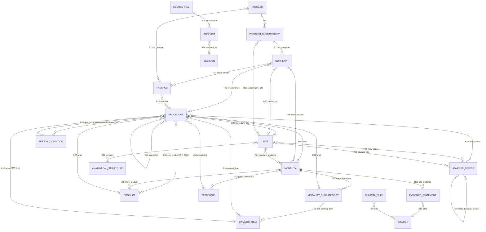

# ERD v3.1 — 피부과 시술 허브 메달리온 시맨틱 정의

작성 2026-11-05 · 상태 **초안(사용자 승인 전)** · 원장 = **브론즈 2판** `bronze/phub-ledger/`(2026-11-05 · HASHES.txt 21 전부 일치 · 1판과의 차이 = CHANGELOG 6곳) + 조사 산출물 step1 10-29 · 발주서 `erd-v3.1-brief.md`(사용자 승인 2026-11-05 「3.1 진행」 · 변경 6건) + 코디·사용자 추가 4건(V3.1-7 동의서 · V3.1-8 안전 문구 수식어 · V3.1-9 사용자 정의 2 개정 · V3.1-10 문구 사전/부록 · 2026-11-05) · 근거 `ERD-V3-CANDIDATES.md` v3.1 후보 · `silver-v3/out/report.md` §13 · batch3-proposed EXO-02/05/06 · 동결 v3(`ERD-FROZEN.md`)의 **사용자 정의 1·3 과 명시 예외의 논리는 그대로, 정의 2 는 사용자 결정으로 개정** · 이전 발주서(v1 ~ v3)의 입력·금지·기준·질문 기본값·처분 유지

기계용 동본 `erd-v3.1.json` · 값 사전 `erd-v3.1-dictionaries.json`(v3 47 + `person_condition` + `phrase_dictionary` = 49 · 값 변경 0 · 제거 이력 필드) · 잎 키 행선지 `erd-v3.1-column-map.md`(v3 대비 이동 29 · 비고 변경 36) · 분해 규칙 실행 `erd-v1.1-resolve.py`(§9.2) · 튜플·단위·문구·조건 실측 `erd-v3.1-tuples.py`(결과 `erd-v3.1-tuples.json`, §9.5·§9.6 v3 와 나란히 + 신설 §9.5.12~13 · §9.6 전면 · §9.7 · §9.8) · 검산 `erd-v3.1-check.py` (결과 §10). 이전 판 산출물은 그대로 두었다. **v3 → v3.1 변경 목록(V3.1-# 대응)은 §11**, v3.1 밖 관찰은 §12.

**v3.1 의 범위는 변경 10건뿐이다.** **V3.1-1** 결정 kind product_reclassify(⓪) · **V3.1-2** 관계 R32 rule_applies_to · **V3.1-3** 결정 kind dictionary_remove(①) · **V3.1-4** 조건 사전 person_condition · 조건 단위 식별 · 문장 부록 · **V3.1-5** 회·차 자리 · **V3.1-6** stopwords 겹침 규칙·목록 · **V3.1-7** 필수 고지 → clinical_rule(disclosure) + R32(ledger) + 문구 사전(disclosure) · **V3.1-8** 안전 문구 수식어 목록(adverse stopwords · 패턴) · **V3.1-9** 사용자 정의 2 개정 — 단위 (사건, 부위, 물질) · 상대 부위 none · 경과는 R15 엣지 속성 · 명시 예외 개정 · 원칙 D 문장 · **V3.1-10** 안전 문구 사전 phrase_dictionary · adverse_expression 개체·R29 삭제 · 부록(R15 source_phrases · 단위 explanations · 게이트 unlinked_phrases) · 결정 kind phrase_map · evidence_statement 유지 · 조건 문장도 부록. **개체 20(v3 21 − adverse_expression) · 관계 31(v3 31 − R29 + R32) · 사전 49(+person_condition · +phrase_dictionary) · 결정 kind 20 · 행선지 1,072(이동 29)** — 그 밖 개체·관계·규칙은 v3 그대로. 사전 값·동의어·매핑·접힘 승인·충돌 판정은 결정 레코드이며 ERD 를 열지 않는다(ERD-FROZEN) — v3.1 이 사전에 더한 것은 구조가 요구한 조건 사전과 분해가 쓰는 문구 사전뿐(기존 47 사전의 값은 불변 · 검산 N-11).

### 0. 사용자 정의 3 · 명시 예외 (ERD-FROZEN 동결 원문 · v3 승계 · **v3.1 개정(정의 2 · 사용자 결정 2026-11-05)**)

동결 원문(ERD-FROZEN 동결 조건 · 글자 그대로):

1. 시술 = (무엇을, 어디에, 어떻게) 튜플. 미상 칸이 있으면 접지 않음. 조각 버리지 않음. 엣지 끝 = 시술 튜플.
2. 부작용 = (사건, 부위, 경과) 튜플. 원인 시술은 엣지. 표현은 가리키기만.
3. 원장 불변. 충돌은 레코드(④ 자동 해결도 기록). 결정 16 kind · 안정 키 · 적용 순서 ①~⑦. 빌드는 approved 만 읽음.

v3 승계 문장(R-4):

1. 시술 = (무엇을, 어디에, 어떻게) 튜플. 미상 칸이 있으면 접지 않음. 조각 버리지 않음. 엣지 끝 = 시술 튜플.
2. 부작용 = (사건, 부위, 경과) 세 칸 + 선택 수식 칸(물질·기전 · 없음은 none 값) 튜플. 원인 시술은 엣지. 표현은 가리키기만. (R-4 · V3-1)
3. 원장 불변. 충돌은 레코드(④ 자동 해결도 기록). 결정 17 kind · 안정 키(REF-…#m<i>·#s<i> 포함) · 적용 순서 ①~⑦(① dictionary_add/canonical_rename). 빌드는 approved 만 읽음. (R-4 · V3-6 · R-1)

**v3.1 문장(정의 2 는 사용자 결정으로 개정 · 정의 3 은 kind 20 · 적용 ⓪①):**

1. 시술 = (무엇을, 어디에, 어떻게) 튜플. 미상 칸이 있으면 접지 않음. 조각 버리지 않음. 엣지 끝 = 시술 튜플.
2. 부작용 = **(사건, 부위, 물질)** 단위. 부위는 단위를 실제로 가르는 것만 — 조직층(layer) 또는 시술 자리와 무관한 절대 부위(필러 뒤 「시력 변화」의 눈) — 이고, 상대 부위(주사 부위·시술 부위)는 none 과 같다(시술 자리는 기본값). 경과(일시·지연·지속·영구·재발)는 단위 칸이 아니라 R15 엣지 속성(어느 시술 뒤 얼마나 가나). 원인 시술은 엣지. 표현은 가리키기만 — 문구는 개체가 아니라 문구 사전 항목이며 엣지·단위의 부록이다. (사용자 결정 2026-11-05 · V3.1-9 · V3.1-10)
3. 원장 불변. 충돌은 레코드(④ 자동 해결도 기록). 결정 20 kind(v3 17 + product_reclassify · dictionary_remove · phrase_map) · 안정 키(REF-…#m<i>·#s<i> · PRD- 는 product_reclassify 뒤 새 id · 옛 id 는 alias · 문구 사전 항목 PHR- = 정규화형 유도) · 적용 순서 ⓪(원장 적재 때 reclassification·product_reclassify) ①~⑦(① dictionary_add → canonical_rename → dictionary_remove → phrase_map). 빌드는 approved 만 읽음. (V3.1-1 · V3.1-3 · V3.1-10)

**명시 예외(사용자 결정 2026-11-04 · 동결 원문)**: 부작용 축에서 부위 없음(none)·경과 미상은 사전 값으로 본다. (멍, none, 미상) 은 하나의 단위라 「멍 (타박상)」「멍 / 반상출혈」「멍·타박상」등이 접힌다. 시술 축의 「미상이면 접지 않음」과 다른 이유: 부작용의 부위 없음은 「모름」이 아니라 「어디서든 나는 사건」이고, 어느 시술에서 나는지는 R15 엣지가 든다. v3: 수식 칸 없음(qualifier none)도 같은 뜻의 값이다 — 「물질·기전이 적히지 않은 사건」이지 미상이 아니다.

**명시 예외(v3.1 개정 · 사용자 결정 2026-11-05)**: 부작용 축에서 **부위 없음(none) · 물질 없음(none)은 사전 값으로 본다**(사용자 결정 2026-11-05 · 경과는 단위 칸에서 나갔으므로 「경과 미상」은 더 이상 단위의 값이 아니라 엣지 속성의 빈값이다). (부종, none, none) 은 하나의 단위라 「주사 부위 부종」「일시적 부종」「경미한 부종」이 전부 같은 단위에 닿고, 「멍 (타박상)」「멍 / 반상출혈」「멍·타박상」은 (멍, none, none) 에 닿는다 — 보톡스 부종과 필러 부종은 같은 부작용이며 지속 기간은 시술의 성질(엣지)이다. 시술 축의 「미상이면 접지 않음」과 다른 이유는 v2.4 와 같다: 부작용의 부위 없음은 「모름」이 아니라 「어디서든 나는 사건」이고, 어느 시술에서 나는지는 R15 엣지가 든다. 「지연성 염증성 결절」은 단위 (결절, none, none) + 엣지 경과 지연(+ 수식어 염증성은 문구 사전 parsed)으로 표현된다. 멍·타박상·반상출혈 = 동의어 유지. 분리는 결정 event_split 으로.

**v3.1 과 정의의 관계**: v3.1 은 정의 1·3 의 뜻을 뒤집지 않고, **정의 2 는 사용자 결정(2026-11-05)으로 개정**한다 — 동결 원문·v3 승계 문장은 위에 그대로 두고 v3.1 개정 문장을 아래에 둔다. 개정의 근거: 보톡스 부종·필러 부종은 같은 부작용인데 v3 까지는 (부종, none, 미상)/(부종, 주사 부위, 미상)/(부종, none, 일시) 세 단위가 임상 근거 없이 표기 차이로 갈렸다. 그래서 경과를 단위에서 빼 R15 엣지 속성으로, 상대 부위를 none 으로 둔다(명시 예외는 「부위 none · 물질 none 은 값」). 「표현은 가리키기만」은 v3.1 에서 더 강해진다 — 표현은 개체(adverse_expression)가 아니라 **문구 사전 항목**(정규화형 기준 한 줄 · 단위를 가리키는 지도)이며, 실버에서는 R15 엣지의 source_phrases[] 부록·단위의 explanations[] 부록·게이트 목록(unlinked_phrases)으로만 나타난다(V3.1-10). 조각이 전부 사전 값인 문구는 시술 참조가 튜플을 만드는 것과 같은 규칙으로 조합 단위를 세우지만(auto), 그 정체성은 사전 값 세 칸이지 표현이 아니다. 원칙 D 는 「문구는 미등록 조각이 섞인 단위를 만들지 않는다」로 고쳐 쓴다(2-C′ 가 막으려던 것은 partial 조각으로 세운 단위). 원칙 B(조각을 버리지 않는다)는 수식어·발생률·조건·설명 조각을 문구 사전 parsed 에 보존하는 것으로 지킨다(검산 N-8). 정의 3 의 「결정 kind」는 17 → 20, 적용 순서 ①~⑦ 은 그대로이고 ⓪ 에 product_reclassify 가 reclassification 옆에, ① 끝에 phrase_map 이 선다. 조건 축(V3.1-4)은 부작용 축의 원칙 A(미등록 조각이 있으면 접지 않음 — raw_name)·B(한 이름에 조건 조각 둘이면 단위 둘)를 그대로 쓰고 조건 문장은 단위·엣지의 부록이다.

**원칙(v2.4 A~C 그대로 · D 는 v3.1 문장)**: **A.** 미상 칸이 하나라도 있으면 다른 이름과 접지 않는다. **B.** 조각을 버리지 않는다. 한 칸에 후보가 둘이면 단위를 둘로 나누거나(부위 「이마/눈가」→ 둘) 미해결로 둔다. **C.** 수식어(경과·부위)는 **같은 멤버 안에서 바로 붙은 사건**에만 준다. 이름 전체에서 끌어오지 않는다. **D.** 표현(원장 문구)은 단위를 **가리키기만** 한다 — 문구는 개체가 아니라 문구 사전 항목·부록이며, **미등록 조각이 섞인 단위를 만들지 않는다**(조각이 전부 사전 값인 조합만 단위가 되고 그 정체성은 사전 값이지 표현이 아니다 · v3.1 V3.1-9/10 · 2-C′ 가 막으려던 것은 partial 조각으로 세운 단위).

v2.4 원칙 D 원문(참고): 표현(adverse_expression)은 단위를 **가리키기만** 한다. 표현에서 새 단위를 만들지 않는다.

## 1. 범위와 층

| 층 | 무엇 | 규칙 |
|---|---|---|
| 브론즈 | 원장 21개 JSON(**브론즈 2판** `bronze/phub-ledger/` · 원장의 집) + `step1-products.json`(조사 산출물) | 바이트 보존·수정 금지. 파일 SHA256 이 식별자(§6 표 · HASHES.txt). 1판 = `phub-stg-2026-10-26/` · 2판 = 1판 복사 + CHANGELOG(부위 나열 `/` → `+` 6곳 · 2026-11-05) |
| 시맨틱 | 이 ERD + 값 사전 + **문구 사전**(v3.1) + 분해 규칙(참조 §1.3 · 튜플 §1.4 · 단위 §1.5 · 조건 §1.6) | 문서. 사용자 승인이 정본 조건. 버전으로 개정(v1 → … → v3(동결) → v3.1 → …) |
| 실버 | ERD 를 따르는 정규화 레코드 | **모든 값은 (파일, 잎 키 경로) 출처를 가진다.** 출처 없는 값 금지. 충돌은 둘 다 보관. v3.1: 원장 문구·조건 문장은 개체가 아니라 엣지·단위의 **부록**(source_phrases · phrases · explanations) 또는 게이트 목록(unlinked_phrases) |
| 골드 | 실버 조합 뷰 | 실버에 없는 사실을 만들지 않는다. 충돌 미판정 레코드 제외. v3.1: 동의서 뷰(계열별 고지 R32 + R16 금기 + 응급 징후 문구 R15)는 골드에서 조립 가능하다 |

지식은 원장 21(2판)·컬럼 리포트·스캔 결과·erd-v* 산출물·발주서·검토서·`step1-products.json`·`ERD-FROZEN.md`·`ERD-V3-CANDIDATES.md`·`silver-v3/out/report.md` §13·`silver-v3/README.md`·`silver-v3/decisions/batch3-proposed/DEC-*-EXO-0{2,5,6}.json`·`silver-v3/tests/enumerate_cases.py`(읽기만) 에서만 가져왔다. step2·step3·source-map·DATA-001·DEC-*·silver-*(위 예외 제외)·silver-v3/lib·`_archive/` 는 열지 않았다.

### 1.1 정규화(「같은 것」판정)와 식별자

- 정규화 `norm_v1`: unicodedata.normalize('NFKC') → str.casefold() → 모든 공백 문자 제거 (스페이스·탭·전각공백) → 그 외 문자(괄호·슬래시·하이픈·점 포함)는 그대로 둔다 — 괄호 안이 부위·용량·제품을 구분하는 경우가 있어 벗기지 않는다
- 정규화 결과가 완전히 같을 때만 「같은 것」. 괄호·조합 기호가 섞인 참조는 v1.1 분해 규칙(§1.3)으로 조각을 내어 조각 단위로 완전 일치만 본다. 유사도·추측 매칭은 하지 않는다.
- 식별자: `<PREFIX>-<sha256(canonical_key)[:10]>`. canonical_key 는 개체별(§2 각 표의 「식별자」). 개체별로 정의 (각 개체의 identity 항목). 원장 id·이름·코드는 전부 aliases 로 보존한다 (질문 4·6 기본값)
- survey 제품: step1 제품(origin=survey)은 PRD-<sha256(계열코드|norm(display_name))[:10]>, 계열 코드가 없으면 'survey' 를 계열 자리에. step1 ledger_id 는 alias
- 제품(v3.1 · V3.1-1): PRD-<sha256(계열 코드|norm(제품명))[:10]> — v3.1(V3.1-1): product_reclassify 가 계열 코드를 바꾸면 재계산 · 옛 id 는 aliases(reclassified_from) · 새 (계열|제품명) 의 PRD- 가 이미 있으면 그 레코드로 합침
- 사전 항목 id(v3 · R-2): DIC-<sha256(사전 이름|정준값)[:10]> — 유도식. canonical_rename(V3-6 · R-2)이 정준값을 바꾸면 재계산되고 옛 DIC- id 는 alias(renamed_from). 코드 기반 개체 id(MOD-<code> · CAT-/PRD- 의 계열 코드)는 정준값과 무관해 바뀌지 않는다
- **튜플·단위 식별자** — procedure(v2.2 · v3 #s<i>): `세 칸 전부 사전 값이면 PRC-<sha256(what_id|site_id|technique_id)[:10]>, 아니면(site none · technique none · what=CAT- 중 하나라도) PRC-<sha256(what_id|site_id|technique_id|anchor)[:10]>. what_id = MOD-/SUB-/PRD-/CAT-, site_id = site 개체 id 또는 'none', technique_id = 기법 사전 id 또는 'none', anchor = CAT- id(분류 항목) · REF- id(참조, REF-sha256(norm(label)|hint)[:10]) · 조합 멤버는 anchor#m<i>. v2.2: 미상은 식별자 값이 아니다 — 세 칸 전부 사전 값일 때만 같은 튜플 = 같은 시술. v3(V3-4): 「무엇을 하나 × 부위 여럿」 참조의 부위별 튜플 anchor 는 REF-…#s<i>(i = 부위 순서) · 조합 멤버는 그대로 #m<i>` · reference anchor: REF-<sha256(norm(label)|hint)[:10]> — 참조 하나(정규화 라벨 · 계열 힌트 — 같은 라벨·힌트는 ① 정규화 완전 일치라 자리가 달라도 같다). v2.2 시술 튜플 anchor · decision tuple_assign 의 target.ref_id. v3(V3-9): 튜플이 없는 미해결 참조의 REF- 도 결정 target 이다 · **adverse_effect(v3.1 · 세 칸)**: `v3.1(V3.1-9): 세 칸(event · site · qualifier) 전부 사전 값이면(미등록 조각 0 · 붙지 않은 조각 0 · event_kind=dict) ADV-<sha256(event_id|site_id|qualifier_id)[:10]>, raw_name 단위는 ADV-<sha256(RAW:<anchor>|none|none|<anchor>)[:10]> — event_id = 사건 사전 id, site_id = site 개체 id(anatomical·layer·region 만 · 상대 부위는 'none') | 'none', qualifier_id = adverse_qualifier 사전 id | 'none'(없음은 값), anchor = 그 이름의 원장 locator. 경과는 식별자에 없다(R15.course). 단위는 complications 65 이름과 auto 문구(문구 사전 · 조각 전부 사전 값)에서 생긴다 — 같은 세 칸은 어느 출처에서 와도 같은 id` · **person_condition(v3.1)**: v3.1(V3.1-4): 사전 단위 CND-<sha256(kind|정준값)[:10]>(kind ∈ condition·check·age_group · 정준값 = 사전 person_condition) · raw_name 단위 CND-<sha256(RAW:kind|norm(원문))[:10]>(같은 원문·같은 kind 는 하나 · anchor = 첫 locator · 전 locator 는 phrases[]). v3 의 CND-<sha256(정규화 이름)> 은 쓰지 않는다 · **문구 사전 항목(v3.1)**: PHR-<sha256(normalized)[:10]> — normalized = 수식어 목록·패턴 토큰을 뺀 토큰들의 norm_v1 연결(공백 없음). 문구 사전 항목 id · 안정 키의 조건(S-5): 원장 바이트·수식어 목록·**경과 사전과 분해 사전(사건·부위·상대 부위·수식)** 이 같을 때 같다 — 경과·수식어·사전 값이 바뀌면(dictionary_add 「지속」 뒤 「안면 비대칭 지속」이 별 항목으로 갈리듯) 정규화형이 바뀔 수 있으므로, 옛 항목(approved 포함)은 **raw_variants 로 새 항목에 재귀속**하고 옛 PHR- 는 alias 로 남긴다(결정 target 이 끊기지 않게) · clinical_rule(v3.1): RUL-<sha256(kind|정규화 문장)[:10]> — v3.1: kind 에 disclosure(필수 고지) · product_note(제품 note 규칙 문장 · edge_create 가 세울 때만) 추가. 같은 고지 문장이 여러 계열에 있으면 레코드 하나 · R32 여럿 · catalog_item(v2.4 계열 코드 고정): CAT-<sha256(계열 코드|norm(항목 이름))[:10]> — v1.1 procedure 의 식별자 규칙을 그대로 물려받는다. v2.4: CAT- 식별자의 「계열 코드」 = **taxonomy 트리 위치**(원장 `taxonomy.json:modality[].id` — 그 항목이 적힌 계열 · reclassification 메모 적용 전). reclassification(reclassified_to · 적용 ⓪)은 R2(하위분류 → 항목) 재배치만 바꾸고 CAT- id 는 바꾸지 않는다 — 소프라노 티타늄 = sha256(`M9|소프라노티타늄`) 그대로(M9 → M8 재배치 뒤에도) · 볼뉴머 M4/M9 는 각각의 트리 위치로 서로 다른 CAT-. 결정·R26·anchor 튜플 id 가 가리키는 CAT- 는 다른 결정 뒤에도 바뀌지 않는다(검토 3-B′) · 표현(v3.1): v3.1(V3.1-10): 개체가 아니다 — 문구 자리는 원장 locator 로, 정규화형은 PHR- 로 가리킨다(v3 의 AEX- 는 쓰지 않는다) · 문구 후보: v3.1: 문구 사전 항목의 parsed.candidates[] = (event, site, qualifier) 후보 + would_be_id(ADV-sha256(event_id|site_id|qualifier_id)) + exists — auto 면 단위가 있다(없으면 생성)
- **접힘 조건(v2.2 · 문자 그대로): 「세 칸 전부 사전 값일 때만」** — 접힘 조건: **세 칸 전부 사전 값일 때만** 다른 항목·참조와 접힌다 — what 이 사전 값(product | modality_subcategory | modality)이고 site 가 부위 사전 값이고 technique 가 기법 사전 값일 때. 미상(site none · technique none)은 식별자 값이 아니다: 미상 칸이 하나라도 있거나 what 이 분류 항목 자신(CAT-)이면 식별자에 anchor 를 섞어 항목·참조마다 고유하다(접히지 않음). anchor = 분류 항목은 CAT- id, 참조(②③)는 REF-sha256(norm(label)|hint)[:10], 조합 멤버는 anchor#m<i>. 참조(또는 조합 멤버)가 분류 항목 이름과 정규화 완전 일치(①)하면 그 항목 자체라 그 항목의 anchor 를 쓴다(같은 튜플 — 접힘 아님). 같은 라벨·같은 힌트의 참조도 ① 이라 자리가 달라도 같은 anchor. 규격·수식·계열명 조각이 붙은 라벨은 자기 anchor(미상 칸이 있으면 접히지 않는다).
- **부작용 접힘 조건(v3.1)**: 부작용 접힘 조건(v3.1 · V3.1-9): **세 칸 전부 사전 값일 때만** 다른 이름·문구와 접힌다 — 조각이 전부 사전(사건 · 부위 · 상대 부위 · 경과 · 수식)에 닿아 미등록 조각이 0 이고 사건에 붙지 않은 조각이 없을 때. 부위 none · 물질 none 은 명시 예외의 값. 상대 부위는 none 과 같고 경과는 R15 엣지로 가므로 「주사 부위 부종」「일시적 부종」「경미한 부종」「부종」은 같은 단위 (부종, none, none). complications 이름에 미등록 조각이 하나라도 있거나 붙지 않은 조각이 남으면 접지 않는다(raw_name 단위 · anchor · 원칙 A·B). 문구는 미등록 조각이 섞인 단위를 만들지 않는다(원칙 D) — 조각 전부 사전 값인 문구만 단위를 세운다(auto).
- **원장 locator(v2.3)**: 원장 locator = `<파일>:<잎 키 경로>@<레코드 키>` — 레코드 키는 상위 레코드 id 와 배열 위치(예 `complications.json:categories[].complications[].name@M16/12` = M16 묶음의 13번째 이름 · `extracted.json:{code}.safety.common[]@M1/3`). 브론즈는 바이트 보존(sha256)이라 위치가 안정 키다. 결정 레코드의 target 과 conflict 안정 키가 이 locator 를 쓴다.
- **결정 target(v3.1)**: 결정 target 이 가리켜도 되는 키(v2.3 · 검토 3-B): 분류 항목 id(CAT-) · 참조 자리 id(REF- · 조합 멤버 REF-…#m<i> · 부위별 튜플 REF-…#s<i>(V3-4 · R-1)) · 원장 locator(file:key path@record) · 원장에서 직접 나온 고정 id(MOD-/SUB-/PRD-/SIT-/TEC- · v3.1: PRD- 는 product_reclassify 가 계열 코드를 바꾸면 재계산되고 옛 id 는 alias(reclassified_from)로 닿는다) · 사전 값(사전 이름 + 정준값 · v3.1: 조건 사전 person_condition 포함 — 조건 단위 CND- 는 사전 값으로 가리킨다 · 문구 사전 항목 PHR-(정규화형 유도)도 안정 키) · conflict 안정 키(kind + locator 쌍). **금지**: 다른 결정을 적용하면 바뀌는 파생 id — PRC-(튜플) · ADV-(부작용 튜플) · CFL-(충돌 레코드) · 부작용 단위는 (event, site, qualifier — 없음은 none) 사전 값 세 쌍으로(V3.1-9), 시술 튜플은 anchor(CAT-/REF-) 또는 (what_id, site_id, technique_id) 로 가리킨다. 검산 K-2 가 전수 확인. v2.4: CAT- 는 taxonomy 트리 위치의 계열 코드로 고정(reclassification 뒤에도 같다 · §2.4). v3(V3-9): REF- 는 튜플이 없는 미해결 참조·조합 멤버(REF-…#m<i>)·부위별 튜플(REF-…#s<i>)도 target 이다. v3.1: CND-(조건 단위 · 사전 정준값 유도) · 문구 자리는 locator 또는 PHR- 로 가리킨다. 충돌: CFL- 레코드 id 는 (대상 id + 속성 + 출처 집합) 해시 — **파생 id 라 결정의 target 이 아니다**. 결정이 가리키는 conflict 의 안정 키 = conflict.stable_key = {kind, locators[]}(값 출처 원장 locator 의 정렬 쌍 + 충돌 종류). DEC- 는 (적용일 + 일련).
- 「같은 것」 = 정규화 완전 일치(①) + 사전 동의어(②)만 자동. 참조·문구·조건 문자열은 분해 규칙으로 조각내어 조각 단위로 같은 판정을 한다. 튜플·단위는 조각이 가리키는 개체·사전 값의 조합이 같을 때 같은 것이다. 유사도·추측 매칭은 ⑦ 후보로만.

### 1.2 다이어그램 (개체·관계만)

### 1.3 참조 해결 — 결정론 분해 규칙 (v1.1 B · v3 stopwords·회사 괄호·조합 기호 · **v3.1 회·차 자리 · stopwords 겹침**)

v1.1 의 세 단계를 **데이터**(`erd-v3.1.json → resolve_rules`)로 적고 `erd-v1.1-resolve.py`(§9.2)와 `erd-v3.1-tuples.py`(§1.4)가 그대로 실행한다. v3.1: 2단계 stopwords 에 session_rule(V3.1-5)·overlap(V3.1-6). 유사도·추측은 없다.

1. **계열 확정** — 참조가 놓인 자리의 상위 계열 코드를 힌트로 쓴다. 없으면 조각 중 계열 사전(modality) 동의어에 닿는 첫 조각의 계열. 자리별 힌트: market-pricing.items[].name: `categories[].id` · synergy.links[].from/to: `노드 접두 M코드 (`M9-울쎄라` → M9)` · problem-packages.procedures[].name: `procedures[].category` · procedure-comparison.procedures[].name: `procedures[].category` · post-procedure-timeline.timelines[].name: `timelines[].category 의 M코드 부분` · treatment-sequence.sequence_order[].categories[]: ``M코드-라벨` 의 M코드` · pih-risk: `procedure_ref 가 id 이므로 분해 대상 아님(id 깊이 판정)` · step1-products.items[]: `family.code (M코드일 때만)` · 그 밖: `힌트 없음`. 코드 정규식 `^(M\d+)(?:[-_ ](.+))?$`
2. **이름 분해** — 괄호 안을 뗀다(`\(([^()]*)\)`). 조합 기호 `+` `/` `&` `,` 로 멤버를 나눈다(기호 뜻: `+` 함께(and) · `/` 양쪽 조각으로 — 부위 둘이면 함께(and) · 대안 둘이면 또는(or) · `&` 함께(and) — `+` 와 같다 · `,` 나열 — `+` 와 같다(and)). 조각마다 사전 순서 **product → modality_subcategory → procedure → site → spec → product_tier**(procedure = catalog_item_name) 로 완전 일치를 시도한다. 규격 정규식 `^(\d+(?:\.\d+)?)\s*(cc|ml|mL|바이알|줄|회|샷|개|부위|cm2|cm²|차|단위|U)(?:\s*(기준|이상|패키지|당|동시))?$` + unit 사전. 조각이 통째로 어느 사전에도 안 닿으면 공백으로 토큰을 나누고, 왼쪽부터 가장 긴 연속 토큰 구간을 사전 순서로 시도한다(정확 일치만). 남는 토큰 = 사전에 없는 조각. 계열이 확정되면 제품·하위분류·단위 시술은 그 계열 안에서 먼저 찾고, 없으면 전 계열에서 찾는다(다른 계열의 조합 멤버). 전 계열에서 둘 이상 계열에 닿으면 모호 → 사전에 없는 조각으로 센다. 한 조각이 단위 시술과 제품 양쪽에 닿으면 단위 시술(8-11 처분), 하위분류와 제품 양쪽이면 하위분류.
   - **stopwords(v3 · V3-3 · v3.1 V3.1-5/6)**: **수식어 제외 목록(stopwords · V3-3)**: 분해에서 아래 단어가 **독립 토큰**(공백 토큰 그대로 · 정규화 완전 일치)으로 나오면 조각(미등록 조각)이 아니라 참조의 `qualifier_text` 속성으로 보존한다 — 시술 튜플의 칸을 정하지 않고 미해결 사유도 되지 않는다. 회차·횟수(「1차」「4회」)는 규격 정규식(`\d+(회|차)`)이 먼저 잡으며 `차` 는 R12 엣지 `session_index`, `회` 는 R12 엣지 `session_count` 로 간다(R9/R17/R18 자리면 qualifier_text 만 · V3.1-5). 목록은 규칙 데이터(resolve_rules.stopwords · 단어마다 원장 locator ≥1 실측 — 출처 없는 단어는 목록에 두지 않는다). 발주서 12 + 원장 실측 추가 7(특별 · 터치 · 여름철 · 병용 · 보조 · 동시 · 콤보). 토큰 일부(「진정관리」의 관리 · 「울쎄라급」)에는 적용하지 않는다(완전 일치만 · 유사도 없음). 분해 사전 밖 사전 값과 겹치는 단어는 overlap 목록(V3.1-6 · 검산이 센다)에 적는다 — 통째 일치가 먼저라 충돌하지 않는다. 단어 19: `회`(brief · locator 6) · `차`(brief · locator 8) · `터치업`(brief · locator 2) · `유지`(brief · locator 3) · `집중`(brief · locator 3) · `연말`(brief · locator 3) · `하반기`(brief · locator 1) · `가을`(brief · locator 2) · `관리`(brief · locator 4) · `케어`(brief · locator 1) · `과도한`(brief · locator 4) · `빈도`(brief · locator 2) · `특별`(ledger · locator 1) · `터치`(ledger · locator 1) · `여름철`(ledger · locator 1) · `병용`(ledger · locator 1) · `보조`(ledger · locator 1) · `동시`(ledger · locator 1) · `콤보`(ledger · locator 1). 회차 `^(\d+)\s*(차)$` → R12.session_index (R9|R17|R18|market-pricing 은 qualifier_text) · 횟수 `^(\d+)\s*(회)$` → R12.session_count (R9|R17|R18|market-pricing 은 qualifier_text). 실측 §9.5.10 · §9.5.12
   - **회·차 자리(v3.1 · V3.1-5)**: **「회」·「N차」 자리(V3.1-5)**: 규격 정규식이 잡는 `\d+회`(횟수)·`\d+차`(회차)는 튜플 칸이 아니라 엣지 속성이다 — 참조 자리가 R12 member(annual_plans · optimal_combo · sequence · comparison · combos)이면 **R12.session_count**(회 · int)·**R12.session_index**(차 · int)로, R9/R17/R18 자리이면 엣지 속성 자리가 없으므로 **qualifier_text 에 규격 원문**(「4회」「1차」)으로만 보존한다. market-pricing(③ · 엣지 아님)은 참조 레코드의 qualifier_text. 한 라벨에 회·차가 둘 이상이면 첫 값이 속성, 나머지는 qualifier_text(버리지 않음). v3 의 「`회` 는 count 로 간다」 문장은 이 속성으로 바뀐다. 실측 §9.5.12(라벨마다 자리 · 관계 · 간 곳).
   - **사전 값 겹침(v3.1 · V3.1-6)**: **stopwords 와 사전 값 겹침(V3.1-6)**: stopword 는 **분해 조각(토큰) 단계에서만** 제외한다 — 조각이 통째로(또는 가장 긴 토큰 구간으로) 어느 사전 값에 완전 일치하는지를 **먼저** 보고, 그 뒤 남은 독립 토큰에만 stopword 를 적용한다. 그래서 「관리」가 modality_group 사전 값(taxonomy modality[].group)과 겹쳐도 분해 사전(product · modality_subcategory · catalog_item_name · site · modality + spec)이 아닌 사전은 분해가 읽지 않으므로 충돌하지 않고, 「LDM 초음파 관리」처럼 통째 일치하는 분류 항목 이름은 떼지 않는다. 겹침 목록은 규칙 데이터(resolve_rules.stopwords.overlap · 단어 × 사전 이름 · 48 사전 전수 · 정준값·동의어)이며 **검산이 센다**(N-6: 실측 = 목록). v3 의 「사전 값과 겹치는 단어는 없다」는 분해 사전 7 기준의 문장이었고 v3.1 이 전 사전 기준으로 고친다. 실측 겹침 1: `관리` ↔ modality_group:관리(canonical) (§9.5.13)
   - **괄호 안 회사·제품(v3 · V3-2)**: **괄호 안 회사·제품 규칙(V3-2)**: 괄호 안(inner 묶음)이 조각 **하나**이고 그 조각이 (a) 회사 사전(manufacturer · 정준값과 동의어 · `/` 로 이어진 복수 회사명은 각각)에 닿으면 바깥 what(계열명 또는 제품명)의 **그 회사 제품**으로 what 을 정한다 — 바깥 what 의 계열 안 제품 중 제조사가 그 회사인 제품이 정확히 하나일 때만(둘 이상·없음은 ambiguous · reason company_product) · (b) 제품 사전에 닿으면 **그 제품**이 what(「스킨부스터(리쥬란)」= 리쥬란 · 바깥은 그 제품의 계열이어야 하며 다른 계열이면 cross_family 표시). 괄호 안 조각이 둘 이상이고 `/` 로 나뉜 대안이면 V3-4(괄호 안 대안은 바깥 하나 · alternatives). 닿지 않으면 기존대로(미등록 조각 → partial/⑨). 「보톡스(엘러간)」은 taxonomy 항목 1 + problem-combos products 문장 7 + extracted related_techniques 2(더모톡신) 에 있으나 「엘러간」은 회사 사전(앨러간/애브비)에 **닿지 않는다** — 규칙은 데이터로 있고 적용은 dictionary_add(회사 동의어) 뒤다(실측 §9.5.9). 실측 §9.5.9
3. **조립** — 튜플 (family, primaries(product|modality_subcategory|procedure|modality), sites, specs, tiers). (a) resolved: 참조 전체가 하나의 사전 값과 통째로 일치(괄호·조합 없이) → 그 깊이(modality|subcategory|procedure|product)로 연결 (b) 분해 성공·항목 없음: 통째 일치는 아니지만 조각이 전부 사전에 닿음 → 「분해 성공·항목 없음」. 조합(튜플) 자체를 보존하고 가격·시너지는 그 조합에 단다. shape = single_primary_qualified(primary 1 + 부위/규격/등급) | combo(primary ≥2) | qualifier_only(primary 0) (c) unresolved: 사전에 없는 조각이 하나라도 있음 → unresolved_reference. 닿은 조각은 partial 로 기록. v2.1: 미해결 참조는 procedure 튜플을 만들지 않는다(힌트 계열·부모 층으로 접지 않음). v2.2: 미등록 조각이 없어도 primary 조각 둘 이상(조합 아님) · site 조각 둘 이상 · technique 조각 둘 이상 · what 으로 못 쓰는 primary 조각이 있으면 튜플 단계(§1.4)에서 미해결(⑨ · unresolved_reason=multi_primary|multi_site|multi_technique|unusable_primary|combo_outside_fragment) — 버리고 접지 않는다. v3: 분리 기호(`+`/`/`)로 나뉜 부위 멤버는 multi_site 가 아니라 같은 what 의 튜플 여럿(V3-4) · 한 멤버 안의 부위 둘은 여전히 multi_site · 기호가 섞이면 combo_mixed
   - **fallback_to_parent = False** — v2.1: 분류 항목 이름의 조각이 하나라도 사전에 없으면 부모 하위분류로 떨어뜨리지 않는다(접힘 금지). what = 그 분류 항목 자신(what_kind=catalog_item). 참조 자리(②)·market-pricing(③)도 같다 — 미등록 조각이 있으면 그 참조는 unresolved(⑨)이며 부모 층 튜플로 접지 않는다
   - **조합 기호(v3 · V3-4)**: **조합 기호 규칙(V3-4 · 확정)**: `+` 는 **항상 함께**(and). `/` 는 **양쪽 조각으로** 정한다 — 같은 what 의 **부위** 둘 → 함께(and) · **대안**(계열 · 하위분류 · 장비 · 재질 · 제품 — primary 조각) 둘 → 또는(or) · **괄호 안 대안은 바깥 하나**(what = 바깥 primary · 괄호 안은 `alternatives[]` 속성 · member_mode or). **「무엇을 하나 × 부위 여럿」**(「보톡스 이마+미간」「보톡스(턱선+광대)」「필러 볼+턱」 — primary 를 가진 멤버가 하나이고 나머지 멤버가 부위 조각뿐)은 조합 패키지(combo_ref)가 아니라 **같은 what 의 시술 튜플 여럿**(부위마다 하나 · anchor = REF-…#s<i>)이며 패키지 멤버 엣지(R12)가 각각 붙는다(member_mode and). primary 를 가진 멤버가 둘 이상이면 combo_ref(멤버마다 튜플 · member_mode = 기호에 따라 and|or · 한 라벨 안에 `+` 와 `/` 가 섞이면 mixed 로 두고 미해결 사유 combo_mixed). 한 멤버 안에 분리 기호 없이 부위 조각이 둘이면 v2.2 그대로 multi_site(버리고 접지 않음 · ⑨). 기호 뜻은 원장 작성 규칙(`bronze/phub-ledger/README.md`: `+` 함께 · `/` 대안)과 같다 — 2판은 부위 나열의 `/` 6곳을 `+` 로 고쳤다(CHANGELOG). 어느 쪽 조각이 미등록이면 규칙은 적용되지 않고 ⑨(unregistered)다(규칙은 사전 값을 만들지 않는다). 실측 §9.5.11

결과는 §9.2 에 v1 수치와 나란히. (a)·(b) 의 결과는 §1.4 의 튜플 규칙으로 한 번 더 내려가 procedure 튜플이 되고, (c) 미해결은 튜플을 만들지 않는다(미해결 참조의 REF- 도 결정 target). 그 튜플이 곧 엣지의 끝이다(§3 엣지 끝 규칙 · §9.5.8).

### 1.4 시술 튜플 분해 규칙 (구조 변경 ① · v2.2~v2.4 · v3 V3-2~5 · **v3.1 V3.1-5** · 데이터 `erd-v3.1.json → tuple_rules.procedure`)

- 입력: ① taxonomy.json modality[].subcategories[].items[].name 521 (family = 계열 코드, parent = 하위분류 id) — v2.4: family = taxonomy 트리 위치의 계열 코드(modality[].id · reclassification 적용 전) · CAT- id 의 계열 코드와 같다(§2.4) — v3: 원장 = 브론즈 2판(bronze/phub-ledger) · ② v1.1 §9.2 의 자유 텍스트 자리 전부(erd-v1.1-resolve.py slot_items — pih id·고민·부위·canonical_category·step1 제외) + market-pricing items[].name 122(③) — v3: 2판 이름(`+` 6곳) · stopwords 는 조각 전 단계에서 뗀다
- **계열 코드(v2.4 · 검토 3-B′)**: CAT- 식별자의 「계열 코드」 = **taxonomy 트리 위치**(원장 `taxonomy.json:modality[].id` — 그 항목이 적힌 계열 · reclassification 메모 적용 전). reclassification(reclassified_to · 적용 ⓪)은 R2(하위분류 → 항목) 재배치만 바꾸고 CAT- id 는 바꾸지 않는다 — 소프라노 티타늄 = sha256(`M9|소프라노티타늄`) 그대로(M9 → M8 재배치 뒤에도) · 볼뉴머 M4/M9 는 각각의 트리 위치로 서로 다른 CAT-. 결정·R26·anchor 튜플 id 가 가리키는 CAT- 는 다른 결정 뒤에도 바뀌지 않는다(검토 3-B′)
- 조각: v2.1: 먼저 v1.1 3단계 (a) **통째 일치**를 본다 — 라벨(또는 분류 항목 이름, 자기 이름 제외) 전체가 하나의 사전 값(계열·제품·하위분류 라벨·분류 항목 이름)이면 조각 하나(괄호·조합 기호가 값 안에 있어도 쪼개지 않는다 · 「PRP/자가혈」「마이크로니들링(MTS)」「리쥬란 HB+」). 아니면 v1.1 §1.3 2단계 그대로: 괄호 안을 떼고(outer / inner 묶음), 묶음 안을 조합 기호 `+ / & ,` 로 멤버로 나누고, 멤버마다 사전 순서 product → modality_subcategory → catalog_item_name → site → spec → product_tier 로 완전 일치. 통째로 안 닿으면 공백 토큰을 왼쪽부터 가장 긴 구간으로. 남는 토큰 = 미등록 조각. 분류 항목 자신의 이름은 catalog_item_name 색인에서 제외(자기 참조 금지)
- **stopwords(v3 · v3.1)**: **수식어 제외 목록(stopwords · V3-3)**: 분해에서 아래 단어가 **독립 토큰**(공백 토큰 그대로 · 정규화 완전 일치)으로 나오면 조각(미등록 조각)이 아니라 참조의 `qualifier_text` 속성으로 보존한다 — 시술 튜플의 칸을 정하지 않고 미해결 사유도 되지 않는다. 회차·횟수(「1차」「4회」)는 규격 정규식(`\d+(회|차)`)이 먼저 잡으며 `차` 는 R12 엣지 `session_index`, `회` 는 R12 엣지 `session_count` 로 간다(R9/R17/R18 자리면 qualifier_text 만 · V3.1-5). 목록은 규칙 데이터(resolve_rules.stopwords · 단어마다 원장 locator ≥1 실측 — 출처 없는 단어는 목록에 두지 않는다). 발주서 12 + 원장 실측 추가 7(특별 · 터치 · 여름철 · 병용 · 보조 · 동시 · 콤보). 토큰 일부(「진정관리」의 관리 · 「울쎄라급」)에는 적용하지 않는다(완전 일치만 · 유사도 없음). 분해 사전 밖 사전 값과 겹치는 단어는 overlap 목록(V3.1-6 · 검산이 센다)에 적는다 — 통째 일치가 먼저라 충돌하지 않는다.
- **회·차(v3.1)**: **「회」·「N차」 자리(V3.1-5)**: 규격 정규식이 잡는 `\d+회`(횟수)·`\d+차`(회차)는 튜플 칸이 아니라 엣지 속성이다 — 참조 자리가 R12 member(annual_plans · optimal_combo · sequence · comparison · combos)이면 **R12.session_count**(회 · int)·**R12.session_index**(차 · int)로, R9/R17/R18 자리이면 엣지 속성 자리가 없으므로 **qualifier_text 에 규격 원문**(「4회」「1차」)으로만 보존한다. market-pricing(③ · 엣지 아님)은 참조 레코드의 qualifier_text. 한 라벨에 회·차가 둘 이상이면 첫 값이 속성, 나머지는 qualifier_text(버리지 않음). v3 의 「`회` 는 count 로 간다」 문장은 이 속성으로 바뀐다. 실측 §9.5.12(라벨마다 자리 · 관계 · 간 곳).
- **괄호 안 회사·제품(v3)**: **괄호 안 회사·제품 규칙(V3-2)**: 괄호 안(inner 묶음)이 조각 **하나**이고 그 조각이 (a) 회사 사전(manufacturer · 정준값과 동의어 · `/` 로 이어진 복수 회사명은 각각)에 닿으면 바깥 what(계열명 또는 제품명)의 **그 회사 제품**으로 what 을 정한다 — 바깥 what 의 계열 안 제품 중 제조사가 그 회사인 제품이 정확히 하나일 때만(둘 이상·없음은 ambiguous · reason company_product) · (b) 제품 사전에 닿으면 **그 제품**이 what(「스킨부스터(리쥬란)」= 리쥬란 · 바깥은 그 제품의 계열이어야 하며 다른 계열이면 cross_family 표시). 괄호 안 조각이 둘 이상이고 `/` 로 나뉜 대안이면 V3-4(괄호 안 대안은 바깥 하나 · alternatives). 닿지 않으면 기존대로(미등록 조각 → partial/⑨). 「보톡스(엘러간)」은 taxonomy 항목 1 + problem-combos products 문장 7 + extracted related_techniques 2(더모톡신) 에 있으나 「엘러간」은 회사 사전(앨러간/애브비)에 **닿지 않는다** — 규칙은 데이터로 있고 적용은 dictionary_add(회사 동의어) 뒤다(실측 §9.5.9).
- **조합(v3 · 확정)**: **조합 기호 규칙(V3-4 · 확정)**: `+` 는 **항상 함께**(and). `/` 는 **양쪽 조각으로** 정한다 — 같은 what 의 **부위** 둘 → 함께(and) · **대안**(계열 · 하위분류 · 장비 · 재질 · 제품 — primary 조각) 둘 → 또는(or) · **괄호 안 대안은 바깥 하나**(what = 바깥 primary · 괄호 안은 `alternatives[]` 속성 · member_mode or). **「무엇을 하나 × 부위 여럿」**(「보톡스 이마+미간」「보톡스(턱선+광대)」「필러 볼+턱」 — primary 를 가진 멤버가 하나이고 나머지 멤버가 부위 조각뿐)은 조합 패키지(combo_ref)가 아니라 **같은 what 의 시술 튜플 여럿**(부위마다 하나 · anchor = REF-…#s<i>)이며 패키지 멤버 엣지(R12)가 각각 붙는다(member_mode and). primary 를 가진 멤버가 둘 이상이면 combo_ref(멤버마다 튜플 · member_mode = 기호에 따라 and|or · 한 라벨 안에 `+` 와 `/` 가 섞이면 mixed 로 두고 미해결 사유 combo_mixed). 한 멤버 안에 분리 기호 없이 부위 조각이 둘이면 v2.2 그대로 multi_site(버리고 접지 않음 · ⑨). 기호 뜻은 원장 작성 규칙(`bronze/phub-ledger/README.md`: `+` 함께 · `/` 대안)과 같다 — 2판은 부위 나열의 `/` 6곳을 `+` 로 고쳤다(CHANGELOG). 어느 쪽 조각이 미등록이면 규칙은 적용되지 않고 ⑨(unregistered)다(규칙은 사전 값을 만들지 않는다).
- fallback_to_parent: **False** (v2.1) · technique_inheritance: **False** (v2.2 · V3-8) · fold_condition: **세 칸 전부 사전 값일 때만** (v2.2)
- 접힘(v2.2): 접힘 조건: **세 칸 전부 사전 값일 때만** 다른 항목·참조와 접힌다 — what 이 사전 값(product | modality_subcategory | modality)이고 site 가 부위 사전 값이고 technique 가 기법 사전 값일 때. 미상(site none · technique none)은 식별자 값이 아니다: 미상 칸이 하나라도 있거나 what 이 분류 항목 자신(CAT-)이면 식별자에 anchor 를 섞어 항목·참조마다 고유하다(접히지 않음). anchor = 분류 항목은 CAT- id, 참조(②③)는 REF-sha256(norm(label)|hint)[:10], 조합 멤버는 anchor#m<i>. 참조(또는 조합 멤버)가 분류 항목 이름과 정규화 완전 일치(①)하면 그 항목 자체라 그 항목의 anchor 를 쓴다(같은 튜플 — 접힘 아님). 같은 라벨·같은 힌트의 참조도 ① 이라 자리가 달라도 같은 anchor. 규격·수식·계열명 조각이 붙은 라벨은 자기 anchor(미상 칸이 있으면 접히지 않는다)
- what(필수) — v2.2 규칙 + v3:
  1. 접힘 조건(v2.2): 세 칸 전부 사전 값일 때만 — what·site·technique 가 전부 사전 값일 때만 식별자에 anchor 가 없고 다른 항목·참조와 접힌다. 미상 칸이 하나라도 있으면 anchor(CAT-/REF-)로 항목·참조마다 고유
  2. product 조각(계열 안 우선, 없으면 전 계열) → what=product
  3. catalog_item 조각 → 그 항목의 튜플 what. 분류 항목(①)에서는 그 항목의 what 이 사전 값일 때만 — 항목 자신이 what 인 항목에 닿은 조각은 what 으로 못 쓰는 primary(unusable_primary → 항목 자신 · ambiguous)
  4. modality_subcategory 조각 → what=modality_subcategory (분류 항목에서 다른 계열 라벨은 못 쓰는 primary)
  5. modality 조각 → what=modality (참조 ②③). 분류 항목(①)에서 자기 계열명 조각은 R2 상위로 이미 담긴 family_fragments(버린 조각 아님), 다른 계열명 조각은 못 쓰는 primary. 참조에서도 what 의 계열과 같은 계열명 조각은 family_fragments
  6. 조각이 계열 사전과 제품 색인 양쪽에 닿으면(보톡스·필러) what 은 product (v2.1 그대로 — 검토 1-E 는 결정 레코드 몫)
  7. **버리고 접지 않는다**(v2.2 · v2.1 규칙 8 삭제): 조합이 아닌데 primary 조각이 둘 이상이면(같은 what 을 가리키는 조각은 하나로 센다) 사전 값으로 조립하지 않는다 — 분류 항목은 항목 자신(ambiguous · reason multi_primary), 참조는 미해결(⑨ · multi_primary)
  8. what 으로 못 쓰는 primary 조각이 하나라도 있으면 같은 처리(reason unusable_primary)
  9. 분류 항목(①): 조각 중 하나라도 미등록이면 what = 항목 자신(partial · candidate_name). primary 가 없으면 항목 자신(complete · reason no_primary). 부모 하위분류 fallback 없음
  10. 참조 ②③: 미등록 조각이 있으면 미해결(⑨ · unregistered). primary 가 없으면 자리 힌트 계열(hint_family), 힌트도 없으면 튜플 불가
  11. v3(V3-2): inner 묶음의 유일한 조각이 회사 사전에 닿으면 바깥 what 계열의 그 회사 제품(정확히 하나일 때) · 제품 사전에 닿으면 그 제품
  12. v3(V3-4): inner 묶음이 `/` 대안(primary 둘 이상)이면 what = 바깥 primary · alternatives 보존(or)
- site: site 사전(21) 에 닿은 조각. 서로 다른 부위 조각이 **둘 이상이면 사전 값으로 조립하지 않는다**(v2.2) — 분류 항목은 항목 자신(ambiguous · multi_site · site=none · extra_sites 에 전부), 참조는 미해결(⑨ · multi_site). 참조가 분류 항목에 닿았고 그 항목 튜플에 site 가 있으면 그 값도 센다. 없으면 none(미상 — 식별자 값 아님). 사전에 없는 부위 같은 조각은 미등록 조각 · v3(V3-4): 분리 기호(`+`/`/`)로 나뉜 부위 멤버는 multi_site 가 아니라 같은 what 의 튜플 여럿(anchor REF-…#s<i> · R12 member_mode and) · v3(V3-5): layer 값은 시술 site 칸에 넣지 않는다(layer_fragments 보존)
- technique: 조각이 기법 사전(12)에 닿으면 그 값(fragment). 아니면 **none**(미상은 미상 — 계열 기본값 R5 를 튜플에 붙이지 않는다 · v2.2). 서로 다른 기법 조각이 둘 이상이면 site 와 같은 처리(multi_technique). R5 계열 → 기법은 decision kind canonical_mapping(target.from_ref=R5:<계열>, target.scope=anchor 목록) 후보로만 §9.5.6 에 목록
- 수식 조각: spec(규격)·product_tier 조각은 튜플 칸이 아니라 수식이다 — 참조 레코드(R9/R12/R18 target_label 등) 쪽에 남긴다. v2.2: primary·site·technique 조각은 수식이 아니다(둘 이상이면 위 규칙대로 미해결·항목 자신, 버리지 않는다) · v3(V3-3): stopwords 토큰은 조각이 아니라 참조 속성 qualifier_text · `\d+차` 는 session_index · v3.1(V3.1-5): `\d+회` 는 R12 session_count · `\d+차` 는 R12 session_index · R9/R17/R18 자리는 qualifier_text 만
- extra(v2.2): extra_primaries · extra_sites 는 항상 실제 값 목록(null 아님). 사전 값 what 튜플이면 [] (버린 조각 없음), 항목 자신 튜플·미해결 참조면 닿은 조각 전부
- 식별자: `세 칸 전부 사전 값이면 PRC-<sha256(what_id|site_id|technique_id)[:10]>, 아니면(site none · technique none · what=CAT- 중 하나라도) PRC-<sha256(what_id|site_id|technique_id|anchor)[:10]>. what_id = MOD-/SUB-/PRD-/CAT-, site_id = site 개체 id 또는 'none', technique_id = 기법 사전 id 또는 'none', anchor = CAT- id(분류 항목) · REF- id(참조, REF-sha256(norm(label)|hint)[:10]) · 조합 멤버는 anchor#m<i>. v2.2: 미상은 식별자 값이 아니다 — 세 칸 전부 사전 값일 때만 같은 튜플 = 같은 시술. v3(V3-4): 「무엇을 하나 × 부위 여럿」 참조의 부위별 튜플 anchor 는 REF-…#s<i>(i = 부위 순서) · 조합 멤버는 그대로 #m<i>` · 상태: complete = 미등록 조각 0 · partial = 미등록 조각 ≥1 · ambiguous = 조각 전부 닿았지만 둘 이상·못 쓰는 primary (분류 항목은 셋 다 튜플을 만들되 partial·ambiguous 는 항목 자신이 what · 참조는 partial·ambiguous 면 미해결)
- **코드 참조(v2.3)**: M 코드만(M1)·실존 하위분류 id(M1-2 · M16-DCA)인 참조는 분해하지 않고 그 노드가 끝(modality/subcategory · 튜플 없음). 분류 항목 id(M8-1-1 · auto-…)는 그 항목의 튜플이 끝(procedure)
- **엣지 끝(v2.3)**: v2.3 엣지 끝 규칙(검토 1-A): 시술 축(proc_axis)을 끝으로 쓰는 엣지는, 그 자리의 참조가 §1.4 로 **procedure 튜플**(또는 combo_ref 의 멤버 튜플)로 해결됐으면 그 **튜플 id 를 끝**으로 쓴다(target_depth=procedure · 미상 칸이 있는 anchor 튜플도 같다 · 참조가 분류 항목 이름과 일치하면 그 항목의 튜플이며 via_catalog_item=CAT- id). 계열(modality)·하위분류(modality_subcategory)·제품(product) 노드에 직접 붙는 것은 **참조가 그 층까지만 적혀 있을 때뿐**이다 — M 코드만(M1) → modality · 실존 하위분류 id(M1-2 · M16-DCA) → subcategory · 제품 사전 전용 자리(products[]) 와 제품 레코드(taxonomy products[]) → product — 그 깊이를 target_depth 로 표시한다. 분류 항목 id(M8-1-1 · auto-…) 나 taxonomy 항목 레코드에 붙은 자리는 그 항목의 튜플(procedure)이다 — 항목 521 전부 튜플이 있으므로 catalog_item 은 끝이 아니다. 미해결(⑨)은 끝이 없다(unresolved_reference 레코드). 실측: §9.5.8 엣지 자리별 끝 분포(erd-v2.3-tuples.py)

### 1.5 부작용 단위·문구 규칙 (구조 변경 ② · v2.3/v2.4 원칙 · v3 V3-1 수식 칸·V3-5 조직층 · **v3.1 V3.1-8 수식어 · V3.1-9 단위 세 칸·경과 엣지 · V3.1-10 문구 사전** · 데이터 `erd-v3.1.json → tuple_rules.adverse`)

- **원칙(v3.1 문장)**: A. 미상 칸이 하나라도 있으면 다른 이름과 접지 않는다. · B. 조각을 버리지 않는다. 한 칸에 후보가 둘이면 단위를 둘로 나누거나(부위 「이마/눈가」→ 둘) 미해결로 둔다. · C. 수식어(경과·부위)는 **같은 멤버 안에서 바로 붙은 사건**에만 준다. 이름 전체에서 끌어오지 않는다. · D. 표현(원장 문구)은 단위를 **가리키기만** 한다 — 문구는 개체가 아니라 문구 사전 항목·부록이며, **미등록 조각이 섞인 단위를 만들지 않는다**(조각이 전부 사전 값인 조합만 단위가 되고 그 정체성은 사전 값이지 표현이 아니다 · v3.1 V3.1-9/10 · 2-C′ 가 막으려던 것은 partial 조각으로 세운 단위).
- 입력: complications.json categories[].complications[].name 65 (사전 뼈대 + 튜플 ①) · 문구: extracted/taxonomy safety.* 전 문구 · consent emergency_signs · literature adverse_effects statement(+patient_ko) 32 · post-procedure-timeline normal/abnormal/caution/emergency 전 문구 · v3.1(V3.1-7): consent mandatory_disclosures 109(kind=disclosure) — 전부 문구 사전 항목(개체 아님)
- **단위(v3.1 · V3.1-9)**: **부작용 단위(V3.1-9 · 사용자 정의 2 개정)**: 단위 = (사건, 부위, 물질) 세 칸 · 식별자 ADV-<sha256(event_id|site_id|qualifier_id)[:10]>. 부위 칸은 **단위를 실제로 가르는 부위만** — site 사전의 조직층(layer) · 절대 부위(anatomical · region: 필러 뒤 「시력 변화」의 눈 주변처럼 시술 자리와 무관할 수 있는 곳) — 이고 **상대 부위(relative_site: 주사 부위 · 시술 부위)는 none 과 같다**(시술 자리는 기본값 · 조각은 parsed.relative_site 에 보존). **경과(course · 일시 · 지연 · 영구 · 재발)는 단위 칸이 아니라 R15 엣지 속성**이다 — 어느 시술 뒤 얼마나 가는지는 시술의 성질(보톡스 부종과 필러 부종은 같은 단위 · 지속 기간은 엣지). 물질·기전(qualifier · adverse_qualifier 사전 · 없음 = none 값)은 v3 그대로 단위 칸. 분해 규칙(원칙 C: 사건이 놓인 멤버 안의 부위·경과·수식만 · 원칙 B: 한 칸에 후보 둘이면 단위 둘 · 경과 후보 둘이면 엣지 경과 둘)은 v2.4 그대로이고 칸만 바뀐다. complications 65 이름: 조각이 전부 사전 값이고 사건에 붙지 않은 조각이 없으면 세 칸 단위(접힘 · 이름의 경과는 category → 단위 R15 엣지의 course), 미등록 조각이나 붙지 않은 조각이 있으면 raw_name 단위(ADV-<sha256(RAW:<anchor>|none|none|<anchor>)[:10]> · 칸은 none/none · 접히지 않음 · adverse_tuple_assign 의 대상) — v2.4 원칙 A 그대로. 실례: 「지연성 염증성 결절」→ 단위 (결절, none, none) + R15.course=지연(염증성은 미등록 조각이면 raw_name · 수식어 목록에 있으면 parsed). 「주사 부위 부종」→ (부종, none, none) · parsed.relative_site=주사 부위. 「혈관 폐색(미간·코)」→ (혈관 폐색, 미간, none) + (혈관 폐색, 코, none)(절대 부위는 칸). 「공기색전」→ (색전, none, 공기).
- 분해: 정규화 전 원문을 괄호로 outer/inner 묶음으로 나누고, 묶음 안을 `· / , + 및 또는 — -- :` 로 멤버로 나눈다. 멤버마다 공백 토큰을 왼쪽부터 가장 긴 구간으로 사전 순서 relative_site(→ 칸 none · parsed) → site(anatomical·layer·region · 칸) → course(→ R15 엣지) → adverse_qualifier(칸) → adverse_event_type(칸) 에 완전 일치(정규화 norm_v1). 남는 토큰 = 미등록 조각 · v3: 통째로 안 닿는 토큰은 접두 수식 + 사건으로 한 번 가른다(공기색전 → 공기 + 색전 · 완전 일치만) · v3.1(V3.1-8): 사전에 안 닿는 토큰은 수식어 목록·패턴(정도 · 시간 · 발생률 · 조건 · 연결어 · 기타)에 대어 parsed 로 보존하고, 그래도 남으면 미등록(outer) 또는 설명(inner · 미등록으로 센다)
- 단위 후보: 멤버 안의 사건 조각 하나 = 단위 하나(멤버에 사건이 둘이면 둘). **course 는 같은 멤버 안의 수식어만**(§1.5 경과 규칙 · v2.3) · **site 도 같은 멤버 안의 부위 조각만**(§1.5 부위 규칙 · v2.4 · 원칙 C) — 둘 다 멤버 밖에서 가져오지 않는다. 한 칸에 후보가 둘 이상이면 후보마다 단위(원칙 B). 사건에 붙지 않은 부위·경과 조각은 extra_* 에 보존하고 그 문자열은 접지 않는다. 없으면 site=none(상대 부위도 none) · 경과는 단위 칸이 아니라 R15 엣지 속성(멤버 안 경과 조각 전부 · 없으면 null) · v3(V3-1): qualifier 도 같은 멤버 안의 수식 조각만 · 후보 둘 이상이면 수식마다 · 없으면 none(값) · v3.1(V3.1-9): 단위 = (사건, 부위, 물질) 세 칸
- **경과(course) 규칙(v2.3 · v3.1 엣지)**: 경과(course)는 분해하는 문자열(complications 이름 · 표현 원문) 안의 경과 수식어(일시적 · 지연성 · 영구 · 가역적 등 경과 사전 값과 동의어)에서만 읽되, **사건에 바로 붙은 수식어만** 읽는다 — 같은 멤버(조합 기호 `· / , + 및 또는` 로 나뉜 조각) 안의 수식어만 그 사건의 경과다. 이름 안에 사건이 둘 이상이면 수식어가 붙은 사건에만 경과를 주고 나머지는 미상: 「통증·불편감 및 지연성 통증(LOP)」→ (통증, 미상) + (통증, 지연) 둘. 멤버 밖(같은 묶음 · 바깥 묶음 · 이름 전체)의 수식어는 가져오지 않는다. duration · incidence 는 R15 엣지 속성으로만 쓰고 경과 칸을 정하는 데 읽지 않는다. 수식어가 없으면 「미상」. v3.1(V3.1-9): 경과는 단위 칸이 아니라 R15 엣지 속성 course 다 — 읽는 규칙(사건에 바로 붙은 수식어만 · 멤버 밖 금지)은 그대로이고 값이 가는 자리만 바뀐다. 수식어가 없으면 엣지 course=null(미상).
- **부위(site) 규칙(v2.4 · v3.1 상대 부위 none)**: 부위(site)는 원칙 C — **사건이 놓인 멤버(조합 기호 `· / , + 및 또는 — -- :` 로 나뉜 조각) 안의 부위 조각(부위 사전 21 · 상대 부위 사전)만** 그 사건의 부위다. 멤버 밖(같은 묶음 · 바깥 묶음 · 이름 전체)에서 가져오지 않는다 — v2.3 의 「멤버 → 같은 묶음 → outer 묶음 → 이름 전체 유일값」 순서는 없앴다(「주사 부위 반응 (부종·압통)」의 바깥 부위는 괄호 안 사건에 붙지 않는다). 부위 조각만으로 된 멤버(사건·경과·미등록 조각 0)가 같은 묶음 안에서 사건 멤버 **바로 앞**에 있으면 그 멤버와 한 멤버로 읽는다(부위 나열 — 「이마/눈가 당김감」= 부위 후보 {이마, 눈가} × 당김감). 한 멤버에 부위 후보가 둘 이상이면 원칙 B — 버리지 않고 **부위마다 튜플**(당김감×이마 + 당김감×눈가). 경과 후보가 둘 이상이어도 같은 방식(경과마다). 사건에 붙지 않은 부위·경과 조각(사건 없는 멤버 · 괄호 안 부위 나열 「혈관 폐색(미간·코)」)은 버리지 않고 **extra_sites · extra_courses 에 보존**하며, 그 문자열은 접지 않는다 — complications 이름이면 raw_name 튜플(anchor=locator), 표현이면 match_status=unlinked(adverse_tuple_assign 의 대상). 없으면 site=none(v3.1: 경과는 칸이 아니라 R15.course · 없으면 null). 실측 §9.6.2b: 멤버 밖에서 온 site 0 · 「두통 × 주사 부위」 0 · 부위 나열 합치기 전부 · 나눈 단위 전부 · 보존한 조각 전부. · v3.1(V3.1-9): 상대 부위(주사 부위 · 시술 부위) 조각은 칸이 아니라 none + parsed.relative_site(보존) · 절대 부위(anatomical·layer·region)만 칸
- **수식(qualifier) 규칙(v3 · V3-1)**: **수식 칸(qualifier · V3-1 · v3.1 세 칸)**: 부작용 단위는 (event, site, qualifier) — qualifier 는 **선택** 칸으로 사건의 물질·기전(공기 · 필러 · 지방 · 혈전 — 물질 / 역행성 — 기전)을 적는다. 값은 사전 `adverse_qualifier`(값마다 원장 출처 필수 · 사전에 없는 조각은 미등록)에서만 온다. qualifier 가 없으면 **none(값)** — 명시 예외와 같은 뜻으로 「물질·기전이 적히지 않은 사건」이지 미상이 아니다. 식별자는 qualifier 를 포함한다(ADV-sha256(event_id|site_id|qualifier_id) · 없으면 'none' · 경과는 식별자에 없다 — R15.course). 분해: 수식 조각은 원칙 C — **사건이 놓인 멤버 안의 수식 조각만** 그 사건의 qualifier 다(멤버 밖에서 가져오지 않는다). 토큰이 통째로 어느 사전에도 닿지 않으면 **접두 수식 + 사건**으로 한 번 가른다(「공기색전」→ 공기 + 색전 — 접두가 수식 사전, 나머지가 사건 사전에 완전 일치할 때만 · 유사도 아님). 한 멤버에 수식 후보가 둘 이상이면 원칙 B — 수식마다 단위. 사건에 붙지 않은 수식 조각은 extra_qualifiers 에 보존하고 그 문자열은 접지 않는다(이름 → raw_name · 문구 → unlinked). **접힘 조건**은 「세 칸(사건 · 부위 · 물질) 전부 사전 값일 때만」(none 은 명시 예외의 값) — 「공기색전」→ (색전, none, 공기) 와 「혈관폐색/색전」의 (색전, none, none) 은 다른 단위다(접히지 않음). 문구 auto 도 세 칸 완전 일치로 단위에 닿는다. 사건 사전 동의어 「공기색전」은 v3 에서 뺐다(이력 removed_synonyms).
- **접힘 조건(v3.1)**: 부작용 접힘 조건(v3.1 · V3.1-9): **세 칸 전부 사전 값일 때만** 다른 이름·문구와 접힌다 — 조각이 전부 사전(사건 · 부위 · 상대 부위 · 경과 · 수식)에 닿아 미등록 조각이 0 이고 사건에 붙지 않은 조각이 없을 때. 부위 none · 물질 none 은 명시 예외의 값. 상대 부위는 none 과 같고 경과는 R15 엣지로 가므로 「주사 부위 부종」「일시적 부종」「경미한 부종」「부종」은 같은 단위 (부종, none, none). complications 이름에 미등록 조각이 하나라도 있거나 붙지 않은 조각이 남으면 접지 않는다(raw_name 단위 · anchor · 원칙 A·B). 문구는 미등록 조각이 섞인 단위를 만들지 않는다(원칙 D) — 조각 전부 사전 값인 문구만 단위를 세운다(auto)
- **raw_name 단위(v2.4 · v3.1 칸)**: complications 이름에 미등록 조각이 하나라도 있거나(partial) 사건에 붙지 않은 부위·경과 조각이 남으면(unresolved): 이름마다 고유한 튜플 하나(event_kind=raw_name · event=이름 원문 · anchor=원장 locator · candidate_name=미등록 조각). **raw_name 튜플에는 course·site 를 주지 않는다 — site=none · qualifier=none(식별자 RAW:anchor 만으로 고유 · v3.1 경과는 칸이 아니다).** 이름 전체에서 조각이 하나라고 그 칸에 넣지 않는다(v2.3 의 「닿은 조각이 하나씩일 때만 그 칸」 삭제 — 「통증·불편감 및 지연성 통증(LOP)」의 raw 칸은 지연이 아니라 미상). §1.5 경과·부위 규칙으로 분해한 결과는 dict_tuples(사건, 부위, 경과, 수식 — 경과는 엣지의 재료)·event_fragments·extra_sites·extra_courses 에 **보존만** 한다(adverse_tuple_assign 의 재료 · 튜플 칸이 아니다). 같은 이름이 여러 사건 조각을 가져도 튜플은 하나다. 실측 §9.6.2c: raw 튜플 site none 100% · course 미상 100%.
- **안전 문구 수식어 목록(v3.1 · V3.1-8)**: **안전 문구 수식어 목록(V3.1-8 · adverse stopwords · 규칙 데이터)**: 원장 문구(문구 사전 항목)·complications 이름의 분해에서 아래 단어·패턴이 **독립 토큰**(정규화 완전 일치 · 패턴은 정규식)으로 나오면 미등록 조각이 아니라 **문구 사전 항목의 parsed 에 보존**한다 — 정도(degree) · 시간(timing) · 발생률(incidence) · 조건(condition) · 연결어(connector) · 기타(misc). 수식어를 뗀 나머지의 정규화형이 문구 사전의 키(normalized)다. 경과 사전(일시 · 지연 · 영구 · 재발 · 미상 과 동의어)에 완전 일치하는 말은 경과(course · R15 엣지 속성)로 먼저 잡힌다(사전 순서가 먼저 · 「일시적으로」「일시적인」은 경과 동의어가 아니라 시간 수식어로 남는다 — 경과 동의어 추가는 dictionary_add · §12). 「지속」은 ERD 사전(v3 값 5)에는 없고 승인된 실버 결정 DICT-COURSE-01(dictionary_add · course · ①)로 들어온다 — 결정 적용 뒤에는 「지속」「지속적」「잔여」「점진적으로 커지는」이 수식어가 아니라 경과로 읽힌다(사전 순서가 먼저 · 수식어 목록은 그 뒤). ERD 실측(결정 전)에서는 시간 수식어로 보존된다. 목록은 원장 전수 실측에서 왔다: v3 부작용 축 미등록 조각(erd-v3-tuples.json adverse.summary.unregistered_all) 중 빈도 ≥ 4 인 조각을 전부 검토해 수식어·연결어·기타에 드는 것만 올렸고(사건·부위·해부·기기 후보 조각 — 홍조 · 손상 · 알레르기 · 건조감 · 신경 · 각질 · 흉터 … — 은 올리지 않았다 · 그것은 dictionary_add 의 몫), 단어·패턴마다 locator ≥1 을 실측한다(검산 N-8 · 출처 없는 단어는 목록에 못 남는다). 빈도 < 4 조각은 목록 밖(미등록 그대로 · 목록 확장은 규칙 데이터 개정). 조사가 붙은 토큰(「멍이」「피부가」「부위가」)은 완전 일치가 아니므로 여전히 미등록이다(§12). 토큰 일부(「홍반과」의 홍반)에는 적용하지 않는다(완전 일치만 · 유사도 없음). 수식어는 사건을 정하지 않고 단위의 세 칸에도 들지 않는다 — 원칙 B(조각을 버리지 않는다)는 parsed 보존으로 지킨다. 단어 138(class 별 degree 25 · timing 29 · incidence 9 · condition 18 · connector 7 · misc 50) · 패턴 5. 목록·locator 전수 §9.6.9.
- **문구 사전(v3.1 · V3.1-10)**: **안전 문구 사전(V3.1-10 · phrase_dictionary · 사용자 「원장 문구들은 부록으로」)**: 원장 문구(extracted/taxonomy safety 문구 · 타임라인 증상 · consent 응급 징후 · 문헌 adverse_effects 문장 + 환자 설명 4개 국어 · 필수 고지)를 **정규화형(norm_v1 + 수식어 목록·패턴 토큰 제거)** 기준으로 한 줄씩 둔다 — 항목 = {id PHR-<sha256(normalized)[:10]>, normalized, raw_variants, kinds[], lang, locators, units, parsed{events · sites · relative_sites · courses · qualifiers · degree · timing · incidence · condition · connector · misc · explanation · phrase_shape · candidates}, status(auto | approved | unlinked), created_units[], citations, accuracy(문헌)}. **auto**: 조각이 전부 사전 값(사건·부위·상대 부위·경과·수식 · 수식어 목록·패턴은 조각이 아님)이고 사건에 붙지 않은 조각이 없으면 후보 (사건, 부위, 물질)마다 **단위를 만들고(없으면 생성 · 있으면 연결)** — §1.3/§1.4 에서 참조가 세 칸 전부 사전 값이면 튜플을 만드는 것과 같은 규칙 — 그 문구가 놓인 자리(계열 코드 · 항목 · 제품)에서 단위로 R15 엣지를 세운다(source_phrases[] 에 PHR- id · **course 는 그 단위의 후보 parsed.candidates[].courses — 사건이 놓인 멤버에 붙은 경과만(원칙 C · 「주사 부위 일시적 부종 및 멍」의 멍 엣지는 경과 null)** · degree/timing/incidence/condition 은 항목의 parsed 를 가리킨다). **unlinked**: 사전에 없는 조각(outer 미등록 · inner 괄호의 미등록 = 설명문 · 붙지 않은 사전 조각)이 하나라도 있거나 사건이 없으면 — 조각·후보를 항목에 보존하고 단위는 만들지 않으며(문구는 미등록 조각이 섞인 단위를 만들지 않는다 · 원칙 A · 원칙 D) 실버 개체가 아니라 **게이트 목록(unlinked_phrases)** 에만 있다. **approved**: 결정 phrase_map 이 units·parsed 를 정한 항목 — 다음 스냅샷의 같은 정규화형 문구는 결정 없이 그 지도를 따른다(auto 도 같다 · 사전이 곧 캐시). 같은 정규화형은 어느 출처에서 와도 항목 하나다(raw_variants · locators 가 늘 뿐). 문헌 레코드는 statement(영문)와 patient_ko 가 각각 항목이며 각자 판정한다(v2.4 의 「두 쪽 전부」 규칙은 레코드 단위였고 v3.1 은 문구 단위라 뺀다 · §11) · patient_en/zh/ja 는 statement 항목의 translations[] 이며 그 레코드가 닿는 단위의 explanations[] 부록으로 간다. **부록**: 실버에서 문구는 (a) R15 엣지의 source_phrases (b) 부작용 단위의 explanations (c) 게이트 unlinked_phrases(조각·후보 보존) 중 하나이며 **합이 문구 자리 수와 같다**(실측 §9.6.11: 2,935 + 고지 109). adverse_expression 개체·R29 는 없다 — 사용자 정의 2 「표현은 가리키기만」을 더 강하게 만족시킨다(표현에 정체성이 없다). evidence_statement(moa · effects 87)는 개체로 **유지**한다 — 그것은 부작용 문구가 아니라 계열에 대한 근거 문장(R20 · R19)이고 단위에 닿는 분해 대상이 아니다. adverse_effects 문장 32 는 문구 사전으로 간다(v2 에서 adverse_expression 으로 갔던 것). R19 cites 의 from 에서 adverse_expression 을 빼고 문헌 문구의 인용은 항목의 citations[] 에 둔다. R20 의 to 는 evidence_statement 뿐.
- **phrase_shape(v3.1)**: **phrase_shape(V3.1-9 보강 · 사용자 「안전 문구도 더 카테고리화」)**: 문구 사전 항목의 parsed 에서 결정론으로 단다 — 모든 토큰은 다음 중 정확히 하나로 분류된다(검산 N-10 · 버리는 조각 0): event · site · relative_site · course · qualifier · degree · timing · incidence · condition · connector · misc · explanation · unregistered. shape 판정(우선순위): 사건 조각이 없거나 미등록 조각(outer)이 있으면 unresolved; 발생률·조건 조각이 있으면 event_incidence_condition; 정도·시간·경과 조각이 있으면 event_degree_course; 설명(괄호 미등록) 조각이 있으면 explanatory; 부위(절대·상대) 조각이 있으면 event_site; 그 밖(사건 + 수식·연결어·기타만) event_only. 한 문구가 여러 종류를 가지면 우선순위가 높은 하나가 shape 이고 전부는 fragment_classes 에 남는다. event_incidence_condition 의 발생률·조건 조각은 그 문구가 만드는 R15 엣지 속성 incidence_text·condition_text 로 올린다 — 값 복사가 아니라 문구 사전 항목 참조. 열거값과 패턴은 원장 전수(§9.6.9)에서 뽑았고 단어·패턴마다 locator 가 있다.
- **필수 고지(v3.1 · V3.1-7)**: **필수 고지(V3.1-7 · 사용자 「동의서도 테이블이 필요한 거 아니냐」)**: consent-checklist.json `categories[].mandatory_disclosures[]`(계열 17 × 문장 109)는 v3 까지 modality.mandatory_disclosures 문자열 속성이었다. v3.1 은 문장마다 **clinical_rule 레코드(kind=disclosure · text = 원문 그대로 · 식별자 = kind + 정규화 문장 — 같은 문장이 여러 계열에 있으면 레코드 하나)를 두고 R32 rule_applies_to(basis=ledger · scope=modality · severity=info · source_locator)로 그 계열(categories[].id)에 연결한다**. modality.mandatory_disclosures 속성은 뺀다(column-map 행선지 이동: modality.mandatory_disclosures → clinical_rule.text). 고지 문장 안의 부작용 조각(혈관폐색 · 괴사 · 실명 · 멍 · 부종 …)은 **같은 문장을 문구 사전(phrase_dictionary · kind=disclosure · 같은 locator) 항목으로도 두어** §1.5 규칙 그대로 단위에 닿는다 — 조각이 전부 사전 값이면 auto(단위 조합 · R15 from=그 계열 · disclosure=true · source_phrases) · 아니면 unlinked 게이트. clinical_rule(disclosure).phrase_ids 가 그 PHR- 항목을 가리킨다(파생 · 같은 locator). 「R29 유사 관계를 clinical_rule 에서 따로 두기」가 아니라 「문구 사전 항목을 하나 더 두기」를 택한 까닭(V3.1-10 과 일관): 부작용 문구의 단위 연결은 전부 문구 사전 한 길로 가고, clinical_rule 은 규칙 문장 개체로 남는다 — 한 문장이 규칙이면서 부작용 문구인 것은 원장의 사실이다. 동의서 뷰(계열별 고지 R32 + R16 금기 + emergency_signs 문구의 R15)는 **골드 뷰이며 실버 레코드로 조립 가능하다** — ERD 는 이 한 줄만 둔다. pre-procedure-checklist 의 규칙 문장(checks[].label 의 「— 대기 원칙」류)에 같은 원칙을 적용할지는 §12 관찰.
- 타임라인 normal: 타임라인 normal 문구는 사전 원천이 아니다. 같은 규칙으로 분해해 닿으면(auto) R15(reaction_level=normal · source_phrases), 아니면 문구 사전 unlinked 항목만(v3.1)
- 문헌: 문헌 레코드는 statement(영문)와 patient_ko(한글)를 각각 분해해 합집합 튜플에 닿는다(같은 레코드의 번역). patient_en/zh/ja 표현은 그 레코드의 튜플을 따라간다(basis 기록) v3.1: statement 와 patient_ko 는 각각 문구 사전 항목(각자 판정) · patient_en/zh/ja 는 statement 항목의 translations[].
- 원장 locator: 원장 locator = `<파일>:<잎 키 경로>@<레코드 키>` — 레코드 키는 상위 레코드 id 와 배열 위치(예 `complications.json:categories[].complications[].name@M16/12` = M16 묶음의 13번째 이름 · `extracted.json:{code}.safety.common[]@M1/3`). 브론즈는 바이트 보존(sha256)이라 위치가 안정 키다. 결정 레코드의 target 과 conflict 안정 키가 이 locator 를 쓴다
- 식별자: `v3.1(V3.1-9): 세 칸(event · site · qualifier) 전부 사전 값이면(미등록 조각 0 · 붙지 않은 조각 0 · event_kind=dict) ADV-<sha256(event_id|site_id|qualifier_id)[:10]>, raw_name 단위는 ADV-<sha256(RAW:<anchor>|none|none|<anchor>)[:10]> — event_id = 사건 사전 id, site_id = site 개체 id(anatomical·layer·region 만 · 상대 부위는 'none') | 'none', qualifier_id = adverse_qualifier 사전 id | 'none'(없음은 값), anchor = 그 이름의 원장 locator. 경과는 식별자에 없다(R15.course). 단위는 complications 65 이름과 auto 문구(문구 사전 · 조각 전부 사전 값)에서 생긴다 — 같은 세 칸은 어느 출처에서 와도 같은 id` · 상태: complete = 미등록 조각 0 · 붙지 않은 조각 0 · partial = 미등록 조각 ≥1(raw_name) · unresolved = 붙지 않은 부위·경과 조각만 남음(raw_name · v2.4). 표현은 튜플 status 를 바꾸지 않는다(match_status=exact|unlinked 는 표현 레코드의 것)

### 1.6 사람 조건 분해 규칙 (**v3.1 신설 · V3.1-4** · 데이터 `erd-v3.1.json → tuple_rules.condition`)

- 입력: 사람 조건 이름 9 키(consent-checklist.json:categories[].contraindications[] · extracted.json:{code}.contraindications.absolute[] · extracted.json:{code}.contraindications.relative[] · taxonomy.json:modality[].extracted.contraindications.absolute[] · taxonomy.json:modality[].extracted.contraindications.relative[] · taxonomy.json:modality[].subcategories[].items[].extracted.safety.contraindications[] · pre-procedure-checklist.json:universal_checks[].label · pre-procedure-checklist.json:category_specific[].checks[].label · treatment-optimization.json:by_age_group[].age) 값 자리 471 · 정규화 distinct 298(kind 포함 299) · 사전: person_condition(정준값 98 · 동의어 · kind · 출처 derived)
- **규칙**: **조건 사전(V3.1-4 · 발주서의 condition_dictionary · 사전 이름 `person_condition`)**: 사람 조건 개체(§2.15)는 v3 까지 정규화 이름 문자열이 식별자였다(298). v3.1 은 **사전 정준값이 식별자**다 — CND-<sha256(kind|정준값)[:10]>(kind ∈ condition·check·age_group 은 원장 키에서(표 CONDITION_KIND_BY_SOURCE) · 같은 정준값이 두 kind 에서 오면 단위 둘 · 발주서 「(+ kind)」). 사전 person_condition: 정준값 · 동의어 · kind(그 값이 나타난 kind 들) · 출처 필수(값·동의어 전부 사람 조건 이름 9 키 값의 부분 문자열 · derived). 초기값은 원장 이름 298 의 분해 조각에서 ERD 가 고른 조건 핵심 98(부작용 사건 사전과 같은 방식 · 값마다 출처 횟수) · 동의어는 괄호 동치(이름이 「X(Y)」꼴이고 Y 가 다른 이름에서 독립 멤버로도 나타남 · 출현 많은 쪽이 정준값)와 표기 변형(한랭/한냉/냉 · 병 접미)뿐 — 뜻이 같은 다른 말은 합치지 않는다(dictionary_add 결정). **분해(부작용 축과 같은 원칙)**: 이름 전체가 사전 값(+kind 무관)과 정규화 완전 일치하면 그대로 그 값(「50대+」처럼 조합 기호가 든 값을 쪼개지 않는다) · 아니면 이름을 괄호로 outer/inner, `· / , + 및 또는 — :` 로 멤버로 나누고 멤버마다 공백 토큰을 왼쪽부터 가장 긴 구간으로 사전(정준값·동의어 · 정규화 완전 일치)에 맞춘다. 표지어(CONDITION_MARKERS 확인 · 여부 · 환자 · 경우 · 사람 · 있는 · 주의 · 필요 · 중 · 시 · 등 · 사용자 · 장착자 · 부위 — 독립 토큰 · 규칙 데이터 · 단어마다 locator)는 조각이 아니라 문장 부록의 qualifier_text. 남는 토큰 = 미등록 조각. **완전 일치만 접는다**: 이름의 조각이 전부 사전 값(+표지어)이면 멤버 안 조건 조각마다 단위 하나(원칙 B · 「임신 및 수유 중」→ (임신) + (수유)) 로 접히고, 미등록 조각이 하나라도 있으면 그 이름은 **raw_name 단위**(CND-<sha256(RAW:kind|정규화 원문)[:10]> · 같은 원문·같은 kind 는 하나 · 닿은 조각은 condition_fragments 에 보존 · 접히지 않음 · 원칙 A). 유사도·조사 분리·추측은 없다 — 「자가면역질환이 있는 경우 …」의 「자가면역질환이」는 조사가 붙어 완전 일치가 아니므로 raw_name(§12 관찰). **문장 보존(부록 · V3.1-10 과 같은 원칙)**: 원장 문장 자리 하나(9 키 · 471)는 개체가 아니라 그 이름이 만든 단위의 `phrases[]` 부록(text · kind · locator · modality_code · level_hint · match exact|raw · 조각·미등록·표지어·괄호 원문)이고, R16/R17/R18 엣지는 `source_phrases[]`(locator)로 어느 문장에서 왔는지 든다. 문장은 단위를 세우지 않는다 — 단위는 이름이 만든다(이름 = 문장 원문이므로 문장마다 단위가 있다 · exact = 사전 단위 · raw = raw_name 단위). R16·R17·R18 의 person_condition 끝은 단위 id 다. 발주서의 「condition_expression 또는 adverse_expression 공용」 중 어느 쪽도 두지 않는 까닭: V3.1-10 이 부작용 표현 개체를 없애고 문구를 부록으로 내렸으므로, 조건 문장도 같은 원칙(문장은 개체가 아니라 단위·엣지의 부록)을 따르는 쪽이 일관된다. raw_name 조건을 사전 단위로 옮기는 길은 dictionary_add(person_condition · 동의어 = 원문 전체 또는 조각) 뒤 재분해 — 전용 kind 는 두지 않는다(§12). 실측 §9.7.
- 분해: 괄호로 outer/inner · `· / , + 및 또는 — :` 로 멤버 · 멤버마다 공백 토큰을 왼쪽부터 가장 긴 구간으로 사전(정준값·동의어 · norm_v1 완전 일치) · 표지어는 qualifier_text · 남는 토큰 = 미등록
- 표지어 14: `확인`(locator 12) · `여부`(locator 12) · `환자`(locator 12) · `경우`(locator 12) · `사람`(locator 8) · `있는`(locator 12) · `주의`(locator 12) · `필요`(locator 12) · `중`(locator 12) · `시`(locator 12) · `등`(locator 12) · `사용자`(locator 8) · `장착자`(locator 1) · `부위`(locator 12). 동의어 규칙: 괄호 동치: 이름이 「X(Y)」꼴이고 Y 가 다른 이름에서 독립 멤버로도 나타남(출현 많은 쪽이 정준값) / 표기 변형: 한랭/한냉/냉 · 병 접미(당뇨/당뇨병) · 공백(정규화)
- 접힘 조건: 조각 전부 사전 값(+표지어)일 때만 — 멤버 안 조건 조각마다 단위 하나(원칙 B) · 미등록 조각 있으면 raw_name(원칙 A) · 식별자: v3.1(V3.1-4): 사전 단위 CND-<sha256(kind|정준값)[:10]>(kind ∈ condition·check·age_group · 정준값 = 사전 person_condition) · raw_name 단위 CND-<sha256(RAW:kind|norm(원문))[:10]>(같은 원문·같은 kind 는 하나 · anchor = 첫 locator · 전 locator 는 phrases[]). v3 의 CND-<sha256(정규화 이름)> 은 쓰지 않는다 · 문장: 조건 문장 자리 하나(471) = 단위의 phrases[] 부록 하나(개체 아님) · R16/R17/R18.source_phrases 가 locator 로 든다 · 문장은 단위를 세우지 않는다(단위는 이름이 만든다 · exact | raw) · 유사도 True 금지 · 조사 분리 False
- 실측 §9.7.

## 2. 개체 목록

개체 20개 — v3 21 에서 `adverse_expression` 을 뺐다(V3.1-10 · 문구는 개체가 아니라 문구 사전 항목·부록). v3.1 에서 바뀐 것: `product`(reclassified_from · V3.1-1) · `modality`(mandatory_disclosures 속성 삭제 · V3.1-7) · `adverse_effect`(세 칸 · 경과 없음 · relative_site_text · created_by_phrase · explanations — V3.1-9/10) · `person_condition`(사전 단위 식별 · phrases[] 부록 — V3.1-4) · `clinical_rule`(kind disclosure·product_note · source_locator · modality_codes · phrase_ids — V3.1-2/7) · `decision`(kind 20) · `evidence_statement`·`conflict`(정의 한 줄). 그 밖은 v3 그대로.

### 2.1 `source_file` — 원장 파일 ★ (접두 `SRC`)

- 정의: 브론즈 스냅샷(2026-10-26)의 원장 JSON 21 + 조사 산출물 step1-products.json(10-29). 실버의 모든 값이 가리키는 출처의 뿌리.
- 식별자(canonical_key): 파일 SHA256
- aliases: 없음

| 속성 | 타입 | 필수 | 출처 원장 키 | 정규화·규칙 |
|---|---|---|---|---|
| file_name | str | ○ | (파생/ERD 정의) | 파일명 |
| sha256 | str | ○ | (파생/ERD 정의) | 바이트 해시 = 식별자 |
| bytes | int | ○ | (파생/ERD 정의) |  |
| snapshot_date | date | ○ | (파생/ERD 정의) | 2026-10-26 고정 |
| trust_tier | int(1~4) | ○ | (파생/ERD 정의) | §5 신뢰 순위 표 |
| kind | enum(ledger\|research_artifact) | ○ | (파생/ERD 정의) | 원장 21 = ledger, step1 = research_artifact |
| trust_basis | str | ○ | (파생/ERD 정의) | 순위 근거 키 |
| trust_flag | str\|null |  | (파생/ERD 정의) | 8-1 「AI 컨센서스 추정」 · step1 「허가 필드만 조건부 2」 |
| version | str\|null |  | `*:version` | 없는 파일(taxonomy·extracted·complications)은 null |
| updated | date\|null |  | `*:updated` |  |
| description | str\|null |  | `*:description` |  |
| method | str\|null |  | `*:consensus_method` `literature-evidence.json:source_method` |  |
| currency | str\|null |  | `market-pricing.json:currency` | 가격 단위 사전과 연결 |
| note | str\|null |  | `market-pricing.json:note` |  |

### 2.2 `modality` — 계열 (접두 `MOD`)

- 정의: 시술 계열 M1~M17. 정본 코드·이름은 taxonomy.json (질문 1). v3.1(V3.1-7): 필수 고지(consent mandatory_disclosures[])는 속성이 아니라 clinical_rule(kind=disclosure) 레코드이며 R32 rule_applies_to(basis=ledger)로 이 계열에 닿는다 — 동의서 뷰는 골드에서 조립한다.
- 식별자(canonical_key): taxonomy modality[].id (M 코드)
- aliases: extracted.json {code}.procedure_id (M1-BOTOX 형) · post-procedure-timeline id(timeline name 이 계열명과 정규화 일치할 때만) · products.json 섹션 키(category_id 가 단일 코드일 때)

| 속성 | 타입 | 필수 | 출처 원장 키 | 정규화·규칙 |
|---|---|---|---|---|
| code | str | ○ | `taxonomy.json:modality[].id` | M1~M17 |
| name | str | ○ | `taxonomy.json:modality[].category` | 정본 한글명 |
| name_en | str | ○ | `taxonomy.json:modality[].category_en` |  |
| group | dict:modality_group | ○ | `taxonomy.json:modality[].group` |  |
| overview | str[src] |  | `extracted.json:{code}.overview` `taxonomy.json:modality[].extracted.overview` | 두 출처 모두 보존, 다르면 충돌 (질문 2) |
| mechanism | str[src] |  | `extracted.json:{code}.mechanism` `taxonomy.json:modality[].extracted.mechanism` | 질문 2 |
| indications_primary | str[][src] |  | `extracted.json:{code}.indications.primary[]` `taxonomy.json:modality[].extracted.indications.primary[]` | 자유 텍스트. 주호소 연결은 사전 일치만 |
| indications_extended | str[][src] |  | `extracted.json:{code}.indications.extended[]` `taxonomy.json:modality[].extracted.indications.extended[]` |  |
| onset | str[src] |  | `extracted.json:{code}.onset_duration.onset` `taxonomy.json:modality[].extracted.onset_duration.onset` |  |
| peak | str[src] |  | `extracted.json:{code}.onset_duration.peak` `taxonomy.json:modality[].extracted.onset_duration.peak` |  |
| duration | str[src] |  | `extracted.json:{code}.onset_duration.duration` `taxonomy.json:modality[].extracted.onset_duration.duration` |  |
| aftercare | str[][src] |  | `extracted.json:{code}.aftercare[]` `taxonomy.json:modality[].extracted.aftercare[]` `procedure-profiles.json:profiles[].aftercare[]` |  |
| related_techniques | str[][src] |  | `extracted.json:{code}.related_techniques[]` `taxonomy.json:modality[].extracted.related_techniques[]` | 설명 문장. 기법 사전 연결은 하지 않음 |
| extracted_meta | obj |  | `extracted.json:{code}.source_type` `extracted.json:{code}.extracted_at` `extracted.json:{code}.guardrail_version` `extracted.json:{code}.updated` | extracted.json 레코드 메타. source(교과서)는 citation 개체 |
| patient_name | str |  | `patient-education.json:categories[].patient_name` | 환자용 별칭 — 사전 동의어로도 등록 |
| patient_simple_explanation | str |  | `patient-education.json:categories[].simple_explanation` |  |
| patient_how_it_works | str |  | `patient-education.json:categories[].how_it_works` |  |
| patient_duration_simple | str |  | `patient-education.json:categories[].duration_simple` |  |
| patient_pain_level | str |  | `patient-education.json:categories[].pain_level` |  |
| patient_downtime | str |  | `patient-education.json:categories[].downtime` |  |
| faq | obj |  | `patient-education.json:categories[].common_concerns[].q` `patient-education.json:categories[].common_concerns[].a` | FAQ = 속성 |
| floor_phase | dict:floor_phase |  | `procedure-profiles.json:profiles[].phase` |  |
| floor_phase_order | int |  | `procedure-profiles.json:profiles[].phaseOrder` | 중복값 있음(95·90·85) — 원문 보존 |
| flags | obj(bool) |  | `procedure-profiles.json:profiles[].hasProtein` `procedure-profiles.json:profiles[].hasHA` `procedure-profiles.json:profiles[].usesGel` `procedure-profiles.json:profiles[].createsWound` `procedure-profiles.json:profiles[].createsChannel` `procedure-profiles.json:profiles[].needsCleansing` |  |
| risk_scores | obj(int 0~3) |  | `procedure-profiles.json:profiles[].thermalLoad` `procedure-profiles.json:profiles[].bleedingRisk` `procedure-profiles.json:profiles[].swellingRisk` |  |
| anesthesia | dict:anesthesia |  | `procedure-profiles.json:profiles[].needsAnesthesia` |  |
| position | dict:position |  | `procedure-profiles.json:profiles[].position` |  |
| prep_time_min | int |  | `procedure-profiles.json:profiles[].prepTime` | 단위 분 |
| prep_notes | str |  | `procedure-profiles.json:profiles[].prepNotes` |  |
| duration_min | int |  | `procedure-profiles.json:profiles[].durationMin` | 단위 분 |
| duration_max | int |  | `procedure-profiles.json:profiles[].durationMax` | 단위 분 |
| moa_summary | str |  | `procedure-profiles.json:profiles[].moa_summary` |  |
| practical_notes | str[] |  | `procedure-profiles.json:profiles[].practicalNotes[]` |  |
| price_items | obj |  | `market-pricing.json:categories[].items[].name` `market-pricing.json:categories[].items[].unit` `market-pricing.json:categories[].items[].low` `market-pricing.json:categories[].items[].mid` `market-pricing.json:categories[].items[].high` | 가격 = 속성. label 의 시술/제품 연결은 사전 일치만(질문 11) |
| pih_note | str |  | `pih-risk.json:notes.{code}` | `M1_to_M7` 범위 키는 M1~M7 일곱 계열에 같은 값을 둔다(③ 형식 교정) |
| same_session_order | obj(order,phase,reason) |  | `treatment-sequence.json:sequence_order[].order` `treatment-sequence.json:sequence_order[].phase` `treatment-sequence.json:sequence_order[].reason` | categories[] 가 가리키는 계열/하위분류에 둔다. 미해결 참조는 ⑨ |
| evidence_statement_count | obj\|null |  | `literature-evidence.json:categories.{code}.moa` `literature-evidence.json:categories.{code}.adverse_effects` `literature-evidence.json:categories.{code}.effects` | 빈 배열 = null(미입력) (질문 13) |
| products_present | bool\|null |  | `taxonomy.json:modality[].products` | 빈 배열 = null(미입력) (질문 15) |

### 2.3 `modality_subcategory` — 계열 하위분류 ★ (접두 `SUB`)

- 정의: taxonomy modality[].subcategories 74. 계열 아래, 단위 시술 위의 분류 층. 참조 깊이 「하위분류」의 대상. 8-4 처분: 하위분류 label 64(distinct)는 기법이 아니라 이 개체의 label 로만 둔다. pih-risk subcategory 는 이 label 과 일치할 때만 연결. v2.4: 분류 항목(CAT-)의 「계열 코드」는 이 하위분류가 놓인 taxonomy 트리 위치의 계열(modality[].id)이며, reclassification(reclassified_to)은 R2 재배치만 바꾸고 CAT- id 를 바꾸지 않는다(§2.4 · 3-B′). v3(V3-8): R5 의 from 이 될 수 있다(하위분류 단위 기본 기법 — canonical_mapping target.from_ref=R5:<하위분류 id>).
- 식별자(canonical_key): 계열 코드 + 정규화 label
- aliases: taxonomy subcategories[].id · treatment-sequence/post-procedure-timeline 의 코드+라벨 합성값(실존 하위분류 id 와 일치할 때만, 질문 7)

| 속성 | 타입 | 필수 | 출처 원장 키 | 정규화·규칙 |
|---|---|---|---|---|
| code | str | ○ | `taxonomy.json:modality[].subcategories[].id` | M1-2 형 56 + 기타 18 형식 혼재 — alias 로도 보존 |
| label | str | ○ | `taxonomy.json:modality[].subcategories[].label` | 중복 `기타`·`추가` 는 계열 코드로 구분 |
| description | str\|null |  | `taxonomy.json:modality[].subcategories[].description` |  |
| items_present | bool\|null |  | `taxonomy.json:modality[].subcategories[].items` | 빈 배열 = null(미입력) |
| same_session_order | obj |  | (파생/ERD 정의) | treatment-sequence categories[] 가 하위분류를 가리킬 때(M15-도포·M15-팩) |

### 2.4 `catalog_item` — 분류 항목(taxonomy 항목) ★ (접두 `CAT`)

- 정의: taxonomy modality 항목 521 을 **있는 그대로** 담는 분류 항목. taxonomy 는 제품·마케팅명·부위 붙은 메뉴·기법이 섞인 분류 트리(10-27 결정)라 단위 시술이 아니다. v1.1 `procedure` 의 속성·alias·출처를 전부 여기로 옮겼다. 계층(계열→하위분류→항목)도 그대로(R1·R2). 각 항목은 분해 규칙(§1.4)으로 튜플 하나(procedure)로 내려가고 R26 derived_from 으로 매단다. v2.1: 이름 조각에 미등록이 있거나 primary 조각이 없는 항목은 그 항목 자신이 튜플의 what(what_kind=catalog_item)이며 다른 항목과 접히지 않는다(부모 하위분류 fallback 삭제). v2.2: 이름 조각에 primary·site·technique 가 둘 이상이거나 what 으로 못 쓰는 primary 가 있어도 항목 자신이 what(tuple_status ambiguous) — 버리고 접지 않는다. 항목 자신 튜플은 식별자에 CAT- anchor 가 들어가 항목마다 고유하다. v2.4: 식별자의 계열 코드 = taxonomy 트리 위치(원장 · reclassification 적용 전) 고정(3-B′).
- 식별자(canonical_key): 계열 코드 + 정규화 항목 이름 (v1.1 procedure 와 같음) — v2.4: CAT- 식별자의 「계열 코드」 = **taxonomy 트리 위치**(원장 `taxonomy.json:modality[].id` — 그 항목이 적힌 계열 · reclassification 메모 적용 전). reclassification(reclassified_to · 적용 ⓪)은 R2(하위분류 → 항목) 재배치만 바꾸고 CAT- id 는 바꾸지 않는다 — 소프라노 티타늄 = sha256(`M9|소프라노티타늄`) 그대로(M9 → M8 재배치 뒤에도) · 볼뉴머 M4/M9 는 각각의 트리 위치로 서로 다른 CAT-. 결정·R26·anchor 튜플 id 가 가리키는 CAT- 는 다른 결정 뒤에도 바뀌지 않는다(검토 3-B′)
- aliases: taxonomy items[].id (M1-2-1 · auto-M4-… · auto-63-… 전부) — 외부 참조 여부 무관하게 alias (질문 4). v1.1 PRC- id 는 CAT- 로 바뀐다(canonical_key 는 같음)

| 속성 | 타입 | 필수 | 출처 원장 키 | 정규화·규칙 |
|---|---|---|---|---|
| name | str | ○ | `taxonomy.json:modality[].subcategories[].items[].name` | 중복 `볼뉴머`(M4·M9) 는 계열 코드로 구분 → ⑦ 후보 |
| detail | str\|null |  | `taxonomy.json:modality[].subcategories[].items[].detail` | 빈 문자열 20 = null |
| overview | str |  | `taxonomy.json:modality[].subcategories[].items[].extracted.overview` |  |
| mechanism | str |  | `taxonomy.json:modality[].subcategories[].items[].extracted.mechanism` |  |
| indications_primary | str[] |  | `taxonomy.json:modality[].subcategories[].items[].extracted.indications.primary[]` |  |
| indications_extended | str[] |  | `taxonomy.json:modality[].subcategories[].items[].extracted.indications.extended[]` `taxonomy.json:modality[].subcategories[].items[].extracted.indications.secondary[]` | `secondary` 는 동의 키로 합친다(질문 20 기본값) — 재검토 §8-3 |
| onset | str |  | `taxonomy.json:modality[].subcategories[].items[].extracted.onset_duration.onset` |  |
| duration | str |  | `taxonomy.json:modality[].subcategories[].items[].extracted.onset_duration.duration` |  |
| peak | str |  | `taxonomy.json:modality[].subcategories[].items[].extracted.onset_duration.peak` `taxonomy.json:modality[].subcategories[].items[].extracted.onset_duration.peak_effect` | `peak_effect` 동의 키 (질문 20) |
| maintenance | str |  | `taxonomy.json:modality[].subcategories[].items[].extracted.onset_duration.maintenance` |  |
| aftercare | str[] |  | `taxonomy.json:modality[].subcategories[].items[].extracted.aftercare[]` |  |
| safety_note | str |  | `taxonomy.json:modality[].subcategories[].items[].extracted.safety.note` |  |
| is_marketing_name | bool |  | `taxonomy.json:modality[].subcategories[].items[].is_marketing_name` |  |
| ingredient_basis | str |  | `taxonomy.json:modality[].subcategories[].items[].ingredient_basis` |  |
| naming_caveat | str |  | `taxonomy.json:modality[].subcategories[].items[].naming_caveat` |  |
| tuple_status | enum(complete\|partial\|ambiguous) |  | (파생/ERD 정의) | 분해 결과: complete = 미등록 조각 0 · partial = 미등록 조각 ≥1 · ambiguous(v2.2) = primary/site/technique 둘 이상 또는 what 으로 못 쓰는 primary(항목 자신 what) |
| unregistered_fragments | str[] |  | (파생/ERD 정의) | 이름 분해에서 어느 사전에도 닿지 않은 조각(공백 토큰 단위). 사전 추가는 이번 범위 아님 — 목록만 |

### 2.5 `procedure` — 단위 시술 (접두 `PRC`)

- 정의: **단위 시술 = 튜플 (what, site, technique)** — 무엇을 × 어디에 × 어떻게. what = modality | modality_subcategory | product (사전 값) 또는 catalog_item(분류 항목 자신). 접힘 조건: **세 칸 전부 사전 값일 때만** 다른 항목·참조와 접힌다 — what 이 사전 값(product | modality_subcategory | modality)이고 site 가 부위 사전 값이고 technique 가 기법 사전 값일 때. 미상(site none · technique none)은 식별자 값이 아니다: 미상 칸이 하나라도 있거나 what 이 분류 항목 자신(CAT-)이면 식별자에 anchor 를 섞어 항목·참조마다 고유하다(접히지 않음). anchor = 분류 항목은 CAT- id, 참조(②③)는 REF-sha256(norm(label)|hint)[:10], 조합 멤버는 anchor#m<i>. 참조(또는 조합 멤버)가 분류 항목 이름과 정규화 완전 일치(①)하면 그 항목 자체라 그 항목의 anchor 를 쓴다(같은 튜플 — 접힘 아님). 같은 라벨·같은 힌트의 참조도 ① 이라 자리가 달라도 같은 anchor. 규격·수식·계열명 조각이 붙은 라벨은 자기 anchor(미상 칸이 있으면 접히지 않는다). **조각을 버리고 접지 않는다**(v2.2): 분류 항목 이름의 조각이 전부 사전에 닿았어도 primary(what 후보) 조각이 둘 이상(조합 아님) · site 조각이 둘 이상 · technique 조각이 둘 이상 · what 으로 못 쓰는 primary 조각이 있으면 사전 값으로 조립하지 않는다 — 분류 항목은 what = 항목 자신(status ambiguous · 조각 전부 extra_primaries/extra_sites 에 실값), 참조(②③)는 미해결(⑨). 같은 계열의 계열명 조각(what 의 계열과 같은 modality 조각)은 what 의 상위(R1·R4)로 이미 담기므로 버린 조각이 아니다. 조각 중 하나라도 미등록이면 v2.1 그대로 what = 항목 자신(partial · candidate_name). primary 조각이 없으면(부위만·계열명만) 항목 자신(complete). 부모 하위분류 fallback 없음. site = 부위 사전 값 | none. technique = 이름 조각이 기법 사전에 닿을 때만 그 값 | none — **계열 기본값(R5)을 튜플에 붙이지 않는다**(v2.2 · 결정 kind canonical_mapping 후보로만 §9.5.6). 원천: ① 분류 항목 521 ② 자유 텍스트 참조(§9.2 자리 전부) ③ market-pricing 122. 조합 기호로 같은 묶음 안에 primary 멤버가 둘 이상이고 멤버 밖에 primary·site 조각이 없으면 package(kind=combo_ref)로 보내고 멤버 각각을 튜플화한다. v2.3: 시술 축 엣지(R3·R9·R12·R15·R16·R17·R18)의 끝은 이 튜플이다(§3 엣지 끝 규칙).
- 식별자(canonical_key): 세 칸 전부 사전 값이면 PRC-<sha256(what_id|site_id|technique_id)[:10]>, 아니면(site none · technique none · what=CAT- 중 하나라도) PRC-<sha256(what_id|site_id|technique_id|anchor)[:10]>. what_id = MOD-/SUB-/PRD-/CAT-, site_id = site 개체 id 또는 'none', technique_id = 기법 사전 id 또는 'none', anchor = CAT- id(분류 항목) · REF- id(참조, REF-sha256(norm(label)|hint)[:10]) · 조합 멤버는 anchor#m<i>. v2.2: 미상은 식별자 값이 아니다 — 세 칸 전부 사전 값일 때만 같은 튜플 = 같은 시술
- aliases: 없음 (분류 항목 id·이름은 catalog_item 의 alias. 참조 원문은 엣지 속성 target_label)

| 속성 | 타입 | 필수 | 출처 원장 키 | 정규화·규칙 |
|---|---|---|---|---|
| what_kind | enum(modality\|modality_subcategory\|product\|catalog_item) | ○ | (파생/ERD 정의) | 무엇을. §1.4 what 규칙(v2.2: primary 조각이 하나일 때만 사전 값 what · 미등록 있으면 partial · 둘 이상·못 쓰면 ambiguous · 없으면 complete — 셋 다 catalog_item = 항목 자신) |
| what_id | str | ○ | `taxonomy.json:modality[].subcategories[].items[].name` `market-pricing.json:categories[].items[].name` `synergy.json:links[].from` `synergy.json:links[].to` `problem-packages.json:problems[].complaints[].procedures[].name` `problem-packages.json:problems[].complaints[].combos[].combo[]` `problem-packages.json:problems[].complaints[].procedures[].products[]` `procedure-comparison.json:comparisons[].procedures[].name` `treatment-optimization.json:by_concern[].severity_levels[].optimal_combo[]` `treatment-optimization.json:by_age_group[].recommended_base[]` `treatment-optimization.json:by_age_group[].avoid[]` `treatment-optimization.json:by_age_group[].upgrade[]` `treatment-optimization.json:annual_plans[].schedule[].procedures[]` `treatment-sequence.json:sequence_order[].categories[]` `treatment-sequence.json:incompatible_same_day[].pair[]` `treatment-sequence.json:minimum_intervals[].from` `treatment-sequence.json:minimum_intervals[].to` `treatment-sequence.json:common_combos[].sequence[]` `post-procedure-timeline.json:timelines[].name` | MOD-/SUB-/PRD-/CAT- 개체 id (R27). 출처 = 튜플을 만든 이름·참조 자리 |
| candidate_name | str[] |  | `taxonomy.json:modality[].subcategories[].items[].name` | v2.1: what_kind=catalog_item 일 때 이름 분해에서 어느 사전에도 닿지 않은 조각(제품명·기법·부위 후보). 사전 추가는 실버 빌드의 결정 묶음 — 보존만 |
| site_id | str\|none | ○ | `taxonomy.json:modality[].subcategories[].items[].name` `market-pricing.json:categories[].items[].name` `synergy.json:links[].from` `synergy.json:links[].to` `problem-packages.json:problems[].complaints[].procedures[].name` `problem-packages.json:problems[].complaints[].combos[].combo[]` `problem-packages.json:problems[].complaints[].procedures[].products[]` `procedure-comparison.json:comparisons[].procedures[].name` `treatment-optimization.json:by_concern[].severity_levels[].optimal_combo[]` `treatment-optimization.json:by_age_group[].recommended_base[]` `treatment-optimization.json:by_age_group[].avoid[]` `treatment-optimization.json:by_age_group[].upgrade[]` `treatment-optimization.json:annual_plans[].schedule[].procedures[]` `treatment-sequence.json:sequence_order[].categories[]` `treatment-sequence.json:incompatible_same_day[].pair[]` `treatment-sequence.json:minimum_intervals[].from` `treatment-sequence.json:minimum_intervals[].to` `treatment-sequence.json:common_combos[].sequence[]` `post-procedure-timeline.json:timelines[].name` | site 개체 id 또는 none (R28). 부위 사전 21(v1.1 그대로, 공유 사전). v2.4: 출처는 이름·참조 자리의 키(what_id 와 같은 19 — 부위 조각은 그 문자열에서 읽는다 · 3-C′) · 사전은 §4 site |
| technique_id | dict:technique\|none |  | `taxonomy.json:modality[].subcategories[].items[].name` `market-pricing.json:categories[].items[].name` `synergy.json:links[].from` `synergy.json:links[].to` `problem-packages.json:problems[].complaints[].procedures[].name` `problem-packages.json:problems[].complaints[].combos[].combo[]` `problem-packages.json:problems[].complaints[].procedures[].products[]` `procedure-comparison.json:comparisons[].procedures[].name` `treatment-optimization.json:by_concern[].severity_levels[].optimal_combo[]` `treatment-optimization.json:by_age_group[].recommended_base[]` `treatment-optimization.json:by_age_group[].avoid[]` `treatment-optimization.json:by_age_group[].upgrade[]` `treatment-optimization.json:annual_plans[].schedule[].procedures[]` `treatment-sequence.json:sequence_order[].categories[]` `treatment-sequence.json:incompatible_same_day[].pair[]` `treatment-sequence.json:minimum_intervals[].from` `treatment-sequence.json:minimum_intervals[].to` `treatment-sequence.json:common_combos[].sequence[]` `post-procedure-timeline.json:timelines[].name` | 기법 사전 값 또는 none. **이름 조각이 기법 사전에 완전 일치할 때만**(fragment) — 출처는 이름·참조 자리의 키(what_id 와 같다)이고 사전은 §4 technique(정준값 출처 procedure-profiles mechanism[]). v2.3: 출처를 이름 키로(검토 1-B). 계열 기본값은 붙이지 않는다 — canonical_mapping(target.from_ref=R5:<계열>) approved 일 때만 |
| technique_origin | enum(fragment\|none) | ○ | (파생/ERD 정의) | v2.2: inherited 삭제 · v2.3: fragment = 이름 조각이 기법 사전에 닿음 · none = 미상. canonical_mapping 결정으로 붙은 값은 실버 빌드에서 decision 출처(decision_id)로 남는다 |
| origins | enum | ○ | (파생/ERD 정의) | ① ② ③ 중 이 튜플을 만든 원천(합집합) |
| status | enum(complete\|partial\|ambiguous) | ○ | (파생/ERD 정의) | complete = 미등록 조각 0 · partial = 미등록 조각 ≥1 · ambiguous(v2.2) = 조각은 전부 닿았지만 primary·site·technique 가 둘 이상이거나 what 으로 못 쓰는 primary 가 있어 사전 값으로 조립하지 않은 분류 항목 자신 튜플 |
| unregistered_fragments | str[] |  | (파생/ERD 정의) | 이 튜플을 만든 이름들의 미등록 조각(합집합) |
| anchor | str\|null | ○ | (파생/ERD 정의) | v2.2 식별자 anchor. 세 칸 전부 사전 값이면 null(접힘 가능), 아니면 CAT- id(분류 항목) · REF- id(참조 자리) · …#m<i>(조합 멤버) — 식별자에 들어가 항목·참조마다 고유 |
| all_dict_values | bool | ○ | (파생/ERD 정의) | v2.2: what·site·technique 세 칸이 전부 사전 값(미상 없음)이면 true — 그때만 접힘 |
| extra_primaries | str[] | ○ | (파생/ERD 정의) | v2.2: 사전 값 what 튜플이면 . 항목 자신 튜플이면 이름에서 닿은 primary 조각 전부(실값 · null 아님) |
| extra_sites | str[] | ○ | (파생/ERD 정의) | v2.2: 칸에 들어가지 않은 부위 조각 전부(실값 · null 아님). 사전 값 what 튜플이면 [] |

### 2.6 `product` — 제품 (접두 `PRD`)

- 정의: 제조사 기준 제품(약제·기기·실). products.json 59 와 taxonomy modality[].products 59 를 합치되 어긋난 3건은 충돌 (질문 3). v1.1: step1-products.json 395 항목을 제품 속성(허가·공식명·허가권자·제조원·허가 상태·KPIC·출처 질의)의 **출처 키**로 편입한다. 원장 59 와의 대응은 B 분해 규칙(이름 분해·동의어)으로만 하고, 원장에 없는 제품은 origin=survey 로 올린다. step1 의 ledger_id·1_identity 같은 설계·식별자는 들이지 않는다(브론즈). v3(V3-7): description(출처 locator 필수) · media_refs를 가진다 — 새 브론즈 원천(조사 파일) 입구로 채운다. v3.1(V3.1-1): 계열은 결정 product_reclassify(⓪)로 옮길 수 있다 — id 재계산 · 옛 id alias · R4 이동 · 제품 끝 엣지 전부 새 id(§5.2). v3.1(V3.1-2): note·legal_warning·regulatory_status 의 규칙 문장은 clinical_rule(kind=product_note) 출처 후보로 열거된다(§9.7.2 · 레코드·R32 는 edge_create 로만).
- 식별자(canonical_key): 계열 코드 + 정규화 제품명 (survey 제품은 계열 코드 없으면 'survey' + 정규화 display_name; 원장 대응이 되면 원장 제품 id 를 쓰고 step1 쪽은 alias). v3.1(V3.1-1): product_reclassify 가 계열 코드를 바꾸면 PRD- 재계산 · 옛 id 는 alias(reclassified_from)
- aliases: taxonomy products[].id (M1-P-0 형) · products.json 의 섹션 키(소속) · step1 ledger_id · step1 display_name/ledger_name/search_names

| 속성 | 타입 | 필수 | 출처 원장 키 | 정규화·규칙 |
|---|---|---|---|---|
| name | str | ○ | `products.json:*.products[].name` `taxonomy.json:modality[].products[].name` |  |
| name_en | str |  | `products.json:*.products[].name_en` `taxonomy.json:modality[].products[].name_en` |  |
| manufacturer | dict:manufacturer |  | `products.json:*.products[].manufacturer` `taxonomy.json:modality[].products[].manufacturer` | `-` 자리표시자 = null |
| country | dict:country |  | `products.json:*.products[].country` `taxonomy.json:modality[].products[].country` | `-` = null |
| mfds | bool\|null |  | `products.json:*.products[].mfds` `taxonomy.json:modality[].products[].mfds` | 신뢰 2(식약처). 키 없음/null = null(미입력) (질문 16) |
| ingredient_material | dict:ingredient_material |  | `products.json:*.products[].ingredient` `products.json:*.products[].material` `taxonomy.json:modality[].products[].ingredient` `taxonomy.json:modality[].products[].material` |  |
| product_type | dict:product_type |  | `products.json:*.products[].type` `taxonomy.json:modality[].products[].type` |  |
| note | str |  | `products.json:*.products[].note` `taxonomy.json:modality[].products[].note` | 스킨보톡스 「별도 제품 아님」 → not_separate_product 플래그 (질문 18) |
| not_separate_product | bool |  | (파생/ERD 정의) | note 가 「별도 제품 아님」일 때 true (질문 18) |
| legal_warning | str |  | `products.json:prp_exosome.products[].legal_warning` |  |
| regulatory_status | str |  | `products.json:prp_exosome.products[].regulatory_status` |  |
| overview | str |  | `taxonomy.json:modality[].products[].extracted.overview` |  |
| mechanism | str |  | `taxonomy.json:modality[].products[].extracted.mechanism` |  |
| indications_primary | str[] |  | `taxonomy.json:modality[].products[].extracted.indications.primary[]` |  |
| indications_extended | str[] |  | `taxonomy.json:modality[].products[].extracted.indications.secondary[]` | secondary → extended 동의 키 |
| onset | str |  | `taxonomy.json:modality[].products[].extracted.onset_duration.onset` |  |
| duration | str |  | `taxonomy.json:modality[].products[].extracted.onset_duration.duration` |  |
| peak | str |  | `taxonomy.json:modality[].products[].extracted.onset_duration.peak_effect` | peak_effect → peak |
| diffusion | str |  | `taxonomy.json:modality[].products[].extracted.onset_duration.diffusion` |  |
| aftercare | str[] |  | `taxonomy.json:modality[].products[].extracted.aftercare[]` |  |
| safety_note | str |  | `taxonomy.json:modality[].products[].extracted.safety.note` |  |
| contraindication_notes | str[] |  | `taxonomy.json:modality[].products[].extracted.safety.contraindications[]` | 병합 금기 문장(PDO+비가교HA). 시술↔시술 엣지로의 변환은 사람 결정 |
| origin | enum(ledger\|survey) | ○ | (파생/ERD 정의) | 원장 59 = ledger, step1 에만 있는 제품 = survey(원장 밖 · 현장/웹 조사) |
| survey_ledger_id | str\|null |  | `step1-products.json:items[].ledger_id` | step1 ledger_id 는 alias 로만 보존 (설계 식별자 아님) |
| survey_names | obj |  | `step1-products.json:items[].2_names.display_name` `step1-products.json:items[].2_names.ledger_name` `step1-products.json:items[].2_names.search_names[].name` `step1-products.json:items[].2_names.search_names[].lang` | aliases. 원장 대응은 이 이름들을 B 규칙으로 분해해 제품 사전 일치만 |
| survey_family_code | str\|null |  | `step1-products.json:items[].family.code` | B 규칙 1단계 계열 힌트. `현장 기기`·`원천 항목 없음` = null(계열 없음 → 이름의 계열 동의어로) |
| license_status | dict:license_status |  | `step1-products.json:items[].4_license.status` | 정상·확인 불가·허가 대상 아님·허가 취소(이력)·미허가·허가번호 미확인 — 「확인 불가」는 null 이 아니라 그 값 그대로. 신뢰 3(판정) |
| license_kind | dict:license_kind |  | `step1-products.json:items[].4_license.kind` | 의약품/의료기기. null = 미입력 |
| licenses | obj |  | `step1-products.json:items[].4_license.licenses[].license_no` `step1-products.json:items[].4_license.licenses[].kind` `step1-products.json:items[].4_license.licenses[].state` `step1-products.json:items[].4_license.licenses[].item` `step1-products.json:items[].4_license.licenses[].official_name` `step1-products.json:items[].4_license.licenses[].official_name_en` `step1-products.json:items[].4_license.licenses[].holder` `step1-products.json:items[].4_license.licenses[].holder_biz` `step1-products.json:items[].4_license.licenses[].manufacturer` `step1-products.json:items[].4_license.licenses[].date` `step1-products.json:items[].4_license.licenses[].pack_unit` `step1-products.json:items[].4_license.licenses[].models[]` `step1-products.json:items[].4_license.licenses[].model` `step1-products.json:items[].4_license.licenses[].company` `step1-products.json:items[].4_license.licenses[].key` `step1-products.json:items[].4_license.licenses[].source` `step1-products.json:items[].4_license.licenses[].kpic.drug_code` `step1-products.json:items[].4_license.licenses[].kpic.drug_name` `step1-products.json:items[].4_license.licenses[].kpic.ingredient` `step1-products.json:items[].4_license.licenses[].kpic.atc` | 허가 건(연결 허가). 잎 키 이름 그대로 보존. `source` 가 `식약처.*API` 에 맞는 건만 신뢰 2(식약처 공식), 아니면 3. kpic.drug_code = KPIC 코드 |
| license_history | obj |  | `step1-products.json:items[].4_license.history[].license_no` `step1-products.json:items[].4_license.history[].state` `step1-products.json:items[].4_license.history[].official_name` `step1-products.json:items[].4_license.history[].holder` `step1-products.json:items[].4_license.history[].date` | 취소·취하 이력 허가 건. 신뢰 규칙은 licenses 와 같다 |
| spec | obj |  | `step1-products.json:items[].5_spec.license[].license_no` `step1-products.json:items[].5_spec.license[].pack_unit` `step1-products.json:items[].5_spec.license[].content` `step1-products.json:items[].5_spec.license[].models_with_volume[]` `step1-products.json:items[].5_spec.license[].basis` `step1-products.json:items[].5_spec.license_spec[].license_key` `step1-products.json:items[].5_spec.license_spec[].pack_unit` `step1-products.json:items[].5_spec.license_spec[].content` | 허가 기준 포장단위·함량. 시장가 복사본(5_spec.market*)은 market-pricing.json 파생이라 브론즈 |
| companies | obj(manufacturer[], importer[], seller[], license_holder[], other[])(name, basis, original, role, period) |  | `step1-products.json:items[].6_companies.manufacturer[].name` `step1-products.json:items[].6_companies.manufacturer[].basis` `step1-products.json:items[].6_companies.importer[].name` `step1-products.json:items[].6_companies.importer[].basis` `step1-products.json:items[].6_companies.seller[].name` `step1-products.json:items[].6_companies.seller[].basis` `step1-products.json:items[].6_companies.license_holder[].name` `step1-products.json:items[].6_companies.other[].name` | 회사 역할별 이름 + 근거 문장. `근거 없음`·`해당 없음` 은 값 그대로(판정값, 신뢰 3). 제조사 사전(manufacturer)과는 정규화 일치만 |
| survey_note | str\|null |  | `step1-products.json:items[].note` | 조사 메모. 신뢰 3 |
| description | str\|null |  | (파생/ERD 정의) | v3(V3-7): 설명문. 출처 locator 필수(원장 잎 키 또는 새 브론즈 원천(조사 파일)) — 출처 없는 값 금지. 원장 21 에는 없어 지금은 null(실버가 만들지 않는다) |
| media_refs | obj\|null |  | (파생/ERD 정의) | v3(V3-7): 매체 참조(사진·도판·영상·문서). 파일은 브론즈 밖 에셋, 실버는 path·sha256 참조만. kind ∈ {photo, diagram, video, document}. 새 브론즈 원천 입구로 채움(현장 기기 사진 109장 등) · 지금은 null |
| reclassified_from | str[]\|null |  | (파생/ERD 정의) | v3.1(V3.1-1): product_reclassify 로 계열이 바뀐 제품의 옛 PRD- id(alias) · 바뀐 적 없으면 null |

### 2.7 `technique` — 기법 (접두 `TEC`)

- 정의: 에너지원·작용 방식 단위. 8-4 처분(사용자): 원장에서 기법 키(technique·mechanism·method 류)로 명시된 값만 — procedure-profiles `mechanism[]` 하나뿐이다. taxonomy 하위분류 label 은 `modality_subcategory` 개체로만, products energy_device `type` 은 product_type 사전으로만, pih-risk `subcategory` 는 하위분류 라벨 일치(R15.subcategory_label)로만. extracted `related_techniques[]` 는 키 이름에 technique 가 있으나 값이 설명 문장이라 기법 값이 아니다(v1 §2.2 유지). v2.3: procedure 튜플의 technique 축은 **이름 조각이 기법 사전에 완전 일치할 때만** 그 값이고, 아니면 none(미상)이다. 계열 기본값을 튜플에 붙이지 않는다 — R5(계열↔기법)는 관계로만 남고, 결정 kind canonical_mapping(target.from_ref=R5:<계열> · scope=anchor 목록)이 approved 일 때만 그 scope 의 technique=none 튜플에 적용된다(§9.5.6 후보 목록). v3(V3-7): description(출처 locator 필수) · media_refs를 가진다 — 새 브론즈 원천(조사 파일) 입구로 채운다. v3(V3-8): R5 는 modality|modality_subcategory → technique. 계열 기본 기법의 상속 결정(canonical_mapping)은 하위분류 단위로 둘 수 있고 섞인 계열(M16)은 하위분류별·항목별 지정 — 자동 상속은 여전히 없다.
- 식별자(canonical_key): 정규화 정준값
- aliases: 사전 동의어

| 속성 | 타입 | 필수 | 출처 원장 키 | 정규화·규칙 |
|---|---|---|---|---|
| name | str | ○ | `procedure-profiles.json:profiles[].mechanism[]` | 사전 technique 정준값(12) |
| description | str\|null |  | (파생/ERD 정의) | v3(V3-7): 설명문. 출처 locator 필수(원장 잎 키 또는 새 브론즈 원천(조사 파일)) — 출처 없는 값 금지. 원장 21 에는 없어 지금은 null(실버가 만들지 않는다) |
| media_refs | obj\|null |  | (파생/ERD 정의) | v3(V3-7): 매체 참조(사진·도판·영상·문서). 파일은 브론즈 밖 에셋, 실버는 path·sha256 참조만. kind ∈ {photo, diagram, video, document}. 새 브론즈 원천 입구로 채움(현장 기기 사진 109장 등) · 지금은 null |

### 2.8 `site` — 부위 (접두 `SIT`)

- 정의: 해부학적 부위. 8-2 처분(사용자): anatomy-danger-zones 11 zone(뼈대) + taxonomy problem 하위분류 라벨 중 실제 부위만(10). 「(확장)」 51개 정준값은 없앴고, 부위가 아닌 41개는 고민 하위분류 라벨 사전(problem_subcategory_label)으로 재배치(§8-2 표). 복합 라벨(이마/관자놀이 등)은 `/` 분해로 뼈대 멤버를 기록한다. v2: procedure 튜플과 adverse_effect 튜플이 함께 쓰는 공유 사전(21 유지). 상대 부위(주사 부위·시술 부위)는 별도 사전 relative_site. v3(V3-5): 값마다 kind ∈ {anatomical, relative, layer, region}. 조직층(layer) 값 5(피부 · 피하 지방층 · 근육 · 혈관 · 점막)가 사전에 들어왔다(값마다 anatomy-danger-zones 층 정보·complications 이름·prevention 출처). relative(주사 부위·시술 부위)는 사전 relative_site 의 값으로 id 가 바뀌지 않는다. region = 얼굴(바디·두피는 아직 미등록 조각). 시술 튜플의 site 칸에는 anatomical·region 만, 부작용 튜플의 site 칸에는 네 kind 전부.
- 식별자(canonical_key): 정규화 정준값 (뼈대는 zone id)
- aliases: zone id(영문 슬러그) · 사전 동의어 · cc_group 원문(부위 라벨 10 에 한함)

| 속성 | 타입 | 필수 | 출처 원장 키 | 정규화·규칙 |
|---|---|---|---|---|
| name_ko | str | ○ | `anatomy-danger-zones.json:zones[].name_ko` |  |
| name_en | str |  | `anatomy-danger-zones.json:zones[].name_en` |  |
| site_kind | enum(backbone\|taxonomy_site_label\|layer) | ○ | (파생/ERD 정의) | anatomy 11 = backbone, taxonomy 부위 라벨 10 = taxonomy_site_label, v3 조직층 5 = layer (값의 출처 종류) |
| kind | enum(anatomical\|relative\|layer\|region) | ○ | `anatomy-danger-zones.json:zones[].name_ko` `taxonomy.json:problem[].subcategories[].label` `complications.json:categories[].complications[].name` `complications.json:categories[].complications[].prevention` `anatomy-danger-zones.json:zones[].safe_injection_depth` `anatomy-danger-zones.json:zones[].clinical_pearls[]` `anatomy-danger-zones.json:zones[].vessels[].danger` | v3(V3-5): **부위 kind(V3-5)**: site 사전(개체 site)의 값마다 kind ∈ {anatomical(얼굴 부위 — anatomy 11 + taxonomy 부위 라벨 9), relative(주사 부위·시술 부위 — 사전 relative_site 의 값 · id 불변), layer(조직층 — 피부 · 피하 지방층 · 근육 · 혈관 · 점막), region(넓은 구역 — 얼굴 · 바디·두피 는 사전 값이 아직 없어 미등록 조각 · dictionary_add 후보)}. layer 값은 anatomy-danger-zones 층 정보(safe_injection_depth · tissue_data.notes · clinical_pearls · vessels[].danger)와 complications 이름·prevention 에서 derived 로 왔다(값마다 출처). 시술 튜플의 site 는 anatomical·region 만 쓴다(layer 는 시술 자리가 아니다 — 시술 이름의 layer 조각은 미등록이 아니라 `layer_fragments` 로 보존 · 칸에 넣지 않는다). 부작용 튜플의 site 는 네 kind 전부 — (괴사, 피부) · (괴사, 피하 지방층) 이 가능해진다(지정은 adverse_tuple_assign · 「피부 괴사」「지방괴사」는 지금 사건 사전 동의어라 자동으로 갈리지 않는다 · §12). |
| members | site[]\|null |  | (파생/ERD 정의) | 복합 라벨을 `/` 로 분해해 모든 조각이 부위 사전에 닿을 때만 멤버(이마/관자놀이 → 이마, 관자놀이) |
| danger_level | dict:danger_level |  | `anatomy-danger-zones.json:zones[].danger_level` | danger_color·filler risk_level 과 같은 값 — color 는 사전 라벨 |
| safe_injection_depth | str |  | `anatomy-danger-zones.json:zones[].safe_injection_depth` |  |
| tissue_data | obj(키 보존) |  | `anatomy-danger-zones.json:zones[].tissue_data.*` | 부위마다 키가 다른 자유 구조 — 키 이름 그대로 보존. `rhinion_data_source` 는 citation 개체로도 등록 |
| clinical_pearls | str[] |  | `anatomy-danger-zones.json:zones[].clinical_pearls[]` |  |

### 2.9 `anatomical_structure` — 해부 구조(혈관·신경) ★ (접두 `ANA`)

- 정의: 부위 안의 혈관·신경. 같은 혈관이 여러 부위에 반복되므로 부위↔구조 엣지에 깊이·주행을 싣는다.
- 식별자(canonical_key): 정규화 이름(한글 (영문) 합성 원문)
- aliases: 원문 합성 이름

| 속성 | 타입 | 필수 | 출처 원장 키 | 정규화·규칙 |
|---|---|---|---|---|
| name_raw | str | ○ | `anatomy-danger-zones.json:zones[].vessels[].name` `anatomy-danger-zones.json:zones[].nerves[].name` | `한글 (영문)` 합성 — name_ko/name_en 분리는 ③ 형식 교정, 원문은 alias |
| kind | enum(vessel\|nerve) | ○ | (파생/ERD 정의) | 키 이름(vessels/nerves)에서 |
| nerve_type | dict:nerve_type |  | `anatomy-danger-zones.json:zones[].nerves[].type` | 신경만 |

### 2.10 `problem` — 고민 (접두 `PRB`)

- 정의: 환자 고민 축 P1~P14. 정본은 taxonomy problem (질문 12). 다른 파일의 분류(treatment-optimization concern·procedure-comparison id·combo-recipes goal·synergy target)는 동의어가 아니면 미해결 후보.
- 식별자(canonical_key): taxonomy problem[].id
- aliases: problem-packages/problem-combos problem 이름(코드 연결)

| 속성 | 타입 | 필수 | 출처 원장 키 | 정규화·규칙 |
|---|---|---|---|---|
| code | str | ○ | `taxonomy.json:problem[].id` |  |
| name | str | ○ | `taxonomy.json:problem[].category` |  |
| name_en | str | ○ | `taxonomy.json:problem[].category_en` |  |

### 2.11 `problem_subcategory` — 고민 하위분류 ★ (접두 `PSB`)

- 정의: taxonomy problem[].subcategories 53. 8-2 처분: 라벨 53 은 사전 problem_subcategory_label 의 정준값이고, problem-packages cc_group 은 (problem_id, label) 로 이 개체에 결합한다(R7 그룹). 부위인 라벨 10 은 부위 사전에도 있다(R11).
- 식별자(canonical_key): 고민 코드 + 정규화 label
- aliases: subcategories[].id

| 속성 | 타입 | 필수 | 출처 원장 키 | 정규화·규칙 |
|---|---|---|---|---|
| code | str | ○ | `taxonomy.json:problem[].subcategories[].id` | P1-1 형. problem-combos packages[].id 와 문자열 충돌 — 그쪽은 패키지 alias 로만 (질문 6) |
| label | str | ○ | `taxonomy.json:problem[].subcategories[].label` |  |

### 2.12 `complaint` — 주호소(cc) (접두 `CMP`)

- 정의: 고민 하위분류 아래의 구체 호소(코필러·코실리프팅 …). taxonomy problem 항목 117 이 원천, problem-packages complaints 115 는 이름 일치가 유일할 때만 자동 결합 (질문 9).
- 식별자(canonical_key): 고민 코드 + 하위분류 label + 정규화 이름
- aliases: taxonomy items[].id (auto-#-timestamp)

| 속성 | 타입 | 필수 | 출처 원장 키 | 정규화·규칙 |
|---|---|---|---|---|
| name | str | ○ | `taxonomy.json:problem[].subcategories[].items[].name` `problem-packages.json:problems[].complaints[].cc` | 중복 6 (아그네스·스킨보톡스·프락셔널레이저·니들RF·서브시전·브이올렛) = 충돌 |
| detail | str |  | `taxonomy.json:problem[].subcategories[].items[].detail` `problem-packages.json:problems[].complaints[].cc_detail` |  |
| alternatives | str[] |  | `problem-packages.json:problems[].complaints[].alternatives[]` | 대안 문장 = 속성 |
| combos_present | bool\|null |  | `problem-packages.json:problems[].complaints[].combos` | 빈 배열 = null |
| modality_ref_present | bool\|null |  | `taxonomy.json:problem[].subcategories[].items[].modality_ref` | 빈 배열 26 = null → 질문 14 두 묶음 |
| cc_group_raw | str |  | `problem-packages.json:problems[].complaints[].cc_group` | 원문 보존. 하위분류 결합은 사전 problem_subcategory_label (problem_id, label) 일치 |

### 2.13 `package` — 묶음(패키지·조합·비교·플랜) (접두 `PKG`)

- 정의: 단위 시술(또는 계열) 묶음. 상담 패키지·레시피·세션 조합·cc 조합·중증도별 최적 조합·연간 플랜·비교표를 `kind` 로 구분한다. 멤버는 R12 엣지. id 는 새로 발급하고 옛 id 는 alias (질문 6). v2: 분해에서 조합 기호로 멤버가 둘 이상인 참조는 kind=combo_ref 패키지로 보내고 멤버 각각을 procedure 튜플로 R12 에 매단다. v3(V3-4): combo_ref 멤버 엣지(R12)에 member_mode(and|or). 「무엇을 하나 × 부위 여럿」 참조는 combo_ref 가 아니라 같은 what 의 튜플 여럿이며 R12 가 각각 붙는다(member_mode and).
- 식별자(canonical_key): kind + 출처 파일 + 정규화 이름(+ 상위 키: 고민/주호소/연령)
- aliases: problem-combos packages[].id (P1-1 …) · combo-recipes id (R1~R7) · procedure-comparison id (lifting …)

| 속성 | 타입 | 필수 | 출처 원장 키 | 정규화·규칙 |
|---|---|---|---|---|
| kind | enum(consult_package\|recipe\|session_combo\|cc_combo\|optimization_plan\|annual_plan\|comparison\|combo_ref) | ○ | (파생/ERD 정의) | 출처 파일별 고정. v2: combo_ref = 이름 분해에서 조합 기호(+·/)로 멤버가 둘 이상인 참조(멤버는 각각 procedure 튜플, R12) |
| name | str | ○ | `problem-combos.json:combos[].packages[].name` `combo-recipes.json:recipes[].name` `treatment-sequence.json:common_combos[].name` `problem-packages.json:problems[].complaints[].combos[].name` `treatment-optimization.json:annual_plans[].plan_name` `procedure-comparison.json:comparisons[].title` | optimization_plan 은 concern+level 합성 이름 |
| subtitle | str |  | `combo-recipes.json:recipes[].subtitle` `procedure-comparison.json:comparisons[].subtitle` |  |
| tier | dict:package_tier |  | `problem-combos.json:combos[].packages[].tier` `problem-combos.json:combos[].packages[].tierLabel` `combo-recipes.json:recipes[].intensity` |  |
| product_tier | dict:product_tier |  | `problem-combos.json:combos[].packages[].productTier` |  |
| purpose | dict:purpose_label |  | `combo-recipes.json:recipes[].goal` |  |
| products_text | str |  | `problem-combos.json:combos[].packages[].products[]` | 조합 문장 1개. 제품 사전 일치는 자동 아님(합성 문장) |
| price_range | str |  | `problem-combos.json:combos[].packages[].priceRange` `treatment-optimization.json:annual_plans[].annual_budget_range` | 원문 보존 + 단위 정규화(질문 22) |
| expected_result | str |  | `problem-combos.json:combos[].packages[].expectedResult` `combo-recipes.json:recipes[].expectedResults` |  |
| sales_pitch | str |  | `problem-combos.json:combos[].packages[].salesPitch` |  |
| upsell_hook | str |  | `problem-combos.json:combos[].packages[].upsellHook` |  |
| clinical_rationale | str |  | `problem-combos.json:combos[].packages[].clinicalRationale` `treatment-optimization.json:by_concern[].severity_levels[].rationale` |  |
| risk_benefit | str |  | `problem-combos.json:combos[].packages[].riskBenefit` |  |
| patient_explanation | str |  | `combo-recipes.json:recipes[].patientExplanation` |  |
| analogy | str |  | `combo-recipes.json:recipes[].analogy` |  |
| repeat_cycle | str |  | `combo-recipes.json:recipes[].repeatCycle` |  |
| follow_up | obj |  | `combo-recipes.json:recipes[].followUp[].week` `combo-recipes.json:recipes[].followUp[].action` |  |
| sequence_text | str |  | `treatment-optimization.json:by_concern[].severity_levels[].sequence` |  |
| expected_sessions | str |  | `treatment-optimization.json:by_concern[].severity_levels[].expected_sessions` |  |
| total_duration | str |  | `treatment-optimization.json:by_concern[].severity_levels[].total_duration` `treatment-sequence.json:common_combos[].total_time` |  |
| evidence_level | dict:evidence_level |  | `treatment-optimization.json:by_concern[].severity_levels[].evidence_level` |  |
| contraindicated_combos | str[]\|null |  | `treatment-optimization.json:by_concern[].severity_levels[].contraindicated_combos[]` `treatment-optimization.json:by_concern[].severity_levels[].contraindicated_combos` | 빈 배열 = null. 시술↔시술 엣지 변환은 사전 일치만 |
| caveats | str[] |  | `treatment-optimization.json:by_concern[].severity_levels[].caveats[]` |  |
| age_group | dict:age_group |  | `treatment-optimization.json:annual_plans[].age_group` |  |
| focus | str |  | `treatment-optimization.json:annual_plans[].focus` |  |
| note | str |  | `treatment-sequence.json:common_combos[].note` |  |
| evidence_notes | str[] |  | `procedure-comparison.json:comparisons[].evidence_notes[]` |  |

### 2.14 `adverse_effect` — 부작용(합병증) (접두 `ADV`)

- 정의: 독립 개체 · **(사건, 부위, 물질) 단위**(v3.1 V3.1-9 · 사용자 정의 2 개정). 시술·계열·제품·부위와 엣지(R15)로만 연결되고 등급·발생률·시기·**경과**·지속·대처는 엣지 속성. 단위는 complications 65 이름과 auto 문구(문구 사전 · 조각 전부 사전 값)에서 생긴다 — 같은 세 칸은 어느 출처에서 와도 같은 단위. **부작용 단위(V3.1-9 · 사용자 정의 2 개정)**: 단위 = (사건, 부위, 물질) 세 칸 · 식별자 ADV-<sha256(event_id|site_id|qualifier_id)[:10]>. 부위 칸은 **단위를 실제로 가르는 부위만** — site 사전의 조직층(layer) · 절대 부위(anatomical · region: 필러 뒤 「시력 변화」의 눈 주변처럼 시술 자리와 무관할 수 있는 곳) — 이고 **상대 부위(relative_site: 주사 부위 · 시술 부위)는 none 과 같다**(시술 자리는 기본값 · 조각은 parsed.relative_site 에 보존). **경과(course · 일시 · 지연 · 영구 · 재발)는 단위 칸이 아니라 R15 엣지 속성**이다 — 어느 시술 뒤 얼마나 가는지는 시술의 성질(보톡스 부종과 필러 부종은 같은 단위 · 지속 기간은 엣지). 물질·기전(qualifier · adverse_qualifier 사전 · 없음 = none 값)은 v3 그대로 단위 칸. 분해 규칙(원칙 C: 사건이 놓인 멤버 안의 부위·경과·수식만 · 원칙 B: 한 칸에 후보 둘이면 단위 둘 · 경과 후보 둘이면 엣지 경과 둘)은 v2.4 그대로이고 칸만 바뀐다. complications 65 이름: 조각이 전부 사전 값이고 사건에 붙지 않은 조각이 없으면 세 칸 단위(접힘 · 이름의 경과는 category → 단위 R15 엣지의 course), 미등록 조각이나 붙지 않은 조각이 있으면 raw_name 단위(ADV-<sha256(RAW:<anchor>|none|none|<anchor>)[:10]> · 칸은 none/none · 접히지 않음 · adverse_tuple_assign 의 대상) — v2.4 원칙 A 그대로. 실례: 「지연성 염증성 결절」→ 단위 (결절, none, none) + R15.course=지연(염증성은 미등록 조각이면 raw_name · 수식어 목록에 있으면 parsed). 「주사 부위 부종」→ (부종, none, none) · parsed.relative_site=주사 부위. 「혈관 폐색(미간·코)」→ (혈관 폐색, 미간, none) + (혈관 폐색, 코, none)(절대 부위는 칸). 「공기색전」→ (색전, none, 공기). 원칙 A~D 는 §0(v3.1 문장).
- 식별자(canonical_key): sha256(event_id|site_id|qualifier_id)[:10] — 세 칸 전부 사전 값일 때(site·qualifier 없음 = 'none' 값 · 상대 부위는 none). raw_name 단위는 sha256(RAW:anchor|none|none|anchor) — 이름마다 고유
- aliases: 없음 (표면형은 사건 사전 동의어 · 문구 표면형은 문구 사전 항목 raw_variants)

| 속성 | 타입 | 필수 | 출처 원장 키 | 정규화·규칙 |
|---|---|---|---|---|
| event_kind | enum(dict\|raw_name) | ○ | (파생/ERD 정의) | dict = 사건 사전 값(세 칸 전부 사전 값 — complications 이름 또는 auto 문구 유래 · 접힘 가능) · raw_name = complications 이름에 미등록 조각이 있거나 사건에 붙지 않은 조각이 남아(이름 자신이 사건 자리 · 접히지 않음 · adverse_tuple_assign 대상) |
| event | dict:adverse_event_type \| str(raw_name) | ○ | `complications.json:categories[].complications[].name` | 사건 사전 값. 뼈대 = complications.json 65 이름의 분해. 사전에 없는 조각은 미등록 · event_kind=raw_name 이면 이름 원문. v2.4: 튜플은 complications 65 이름에서만 생긴다(표현은 가리키기만) |
| site_ref_kind | enum(site\|none) | ○ | `complications.json:categories[].complications[].name` | v3.1: site 개체(R31 · anatomical·layer·region) \| none — 상대 부위(relative_site)는 none(조각은 R15/문구 parsed.relative_site) |
| site_ref_id | str\|none | ○ | `complications.json:categories[].complications[].name` | v3.1: site 개체 id(anatomical·layer·region) 또는 none — 상대 부위 사전 id 는 칸에 오지 않는다(none · relative_site_text 보존). 부위 규칙: 부위(site)는 원칙 C — **사건이 놓인 멤버(조합 기호 `· / , + 및 또는 — -- :` 로 나뉜 조각) 안의 부위 조각(부위 사전 21 · 상대 부위 사전)만** 그 사건의 부위다. 멤버 밖(같은 묶음 · 바깥 묶음 · 이름 전체)에서 가져오지 않는다 — v2.3 의 「멤버 → 같은 묶음 → outer 묶음 → 이름 전체 유일값」 순서는 없앴다(「주사 부위 반응 (부종·압통)」의 바깥 부위는 괄호 안 사건에 붙지 않는다). 부위 조각만으로 된 멤버(사건·경과·미등록 조각 0)가 같은 묶음 안에서 사건 멤버 **바로 앞**에 있으면 그 멤버와 한 멤버로 읽는다(부위 나열 — 「이마/눈가 당김감」= 부위 후보 {이마, 눈가} × 당김감). 한 멤버에 부위 후보가 둘 이상이면 원칙 B — 버리지 않고 **부위마다 튜플**(당김감×이마 + 당김감×눈가). 경과 후보가 둘 이상이어도 같은 방식(경과마다). 사건에 붙지 않은 부위·경과 조각(사건 없는 멤버 · 괄호 안 부위 나열 「혈관 폐색(미간·코)」)은 버리지 않고 **extra_sites · extra_courses 에 보존**하며, 그 문자열은 접지 않는다 — complications 이름이면 raw_name 튜플(anchor=locator), 표현이면 match_status=unlinked(adverse_tuple_assign 의 대상). 없으면 site=none(v3.1: 경과는 칸이 아니라 R15.course · 없으면 null). 실측 §9.6.2b: 멤버 밖에서 온 site 0 · 「두통 × 주사 부위」 0 · 부위 나열 합치기 전부 · 나눈 단위 전부 · 보존한 조각 전부. · v3.1(V3.1-9): 상대 부위(주사 부위 · 시술 부위) 조각은 칸이 아니라 none + parsed.relative_site(보존) · 절대 부위(anatomical·layer·region)만 칸 |
| qualifier | dict:adverse_qualifier\|none | ○ | `complications.json:categories[].complications[].name` | v3(V3-1): 물질·기전 수식(공기 · 필러 · 지방 · 혈전 · 역행성). 사건이 놓인 멤버 안의 수식 조각만(원칙 C) · 없으면 none(값 · 미상 아님). raw_name 은 none |
| qualifier_id | str\|none | ○ | (파생/ERD 정의) | adverse_qualifier 사전 id 또는 'none' — 식별자에 들어간다 |
| qualifier_basis | enum(member\|prefix_split)\|null |  | (파생/ERD 정의) | v3: 수식이 어디서 왔나 — member(멤버 안 독립 조각) · prefix_split(「공기색전」처럼 토큰 접두를 가른 것) · null(none) |
| status | enum(complete\|partial\|unresolved) | ○ | (파생/ERD 정의) | complete = 미등록 조각 0 · 붙지 않은 조각 0(사전 단위) · partial = 미등록 조각 ≥1(raw_name) · unresolved = 미등록 0 이지만 사건에 붙지 않은 부위·경과·수식 조각이 남음(raw_name) |
| unregistered_fragments | str[] |  | (파생/ERD 정의) | 이 튜플을 만든 이름의 미등록 조각(raw_name 만 · dict 튜플은 [] — v2.4: 표현의 미등록 조각은 표현 레코드에만) |
| origins | str[] | ○ | `complications.json:categories[].complications[].name` `literature-evidence.json:categories.{code}.adverse_effects[].statement` `literature-evidence.json:categories.{code}.adverse_effects[].patient_ko` `consent-checklist.json:categories[].emergency_signs[]` `post-procedure-timeline.json:timelines[].phases[].normal[]` `post-procedure-timeline.json:timelines[].phases[].abnormal[]` `post-procedure-timeline.json:timelines[].phases[].caution[]` `post-procedure-timeline.json:timelines[].phases[].emergency[]` `extracted.json:{code}.safety.common[]` `extracted.json:{code}.safety.uncommon[]` `extracted.json:{code}.safety.serious[]` `extracted.json:{code}.safety.emergency[]` `taxonomy.json:modality[].extracted.safety.common[]` `taxonomy.json:modality[].extracted.safety.uncommon[]` `taxonomy.json:modality[].extracted.safety.serious[]` `taxonomy.json:modality[].subcategories[].items[].extracted.safety.common[]` `taxonomy.json:modality[].subcategories[].items[].extracted.safety.serious[]` `taxonomy.json:modality[].subcategories[].items[].extracted.safety.common_adverse_effects[]` `taxonomy.json:modality[].subcategories[].items[].extracted.safety.serious_adverse_effects[]` `taxonomy.json:modality[].subcategories[].items[].extracted.safety.long_term[]` `taxonomy.json:modality[].products[].extracted.safety.common[]` `taxonomy.json:modality[].products[].extracted.safety.serious[]` `taxonomy.json:modality[].products[].extracted.safety.common_side_effects[]` | v3.1: 이 단위를 만든 원천 — complications · 또는 auto 문구의 kind(safety_phrase · symptom_phrase · emergency_sign · evidence_statement · patient_text · disclosure) |
| anchor | str\|null | ○ | (파생/ERD 정의) | v2.3 식별자 anchor. 세 칸 전부 사전 값이면 null(접힘 가능), raw_name 이면 그 이름의 원장 locator — 식별자에 들어가 이름마다 고유 |
| all_dict_values | bool | ○ | (파생/ERD 정의) | v3.1: event 가 사전 값이고 미등록 조각 0 · 붙지 않은 조각 0 이면 true — 그때만 접힘(site none · qualifier none 은 명시 예외의 값 · 경과는 칸이 아니다) |
| candidate_name | str[] | ○ | `complications.json:categories[].complications[].name` | raw_name 튜플의 미등록 조각(사전 추가·adverse_tuple_assign 의 재료 · unresolved 면 []). dict 튜플은 [] |
| event_fragments | str[] | ○ | (파생/ERD 정의) | raw_name 튜플에서 사건 사전에 닿은 조각 전부(실값 · 버리지 않는다). dict 튜플은 [event] |
| extra_sites | str[] | ○ | (파생/ERD 정의) | 사건에 붙지 않은 부위 조각 전부(raw_name · 원칙 B 보존). dict 단위는 [] |
| extra_qualifiers | str[] | ○ | (파생/ERD 정의) | v3(V3-1): 사건에 붙지 않은 수식 조각 전부(원칙 B 보존 · 있으면 raw_name). dict 튜플은 [] |
| dict_tuples | obj\|null |  | (파생/ERD 정의) | raw_name 단위에 §1.5 사전 분해 결과를 보존만(course 포함 — 엣지 경과의 재료 · 단위 칸이 아니다). dict 단위는 null |
| raw_reason | enum(unregistered\|unattached_fragments\|unregistered+unattached_fragments)\|null |  | (파생/ERD 정의) | v2.4: raw_name 이 된 사유. dict 튜플은 null |
| site_basis | enum(member\|site_list)\|null |  | (파생/ERD 정의) | v2.4: dict 튜플의 site 가 어디서 왔나 — member(사건 멤버 안) · site_list(바로 앞 부위 나열 멤버) · null(none). 멤버 밖은 없다(검산) |
| relative_site_text | str[] | ○ | (파생/ERD 정의) | v3.1(V3.1-9): 이름에서 사건에 붙은 상대 부위 조각(주사 부위 · 시술 부위) — 칸은 none · 보존 |
| created_by_phrase | str\|null |  | (파생/ERD 정의) | v3.1(V3.1-10): 이 단위를 처음 세운 문구 사전 항목 PHR- id(complications 유래면 null) |
| explanations | obj | ○ | (파생/ERD 정의) | v3.1(V3.1-10): 특정 시술이 아니라 단위에 대한 문구 부록 — 문헌 statement·환자 설명(translations)·auto 문구 전부(phrase_id) |

### 2.15 `person_condition` — 사람 조건(금기·주의·확인·연령) (접두 `CND`)

- 정의: 시술 대상자의 상태·병력·복용·체질·연령대. 금기(절대/상대)·동의서 금기·시술 전 확인 항목·연령대 권고가 모두 이 개체와의 엣지. v3.1(V3.1-4): **조건 단위** — 식별자는 문자열이 아니라 조건 사전(person_condition)의 정준값(+kind)이고, 원장 이름이 사전 값(+표지어)으로 완전히 분해되지 않으면 raw_name 단위(접히지 않음). 원장 문장은 phrases[] 부록으로 보존된다. **조건 사전(V3.1-4 · 발주서의 condition_dictionary · 사전 이름 `person_condition`)**: 사람 조건 개체(§2.15)는 v3 까지 정규화 이름 문자열이 식별자였다(298). v3.1 은 **사전 정준값이 식별자**다 — CND-<sha256(kind|정준값)[:10]>(kind ∈ condition·check·age_group 은 원장 키에서(표 CONDITION_KIND_BY_SOURCE) · 같은 정준값이 두 kind 에서 오면 단위 둘 · 발주서 「(+ kind)」). 사전 person_condition: 정준값 · 동의어 · kind(그 값이 나타난 kind 들) · 출처 필수(값·동의어 전부 사람 조건 이름 9 키 값의 부분 문자열 · derived). 초기값은 원장 이름 298 의 분해 조각에서 ERD 가 고른 조건 핵심 98(부작용 사건 사전과 같은 방식 · 값마다 출처 횟수) · 동의어는 괄호 동치(이름이 「X(Y)」꼴이고 Y 가 다른 이름에서 독립 멤버로도 나타남 · 출현 많은 쪽이 정준값)와 표기 변형(한랭/한냉/냉 · 병 접미)뿐 — 뜻이 같은 다른 말은 합치지 않는다(dictionary_add 결정). **분해(부작용 축과 같은 원칙)**: 이름 전체가 사전 값(+kind 무관)과 정규화 완전 일치하면 그대로 그 값(「50대+」처럼 조합 기호가 든 값을 쪼개지 않는다) · 아니면 이름을 괄호로 outer/inner, `· / , + 및 또는 — :` 로 멤버로 나누고 멤버마다 공백 토큰을 왼쪽부터 가장 긴 구간으로 사전(정준값·동의어 · 정규화 완전 일치)에 맞춘다. 표지어(CONDITION_MARKERS 확인 · 여부 · 환자 · 경우 · 사람 · 있는 · 주의 · 필요 · 중 · 시 · 등 · 사용자 · 장착자 · 부위 — 독립 토큰 · 규칙 데이터 · 단어마다 locator)는 조각이 아니라 문장 부록의 qualifier_text. 남는 토큰 = 미등록 조각. **완전 일치만 접는다**: 이름의 조각이 전부 사전 값(+표지어)이면 멤버 안 조건 조각마다 단위 하나(원칙 B · 「임신 및 수유 중」→ (임신) + (수유)) 로 접히고, 미등록 조각이 하나라도 있으면 그 이름은 **raw_name 단위**(CND-<sha256(RAW:kind|정규화 원문)[:10]> · 같은 원문·같은 kind 는 하나 · 닿은 조각은 condition_fragments 에 보존 · 접히지 않음 · 원칙 A). 유사도·조사 분리·추측은 없다 — 「자가면역질환이 있는 경우 …」의 「자가면역질환이」는 조사가 붙어 완전 일치가 아니므로 raw_name(§12 관찰). **문장 보존(부록 · V3.1-10 과 같은 원칙)**: 원장 문장 자리 하나(9 키 · 471)는 개체가 아니라 그 이름이 만든 단위의 `phrases[]` 부록(text · kind · locator · modality_code · level_hint · match exact|raw · 조각·미등록·표지어·괄호 원문)이고, R16/R17/R18 엣지는 `source_phrases[]`(locator)로 어느 문장에서 왔는지 든다. 문장은 단위를 세우지 않는다 — 단위는 이름이 만든다(이름 = 문장 원문이므로 문장마다 단위가 있다 · exact = 사전 단위 · raw = raw_name 단위). R16·R17·R18 의 person_condition 끝은 단위 id 다. 발주서의 「condition_expression 또는 adverse_expression 공용」 중 어느 쪽도 두지 않는 까닭: V3.1-10 이 부작용 표현 개체를 없애고 문구를 부록으로 내렸으므로, 조건 문장도 같은 원칙(문장은 개체가 아니라 단위·엣지의 부록)을 따르는 쪽이 일관된다. raw_name 조건을 사전 단위로 옮기는 길은 dictionary_add(person_condition · 동의어 = 원문 전체 또는 조각) 뒤 재분해 — 전용 kind 는 두지 않는다(§12). 실측 §9.7.
- 식별자(canonical_key): v3.1(V3.1-4): 사전 단위 CND-<sha256(kind|정준값)[:10]>(kind ∈ condition·check·age_group · 정준값 = 사전 person_condition) · raw_name 단위 CND-<sha256(RAW:kind|norm(원문))[:10]>(같은 원문·같은 kind 는 하나 · anchor = 첫 locator · 전 locator 는 phrases[]). v3 의 CND-<sha256(정규화 이름)> 은 쓰지 않는다
- aliases: pre-procedure universal_checks[].id (allergies …)

| 속성 | 타입 | 필수 | 출처 원장 키 | 정규화·규칙 |
|---|---|---|---|---|
| name | str | ○ | `consent-checklist.json:categories[].contraindications[]` `extracted.json:{code}.contraindications.absolute[]` `extracted.json:{code}.contraindications.relative[]` `taxonomy.json:modality[].extracted.contraindications.absolute[]` `taxonomy.json:modality[].extracted.contraindications.relative[]` `taxonomy.json:modality[].subcategories[].items[].extracted.safety.contraindications[]` `pre-procedure-checklist.json:universal_checks[].label` `pre-procedure-checklist.json:category_specific[].checks[].label` `treatment-optimization.json:by_age_group[].age` | v3.1: 사전 단위 = 사전 정준값 · raw_name 단위 = 이름 원문. 반복 문자열(임신 및 수유 중 15회)은 하나로 병합(같은 정규화 원문 · 같은 kind) |
| name_kind | enum(dict\|raw_name) | ○ | (파생/ERD 정의) | v3.1(V3.1-4): dict = 사전 정준값 단위(접힘 가능) · raw_name = 미등록 조각이 있는 이름 자신(접히지 않음 · dictionary_add 의 대상) |
| kind | enum(condition\|check\|age_group) | ○ | (파생/ERD 정의) | 원장 키에서(CONDITION_KIND_BY_SOURCE) · 식별자에 들어간다 |
| dictionary_id | str\|null |  | (파생/ERD 정의) | v3.1: 사전 person_condition 항목 DIC- id(dict 단위) · raw_name 은 null |
| candidate_name | str[] | ○ | `consent-checklist.json:categories[].contraindications[]` `extracted.json:{code}.contraindications.absolute[]` `extracted.json:{code}.contraindications.relative[]` `taxonomy.json:modality[].extracted.contraindications.absolute[]` `taxonomy.json:modality[].extracted.contraindications.relative[]` `taxonomy.json:modality[].subcategories[].items[].extracted.safety.contraindications[]` `pre-procedure-checklist.json:universal_checks[].label` `pre-procedure-checklist.json:category_specific[].checks[].label` `treatment-optimization.json:by_age_group[].age` | v3.1: raw_name 단위의 미등록 조각(사전 추가의 재료) · dict 단위는 [] |
| condition_fragments | str[] | ○ | (파생/ERD 정의) | v3.1: 이름에서 사전에 닿은 조건 조각 전부(실값 · 버리지 않는다) · dict 단위는 [정준값] |
| qualifier_text | str[] | ○ | (파생/ERD 정의) | v3.1: 표지어(CONDITION_MARKERS)로 뗀 토큰 원문 — 조각이 아니다 |
| anchor | str\|null | ○ | (파생/ERD 정의) | v3.1: raw_name 단위의 원장 locator(첫 자리 · 전 자리는 phrases[]) · dict 단위는 null |
| phrases | obj | ○ | `consent-checklist.json:categories[].contraindications[]` `extracted.json:{code}.contraindications.absolute[]` `extracted.json:{code}.contraindications.relative[]` `taxonomy.json:modality[].extracted.contraindications.absolute[]` `taxonomy.json:modality[].extracted.contraindications.relative[]` `taxonomy.json:modality[].subcategories[].items[].extracted.safety.contraindications[]` `pre-procedure-checklist.json:universal_checks[].label` `pre-procedure-checklist.json:category_specific[].checks[].label` `treatment-optimization.json:by_age_group[].age` | v3.1(V3.1-4 · V3.1-10 과 같은 원칙): 이 단위를 만든 원장 문장 자리 전부(부록 · 개체 아님) — 문장은 단위를 세우지 않는다(단위는 이름이 만든다) |
| description | str |  | `pre-procedure-checklist.json:universal_checks[].description` |  |
| universal | bool |  | (파생/ERD 정의) | pre-procedure universal_checks = true (계열 엣지 없이 전 계열 적용) |
| universal_level | dict:condition_level |  | `pre-procedure-checklist.json:universal_checks[].type` |  |
| maintenance | str |  | `treatment-optimization.json:by_age_group[].maintenance` | 연령대만 |
| annual_focus | str |  | `treatment-optimization.json:by_age_group[].annual_focus` | 연령대만 |
| note | str |  | `treatment-optimization.json:by_age_group[].note` |  |

### 2.16 `citation` — 문헌 인용 (접두 `CIT`)

- 정의: 논문·URL·교과서·가이드라인 문자열. literature-evidence 인용은 PMID 로 동일성 판정(20종/119회).
- 식별자(canonical_key): pmid > doi > url > 정규화 원문
- aliases: 없음

| 속성 | 타입 | 필수 | 출처 원장 키 | 정규화·규칙 |
|---|---|---|---|---|
| kind | enum(pubmed\|url\|textbook\|guideline_text) | ○ | (파생/ERD 정의) |  |
| pmid | str |  | `literature-evidence.json:categories.{code}.moa[].citations[].pmid` `literature-evidence.json:categories.{code}.adverse_effects[].citations[].pmid` `literature-evidence.json:categories.{code}.effects[].citations[].pmid` |  |
| doi | str |  | `literature-evidence.json:categories.{code}.moa[].citations[].doi` `literature-evidence.json:categories.{code}.adverse_effects[].citations[].doi` `literature-evidence.json:categories.{code}.effects[].citations[].doi` |  |
| pmc | str |  | `literature-evidence.json:categories.{code}.moa[].citations[].pmc` `literature-evidence.json:categories.{code}.adverse_effects[].citations[].pmc` `literature-evidence.json:categories.{code}.effects[].citations[].pmc` |  |
| oa_url | str |  | `literature-evidence.json:categories.{code}.moa[].citations[].oa_url` `literature-evidence.json:categories.{code}.adverse_effects[].citations[].oa_url` `literature-evidence.json:categories.{code}.effects[].citations[].oa_url` |  |
| title | str |  | `literature-evidence.json:categories.{code}.moa[].citations[].title` `literature-evidence.json:categories.{code}.adverse_effects[].citations[].title` `literature-evidence.json:categories.{code}.effects[].citations[].title` |  |
| authors | str |  | `literature-evidence.json:categories.{code}.moa[].citations[].authors` `literature-evidence.json:categories.{code}.adverse_effects[].citations[].authors` `literature-evidence.json:categories.{code}.effects[].citations[].authors` |  |
| journal | str |  | `literature-evidence.json:categories.{code}.moa[].citations[].journal` `literature-evidence.json:categories.{code}.adverse_effects[].citations[].journal` `literature-evidence.json:categories.{code}.effects[].citations[].journal` |  |
| year | int |  | `literature-evidence.json:categories.{code}.moa[].citations[].year` `literature-evidence.json:categories.{code}.adverse_effects[].citations[].year` `literature-evidence.json:categories.{code}.effects[].citations[].year` |  |
| url | str |  | `complications.json:categories[].complications[].evidence` `step1-products.json:items[].evidence[].urls[]` `step1-products.json:items[].4_license.distribution_sources[].url` | `;` 로 이어진 복수 URL 은 분리(③) — 원문은 브론즈. step1 evidence/유통 근거 URL 도 kind=url |
| text | str |  | `extracted.json:{code}.source` `treatment-optimization.json:combination_rules[].evidence` `treatment-sequence.json:minimum_intervals[].source` `anatomy-danger-zones.json:zones[].tissue_data.rhinion_data_source` `step1-products.json:items[].4_license.distribution_sources[].text` | 교과서 장·가이드라인 문자열. `일반 의학 지식`·`임상 가이드` 도 값 그대로 |

### 2.17 `evidence_statement` — 문헌 근거 문장 ★ (접두 `EVS`)

- 정의: literature-evidence 의 moa·effects 문장(87). 인용 개체와 연결되고 환자용 4개 국어 문장을 가진다. adverse_effects 문장(32)은 v2 에서 adverse_expression(kind=evidence_statement)으로 간다. v3.1(V3.1-10): 개체 유지 — moa·effects 는 계열 근거 문장(R20·R19)이고 단위에 닿는 분해 대상이 아니다. adverse_effects 문장 32 는 문구 사전(kind=evidence_statement)으로.
- 식별자(canonical_key): 계열 코드 + kind + 정규화 statement
- aliases: 없음

| 속성 | 타입 | 필수 | 출처 원장 키 | 정규화·규칙 |
|---|---|---|---|---|
| kind | enum(moa\|effect) | ○ | (파생/ERD 정의) |  |
| statement | str | ○ | `literature-evidence.json:categories.{code}.moa[].statement` `literature-evidence.json:categories.{code}.effects[].statement` |  |
| patient_text | obj(ko,en,zh,ja) |  | `literature-evidence.json:categories.{code}.moa[].patient_ko` `literature-evidence.json:categories.{code}.moa[].patient_en` `literature-evidence.json:categories.{code}.moa[].patient_zh` `literature-evidence.json:categories.{code}.moa[].patient_ja` `literature-evidence.json:categories.{code}.effects[].patient_ko` `literature-evidence.json:categories.{code}.effects[].patient_en` `literature-evidence.json:categories.{code}.effects[].patient_zh` `literature-evidence.json:categories.{code}.effects[].patient_ja` | 질문 19 정제 |
| accuracy_score | int |  | `literature-evidence.json:categories.{code}.moa[].accuracy_score` `literature-evidence.json:categories.{code}.effects[].accuracy_score` |  |
| accuracy_note | str |  | `literature-evidence.json:categories.{code}.moa[].accuracy_note` `literature-evidence.json:categories.{code}.effects[].accuracy_note` |  |
| added_at | date |  | `literature-evidence.json:categories.{code}.moa[].added_at` `literature-evidence.json:categories.{code}.effects[].added_at` |  |

### 2.18 `clinical_rule` — 임상 규칙 문장 ★ (접두 `RUL`)

- 정의: 특정 개체에 자동으로 붙일 수 없는 원칙·규칙·안전 사실 문장(29). 사람이 결정 개체로 시술 쌍·부작용에 연결할 때까지 독립 개체로 둔다. v3.1(V3.1-2): R32 rule_applies_to 로 제품·기법·시술 축에 닿는다(basis edge_create · 값은 결정으로만). v3.1(V3.1-7): kind=disclosure — consent 필수 고지 문장(계열 17 × 109 · 원문 그대로 · locator) · R32(basis=ledger)로 그 계열에 · 같은 문장의 문구 사전 항목(kind=disclosure)이 부작용 단위에 닿는다(phrase_ids). kind=product_note — 제품 note 규칙 문장(출처 후보 열거 · edge_create 가 세울 때만 레코드). **필수 고지(V3.1-7 · 사용자 「동의서도 테이블이 필요한 거 아니냐」)**: consent-checklist.json `categories[].mandatory_disclosures[]`(계열 17 × 문장 109)는 v3 까지 modality.mandatory_disclosures 문자열 속성이었다. v3.1 은 문장마다 **clinical_rule 레코드(kind=disclosure · text = 원문 그대로 · 식별자 = kind + 정규화 문장 — 같은 문장이 여러 계열에 있으면 레코드 하나)를 두고 R32 rule_applies_to(basis=ledger · scope=modality · severity=info · source_locator)로 그 계열(categories[].id)에 연결한다**. modality.mandatory_disclosures 속성은 뺀다(column-map 행선지 이동: modality.mandatory_disclosures → clinical_rule.text). 고지 문장 안의 부작용 조각(혈관폐색 · 괴사 · 실명 · 멍 · 부종 …)은 **같은 문장을 문구 사전(phrase_dictionary · kind=disclosure · 같은 locator) 항목으로도 두어** §1.5 규칙 그대로 단위에 닿는다 — 조각이 전부 사전 값이면 auto(단위 조합 · R15 from=그 계열 · disclosure=true · source_phrases) · 아니면 unlinked 게이트. clinical_rule(disclosure).phrase_ids 가 그 PHR- 항목을 가리킨다(파생 · 같은 locator). 「R29 유사 관계를 clinical_rule 에서 따로 두기」가 아니라 「문구 사전 항목을 하나 더 두기」를 택한 까닭(V3.1-10 과 일관): 부작용 문구의 단위 연결은 전부 문구 사전 한 길로 가고, clinical_rule 은 규칙 문장 개체로 남는다 — 한 문장이 규칙이면서 부작용 문구인 것은 원장의 사실이다. 동의서 뷰(계열별 고지 R32 + R16 금기 + emergency_signs 문구의 R15)는 **골드 뷰이며 실버 레코드로 조립 가능하다** — ERD 는 이 한 줄만 둔다. pre-procedure-checklist 의 규칙 문장(checks[].label 의 「— 대기 원칙」류)에 같은 원칙을 적용할지는 §12 관찰.
- 식별자(canonical_key): kind + 정규화 문장 (v3.1: disclosure 도 같은 규칙 — 같은 문장이 여러 계열에 있으면 레코드 하나 · R32 여럿)
- aliases: 없음

| 속성 | 타입 | 필수 | 출처 원장 키 | 정규화·규칙 |
|---|---|---|---|---|
| kind | enum(principle\|combination_rule\|critical_safety_fact\|disclosure\|product_note) | ○ | (파생/ERD 정의) | v3.1: disclosure = consent mandatory_disclosures · product_note = 제품 note·legal_warning·regulatory_status 의 규칙 문장(V3.1-2 · edge_create 가 locator 를 가리킬 때만 레코드) |
| text | str | ○ | `treatment-sequence.json:principles[]` `treatment-optimization.json:optimization_principles[]` `treatment-optimization.json:combination_rules[].rule` `anatomy-danger-zones.json:critical_safety_facts.minimum_filler_for_blindness` `anatomy-danger-zones.json:critical_safety_facts.blindness_highest_risk_zones` `anatomy-danger-zones.json:critical_safety_facts.mechanism` `anatomy-danger-zones.json:critical_safety_facts.caveat` `consent-checklist.json:categories[].mandatory_disclosures[]` `products.json:prp_exosome.products[].legal_warning` `products.json:prp_exosome.products[].regulatory_status` `products.json:*.products[].note` `taxonomy.json:modality[].products[].note` | critical_safety_facts 는 키 이름을 topic 으로 · v3.1: 고지 문장은 원문 그대로(V3.1-7) · 제품 note 키는 후보 출처(product_note · 레코드는 결정 뒤) |
| topic | str |  | (파생/ERD 정의) | critical_safety_facts 의 키 이름 |
| detail | str |  | `treatment-optimization.json:combination_rules[].detail` |  |
| consensus | dict:consensus |  | `treatment-optimization.json:combination_rules[].consensus` |  |
| priority | dict:rule_priority |  | `treatment-optimization.json:combination_rules[].priority` |  |
| source_locator | str | ○ | (파생/ERD 정의) | v3.1: 문장의 원장 locator(식별 보조 · R32.source_locator 와 같다 · 같은 문장이 여러 자리면 전부 sources) |
| modality_codes | str[] |  | `consent-checklist.json:categories[].id` | v3.1(V3.1-7): disclosure 가 놓인 계열 코드 전부(= R32 basis=ledger 의 끝) |
| phrase_ids | str[]\|null |  | (파생/ERD 정의) | v3.1(V3.1-7): disclosure 의 같은 locator 로 만든 문구 사전 항목(kind=disclosure)의 PHR- id — 부작용 단위 연결은 그쪽(R15 source_phrases). 그 밖 kind 는 null |

### 2.19 `conflict` — 충돌 (접두 `CFL`)

- 정의: 같은 사실에 원장 값이 다르면 기계가 남기는 레코드 — 신뢰 순위로 자동 해결된 것(④ · status=auto_resolved_by_trust)도, 순위로 안 풀리는 것(⑥ · open)도 전부. 유사도만 높은 중복(⑦), 사전 밖 값(⑧), 참조 깨짐·미해결(⑨)도 같다. 실버에 값 전부 보관, 골드는 open 제외(auto_resolved_by_trust 는 chosen_value 로 골드에 간다). 사람 판정은 decision(kind=conflict_override)으로만. v2.3: 사람 판정은 decision(kind=conflict_override — 값을 고름 · conflict_close — 고르지 않고 닫음: not_same | both_valid | needs_source)으로만, 둘 다 conflict.stable_key 를 가리킨다. v3.1(V3.1-10): 문구 unlinked 는 게이트 unlinked_phrases(⑧ · 조각·후보 보존).
- 식별자(canonical_key): 레코드 id = 대상 id + 속성/엣지 + 출처 집합 해시(CFL- · 파생). **안정 키 stable_key = {kind, locators[]}**(값 출처 원장 locator 정렬 쌍 + 종류) — 결정은 이것만 가리킨다(v2.3 · 검토 3-B)
- aliases: 없음

| 속성 | 타입 | 필수 | 출처 원장 키 | 정규화·규칙 |
|---|---|---|---|---|
| kind | enum(value_conflict\|duplicate_candidate\|unregistered_value\|unresolved_reference) | ○ | (파생/ERD 정의) | ⑥⑦⑧⑨ |
| target_type | str | ○ | (파생/ERD 정의) | 개체 키 또는 관계 번호 |
| target_id | str\|null | ○ | (파생/ERD 정의) | 미해결 참조는 null |
| stable_key | obj(kind, locators: str[] — 정렬) | ○ | (파생/ERD 정의) | v2.3: 결정이 가리키는 안정 키. locators = values[] 의 (source_file:source_path@record) 전부(정렬). target_id 가 파생 id(PRC-/ADV-)여도 이 키는 바뀌지 않는다 |
| field | str | ○ | (파생/ERD 정의) |  |
| values | obj | ○ | `step1-products.json:items[].6_companies.conflicts[].field` `step1-products.json:items[].6_companies.conflicts[].license` `step1-products.json:items[].6_companies.conflicts[].other` `step1-products.json:items[].6_companies.conflicts[].source` `step1-products.json:items[].6_companies.conflicts[].note` | step1 6_companies.conflicts(12) 는 허가 값 vs 다른 출처 값의 value_conflict 로 그대로 적재(「덮어쓰지 않음」 유지) · v2.2: trust_tier 는 필수(④ 판정 근거) |
| resolution_rule | str | ○ | (파생/ERD 정의) | 적용 시도한 규칙(①~⑤) 과 결과 |
| rule_ref | enum(④\|⑥\|⑦\|⑧\|⑨) | ○ | (파생/ERD 정의) | v2.2: 이 레코드를 만든 규칙 번호(§5) |
| chosen_value | any\|null |  | (파생/ERD 정의) | v2.2: ④ 자동 채택 값(높은 순위 값) 또는 conflict_override 의 값. ⑥ open 은 null |
| close_verdict | enum(not_same\|both_valid\|needs_source)\|null |  | (파생/ERD 정의) | v2.3: conflict_close 결정(approved)의 verdict. status=dismissed 와 함께 |
| status | enum(open\|auto_resolved_by_trust\|resolved\|dismissed) | ○ | (파생/ERD 정의) | v2.2: ④ 자동 채택 = auto_resolved_by_trust · ⑥~⑨ 사람 판정 전 = open · conflict_override(approved) = resolved · v2.3: conflict_close(approved) = dismissed · v3(V3-10): fold_approve(approved)가 접는 anchor 쌍의 ⑦ 은 resolved · decision_id |
| decision_id | str\|null |  | (파생/ERD 정의) |  |

### 2.20 `decision` — 결정 (접두 `DEC`)

- 정의: 사람이 판정한 레코드. 원장은 고치지 않고 결정만 쌓는다. **실버 빌드가 그대로 읽어 적용하는 모양**(v2.2): 공통 필드 id · kind · target(구조체) · new_value(구조체) · reason · decided_by · decided_at · status(proposed|approved|rejected) · source_refs[] — target·new_value 의 모양은 kind 마다 정해져 있다(§5.2 표). 빌드는 status=approved 인 결정만 읽는다(proposed·rejected 는 목록만). build_reads=true 인 kind 만 실버 값을 바꾼다 — 나머지 kind 는 ERD 개정·원장 메모 기록. taxonomy 안의 교정 메모 키는 원장 작성자 결정(status=approved · decided_by=원장 작성자)으로 적재한다(질문 23). v2.3: target 은 안정 키만(CAT-/REF-/원장 locator/고정 id/사전 값/conflict.stable_key — PRC-/ADV-/CFL- 금지) · 적용 순서 ①~⑦ 고정(§5 표) · kind 16(12 + edge_create · tuple_assign_multi · adverse_tuple_assign · conflict_close). v2.4: adverse_tuple_assign 대상 = raw_name 전부 · 표현 레코드 전부(3-A′) · CAT- 는 트리 위치 계열 코드로 고정(3-B′). v3: kind 17(+canonical_rename · V3-6) · tuple_assign(_multi)·adverse_tuple_assign 는 미해결·조합 anchor 에도 적용(V3-9) · fold_approve 가 ⑦ 을 닫는다(V3-10). v3.1: kind 20(+product_reclassify ⓪ · +dictionary_remove ① · +phrase_map ①) · edge_create 가 R32 와 조건 사전 dict_value 와 세 칸 adverse_tuple 을 받는다.
- 식별자(canonical_key): DEC-<적용일>-<일련 2자리> (적용일 = 레코드 적재일)
- aliases: 없음

| 속성 | 타입 | 필수 | 출처 원장 키 | 정규화·규칙 |
|---|---|---|---|---|
| id | str | ○ | (파생/ERD 정의) | DEC-YYYY-MM-DD-NN |
| kind | enum(dictionary_add\|canonical_rename\|dictionary_remove\|phrase_map\|canonical_mapping\|tuple_assign\|tuple_assign_multi\|adverse_tuple_assign\|fold_approve\|event_split\|edge_create\|conflict_override\|conflict_close\|exclude\|reclassification\|product_reclassify\|ledger_correction_note\|verification_hold\|conflict_resolution\|scope_review) | ○ | (파생/ERD 정의) | §5.2 표(20 · v3 17 + v3.1 product_reclassify · dictionary_remove · phrase_map). 빌드 적용 kind(build_reads=true): dictionary_add · canonical_rename · dictionary_remove · phrase_map · canonical_mapping · tuple_assign · tuple_assign_multi · adverse_tuple_assign · fold_approve · event_split · edge_create · conflict_override · conflict_close · exclude · reclassification · product_reclassify · 적용 순서 §5 표 |
| target | obj(kind별) | ○ | (파생/ERD 정의) | 무엇에 적용하나 — kind별 구조체(§5.2). v2.3: 안정 키만(검산 K-2: PRC-/ADV-/CFL- 0) |
| new_value | obj(kind별) | ○ | `taxonomy.json:modality[].subcategories[].items[].reclassified_to` `taxonomy.json:modality[].subcategories[].items[].canonical_category` | 무엇으로 — kind별 구조체(§5.2). reclassified_to → reclassification.modality_id · canonical_category → canonical_mapping.to_id(하위분류 사전 일치만) |
| reason | str | ○ | `taxonomy.json:modality[].subcategories[].items[].classification_issue` `taxonomy.json:modality[].subcategories[].items[].correction_note` `taxonomy.json:modality[].subcategories[].items[].verification_needed` | 왜(v2.1 what+why). 원장 메모는 원문 그대로 |
| decided_by | str\|null | ○ | (파생/ERD 정의) | 승인한 사람. status=proposed 면 null(제안 주체는 reason · source_refs) — 승인 시점에 채운다(검토 3-E). 원장 메모는 `원장 작성자(taxonomy.json)` |
| decided_at | date\|null | ○ | (파생/ERD 정의) | 승인 일자. proposed 면 null. 원장 메모는 null(원장에 일자 없음) |
| status | enum(proposed\|approved\|rejected) | ○ | (파생/ERD 정의) | 빌드는 status=approved 인 결정만 읽는다(proposed·rejected 는 목록만). build_reads=true 인 kind 만 실버 값을 바꾼다 — 나머지 kind 는 ERD 개정·원장 메모 기록 |
| source_refs | obj | ○ | (파생/ERD 정의) | 근거 — 원장 (파일:키 경로[레코드]) · 발주서 · 검토서 · ERD 절 |

## 3. 관계 목록

관계 31개 — v3 31 에서 R29 expresses 를 빼고(V3.1-10) R32 rule_applies_to 를 더했다(V3.1-2). v3.1 에서 바뀐 것: **R12** session_count(V3.1-5) · R9/R17/R18 qualifier_text 비고 · **R15** course(엣지 속성 · V3.1-9) · source_phrases·degree/timing/incidence/condition 참조·created_by_phrase·disclosure(V3.1-10/7) · R16/R17/R18 source_phrases · 조건 단위 끝(V3.1-4) · R19 from · R20 to(V3.1-10) · R30/R31 세 칸 · R3/R4/R27 product_reclassify 비고. `proc_axis` = procedure(기본) | modality | modality_subcategory | product — **v2.3 엣지 끝 규칙**: v2.3 엣지 끝 규칙(검토 1-A): 시술 축(proc_axis)을 끝으로 쓰는 엣지는, 그 자리의 참조가 §1.4 로 **procedure 튜플**(또는 combo_ref 의 멤버 튜플)로 해결됐으면 그 **튜플 id 를 끝**으로 쓴다(target_depth=procedure · 미상 칸이 있는 anchor 튜플도 같다 · 참조가 분류 항목 이름과 일치하면 그 항목의 튜플이며 via_catalog_item=CAT- id). 계열(modality)·하위분류(modality_subcategory)·제품(product) 노드에 직접 붙는 것은 **참조가 그 층까지만 적혀 있을 때뿐**이다 — M 코드만(M1) → modality · 실존 하위분류 id(M1-2 · M16-DCA) → subcategory · 제품 사전 전용 자리(products[]) 와 제품 레코드(taxonomy products[]) → product — 그 깊이를 target_depth 로 표시한다. 분류 항목 id(M8-1-1 · auto-…) 나 taxonomy 항목 레코드에 붙은 자리는 그 항목의 튜플(procedure)이다 — 항목 521 전부 튜플이 있으므로 catalog_item 은 끝이 아니다. 미해결(⑨)은 끝이 없다(unresolved_reference 레코드). 실측: §9.5.8 엣지 자리별 끝 분포(erd-v2.3-tuples.py) 시너지·순서·간격·시술간 금기는 **R18 하나**의 `kind` 속성.

### R1 `has_subcategory` — modality → modality_subcategory (1:N)

- 출처: `taxonomy.json:modality[].subcategories[].id`
- 규칙: taxonomy 트리

### R2 `has_catalog_item` — modality_subcategory → catalog_item (1:N)

- 출처: `taxonomy.json:modality[].subcategories[].items[].id`
- 규칙: taxonomy 트리. v2: 끝이 catalog_item(v1.1 procedure). 결정(reclassified_to)으로 재배치될 수 있음

### R3 `uses_product` — procedure → product (N:M)

| 엣지 속성 | 타입 | 비고 |
|---|---|---|
| target_depth | enum(modality\|subcategory\|procedure\|product) | v2.3: 끝의 깊이(procedure 기본) |
| via_catalog_item | str\|null | 참조가 분류 항목 이름과 일치해 그 항목의 튜플을 끝으로 썼을 때 그 항목 id(CAT-) |

- 출처: `taxonomy.json:modality[].subcategories[].items[].name`
- 규칙: v2.3: 항목 이름 = 같은 계열 제품명(정규화 완전 일치)일 때만 자동. 끝(from)은 그 항목의 튜플(what=product · via_catalog_item=CAT-). v2.3 엣지 끝 규칙(검토 1-A): 시술 축(proc_axis)을 끝으로 쓰는 엣지는, 그 자리의 참조가 §1.4 로 **procedure 튜플**(또는 combo_ref 의 멤버 튜플)로 해결됐으면 그 **튜플 id 를 끝**으로 쓴다(target_depth=procedure · 미상 칸이 있는 anchor 튜플도 같다 · 참조가 분류 항목 이름과 일치하면 그 항목의 튜플이며 via_catalog_item=CAT- id). 계열(modality)·하위분류(modality_subcategory)·제품(product) 노드에 직접 붙는 것은 **참조가 그 층까지만 적혀 있을 때뿐**이다 — M 코드만(M1) → modality · 실존 하위분류 id(M1-2 · M16-DCA) → subcategory · 제품 사전 전용 자리(products[]) 와 제품 레코드(taxonomy products[]) → product — 그 깊이를 target_depth 로 표시한다. 분류 항목 id(M8-1-1 · auto-…) 나 taxonomy 항목 레코드에 붙은 자리는 그 항목의 튜플(procedure)이다 — 항목 521 전부 튜플이 있으므로 catalog_item 은 끝이 아니다. 미해결(⑨)은 끝이 없다(unresolved_reference 레코드). 실측: §9.5.8 엣지 자리별 끝 분포(erd-v2.3-tuples.py) · v3.1(V3.1-1): 제품 끝은 product_reclassify 뒤 새 PRD- id(옛 id alias)

### R4 `offers_product` — modality → product (1:N)

| 엣지 속성 | 타입 | 비고 |
|---|---|---|
| section_key | str | products.json 섹션 키 |

- 출처: `products.json:botulinum_toxin.category_id`, `products.json:filler_ha.category_id`, `products.json:biostimulator.category_id`, `products.json:skin_booster.category_id`, `products.json:thread_lift.category_id`, `products.json:energy_device.category_id[]`, `products.json:prp_exosome.category_id`, `products.json:stem_cell.category_id`, `taxonomy.json:modality[].products[].id`, `step1-products.json:items[].family.code`
- 규칙: energy_device 는 category_id 가 [M8,M9,M11] 집합 — 개별 제품의 계열은 taxonomy modality[].products 소속으로 확정, products.json 쪽 집합은 검증 제약. step1 family.code 는 survey 제품의 계열 힌트(M 코드일 때만), `현장 기기`·`원천 항목 없음` 은 계열 없음 · v3.1(V3.1-1): product_reclassify(⓪)가 적용되면 from 은 새 계열(원장 category_id 와 다르면 결정 derived_from) · 끝 PRD- 는 새 id

### R5 `applies_technique` — modality|modality_subcategory → technique (N:M)

| 엣지 속성 | 타입 | 비고 |
|---|---|---|
| basis | enum(ledger\|canonical_mapping) | v3: ledger = procedure-profiles mechanism · canonical_mapping = 결정으로 둔 하위분류 단위 기본 기법(decision_id) |

- 출처: `procedure-profiles.json:profiles[].mechanism[]`
- 규칙: 8-4 처분: 기법 사전 = mechanism[] 12 값만. 하위분류 label·energy_device type·pih subcategory 는 기법이 아니다. v3(V3-8): **기법 상속(V3-8)**: R5 applies_technique 는 modality **또는 modality_subcategory** → technique. 계열 기본 기법(procedure-profiles mechanism[])은 계열 단위 출처뿐이지만, 상속 결정은 **하위분류 단위**로 둘 수 있다 — canonical_mapping(target.from_ref = R5:<계열> 또는 R5:<하위분류 id> · scope = 그 아래 CAT-/REF- 목록). 계열이 섞여 있으면(M16 수액 — intravenous 일괄 불가 · 지방분해주사·두피 메조 등 피하/근육 주사 혼재) 하위분류별 또는 항목별(scope 를 항목 CAT- 하나로) 지정한다. 상속은 결정(canonical_mapping)으로만 — 자동 아님(v2.2 유지 · technique_inheritance=false). §9.5.6 후보 표는 하위분류별로 scope 를 가른다.

### R6 `has_problem_subcategory` — problem → problem_subcategory (1:N)

- 출처: `taxonomy.json:problem[].subcategories[].id`

### R7 `has_complaint` — problem_subcategory → complaint (1:N)

- 출처: `taxonomy.json:problem[].subcategories[].items[].id`, `problem-packages.json:problems[].complaints[].cc`
- 규칙: problem-packages 는 problem_id + cc 이름 유일 일치로 결합 (질문 9)

### R8 `addressed_by_modality` — complaint → modality (N:M)

- 출처: `taxonomy.json:problem[].subcategories[].items[].modality_ref[]`, `taxonomy.json:problem[].subcategories[].items[].modality_ref`
- 규칙: 빈 배열 26 = null → 질문 14 두 묶음(매핑 후보 / 계열 없음 격리 + 범위 검토)

### R9 `recommends` — complaint → proc_axis (N:M)

| 엣지 속성 | 타입 | 비고 |
|---|---|---|
| target_label | str | procedures[].name 원문 — 「시술 종류」층 (질문 10) |
| target_depth | enum(modality\|subcategory\|procedure\|product) | v2.3: 끝의 깊이 — procedure(참조가 튜플로 해결됨 · 기본) · modality/subcategory/product(참조가 그 층까지만 적힘). catalog_item 은 끝이 아니다(항목 전부 튜플이 있다) |
| modality_code | str | procedures[].category |
| role | str | 자유 텍스트 |
| products | str[]\|null | 제품 사전 일치 → product id, 미일치 → ⑨. 빈 배열 = null |
| via_catalog_item | str\|null | 참조가 분류 항목 이름과 일치해 그 항목의 튜플을 끝으로 썼을 때 그 항목 id(CAT-) |
| qualifier_text | str[] | v3(V3-3): stopwords 로 뗀 수식어 원문 · v3.1(V3.1-5): 이 자리의 `\d+회`·`\d+차` 규격 원문도 여기(엣지 속성 자리 없음) |
| alternatives | str[]\|null | v3(V3-4): 괄호 안 대안 — 끝은 바깥 what 하나 |
| member_mode | enum(and\|or)\|null | v3(V3-4): 참조가 같은 what 의 부위별 튜플 여럿이면 and(엣지가 튜플마다) · 대안이면 or |

- 출처: `problem-packages.json:problems[].complaints[].procedures[].name`, `problem-packages.json:problems[].complaints[].procedures[].category`, `problem-packages.json:problems[].complaints[].procedures[].role`, `problem-packages.json:problems[].complaints[].procedures[].products[]`, `problem-packages.json:problems[].complaints[].procedures[].products`
- 규칙: name 을 B 분해 규칙으로 해결: 사전 일치면 그 깊이, 분해 성공·항목 없음이면 조합 보존, 조각이 사전에 없으면 ⑨. v2.3 엣지 끝 규칙(검토 1-A): 시술 축(proc_axis)을 끝으로 쓰는 엣지는, 그 자리의 참조가 §1.4 로 **procedure 튜플**(또는 combo_ref 의 멤버 튜플)로 해결됐으면 그 **튜플 id 를 끝**으로 쓴다(target_depth=procedure · 미상 칸이 있는 anchor 튜플도 같다 · 참조가 분류 항목 이름과 일치하면 그 항목의 튜플이며 via_catalog_item=CAT- id). 계열(modality)·하위분류(modality_subcategory)·제품(product) 노드에 직접 붙는 것은 **참조가 그 층까지만 적혀 있을 때뿐**이다 — M 코드만(M1) → modality · 실존 하위분류 id(M1-2 · M16-DCA) → subcategory · 제품 사전 전용 자리(products[]) 와 제품 레코드(taxonomy products[]) → product — 그 깊이를 target_depth 로 표시한다. 분류 항목 id(M8-1-1 · auto-…) 나 taxonomy 항목 레코드에 붙은 자리는 그 항목의 튜플(procedure)이다 — 항목 521 전부 튜플이 있으므로 catalog_item 은 끝이 아니다. 미해결(⑨)은 끝이 없다(unresolved_reference 레코드). 실측: §9.5.8 엣지 자리별 끝 분포(erd-v2.3-tuples.py) · v3.1(V3.1-5): 회·차 규격은 qualifier_text 만(R12 가 아니다)

### R10 `located_at` — complaint → site (N:1)

| 엣지 속성 | 타입 | 비고 |
|---|---|---|
| label_raw | str | cc_group 원문 |

- 출처: `problem-packages.json:problems[].complaints[].cc_group`
- 규칙: 8-2 처분: cc_group 이 부위 사전(뼈대 11 + taxonomy 부위 라벨 10)에 있을 때만. 나머지 cc_group 은 R7 그룹(사전 problem_subcategory_label)

### R11 `subcategory_site` — problem_subcategory → site (N:1)

- 출처: `taxonomy.json:problem[].subcategories[].label`
- 규칙: 라벨이 부위 사전(taxonomy 부위 라벨 10)에 있을 때만

### R12 `member` — package → proc_axis (N:M)

| 엣지 속성 | 타입 | 비고 |
|---|---|---|
| target_label | str | 원문 멤버 문자열 |
| target_depth | enum(modality\|subcategory\|procedure\|product) | v2.3: 끝의 깊이 — procedure(참조가 튜플로 해결됨 · 기본) · modality/subcategory/product(참조가 그 층까지만 적힘). catalog_item 은 끝이 아니다(항목 전부 튜플이 있다) |
| order | int\|null | 순서(sequence·schedule) |
| month | int\|null | annual_plans schedule |
| modality_code | str\|null | comparison procedures[].category |
| mechanism_simple | str | comparison |
| pain | dict:pain_scale | comparison |
| downtime | str | comparison |
| onset | str | comparison |
| duration | str | comparison |
| cost_range | str | comparison |
| best_for | str | comparison |
| limitations | str | comparison |
| pih_risk | dict:pih_risk_level | comparison |
| asian_skin_note | str | comparison |
| via_catalog_item | str\|null | 참조가 분류 항목 이름과 일치해 그 항목의 튜플을 끝으로 썼을 때 그 항목 id(CAT-) |
| member_mode | enum(and\|or) | v3(V3-4): and = 함께(`+` · 부위 나열 · 「무엇을 하나 × 부위 여럿」의 튜플마다) · or = 대안(`/` 대안 · 괄호 안 대안) |
| session_index | int\|null | v3(V3-3) · v3.1(V3.1-5): 회차 수식(「1차」) — 규격 `\d+차` 에서 · R12 자리에만(R9/R17/R18 는 qualifier_text) |
| qualifier_text | str[] | v3(V3-3): stopwords 로 뗀 수식어 원문(유지 · 집중 · 연말 …) — 튜플 칸이 아니다 |
| alternatives | str[]\|null | v3(V3-4): 괄호 안 대안(HIFU(슈링크/울쎄라)의 슈링크·울쎄라 — 사전에 닿은 조각의 id 목록) · 끝은 바깥 what 하나 |
| session_count | int\|null | v3.1(V3.1-5): 횟수 수식(「4회」「3회 패키지」) — 규격 `\d+회` 에서 · R12 자리에만 · 둘 이상이면 첫 값(나머지는 qualifier_text) |

- 출처: `combo-recipes.json:recipes[].procedures[]`, `problem-combos.json:combos[].packages[].procedures[]`, `problem-packages.json:problems[].complaints[].combos[].combo[]`, `treatment-optimization.json:by_concern[].severity_levels[].optimal_combo[]`, `treatment-optimization.json:annual_plans[].schedule[].month`, `treatment-optimization.json:annual_plans[].schedule[].procedures[]`, `treatment-sequence.json:common_combos[].sequence[]`, `procedure-comparison.json:comparisons[].procedures[].name`, `procedure-comparison.json:comparisons[].procedures[].category`, `procedure-comparison.json:comparisons[].procedures[].mechanism_simple`, `procedure-comparison.json:comparisons[].procedures[].pain`, `procedure-comparison.json:comparisons[].procedures[].downtime`, `procedure-comparison.json:comparisons[].procedures[].onset`, `procedure-comparison.json:comparisons[].procedures[].duration`, `procedure-comparison.json:comparisons[].procedures[].cost_range`, `procedure-comparison.json:comparisons[].procedures[].best_for`, `procedure-comparison.json:comparisons[].procedures[].limitations`, `procedure-comparison.json:comparisons[].procedures[].pih_risk`, `procedure-comparison.json:comparisons[].procedures[].asian_skin_note`
- 규칙: M 코드 멤버는 계열 깊이로 확정. 자유 텍스트 멤버는 B 분해 규칙(§1.3) — 사전 일치 · 분해 성공·항목 없음 · ⑨. v2.3 엣지 끝 규칙(검토 1-A): 시술 축(proc_axis)을 끝으로 쓰는 엣지는, 그 자리의 참조가 §1.4 로 **procedure 튜플**(또는 combo_ref 의 멤버 튜플)로 해결됐으면 그 **튜플 id 를 끝**으로 쓴다(target_depth=procedure · 미상 칸이 있는 anchor 튜플도 같다 · 참조가 분류 항목 이름과 일치하면 그 항목의 튜플이며 via_catalog_item=CAT- id). 계열(modality)·하위분류(modality_subcategory)·제품(product) 노드에 직접 붙는 것은 **참조가 그 층까지만 적혀 있을 때뿐**이다 — M 코드만(M1) → modality · 실존 하위분류 id(M1-2 · M16-DCA) → subcategory · 제품 사전 전용 자리(products[]) 와 제품 레코드(taxonomy products[]) → product — 그 깊이를 target_depth 로 표시한다. 분류 항목 id(M8-1-1 · auto-…) 나 taxonomy 항목 레코드에 붙은 자리는 그 항목의 튜플(procedure)이다 — 항목 521 전부 튜플이 있으므로 catalog_item 은 끝이 아니다. 미해결(⑨)은 끝이 없다(unresolved_reference 레코드). 실측: §9.5.8 엣지 자리별 끝 분포(erd-v2.3-tuples.py). v3(V3-4): **조합 기호 규칙(V3-4 · 확정)**: `+` 는 **항상 함께**(and). `/` 는 **양쪽 조각으로** 정한다 — 같은 what 의 **부위** 둘 → 함께(and) · **대안**(계열 · 하위분류 · 장비 · 재질 · 제품 — primary 조각) 둘 → 또는(or) · **괄호 안 대안은 바깥 하나**(what = 바깥 primary · 괄호 안은 `alternatives[]` 속성 · member_mode or). **「무엇을 하나 × 부위 여럿」**(「보톡스 이마+미간」「보톡스(턱선+광대)」「필러 볼+턱」 — primary 를 가진 멤버가 하나이고 나머지 멤버가 부위 조각뿐)은 조합 패키지(combo_ref)가 아니라 **같은 what 의 시술 튜플 여럿**(부위마다 하나 · anchor = REF-…#s<i>)이며 패키지 멤버 엣지(R12)가 각각 붙는다(member_mode and). primary 를 가진 멤버가 둘 이상이면 combo_ref(멤버마다 튜플 · member_mode = 기호에 따라 and|or · 한 라벨 안에 `+` 와 `/` 가 섞이면 mixed 로 두고 미해결 사유 combo_mixed). 한 멤버 안에 분리 기호 없이 부위 조각이 둘이면 v2.2 그대로 multi_site(버리고 접지 않음 · ⑨). 기호 뜻은 원장 작성 규칙(`bronze/phub-ledger/README.md`: `+` 함께 · `/` 대안)과 같다 — 2판은 부위 나열의 `/` 6곳을 `+` 로 고쳤다(CHANGELOG). 어느 쪽 조각이 미등록이면 규칙은 적용되지 않고 ⑨(unregistered)다(규칙은 사전 값을 만들지 않는다). · v3.1(V3.1-5): **「회」·「N차」 자리(V3.1-5)**: 규격 정규식이 잡는 `\d+회`(횟수)·`\d+차`(회차)는 튜플 칸이 아니라 엣지 속성이다 — 참조 자리가 R12 member(annual_plans · optimal_combo · sequence · comparison · combos)이면 **R12.session_count**(회 · int)·**R12.session_index**(차 · int)로, R9/R17/R18 자리이면 엣지 속성 자리가 없으므로 **qualifier_text 에 규격 원문**(「4회」「1차」)으로만 보존한다. market-pricing(③ · 엣지 아님)은 참조 레코드의 qualifier_text. 한 라벨에 회·차가 둘 이상이면 첫 값이 속성, 나머지는 qualifier_text(버리지 않음). v3 의 「`회` 는 count 로 간다」 문장은 이 속성으로 바뀐다. 실측 §9.5.12(라벨마다 자리 · 관계 · 간 곳).

### R13 `package_for_problem` — package → problem (N:M)

| 엣지 속성 | 타입 | 비고 |
|---|---|---|
| problem_label | str | concern / comparison id 원문 |
| severity | dict:concern_severity | optimization_plan |
| severity_detail | str | level 괄호 안(③ 형식 교정) |

- 출처: `problem-combos.json:combos[].problem_id`, `treatment-optimization.json:by_concern[].concern`, `treatment-optimization.json:by_concern[].concern_en`, `treatment-optimization.json:by_concern[].icon`, `treatment-optimization.json:by_concern[].severity_levels[].level`, `procedure-comparison.json:comparisons[].id`
- 규칙: problem_id 는 확정. concern·comparison id 는 고민 사전 일치만(질문 12), 나머지 ⑨

### R14 `offers_combo` — complaint → package (N:M)

| 엣지 속성 | 타입 | 비고 |
|---|---|---|
| reason | str |  |
| evidence | str | 근거 문장(인용 아님) |

- 출처: `problem-packages.json:problems[].complaints[].combos[].name`, `problem-packages.json:problems[].complaints[].combos[].reason`, `problem-packages.json:problems[].complaints[].combos[].evidence`
- 규칙: cc_combo 패키지는 이름+멤버 집합으로 동일성 판정

### R15 `may_cause` — proc_axis|site → adverse_effect (N:M)

| 엣지 속성 | 타입 | 비고 |
|---|---|---|
| target_depth | enum(modality\|subcategory\|procedure\|product) | v2.3: 끝의 깊이 — procedure(참조가 튜플로 해결됨 · 기본) · modality/subcategory/product(참조가 그 층까지만 적힘). catalog_item 은 끝이 아니다(항목 전부 튜플이 있다) |
| source_label | str | pih name · timeline name 등 원문 라벨 |
| frequency_class | dict:frequency_class | common/uncommon/serious/emergency/long_term |
| severity | dict:severity | complications |
| incidence | str |  |
| onset | str |  |
| duration | str |  |
| mechanism | str |  |
| management | str |  |
| prevention | str |  |
| risk_factors | str[]\|null | 빈 배열 = null |
| evidence_ref | citation[] | URL 인용 |
| period | dict:period | timeline |
| phase_label | dict:phase_label | timeline |
| reaction_level | dict:reaction_level | timeline |
| pih_risk | dict:pih_risk_level | pih-risk |
| pih_rate | str | pih-risk |
| fitzpatrick_note | str | pih-risk |
| subcategory_label | str | pih-risk subcategory 원문 — modality_subcategory.label 정규화 일치 시 하위분류 연결, 아니면 라벨만 |
| via_catalog_item | str\|null | 참조가 분류 항목 이름과 일치해 그 항목의 튜플을 끝으로 썼을 때 그 항목 id(CAT-) |
| course | dict:course[]\|null | v3.1(V3.1-9 · S-1): **경과는 엣지 속성** — 그 단위의 사건이 놓인 멤버에 붙은 경과 조각만(원칙 C · 일시 · 지연 · 영구 · 재발 · 둘 이상이면 전부) · 없으면 null(미상). 문구 유래면 source_phrases 항목의 **parsed.candidates[단위].courses**(항목 전체 parsed.courses 가 아니다 — 「주사 부위 일시적 부종 및 멍」의 멍 엣지는 null), 이름 유래면 그 이름의 dict_tuples 중 그 사건의 경과. 경과 값 집합 = course 사전(ERD 값 5 · 결정 dictionary_add 로 확장 가능 — 승인된 실버 결정 DICT-COURSE-01 「지속」이 ① 에서 들어오면 그 뒤 「지속」「지속적」은 수식어가 아니라 경과로 읽힌다) |
| source_phrases | str[] | v3.1(V3.1-10): 이 엣지를 낸 문구 사전 항목 PHR- id 전부(부록 — text · kind · locator · frequency_class · phrase_shape · parsed 조각은 항목에 있다) · complications 유래면 [] |
| degree_text | ref(PHR- · parsed.degree)\|null | v3.1(V3.1-8): 값 복사가 아니라 문구 사전 항목 참조 |
| timing_text | ref(PHR- · parsed.timing)\|null | v3.1(V3.1-8): 문구 사전 항목 참조 |
| incidence_text | ref(PHR- · parsed.incidence)\|null | v3.1(V3.1-9): 발생률 조각 — 문구 사전 항목 참조(incidence 문자열 속성과 별개 · 문구에서 온 것) |
| condition_text | ref(PHR- · parsed.condition)\|null | v3.1(V3.1-9): 조건 조각 — 문구 사전 항목 참조 |
| created_by_phrase | bool | v3.1(V3.1-10): 끝 단위를 문구가 세웠으면 true |
| disclosure | bool | v3.1(V3.1-7): 고지 문장(kind=disclosure) 유래면 true · from = 그 계열 |

- 출처: `complications.json:categories[].id`, `complications.json:categories[].complications[].severity`, `complications.json:categories[].complications[].incidence`, `complications.json:categories[].complications[].onset`, `complications.json:categories[].complications[].mechanism`, `complications.json:categories[].complications[].management`, `complications.json:categories[].complications[].prevention`, `complications.json:categories[].complications[].duration`, `complications.json:categories[].complications[].risk_factors`, `complications.json:categories[].complications[].risk_factors[]`, `extracted.json:{code}.safety.serious`, `pih-risk.json:procedures[].category`, `pih-risk.json:procedures[].subcategory`, `pih-risk.json:procedures[].name`, `pih-risk.json:procedures[].procedure_ref`, `pih-risk.json:procedures[].pih_risk`, `pih-risk.json:procedures[].pih_rate`, `pih-risk.json:procedures[].fitzpatrick_note`, `pih-risk.json:procedures[].risk_factors[]`, `pih-risk.json:procedures[].prevention`, `post-procedure-timeline.json:timelines[].category`, `post-procedure-timeline.json:timelines[].name`, `post-procedure-timeline.json:timelines[].phases[].period`, `post-procedure-timeline.json:timelines[].phases[].label`, `literature-evidence.json:categories.{code}.adverse_effects[].statement`, `literature-evidence.json:categories.{code}.adverse_effects[].patient_ko`, `consent-checklist.json:categories[].emergency_signs[]`, `post-procedure-timeline.json:timelines[].phases[].normal[]`, `post-procedure-timeline.json:timelines[].phases[].abnormal[]`, `post-procedure-timeline.json:timelines[].phases[].caution[]`, `post-procedure-timeline.json:timelines[].phases[].emergency[]`, `extracted.json:{code}.safety.common[]`, `extracted.json:{code}.safety.uncommon[]`, `extracted.json:{code}.safety.serious[]`, `extracted.json:{code}.safety.emergency[]`, `taxonomy.json:modality[].extracted.safety.common[]`, `taxonomy.json:modality[].extracted.safety.uncommon[]`, `taxonomy.json:modality[].extracted.safety.serious[]`, `taxonomy.json:modality[].subcategories[].items[].extracted.safety.common[]`, `taxonomy.json:modality[].subcategories[].items[].extracted.safety.serious[]`, `taxonomy.json:modality[].subcategories[].items[].extracted.safety.common_adverse_effects[]`, `taxonomy.json:modality[].subcategories[].items[].extracted.safety.serious_adverse_effects[]`, `taxonomy.json:modality[].subcategories[].items[].extracted.safety.long_term[]`, `taxonomy.json:modality[].products[].extracted.safety.common[]`, `taxonomy.json:modality[].products[].extracted.safety.serious[]`, `taxonomy.json:modality[].products[].extracted.safety.common_side_effects[]`, `consent-checklist.json:categories[].mandatory_disclosures[]`
- 규칙: pih procedure_ref 는 가장 구체 수준 그대로 + target_depth (질문 5). extracted safety.serious null = 미입력. v2: 끝은 adverse_effect 튜플이며 문구 하나가 사건을 둘 이상 담으면 튜플마다 엣지 하나(같은 엣지 속성). 타임라인 normal 문구는 reaction_level=normal 로 표시. 등급·빈도·시기·지속·대처·예방·위험 요인·예상/이상/주의/응급 표시는 전부 이 엣지 속성(튜플에 넣지 않는다). v2.3 엣지 끝 규칙(검토 1-A): 시술 축(proc_axis)을 끝으로 쓰는 엣지는, 그 자리의 참조가 §1.4 로 **procedure 튜플**(또는 combo_ref 의 멤버 튜플)로 해결됐으면 그 **튜플 id 를 끝**으로 쓴다(target_depth=procedure · 미상 칸이 있는 anchor 튜플도 같다 · 참조가 분류 항목 이름과 일치하면 그 항목의 튜플이며 via_catalog_item=CAT- id). 계열(modality)·하위분류(modality_subcategory)·제품(product) 노드에 직접 붙는 것은 **참조가 그 층까지만 적혀 있을 때뿐**이다 — M 코드만(M1) → modality · 실존 하위분류 id(M1-2 · M16-DCA) → subcategory · 제품 사전 전용 자리(products[]) 와 제품 레코드(taxonomy products[]) → product — 그 깊이를 target_depth 로 표시한다. 분류 항목 id(M8-1-1 · auto-…) 나 taxonomy 항목 레코드에 붙은 자리는 그 항목의 튜플(procedure)이다 — 항목 521 전부 튜플이 있으므로 catalog_item 은 끝이 아니다. 미해결(⑨)은 끝이 없다(unresolved_reference 레코드). 실측: §9.5.8 엣지 자리별 끝 분포(erd-v2.3-tuples.py). v2.2: duration · incidence 는 이 엣지의 속성으로만 — 경과 칸(adverse_effect.course)을 정하지 않는다 v2.4: v3.1(V3.1-10): 문구 유래 엣지는 문구 사전 항목이 auto|approved 일 때 생기고 끝 단위는 문구가 세웠을 수 있다(created_by_phrase) · 경과·정도·시간·발생률·조건은 항목 parsed 를 참조. · v3: 끝 튜플의 수식 칸(qualifier)은 튜플의 것 — 엣지에 넣지 않는다 · v3.1(V3.1-9): 경과는 이 엣지의 course 속성(단위 칸이 아니다)

### R16 `contraindicated_for` — proc_axis → person_condition (N:M)

| 엣지 속성 | 타입 | 비고 |
|---|---|---|
| level | dict:condition_level | absolute/relative/consent/must_check … |
| target_depth | enum(modality\|subcategory\|procedure\|product) | v2.3: 끝의 깊이 — procedure(참조가 튜플로 해결됨 · 기본) · modality/subcategory/product(참조가 그 층까지만 적힘). catalog_item 은 끝이 아니다(항목 전부 튜플이 있다) |
| via_catalog_item | str\|null | 참조가 분류 항목 이름과 일치해 그 항목의 튜플을 끝으로 썼을 때 그 항목 id(CAT-) |
| source_phrases | str[] | v3.1(V3.1-4): 이 엣지를 낸 조건 문장의 원장 locator 전부(단위 phrases[] 부록의 키) |

- 출처: `consent-checklist.json:categories[].id`, `pre-procedure-checklist.json:category_specific[].id`, `pre-procedure-checklist.json:category_specific[].checks[].type`
- 규칙: universal_checks 는 엣지 없이 person_condition.universal=true. v2.3 엣지 끝 규칙(검토 1-A): 시술 축(proc_axis)을 끝으로 쓰는 엣지는, 그 자리의 참조가 §1.4 로 **procedure 튜플**(또는 combo_ref 의 멤버 튜플)로 해결됐으면 그 **튜플 id 를 끝**으로 쓴다(target_depth=procedure · 미상 칸이 있는 anchor 튜플도 같다 · 참조가 분류 항목 이름과 일치하면 그 항목의 튜플이며 via_catalog_item=CAT- id). 계열(modality)·하위분류(modality_subcategory)·제품(product) 노드에 직접 붙는 것은 **참조가 그 층까지만 적혀 있을 때뿐**이다 — M 코드만(M1) → modality · 실존 하위분류 id(M1-2 · M16-DCA) → subcategory · 제품 사전 전용 자리(products[]) 와 제품 레코드(taxonomy products[]) → product — 그 깊이를 target_depth 로 표시한다. 분류 항목 id(M8-1-1 · auto-…) 나 taxonomy 항목 레코드에 붙은 자리는 그 항목의 튜플(procedure)이다 — 항목 521 전부 튜플이 있으므로 catalog_item 은 끝이 아니다. 미해결(⑨)은 끝이 없다(unresolved_reference 레코드). 실측: §9.5.8 엣지 자리별 끝 분포(erd-v2.3-tuples.py) · v3.1(V3.1-4): person_condition 끝은 조건 단위 id(CND- · 사전 단위 또는 raw_name 단위) — 문장이 아니라 그 문장이 만든 단위. level 은 문장의 level_hint·원장 키에서

### R17 `age_group_guidance` — person_condition(age_group) → proc_axis|problem (N:M)

| 엣지 속성 | 타입 | 비고 |
|---|---|---|
| relation_kind | enum(primary_concern\|recommended_base\|avoid\|upgrade) |  |
| target_label | str | 원문 |
| via_catalog_item | str\|null | 참조가 분류 항목 이름과 일치해 그 항목의 튜플을 끝으로 썼을 때 그 항목 id(CAT-) |
| target_depth | enum(modality\|subcategory\|procedure\|product) | v2.3: 끝의 깊이 — procedure(참조가 튜플로 해결됨 · 기본) · modality/subcategory/product(참조가 그 층까지만 적힘). catalog_item 은 끝이 아니다(항목 전부 튜플이 있다) |
| qualifier_text | str[] | v3(V3-3): stopwords 로 뗀 수식어 원문 · v3.1(V3.1-5): 이 자리의 `\d+회`·`\d+차` 규격 원문도 여기(엣지 속성 자리 없음) |
| alternatives | str[]\|null | v3(V3-4): 괄호 안 대안 — 끝은 바깥 what 하나 |
| member_mode | enum(and\|or)\|null | v3(V3-4): 참조가 같은 what 의 부위별 튜플 여럿이면 and(엣지가 튜플마다) · 대안이면 or |
| source_phrases | str[] | v3.1(V3.1-4): 이 엣지를 낸 조건 문장의 원장 locator 전부(단위 phrases[] 부록의 키) |

- 출처: `treatment-optimization.json:by_age_group[].primary_concerns[]`, `treatment-optimization.json:by_age_group[].recommended_base[]`, `treatment-optimization.json:by_age_group[].avoid[]`, `treatment-optimization.json:by_age_group[].upgrade[]`
- 규칙: 자유 텍스트 → B 분해 규칙, 고민 라벨은 고민 사전 일치만. v2.3 엣지 끝 규칙(검토 1-A): 시술 축(proc_axis)을 끝으로 쓰는 엣지는, 그 자리의 참조가 §1.4 로 **procedure 튜플**(또는 combo_ref 의 멤버 튜플)로 해결됐으면 그 **튜플 id 를 끝**으로 쓴다(target_depth=procedure · 미상 칸이 있는 anchor 튜플도 같다 · 참조가 분류 항목 이름과 일치하면 그 항목의 튜플이며 via_catalog_item=CAT- id). 계열(modality)·하위분류(modality_subcategory)·제품(product) 노드에 직접 붙는 것은 **참조가 그 층까지만 적혀 있을 때뿐**이다 — M 코드만(M1) → modality · 실존 하위분류 id(M1-2 · M16-DCA) → subcategory · 제품 사전 전용 자리(products[]) 와 제품 레코드(taxonomy products[]) → product — 그 깊이를 target_depth 로 표시한다. 분류 항목 id(M8-1-1 · auto-…) 나 taxonomy 항목 레코드에 붙은 자리는 그 항목의 튜플(procedure)이다 — 항목 521 전부 튜플이 있으므로 catalog_item 은 끝이 아니다. 미해결(⑨)은 끝이 없다(unresolved_reference 레코드). 실측: §9.5.8 엣지 자리별 끝 분포(erd-v2.3-tuples.py) · v3.1(V3.1-5): 회·차 규격은 qualifier_text 만(R12 가 아니다) · v3.1(V3.1-4): from 은 age_group 단위(사전 person_condition kind=age_group · 20대 …)

### R18 `interaction` — proc_axis|person_condition → proc_axis (N:M (방향 있음))

| 엣지 속성 | 타입 | 비고 |
|---|---|---|
| kind | enum(synergy_together\|synergy_after\|synergy_instead\|pair_rule\|incompatible_same_day\|minimum_interval) | 시너지·순서·간격·시술간 금기 전부 이 엣지 하나 |
| from_label | str |  |
| to_label | str |  |
| from_modality | str |  |
| to_modality | str |  |
| level | dict:interaction_level | contraindications |
| interval_text | str |  |
| min_interval_value | int\|null |  |
| min_interval_unit | dict:unit | day/month 원문 단위 보존 (질문 22) |
| reason | str |  |
| timing | str | synergy |
| target | dict:purpose_label | synergy |
| note | str |  |
| source_ref | citation | minimum_intervals source |
| via_catalog_item | str\|null | 참조가 분류 항목 이름과 일치해 그 항목의 튜플을 끝으로 썼을 때 그 항목 id(CAT-) |
| target_depth | enum(modality\|subcategory\|procedure\|product) | v2.3: 끝의 깊이 — procedure(참조가 튜플로 해결됨 · 기본) · modality/subcategory/product(참조가 그 층까지만 적힘). catalog_item 은 끝이 아니다(항목 전부 튜플이 있다) |
| qualifier_text | str[] | v3(V3-3): stopwords 로 뗀 수식어 원문 · v3.1(V3.1-5): 이 자리의 `\d+회`·`\d+차` 규격 원문도 여기(엣지 속성 자리 없음) |
| alternatives | str[]\|null | v3(V3-4): 괄호 안 대안 — 끝은 바깥 what 하나 |
| member_mode | enum(and\|or)\|null | v3(V3-4): 참조가 같은 what 의 부위별 튜플 여럿이면 and(엣지가 튜플마다) · 대안이면 or |
| source_phrases | str[] | v3.1(V3.1-4): 이 엣지를 낸 조건 문장의 원장 locator 전부(단위 phrases[] 부록의 키) |

- 출처: `synergy.json:links[].from`, `synergy.json:links[].from_category`, `synergy.json:links[].to`, `synergy.json:links[].to_category`, `synergy.json:links[].type`, `synergy.json:links[].reason`, `synergy.json:links[].timing`, `synergy.json:links[].target`, `contraindications.json:rules[].from`, `contraindications.json:rules[].to`, `contraindications.json:rules[].level`, `contraindications.json:rules[].interval`, `contraindications.json:rules[].note`, `treatment-sequence.json:incompatible_same_day[].pair[]`, `treatment-sequence.json:incompatible_same_day[].reason`, `treatment-sequence.json:minimum_intervals[].from`, `treatment-sequence.json:minimum_intervals[].to`, `treatment-sequence.json:minimum_intervals[].min_days`, `treatment-sequence.json:minimum_intervals[].min_months`, `treatment-sequence.json:minimum_intervals[].reason`
- 규칙: synergy 노드 `M코드-이름` 은 코드로 계열 확정(B 1단계), 이름은 분해 규칙. 자유 텍스트 쌍도 같은 규칙. v2.3 엣지 끝 규칙(검토 1-A): 시술 축(proc_axis)을 끝으로 쓰는 엣지는, 그 자리의 참조가 §1.4 로 **procedure 튜플**(또는 combo_ref 의 멤버 튜플)로 해결됐으면 그 **튜플 id 를 끝**으로 쓴다(target_depth=procedure · 미상 칸이 있는 anchor 튜플도 같다 · 참조가 분류 항목 이름과 일치하면 그 항목의 튜플이며 via_catalog_item=CAT- id). 계열(modality)·하위분류(modality_subcategory)·제품(product) 노드에 직접 붙는 것은 **참조가 그 층까지만 적혀 있을 때뿐**이다 — M 코드만(M1) → modality · 실존 하위분류 id(M1-2 · M16-DCA) → subcategory · 제품 사전 전용 자리(products[]) 와 제품 레코드(taxonomy products[]) → product — 그 깊이를 target_depth 로 표시한다. 분류 항목 id(M8-1-1 · auto-…) 나 taxonomy 항목 레코드에 붙은 자리는 그 항목의 튜플(procedure)이다 — 항목 521 전부 튜플이 있으므로 catalog_item 은 끝이 아니다. 미해결(⑨)은 끝이 없다(unresolved_reference 레코드). 실측: §9.5.8 엣지 자리별 끝 분포(erd-v2.3-tuples.py) · v3.1(V3.1-5): 회·차 규격은 qualifier_text 만(R12 가 아니다) · v3.1(V3.1-4): person_condition 끝은 조건 단위 id

### R19 `cites` — evidence_statement|clinical_rule → citation (N:1)

- 출처: `literature-evidence.json:categories.{code}.moa[].citations[].pmid`, `literature-evidence.json:categories.{code}.effects[].citations[].pmid`, `literature-evidence.json:categories.{code}.adverse_effects[].citations[].pmid`, `treatment-optimization.json:combination_rules[].evidence`, `extracted.json:{code}.source`
- 규칙: v3.1(V3.1-10): 문헌 adverse_effects 문구의 인용은 문구 사전 항목의 citations[] 에(개체 아님) · clinical_rule(disclosure)는 인용 없음

### R20 `has_evidence` — modality → evidence_statement (1:N)

- 출처: `literature-evidence.json:categories.{code}.name`
- 규칙: 코드 키로 확정. v3.1(V3.1-10): adverse_effects 문장은 문구 사전 항목이며 단위의 explanations[] 부록으로 간다(이 관계의 끝이 아니다)

### R21 `contains_structure` — site → anatomical_structure (N:M)

| 엣지 속성 | 타입 | 비고 |
|---|---|---|
| depth_mm | float\|null |  |
| depth_range_mm | float[2]\|null | 단일값/범위 두 형태 원문 보존 |
| diameter_mm | float |  |
| course | str |  |
| danger | str |  |
| note | str |  |
| significance | str | 신경 |

- 출처: `anatomy-danger-zones.json:zones[].vessels[].depth_mm`, `anatomy-danger-zones.json:zones[].vessels[].depth_range_mm[]`, `anatomy-danger-zones.json:zones[].vessels[].diameter_mm`, `anatomy-danger-zones.json:zones[].vessels[].course`, `anatomy-danger-zones.json:zones[].vessels[].danger`, `anatomy-danger-zones.json:zones[].vessels[].note`, `anatomy-danger-zones.json:zones[].nerves[].significance`

### R22 `injection_guidance` — site → modality (N:M)

| 엣지 속성 | 타입 | 비고 |
|---|---|---|
| target_muscle | str | M1 |
| risk_text | str | 자유 문장(부작용 개체 추출은 자동 아님) |
| safe_zone | str | M1 |
| diffusion_range_cm | str | M1 |
| key_warning | str | M1 |
| dose_range | str | M1 |
| risk_level | dict:danger_level | M2 |
| primary_risk | str | M2 |
| safe_technique | str | M2 |
| max_per_point_ml | float | M2 |
| preferred_product | str | M2 — 제품 연결은 사전 일치만 |
| emergency_protocol | str | M2 |

- 출처: `anatomy-danger-zones.json:zones[].botox_specific.target_muscle`, `anatomy-danger-zones.json:zones[].botox_specific.risk`, `anatomy-danger-zones.json:zones[].botox_specific.safe_zone`, `anatomy-danger-zones.json:zones[].botox_specific.diffusion_range_cm`, `anatomy-danger-zones.json:zones[].botox_specific.key_warning`, `anatomy-danger-zones.json:zones[].botox_specific.dose_range`, `anatomy-danger-zones.json:zones[].filler_specific.risk_level`, `anatomy-danger-zones.json:zones[].filler_specific.primary_risk`, `anatomy-danger-zones.json:zones[].filler_specific.safe_technique`, `anatomy-danger-zones.json:zones[].filler_specific.max_per_point_ml`, `anatomy-danger-zones.json:zones[].filler_specific.preferred_product`, `anatomy-danger-zones.json:zones[].filler_specific.emergency_protocol`
- 규칙: 키 이름 botox_specific → M1, filler_specific → M2 (사전 동의어 botox·filler). 재검토 §8-13

### R23 `concerns` — conflict → (임의 개체|엣지) (N:1)

- 출처: (ERD 정의 · 실버 빌더 생성)
- 규칙: 다형 참조 (target_type, target_id). v2.2: ④ 자동 해결(auto_resolved_by_trust)도 이 엣지를 가진다. v2.3: conflict.stable_key(kind + 출처 locator 쌍)가 결정의 대상

### R24 `applies_to` — decision → (임의 개체|엣지|충돌) (N:M)

- 출처: (ERD 정의 · 실버 빌더 생성)
- 규칙: decision.target 구조체(kind별)가 끝점 — v2.3: 안정 키만(CAT-/REF-/원장 locator/고정 id/사전 값/conflict.stable_key). 빌드는 status=approved 만 §5 적용 순서로 따라간다

### R25 `provenance` — (모든 개체·엣지·속성값) → source_file (N:1)

| 엣지 속성 | 타입 | 비고 |
|---|---|---|
| path | str | 잎 키 경로 |
| record_locator | str | 배열 인덱스·코드 키 |

- 출처: (ERD 정의 · 실버 빌더 생성)
- 규칙: 실버 모든 값의 출처. 다이어그램에는 그리지 않는다

### R26 `derived_from` — procedure → catalog_item (1:N)

| 엣지 속성 | 타입 | 비고 |
|---|---|---|
| decomposition | obj(what_basis, fragments{primaries,sites,techniques}, family_fragments, extra_primaries, extra_sites, qualifiers, unregistered_fragments, self_reason) | 항목 이름을 어떻게 분해해 이 튜플이 됐는지(§1.4) · v2.2 extra_* 는 실값 |

- 출처: `taxonomy.json:modality[].subcategories[].items[].name`
- 규칙: 분류 항목 하나 → 튜플 하나. v2.2: 접힘은 세 칸 전부 사전 값일 때만 — 미상 칸이 있거나 what 이 CAT- 인 튜플은 식별자에 CAT- anchor 가 들어가 1:1. §9.5 접힌 표

### R27 `procedure_what` — procedure → modality|modality_subcategory|product|catalog_item (N:1)

| 엣지 속성 | 타입 | 비고 |
|---|---|---|
| what_kind | enum(modality\|modality_subcategory\|product\|catalog_item) |  |

- 출처: (ERD 정의 · 실버 빌더 생성)
- 규칙: 튜플의 what 축. §1.4 what 규칙. v2.2: primary 조각이 하나일 때만 사전 값 what — 미등록·둘 이상·못 쓰는 primary·primary 없음이면 what=catalog_item(항목 자신) · v3.1(V3.1-1): 제품 끝은 product_reclassify 뒤 새 PRD- id(옛 id alias)

### R28 `procedure_site` — procedure → site (N:1 (없으면 none))

- 출처: (ERD 정의 · 실버 빌더 생성)
- 규칙: 튜플의 site 축. 부위 사전 21 공유. 사전에 없는 부위 조각은 미등록 기록 + none

### R30 `leads_to` — adverse_effect → adverse_effect (N:M (방향 있음))

| 엣지 속성 | 타입 | 비고 |
|---|---|---|
| basis | str | 근거 문장(출처 잎 키) |

- 출처: (ERD 정의 · 실버 빌더 생성)
- 규칙: 인과(혈관 폐색 → 피부 괴사). 원장은 인과를 구조화하지 않았다(incidence·mechanism 문장 안에만 있음) — 자동 생성 없음. v2.3: 결정 kind edge_create(target.relation=R30 · from_ref/to_ref = (event, site, qualifier — 없음은 none) 사전 값 세 쌍(V3.1-9) · new_value.attrs.basis) 가 approved 일 때만 값이 생긴다(적용 ⑤)

### R31 `adverse_site` — adverse_effect → site (N:1 (상대 부위는 사전 relative_site · 없으면 none))

- 출처: `complications.json:categories[].complications[].name`
- 규칙: 튜플의 site 축. 공유 부위 사전 21 + relative_site(주사 부위·시술 부위) + none v2.4: site 축 값은 §1.5 부위 규칙(사건이 놓인 멤버 안의 부위만 · 원칙 C) · raw_name 은 none · v3(V3-5): site 의 kind 는 anatomical|layer|region(조직층 값 5 추가) — (괴사, 피부)·(괴사, 피하 지방층) 가능 · v3.1(V3.1-9): 끝은 anatomical·layer·region 만 — 상대 부위는 none(엣지 없음 · 단위 relative_site_text)

### R32 `rule_applies_to` — clinical_rule → product|technique|proc_axis (N:M)

| 엣지 속성 | 타입 | 비고 |
|---|---|---|
| scope | enum(all\|modality\|product) | v3.1(V3.1-2): all = 끝과 무관하게 전 계열(기법 끝) · modality = 그 계열의 제품·시술 전부(끝이 계열) · product = 그 제품 하나 |
| severity | enum(prohibited\|caution\|info) | v3.1(V3.1-2): ERD 열거형(원장 출처 없음) — 「불법」「금지」prohibited · 주의 caution · 고지 info(disclosure 기본) |
| source_locator | str | v3.1: 규칙 문장의 원장 locator(clinical_rule.source_locator 와 같다) |
| decision_id | str\|null | v3.1: edge_create 결정 id(basis=edge_create) · ledger 면 null |
| basis | enum(ledger\|edge_create) | v3.1(V3.1-7): ledger = consent mandatory_disclosures → 계열(빌드가 만든다) · edge_create = 그 밖(결정으로만) |
| target_depth | enum(modality\|subcategory\|procedure\|product\|technique) | v3.1: 끝의 깊이 |

- 출처: `consent-checklist.json:categories[].id`, `consent-checklist.json:categories[].mandatory_disclosures[]`
- 규칙: **R32 rule_applies_to(V3.1-2 · V3.1-7)**: clinical_rule → product | technique | proc_axis(계열 · 하위분류 · 시술 튜플). 속성 scope(all = 끝과 무관하게 전 계열(기법 끝 「주사 기법 전부」) · modality = 그 계열의 제품·시술 전부(끝이 계열) · product = 그 제품 하나) · severity(prohibited · caution · info — ERD 열거형 · 「불법」「금지」는 prohibited) · source_locator(규칙 문장의 원장 locator) · decision_id(edge_create 결정 · basis=edge_create 일 때) · basis(ledger | edge_create). **값의 두 길**: (a) basis=ledger — consent-checklist categories[].mandatory_disclosures는 원장이 계열(categories[].id)로 구조화했으므로 clinical_rule(kind=disclosure) → modality 엣지를 빌드가 만든다(scope=modality · severity=info · source_locator=그 문장 locator). (b) basis=edge_create — 그 밖(제품 note 의 규칙 문장 「화장품 허가 (주사 사용 불법)」 · 이소트레티노인 대기 기간 같은 규칙 문장)은 원장이 구조화하지 않았으므로 **edge_create 로만** 값이 생긴다(from_ref = clinical_rule 의 locator(kind=locator) · to_ref = dict_value(product_name · technique · modality) 또는 anchor/procedure_tuple). 제품 note·legal_warning·regulatory_status 에 규칙 문장이 있으면 clinical_rule(kind=product_note)의 **출처 후보로 열거만** 한다(§9.7.2 전수 · 레코드와 엣지는 edge_create 가 locator 를 가리킬 때 세운다 — 값 자동 생성은 하지 않는다 · 어느 문장이 「규칙」인지는 사람 판정). 끝이 product 면 product_reclassify 뒤 새 PRD- id 로 따라간다(V3.1-1). proc_axis 끝은 v2.3 엣지 끝 규칙(튜플 또는 그 층까지만 적힌 노드)을 따른다.

### 3.1 ERD 정의 열거형 (원장 출처 없음 — 값 사전과 구분)

v3.1: `adverse_expression.*` 열거형 키는 문구 사전 항목의 kind·status·사유를 뜻한다(개체는 없다 · 키 이름은 적합성 열거기 `tests/enumerate_cases.py` 의 정적 목록과 맞추려 유지). `phrase_dictionary.*` 가 같은 값의 정식 이름.

| 열거형 | 값 |
|---|---|
| target_depth | modality, subcategory, procedure, product |
| package.kind | consult_package, recipe, session_combo, cc_combo, optimization_plan, annual_plan, comparison, combo_ref |
| person_condition.kind | condition, check, age_group |
| citation.kind | pubmed, url, textbook, guideline_text |
| evidence_statement.kind | moa, effect |
| clinical_rule.kind | principle, combination_rule, critical_safety_fact, disclosure, product_note |
| conflict.kind | value_conflict, duplicate_candidate, unregistered_value, unresolved_reference |
| conflict.status | open, auto_resolved_by_trust, resolved, dismissed |
| decision.kind | dictionary_add, canonical_rename, dictionary_remove, phrase_map, canonical_mapping, tuple_assign, tuple_assign_multi, adverse_tuple_assign, fold_approve, event_split, edge_create, conflict_override, conflict_close, exclude, reclassification, product_reclassify, ledger_correction_note, verification_hold, conflict_resolution, scope_review |
| R17.relation_kind | primary_concern, recommended_base, avoid, upgrade |
| R18.kind | synergy_together, synergy_after, synergy_instead, pair_rule, incompatible_same_day, minimum_interval |
| anatomical_structure.kind | vessel, nerve |
| product.origin | ledger, survey |
| site.site_kind | backbone, taxonomy_site_label, layer |
| source_file.kind | ledger, research_artifact |
| reference.status | resolved, decomposed, unresolved |
| reference.decomposed_shape | single_primary_qualified, combo, qualifier_only |
| adverse_expression.kind | evidence_statement, symptom_phrase, emergency_sign, patient_text, safety_phrase, disclosure |
| adverse_expression.match_status | auto, approved, unlinked |
| procedure.what_kind | modality, modality_subcategory, product, catalog_item |
| procedure.technique_origin | fragment, none |
| procedure.origins | catalog_item, reference, market_pricing |
| tuple.status | complete, partial |
| adverse_effect.site_ref_kind | site, none |
| catalog_item.tuple_status | complete, partial, ambiguous |
| procedure.status | complete, partial, ambiguous |
| reference.unresolved_reason | unregistered, multi_primary, multi_site, multi_technique, unusable_primary, combo_outside_fragment, company_product, combo_mixed |
| conflict.rule_ref | ④, ⑥, ⑦, ⑧, ⑨ |
| decision.status | proposed, approved, rejected |
| decision.source_refs.kind | ledger, brief, review, erd |
| edge_end_kind | procedure, modality, subcategory, product, unresolved |
| adverse_effect.event_kind | dict, raw_name |
| conflict.close_verdict | not_same, both_valid, needs_source |
| decision.apply_order | dictionary_add / canonical_rename / dictionary_remove / phrase_map, canonical_mapping, tuple_assign / tuple_assign_multi / adverse_tuple_assign, fold_approve / event_split, edge_create, conflict_override / conflict_close, exclude |
| adverse_expression.unlinked_reason | unregistered, unattached_fragments, no_event |
| adverse_effect.status | complete, partial, unresolved |
| adverse_effect.raw_reason | unregistered, unattached_fragments, unregistered+unattached_fragments |
| adverse_effect.site_basis | member, site_list |
| site.kind | anatomical, relative, layer, region |
| adverse_qualifier.kind | 물질, 기전 |
| adverse_effect.qualifier_basis | member, prefix_split |
| R12.member_mode | and, or |
| media_refs.kind | photo, diagram, video, document |
| reference.result | tuple, multi_tuple, combo_ref, node, unresolved, none |
| phrase_dictionary.status | auto, approved, unlinked |
| phrase_dictionary.kind | evidence_statement, symptom_phrase, emergency_sign, patient_text, safety_phrase, disclosure |
| phrase_dictionary.phrase_shape | event_only, event_site, event_degree_course, event_incidence_condition, explanatory, unresolved |
| phrase_dictionary.fragment_class | event, site, relative_site, course, qualifier, degree, timing, incidence, condition, connector, misc, explanation, unregistered |
| adverse_stopword.class | degree, timing, incidence, condition, connector, misc |
| R32.scope | all, modality, product |
| R32.severity | prohibited, caution, info |
| R32.basis | ledger, edge_create |
| person_condition.name_kind | dict, raw_name |
| condition_phrase.match | exact, raw |

## 4. 값 사전 목록

전부 `erd-v3.1-dictionaries.json` — v3 47 + **`person_condition`(V3.1-4 · 조건 사전)** + **`phrase_dictionary`(V3.1-10 · 문구 사전 · 분해 결과)** = 49 (값 사전 45 + 개체 이름 색인 3 + 문구 색인 1). **기존 47 사전의 값·동의어·순서는 v3 과 같다**(검산 N-11). 모든 사전에 제거 이력 필드 removed_synonyms[]/removed_entries.

| 사전 | 종류 | 라벨 | 정준값 | 동의어 | 후보 | 출처 키 |
|---|---|---|---|---|---|---|
| modality | value | 계열 | 17 | 118 | 6 | `complications.json:categories[].name`, `consent-checklist.json:categories[].name`, `contraindications.json:rules[].from_name`, `contraindications.json:rules[].to_name`, `extracted.json:{code}.name_en`, `extracted.json:{code}.name` … |
| problem | value | 고민 | 14 | 30 | 29 | `problem-combos.json:combos[].problem`, `problem-packages.json:problems[].problem`, `procedure-comparison.json:comparisons[].id`, `taxonomy.json:problem[].category_en`, `taxonomy.json:problem[].category`, `taxonomy.json:problem[].id` |
| site | value | 부위 | 26 | 17 | 0 | `anatomy-danger-zones.json:zones[].clinical_pearls[]`, `anatomy-danger-zones.json:zones[].id`, `anatomy-danger-zones.json:zones[].name_en`, `anatomy-danger-zones.json:zones[].name_ko`, `anatomy-danger-zones.json:zones[].safe_injection_depth`, `anatomy-danger-zones.json:zones[].tissue_data.notes` … |
| technique | value | 기법 | 12 | 0 | 0 | `procedure-profiles.json:profiles[].mechanism[]` |
| severity | value | 부작용 등급 | 4 | 0 | 0 | `complications.json:categories[].complications[].severity` |
| reaction_level | value | 시술 후 반응 등급(timeline) | 4 | 0 | 0 | `post-procedure-timeline.json:timelines[].phases[].abnormal[]`, `post-procedure-timeline.json:timelines[].phases[].caution[]`, `post-procedure-timeline.json:timelines[].phases[].emergency[]`, `post-procedure-timeline.json:timelines[].phases[].normal[]` |
| pih_risk_level | value | PIH 위험도 | 6 | 0 | 0 | `pih-risk.json:procedures[].pih_risk`, `procedure-comparison.json:comparisons[].procedures[].pih_risk` |
| interaction_level | value | 시술 쌍 규칙 등급 | 3 | 0 | 0 | `contraindications.json:rules[].level` |
| condition_level | value | 사람 조건 등급(금기·확인) | 7 | 2 | 0 | `consent-checklist.json:categories[].contraindications[]`, `extracted.json:{code}.contraindications.absolute[]`, `extracted.json:{code}.contraindications.relative[]`, `pre-procedure-checklist.json:category_specific[].checks[].type`, `pre-procedure-checklist.json:universal_checks[].type`, `taxonomy.json:modality[].subcategories[].items[].extracted.safety.contraindications[]` |
| synergy_type | value | 시너지 종류 | 3 | 0 | 0 | `synergy.json:links[].type` |
| package_tier | value | 패키지 등급 | 6 | 4 | 0 | `combo-recipes.json:recipes[].intensity`, `problem-combos.json:combos[].packages[].tierLabel`, `problem-combos.json:combos[].packages[].tier` |
| product_tier | value | 제품 등급(국산/수입) | 7 | 0 | 0 | `problem-combos.json:combos[].packages[].productTier` |
| unit | value | 단위 | 26 | 0 | 0 | `anatomy-danger-zones.json:zones[].botox_specific.diffusion_range_cm`, `anatomy-danger-zones.json:zones[].filler_specific.max_per_point_ml`, `anatomy-danger-zones.json:zones[].tissue_data.within_5mm_percent`, `anatomy-danger-zones.json:zones[].vessels[].depth_mm`, `combo-recipes.json:recipes[].followUp[].week`, `market-pricing.json:categories[].items[].unit` … |
| period | value | 시술 후 시기 구간 | 12 | 0 | 0 | `post-procedure-timeline.json:timelines[].phases[].period` |
| phase_label | value | 시술 후 시기 라벨 | 24 | 0 | 0 | `post-procedure-timeline.json:timelines[].phases[].label` |
| evidence_level | value | 근거 수준 | 2 | 0 | 0 | `treatment-optimization.json:by_concern[].severity_levels[].evidence_level` |
| rule_priority | value | 규칙 우선도 | 4 | 0 | 0 | `treatment-optimization.json:combination_rules[].priority` |
| consensus | value | 합의 표시 | 3 | 0 | 0 | `treatment-optimization.json:combination_rules[].consensus` |
| accuracy_rubric | value | 문헌 정확도 점수 구간 | 5 | 0 | 0 | `literature-evidence.json:accuracy_summary.rubric` |
| anesthesia | value | 마취 | 6 | 0 | 0 | `procedure-profiles.json:profiles[].needsAnesthesia` |
| position | value | 체위 | 2 | 0 | 0 | `procedure-profiles.json:profiles[].position` |
| floor_phase | value | 플로어 단계 | 9 | 0 | 0 | `procedure-profiles.json:profiles[].phase` |
| session_phase | value | 동일 세션 순서 단계 | 11 | 0 | 0 | `treatment-sequence.json:sequence_order[].phase` |
| modality_group | value | 계열 묶음 | 3 | 0 | 0 | `taxonomy.json:modality[].group` |
| source_type | value | extracted 출처 유형 | 3 | 0 | 0 | `extracted.json:{code}.source_type` |
| nerve_type | value | 신경 종류 | 2 | 0 | 0 | `anatomy-danger-zones.json:zones[].nerves[].type` |
| danger_level | value | 부위 위험 등급 | 4 | 4 | 0 | `anatomy-danger-zones.json:zones[].danger_color`, `anatomy-danger-zones.json:zones[].danger_level`, `anatomy-danger-zones.json:zones[].filler_specific.risk_level` |
| purpose_label | value | 목적 라벨 | 33 | 0 | 0 | `combo-recipes.json:recipes[].goal`, `procedure-comparison.json:comparisons[].id`, `synergy.json:links[].target`, `treatment-optimization.json:by_concern[].icon` |
| country | value | 제조국 | 7 | 0 | 1 | `products.json:biostimulator.products[].country`, `products.json:botulinum_toxin.products[].country`, `products.json:energy_device.products[].country`, `products.json:filler_ha.products[].country`, `products.json:prp_exosome.products[].country`, `products.json:skin_booster.products[].country` … |
| manufacturer | value | 제조사 | 39 | 0 | 1 | `products.json:biostimulator.products[].manufacturer`, `products.json:botulinum_toxin.products[].manufacturer`, `products.json:energy_device.products[].manufacturer`, `products.json:filler_ha.products[].manufacturer`, `products.json:prp_exosome.products[].manufacturer`, `products.json:skin_booster.products[].manufacturer` … |
| ingredient_material | value | 성분·재질 | 10 | 0 | 0 | `products.json:biostimulator.products[].ingredient`, `products.json:skin_booster.products[].ingredient`, `products.json:thread_lift.products[].material`, `taxonomy.json:modality[].products[].ingredient`, `taxonomy.json:modality[].products[].material` |
| product_type | value | 제품 유형 | 15 | 0 | 0 | `products.json:energy_device.products[].type`, `products.json:prp_exosome.products[].type`, `products.json:stem_cell.products[].type`, `taxonomy.json:modality[].products[].type` |
| age_group | value | 연령대 | 5 | 0 | 0 | `treatment-optimization.json:annual_plans[].age_group`, `treatment-optimization.json:by_age_group[].age` |
| concern_severity | value | 고민 중증도 | 3 | 24 | 0 | `treatment-optimization.json:by_concern[].severity_levels[].level` |
| pain_scale | value | 통증 별점 | 4 | 0 | 0 | `procedure-comparison.json:comparisons[].procedures[].pain` |
| frequency_class | value | 부작용 빈도 분류(키 이름) | 5 | 3 | 0 | `consent-checklist.json:categories[].emergency_signs[]`, `extracted.json:{code}.safety.common[]`, `extracted.json:{code}.safety.emergency[]`, `extracted.json:{code}.safety.serious[]`, `extracted.json:{code}.safety.uncommon[]`, `taxonomy.json:modality[].products[].extracted.safety.common_side_effects[]` |
| problem_subcategory_label | value | 고민 하위분류 라벨 | 53 | 53 | 0 | `problem-packages.json:problems[].complaints[].cc_group`, `taxonomy.json:problem[].subcategories[].id`, `taxonomy.json:problem[].subcategories[].label` |
| product_name | entity_name_index | 제품명 색인 | 61 | 63 | 0 | `products.json:biostimulator.products[].name_en`, `products.json:biostimulator.products[].name`, `products.json:botulinum_toxin.products[].name_en`, `products.json:botulinum_toxin.products[].name`, `products.json:energy_device.products[].name_en`, `products.json:energy_device.products[].name` … |
| modality_subcategory_label | entity_name_index | 계열 하위분류 라벨 색인 | 71 | 74 | 0 | `taxonomy.json:modality[].subcategories[].id`, `taxonomy.json:modality[].subcategories[].label` |
| license_status | value | 허가 상태(step1 판정) | 6 | 0 | 0 | `step1-products.json:items[].4_license.status` |
| license_kind | value | 허가 종류 | 2 | 0 | 0 | `step1-products.json:items[].4_license.history[].kind`, `step1-products.json:items[].4_license.kind`, `step1-products.json:items[].4_license.licenses[].kind` |
| license_state | value | 허가 건 상태 | 8 | 0 | 0 | `step1-products.json:items[].4_license.history[].state`, `step1-products.json:items[].4_license.licenses[].state` |
| catalog_item_name | entity_name_index | 분류 항목 이름 색인 | 520 | 0 | 0 | `taxonomy.json:modality[].subcategories[].items[].name` |
| adverse_event_type | value | 부작용 사건 | 40 | 71 | 0 | `complications.json:categories[].complications[].name` |
| course | value | 부작용 경과 | 5 | 9 | 0 | `(ERD 정의):(default)`, `complications.json:categories[].complications[].name`, `post-procedure-timeline.json:timelines[].phases[].caution[]`, `post-procedure-timeline.json:timelines[].phases[].emergency[]`, `taxonomy.json:modality[].subcategories[].items[].extracted.safety.serious[]` |
| relative_site | value | 상대 부위 | 2 | 1 | 0 | `complications.json:categories[].complications[].name`, `consent-checklist.json:categories[].emergency_signs[]`, `taxonomy.json:modality[].subcategories[].items[].extracted.safety.common[]` |
| adverse_qualifier | value | 부작용 수식(물질·기전) | 5 | 0 | 0 | `anatomy-danger-zones.json:critical_safety_facts.mechanism`, `anatomy-danger-zones.json:zones[].filler_specific.primary_risk`, `anatomy-danger-zones.json:zones[].vessels[].danger`, `complications.json:categories[].complications[].name`, `consent-checklist.json:categories[].emergency_signs[]`, `extracted.json:{code}.safety.serious[]` … |
| person_condition | value | 사람 조건 사전(condition_dictionary) | 98 | 9 | 0 | `consent-checklist.json:categories[].contraindications[]`, `extracted.json:{code}.contraindications.absolute[]`, `extracted.json:{code}.contraindications.relative[]`, `pre-procedure-checklist.json:category_specific[].checks[].label`, `pre-procedure-checklist.json:universal_checks[].label`, `taxonomy.json:modality[].extracted.contraindications.absolute[]` … |
| phrase_dictionary | phrase_index | 안전 문구 사전 | 1218 | 0 | 0 | `consent-checklist.json:categories[].emergency_signs[]`, `consent-checklist.json:categories[].mandatory_disclosures[]`, `extracted.json:{code}.safety.common[]`, `extracted.json:{code}.safety.emergency[]`, `extracted.json:{code}.safety.serious[]`, `extracted.json:{code}.safety.uncommon[]` … |

사전 하나에 비고가 있는 것:

- `modality`: 정준값 = taxonomy modality[].category. 동의어는 원장에 코드 연결(같은 레코드의 id/코드 키)이 있는 이름 키만 자동 등록 (질문 1)
- `problem`: 정준값 = taxonomy problem[].category (질문 12). 코드 연결 동의어만 자동, 다른 분류는 후보
- `site`: 8-2 처분: 뼈대 = anatomy 11 zone(kind=backbone) + taxonomy 부위 라벨 10(kind=taxonomy_site_label). 「(확장)」 정준값 0. 부위가 아닌 하위분류 라벨 41 은 problem_subcategory_label 로(§8-2 표). 복합 라벨은 `/` 분해 멤버 · v3(V3-5): 값마다 kind ∈ {anatomical, relative(relative_site 사전), layer, region} · 조직층 5(피부 · 피하 지방층 · 근육 · 혈관 · 점막 · site_kind=layer · anatomy 층 정보·complications 출처) · region = 얼굴. 시술 튜플 site 칸에는 anatomical·region 만
- `technique`: 8-4 처분: 원장에서 기법 키(mechanism)로 명시된 값만 — procedure-profiles mechanism[] 12. 하위분류 label·energy_device type·pih subcategory 는 뺐다
- `pih_risk_level`: `none` 은 procedure-comparison 에만, `very_high` 는 pih-risk 에만 — 합집합. 재검토 §8-7
- `condition_level`: 키 이름(absolute/relative/contraindication) + pre-procedure type 값. absolute_contraindication→absolute, relative_contraindication→relative 는 동의 정규화(③)
- `synergy_type`: R18.kind 매핑: 함께→synergy_together, 다음에→synergy_after, 대신→synergy_instead
- `package_tier`: problem-combos tier↔tierLabel 은 같은 레코드 쌍 → 동의어. combo-recipes intensity 는 정규화 일치만 병합
- `product_tier`: 7 표면형 전부 정준값. 병합은 사람 결정 (재검토 §8-6)
- `unit`: 값 단위 17 + 통화 + 키 이름에서 오는 단위(day/month/week/mm/ml/cm/percent)
- `accuracy_rubric`: literature accuracy_summary.rubric 문자열에서 구간 분해(③)
- `danger_level`: 정수 level 과 color 는 zone 마다 1:1 쌍 → color 를 동의어로. filler_specific.risk_level 도 같은 값
- `purpose_label`: 영/한 슬러그 혼재. 고민 사전과는 정규화 일치만 (질문 12). 비슷한 값(안티에이징/안티에이징 패키지 등)은 ⑦ 후보
- `country`: `-` 자리표시자는 null 로 (질문 18) — 정준값 아님
- `manufacturer`: `클래시스`/`클래시스(Classys)` 는 병합하지 않음(⑦). `-` 는 null
- `age_group`: `40대+` 와 `40대`·`50대+` 는 입도가 다름 — 병합 안 함 (재검토 §8-12)
- `concern_severity`: `경미 (fine lines)` 합성값에서 괄호 앞을 정준값으로(③). 괄호 안은 R13.severity_detail
- `frequency_class`: 동의 키 정규화 (질문 20)
- `problem_subcategory_label`: 정준값 = taxonomy problem[].subcategories[].label 53(코드 연결). problem-packages cc_group 은 (problem_id, label) 일치로 동의어 등록(= R7 그룹). 부위 라벨 10 은 site 사전에도
- `product_name`: B 규칙 사전 순서 1. 개체 product 의 이름 색인(taxonomy modality[].products + products.json). code = 계열(여러 계열이면 `|`). name_en 동의어
- `modality_subcategory_label`: B 규칙 사전 순서 2. 개체 modality_subcategory 의 label 색인. 같은 라벨이 여러 계열(기타·추가)이면 code `|`. 하위분류 id 는 link=code 동의어
- `license_status`: C: 「확인 불가」도 값 그대로(null 아님). 신뢰 3(판정)
- `license_kind`: 의약품/의료기기. null = 미입력
- `license_state`: 연결 허가는 전부 `정상`, 이력 허가는 취소·취하·만료. `취하 2013-06-30` 처럼 날짜가 붙은 값은 원문 보존(③ 분해는 실버 빌더)
- `catalog_item_name`: B 규칙 사전 순서 3(v1.1 의 procedure_name). 개체 catalog_item 의 이름 색인(taxonomy 항목 521). 중복 이름(볼뉴머)은 code `|`. v2: procedure 는 튜플이라 이름 색인이 없다
- `adverse_event_type`: 구조 변경 ②: 뼈대 = complications.json 65 이름을 분해해 얻는 사건 조각. 각 값에 category ∈ {국소 일시 반응, 염증/감염, 혈관, 신경, 색소, 구조/이물, 전신}. 표기 변형(한/영)은 동의어. 값·동의어 전부 65 이름의 부분 문자열(kind=derived). 사전에 없는 조각은 미등록(사전 추가는 실버 빌드의 결정 묶음) · v3(V3-1): 「공기색전」은 색전의 동의어에서 뺐다(접두 수식 공기 + 사건 색전) — 사전 값 변경은 이것 하나
- `course`: 경과(course)는 분해하는 문자열(complications 이름 · 표현 원문) 안의 경과 수식어(일시적 · 지연성 · 영구 · 가역적 등 경과 사전 값과 동의어)에서만 읽되, **사건에 바로 붙은 수식어만** 읽는다 — 같은 멤버(조합 기호 `· / , + 및 또는` 로 나뉜 조각) 안의 수식어만 그 사건의 경과다. 이름 안에 사건이 둘 이상이면 수식어가 붙은 사건에만 경과를 주고 나머지는 미상: 「통증·불편감 및 지연성 통증(LOP)」→ (통증, 미상) + (통증, 지연) 둘. 멤버 밖(같은 묶음 · 바깥 묶음 · 이름 전체)의 수식어는 가져오지 않는다. duration · incidence 는 R15 엣지 속성으로만 쓰고 경과 칸을 정하는 데 읽지 않는다. 수식어가 없으면 「미상」.
- `relative_site`: 구조 변경 ②: 해부 부위가 아닌 상대 위치(주사 부위·시술 부위). adverse_effect 튜플의 site 축에서 공유 부위 사전(site 21)과 함께 쓴다. 공백 변형·주입 부위 는 동의어
- `adverse_qualifier`: v3(V3-1): 부작용 튜플의 선택 수식 칸. 물질(공기 · 필러 · 지방 · 혈전) · 기전(역행성). 값·동의어 전부 원장 잎 키 값의 부분 문자열(kind=derived). 없음 = none(값). 사전에 없는 조각은 미등록(사전 추가는 결정 dictionary_add)
- `person_condition`: v3.1(V3.1-4): 사람 조건 개체의 식별 사전 — 정준값·동의어·kind(condition|check|age_group · 그 값이 나타난 kind 들)·출처(derived · 사람 조건 이름 9 키 값의 부분 문자열). 초기값은 원장 이름 298 의 분해 조각에서 ERD 가 고른 조건 핵심(부작용 사건 사전과 같은 방식) · 동의어는 괄호 동치·표기 변형뿐 · 뜻이 같은 다른 말은 dictionary_add 결정
- `phrase_dictionary`: v3.1(V3.1-10): 원장 문구(safety · 타임라인 · 응급 징후 · 문헌 문장 · 환자 설명 · 필수 고지)의 정규화형(norm_v1 + 수식어 제거) 항목 — 단위(사건·부위·물질)로의 지도 · status auto|approved|unlinked · 결정 phrase_map 이 승인·수정 · 다음 스냅샷의 같은 문구는 결정 없이 자동. 분해가 읽는 사전이 아니라 분해가 쓰는 사전(캐시)

### 4.1 사건 사전(adverse_event_type) 전체 — 값 · 분류 · 동의어 · 출처 횟수 · 제거 이력

| # | 사건 | category | 동의어(표기 변형) | 65 이름 중 출현 | 분류 확인 필요 | v3 제거 동의어 |
|---|---|---|---|---|---|---|
| 1 | 통증 | 국소 일시 반응 | 압통, Pain, 불편감, Discomfort | 7 |  |  |
| 2 | 멍 | 국소 일시 반응 | 타박상, 반상출혈, Bruising, Ecchymosis | 7 |  |  |
| 3 | 홍반 | 국소 일시 반응 | Erythema, Redness, 발적, 빨개짐 | 9 |  |  |
| 4 | 부종 | 국소 일시 반응 | 종창, Swelling, Edema, 붓기 | 9 |  |  |
| 5 | 혈종 | 국소 일시 반응 | Hematoma | 2 |  |  |
| 6 | 열감 | 국소 일시 반응 | — | 2 |  |  |
| 7 | 당김감 | 국소 일시 반응 | Tightness | 1 |  |  |
| 8 | 자극감 | 국소 일시 반응 | Stinging | 1 |  |  |
| 9 | 작열감 | 국소 일시 반응 | burning | 1 |  |  |
| 10 | 건조 | 국소 일시 반응 | Dryness | 1 |  |  |
| 11 | 낙설 | 국소 일시 반응 | 각질 박리, desquamation | 1 |  |  |
| 12 | 소양감 | 국소 일시 반응 | Pruritus, 가려움 | 1 |  |  |
| 13 | 두통 | 전신 | — | 1 | ○ |  |
| 14 | 독감 유사 증상 | 전신 | — | 1 |  |  |
| 15 | 항체 내성 | 전신 | 면역 저항 | 1 |  |  |
| 16 | 아나필락시스 | 전신 | 즉시형 과민반응, 과민반응 | 1 |  |  |
| 17 | 실신 | 전신 | 혈관미주신경성 반응, vasovagal | 1 |  |  |
| 18 | 전해질 과부하 | 전신 | — | 1 |  |  |
| 19 | 감염 | 염증/감염 | Infection | 5 |  |  |
| 20 | 바이오필름 | 염증/감염 | Biofilm | 1 |  |  |
| 21 | 정맥염 | 염증/감염 | — | 1 |  |  |
| 22 | 혈관 폐색 | 혈관 | Vascular Occlusion | 1 |  |  |
| 23 | 색전 | 혈관 | Embolism | 2 |  | 공기색전 |
| 24 | 혈관외유출 | 혈관 | extravasation | 1 |  |  |
| 25 | 감각 이상 | 신경 | 저림, 감각둔화, 감각저하, 따끔거림, Hypoesthesia, Paresthesia | 2 |  |  |
| 26 | 색소침착 | 색소 | PIH, 과색소침착, 염증후 색소침착, Post-inflammatory Hyperpigmentation, Hyperpigmentation | 4 |  |  |
| 27 | 결절 | 구조/이물 | Nodule | 3 |  |  |
| 28 | 육아종 | 구조/이물 | Granuloma | 2 |  |  |
| 29 | 이물반응 | 구조/이물 | Foreign Body Reaction | 1 |  |  |
| 30 | 경결 | 구조/이물 | 딱딱함, 섬유화 | 2 | ○ |  |
| 31 | 구형구축 | 구조/이물 | Capsular Contracture | 1 |  |  |
| 32 | 실 노출 | 구조/이물 | Thread Exposure | 1 |  |  |
| 33 | 실 이동 | 구조/이물 | Thread Migration | 1 |  |  |
| 34 | 딤플링 | 구조/이물 | 피부 딤플링, 주름짐, Dimpling, Puckering | 1 |  |  |
| 35 | 비대칭 | 구조/이물 | 안면 비대칭, Asymmetry | 3 | ○ |  |
| 36 | 반흔 | 구조/이물 | Scarring | 1 |  |  |
| 37 | 화상 | 구조/이물 | 열손상, Thermal Burn | 2 | ○ |  |
| 38 | 수포 | 구조/이물 | — | 1 | ○ |  |
| 39 | 괴사 | 구조/이물 | 피부 괴사, Skin Necrosis, 동상, 지방괴사, Frostbite, Fat Necrosis | 1 |  |  |
| 40 | PAH | 구조/이물 | 역설적 지방 증식, Paradoxical Adipose Hyperplasia | 1 |  |  |

제거 이력(removed_synonyms · V3.1-3): 「공기색전」(정준값 색전 · by ERD v3(V3-1) · 2026-11-05)

### 4.2 경과 사전(course) · 상대 부위 사전(relative_site) · 수식 사전(adverse_qualifier) · 부위 사전 kind

- **경과 규칙(v2.3 · v3.1 엣지 속성)**: 경과(course)는 분해하는 문자열(complications 이름 · 표현 원문) 안의 경과 수식어(일시적 · 지연성 · 영구 · 가역적 등 경과 사전 값과 동의어)에서만 읽되, **사건에 바로 붙은 수식어만** 읽는다 — 같은 멤버(조합 기호 `· / , + 및 또는` 로 나뉜 조각) 안의 수식어만 그 사건의 경과다. 이름 안에 사건이 둘 이상이면 수식어가 붙은 사건에만 경과를 주고 나머지는 미상: 「통증·불편감 및 지연성 통증(LOP)」→ (통증, 미상) + (통증, 지연) 둘. 멤버 밖(같은 묶음 · 바깥 묶음 · 이름 전체)의 수식어는 가져오지 않는다. duration · incidence 는 R15 엣지 속성으로만 쓰고 경과 칸을 정하는 데 읽지 않는다. 수식어가 없으면 「미상」. v3.1(V3.1-9): 경과는 단위 칸이 아니라 R15 엣지 속성 course 다 — 읽는 규칙(사건에 바로 붙은 수식어만 · 멤버 밖 금지)은 그대로이고 값이 가는 자리만 바뀐다. 수식어가 없으면 엣지 course=null(미상).
- `course`: 일시(동의어: 일시적, 가역적, Transient) · 지연(동의어: 지연성, Delayed, Late-Onset, LOP) · 영구(동의어: 영구적) · 재발(동의어: 재활성화) · 미상(동의어: —) — v3.1: 단위 칸이 아니라 R15.course
- `relative_site`: 주사 부위(동의어: 주입 부위) · 시술 부위(동의어: —) — v3.1: 단위 부위 칸은 none · relative_site_text 보존
- `adverse_qualifier`: 공기(물질) · 필러(물질) · 지방(물질) · 혈전(물질) · 역행성(기전)
- `site` kind: anatomical 20 · region 1 · layer 5 — v3.1 단위 부위 칸은 anatomical·layer·region 만

### 4.3 조건 사전(person_condition · **v3.1 · V3.1-4**) 전체 — 값 · kind · 동의어 · 출처 횟수

- 정준값 98 · 동의어 9 · kind 분포 {'check|condition': 48, 'condition': 25, 'check': 21, 'age_group': 4} · 값·동의어 전부 derived(사람 조건 이름 9 키 값의 부분 문자열). 실측 §9.7.0: 쓰인 값 98/98.

| # | 정준값 | kind | 동의어 | 출처(파일:키 · 횟수) | 비고 |
|---|---|---|---|---|---|
| 1 | 켈로이드 체질 | check\|condition | — | `consent-checklist:contraindications[]`×7 · `extracted:absolute[]`×5 · `extracted:relative[]`×2 · `taxonomy:absolute[]`×5 · `taxonomy:relative[]`×2 · `pre-procedure-checklist:label`×6 | consent·extracted·taxonomy 「켈로이드 체질」 ×10 · pre-procedure 「켈로이드 체질 확인」 |
| 2 | 임신 | check\|condition | — | `consent-checklist:contraindications[]`×17 · `extracted:absolute[]`×1 · `extracted:relative[]`×9 · `taxonomy:absolute[]`×1 · `taxonomy:relative[]`×9 · `taxonomy:contraindications[]`×4 · `pre-procedure-checklist:label`×1 · `pre-procedure-checklist:label`×2 | 「임신 및 수유 중」 ×15 · 「임신/수유 중」 · 「임신 중」 · 「임신 여부」 |
| 3 | 수유 | check\|condition | — | `consent-checklist:contraindications[]`×17 · `extracted:relative[]`×9 · `taxonomy:relative[]`×9 · `taxonomy:contraindications[]`×3 · `pre-procedure-checklist:label`×1 | 「임신 및 수유 중」 · 「수유 여부」 |
| 4 | 임산부 | condition | — | `extracted:relative[]`×3 · `taxonomy:relative[]`×3 | extracted/taxonomy 「임산부」 |
| 5 | 자가면역질환 | check\|condition | — | `consent-checklist:contraindications[]`×5 · `extracted:relative[]`×3 · `taxonomy:relative[]`×3 · `pre-procedure-checklist:label`×1 · `pre-procedure-checklist:label`×4 | consent 「자가면역 질환」 ×4 · pre-procedure universal 「자가면역 질환」 · 「자가면역질환 여부」(공백 변형은 정규화로 같다) |
| 6 | 심장박동기 | check\|condition | 페이스메이커 | `extracted:absolute[]`×4 · `taxonomy:absolute[]`×4 · `taxonomy:contraindications[]`×1 | 괄호 동치 「심장박동기(페이스메이커) 사용자」 · 「페이스메이커/전자 의료기기 여부」(독립 멤버) |
| 7 | 심박조율기 | condition | — | `consent-checklist:contraindications[]`×4 | consent 「심박조율기 또는 이식형 전자장치」 — 심장박동기와 합치지 않는다(결정) |
| 8 | 이식형 전자장치 | condition | — | `consent-checklist:contraindications[]`×3 | consent 「심박조율기 또는 이식형 전자장치」 |
| 9 | 이식형 제세동기 | condition | — | `extracted:absolute[]`×1 · `taxonomy:absolute[]`×1 | extracted/taxonomy 「… 또는 이식형 제세동기 사용자」 |
| 10 | 전자 의료기기 | check | — | `pre-procedure-checklist:label`×1 | pre-procedure 「페이스메이커/전자 의료기기 여부」 |
| 11 | 항응고제 | check\|condition | — | `consent-checklist:contraindications[]`×7 · `extracted:relative[]`×2 · `taxonomy:relative[]`×2 · `taxonomy:contraindications[]`×1 · `pre-procedure-checklist:label`×1 · `pre-procedure-checklist:label`×6 | pre-procedure 「항응고제/항혈소판제」 · 「항응고제/아스피린 복용 여부」 |
| 12 | 항혈소판제 | check | — | `pre-procedure-checklist:label`×1 · `pre-procedure-checklist:label`×2 | pre-procedure 「항응고제/항혈소판제」 |
| 13 | 항응고제 복용 | check\|condition | — | `consent-checklist:contraindications[]`×7 · `extracted:relative[]`×2 · `taxonomy:relative[]`×2 · `taxonomy:contraindications[]`×1 · `pre-procedure-checklist:label`×3 | consent 「항응고제 복용 중」 ×3 · taxonomy 항목 「항응고제 복용」 · pre-procedure 「항응고제 복용 여부」 |
| 14 | NSAIDs 복용 | check\|condition | — | `consent-checklist:contraindications[]`×1 · `pre-procedure-checklist:label`×1 | consent 「NSAIDs 복용 중(…)」 · pre-procedure 「NSAIDs 복용 중단 여부 (…)」 |
| 15 | 아스피린 | check\|condition | — | `extracted:relative[]`×3 · `taxonomy:relative[]`×3 · `pre-procedure-checklist:label`×1 | pre-procedure 「항응고제/아스피린 복용 여부 (멍 위험)」 |
| 16 | 당뇨병 | check\|condition | 당뇨 | `consent-checklist:contraindications[]`×1 · `extracted:absolute[]`×2 · `extracted:relative[]`×2 · `taxonomy:absolute[]`×2 · `taxonomy:relative[]`×2 | 표기 변형(병 접미) · consent 「조절되지 않는 당뇨」 ×3 · extracted 「당뇨병 환자」 |
| 17 | 고혈압 | condition | — | `extracted:relative[]`×1 · `taxonomy:relative[]`×1 | extracted/taxonomy 「고혈압 환자」 |
| 18 | 신장질환 | condition | — | `extracted:absolute[]`×1 · `taxonomy:absolute[]`×1 | extracted/taxonomy 「신장질환 환자」 |
| 19 | 신부전 | check\|condition | — | `consent-checklist:contraindications[]`×1 · `extracted:absolute[]`×1 · `taxonomy:absolute[]`×1 · `pre-procedure-checklist:label`×1 | consent 「심부전 또는 신부전(…)」 · pre-procedure 「심부전/신부전 여부」 |
| 20 | 심부전 | check\|condition | — | `consent-checklist:contraindications[]`×1 · `extracted:relative[]`×1 · `taxonomy:relative[]`×1 · `pre-procedure-checklist:label`×1 | consent · extracted 「심부전 환자 (…)」 |
| 21 | 심폐질환 | condition | — | `extracted:relative[]`×1 · `taxonomy:relative[]`×1 | extracted/taxonomy 「심각한 심폐질환 환자」 |
| 22 | 허혈성 심질환 | condition | — | `extracted:absolute[]`×1 · `taxonomy:absolute[]`×1 | extracted/taxonomy 「허혈성 심질환 (…)」 |
| 23 | 간질 | check\|condition | — | `consent-checklist:contraindications[]`×1 · `extracted:relative[]`×1 · `taxonomy:relative[]`×1 · `pre-procedure-checklist:label`×2 | consent 「간질 또는 경련 질환」 · extracted 「간질(뇌전증) 환자」(뇌전증은 독립 멤버로 없어 동의어 아님) |
| 24 | 경련 질환 | condition | — | `consent-checklist:contraindications[]`×1 | consent 「간질 또는 경련 질환」 |
| 25 | 경련성 질환 | check | — | `pre-procedure-checklist:label`×1 | pre-procedure 「간질/경련성 질환 여부」 |
| 26 | 신경계 질환 | check | — | `pre-procedure-checklist:label`×1 | pre-procedure 「신경계 질환 여부 (간질 등)」 |
| 27 | 암 | check\|condition | 악성 종양 | `consent-checklist:contraindications[]`×2 · `extracted:absolute[]`×1 · `taxonomy:absolute[]`×1 · `pre-procedure-checklist:label`×1 | 괄호 동치 「악성 종양(암)이 있는 경우」 · 「암 환자 또는 혈액암」 · consent 「악성 종양」(독립 멤버) — 출현 많은 「암」이 정준값 |
| 28 | 혈액암 | condition | — | `consent-checklist:contraindications[]`×1 | consent 「암 환자 또는 혈액암」 |
| 29 | 활동성 감염 | check\|condition | — | `consent-checklist:contraindications[]`×9 · `extracted:absolute[]`×5 · `taxonomy:absolute[]`×5 · `taxonomy:contraindications[]`×1 · `pre-procedure-checklist:label`×4 | consent 「활동성 감염」 ×2 · 「활동성 감염 또는 패혈증」 · taxonomy 항목 「활동성 감염 부위」 |
| 30 | 감염 | check\|condition | — | `consent-checklist:contraindications[]`×14 · `extracted:absolute[]`×12 · `extracted:relative[]`×2 · `taxonomy:absolute[]`×12 · `taxonomy:relative[]`×2 · `taxonomy:contraindications[]`×1 · `pre-procedure-checklist:label`×15 | pre-procedure 「활동성 여드름/감염 부위 확인」 · 「시술 부위 감염/염증 여부」 |
| 31 | 염증 | check\|condition | — | `consent-checklist:contraindications[]`×3 · `extracted:absolute[]`×5 · `taxonomy:absolute[]`×5 · `pre-procedure-checklist:label`×1 | consent 「시술 부위 활동성 감염 또는 염증」 · pre-procedure 「시술 부위 감염/염증 여부」 |
| 32 | 패혈증 | check\|condition | — | `consent-checklist:contraindications[]`×1 · `extracted:absolute[]`×1 · `taxonomy:absolute[]`×1 · `pre-procedure-checklist:label`×2 | consent 「활동성 감염 또는 패혈증」 · pre-procedure 「활동성 감염/패혈증 여부」 |
| 33 | 시술 부위 감염 | check\|condition | — | `consent-checklist:contraindications[]`×2 · `pre-procedure-checklist:label`×2 | consent 「시술 부위 감염」 · 「시술 부위 감염 또는 활동성 피부질환」 · pre-procedure 「시술 부위 감염/염증 여부」 |
| 34 | 시술 부위 활동성 감염 | check\|condition | — | `consent-checklist:contraindications[]`×6 · `pre-procedure-checklist:label`×2 | consent 「시술 부위 활동성 감염」 ×3 · pre-procedure 「시술 부위 활동성 감염 여부」 |
| 35 | 활동성 피부 감염 | condition | — | `consent-checklist:contraindications[]`×2 | consent 「활동성 피부 감염 또는 개방성 상처」 · 「활동성 피부 감염(HSV, 세균감염 등)」 |
| 36 | 활동성 바이러스 감염 | condition | — | `extracted:absolute[]`×1 · `taxonomy:absolute[]`×1 | extracted/taxonomy 「활동성 바이러스 감염 (단순포진 등)」 |
| 37 | 단순포진 | condition | — | `extracted:absolute[]`×1 · `taxonomy:absolute[]`×1 | extracted/taxonomy 「활동성 바이러스 감염 (단순포진 등)」 |
| 38 | 만성감염 | check | — | `pre-procedure-checklist:label`×1 | pre-procedure 「피부결핵/매독 등 만성감염 여부」 |
| 39 | 피부결핵 | check | — | `pre-procedure-checklist:label`×1 | pre-procedure 「피부결핵/매독 등 만성감염 여부」 |
| 40 | 매독 | check | — | `pre-procedure-checklist:label`×1 | pre-procedure 「피부결핵/매독 등 만성감염 여부」 |
| 41 | 활동성 여드름 | check\|condition | — | `consent-checklist:contraindications[]`×1 · `pre-procedure-checklist:label`×3 | consent 「활동성 여드름 또는 피부 감염」 · pre-procedure 「활동성 여드름/감염 부위 확인」 |
| 42 | 여드름 | check\|condition | — | `consent-checklist:contraindications[]`×1 · `extracted:absolute[]`×1 · `extracted:relative[]`×2 · `taxonomy:absolute[]`×1 · `taxonomy:relative[]`×2 · `pre-procedure-checklist:label`×3 | extracted/taxonomy 「심한 여드름이 진행 중인 경우」(조각) |
| 43 | 헤르페스 | check | — | `pre-procedure-checklist:label`×1 · `pre-procedure-checklist:label`×2 | pre-procedure 「활동성 여드름/감염/헤르페스 여부」 |
| 44 | 헤르페스 병력 | check | — | `pre-procedure-checklist:label`×1 · `pre-procedure-checklist:label`×1 | pre-procedure universal 「헤르페스 병력」 · 「헤르페스 병력 확인 — …」 |
| 45 | 알레르기 병력 | check\|condition | — | `consent-checklist:contraindications[]`×1 · `pre-procedure-checklist:label`×1 | pre-procedure universal 「알레르기 병력」 · consent 「시술 성분에 대한 알레르기 병력」(조각) |
| 46 | HA 성분 알레르기 | check | — | `pre-procedure-checklist:label`×1 | pre-procedure 「HA 성분 알레르기 여부」 |
| 47 | 히알루로니다아제 알레르기 | check | — | `pre-procedure-checklist:label`×1 | pre-procedure 「히알루로니다아제 알레르기 여부」 |
| 48 | 광과민성 질환 | check\|condition | — | `consent-checklist:contraindications[]`×1 · `extracted:absolute[]`×1 · `taxonomy:absolute[]`×1 · `pre-procedure-checklist:label`×1 | consent 「광과민성 질환」 · pre-procedure 「광과민성 질환/약물 복용 여부」 · extracted 「광과민성 질환이 있는 경우 (…)」 |
| 49 | 광과민성 약물 복용 | check\|condition | — | `consent-checklist:contraindications[]`×1 · `pre-procedure-checklist:label`×1 | consent 「광과민성 약물 복용 중」 · pre-procedure 「광과민성 질환/약물 복용 여부」(조각) |
| 50 | 면역억제 상태 | condition | — | `consent-checklist:contraindications[]`×2 | consent 「면역억제 상태」 ×2 |
| 51 | 혈액 응고 장애 | condition | — | `consent-checklist:contraindications[]`×1 · `extracted:relative[]`×3 · `taxonomy:relative[]`×3 | consent 「혈액 응고 장애」 · extracted/taxonomy 「혈액 응고 장애가 있는 경우」 |
| 52 | 응고장애 | check\|condition | — | `consent-checklist:contraindications[]`×1 · `extracted:relative[]`×3 · `taxonomy:relative[]`×3 · `pre-procedure-checklist:label`×2 | pre-procedure 「혈액질환/응고장애 여부」 · 「출혈 경향/응고장애 여부」 |
| 53 | 혈액질환 | check\|condition | — | `consent-checklist:contraindications[]`×1 · `pre-procedure-checklist:label`×2 | consent 「혈소판 기능 장애 또는 혈액 질환」 · pre-procedure 「혈액질환/응고장애 여부」 |
| 54 | 혈소판 기능 장애 | condition | — | `consent-checklist:contraindications[]`×1 · `extracted:absolute[]`×1 · `taxonomy:absolute[]`×1 | consent 「혈소판 기능 장애 또는 혈액 질환」 · extracted 「혈소판 기능 장애가 있는 경우」 |
| 55 | 혈소판감소증 | check | — | `pre-procedure-checklist:label`×1 | pre-procedure 「혈소판감소증/혈액질환 여부」 |
| 56 | 출혈 경향 | check\|condition | — | `consent-checklist:contraindications[]`×1 · `pre-procedure-checklist:label`×1 | consent 「항응고제 복용 중 또는 출혈 경향」 · pre-procedure 「출혈 경향/응고장애 여부」 |
| 57 | 탈장 | check\|condition | 헤르니아 | `consent-checklist:contraindications[]`×2 · `extracted:relative[]`×1 · `taxonomy:relative[]`×1 · `pre-procedure-checklist:label`×1 | 괄호 동치 「헤르니아(탈장)」 · pre-procedure 「탈장 여부 (복부 시술 시)」(독립 멤버) · 「시술 부위 탈장(hernia)」 |
| 58 | 금속 임플란트 | check\|condition | — | `consent-checklist:contraindications[]`×3 · `extracted:absolute[]`×3 · `taxonomy:absolute[]`×3 · `taxonomy:contraindications[]`×1 · `pre-procedure-checklist:label`×5 | taxonomy 항목 「금속 임플란트 부위」 · pre-procedure 「금속 임플란트 확인 — …」 |
| 59 | 시술 부위 금속 임플란트 | check\|condition | — | `consent-checklist:contraindications[]`×3 · `pre-procedure-checklist:label`×1 | consent 「시술 부위 금속 임플란트」 ×3 · pre-procedure 「시술 부위 금속 임플란트 여부」 |
| 60 | 체내 금속 임플란트 | check\|condition | — | `extracted:absolute[]`×2 · `taxonomy:absolute[]`×2 · `pre-procedure-checklist:label`×3 | pre-procedure 「체내 금속 임플란트 여부 (시술 부위)」 · 「체내 금속 임플란트/페이스메이커 여부」 |
| 61 | 레이노 현상 | condition | — | `consent-checklist:contraindications[]`×1 · `extracted:relative[]`×1 · `taxonomy:relative[]`×1 | consent 「레이노 현상(중증)」 · extracted 「레이노 현상 (…)」 |
| 62 | 레이노 증후군 | check | — | `pre-procedure-checklist:label`×1 | pre-procedure 「레이노 증후군 여부」 — 레이노 현상과 합치지 않는다(결정) |
| 63 | 한랭두드러기 | check\|condition | 한냉두드러기 | `consent-checklist:contraindications[]`×1 · `extracted:absolute[]`×1 · `taxonomy:absolute[]`×1 | 표기 변형(한랭/한냉) · consent 「한랭 두드러기(cold urticaria)」 · extracted 「한랭두드러기 (…)」 · pre-procedure  |
| 64 | 한랭 글로불린혈증 | check\|condition | 한냉글로불린혈증, 냉글로불린혈증 | `consent-checklist:contraindications[]`×1 | 표기 변형(한랭/한냉/냉) · consent 「한랭 글로불린혈증(cryoglobulinemia)」 · pre-procedure 「한냉두드러기/한냉글로불린혈증 여부 |
| 65 | 발작성 한랭 혈색소뇨증 | check\|condition | 발작성 한냉혈색소뇨증, 발작성 냉혈색소뇨증 | `consent-checklist:contraindications[]`×1 | 표기 변형(한랭/한냉/냉) · consent · pre-procedure · extracted |
| 66 | G6PD 결핍증 | check\|condition | — | `extracted:absolute[]`×1 · `taxonomy:absolute[]`×1 · `pre-procedure-checklist:label`×1 | extracted 「G6PD 결핍증 환자 (…)」 · pre-procedure 「G6PD 결핍증 여부 (…)」 |
| 67 | G6PD 결핍 | check\|condition | — | `consent-checklist:contraindications[]`×1 · `extracted:absolute[]`×1 · `taxonomy:absolute[]`×1 · `pre-procedure-checklist:label`×1 | consent 「G6PD 결핍(비타민C 고용량 시)」 — 결핍증과 합치지 않는다(결정) |
| 68 | 중증근무력증 | check\|condition | — | `consent-checklist:contraindications[]`×1 · `extracted:absolute[]`×1 · `taxonomy:absolute[]`×1 · `pre-procedure-checklist:label`×1 | consent 「신경근접합부 질환(중증근무력증 등)」 · extracted 「중증근무력증 / 루게릭병 (…) 환자」 |
| 69 | 루게릭병 | condition | — | `extracted:absolute[]`×1 · `taxonomy:absolute[]`×1 | extracted 「중증근무력증 / 루게릭병 (…) 환자」 |
| 70 | 신경근접합부 질환 | check\|condition | — | `consent-checklist:contraindications[]`×1 · `pre-procedure-checklist:label`×1 | consent 「신경근접합부 질환(중증근무력증 등)」 · pre-procedure 「… 확인」 |
| 71 | 신경근 질환 | condition | — | `taxonomy:contraindications[]`×1 | taxonomy 항목 「신경근 질환」 |
| 72 | 신경근육 질환 | condition | — | `taxonomy:contraindications[]`×1 | taxonomy 항목 「신경근육 질환」 |
| 73 | 이소트레티노인 복용 | check\|condition | — | `consent-checklist:contraindications[]`×2 · `pre-procedure-checklist:label`×1 · `pre-procedure-checklist:label`×4 | consent 「이소트레티노인 복용 중 또는 중단 후 …」 ×2 · pre-procedure 「이소트레티노인 복용 여부/중단 시점 확인 — …」 |
| 74 | 이소트레티노인 복용력 | check | — | `pre-procedure-checklist:label`×1 | pre-procedure universal 「이소트레티노인 복용력」 |
| 75 | 레티노이드 | check\|condition | — | `consent-checklist:contraindications[]`×1 · `pre-procedure-checklist:label`×2 | consent 「임신 및 수유 중(특히 이소트레티노인, 레티노이드 절대 금기)」 · pre-procedure 「임신 테스트 (레티노이드 처방 시 필수)」 |
| 76 | 흡연 | condition | — | `consent-checklist:contraindications[]`×1 · `extracted:relative[]`×1 · `taxonomy:relative[]`×1 | consent 「흡연(생착률 저하)」 · extracted 「흡연 및 경구 피임약, …」 |
| 77 | 경구 피임약 | condition | — | `extracted:relative[]`×1 · `taxonomy:relative[]`×1 | extracted/taxonomy 「흡연 및 경구 피임약, 갱년기 에스트로겐 복용 중」 |
| 78 | 기저질환 | check | — | `pre-procedure-checklist:label`×1 | pre-procedure universal 「기저질환」 |
| 79 | 현재 복용 약물 | check | — | `pre-procedure-checklist:label`×1 | pre-procedure universal 「현재 복용 약물」 |
| 80 | 최근 시술 이력 | check | — | `pre-procedure-checklist:label`×1 | pre-procedure universal 「최근 시술 이력」 |
| 81 | 시술 부위 피부 상태 | check\|condition | — | `extracted:absolute[]`×1 · `taxonomy:absolute[]`×1 · `pre-procedure-checklist:label`×1 | pre-procedure universal 「시술 부위 피부 상태」 · extracted 「시술 부위 피부 상태가 나쁜 경우나 …」 |
| 82 | 기대치 | check | — | `pre-procedure-checklist:label`×1 | pre-procedure universal 「기대치 확인」 |
| 83 | 활동성 피부질환 | check\|condition | — | `consent-checklist:contraindications[]`×2 · `pre-procedure-checklist:label`×1 | consent 「시술 부위 활동성 피부질환」 · 「시술 부위 감염 또는 활동성 피부질환」 · pre-procedure 「시술 부위 감염/활동성 피부질환 여부」 |
| 84 | 습진 | check\|condition | — | `consent-checklist:contraindications[]`×1 · `pre-procedure-checklist:label`×1 | consent 「시술 부위 활동성 습진, 건선」 · pre-procedure 「활동성 피부염/습진/건선 여부」 |
| 85 | 건선 | check\|condition | — | `consent-checklist:contraindications[]`×1 · `pre-procedure-checklist:label`×1 | consent 「시술 부위 활동성 습진, 건선」 · pre-procedure 「활동성 피부염/습진/건선 여부」 |
| 86 | 활동성 피부염 | check | — | `pre-procedure-checklist:label`×1 | pre-procedure 「활동성 피부염/습진/건선 여부」 |
| 87 | 방사선 치료 | condition | — | `extracted:absolute[]`×1 · `taxonomy:absolute[]`×1 | extracted/taxonomy 「방사선 치료 중인 사람」 |
| 88 | 이물반응 | check\|condition | — | `consent-checklist:contraindications[]`×1 · `pre-procedure-checklist:label`×2 | consent 「이물반응/육아종 병력」 |
| 89 | 육아종 | check\|condition | — | `consent-checklist:contraindications[]`×1 · `pre-procedure-checklist:label`×2 | consent 「이물반응/육아종 병력」 |
| 90 | 개방성 상처 | condition | — | `consent-checklist:contraindications[]`×1 | consent 「활동성 피부 감염 또는 개방성 상처」 |
| 91 | 최근 수술 | condition | — | `consent-checklist:contraindications[]`×2 · `extracted:relative[]`×1 · `taxonomy:relative[]`×1 | consent 「최근 수술(시술 부위 6주 이내)」 · extracted 「최근 수술 이력이 있는 부위」 |
| 92 | 아미노글리코시드 항생제 복용 | check\|condition | — | `consent-checklist:contraindications[]`×1 · `pre-procedure-checklist:label`×1 | consent 「아미노글리코시드 항생제 복용 중」 · pre-procedure 「아미노글리코시드 항생제 복용 여부 (…)」 |
| 93 | D-페니실라민 복용 | check | — | `pre-procedure-checklist:label`×1 | pre-procedure 「D-페니실라민 복용 여부 (…)」 |
| 94 | Fitzpatrick 피부타입 | check | — | `pre-procedure-checklist:label`×1 | pre-procedure 「Fitzpatrick 피부타입 확인 (I-VI)」 |
| 95 | 20대 | age_group | — | `treatment-optimization:age`×1 | treatment-optimization by_age_group[].age |
| 96 | 30대 | age_group | — | `treatment-optimization:age`×1 | treatment-optimization by_age_group[].age |
| 97 | 40대 | age_group | — | `treatment-optimization:age`×1 | treatment-optimization by_age_group[].age |
| 98 | 50대+ | age_group | — | `treatment-optimization:age`×1 | treatment-optimization by_age_group[].age |

### 4.4 문구 사전(phrase_dictionary · **v3.1 · V3.1-10**) — 요약 (항목 전부는 §9.6.12)

- 항목 1218(자리 2948) · status {'unlinked': 1033, 'auto': 185}. v3.1(V3.1-10): 원장 문구(safety · 타임라인 · 응급 징후 · 문헌 문장 · 환자 설명 · 필수 고지)의 정규화형(norm_v1 + 수식어 제거) 항목 — 단위(사건·부위·물질)로의 지도 · status auto|approved|unlinked · 결정 phrase_map 이 승인·수정 · 다음 스냅샷의 같은 문구는 결정 없이 자동. 분해가 읽는 사전이 아니라 분해가 쓰는 사전(캐시)

## 5. 충돌·결정 개체 정의 + 규칙 ①~⑩ + 신뢰 순위 + 결정 적용 순서

충돌(`conflict`)·결정(`decision`) 개체 정의는 §2. 결정 레코드는 §5.2 의 모양으로 `erd-v3.1.json → decisions` 에 적재한다 — v3 의 26 을 그대로 이관 + v3.1 개정 DEC-27(proposed). 이관 표 §5.3. **결정 target 은 안정 키만(v2.3 · v3 미해결·조합 REF- · v3.1 PRD- alias · CND- 사전 값 · PHR-) · 적용 순서는 §5.4 표(⓪ product_reclassify · ① 에 dictionary_remove · phrase_map).**

| # | 분류 | 규칙 |
|---|---|---|
| ① | 자동 확정 | 정규화(norm_v1) 완전 일치 병합 |
| ② | 자동 확정 | 사전 동의어 병합 (erd-v1-dictionaries.json 의 synonyms 만) |
| ③ | 자동 확정 | 형식 교정: 타입(bool/int/float 문자열화 금지)·단위(min_days/min_months 는 값+단위로)·날짜(ISO)·동의 키(secondary→extended, peak_effect→peak, *_adverse_effects/*_side_effects→common/serious)·범위 키(M1_to_M7 → M1..M7)·구분자 분리(`;` URL)·합성 문자열 분해(`한글 (영문)`, `경미 (설명)`, `M코드-이름`). 원문은 브론즈 |
| ④ | 자동 확정 + 기록 | 신뢰 순위로 풀리는 충돌: 순위가 다른 출처끼리 값이 다르면 높은 순위 값을 자동 채택하고, **채택마다 conflict 레코드를 남긴다** — kind=value_conflict · status=auto_resolved_by_trust · chosen_value=채택 값 · values[] 에 모든 값과 출처·trust_tier · rule_ref=④. 낮은 값은 실버에 보관. 사람이 뒤집을 때는 decision(kind=conflict_override, target.conflict_key, new_value.chosen_value, status=approved) — 빌드는 approved override 가 있으면 그 값을 쓴다 |
| ⑤ | 자동 확정 | 빈값 = null(미입력). 추측 보완 금지. 명시적으로 없다고 적힌 것만 빈 목록 |
| ⑥ | 자동 탐지·표시 | 순위로 안 풀리는 값 충돌 → 충돌 개체(value_conflict), 실버에 둘 다 보관, 골드 제외. conflict.status=open · rule_ref=⑥ |
| ⑦ | 자동 탐지·표시 | 유사도만 높은 중복 후보(괄호·공백·영/한만 다른 표면형) → duplicate_candidate. v2.3: 판정은 decision conflict_close(verdict=not_same) 또는 fold_approve. v3(V3-10): fold_approve 가 접는 anchor 쌍의 ⑦ 은 그 결정으로 닫힌다(status=resolved · decision_id) |
| ⑧ | 자동 탐지·표시 | 사전 밖 값 → unregistered_value 격리 |
| ⑨ | 자동 탐지·표시 | 참조 해결은 결정론 분해 규칙(§1.3): ① 계열 확정(자리의 상위 코드, 없으면 이름의 계열 동의어) ② 이름 분해(괄호 밖/안 · 조합 기호 `+ / & ,` · 공백) 후 조각마다 제품 → 하위분류 → 단위 시술 → 부위 → 규격(정규식) → product_tier 순으로 완전 일치만 ③ 조립: 통째 일치면 그 깊이로 연결, 조각이 전부 사전에 닿으면 「분해 성공·항목 없음」으로 조합 보존, 사전에 없는 조각이 하나라도 있으면 그때만 unresolved_reference(닿은 조각은 부분 결과로 기록). 유사도·추측 금지. v2.3: 범위 밖·판정은 conflict_close(needs_source) · 지정은 tuple_assign(_multi). v3.1(V3.1-4): 조건 raw_name 단위는 ⑧ unregistered_value(미등록 조각)로 센다 — 참조 깨짐이 아니다. v3.1(V3.1-10): 문구 unlinked 는 게이트 unlinked_phrases(⑧ 미등록 조각 · 후보 보존) |
| ⑩ | 사람만 | 임상 내용의 참·거짓. ⑥~⑨ 목록만 본다 |

빈값과 「없음」: 안 적힌 것(키 없음·null·빈 배열·빈 문자열) = null(미입력). 명시적으로 없다고 적힌 것만 빈 목록. step1 의 「확인 불가」·「근거 없음」·「해당 없음」은 값이다(null 아님). **시술 튜플의 site none·technique none 은 미상이며 식별자 값이 아니다(v2.2)** — 미상 칸이 있으면 식별자에 anchor(CAT-/REF-)를 섞어 항목·참조마다 고유하고 접히지 않는다. **부작용 단위(v3.1 · 세 칸)**: 미등록 조각이 있거나 사건에 붙지 않은 조각이 남은 이름은 raw_name 단위로 접히지 않고, 접힘은 세 칸 전부 사전 값일 때만 — 부위 none·물질 none 은 명시 예외의 값(식별자에 들어간다) · 경과는 R15 엣지 속성. 문구는 미등록 조각이 섞인 단위를 만들지 않는다(원칙 D). 단계 끝 = 컬럼 행선지 미정 0 · 충돌 미판정(open) 0 — fold_approve 가 접는 쌍의 ⑦ 을 닫고(V3-10), conflict_close 가 나머지를 닫는다 · 문구 unlinked 는 게이트 unlinked_phrases(phrase_map 의 몫).

**규칙 ④ (v2.2 · 사용자 결정으로 유지 + 기록)**: 신뢰 순위로 풀리는 충돌: 순위가 다른 출처끼리 값이 다르면 높은 순위 값을 자동 채택하고, **채택마다 conflict 레코드를 남긴다** — kind=value_conflict · status=auto_resolved_by_trust · chosen_value=채택 값 · values[] 에 모든 값과 출처·trust_tier · rule_ref=④. 낮은 값은 실버에 보관. 사람이 뒤집을 때는 decision(kind=conflict_override, target.conflict_key, new_value.chosen_value, status=approved) — 빌드는 approved override 가 있으면 그 값을 쓴다.

**V3-10**: **fold_approve 가 ⑦ 을 닫는다(V3-10)**: fold_approve(approved)가 접는 anchor 쌍에 ⑦ duplicate_candidate 레코드가 있으면 그 conflict 를 status=resolved · decision_id=그 결정으로 닫는다(close_verdict 없음 · 같은 것으로 판정). 쌍이 아닌 ⑦(접지 않는다)은 conflict_close(not_same)로 닫는다. 「단계 끝 = open 0」에 닿는 두 길이다.

**V3-9**: **결정 적용 대상 확장(V3-9 · R-1)**: tuple_assign · tuple_assign_multi 의 target.ref_id 는 **미해결 참조(⑨ · 튜플 없음)와 조합 참조(combo_ref · 멤버 anchor REF-…#m<i>) · 부위별 튜플(REF-…#s<i> · V3-4)**에도 적용된다 — anchor 가 튜플을 가리키지 않아도 결정이 그 anchor 의 튜플을 **세운다**(분해 결과를 덮는 것이 아니라 없는 자리를 채운다). adverse_tuple_assign 도 같다(locator 가 raw_name·unlinked 표현이면 그 자리를 세운다 — v2.4 그대로). 빌더 규칙: anchor 가 실버에 없다는 이유로 거부하지 않는다(4차에서 거부된 HIFU(슈링크/울쎄라) 2건의 자리). 지정값 자체는 사전 값이어야 한다(없으면 rejected · 사유 dictionary).

**V3.1-1**: **product_reclassify(V3.1-1)**: 제품(PRD-)의 **계열 코드를 교체**하는 결정. target 은 PRD- id(안정 키 · 계열 코드 + 제품명으로 유도) 또는 (dictionary=product_name, canonical=제품명). new_value.to_modality_code 는 계열 코드(M코드 · modality 사전 code). 제품 id 는 계열 코드 기반(§2.6 식별자 = 계열 코드 + 정규화 제품명)이라 **재계산**되고 옛 PRD- id 는 alias(`reclassified_from`)로 남는다 — 결정·엣지가 옛 id 로 가리킨 것은 alias 로 닿는다. product_name 사전 항목의 code 도 새 계열로(DIC- id 는 사전 이름|정준값 유도라 그대로). **R4 offers_product** 는 옛 계열 → 새 계열로 옮기고(section_key 보존 · 원장 products.json 의 category_id 와 다르면 ⑥ value_conflict 가 아니라 결정 출처 derived_from 으로 기록), **제품을 끝으로 쓰는 엣지 전부**(R3 · R27 · 시술 축 엣지 R9/R12/R15/R16/R17/R18 의 product 끝(target_depth=product))는 새 id 로. what=product 인 시술 튜플(PRC-)은 파생 id 라 재계산된다(anchor 불변). 새 (계열|제품명) 의 PRD- 가 이미 있으면(같은 이름의 제품이 그 계열에 있을 때) 그 레코드로 합치고(aliases·출처·엣지 합침 · 옛 id 는 alias) 레코드를 둘 두지 않는다. CAT- 는 taxonomy 트리 위치라 바뀌지 않는다(v2.4). 적용 ⓪ — 원장 적재 직후 reclassification 과 같은 자리(사전 단계 ① 보다 먼저: 분해·R4·엣지가 새 계열을 읽는다). 대상 예: 엑소좀 통합 ② M5 제품 ASCEplus · EXOSOME SKIN → M4(batch3-proposed EXO-02 · 값은 결정).

**V3.1-3**: **dictionary_remove(V3.1-3)**: 사전 값의 **동의어 하나**(target.synonym 있음) 또는 **값 자체**(target.synonym 없음)를 뺀다. 값 제거는 그 값을 쓰는 레코드(사전 값이 곧 개체 식별인 개체 레코드 · 그 값을 what/site/technique/event/qualifier/조건 칸이나 R15.course 속성으로 쓰는 튜플·단위·엣지 · 그 값이 끝인 엣지)가 하나라도 있으면 **거부**(rejected · 사유 in_use — 먼저 그 레코드를 옮기거나 exclude 한다). 제거 이력은 사전에 보존한다 — 사전 레코드의 `removed_synonyms[]`(value · canonical · decision_id · removed_at) · `removed_entries[]`(canonical · id · decision_id · removed_at) — 다시 넣으려면 dictionary_add(새 결정). 빌드는 분해를 다시 돌린다(동의어가 빠지면 그 표면형은 미등록 조각이 된다). 적용 ① — 같은 단계의 dictionary_add·canonical_rename 을 **전부 적용한 뒤**(① 안에서 kind 순서 dictionary_add → canonical_rename → dictionary_remove · 그 안에서는 decided_at 순 · 같으면 id 순) — 추가한 값의 동의어를 같은 묶음에서 빼는 결정이 순서에 흔들리지 않게. 대상 예: 시장가 「PRP/엑소좀」을 M5 계열 동의어에서(EXO-06) · 「피부 괴사」를 괴사 동의어에서 빼 (괴사, 피부)로 읽기(D-6). v3 가 ERD 로 직접 뺀 「공기색전」은 사전 removed_synonyms 에 by=ERD v3(V3-1) 로 같이 기록한다(결정 id 없음 · 이력만).

**V3.1-10 phrase_map**: **phrase_map(V3.1-10)**: 문구 사전 항목의 지도를 사람이 정한다 — target 은 PHR- id(정규화형 유도 · 안정 키) 또는 normalized 문자열. new_value.units 는 (사건, 부위, 물질) 사전 정준값(없으면 none)의 목록(하나 이상 · 없으면 [] = 부작용 아님 판정), courses/parsed 는 선택(엣지 경과 등 덮어쓰기). 적용하면 status=approved · units 에 없는 단위는 세운다(지정값은 사전 값이어야 · 아니면 rejected 사유 dictionary). raw_name 단위(complications 이름)는 여전히 adverse_tuple_assign(kind=raw_name) 의 몫이고 문구는 전부 phrase_map 이다. 적용 ① 끝(dictionary_add → canonical_rename → dictionary_remove → phrase_map · 지정 단위가 사전 값을 읽어야 하므로) — 그 뒤 분해·R15 가 지도를 읽는다.

### 5.1 원장 신뢰 순위 (파일별 · 21 + step1) — v1.1 그대로 (브론즈 2판도 같은 파일·같은 순위)

| 순위 | 파일 | 종류 | 근거 키 | 표시 | 비고 |
|---|---|---|---|---|---|
| 1 | `literature-evidence.json` | ledger | source_method |  | PubMed 인용(pmid/doi) 있음. 계열 17 단위. 파일 스스로 전문의 검토 별도 필요 명시 |
| 3 | `combo-recipes.json` | ledger | description |  |  |
| 3 | `complications.json` | ledger | (없음) | AI 컨센서스 추정(8-1) | 발주서 §5 목록은 4 이나 원장에 source_method·consensus_method 키가 없다. 8-1 처분(사용자): 3 유지 + 「AI 컨센서스 추정」 표시 |
| 3 | `consent-checklist.json` | ledger | description |  |  |
| 3 | `contraindications.json` | ledger | description |  |  |
| 3 | `extracted.json` | ledger | {code}.source |  | 교과서 장 번호 또는 일반 의학 지식. 사람 원장 |
| 3 | `market-pricing.json` | ledger | note |  | 시장 범위 가격, 정가 아님 |
| 3 | `patient-education.json` | ledger | - |  |  |
| 3 | `pih-risk.json` | ledger | description |  |  |
| 3 | `pre-procedure-checklist.json` | ledger | description |  |  |
| 3 | `problem-combos.json` | ledger | description |  |  |
| 3 | `problem-packages.json` | ledger | description |  | taxonomy P1~P14 기반 자동 생성이라 적혀 있으나 사람 원장으로 둔다 |
| 3 | `procedure-comparison.json` | ledger | - |  |  |
| 3 | `procedure-profiles.json` | ledger | description |  |  |
| 3 | `products.json` | ledger | - |  | 제품 목록 자체는 사람 원장(3). `products[].mfds` 필드만 2(식약처 허가 정보)로 격상 |
| 3 | `step1-products.json` | research_artifact | items[].4_license.licenses[].source | 허가 필드만 조건부 2(C) | 조사 산출물(research artifact, 10-29 · 395 항목 · 식약처 허가 조사). 허가·회사·공식명 필드는 licenses[].source 가 `식약처.*API` 에 맞을 때만 2, 그 밖(판정·메모·search_names 등)은 3. 설계·식별자(ledger_id·1_identity 등)는 ERD 에 들이지 않고 출처 키로만 쓴다 |
| 3 | `synergy.json` | ledger | - |  |  |
| 3 | `taxonomy.json` | ledger | - |  | version/updated 없음. 정본 이름·코드 원천(질문 1) |
| 3 | `treatment-sequence.json` | ledger | description |  |  |
| 4 | `anatomy-danger-zones.json` | ledger | consensus_method |  | `consensus_method` = 3-AI Expert Consensus → 4 확정 |
| 4 | `post-procedure-timeline.json` | ledger | consensus_method |  | `consensus_method` = Perplexity+Gemini+Claude 3-AI → 4 확정 |
| 4 | `treatment-optimization.json` | ledger | consensus_method |  | `consensus_method` = 3-AI Expert Panel Consensus → 4 확정 |

`products.json` 의 `products[].mfds` 필드만 2(식약처 허가)로 격상한다. `complications.json` 은 8-1 처분으로 3 유지 + 「AI 컨센서스 추정」. `step1-products.json` 은 조사 산출물: 허가 건 115/342 건의 허가·회사·공식명 필드만 2, 그 밖은 3. v3(V3-7): description·media_refs 를 채울 새 브론즈 원천(조사 파일)도 research_artifact 로 같은 표에 등록하고 locator 를 준다 — 지금은 없다.

### 5.2 결정 kind — 빌드가 읽는 모양 (v2.2 · v2.3 · v2.4 · v3 · **v3.1: product_reclassify ⓪ · dictionary_remove ① · phrase_map ①**)

공통 필드: id · kind · target · new_value · reason · decided_by · decided_at · status · source_refs. status ∈ {proposed, approved, rejected}. **빌드는 status=approved 인 결정만 읽는다(proposed·rejected 는 목록만). build_reads=true 인 kind 만 실버 값을 바꾼다 — 나머지 kind 는 ERD 개정·원장 메모 기록.** target·new_value 는 문자열이 아니라 kind 별 구조체다. kind 20 = v3 17 + v3.1 신설 3(`product_reclassify` · `dictionary_remove` · `phrase_map`). v3.1 에서 비고가 바뀐 kind: `edge_create`(V3.1-2 R32 · V3.1-4 person_condition dict_value · V3.1-9 adverse_tuple 세 칸) · `dictionary_add`(V3.1-4 조건 사전 대상) · `adverse_tuple_assign`(V3.1-9/10 raw_name 만 · 세 칸 + courses).

**target 규칙(v3.1)**: 결정 target 이 가리켜도 되는 키(v2.3 · 검토 3-B): 분류 항목 id(CAT-) · 참조 자리 id(REF- · 조합 멤버 REF-…#m<i> · 부위별 튜플 REF-…#s<i>(V3-4 · R-1)) · 원장 locator(file:key path@record) · 원장에서 직접 나온 고정 id(MOD-/SUB-/PRD-/SIT-/TEC- · v3.1: PRD- 는 product_reclassify 가 계열 코드를 바꾸면 재계산되고 옛 id 는 alias(reclassified_from)로 닿는다) · 사전 값(사전 이름 + 정준값 · v3.1: 조건 사전 person_condition 포함 — 조건 단위 CND- 는 사전 값으로 가리킨다 · 문구 사전 항목 PHR-(정규화형 유도)도 안정 키) · conflict 안정 키(kind + locator 쌍). **금지**: 다른 결정을 적용하면 바뀌는 파생 id — PRC-(튜플) · ADV-(부작용 튜플) · CFL-(충돌 레코드) · 부작용 단위는 (event, site, qualifier — 없음은 none) 사전 값 세 쌍으로(V3.1-9), 시술 튜플은 anchor(CAT-/REF-) 또는 (what_id, site_id, technique_id) 로 가리킨다. 검산 K-2 가 전수 확인. v2.4: CAT- 는 taxonomy 트리 위치의 계열 코드로 고정(reclassification 뒤에도 같다 · §2.4). v3(V3-9): REF- 는 튜플이 없는 미해결 참조·조합 멤버(REF-…#m<i>)·부위별 튜플(REF-…#s<i>)도 target 이다. v3.1: CND-(조건 단위 · 사전 정준값 유도) · 문구 자리는 locator 또는 PHR- 로 가리킨다.

**canonical_rename(V3-6)**: **canonical_rename(V3-6 · R-2)**: 사전 정준값 교체 — 코드가 있는 값(계열 M1 등)은 **코드 기반 개체 id(MOD-<code> · CAT-·PRD- 의 계열 코드)가 그대로**라 정준값을 바꿔도 개체·튜플·엣지의 id 는 바뀌지 않는다. 사전 항목 id 는 유도식 DIC-sha256(사전|정준값)(§1.1)이라 **재계산되며 옛 DIC- id 는 alias(renamed_from)로 남는다**. 옛 정준값은 동의어로 내리고(link=renamed_from) 선택적으로 is_marketing_name 을 표시한다. dictionary_add 로는 새 값이 생기므로 쓰지 않는다. 대상(값은 묶음 3 결정 · ERD 는 kind 만): M1 「보톡스」→「보툴리눔 톡신」 · M3 → 「바이오스티뮬레이터」 · M5 → 「자가혈 유래 시술」. 적용 ①(dictionary_add 와 같은 단계 · decided_at 순).

| kind | v2.2 신설 | v2.3 신설·개형 | v3 | v3.1 | 빌드 적용 | 적용 단계 | target | new_value | 비고 |
|---|---|---|---|---|---|---|---|---|---|
| `dictionary_add` | ○ |  |  | 비고 | ○ | ① | obj(dictionary: 사전 이름) | obj(canonical: str, synonyms: str[], category: str\|null) | 사전에 값·동의어 추가(출처는 source_refs). 빌드는 분해를 다시 돌린다. §9.5.6·§12-3 의 미등록 조각·제품 사전 확장이 갈 자리. 적용 ①. v3.1: person_condition(조건 사전)도 대상 — 동의어 = 원문 전체 또는 조각 · 적용 뒤 조건 분해를 다시 돌린다(raw_name → 사전 단위) · new_value.kind(condition\|check\|age_group)는 사전 person_condition 일 때 읽는다. 문구 사전(phrase_dictionary)은 dictionary_add 가 아니라 phrase_map 으로 |
| `canonical_rename` |  |  | 신설 |  | ○ | ① | obj(dictionary: 사전 이름, code: str\|null — 계열 코드 등, canonical: str — 지금 정준값) | obj(canonical: str — 새 정준값, old_as_synonym: true, old_id_as_alias: true — 옛 DIC- id 는 alias(renamed_from), is_marketing_name: bool\|null) | v3(V3-6): **canonical_rename(V3-6 · R-2)**: 사전 정준값 교체 — 코드가 있는 값(계열 M1 등)은 **코드 기반 개체 id(MOD-<code> · CAT-·PRD- 의 계열 코드)가 그대로**라 정준값을 바꿔도 개체·튜플·엣지의 id 는 바뀌지 않는다. 사전 항목 id 는 유도식 DIC-sha256(사전\|정준값)(§1.1)이라 **재계산되며 옛 DIC- id 는 alias(renamed_from)로 남는다**. 옛 정준값은 동의어로 내리고(link=renamed_from) 선택적으로 is_marketing_name 을 표시한다. dictionary_add 로는 새 값이 생기므로 쓰지 않는다. 대상(값은 묶음 3 결정 · ERD 는 kind 만): M1 「보톡스」→「보툴리눔 톡신」 · M3 → 「바이오스티뮬레이터」 · M5 → 「자가혈 유래 시술」. 적용 ①(dictionary_add 와 같은 단계 · decided_at 순). |
| `dictionary_remove` |  |  |  | 신설 | ○ | ① | obj(dictionary: 사전 이름, canonical: str — 정준값, synonym: str\|null — 있으면 그 동의어 하나 제거 · 없으면 값 제거) | obj(removed: true) | v3.1(V3.1-3): **dictionary_remove(V3.1-3)**: 사전 값의 **동의어 하나**(target.synonym 있음) 또는 **값 자체**(target.synonym 없음)를 뺀다. 값 제거는 그 값을 쓰는 레코드(사전 값이 곧 개체 식별인 개체 레코드 · 그 값을 what/site/technique/event/qualifier/조건 칸이나 R15.course 속성으로 쓰는 튜플·단위·엣지 · 그 값이 끝인 엣지)가 하나라도 있으면 **거부**(rejected · 사유 in_use — 먼저 그 레코드를 옮기거나 exclude 한다). 제거 이력은 사전에 보존한다 — 사전 레코드의 `removed_synonyms[]`(value · canonical · decision_id · removed_at) · `removed_entries[]`(canonical · id · decision_id · removed_at) — 다시 넣으려면 dictionary_add(새 결정). 빌드는 분해를 다시 돌린다(동의어가 빠지면 그 표면형은 미등록 조각이 된다). 적용 ① — 같은 단계의 dictionary_add·canonical_rename 을 **전부 적용한 뒤**(① 안에서 kind 순서 dictionary_add → canonical_rename → dictionary_remove · 그 안에서는 decided_at 순 · 같으면 id 순) — 추가한 값의 동의어를 같은 묶음에서 빼는 결정이 순서에 흔들리지 않게. 대상 예: 시장가 「PRP/엑소좀」을 M5 계열 동의어에서(EXO-06) · 「피부 괴사」를 괴사 동의어에서 빼 (괴사, 피부)로 읽기(D-6). v3 가 ERD 로 직접 뺀 「공기색전」은 사전 removed_synonyms 에 by=ERD v3(V3-1) 로 같이 기록한다(결정 id 없음 · 이력만). |
| `phrase_map` |  |  |  | 신설 | ○ | ① | obj(phrase_id: PHR-id \| normalized: str — 둘 중 하나) | obj(units: obj — 없으면 [] = 부작용 아님, courses: str[]\|null — 경과 사전 정준값, status: approved) | v3.1(V3.1-10): **phrase_map(V3.1-10)**: 문구 사전 항목의 지도를 사람이 정한다 — target 은 PHR- id(정규화형 유도 · 안정 키) 또는 normalized 문자열. new_value.units 는 (사건, 부위, 물질) 사전 정준값(없으면 none)의 목록(하나 이상 · 없으면 [] = 부작용 아님 판정), courses/parsed 는 선택(엣지 경과 등 덮어쓰기). 적용하면 status=approved · units 에 없는 단위는 세운다(지정값은 사전 값이어야 · 아니면 rejected 사유 dictionary). raw_name 단위(complications 이름)는 여전히 adverse_tuple_assign(kind=raw_name) 의 몫이고 문구는 전부 phrase_map 이다. 적용 ① 끝(dictionary_add → canonical_rename → dictionary_remove → phrase_map · 지정 단위가 사전 값을 읽어야 하므로) — 그 뒤 분해·R15 가 지도를 읽는다. |
| `canonical_mapping` | ○ | 개형 |  |  | ○ | ② | obj(from_ref: str — 원천 참조(R5:<계열> · MOD-/SUB-/PRD- id · 라벨 · 원장 canonical_category 의 CAT- id), scope: str[] — 적용 범위의 anchor 목록(CAT-/REF-) 또는 ["*"]) | obj(to_id: str — MOD-/SUB-/PRD-/TEC- 고정 id) | from_ref 를 to_id 로 읽는다(scope 의 anchor 안에서만 · v2.3: scope 는 자유 문자열이 아니라 id 목록 — §9.5.6 의 분류 항목 목록이 그 scope). R5 계열 기법 후보(§9.5.6) · 보톡스 product↔modality(검토 1-E) · 원장 canonical_category(질문 23). 적용 ② |
| `tuple_assign` | ○ |  | 비고 |  | ○ | ③ | obj(catalog_item_id: CAT-id \| ref_id: REF-id — 둘 중 하나) | obj(what_kind, what_id, site_id, technique_id) | 분해 결과 대신 그 항목·참조의 튜플 세 칸을 지정(「사각턱보톡스 = 보톡스×턱×injection」). 지정값이 세 칸 전부 사전 값이면 접힐 수 있고 아니면 anchor 그대로. 적용 ③. v3(V3-9): target.ref_id 가 미해결 참조(튜플 없음)·조합 참조(REF-…#m<i>)여도 적용 — 결정이 그 anchor 의 튜플을 세운다(빌더는 anchor 부재로 거부하지 않는다) |
| `tuple_assign_multi` |  | 신설 | 비고 |  | ○ | ③ | obj(catalog_item_id: CAT-id \| ref_id: REF-id — 둘 중 하나) | obj(tuples: obj — 둘 이상, member_mode: and\|or — 같은 what × 부위 여럿이면 and 고정) | v2.3: 항목·참조 하나를 튜플 **여럿**으로 지정(「보톡스 이마/미간」= 보톡스×이마 + 보톡스×미간 · 「필러 볼/턱」). v3(R-3 · V3-4): 같은 what 의 부위 여럿이면 multi_tuple(튜플 여럿 · R12 가 각각 · member_mode and · anchor REF-…#s<i>), primary 가 둘 이상(대안·함께)이면 combo_ref(member_mode 는 new_value.member_mode) · 분류 항목이면 튜플마다 R26. §9.5.4 multi_site·multi_primary 미해결의 자리. 적용 ③. v3(V3-9): target.ref_id 가 미해결 참조(튜플 없음)·조합 참조(REF-…#m<i>)여도 적용 — 결정이 그 anchor 의 튜플을 세운다(빌더는 anchor 부재로 거부하지 않는다) |
| `adverse_tuple_assign` |  | 신설 | 비고 | 비고 | ○ | ③ | obj(locator: 원장 locator — complications 이름(raw_name 단위의 anchor), kind: raw_name) | obj(tuples: obj — 하나 이상, courses: str[]\|null — 그 이름의 category → 단위 R15 엣지 경과) | 부작용 원천에 (사건, 부위, 물질) 단위를 사람이 지정한다. v3.1(V3.1-9/10): **대상 = raw_name 단위 전부**(미등록 조각 · 붙지 않은 조각이 있는 complications 이름) — 표현 레코드는 개체가 아니므로 문구는 phrase_map 으로. raw_name 단위는 지정 단위로 대체되고 locator 가 출처로 남는다 · 지정 단위가 없으면 세운다(세 칸 사전 값이어야 · 아니면 rejected). 적용 ③. 예 「카테터 관련 감염」→ (감염, none, none) 또는 수식 사전 추가 뒤 (감염, none, 카테터) · 「지연성 염증성 결절」→ (결절, none, none) + courses [지연]. V3-9: locator 가 raw_name 이면 그 자리를 세운다(거부 없음) · 미해결 anchor 규칙과 같다 |
| `fold_approve` | ○ | 개형 | 비고 |  | ○ | ④ | obj(anchors: str[] ≥2 — CAT-/REF- id 또는 조합 멤버 anchor(…#m<i>) · 부위별 튜플 anchor(…#s<i> · V3-4 · R-1)) | obj(keep_anchor: str — anchors 중 하나) | anchor 가 가리키는 튜플 둘 이상을 하나로(시술 축 · 부작용 단위는 세 칸이 같으면 이미 같은 id 라 fold 대상이 아니다)(v2.3: PRC- 가 아니라 anchor 를 받는다 — 검토 3-B). 나머지 anchor 의 튜플 출처·R26·엣지를 keep_anchor 의 튜플로 옮기고 나머지 튜플 id 는 alias. 적용 ④. v3(V3-10): 접는 anchor 쌍의 ⑦ duplicate_candidate 를 status=resolved · decision_id 로 닫는다 |
| `event_split` | ○ |  |  |  | ○ | ④ | obj(event: 사건 사전 정준값) | obj(new_events: obj) | 사건 사전 값 하나를 여럿으로(과민반응 ≠ 아나필락시스 등). 옮긴 동의어는 원 값에서 빠진다. 빌드는 부작용 분해를 다시 돌린다. 적용 ④ |
| `edge_create` |  | 신설 | 비고 | 비고 | ○ | ⑤ | obj(relation: R# — R30 등 결정으로만 값이 생기는 관계, from_ref: ref 구조체, to_ref: ref 구조체) | obj(attrs: obj — 그 관계의 엣지 속성) | v2.3: 원장이 구조화하지 않은 엣지를 사람이 만든다 — R30 leads_to(혈관 폐색 → 피부 괴사) · R32 rule_applies_to(clinical_rule → product\|technique\|proc_axis · V3.1-2 · basis=edge_create · attrs scope·severity) 등. ref 구조체 = obj(kind: anchor\|locator\|procedure_tuple\|adverse_tuple\|dict_value, anchor: CAT-/REF- \| locator: str \| tuple: obj(what_id, site_id, technique_id) \| tuple: obj(event, site, qualifier — 사전 정준값 · site·qualifier 없으면 none · v3.1 세 칸) \| dict: obj(dictionary, canonical)). 적용 ⑤. v3.1: dict_value 의 dictionary 에 person_condition(조건 사전 · 끝 person_condition 단위 · V3.1-4)이 들어간다 · from_ref kind=locator 가 clinical_rule 의 문장 locator(제품 note 포함)를 가리키면 그 레코드를 세운다(R32) · R15 를 결정으로 세울 때 course 는 attrs.course |
| `conflict_override` | ○ | 개형 |  |  | ○ | ⑥ | obj(conflict_key: obj(kind, locators[]) — conflict.stable_key) | obj(chosen_value: any) | 규칙 ④ 자동 해결(auto_resolved_by_trust) 또는 ⑥ open 충돌의 값을 사람이 정한다(v2.3: CFL- 가 아니라 안정 키). conflict.status → resolved · decision_id. 적용 ⑥ |
| `conflict_close` |  | 신설 |  |  | ○ | ⑥ | obj(conflict_key: obj(kind, locators[]) — conflict.stable_key) | obj(verdict: enum(not_same\|both_valid\|needs_source), note: str) | v2.3: 값을 고르지 않고 충돌을 닫는다 — not_same(⑦ 후보는 같은 것이 아니다 · 각자 유지) · both_valid(둘 다 맞다 · 실버에 둘 다, 골드도 둘 다) · needs_source(원장 밖 근거가 필요 · 골드 제외 유지). 셋 다 conflict.status → dismissed · verdict·note 는 conflict.close_verdict 에 보존. 「단계 끝 = open 0」에 닿는 길. 적용 ⑥ |
| `exclude` | ○ | 개형 |  |  | ○ | ⑦ | obj(kind: enum(catalog_item\|reference\|ledger_record\|dictionary_value), key: CAT-id \| REF-id \| 원장 locator \| obj(dictionary, canonical)) | obj(excluded: true) | 실버·골드에서 뺀다(원장은 그대로 · v2.3: 아무 id 가 아니라 고정 키만). 사유는 reason. 적용 ⑦ |
| `reclassification` |  |  |  |  | ○ | ⓪ | obj(catalog_item_id: CAT-id) | obj(modality_id: MOD-id) | v1: 원장 reclassified_to → R2 재배치(질문 23). 원장 메모 결정 — 적용 ⓪(원장 적재 때). v2.4: CAT- 의 계열 코드는 taxonomy 트리 위치(원장)로 고정 — 이 결정은 R2 만 바꾸고 CAT- id 를 바꾸지 않는다(3-B′ · §2.4) |
| `product_reclassify` |  |  |  | 신설 | ○ | ⓪ | obj(product_id: PRD-id \| product: obj(dictionary: product_name, canonical: str) — 둘 중 하나) | obj(to_modality_code: str — 새 계열 코드(M코드)) | v3.1(V3.1-1): 적용 ⓪(원장 적재 직후 · reclassification 과 같은 자리). **product_reclassify(V3.1-1)**: 제품(PRD-)의 **계열 코드를 교체**하는 결정. target 은 PRD- id(안정 키 · 계열 코드 + 제품명으로 유도) 또는 (dictionary=product_name, canonical=제품명). new_value.to_modality_code 는 계열 코드(M코드 · modality 사전 code). 제품 id 는 계열 코드 기반(§2.6 식별자 = 계열 코드 + 정규화 제품명)이라 **재계산**되고 옛 PRD- id 는 alias(`reclassified_from`)로 남는다 — 결정·엣지가 옛 id 로 가리킨 것은 alias 로 닿는다. product_name 사전 항목의 code 도 새 계열로(DIC- id 는 사전 이름\|정준값 유도라 그대로). **R4 offers_product** 는 옛 계열 → 새 계열로 옮기고(section_key 보존 · 원장 products.json 의 category_id 와 다르면 ⑥ value_conflict 가 아니라 결정 출처 derived_from 으로 기록), **제품을 끝으로 쓰는 엣지 전부**(R3 · R27 · 시술 축 엣지 R9/R12/R15/R16/R17/R18 의 product 끝(target_depth=product))는 새 id 로. what=product 인 시술 튜플(PRC-)은 파생 id 라 재계산된다(anchor 불변). 새 (계열\|제품명) 의 PRD- 가 이미 있으면(같은 이름의 제품이 그 계열에 있을 때) 그 레코드로 합치고(aliases·출처·엣지 합침 · 옛 id 는 alias) 레코드를 둘 두지 않는다. CAT- 는 taxonomy 트리 위치라 바뀌지 않는다(v2.4). 적용 ⓪ — 원장 적재 직후 reclassification 과 같은 자리(사전 단계 ① 보다 먼저: 분해·R4·엣지가 새 계열을 읽는다). 대상 예: 엑소좀 통합 ② M5 제품 ASCEplus · EXOSOME SKIN → M4(batch3-proposed EXO-02 · 값은 결정). |
| `ledger_correction_note` |  |  |  |  | 기록만 | — | obj(catalog_item_id: CAT-id) | obj(note: str) | v1: 원장 교정 메모 보존(classification_issue · correction_note). 빌드가 값을 바꾸지 않는다 |
| `verification_hold` |  |  |  |  | 기록만 | — | obj(catalog_item_id: CAT-id) | obj(hold: true) | v1: 원장 verification_needed — 확인 대기 표시만 |
| `conflict_resolution` |  |  |  |  | 기록만 | — | obj(erd_ref: str — ERD 절·개체·속성 · review_item: str\|null) | obj(disposition: str) | v1.1: ERD 개정 기록(처분). ERD 문서에 반영 — 빌드가 다시 적용하지 않는다 |
| `scope_review` |  |  |  |  | 기록만 | — | obj(erd_ref: str — ERD 절·개체·관계 · review_item: str\|null) | obj(disposition: str) | v1.1~: ERD 개정 기록(구조 변경·범위). ERD 문서에 반영 — 빌드가 다시 적용하지 않는다 |

### 5.3 결정 레코드 — v3 의 26 이관 + v3.1 1 (전부)

| id | kind | target | new_value | decided_by | decided_at | status | source_refs |
|---|---|---|---|---|---|---|---|
| DEC-2026-11-04-01 | conflict_resolution | {"erd_ref": "§5.1 · source_file.trust_flag", "review_item": "8-1"} | {"disposition": "3 유지 + 「AI 컨센서스 추정」 표시(trust_flag)"} | 사용자 | 2026-11-04 | approved | erd-v1.1-brief.md §A (사용자 승인 「그렇게 진행하자」) · erd-v1.md §8-1 |
| DEC-2026-11-04-02 | scope_review | {"erd_ref": "§4 site · problem_subcategory_label · R10/R11 · §9.1", "review_item": "8-2"} | {"disposition": "부위 사전에서 「(확장)」 51 제거. 부위 = anatomy 11 + taxonomy 부위 라벨 10. 뺀 41 은 고민 하위분류 라벨 사전(problem_subcategory_label)으로 재배치(§8-2 표)"} | 사용자 | 2026-11-04 | approved | erd-v1.1-brief.md §A (사용자 승인 「그렇게 진행하자」) · erd-v1.md §8-2 |
| DEC-2026-11-04-03 | conflict_resolution | {"erd_ref": "§2 procedure.indications_extended", "review_item": "8-3"} | {"disposition": "secondary → extended 동의 키 정규화 유지"} | 사용자(워커 처리안 일괄 확정) | 2026-11-04 | approved | erd-v1.1-brief.md §A (사용자 승인 「그렇게 진행하자」) — 「나머지 15건은 워커 처리대로 확정」 · erd-v1.md §8-3 |
| DEC-2026-11-04-04 | scope_review | {"erd_ref": "§4 technique · R5 · R15.subcategory_label", "review_item": "8-4"} | {"disposition": "하위분류 label 64 를 기법 사전에서 제거, modality_subcategory 개체로만. 기법 사전 = mechanism[] 12 값만(energy_device type → product_type 사전, pih subcategory → 하위분류 라 | 사용자 | 2026-11-04 | approved | erd-v1.1-brief.md §A (사용자 승인 「그렇게 진행하자」) · erd-v1.md §8-4 |
| DEC-2026-11-04-05 | scope_review | {"erd_ref": "§9.2 질문 14 표 · q14_bundles", "review_item": "8-5"} | {"disposition": "경구약 4(약물치료·미녹시딜·피나스테리드·두타스테리드) = ② 「피부과 허브 범위 밖」 격리 묶음, 범위 검토 표시. 미배정 0"} | 사용자 | 2026-11-04 | approved | erd-v1.1-brief.md §A (사용자 승인 「그렇게 진행하자」) · erd-v1.md §8-5 |
| DEC-2026-11-04-06 | conflict_resolution | {"erd_ref": "§4 product_tier", "review_item": "8-6"} | {"disposition": "product_tier 7 표면형 전부 정준값, 병합 안 함"} | 사용자(워커 처리안 일괄 확정) | 2026-11-04 | approved | erd-v1.1-brief.md §A (사용자 승인 「그렇게 진행하자」) — 「나머지 15건은 워커 처리대로 확정」 · erd-v1.md §8-6 |
| DEC-2026-11-04-07 | conflict_resolution | {"erd_ref": "§4 pih_risk_level", "review_item": "8-7"} | {"disposition": "pih_risk_level 합집합 6값, `none` 정의 null"} | 사용자(워커 처리안 일괄 확정) | 2026-11-04 | approved | erd-v1.1-brief.md §A (사용자 승인 「그렇게 진행하자」) — 「나머지 15건은 워커 처리대로 확정」 · erd-v1.md §8-7 |
| DEC-2026-11-04-08 | conflict_resolution | {"erd_ref": "§2 adverse_effect", "review_item": "8-8"} | {"disposition": "literature adverse_effects 32 는 부작용 개체 kind=literature_claim, 이름형과의 연결은 ⑦/사람"} | 사용자(워커 처리안 일괄 확정) | 2026-11-04 | approved | erd-v1.1-brief.md §A (사용자 승인 「그렇게 진행하자」) — 「나머지 15건은 워커 처리대로 확정」 · erd-v1.md §8-8 |
| DEC-2026-11-04-09 | conflict_resolution | {"erd_ref": "R15 · §9.2", "review_item": "8-9"} | {"disposition": "timeline name 은 R15.source_label, 더 좁은 이름은 참조 해결(v1.1 은 B 규칙)"} | 사용자(워커 처리안 일괄 확정) | 2026-11-04 | approved | erd-v1.1-brief.md §A (사용자 승인 「그렇게 진행하자」) — 「나머지 15건은 워커 처리대로 확정」 · erd-v1.md §8-9 |
| DEC-2026-11-04-10 | conflict_resolution | {"erd_ref": "§4 problem · R13", "review_item": "8-10"} | {"disposition": "concern·comparison id 는 고민 사전 일치만, 나머지 후보"} | 사용자(워커 처리안 일괄 확정) | 2026-11-04 | approved | erd-v1.1-brief.md §A (사용자 승인 「그렇게 진행하자」) — 「나머지 15건은 워커 처리대로 확정」 · erd-v1.md §8-10 |
| DEC-2026-11-04-11 | conflict_resolution | {"erd_ref": "§1.3 overlap_rule · R18", "review_item": "8-11"} | {"disposition": "항목+제품 겹침은 procedure 우선(B overlap_rule 로 데이터화)"} | 사용자(워커 처리안 일괄 확정) | 2026-11-04 | approved | erd-v1.1-brief.md §A (사용자 승인 「그렇게 진행하자」) — 「나머지 15건은 워커 처리대로 확정」 · erd-v1.md §8-11 |
| DEC-2026-11-04-12 | conflict_resolution | {"erd_ref": "§4 age_group", "review_item": "8-12"} | {"disposition": "age_group 5값 전부 정준값, 병합 안 함"} | 사용자(워커 처리안 일괄 확정) | 2026-11-04 | approved | erd-v1.1-brief.md §A (사용자 승인 「그렇게 진행하자」) — 「나머지 15건은 워커 처리대로 확정」 · erd-v1.md §8-12 |
| DEC-2026-11-04-13 | conflict_resolution | {"erd_ref": "R22", "review_item": "8-13"} | {"disposition": "botox_specific → M1, filler_specific → M2"} | 사용자(워커 처리안 일괄 확정) | 2026-11-04 | approved | erd-v1.1-brief.md §A (사용자 승인 「그렇게 진행하자」) — 「나머지 15건은 워커 처리대로 확정」 · erd-v1.md §8-13 |
| DEC-2026-11-04-14 | conflict_resolution | {"erd_ref": "③ · modality.pih_note", "review_item": "8-14"} | {"disposition": "M1_to_M7 → M1..M7 전개"} | 사용자(워커 처리안 일괄 확정) | 2026-11-04 | approved | erd-v1.1-brief.md §A (사용자 승인 「그렇게 진행하자」) — 「나머지 15건은 워커 처리대로 확정」 · erd-v1.md §8-14 |
| DEC-2026-11-04-15 | conflict_resolution | {"erd_ref": "modality.price_items · §9.2", "review_item": "8-15"} | {"disposition": "market-pricing 122·problem-combos products 24 는 속성 보존. v1.1: market-pricing 이름은 B 규칙으로 다시 센다(§9.2), products 문장은 분해 대상 아님"} | 사용자(워커 처리안 일괄 확정) | 2026-11-04 | approved | erd-v1.1-brief.md §A (사용자 승인 「그렇게 진행하자」) — 「나머지 15건은 워커 처리대로 확정」 · erd-v1.md §8-15 |
| DEC-2026-11-04-16 | conflict_resolution | {"erd_ref": "질문 19", "review_item": "8-16"} | {"disposition": "정제 규칙은 실버 빌더 명세, 원문 브론즈"} | 사용자(워커 처리안 일괄 확정) | 2026-11-04 | approved | erd-v1.1-brief.md §A (사용자 승인 「그렇게 진행하자」) — 「나머지 15건은 워커 처리대로 확정」 · erd-v1.md §8-16 |
| DEC-2026-11-04-17 | conflict_resolution | {"erd_ref": "R16", "review_item": "8-17"} | {"disposition": "universal_checks 는 person_condition.universal=true, 엣지 없음"} | 사용자(워커 처리안 일괄 확정) | 2026-11-04 | approved | erd-v1.1-brief.md §A (사용자 승인 「그렇게 진행하자」) — 「나머지 15건은 워커 처리대로 확정」 · erd-v1.md §8-17 |
| DEC-2026-11-04-18 | conflict_resolution | {"erd_ref": "§9.3 · complaint", "review_item": "8-18"} | {"disposition": "주호소 중복은 6 으로 충돌 예상, 결합 키 (problem_id, 이름)"} | 사용자(워커 처리안 일괄 확정) | 2026-11-04 | approved | erd-v1.1-brief.md §A (사용자 승인 「그렇게 진행하자」) — 「나머지 15건은 워커 처리대로 확정」 · erd-v1.md §8-18 |
| DEC-2026-11-04-19 | conflict_resolution | {"erd_ref": "R12", "review_item": "8-19"} | {"disposition": "comparison 비교값은 R12 엣지 속성"} | 사용자(워커 처리안 일괄 확정) | 2026-11-04 | approved | erd-v1.1-brief.md §A (사용자 승인 「그렇게 진행하자」) — 「나머지 15건은 워커 처리대로 확정」 · erd-v1.md §8-19 |
| DEC-2026-11-04-20 | scope_review | {"erd_ref": "§2 catalog_item·procedure · R2·R3·R26~R28 · §1.4 · §9.5", "review_item": null} | {"disposition": "구조 변경 ①: 시술 축을 catalog_item(분류 항목 그대로)과 procedure(what×site×technique 튜플)로 분리"} | null | null | proposed | erd-v2-brief.md (발주 승인 「진행하자」 · ERD v2 본문 승인 전) · erd-v2.1-review.md 3-E |
| DEC-2026-11-04-21 | scope_review | {"erd_ref": "§2 adverse_effect·adverse_expression · R15·R19·R20·R29~R31 · §1.5 · §9.6", "review_item": null} | {"disposition": "구조 변경 ②: 부작용을 사건 사전 + 경과 사전 + adverse_effect(event×site×course 튜플) + adverse_expression(원문)으로 분리"} | null | null | proposed | erd-v2-brief.md (발주 승인 「진행하자」 · ERD v2 본문 승인 전) · erd-v2.1-review.md 3-E |
| DEC-2026-11-04-22 | scope_review | {"erd_ref": "§1.4 what 규칙 · procedure.what_kind/candidate_name · R26·R27 · resolve_rules.fallback_to_parent · §9.5", "review_item": null} | {"disposition": "v2.1: 시술 튜플 접힘 규칙 수정 — 이름 조각이 전부 사전 값일 때만 접힘, 미등록 조각 있으면 what=분류 항목 자신(catalog_item), 부모 하위분류 fallback 삭제, 참조 ②③는 미등록 조각 있으면 미해결"} | null | null | proposed | erd-v2.1-brief.md (코디 발주 · ERD v2.1 본문 승인 전) · erd-v2.1-review.md 3-E |
| DEC-2026-11-04-23 | scope_review | {"erd_ref": "§1.4 · §1.5 · §2.5 procedure · §2.14 adverse_effect.course · §2.20 conflict · §2.21 decision · §4 course · §5 ④ · §5.2", "review_item": "erd-v2.1-review.md ⑤ 1~6"} | {"disposition": "v2.2: 미상은 식별자 값 아님(세 칸 전부 사전 값일 때만 접힘) · 조각 버림 금지 · 기법 상속 끔 · ④ 유지+충돌 기록 · decision 모양 · course 출처 일원화"} | null | null | proposed | erd-v2.2-brief.md (사용자 승인 「진행하자」 · ④ 변형은 사용자 결정) · erd-v2.1-review.md ⑤ |
| DEC-2026-11-04-24 | scope_review | {"erd_ref": "§1.1 locator · §1.5 경과·접힘 규칙 · §2.5 procedure.technique_id · §2.7 technique · §2.14 adverse_effect · §2.15 adverse_expression.match_status · §2.20 conflict.stable_key · §2.21 decision · § | {"disposition": "v2.3: 엣지 끝 = 시술 튜플 · 경과는 사건에 바로 붙은 수식어만 · 부작용 미등록 조각 접힘 금지(raw_name) · 결정 kind +4(edge_create · tuple_assign_multi · adverse_tuple_assign · con | null | null | proposed | erd-v2.3-brief.md (사용자 승인 「진행하자」) · erd-v2.2-review.md ⑥ |
| DEC-2026-11-04-25 | scope_review | {"erd_ref": "§1.5 부작용 분해 규칙(원칙 A~D · 부위 규칙 · raw_name 칸 · 표현 규칙) · §2.3·§2.4 catalog_item 계열 코드 · §2.5 procedure.site_id 출처 · §2.14 adverse_effect · §2.15 adverse_expression.match_status/candidates ·  | {"disposition": "v2.4: 부위도 사건이 놓인 멤버 안의 조각만(원칙 C · 후보 둘이면 튜플 둘 · 붙지 않은 조각은 extra_* 보존) · raw_name 튜플의 칸은 none/미상 · 표현은 단위를 만들지 않는다(exact 만 R29 · 새 튜플 0) · adver | null | null | proposed | erd-v2.4-brief.md (사용자 승인 「진행해」) · erd-v2.3-review.md ⑥ |
| DEC-2026-11-05-26 | scope_review | {"erd_ref": "§1.3 resolve_rules(stopwords · company_paren · combo) · §1.4 · §1.5 수식 칸 · §2.5 product · §2.6 technique · §2.7 site.kind · §2.14 adverse_effect.qualifier · §2.15 candidates · §2.21 decis | {"disposition": "v3: 부작용 수식 칸 qualifier · 괄호 안 회사·제품 규칙 · stopwords · 조합 기호 확정(+ 함께 · / 부위 함께·대안 또는 · 부위 여럿 → 튜플 여럿 · member_mode) · 부위 kind(layer 5) · canonica | null | null | proposed | erd-v3-brief.md · ERD-V3-CANDIDATES.md · ERD-FROZEN.md |
| DEC-2026-11-05-27 | scope_review | {"erd_ref": "§0 정의 2 개정 · §1.5 · §1.6 · §2.6 product · §2.14 adverse_effect(세 칸) · §2.16 person_condition(사전 단위) · §2.19 clinical_rule · §2 adverse_expression 삭제 · R12 · R15 · R16~R18 · R19/R20 · R29  | {"disposition": "v3.1: product_reclassify · R32 rule_applies_to · dictionary_remove · 조건 사전(person_condition 단위) · 회·차 자리 · stopwords 겹침 · 필수 고지 clinical_rule(d | null | null | proposed | erd-v3.1-brief.md · ERD-V3-CANDIDATES.md v3.1 후보 · ERD-FROZEN.md · silver-v3/out/report.md §13 · batch3-proposed EXO-02/05/06 |

이관(v3 → v3.1): 26 레코드 전부 모양·값 그대로(파생 id 포함 0 · 검산 K-2). DEC-27 은 v3.1 개정 기록(proposed) — ERD 승인 때 decided_by=사용자 · decided_at=승인일 · approved. 실버 결정 묶음(batch1·2A·2B·3)은 실버 저장소에 있고 ERD 는 kind·target 모양만 정한다.

### 5.4 결정 적용 순서 (v2.3 · v3 ① canonical_rename · **v3.1 ⓪ product_reclassify · ① dictionary_remove·phrase_map**)

빌드는 approved 결정을 **① dictionary_add / canonical_rename / dictionary_remove / phrase_map(이 순서) → ② canonical_mapping → ③ tuple_assign / tuple_assign_multi / adverse_tuple_assign → ④ fold_approve / event_split → ⑤ edge_create → ⑥ conflict_override / conflict_close → ⑦ exclude** 순으로 적용한다. 같은 단계 안은 decided_at 순(같으면 id 순). 원장 메모 결정(reclassification · 원장 작성자)과 product_reclassify(V3.1-1)는 ⓪ 원장 적재 때(같은 자리 · decided_at 순). 결정 사이의 결과는 이 순서로만 정해지고 사전 상태에 따라 달라지지 않는다(검토 3-B). v3.1: ① 안에서만 kind 순서가 있다(dictionary_add → canonical_rename → dictionary_remove → phrase_map).

| 단계 | kind | 왜 이 자리인가 |
|---|---|---|
| ⓪ | `reclassification` / `product_reclassify` | 원장 적재 때 — 분해·R2/R4·엣지가 새 계열을 읽는다(v3.1: product_reclassify 는 PRD- 재계산 · 옛 id alias) |
| ① | `dictionary_add` / `canonical_rename` / `dictionary_remove` / `phrase_map` | 사전 값·동의어가 먼저 — 이후 단계의 분해·지정이 이 사전을 읽는다 · v3: canonical_rename 도 사전 단계(같은 코드·id 유지) · v3.1: dictionary_remove 는 같은 단계의 add·rename 을 전부 적용한 뒤 · phrase_map 은 맨 끝(kind 순서 · 그 안은 decided_at 순) |
| ② | `canonical_mapping` | 참조·계열 기법·canonical_category 를 읽는 방식 |
| ③ | `tuple_assign` / `tuple_assign_multi` / `adverse_tuple_assign` | 항목·참조·부작용 원천의 튜플 지정(분해 결과를 덮는다) |
| ④ | `fold_approve` / `event_split` | 튜플 접기 · 사건 사전 분리(③ 이 끝난 튜플 위에서) |
| ⑤ | `edge_create` | 결정으로만 생기는 엣지(R30 등) — 양끝 튜플이 ③④ 로 확정된 뒤 |
| ⑥ | `conflict_override` / `conflict_close` | 충돌 판정 — 값·튜플이 전부 확정된 뒤 |
| ⑦ | `exclude` | 제외는 마지막 |

## 6. 원장 파일 21(브론즈 2판) + step1 → 개체 매핑 요약

| 파일 | 순위 | sha256(12) | 브론즈 판 | 잎 | 주 개체 | 부 개체·엣지 | 사전 | 브론즈만/버림 |
|---|---|---|---|---|---|---|---|---|
| `anatomy-danger-zones.json` | 4 | 34b2a2de737a | 2판 = 1판 | 67 | site(36), clinical_rule(4), anatomical_structure(3) | citation(1); R22(12), R21(7) | danger_level | 0 |
| `combo-recipes.json` | 3 | 1bb7c309e8ec | 2판 = 1판 | 15 | package(9) | R12(1) | purpose_label, package_tier | 0 |
| `complications.json` | 3 | 7bf0573efa95 | 2판 = 1판 | 17 | citation(1) | R15(10) | severity, modality, adverse_event_type | 0 |
| `consent-checklist.json` | 3 | 4e138ffb6441 | 2판 = 1판 | 8 | clinical_rule(1), person_condition(1) | R16(1) | modality, phrase_dictionary | 0 |
| `contraindications.json` | 3 | 964b729594b1 | 2판 = 1판 | 10 | — | R18(5) | modality | 0 |
| `extracted.json` | 3 | b829d499e3e3 | 2판 = 1판 | 24 | modality(14), person_condition(2), citation(1) | R15(1) | modality, phrase_dictionary | 0 |
| `literature-evidence.json` | 1 | 6e179872a9c2 | 2판 = 1판 | 68 | citation(24), evidence_statement(16), modality(3) | — | accuracy_rubric, modality, phrase_dictionary | 12: `accuracy_summary.scored_by`, `accuracy_summary.overall_average`, `accuracy_summary.n_scored` … |
| `market-pricing.json` | 3 | 601d7e7b4db2 | 2판 = 1판 | 11 | modality(5) | — | unit, modality | 0 |
| `patient-education.json` | 3 | 6c96520c514b | 2판 = 1판 | 12 | modality(7), modality(소속)(1) | — | modality | 0 |
| `pih-risk.json` | 3 | cb6e9305113d | 2판 = 1판 | 18 | modality(1) | R15(9) | pih_risk_level | 0 |
| `post-procedure-timeline.json` | 4 | d04c9fe494ac | 2판 = 1판 | 16 | modality(1) | R15(4) | reaction_level, phrase_dictionary | 0 |
| `pre-procedure-checklist.json` | 3 | 0de87bff91f7 | 2판 = 1판 | 11 | person_condition(5) | R16(2) | modality | 0 |
| `problem-combos.json` | 3 | 74453c724800 | 2판 = 1판 | 18 | package(9) | R13(1), R12(1) | problem, package_tier, product_tier | 0 |
| `problem-packages.json` | 3 | e44fa7216e0e | 2판 = 1판 | 19 | complaint(4), problem(소속)(1), package(1) | R9(5), R14(2), R12(1) | problem, problem_subcategory_label | 0 |
| `procedure-comparison.json` | 3 | eba7ae5af919 | 2판 = 1판 | 18 | package(4) | R12(12) | — | 0 |
| `procedure-profiles.json` | 3 | a1fe389d8343 | 2판 = 1판 | 27 | modality(20), modality(소속)(1) | — | modality, technique | 0 |
| `products.json` | 3 | 090955cccd35 | 2판 = 1판 | 61 | product(28) | R4(8) | manufacturer, country, ingredient_material, product_type | 0 |
| `synergy.json` | 3 | 5b17a72f2ff3 | 2판 = 1판 | 10 | — | R18(6) | synergy_type, purpose_label | 0 |
| `taxonomy.json` | 3 | 7e92abcd81b3 | 2판 = 1판 | 87 | catalog_item(18), product(16), modality(13) | decision(5), modality_subcategory(4), person_condition(3), problem(3), complaint(3), problem_subcategory(2); R8(2) | modality_group, phrase_dictionary, manufacturer, country, ingredient_material, product_type | 1: `modality[].name` |
| `treatment-optimization.json` | 4 | 07b9ebe0a843 | 2판 ✎ | 36 | package(11), person_condition(4), clinical_rule(3) | citation(1); R17(4), R12(3), R13(2) | problem, purpose_label, consensus, rule_priority, age_group | 0 |
| `treatment-sequence.json` | 3 | e2f74d41d75a | 2판 ✎ | 20 | modality(3), package(3), clinical_rule(1) | citation(1); R18(7), R12(1) | session_phase | 0 |
| `step1-products.json` | 3 | 41128c7d5bce | — | 499 | product(127), conflict(6), citation(3) | R4(1) | license_status, license_kind, license_state | 353: `basis.frozen_input`, `basis.decisions[]`, `basis.research[]` … |

`step1-products.json` 전체 SHA256 `41128c7d5bce171bb186afdf13ec76d6f98adb092efb34be1af55461792354fd` · 1830115 bytes · 항목 395 · 잎 키 499. 2판 해시는 `bronze/phub-ledger/HASHES.txt` 와 전부 일치(검산 D).

### 6.1 옮긴 키 (v1.1 → v2 이동 표 · v3 → v3.1 이동 표는 column-map 파일)

| # | 파일 | 경로 | v1.1 | v2 |
|---|---|---|---|---|
| 1 | `taxonomy.json` | `modality[].subcategories[].items[].id` | `개체:procedure.aliases` | `개체:catalog_item.aliases` |
| 2 | `taxonomy.json` | `modality[].subcategories[].items[].name` | `개체:procedure.name` | `개체:catalog_item.name` |
| 3 | `taxonomy.json` | `modality[].subcategories[].items[].detail` | `개체:procedure.detail` | `개체:catalog_item.detail` |
| 4 | `taxonomy.json` | `modality[].subcategories[].items[].extracted.overview` | `개체:procedure.overview` | `개체:catalog_item.overview` |
| 5 | `taxonomy.json` | `modality[].subcategories[].items[].extracted.mechanism` | `개체:procedure.mechanism` | `개체:catalog_item.mechanism` |
| 6 | `taxonomy.json` | `modality[].subcategories[].items[].extracted.indications.primary[]` | `개체:procedure.indications_primary` | `개체:catalog_item.indications_primary` |
| 7 | `taxonomy.json` | `modality[].subcategories[].items[].extracted.indications.extended[]` | `개체:procedure.indications_extended` | `개체:catalog_item.indications_extended` |
| 8 | `taxonomy.json` | `modality[].subcategories[].items[].extracted.indications.secondary[]` | `개체:procedure.indications_extended` | `개체:catalog_item.indications_extended` |
| 9 | `taxonomy.json` | `modality[].subcategories[].items[].extracted.safety.note` | `개체:procedure.safety_note` | `개체:catalog_item.safety_note` |
| 10 | `taxonomy.json` | `modality[].subcategories[].items[].extracted.onset_duration.onset` | `개체:procedure.onset` | `개체:catalog_item.onset` |
| 11 | `taxonomy.json` | `modality[].subcategories[].items[].extracted.onset_duration.duration` | `개체:procedure.duration` | `개체:catalog_item.duration` |
| 12 | `taxonomy.json` | `modality[].subcategories[].items[].extracted.onset_duration.peak` | `개체:procedure.peak` | `개체:catalog_item.peak` |
| 13 | `taxonomy.json` | `modality[].subcategories[].items[].extracted.onset_duration.peak_effect` | `개체:procedure.peak` | `개체:catalog_item.peak` |
| 14 | `taxonomy.json` | `modality[].subcategories[].items[].extracted.onset_duration.maintenance` | `개체:procedure.maintenance` | `개체:catalog_item.maintenance` |
| 15 | `taxonomy.json` | `modality[].subcategories[].items[].extracted.aftercare[]` | `개체:procedure.aftercare` | `개체:catalog_item.aftercare` |
| 16 | `taxonomy.json` | `modality[].subcategories[].items[].is_marketing_name` | `개체:procedure.is_marketing_name` | `개체:catalog_item.is_marketing_name` |
| 17 | `taxonomy.json` | `modality[].subcategories[].items[].ingredient_basis` | `개체:procedure.ingredient_basis` | `개체:catalog_item.ingredient_basis` |
| 18 | `taxonomy.json` | `modality[].subcategories[].items[].naming_caveat` | `개체:procedure.naming_caveat` | `개체:catalog_item.naming_caveat` |
| 19 | `complications.json` | `categories[].complications[].name` | `개체:adverse_effect.name` | `사전:dict:adverse_event_type` |
| 20 | `literature-evidence.json` | `categories.{code}.adverse_effects[].statement` | `개체:adverse_effect.name` | `개체:adverse_expression.text` |
| 21 | `literature-evidence.json` | `categories.{code}.adverse_effects[].patient_ko` | `개체:adverse_effect.patient_text.ko` | `개체:adverse_expression.patient_text` |
| 22 | `literature-evidence.json` | `categories.{code}.adverse_effects[].patient_en` | `개체:adverse_effect.patient_text.en` | `개체:adverse_expression.patient_text` |
| 23 | `literature-evidence.json` | `categories.{code}.adverse_effects[].patient_zh` | `개체:adverse_effect.patient_text.zh` | `개체:adverse_expression.patient_text` |
| 24 | `literature-evidence.json` | `categories.{code}.adverse_effects[].patient_ja` | `개체:adverse_effect.patient_text.ja` | `개체:adverse_expression.patient_text` |
| 25 | `literature-evidence.json` | `categories.{code}.adverse_effects[].accuracy_score` | `개체:adverse_effect.accuracy_score` | `개체:adverse_expression.accuracy_score` |
| 26 | `literature-evidence.json` | `categories.{code}.adverse_effects[].accuracy_note` | `개체:adverse_effect.accuracy_note` | `개체:adverse_expression.accuracy_note` |
| 27 | `literature-evidence.json` | `categories.{code}.adverse_effects[].added_at` | `개체:adverse_effect.added_at` | `개체:adverse_expression.added_at` |
| 28 | `consent-checklist.json` | `categories[].emergency_signs[]` | `개체:adverse_effect.name` | `개체:adverse_expression.text` |
| 29 | `post-procedure-timeline.json` | `timelines[].phases[].normal[]` | `개체:adverse_effect.name` | `개체:adverse_expression.text` |
| 30 | `post-procedure-timeline.json` | `timelines[].phases[].abnormal[]` | `개체:adverse_effect.name` | `개체:adverse_expression.text` |
| 31 | `post-procedure-timeline.json` | `timelines[].phases[].caution[]` | `개체:adverse_effect.name` | `개체:adverse_expression.text` |
| 32 | `post-procedure-timeline.json` | `timelines[].phases[].emergency[]` | `개체:adverse_effect.name` | `개체:adverse_expression.text` |
| 33 | `extracted.json` | `{code}.safety.common[]` | `개체:adverse_effect.name` | `개체:adverse_expression.text` |
| 34 | `extracted.json` | `{code}.safety.uncommon[]` | `개체:adverse_effect.name` | `개체:adverse_expression.text` |
| 35 | `extracted.json` | `{code}.safety.serious[]` | `개체:adverse_effect.name` | `개체:adverse_expression.text` |
| 36 | `extracted.json` | `{code}.safety.emergency[]` | `개체:adverse_effect.name` | `개체:adverse_expression.text` |
| 37 | `taxonomy.json` | `modality[].extracted.safety.common[]` | `개체:adverse_effect.name` | `개체:adverse_expression.text` |
| 38 | `taxonomy.json` | `modality[].extracted.safety.uncommon[]` | `개체:adverse_effect.name` | `개체:adverse_expression.text` |
| 39 | `taxonomy.json` | `modality[].extracted.safety.serious[]` | `개체:adverse_effect.name` | `개체:adverse_expression.text` |
| 40 | `taxonomy.json` | `modality[].subcategories[].items[].extracted.safety.common[]` | `개체:adverse_effect.name` | `개체:adverse_expression.text` |
| 41 | `taxonomy.json` | `modality[].subcategories[].items[].extracted.safety.serious[]` | `개체:adverse_effect.name` | `개체:adverse_expression.text` |
| 42 | `taxonomy.json` | `modality[].subcategories[].items[].extracted.safety.common_adverse_effects[]` | `개체:adverse_effect.name` | `개체:adverse_expression.text` |
| 43 | `taxonomy.json` | `modality[].subcategories[].items[].extracted.safety.serious_adverse_effects[]` | `개체:adverse_effect.name` | `개체:adverse_expression.text` |
| 44 | `taxonomy.json` | `modality[].subcategories[].items[].extracted.safety.long_term[]` | `개체:adverse_effect.name` | `개체:adverse_expression.text` |
| 45 | `taxonomy.json` | `modality[].products[].extracted.safety.common[]` | `개체:adverse_effect.name` | `개체:adverse_expression.text` |
| 46 | `taxonomy.json` | `modality[].products[].extracted.safety.serious[]` | `개체:adverse_effect.name` | `개체:adverse_expression.text` |
| 47 | `taxonomy.json` | `modality[].products[].extracted.safety.common_side_effects[]` | `개체:adverse_effect.name` | `개체:adverse_expression.text` |

## 7. 질문 25 답 — v1.1 그대로

| # | 답 (발주서 §6 기본값 적용 · v1.1 개정분 7·8·10·11·14·16·24 유지) |
|---|---|
| 1 | 정본 이름 = taxonomy.json 코드·이름. 다른 표기는 사전 `modality`·`problem` 의 동의어(코드 연결이 있는 키만 자동 등록). |
| 2 | extracted.json 과 taxonomy modality[].extracted 양쪽을 계열 속성에 출처 붙여 보존. 본문이 다른 8계열(M2·M3·M5·M8·M10·M12·M13·M17)은 value_conflict 개체. extracted.json 만의 메타(source·source_type·procedure_id·extracted_at·guardrail_version)는 보존(source 는 citation, procedure_id 는 alias). |
| 3 | products.json 과 taxonomy products 를 제품 개체로 합친다. 어긋난 3건(티엠버스/타임버스 · 신펄 · 볼뉴머)은 충돌 개체. |
| 4 | 모든 개체에 결정론 새 ID 발급. taxonomy 의 M1-2-1·auto-… id 는 전부 aliases 로 보존(외부 참조 여부 무관). |
| 5 | pih procedure_ref 는 가리키는 가장 구체 수준(항목/하위분류/계열) 그대로 R15 엣지의 끝으로 두고 target_depth 속성을 둔다. 중복 ref 4건은 각각 별개 엣지(source_label 로 구분). |
| 6 | problem-combos packages[].id(P1-1 …)는 패키지 개체의 alias 로만 보존하고 새 id 발급. taxonomy P1-1(고민 하위분류)과는 무관. |
| 7 | 코드+라벨 합성값(M16-DCA·M15-도포·M15-팩)은 실존 하위분류 id 이면 그 하위분류로 연결. 나머지는 라벨을 B 분해 규칙으로 계열 안에서 해결(§9.2 v1.1 열). |
| 8 | synergy 노드는 코드로 계열 확정(B 1단계), 이름은 B 분해 규칙. 분해 성공·항목 없음은 조합 보존, 사전에 없는 조각만 미해결. from_category/to_category 는 엣지 속성으로 보존. |
| 9 | problem-packages cc ↔ taxonomy 항목은 (problem_id, 이름) 일치가 유일할 때만 자동 결합. 중복 6건은 충돌 개체. cc_group ≠ taxonomy label 2건(P9)도 충돌. |
| 10 | problem-packages procedures[].name 29종은 B 분해 규칙으로 해결(통째 일치 → 깊이, 분해 성공 → 조합 보존, 사전 밖 조각 → 미해결). |
| 11 | 자유 텍스트 시술명(treatment-optimization·treatment-sequence·procedure-comparison·market-pricing)은 B 분해 규칙(§1.3). 결과는 §9.2 v1 vs v1.1. problem-combos products 문장은 여전히 속성(문장 합성, 분해 대상 아님). |
| 12 | 고민 축 정본 = taxonomy P1~P14. problem-combos 의 다른 이름은 코드 연결 동의어. treatment-optimization concern·procedure-comparison id·combo-recipes goal·synergy target 은 사전 `purpose_label` 에 값으로 두고 고민과는 정규화 일치만 — 나머지 미해결. |
| 13 | literature 빈 섹션 · complications 10계열 · timeline 10 · contraindications 11 · problem-combos 8고민: 빠진 것은 null(미입력). 「없음」 아님. |
| 14 | modality_ref 빈 26 항목은 두 묶음 — ① 기존 계열 매핑 후보(서브시전·에어서브시전·윤곽주사·지방분해주사·HPL·BNLS·브이올렛·컷슬린·두피메조) ② 계열 없음 격리(반영구 4·경구약 4(약물치료·미녹시딜·피나스테리드·두타스테리드 — 8-5 처분)·FUE·FUT·미라드라이·실리콘시트·스테로이드주사·경화요법·엔더몰로지), 격리 묶음은 「피부과 허브 범위 밖」 범위 검토 표시. 미배정 0. |
| 15 | complications risk_factors · problem-packages products · treatment-optimization contraindicated_combos · taxonomy products 의 빈 배열 = null(미입력). |
| 16 | 기기 mfds null / 키 없음 = null(미입력). v1.1: step1 허가 상태(license_status)는 별도 속성이며 「확인 불가」도 값 그대로. mfds 와 license_status 는 합치지 않는다. |
| 17 | extracted safety.serious null(M10·M13) = null(미입력). |
| 18 | 스킨보톡스는 제품 개체로 유지 + not_separate_product=true 플래그. manufacturer/country `-` 는 null. |
| 19 | patient_* 의 각주 `[n]` 과 언어 섞임은 실버에서 정제(③), 원문은 브론즈. 정제 규칙은 실버 빌더 명세. |
| 20 | 동의 키 정규화: secondary→extended, peak_effect→peak, common_adverse_effects/common_side_effects→common, serious_adverse_effects→serious. 원문 키는 출처 경로로 보존. secondary≡extended 가정은 §8-3. |
| 21 | procedure-profiles mechanism[] 의 regenerative/regeneration 은 사전에 둘 다 정준값으로 두고 ⑦ 후보 표시. phaseOrder 중복은 원문 보존(정렬 키 아님). |
| 22 | 단위 정규화: min_days/min_months → (값, 단위), market-pricing unit 17종은 사전 `unit`, priceRange `/회` 는 unit 속성 분리. 원문 보존. |
| 23 | taxonomy 교정 메모(classification_issue 2·reclassified_to 1·correction_note 1·verification_needed 1·canonical_category 6)는 결정 개체(kind=ledger_correction_note 등)로 기록하고 적용한다: reclassified_to → R2 재배치(M9-2-4 소프라노 티타늄 → M8), classification_issue(볼뉴머 M4) → ⑦ 후보 + 결정, canonical_category → 하위분류 사전 일치만 자동. is_marketing_name·ingredient_basis·naming_caveat 는 시술 속성. |
| 24 | 부위 사전 v1.1 = anatomy 11 zone 뼈대 + taxonomy 부위 라벨 10(코·이마/관자놀이·턱/턱선·입술·눈가·볼/광대·얼굴·사각턱·이중턱/턱밑·승모근·광대·볼/관자놀이 중 뼈대와 겹치지 않는 10). cc_group 52 중 부위 라벨만 부위 동의어, 나머지 41 은 사전 problem_subcategory_label(고민 하위분류 라벨)로 — 8-2 처분. |
| 25 | 브론즈 기준 스냅샷 2026-10-26. 파일별 version/updated/description/method 는 source_file 개체 속성. |

v3.1 에서 답이 바뀐 질문은 없다. 질문 19(문구 정제)는 v3.1 에서 문구 사전이 정규화형을 들고 원문은 raw_variants 로 보존한다 — 답의 뜻(원문 브론즈 · 정제는 실버 규칙)은 그대로.

## 8. 기본값 재검토 — 처분 결과 (v1.1 그대로)

v1 §8 의 19 건 처분은 v1.1 에서 확정됐고 v2 이후 바꾸지 않는다. 각 건은 결정 레코드(`erd-v3.1.json → decisions` · §5.3, status approved)로 남는다.

| # | 항목 | 처분 주체 | 처분(확정) | 반영 위치 |
|---|---|---|---|---|
| 8-1 | complications.json 의 신뢰 순위 — 발주서 목록은 4, 원장엔 판단 키가 없다 | 사용자 | 3 유지 + 「AI 컨센서스 추정」 표시(trust_flag) | §5.1 · source_file.trust_flag |
| 8-2 | cc_group 52 를 부위 사전 동의어로 — 절반 가까이가 부위가 아니다 | 사용자 | 부위 사전에서 「(확장)」 51 제거. 부위 = anatomy 11 + taxonomy 부위 라벨 10. 뺀 41 은 고민 하위분류 라벨 사전(problem_subcategory_label)으로 재배치(§8-2 표) | §4 site · problem_subcategory_label · R10/R11 · §9.1 |
| 8-3 | taxonomy 항목 `indications.secondary` ≡ `extended` 가정 | 워커 처리 확정 | secondary → extended 동의 키 정규화 유지 | §2 procedure.indications_extended |
| 8-4 | 기법 사전의 경계 — taxonomy 하위분류 label 전부를 기법 후보로 넣었다 | 사용자 | 하위분류 label 64 를 기법 사전에서 제거, modality_subcategory 개체로만. 기법 사전 = mechanism[] 12 값만(energy_device type → product_type 사전, pih subcategory → 하위분류 라벨 일치) | §4 technique · R5 · R15.subcategory_label |
| 8-5 | 질문 14 두 묶음과 실제 26 항목 이름의 대조 | 사용자 | 경구약 4(약물치료·미녹시딜·피나스테리드·두타스테리드) = ② 「피부과 허브 범위 밖」 격리 묶음, 범위 검토 표시. 미배정 0 | §9.2 질문 14 표 · q14_bundles |
| 8-6 | product_tier 7 표면형 병합 | 워커 처리 확정 | product_tier 7 표면형 전부 정준값, 병합 안 함 | §4 product_tier |
| 8-7 | pih_risk_level 에 `none`(procedure-comparison) 을 합집합으로 넣었다 | 워커 처리 확정 | pih_risk_level 합집합 6값, `none` 정의 null | §4 pih_risk_level |
| 8-8 | literature adverse_effects 문장 32 를 부작용 개체(문장 이름)로 | 워커 처리 확정 | literature adverse_effects 32 는 부작용 개체 kind=literature_claim, 이름형과의 연결은 ⑦/사람 | §2 adverse_effect |
| 8-9 | post-procedure-timeline `name` 의 구체 수준 | 워커 처리 확정 | timeline name 은 R15.source_label, 더 좁은 이름은 참조 해결(v1.1 은 B 규칙) | R15 · §9.2 |
| 8-10 | treatment-optimization concern 8 · procedure-comparison 9 ↔ 고민 14 | 워커 처리 확정 | concern·comparison id 는 고민 사전 일치만, 나머지 후보 | §4 problem · R13 |
| 8-11 | synergy 노드 이름이 항목과 제품 양쪽에 있을 때 항목 우선 | 워커 처리 확정 | 항목+제품 겹침은 procedure 우선(B overlap_rule 로 데이터화) | §1.3 overlap_rule · R18 |
| 8-12 | age_group `40대+`(annual_plans) vs `40대`·`50대+`(by_age_group) | 워커 처리 확정 | age_group 5값 전부 정준값, 병합 안 함 | §4 age_group |
| 8-13 | anatomy botox_specific → M1, filler_specific → M2 (키 이름으로 계열 지정) | 워커 처리 확정 | botox_specific → M1, filler_specific → M2 | R22 |
| 8-14 | pih-risk `notes.M1_to_M7` 범위 키 전개 | 워커 처리 확정 | M1_to_M7 → M1..M7 전개 | ③ · modality.pih_note |
| 8-15 | market-pricing 항목 122 · problem-combos products 문장 24 는 자동 연결이 거의 0 | 워커 처리 확정 | market-pricing 122·problem-combos products 24 는 속성 보존. v1.1: market-pricing 이름은 B 규칙으로 다시 센다(§9.2), products 문장은 분해 대상 아님 | modality.price_items · §9.2 |
| 8-16 | complications evidence URL `;` 분리, literature 각주·언어 섞임 정제 — 정제 규칙의 위치 | 워커 처리 확정 | 정제 규칙은 실버 빌더 명세, 원문 브론즈 | 질문 19 |
| 8-17 | universal_checks 12 는 계열 엣지 없이 person_condition.universal=true | 워커 처리 확정 | universal_checks 는 person_condition.universal=true, 엣지 없음 | R16 |
| 8-18 | 주호소 이름 중복 — 이름만으로 6, (problem_id, 이름) 결합이면 2 | 워커 처리 확정 | 주호소 중복은 6 으로 충돌 예상, 결합 키 (problem_id, 이름) | §9.3 · complaint |
| 8-19 | procedure-comparison 의 시술별 비교값(통증·다운타임·비용 …)을 R12 엣지 속성에 | 워커 처리 확정 | comparison 비교값은 R12 엣지 속성 | R12 |

### 8-2 표 — v1 부위 사전 「(확장)」 51 의 처분 (v1.1 그대로)

| 값 | cc_group 횟수 | 재배치 | 사유 |
|---|---|---|---|
| 이마/관자놀이 | 2 | 부위 사전 유지 (taxonomy 부위 라벨) · 멤버 이마+관자놀이 | 실제 해부 부위 |
| 턱/턱선 | 3 | 부위 사전 유지 (taxonomy 부위 라벨) · 멤버 턱+턱선 | 실제 해부 부위 |
| 눈가 | 3 | 부위 사전 유지 (taxonomy 부위 라벨) | 실제 해부 부위 |
| 볼/광대 | 2 | 부위 사전 유지 (taxonomy 부위 라벨) · 멤버 볼+광대 | 실제 해부 부위 |
| 반영구화장 | 4 | problem_subcategory_label (P1 하위분류 P1-7) | 증상·치료 유형·목적 라벨 — 부위 아님 |
| 표정주름 | 3 | problem_subcategory_label (P2 하위분류 P2-1) | 증상·치료 유형·목적 라벨 — 부위 아님 |
| 깊은주름 | 3 | problem_subcategory_label (P2 하위분류 P2-2) | 증상·치료 유형·목적 라벨 — 부위 아님 |
| 잔주름 | 1 | problem_subcategory_label (P2 하위분류 P2-3) | 증상·치료 유형·목적 라벨 — 부위 아님 |
| 얼굴 쳐짐 | 3 | problem_subcategory_label (P3 하위분류 P3-1) | 증상·치료 유형·목적 라벨 — 부위 아님 |
| 눈가 쳐짐 | 1 | problem_subcategory_label (P3 하위분류 P3-2) | 증상·치료 유형·목적 라벨 — 부위 아님 |
| 바디 쳐짐 | 1 | problem_subcategory_label (P3 하위분류 P3-3) | 증상·치료 유형·목적 라벨 — 부위 아님 |
| 피부재생/탄력 | 3 | problem_subcategory_label (P4 하위분류 P4-1) | 증상·치료 유형·목적 라벨 — 부위 아님 |
| 볼륨회복 | 2 | problem_subcategory_label (P4 하위분류 P4-2) | 증상·치료 유형·목적 라벨 — 부위 아님 |
| 전신항노화 | 2 | problem_subcategory_label (P4 하위분류 P4-3) | 증상·치료 유형·목적 라벨 — 부위 아님 |
| 기미 | 3 | problem_subcategory_label (P5 하위분류 P5-1) | 증상·치료 유형·목적 라벨 — 부위 아님 |
| 주근깨/잡티 | 2 | problem_subcategory_label (P5 하위분류 P5-2) | 증상·치료 유형·목적 라벨 — 부위 아님 |
| 오타모반/ABNOM | 1 | problem_subcategory_label (P5 하위분류 P5-3) | 증상·치료 유형·목적 라벨 — 부위 아님 |
| 전체미백 | 2 | problem_subcategory_label (P5 하위분류 P5-4) | 증상·치료 유형·목적 라벨 — 부위 아님 |
| 급성(활성) 여드름 | 3 | problem_subcategory_label (P6 하위분류 P6-1) | 증상·치료 유형·목적 라벨 — 부위 아님 |
| 피지/모공 | 3 | problem_subcategory_label (P6 하위분류 P6-2) | 증상·치료 유형·목적 라벨 — 부위 아님 |
| 여드름자국(PIH/PIE) | 2 | problem_subcategory_label (P6 하위분류 P6-3) | 증상·치료 유형·목적 라벨 — 부위 아님 |
| 피지과다형 | 2 | problem_subcategory_label (P7 하위분류 P7-1) | 증상·치료 유형·목적 라벨 — 부위 아님 |
| 탄력저하형 | 2 | problem_subcategory_label (P7 하위분류 P7-2) | 증상·치료 유형·목적 라벨 — 부위 아님 |
| 흉터형(열린모공) | 2 | problem_subcategory_label (P7 하위분류 P7-3) | 증상·치료 유형·목적 라벨 — 부위 아님 |
| 안면홍조 | 3 | problem_subcategory_label (P8 하위분류 P8-1) | 증상·치료 유형·목적 라벨 — 부위 아님 |
| 모세혈관확장 | 2 | problem_subcategory_label (P8 하위분류 P8-2) | 증상·치료 유형·목적 라벨 — 부위 아님 |
| 하지정맥류 | 0 | problem_subcategory_label (P8 하위분류 P8-3) | 증상·치료 유형·목적 라벨 — 부위 아님 |
| 여드름흉터 | 6 | problem_subcategory_label (P9 하위분류 P9-1) | 증상·치료 유형·목적 라벨 — 부위 아님 |
| 켈로이드/비후성 | 2 | problem_subcategory_label (P9 하위분류 P9-2) | 증상·치료 유형·목적 라벨 — 부위 아님 |
| 수술흉터/화상흉터 | 2 | problem_subcategory_label (P9 하위분류 P9-3) | 증상·치료 유형·목적 라벨 — 부위 아님 |
| 튼살 | 2 | problem_subcategory_label (P9 하위분류 P9-4) | 증상·치료 유형·목적 라벨 — 부위 아님 |
| 얼굴 | 1 | 부위 사전 유지 (taxonomy 부위 라벨) | 실제 해부 부위 |
| 바디(여성) | 2 | problem_subcategory_label (P10 하위분류 P10-2) | 증상·치료 유형·목적 라벨 — 부위 아님 |
| 남성 | 1 | problem_subcategory_label (P10 하위분류 P10-3) | 증상·치료 유형·목적 라벨 — 부위 아님 |
| 사각턱 | 1 | 부위 사전 유지 (taxonomy 부위 라벨) | 실제 해부 부위 |
| 이중턱/턱밑 | 2 | 부위 사전 유지 (taxonomy 부위 라벨) | 실제 해부 부위 |
| 승모근 | 1 | 부위 사전 유지 (taxonomy 부위 라벨) | 실제 해부 부위 |
| 광대 | 1 | 부위 사전 유지 (taxonomy 부위 라벨) | 실제 해부 부위 |
| 볼/관자놀이 | 2 | 부위 사전 유지 (taxonomy 부위 라벨) · 멤버 볼+관자놀이 | 실제 해부 부위 |
| 지방감소 | 7 | problem_subcategory_label (P12 하위분류 P12-1) | 증상·치료 유형·목적 라벨 — 부위 아님 |
| 근육강화 | 1 | problem_subcategory_label (P12 하위분류 P12-2) | 증상·치료 유형·목적 라벨 — 부위 아님 |
| 바디탄력 | 2 | problem_subcategory_label (P12 하위분류 P12-3) | 증상·치료 유형·목적 라벨 — 부위 아님 |
| 셀룰라이트 | 1 | problem_subcategory_label (P12 하위분류 P12-4) | 증상·치료 유형·목적 라벨 — 부위 아님 |
| 주사치료 | 3 | problem_subcategory_label (P13 하위분류 P13-1) | 증상·치료 유형·목적 라벨 — 부위 아님 |
| 장비치료 | 3 | problem_subcategory_label (P13 하위분류 P13-2) | 증상·치료 유형·목적 라벨 — 부위 아님 |
| 약물치료 | 3 | problem_subcategory_label (P13 하위분류 P13-3) | 증상·치료 유형·목적 라벨 — 부위 아님 |
| 모발이식 | 2 | problem_subcategory_label (P13 하위분류 P13-4) | 증상·치료 유형·목적 라벨 — 부위 아님 |
| 점/사마귀 | 2 | problem_subcategory_label (P14 하위분류 P14-1) | 증상·치료 유형·목적 라벨 — 부위 아님 |
| 문신제거 | 1 | problem_subcategory_label (P14 하위분류 P14-2) | 증상·치료 유형·목적 라벨 — 부위 아님 |
| 다한증 | 2 | problem_subcategory_label (P14 하위분류 P14-3) | 증상·치료 유형·목적 라벨 — 부위 아님 |
| 피부질환 | 2 | problem_subcategory_label (P14 하위분류 P14-4) | 증상·치료 유형·목적 라벨 — 부위 아님 |

부위 사전 유지 10 · problem_subcategory_label 로 41. 부위 사전 최종 = 뼈대 11 + taxonomy 부위 라벨 10 + v3 조직층 5 = **26**.

## 9. ERD 승인 때 사용자가 볼 것

### 9.1 사전 표 (정준값 수 · 동의어 · 후보)

| 사전 | 정준값 | 동의어 | 후보(미연결) |
|---|---|---|---|
| modality | 17 | 118 | ha-filler; hifu-rf; fractional-co2; dca-injection; needle-rf; chemical-peel-mid |
| problem | 14 | 30 | 주름 개선; 볼륨 손실; 피부결/모공; 색소/기미; 여드름/흉터; 바디컨투어링; Wrinkle Reduction; Sagging / Elasticity; Volume Loss; Skin Texture / Pores; Pigmentation / Melasma; Acne / Acne Scars; Body Contouring; lifting; volume; skin_texture; pigment; hair_removal; body_contouring; rejuvenation; 리프팅 비교; 주름 개선 비교; 볼륨 회복 비교; 피부결 개선 비교; 색소 치료 비교; 제모 비교; 바디 컨투어링 비교; 여드름 치료 비교; 피부 재생 비교 |
| site | 26 | 17 | — |
| technique | 12 | 0 | — |
| severity | 4 | 0 | — |
| reaction_level | 4 | 0 | — |
| pih_risk_level | 6 | 0 | — |
| interaction_level | 3 | 0 | — |
| condition_level | 7 | 2 | — |
| synergy_type | 3 | 0 | — |
| package_tier | 6 | 4 | — |
| product_tier | 7 | 0 | — |
| unit | 26 | 0 | — |
| period | 12 | 0 | — |
| phase_label | 24 | 0 | — |
| evidence_level | 2 | 0 | — |
| rule_priority | 4 | 0 | — |
| consensus | 3 | 0 | — |
| accuracy_rubric | 5 | 0 | — |
| anesthesia | 6 | 0 | — |
| position | 2 | 0 | — |
| floor_phase | 9 | 0 | — |
| session_phase | 11 | 0 | — |
| modality_group | 3 | 0 | — |
| source_type | 3 | 0 | — |
| nerve_type | 2 | 0 | — |
| danger_level | 4 | 4 | — |
| purpose_label | 33 | 0 | — |
| country | 7 | 0 | - |
| manufacturer | 39 | 0 | - |
| ingredient_material | 10 | 0 | — |
| product_type | 15 | 0 | — |
| age_group | 5 | 0 | — |
| concern_severity | 3 | 24 | — |
| pain_scale | 4 | 0 | — |
| frequency_class | 5 | 3 | — |
| problem_subcategory_label | 53 | 53 | — |
| product_name | 61 | 63 | — |
| modality_subcategory_label | 71 | 74 | — |
| license_status | 6 | 0 | — |
| license_kind | 2 | 0 | — |
| license_state | 8 | 0 | — |
| catalog_item_name | 520 | 0 | — |
| adverse_event_type | 40 | 71 | — |
| course | 5 | 9 | — |
| relative_site | 2 | 1 | — |
| adverse_qualifier | 5 | 0 | — |
| person_condition | 98 | 9 | — |
| phrase_dictionary | 1218 | 0 | — |

핵심 사전 정준값 전체:

- `modality` (17): 보톡스[M1] · 필러[M2] · 바이오스티뮬레이터/콜라겐부스터[M3] · 스킨부스터[M4] · PRP/자가혈[M5] · 지방이식[M6] · 실리프팅[M7] · 레이저[M8] · 기기 리프팅[M9] · HIFES/EMS[M10] · 니들RF[M11] · 마이크로니들링(MTS)[M12] · 플라즈마[M13] · 크라이오리포라이시스[M14] · 메디컬스킨케어[M15] · 수액치료[M16] · 줄기세포치료[M17]
- `problem` (14): 쁘띠시술[P1] · 주름[P2] · 쳐짐[P3] · 항노화[P4] · 색소/미백[P5] · 여드름[P6] · 모공[P7] · 홍조/혈관[P8] · 흉터[P9] · 제모[P10] · 얼굴윤곽[P11] · 바디[P12] · 두피/탈모[P13] · 기타[P14]
- `site` (26): 이마(anatomical) · 미간(anatomical) · 관자놀이(anatomical) · 눈 주변(anatomical) · 코(anatomical) · 팔자주름(anatomical) · 볼(anatomical) · 입술(anatomical) · 턱(anatomical) · 턱선(anatomical) · 목(anatomical) · 이마/관자놀이(anatomical) · 턱/턱선(anatomical) · 눈가(anatomical) · 볼/광대(anatomical) · 얼굴(region) · 사각턱(anatomical) · 이중턱/턱밑(anatomical) · 승모근(anatomical) · 광대(anatomical) · 볼/관자놀이(anatomical) · 피부(layer) · 피하 지방층(layer) · 근육(layer) · 혈관(layer) · 점막(layer)
- `technique` (12): injection · regenerative · mechanical · thermal · ablative · electromagnetic_stimulation · plasma_energy · cooling · topical · infusion · intravenous · regeneration
- `course` (5): 일시 · 지연 · 영구 · 재발 · 미상
- `relative_site` (2): 주사 부위 · 시술 부위
- `adverse_qualifier` (5): 공기(물질) · 필러(물질) · 지방(물질) · 혈전(물질) · 역행성(기전)
- `license_status` (6): 정상 · 확인 불가 · 미허가 · 허가 취소(이력) · 허가 대상 아님 · 허가번호 미확인
- `license_kind` (2): 의약품 · 의료기기
- `license_state` (8): 정상 · 취소 · 만료(유효기간) · 취하 · 취하 2026-10-19 · 취하 2015-07-29 · 취하 2013-06-30 · 재제조(정품 아님)
- `adverse_event_type` (40): 통증[국소 일시 반응] · 멍[국소 일시 반응] · 홍반[국소 일시 반응] · 부종[국소 일시 반응] · 혈종[국소 일시 반응] · 열감[국소 일시 반응] · 당김감[국소 일시 반응] · 자극감[국소 일시 반응] · 작열감[국소 일시 반응] · 건조[국소 일시 반응] · 낙설[국소 일시 반응] · 소양감[국소 일시 반응] · 두통[전신] · 독감 유사 증상[전신] · 항체 내성[전신] · 아나필락시스[전신] · 실신[전신] · 전해질 과부하[전신] · 감염[염증/감염] · 바이오필름[염증/감염] · 정맥염[염증/감염] · 혈관 폐색[혈관] · 색전[혈관] · 혈관외유출[혈관] · 감각 이상[신경] · 색소침착[색소] · 결절[구조/이물] · 육아종[구조/이물] · 이물반응[구조/이물] · 경결[구조/이물] · 구형구축[구조/이물] · 실 노출[구조/이물] · 실 이동[구조/이물] · 딤플링[구조/이물] · 비대칭[구조/이물] · 반흔[구조/이물] · 화상[구조/이물] · 수포[구조/이물] · 괴사[구조/이물] · PAH[구조/이물]
- `person_condition` (98): 켈로이드 체질(check|condition) · 임신(check|condition) · 수유(check|condition) · 임산부(condition) · 자가면역질환(check|condition) · 심장박동기(check|condition) · 심박조율기(condition) · 이식형 전자장치(condition) · 이식형 제세동기(condition) · 전자 의료기기(check) · 항응고제(check|condition) · 항혈소판제(check) · 항응고제 복용(check|condition) · NSAIDs 복용(check|condition) · 아스피린(check|condition) · 당뇨병(check|condition) · 고혈압(condition) · 신장질환(condition) · 신부전(check|condition) · 심부전(check|condition) · 심폐질환(condition) · 허혈성 심질환(condition) · 간질(check|condition) · 경련 질환(condition) · 경련성 질환(check) · 신경계 질환(check) · 암(check|condition) · 혈액암(condition) · 활동성 감염(check|condition) · 감염(check|condition) · 염증(check|condition) · 패혈증(check|condition) · 시술 부위 감염(check|condition) · 시술 부위 활동성 감염(check|condition) · 활동성 피부 감염(condition) · 활동성 바이러스 감염(condition) · 단순포진(condition) · 만성감염(check) · 피부결핵(check) · 매독(check) · 활동성 여드름(check|condition) · 여드름(check|condition) · 헤르페스(check) · 헤르페스 병력(check) · 알레르기 병력(check|condition) · HA 성분 알레르기(check) · 히알루로니다아제 알레르기(check) · 광과민성 질환(check|condition) · 광과민성 약물 복용(check|condition) · 면역억제 상태(condition) · 혈액 응고 장애(condition) · 응고장애(check|condition) · 혈액질환(check|condition) · 혈소판 기능 장애(condition) · 혈소판감소증(check) · 출혈 경향(check|condition) · 탈장(check|condition) · 금속 임플란트(check|condition) · 시술 부위 금속 임플란트(check|condition) · 체내 금속 임플란트(check|condition) · 레이노 현상(condition) · 레이노 증후군(check) · 한랭두드러기(check|condition) · 한랭 글로불린혈증(check|condition) · 발작성 한랭 혈색소뇨증(check|condition) · G6PD 결핍증(check|condition) · G6PD 결핍(check|condition) · 중증근무력증(check|condition) · 루게릭병(condition) · 신경근접합부 질환(check|condition) · 신경근 질환(condition) · 신경근육 질환(condition) · 이소트레티노인 복용(check|condition) · 이소트레티노인 복용력(check) · 레티노이드(check|condition) · 흡연(condition) · 경구 피임약(condition) · 기저질환(check) · 현재 복용 약물(check) · 최근 시술 이력(check) · 시술 부위 피부 상태(check|condition) · 기대치(check) · 활동성 피부질환(check|condition) · 습진(check|condition) · 건선(check|condition) · 활동성 피부염(check) · 방사선 치료(condition) · 이물반응(check|condition) · 육아종(check|condition) · 개방성 상처(condition) · 최근 수술(condition) · 아미노글리코시드 항생제 복용(check|condition) · D-페니실라민 복용(check) · Fitzpatrick 피부타입(check) · 20대(age_group) · 30대(age_group) · 40대(age_group) · 50대+(age_group)
- `problem_subcategory_label` (53): 코[P1](부위) · 이마/관자놀이[P1](부위) · 턱/턱선[P1](부위) · 입술[P1](부위) · 눈가[P1](부위) · 볼/광대[P1](부위) · 반영구화장[P1] · 표정주름[P2] · 깊은주름[P2] · 잔주름[P2] · 얼굴 쳐짐[P3] · 눈가 쳐짐[P3] · 바디 쳐짐[P3] · 피부재생/탄력[P4] · 볼륨회복[P4] · 전신항노화[P4] · 기미[P5] · 주근깨/잡티[P5] · 오타모반/ABNOM[P5] · 전체미백[P5] · 급성(활성) 여드름[P6] · 피지/모공[P6] · 여드름자국(PIH/PIE)[P6] · 피지과다형[P7] · 탄력저하형[P7] · 흉터형(열린모공)[P7] · 안면홍조[P8] · 모세혈관확장[P8] · 하지정맥류[P8] · 여드름흉터[P9] · 켈로이드/비후성[P9] · 수술흉터/화상흉터[P9] · 튼살[P9] · 얼굴[P10](부위) · 바디(여성)[P10] · 남성[P10] · 사각턱[P11](부위) · 이중턱/턱밑[P11](부위) · 승모근[P11](부위) · 광대[P11](부위) · 볼/관자놀이[P11](부위) · 지방감소[P12] · 근육강화[P12] · 바디탄력[P12] · 셀룰라이트[P12] · 주사치료[P13] · 장비치료[P13] · 약물치료[P13] · 모발이식[P13] · 점/사마귀[P14] · 문신제거[P14] · 다한증[P14] · 피부질환[P14]

### 9.2 격리 목록 — 참조 해결, v1 vs v1.1 규칙 (v3.1 · 브론즈 2판으로 재실행)

v1 = 완전 일치만. v1.1 규칙(§1.3 · v1.1 코드 그대로 — stopwords·회사 괄호·조합 기호·회차는 §1.4 실측에서)을 v3.1 사전(조건·문구 사전은 분해가 읽지 않는다)으로 `erd-v1.1-resolve.py` 를 2판 원장에 다시 돌린 수치 — v3 와 같다.

| 참조 자리 | 건 | v1 해결 | v1 미해결 | v1.1 해결(깊이) | v1.1 분해 성공·항목 없음(모양) | v1.1 미해결 | 미해결 사유 상위 조각 |
|---|---|---|---|---|---|---|---|
| synergy.links[].from/to (노드 52) | 52 | 31 | 21 | 33 (modality=10, procedure=18, product=3, subcategory=2) | 0 (—) | 19 | `HIFES`×2 · `MTS`×2 · `바디`×2 · `두피`×2 · `리프팅기기`×1 |
| problem-packages.procedures[].name (시술 종류 29) | 29 | 14 | 15 | 15 (modality=11, procedure=3, subcategory=1) | 0 (—) | 14 | `반영구화장`×1 · `리프팅기기`×1 · `크라이오`×1 · `수액`×1 · `미백주사`×1 |
| problem-packages.combos[].combo[] (멤버 29) | 29 | 13 | 16 | 13 (modality=9, procedure=3, subcategory=1) | 0 (—) | 16 | `반영구화장`×1 · `리프팅기기`×1 · `크라이오`×1 · `수액`×1 · `미백주사`×1 |
| problem-packages.procedures[].products[] (제품 34) | 34 | 30 | 4 | 30 (product=30) | 0 (—) | 4 | `트리암시놀론`×1 · `±5-FU`×1 · `PDL`×1 · `V빔`×1 · `헤어맥스`×1 |
| procedure-comparison.procedures[].name (39) | 38 | 1 | 37 | 1 (procedure=1) | 4 (combo=4) | 33 | `Nd:YAG`×4 · `프랙셔널`×3 · `HIFU`×2 · `RF`×2 · `리쥬란`×2 |
| treatment-optimization.optimal_combo[] (57) | 57 | 15 | 42 | 15 (procedure=8, modality=7) | 5 (single_primary_qualified=1, combo=4) | 37 | `RF`×5 · `HIFU`×4 · `HA`×4 · `다이오드`×4 · `바디`×3 |
| treatment-optimization.by_age_group recommended_base/avoid/upgrade (22) | 22 | 6 | 16 | 6 (modality=5, procedure=1) | 2 (combo=2) | 14 | `과도한`×4 · `HIFU`×3 · `RF`×2 · `시술`×2 · `빈도`×2 |
| treatment-optimization.annual_plans.schedule[].procedures[] (29) | 29 | 3 | 26 | 3 (modality=2, procedure=1) | 8 (single_primary_qualified=8) | 18 | `관리`×4 · `필링`×3 · `색소`×3 · `LED`×3 · `연말`×3 |
| treatment-sequence.sequence_order[].categories[] (19) | 19 | 12 | 7 | 12 (procedure=1, subcategory=4, modality=7) | 0 (—) | 7 | `클렌징`×1 · `국소마취`×1 · `연고마취`×1 · `HIFU`×1 · `RF`×1 |
| treatment-sequence.incompatible_same_day[].pair[] (14 distinct) | 14 | 4 | 10 | 4 (procedure=1, modality=2, subcategory=1) | 1 (combo=1) | 9 | `필링`×3 · `심부`×2 · `페놀`×2 · `HA`×2 · `PDO실`×1 |
| treatment-sequence.minimum_intervals from/to (14 distinct) | 12 | 4 | 8 | 4 (modality=3, procedure=1) | 0 (—) | 8 | `필링`×3 · `심부`×2 · `HA`×1 · `RF`×1 · `HIFU`×1 |
| treatment-sequence.common_combos[].sequence[] (22 distinct) | 22 | 4 | 18 | 4 (procedure=3, modality=1) | 3 (single_primary_qualified=3) | 15 | `HIFU`×3 · `팔자`×2 · `MTS`×2 · `미세채널`×1 · `오픈`×1 |
| post-procedure-timeline.timelines[].name (10) | 10 | 4 | 6 | 4 (modality=4) | 0 (—) | 6 | `HA`×1 · `HIFU`×1 · `RF`×1 · `리프팅`×1 · `CO2`×1 |
| market-pricing.items[].name (122) | 122 | 2 | 120 | 3 (procedure=3) | 22 (combo=9, single_primary_qualified=13) | 97 | `전체얼굴`×23 · `HA`×8 · `MTS`×7 · `풀페이스`×7 · `줄기세포`×5 |
| pih-risk.procedure_ref (26) | 26 | 26 | 0 | 26 (procedure=16, subcategory=7, modality=3) | 0 (—) | 0 | — |
| 고민 사전 일치 (concern 8 · comparison 9 · primary_concerns 17) | 34 | 5 | 29 | 5 (problem=5) | 0 (—) | 29 | `볼륨 손실`×3 · `색소/기미`×2 · `여드름/흉터`×2 · `처짐`×2 · `주름 개선`×1 |
| 부위 사전 (뼈대 11 + 확장) | 26 | 11 | 51 | 21 (backbone=11, taxonomy_site_label=10, extension=0) | 0 (—) | 0 | — |
| taxonomy canonical_category → 하위분류 (6) | 6 | 0 | 6 | 0 (—) | 0 (—) | 6 | `메조테라피`×3 · `IV`×2 · `비가교`×1 · `HA`×1 · `재생형`×1 |
| step1-products.items[] display/ledger/search 이름 → 원장 제품 (395) | 395 | — | — | 66 (product=66) | 272 (non_product_depth:procedure=272) | 57 | `프리미엄`×2 · `플러스`×2 · `덴서티`×2 · `프로`×2 · `피코라이트`×2 |

합계(부위 사전·step1 제외): 미해결 참조(⑨) v1 **381** → v1.1 규칙 **332** · 분해 성공·항목 없음 **45** · 해결 **178**.

미해결 사유 상위 조각(전 자리 합산, 사전에 없는 조각 · v1.1 코드 — stopwords 적용 전): `전체얼굴`×23 · `HIFU`×19 · `HA`×17 · `필링`×15 · `RF`×15 · `MTS`×14 · `풀페이스`×8 · `바디`×7 · `줄기세포`×7 · `LED`×7 · `다이오드`×6 · `크라이오`×5 · `두피`×5 · `리쥬란`×5 · `수액`×5 · `CO2`×5 · `Nd:YAG`×5 · `토닝`×5 · `HIFES`×4 · `지방분해`×4 · `비타민C`×4 · `과도한`×4 · `시술`×4 · `관리`×4 · `리프팅`×4 · `심부`×4 · `볼륨`×4 · `이모드`×4 · `리프팅기기`×3 · `혈관레이저`×3 · `프랙셔널`×3 · `저출력`×3 · `810nm`×3 · `고주파`×3 · `주사`×3 · `유지`×3 · `피부결`×3 · `색소`×3 · `집중`×3 · `연말`×3

- **synergy.links[].from/to (노드 52)** 미해결 19: `리프팅기기`@M9(리프팅기기) · `사각턱보톡스`@M1(사각턱보톡스) · `턱필러`@M2(턱필러) · `HIFES`@M10(HIFES) · `MTS`@M12(MTS) · `필링`@M15(필링) · `크라이오`@M14(크라이오) · `HIFES(바디)`@M10(HIFES,바디) · `인모드(바디)`@M9(바디) · `줄기세포`@M17(줄기세포) · `저출력레이저(두피)`@M8(저출력레이저,두피) · `코필러`@M2(코필러) · `보톡스(코끝)`@M1(코끝) · `써마지`@M9(써마지) · `리쥬란`@M4(리쥬란) · `MTS(두피)`@M12(MTS,두피) · `혈관레이저`@M8(혈관레이저) · `다이오드`@M8(다이오드) · `CO2레이저`@M8(CO2레이저)
- **problem-packages.procedures[].name (시술 종류 29)** 미해결 14: `반영구화장`@M15(반영구화장) · `리프팅기기`@M9(리프팅기기) · `크라이오`@M14(크라이오) · `수액`@M16(수액) · `미백주사`@M16(미백주사) · `혈관레이저`@M8(혈관레이저) · `병변내 스테로이드주사`@M15(병변내,스테로이드주사) · `제모레이저`@M8(제모레이저) · `지방분해`@M14(지방분해) · `HIFES`@M10(HIFES) · `약물치료`@M15(약물치료) · `모발이식`@M15(모발이식) · `피코레이저`@M8(피코레이저) · `미라드라이`@M9(미라드라이)
- **problem-packages.combos[].combo[] (멤버 29)** 미해결 16: `반영구화장`(반영구화장) · `리프팅기기`(리프팅기기) · `크라이오`(크라이오) · `수액`(수액) · `미백주사`(미백주사) · `필링`(필링) · `혈관레이저`(혈관레이저) · `병변내 스테로이드주사`(병변내,스테로이드주사) · `제모레이저`(제모레이저) · `지방분해`(지방분해) · `HIFES`(HIFES) · `MTS`(MTS) · `약물치료`(약물치료) · `모발이식`(모발이식) · `피코레이저`(피코레이저) · `미라드라이`(미라드라이)
- **problem-packages.procedures[].products[] (제품 34)** 미해결 4: `트리암시놀론(±5-FU)`(트리암시놀론,±5-FU) · `PDL(V빔)`(PDL,V빔) · `헤어맥스(LLLT)`(헤어맥스,LLLT) · `CO2레이저`(CO2레이저)
- **procedure-comparison.procedures[].name (39)** 미해결 33: `울쎄라 (HIFU)`@M9(HIFU) · `써마지FLX (RF)`@M9(RF) · `실리프팅 (PDO코그)`@M7(PDO코그) · `인모드FX (RF마이크로니들)`@M11(인모드FX,RF마이크로니들) · `보톡스 (보툴리눔톡신)`@M1(보툴리눔톡신) · `히알루론산 필러`@M2(히알루론산) · `프락셀 (프랙셔널 레이저)`@M8(프랙셔널) · `리쥬란 (PN주사)`@M4(리쥬란,PN주사) · `자가지방이식`@M6(자가지방이식) · `마이크로니들RF (시크릿/인모드)`@M11(마이크로니들RF) · `CO2 프랙셔널 레이저`@M8(CO2,프랙셔널) · `MTS (더마펜/더마스탬프)`@M12(MTS,더마펜) · `피코 프랙셔널`@M8(피코,프랙셔널) · `실리콘피부관리 (아쿠아필/하이드라)`@M15(실리콘피부관리,하이드라) · `Q-스위치 Nd:YAG`@M8(Q-스위치,Nd:YAG) · `IPL (광선치료)`@M9(광선치료) · `레이저토닝 (저출력 Nd:YAG)`@M8(저출력,Nd:YAG) · `알렉산드라이트 (755nm)`@M8(755nm) · `다이오드 (808nm/810nm)`@M8(다이오드,808nm,810nm) · `Nd:YAG (1064nm)`@M8(Nd:YAG,1064nm) · `쿨스컬프팅 (냉동지방분해)`@M14(냉동지방분해) · `리포셀 (HIFU 지방)`@M10(리포셀,HIFU,지방) · `스컬프슈어 (레이저 지방분해)`@M8(스컬프슈어,지방분해) · `바넬라 (고주파 바디)`@M9(바넬라,고주파,바디) · `아그네스 (RF 니들 피지선)`@M11(RF,니들,피지선) · `PDT (광역동치료)`@M8(PDT,광역동치료) · `살리실릭 필링`@M15(살리실릭,필링) · `압출+스킨스케일링`@M15(압출,스킨스케일링) · `제네시스 (Nd:YAG 롱펄스)`@M8(제네시스,Nd:YAG,롱펄스) · `스킨부스터 (쥬베룩/리쥬란)`@M4(리쥬란) · `PRP (자가혈 재생)`@M5(자가혈,재생) · `엑소좀 (줄기세포 유래)`@M17(줄기세포,유래) · `물광주사 (메소테라피)`@M4(물광주사,메소테라피)
- **procedure-comparison.procedures[].name (39)** 분해 성공·항목 없음 4: `스컬트라 (PLLA)`@M3[combo] · `엘란쎄 (PCL)`@M3[combo] · `IPL 제모`@M9[combo] · `바이오스티뮬레이터 (쥬베룩볼륨)`@M3[combo]
- **treatment-optimization.optimal_combo[] (57)** 미해결 37: `스킨부스터(리쥬란)`(리쥬란) · `HIFU/RF`(HIFU,RF) · `써마지/RF`(써마지,RF) · `HIFU(슈링크/울쎄라)`(HIFU) · `울쎄라 HIFU`(HIFU) · `HA 볼류마이징 스킨부스터`(HA,볼류마이징) · `HA 필러`(HA) · `HA 필러(딥)`(HA,딥) · `CaHA(레디에스)`(CaHA,레디에스) · `필링(약한 산)`(필링,약한,산) · `MTS/니들RF`(MTS) · `PRP (엑소좀은 보조·근거 제한적)`(엑소좀은,보조·근거,제한적) · `비타민C 이온토포레시스`(비타민C) · `트라넥삼산(경구/국소)`(경구,국소) · `스킨부스터(미백성분)`(미백성분) · `저출력 IPL(병용 보조)`(저출력,병용,보조) · `저출력 피코토닝`(저출력) · `트라넥삼산(경구+주사)`(경구,주사) · `마이크로니들링+미백약물`(마이크로니들링,미백약물) · `필링(살리실산/글리콜산)`(필링,살리실산,글리콜산) · `LED(블루라이트)`(LED,블루라이트) · `서브시전(subcision)`(subcision) · `필러(HA/CaHA)`(HA,CaHA) · `TCA Cross`(TCA,Cross) · `다이오드 레이저(810nm)`(다이오드,810nm) · `알렉산드라이트(755nm)`(755nm) · `다이오드(810nm)`(다이오드,810nm) · `듀얼파장(알렉+다이오드 or 다이오드+Nd:YAG)`(듀얼파장,알렉,다이오드,or,다이오드,Nd:YAG) · `IPL(유지)`(유지) · `크라이오(냉동지방분해)`(크라이오,냉동지방분해) · `고주파 바디 RF`(고주파,바디,RF) · `지방분해주사(데옥시콜산)`(지방분해주사,데옥시콜산) · `크라이오`(크라이오) · `바디 RF`(바디,RF) · `지방흡입(리포)`(지방흡입,리포) · `바디 HIFU(리포셀)`(바디,HIFU,리포셀) · `RF 타이트닝`(RF,타이트닝)
- **treatment-optimization.optimal_combo[] (57)** 분해 성공·항목 없음 5: `보톡스(턱선+광대)`[single_primary_qualified] · `실리프팅(PDO/PCL)`[combo] · `바이오스티뮬레이터(쥬베룩)`[combo] · `바이오스티뮬레이터(스컬트라/엘란쎄)`[combo] · `프락셔널 레이저`[combo]
- **treatment-optimization.by_age_group recommended_base/avoid/upgrade (22)** 미해결 14: `필링`(필링) · `토닝`(토닝) · `LED`(LED) · `과도한 필러 (자연스러운 노화 중요)`(과도한,자연스러운,노화,중요) · `불필요한 보톡스(예방 목적 과잉 금지)`(불필요한,예방,목적,과잉,금지) · `과도한 필러량(자연스러움 유지)`(과도한,필러량,자연스러움,유지) · `바이오스티뮬레이터 (콜라겐 예방적 투자)`(예방적,투자) · `HIFU/RF`(HIFU,RF) · `과도한 시술 빈도(피부 회복력 저하 고려)`(과도한,시술,빈도,회복력,저하,고려) · `HIFU(울쎄라급)`(HIFU,울쎄라급) · `과도한 필러(부자연스러운 외관)`(과도한,부자연스러운,외관) · `회복력 초과 시술 빈도`(회복력,초과,시술,빈도) · `프락셔널 CO2(피부결)`(CO2,피부결) · `목전용 HIFU/RF`(목전용,HIFU,RF)
- **treatment-optimization.by_age_group recommended_base/avoid/upgrade (22)** 분해 성공·항목 없음 2: `실리프팅(PCL/PDO)`[combo] · `프락셔널 레이저`[combo]
- **treatment-optimization.annual_plans.schedule[].procedures[] (29)** 미해결 18: `토닝 4회`(토닝) · `필링 1회`(필링) · `IPL(색소 관리)`(색소,관리) · `LED 집중(여름철)`(LED,집중,여름철) · `IPL(가을 색소 관리)`(가을,색소,관리) · `연말 집중 케어(필링+LED)`(연말,집중,케어,필링,LED) · `보톡스 터치업`(터치업) · `연말 특별 관리(필링+LED)`(연말,특별,관리,필링,LED) · `보톡스 풀페이스`(풀페이스) · `HIFU(울쎄라/슈링크)`(HIFU) · `토닝 2회`(토닝) · `필러(팔자/볼)`(팔자) · `프락셔널(피부결)`(피부결) · `HIFU/RF(하반기)`(HIFU,RF,하반기) · `필러 터치업`(터치업) · `IPL(가을 색소)`(가을,색소) · `바이오스티뮬레이터(유지 1차)`(유지) · `연말 리프팅 관리(RF/HIFU 터치)`(연말,리프팅,관리,RF,HIFU,터치)
- **treatment-optimization.annual_plans.schedule[].procedures[] (29)** 분해 성공·항목 없음 8: `스킨부스터 1차`[single_primary_qualified] · `스킨부스터 2차`[single_primary_qualified] · `스킨부스터 3차`[single_primary_qualified] · `스킨부스터 4차`[single_primary_qualified] · `보톡스 이마+미간`[single_primary_qualified] · `바이오스티뮬레이터 1차`[single_primary_qualified] · `바이오스티뮬레이터 2차`[single_primary_qualified] · `바이오스티뮬레이터 3차`[single_primary_qualified]
- **treatment-sequence.sequence_order[].categories[] (19)** 미해결 7: `클렌징`@M15(클렌징) · `국소마취`(국소마취) · `연고마취`(연고마취) · `HIFU`@M9(HIFU) · `RF`@M9(RF) · `토닝`@M8(토닝) · `LED`@M15(LED)
- **treatment-sequence.incompatible_same_day[].pair[] (14 distinct)** 미해결 9: `심부 필링(페놀)`(심부,필링,페놀) · `PDO실`(PDO실) · `비가교HA`(비가교HA) · `이소트레티노인 복용 중`(복용,중) · `프락셔널/필링`(필링) · `HA 필러 주입 후 RF/HIFU`(HA,주입,후,RF,HIFU) · `HA 필러`(HA) · `심부 필링(TCA 50%+/페놀)`(심부,필링,TCA,50%,페놀) · `모든 시술`(모든,시술)
- **treatment-sequence.incompatible_same_day[].pair[] (14 distinct)** 분해 성공·항목 없음 1: `프락셔널 레이저`[combo]
- **treatment-sequence.minimum_intervals from/to (14 distinct)** 미해결 8: `HA 필러`(HA) · `RF/HIFU`(RF,HIFU) · `프락셔널/얕은 필링`(얕은,필링) · `박리성(ablative) 레이저/심부 필링`(박리성,심부,필링,ablative) · `심부 필링`(심부,필링) · `프락셔널 CO2`(CO2) · `필러 (별도 세션)`(별도,세션) · `필러 (동일 부위 재시술)`(동일,부위,재시술)
- **treatment-sequence.common_combos[].sequence[] (22 distinct)** 미해결 15: `슈링크 HIFU`(HIFU) · `필러 팔자`(팔자) · `울쎄라 HIFU`(HIFU) · `MTS(미세채널 오픈)`(MTS,미세채널,오픈) · `ALA 도포·배양`(ALA,도포·배양) · `광조사(PDT)`(광조사,PDT) · `진정팩`(진정팩) · `비타민C 이온토포레시스`(비타민C) · `필러 팔자+볼`(팔자) · `스킨부스터 리쥬란`(리쥬란) · `HIFU 울쎄라`(HIFU) · `토닝`(토닝) · `프락셔널 CO2`(CO2) · `MTS`(MTS) · `PRP 도포`(도포)
- **treatment-sequence.common_combos[].sequence[] (22 distinct)** 분해 성공·항목 없음 3: `보톡스 이마+미간`[single_primary_qualified] · `보톡스 턱선`[single_primary_qualified] · `필러 볼+턱`[single_primary_qualified]
- **post-procedure-timeline.timelines[].name (10)** 미해결 6: `HA 필러`@M2(HA) · `HIFU/RF 리프팅`@M9(HIFU,RF,리프팅) · `프락셔널 CO2 레이저`@M8(CO2) · `DCA 지방분해 주사`@M16(DCA,지방분해,주사) · `니들RF (미세침 고주파)`@M11(미세침,고주파) · `케미컬 필링 (중간 깊이)`@M15(중간,깊이)
- **market-pricing.items[].name (122)** 미해결 97: `목주름 (네페르티티)`@M1(목주름,네페르티티) · `팔자주름 (HA 1cc)`@M2(HA) · `입술 볼륨 (HA 1cc)`@M2(볼륨,HA) · `코 필러 (HA 1cc)`@M2(HA) · `턱 끝 볼륨 (HA 1cc)`@M2(끝,볼륨,HA) · `이마 볼륨 (HA 2cc)`@M2(볼륨,HA) · `볼 볼륨 (HA 1cc)`@M2(볼륨,HA) · `눈밑 꺼짐 (HA 1cc)`@M2(눈밑,꺼짐,HA) · `관자놀이 (HA 2cc)`@M2(HA) · `엘란쎄 S (1cc)`@M3(S) · `엘란쎄 M (1cc)`@M3(M) · `래디에스 (1.5cc)`@M3(래디에스) · `쥬베룩 파인 (2cc)`@M4(파인) · `쥬베룩 울트라 (2cc)`@M4(울트라) · `스킨부스터 물광주사 (전체얼굴)`@M4(물광주사,전체얼굴) · `PRP (전체얼굴)`@M5(전체얼굴) · `PRP (두피)`@M5(두피) · `엑소좀 (전체얼굴)`@M5(전체얼굴) · `엑소좀 (두피)`@M5(두피) · `PDRN 주사 (부위당)`@M5(PDRN,주사,부위당) · `PRP + MTS 콤보`@M5(MTS,콤보) · `눈밑 지방이식`@M6(눈밑) · `풀페이스 지방이식`@M6(풀페이스) · `턱 끝 지방이식`@M6(끝) · `나노 지방이식 (전체얼굴)`@M6(전체얼굴) · `PDO 실 (10줄 기준)`@M7(실) · `코그 실 리프팅 (양쪽 8줄)`@M7(코그) · `민트 리프팅 (양쪽)`@M7(민트,리프팅) · `몰딩 실 (V라인)`@M7(몰딩,실,V라인) · `풀페이스 실리프팅 (20줄 이상)`@M7(풀페이스) · `피코토닝 (전체얼굴)`@M8(전체얼굴) · `피코프락셀 (전체얼굴)`@M8(전체얼굴) · `CO2 프락셔널 (전체얼굴)`@M8(전체얼굴) · `제네시스 (전체얼굴)`@M8(제네시스,전체얼굴) · `엑셀V (혈관/홍조)`@M8(홍조) · `IPL (전체얼굴)`@M8(전체얼굴) · `레이저 제모 (겨드랑이)`@M8(겨드랑이) · `레이저 제모 (전신)`@M8(전신) · `점 제거 (1개당)`@M8(점,제거) · `문신 제거 (10cm2)`@M8(문신,제거) · `울쎄라 (풀페이스)`@M9(풀페이스) · `울쎄라 (턱라인)`@M9(턱라인) · `슈링크 유니버스 (풀페이스)`@M9(풀페이스) · `슈링크 유니버스 (턱라인)`@M9(턱라인) · `더블로골드 (풀페이스)`@M9(풀페이스) · `써마지 FLX (풀페이스 900샷)`@M9(풀페이스) · `인모드 (풀페이스)`@M9(풀페이스) · `이모드 (복부)`@M10(이모드,복부) · `이모드 (힙)`@M10(이모드,힙) · `이모드 (복부+힙 동시)`@M10(이모드,복부,힙,동시) · `이모드 (4회 패키지)`@M10(이모드) · `안면 EMS (표정근 강화)`@M10(안면,EMS,표정근,강화) · `EMS 바디 (팔뚝/허벅지)`@M10(EMS,바디,팔뚝,허벅지) · `시크릿 (전체얼굴)`@M11(전체얼굴) · `인피니 (전체얼굴)`@M11(전체얼굴) · `모피어스8 (전체얼굴)`@M11(모피어스8,전체얼굴) · `포텐자 (전체얼굴)`@M11(전체얼굴) · `니들RF (여드름 흉터)`@M11(여드름,흉터) · `니들RF (모공축소)`@M11(모공축소) · `니들RF (목주름)`@M11(목주름) · `MTS (전체얼굴)`@M12(MTS,전체얼굴) · `MTS + PRP (전체얼굴)`@M12(MTS,전체얼굴) · `MTS + 스킨부스터`@M12(MTS) · `더마펜4 (전체얼굴)`@M12(전체얼굴) · `MTS (여드름 흉터 집중)`@M12(MTS,여드름,흉터,집중) · `MTS (두피 탈모)`@M12(MTS,두피,탈모) · `플라즈마 리프팅 (전체얼굴)`@M13(리프팅,전체얼굴) · `플라즈마 (여드름 치료)`@M13(여드름,치료) · `플라즈마 (쥐젖/사마귀 1개)`@M13(쥐젖,사마귀) · `플라즈마 (눈꺼풀 처짐 비수술)`@M13(눈꺼풀,처짐,비수술) · `플라즈마 샤워 (진정/재생)`@M13(샤워,진정,재생) · `쿨스컬프팅 (복부 1부위)`@M14(복부) · `쿨스컬프팅 (러브핸들 양쪽)`@M14(러브핸들) · `쿨스컬프팅 (턱밑 이중턱)`@M14(턱밑,이중턱) · `쿨스컬프팅 (허벅지 안쪽 양쪽)`@M14(허벅지,안쪽) · `쿨스컬프팅 (팔뚝 양쪽)`@M14(팔뚝) · `쿨미니 (소부위 1개)`@M14(소부위) · `아쿠아필 (전체얼굴)`@M15(전체얼굴) · `화학 박피 (살리실산/글리콜산)`@M15(화학,박피,살리실산,글리콜산) · `LED 광선치료 (전체얼굴)`@M15(LED,광선치료,전체얼굴) · `이온토포레시스 (비타민C)`@M15(비타민C) · `진정관리 (시술 후 재생팩)`@M15(진정관리,시술,후,재생팩) · `프리미엄 스킨케어 (풀코스)`@M15(프리미엄,스킨케어,풀코스) · `백옥주사 (글루타치온)`@M16(글루타치온) · `신데렐라주사 (알파리포산)`@M16(알파리포산) · `마늘주사 (비타민B1)`@M16(비타민B1) · `감초주사 (간해독)`@M16(감초주사,간해독) · `고농도 비타민C 수액`@M16(고농도,비타민C,수액) · `면역 수액 (종합 비타민)`@M16(면역,수액,종합,비타민) · `태반주사 (라이넥)`@M16(태반주사,라이넥) · `다이어트 수액`@M16(다이어트,수액) · `줄기세포 배양액 주입 (전체얼굴)`@M17(주입,전체얼굴) · `줄기세포 엑소좀 (전체얼굴)`@M17(줄기세포,전체얼굴) · `줄기세포 + MTS (전체얼굴)`@M17(줄기세포,MTS,전체얼굴) · `줄기세포 두피치료 (탈모)`@M17(줄기세포,두피치료,탈모) · `줄기세포 관절치료`@M17(줄기세포,관절치료) · `줄기세포 3회 패키지 (전체얼굴)`@M17(줄기세포,전체얼굴)
- **market-pricing.items[].name (122)** 분해 성공·항목 없음 22: `이마 주름 (수입)`@M1[combo] · `이마 주름 (국산)`@M1[combo] · `미간 주름 (수입)`@M1[combo] · `미간 주름 (국산)`@M1[combo] · `눈가 주름 (수입)`@M1[combo] · `눈가 주름 (국산)`@M1[combo] · `사각턱 (수입)`@M1[combo] · `사각턱 (국산)`@M1[combo] · `스컬트라 (1바이알)`@M3[single_primary_qualified] · `스컬트라 (3회 패키지)`@M3[single_primary_qualified] · `쥬베룩 볼륨 (2cc)`@M3[single_primary_qualified] · `쥬베룩 볼륨 (4cc)`@M3[single_primary_qualified] · `리쥬란 힐러 (2cc)`@M4[single_primary_qualified] · `리쥬란 아이 (1cc)`@M4[single_primary_qualified] · `프로파일로 (2ml)`@M4[single_primary_qualified] · `이마 지방이식`@M6[single_primary_qualified] · `볼 지방이식`@M6[single_primary_qualified] · `관자놀이 지방이식`@M6[single_primary_qualified] · `코 실리프팅`@M7[single_primary_qualified] · `목 실리프팅`@M7[single_primary_qualified] · `써마지 FLX (눈가 450샷)`@M9[single_primary_qualified] · `플라즈마 (눈가 주름)`@M13[combo]
- **고민 사전 일치 (concern 8 · comparison 9 · primary_concerns 17)** 미해결 29: `주름 개선`(주름 개선) · `볼륨 손실`(볼륨 손실) · `피부결/모공`(피부결/모공) · `색소/기미`(색소/기미) · `여드름/흉터`(여드름/흉터) · `바디컨투어링`(바디컨투어링) · `lifting / 리프팅 비교`(lifting) · `volume / 볼륨 회복 비교`(volume) · `skin_texture / 피부결 개선 비교`(skin_texture) · `pigment / 색소 치료 비교`(pigment) · `hair_removal / 제모 비교`(hair_removal) · `body_contouring / 바디 컨투어링 비교`(body_contouring) · `rejuvenation / 피부 재생 비교`(rejuvenation) · `여드름/흉터`@20대(여드름/흉터) · `피부결`@20대(피부결) · `색소(기미 초기)`@20대(색소(기미 초기)) · `초기 주름`@30대(초기 주름) · `탄력 저하`@30대(탄력 저하) · `색소/기미`@30대(색소/기미) · `눈가 노화`@30대(눈가 노화) · `주름 심화`@40대(주름 심화) · `처짐`@40대(처짐) · `볼륨 손실`@40대(볼륨 손실) · `색소 심화`@40대(색소 심화) · `처짐`@50대+(처짐) · `깊은 주름`@50대+(깊은 주름) · `볼륨 손실`@50대+(볼륨 손실) · `피부 노화`@50대+(피부 노화) · `목주름`@50대+(목주름)
- **taxonomy canonical_category → 하위분류 (6)** 미해결 6: `M4 스킨부스터 > 비가교 HA 메조테라피`@꿀광주사(비가교,HA,메조테라피) · `M4 스킨부스터 > 재생형 메조테라피`@아기주사(재생형,메조테라피) · `M4 스킨부스터 > 콜라겐 혼합 메조테라피`@벨벳주사(메조테라피) · `M16 수액치료 > 항산화·미백 IV`@백옥주사(항산화·미백,IV) · `M16 수액치료 > 비타민 B 계열`@마늘주사(비타민,B,계열) · `M16 수액치료 > 항산화 IV`@신데렐라주사(항산화,IV)

step1 395 → 원장 제품 대응(B 규칙만): 대응 66 (원장 제품 59 중 59종, 이름 역할 {'display_name': 53, 'ledger_name': 2, 'search_name': 11}) · 분해 성공·항목 없음 272 (non_product_depth:procedure=272) · 미해결 57 → **origin=survey 329** (그중 step1 active=false 41).

질문 14 두 묶음(modality_ref 빈 26 항목 · 8-5 처분 반영, 미배정 0) — v1.1 그대로:

| 고민 | 하위분류 | 항목 | 묶음 | 발주서 목록 일치 | 범위 |
|---|---|---|---|---|---|
| P1 | 반영구화장 | 눈썹반영구 | ② 계열 없음 격리(범위 검토) | 반영구 | 피부과 허브 범위 밖 — 범위 검토 |
| P1 | 반영구화장 | 아이라인반영구 | ② 계열 없음 격리(범위 검토) | 반영구 | 피부과 허브 범위 밖 — 범위 검토 |
| P1 | 반영구화장 | 입술반영구 | ② 계열 없음 격리(범위 검토) | 반영구 | 피부과 허브 범위 밖 — 범위 검토 |
| P1 | 반영구화장 | 헤어라인반영구 | ② 계열 없음 격리(범위 검토) | 반영구 | 피부과 허브 범위 밖 — 범위 검토 |
| P6 | 급성(활성) 여드름 | 약물치료 | ② 계열 없음 격리(범위 검토) | 경구약(8-5 처분) | 피부과 허브 범위 밖 — 범위 검토 |
| P7 | 흉터형(열린모공) | 서브시전 | ① 계열 매핑 후보 | 서브시전 |  |
| P8 | 하지정맥류 | 경화요법 | ② 계열 없음 격리(범위 검토) | 경화요법 | 피부과 허브 범위 밖 — 범위 검토 |
| P9 | 여드름흉터 | 서브시전 | ① 계열 매핑 후보 | 서브시전 |  |
| P9 | 여드름흉터 | 에어서브시전 | ① 계열 매핑 후보 | 서브시전, 에어서브시전 |  |
| P9 | 켈로이드/비후성 | 스테로이드주사 | ② 계열 없음 격리(범위 검토) | 스테로이드주사 | 피부과 허브 범위 밖 — 범위 검토 |
| P9 | 수술흉터/화상흉터 | 실리콘시트 | ② 계열 없음 격리(범위 검토) | 실리콘시트 | 피부과 허브 범위 밖 — 범위 검토 |
| P11 | 이중턱/턱밑 | 윤곽주사 | ① 계열 매핑 후보 | 윤곽주사 |  |
| P11 | 이중턱/턱밑 | 브이올렛 | ① 계열 매핑 후보 | 브이올렛 |  |
| P12 | 지방감소 | 지방분해주사(PPC/DC) | ① 계열 매핑 후보 | 지방분해주사 |  |
| P12 | 지방감소 | HPL주사 | ① 계열 매핑 후보 | HPL |  |
| P12 | 지방감소 | BNLS주사 | ① 계열 매핑 후보 | BNLS |  |
| P12 | 지방감소 | 브이올렛 | ① 계열 매핑 후보 | 브이올렛 |  |
| P12 | 지방감소 | 컷슬린 | ① 계열 매핑 후보 | 컷슬린 |  |
| P12 | 셀룰라이트 | 엔더몰로지 | ② 계열 없음 격리(범위 검토) | 엔더몰로지 | 피부과 허브 범위 밖 — 범위 검토 |
| P13 | 주사치료 | 두피메조 | ① 계열 매핑 후보 | 두피메조 |  |
| P13 | 약물치료 | 미녹시딜 | ② 계열 없음 격리(범위 검토) | 경구약(8-5 처분) | 피부과 허브 범위 밖 — 범위 검토 |
| P13 | 약물치료 | 피나스테리드 | ② 계열 없음 격리(범위 검토) | 경구약(8-5 처분) | 피부과 허브 범위 밖 — 범위 검토 |
| P13 | 약물치료 | 두타스테리드 | ② 계열 없음 격리(범위 검토) | 경구약(8-5 처분) | 피부과 허브 범위 밖 — 범위 검토 |
| P13 | 모발이식 | FUE | ② 계열 없음 격리(범위 검토) | FUE | 피부과 허브 범위 밖 — 범위 검토 |
| P13 | 모발이식 | FUT | ② 계열 없음 격리(범위 검토) | FUT | 피부과 허브 범위 밖 — 범위 검토 |
| P14 | 다한증 | 미라드라이 | ② 계열 없음 격리(범위 검토) | 미라드라이 | 피부과 허브 범위 밖 — 범위 검토 |

### 9.3 충돌 예상 수 (v1.1 그대로 재계산 · v2.2 rule_ref 열 · v2.3 닫는 kind 열 · v3 fold_approve · v3.1 phrase_map)

| 종류 | rule_ref | 무엇 | 건 | 닫는 결정 kind(v3.1) |
|---|---|---|---|---|
| value_conflict | ⑥ | modality 본문 extracted.json vs taxonomy modality[].extracted (질문 2) | 8 | conflict_override · conflict_close |
| value_conflict | ⑥ | 제품 목록 products.json vs taxonomy products (질문 3: 티엠버스/타임버스 쌍 1 + 신펄 + 볼뉴머 = 3) | 3 | conflict_override · conflict_close |
| value_conflict | ⑥ | 주호소 이름 중복 — 발주서 기본값 9 (이름만으로 6) | 6 | conflict_override · conflict_close |
| value_conflict | ⑥ | cc_group ≠ taxonomy 하위분류 label | 0 | conflict_override · conflict_close |
| value_conflict | ⑥ | pih procedure_ref 가 가리키는 항목의 이름과 괄호를 벗겨도 다른 행 (같은 id 에 다른 이름) | 3 | conflict_override · conflict_close |
| duplicate_candidate | ⑦ | pih name 이 항목명과 괄호 보충만 다른 행 (source_label 로 보존, ⑦ 참고) | 13 | conflict_close(not_same) · fold_approve(v3: 접는 쌍의 ⑦ 을 닫는다) |
| duplicate_candidate | ⑦ | taxonomy 항목 이름 중복(계열 간) | 1 | conflict_close(not_same) · fold_approve(v3: 접는 쌍의 ⑦ 을 닫는다) |
| duplicate_candidate | ⑦ | 표면형 변형 묶음 (리포트 §3.10, 괄호·공백·영/한만 다른 것) | 149 | conflict_close(not_same) · fold_approve(v3: 접는 쌍의 ⑦ 을 닫는다) |
| duplicate_candidate | ⑦ | procedure-profiles mechanism regenerative/regeneration · 제조사 클래시스/클래시스(Classys) · purpose_label 유사값(안티에이징/안티에이징 패키지 등 4쌍) | 6 | conflict_close(not_same) · fold_approve(v3: 접는 쌍의 ⑦ 을 닫는다) |
| duplicate_candidate | ⑦ | complications 합병증 표기 변형(홍반 3 · 부종 2 · 화상 2 · 비대칭 2 · 감염 2 · 주사부위반응 2) | 6 | conflict_close(not_same) · fold_approve(v3: 접는 쌍의 ⑦ 을 닫는다) |
| unregistered_value | ⑧ | 사전 밖 값 — pih_risk `none`(comparison) 은 합집합으로 등록, `-` 자리표시자 2 → null | 2 | dictionary_add · conflict_close · v3.1: 문구는 phrase_map · 조건은 dictionary_add(person_condition) |
| value_conflict | ⑥ | step1 6_companies.conflicts — 허가 제조사 vs 다른 출처(「덮어쓰지 않음」 그대로 적재) | 12 | conflict_override · conflict_close |
| unresolved_reference | ⑨ | step1 이름이 둘 이상 계열의 원장 제품/항목에 닿아 모호(계열 힌트 없음) | 0 | tuple_assign(_multi · v3: 미해결 anchor 에도) · dictionary_add · conflict_close(needs_source) |

v2.2 규칙 ④: 이 표는 원장 파일 단위 예상이다. v2.3: 모든 conflict 는 stable_key 를 가지며 결정은 그 키로만 가리킨다. v3(V3-10): fold_approve 가 접는 쌍의 ⑦ 을 닫는다. v3.1: 문구 unlinked(게이트 unlinked_phrases)·조건 raw_name 은 ⑧ 미등록 조각 — phrase_map · dictionary_add(person_condition) 의 몫.

- modality 본문 extracted.json vs taxonomy modality[].extracted (질문 2): M2: mechanism,indications,safety,aftercare; M3: aftercare; M5: mechanism,aftercare; M8: safety; M10: safety; M12: overview,mechanism; M13: safety; M17: overview,mechanism
- 제품 목록 products.json vs taxonomy products (질문 3: 티엠버스/타임버스 쌍 1 + 신펄 + 볼뉴머 = 3): products.json 에만: ['티엠버스', '볼뉴머']; taxonomy 에만: ['타임버스', '신펄']
- 주호소 이름 중복 — 발주서 기본값 9 (이름만으로 6): 아그네스×2; 스킨보톡스×2; 프락셔널레이저×3; 니들RF×3; 서브시전×2; 브이올렛×2; (problem_id, 이름) 결합이면 남는 중복 2: ['P9:니들RF×2', 'P9:프락셔널레이저×2'] — 재검토 §8-18
- pih procedure_ref 가 가리키는 항목의 이름과 괄호를 벗겨도 다른 행 (같은 id 에 다른 이름): M8-1-1: pih `QS Nd:YAG 1064nm (표준 에너지, 색소 치료)` vs taxonomy `레이저토닝`; M8-4-2: pih `엑셀브이/더마브이 (LP 532+1064nm)` vs taxonomy `엑셀브이`; M8-5-3: pih `알렉산드라이트 제모 (755nm LP)` vs taxonomy `젠틀맥스프로+`
- pih name 이 항목명과 괄호 보충만 다른 행 (source_label 로 보존, ⑦ 참고): M8-1-1: pih `레이저 토닝 (QS Nd:YAG 1064nm 저에너지)` vs taxonomy `레이저토닝`; M8-1-2: pih `피코토닝 (피코초 Nd:YAG 1064nm)` vs taxonomy `피코토닝`; M8-1-3: pih `피코슈어 (755nm 피코초)` vs taxonomy `피코슈어`; M8-2-1: pih `CO2 프락셔널 (10600nm, 박리성)` vs taxonomy `CO2프락셔널`; M8-2-3: pih `어븀야그(Er:YAG) 프락셔널 (2940nm, 박리성)` vs taxonomy `어븀야그 프락셔널`; M8-2-4: pih `프락셀듀얼 (1550+1927nm, 비박리~얕은 박리)` vs taxonomy `프락셀듀얼`; M8-2-5: pih `피코프락셀 (비박리성 피코초)` vs taxonomy `피코프락셀`; M8-2-6: pih `피코슈어 프락셀 (755nm 비박리성)` vs taxonomy `피코슈어 프락셀`; M8-3-1: pih `IPL (560-950nm 광대역)` vs taxonomy `IPL`; M8-4-1: pih `브이빔 (PDL 595nm)` vs taxonomy `브이빔`; M9-2-5: pih `인모드 (바이폴라 RF + IPL/다이오드)` vs taxonomy `인모드`; M15-1-1: pih `AHA/BHA 필링 (표재성)` vs taxonomy `AHA/BHA 필링`; M15-1-2: pih `TCA 필링 (중간-심층)` vs taxonomy `TCA 필링`
- taxonomy 항목 이름 중복(계열 간): 볼뉴머
- 사전 밖 값 — pih_risk `none`(comparison) 은 합집합으로 등록, `-` 자리표시자 2 → null: products.json skin_booster 스킨보톡스 manufacturer/country `-`

합계: value_conflict 32 · duplicate_candidate 175 · unregistered_value 2 · unresolved_reference 332(+ step1 모호 0). 전부 사람 판정 전 `open`.

### 9.4 결정 개체로 미리 적재될 원장 메모 (질문 23) — v1 과 같음

| 계열 | 항목 id | 항목 | 키 | 값 |
|---|---|---|---|---|
| M1 | auto-M1-1775362462896 | 톡스온 | verification_needed | 식약처 허가 번호 및 임상시험 근거 확인 전까지 '신규 허가' 표현 사용 금지. 확인 전에는 임상·광고에 사용 지양 |
| M4 | auto-M4-1775362490962 | 볼뉴머 | classification_issue | 이 엔트리는 M4(스킨부스터) 섹션에 잘못 등재됨 — 볼뉴머는 클래시스(Classys)의 6.78MHz 모노폴라 RF 리프팅 … |
| M4 | auto-M4-1775402593549 | 꿀광주사 | canonical_category | M4 스킨부스터 > 비가교 HA 메조테라피 |
| M4 | auto-M4-1775402599755 | 아기주사 | canonical_category | M4 스킨부스터 > 재생형 메조테라피 |
| M4 | auto-M4-1775402606093 | 벨벳주사 | canonical_category | M4 스킨부스터 > 콜라겐 혼합 메조테라피 |
| M8 | auto-M8-1775362936434 | 리팟 | correction_note | 이전 데이터에 '808nm 다이오드 제모 레이저'로 잘못 기재돼 있었음. 실제 사양은 클래시스 공식 제품 페이지(https:/… |
| M9 | M9-2-4 | 소프라노 티타늄 | classification_issue | 본 엔트리는 현재 M9-2(RF/에너지) 섹션에 있으나 실제 에너지원은 레이저(다이오드·알렉산드라이트·Nd:YAG)이므로 M8… |
| M9 | M9-2-4 | 소프라노 티타늄 | reclassified_to | M8 |
| M16 | M16-1-1 | 백옥주사 | canonical_category | M16 수액치료 > 항산화·미백 IV |
| M16 | M16-2-1 | 마늘주사 | canonical_category | M16 수액치료 > 비타민 B 계열 |
| M16 | M16-2-2 | 신데렐라주사 | canonical_category | M16 수액치료 > 항산화 IV |

v2.4: 위 reclassified_to 가 적용돼도(⓪) 그 항목의 CAT- id 는 트리 위치의 계열 코드로 계산한 값 그대로다 — R2 만 바뀐다(§2.4). v3.1: 제품의 계열 교체는 product_reclassify(⓪ · PRD- 재계산 · alias).

### 9.5 시술 튜플 실측 (v3.1 · `erd-v3.1-tuples.py` 실제 실행 · 브론즈 2판 · v3 수치와 나란히 · 숫자는 목표가 아니다)

규칙은 §1.4(v3.1: 회·차 자리 · stopwords 겹침 외에는 v3 그대로 — 시술 축 분해 결과는 v3 과 같다 · 검산 G). 분류 항목은 **자기 이름을 색인에서 제외**하고 분해했다. 접힘 조건은 「세 칸 전부 사전 값일 때만」. v3 열은 `erd-v3-tuples.json` 의 수치.

#### 9.5.1 분류 항목 521 → 튜플 (v2.4 → v3 나란히 · 원장 2판)

| 항목 | v2.4 | v3 |
|---|---|---|
| 분류 항목 | 521 | 521 |
| 분해 결과 | tuple=521 | tuple=521 |
| 튜플 수(distinct) | **521** (비율 1.0) | **521** (521 → N · 비율 1.0) |
| 둘 이상 항목이 접힌 튜플 | 0 개 튜플에 항목 0 개 | 0 개 튜플에 항목 0 개 |
| what 축 | catalog_item=477, product=37, modality_subcategory=7 · 근거: self:unregistered=472, product=37, self:no_primary=2, subcategory=7, self:multi_primary=2, self:unusable_primary=1 | catalog_item=477, product=37, modality_subcategory=7 · 근거: self:unregistered=472, product=37, self:no_primary=2, subcategory=7, self:multi_primary=2, self:unusable_primary=1 |
| 항목 자신(catalog_item)이 what 인 항목 | 477 | 477 (사유: unregistered=472, no_primary=2, multi_primary=2, unusable_primary=1 · 그중 부위 칸 있음 3) |
| site 축 | none 518 / 항목 기준 0.994 · 튜플 기준 0.994 | none 518 / 항목 기준 none 비율 0.994 · 튜플 기준 0.994 |
| technique 축 | none=521 · 항목 기준 none 1.0 | none=521 · 항목 기준 none 비율 1.0 · 튜플 기준 1.0 |
| 항목 상태 | partial=472, complete=46, ambiguous=3 | partial=472, complete=46, ambiguous=3 |
| v3 신설 — 부위 여럿(multi_tuple) 항목 · stopwords 가 뗀 항목 · layer 조각 항목 · 회사 괄호 적용 항목 | — | 0 · 0 · 0 · 0 |

#### 9.5.2 접힌 결과 — 둘 이상의 분류 항목이 같은 튜플로 간 것 전부 (세 칸 전부 사전 값만 남는다 · v2.4 와 같은 규칙)

(없음 — 접힌 분류 항목 0. v2.4 0 과 같다)

#### 9.5.3 항목 하나짜리 튜플 (접히지 않은 것 전부 · v2.4 와 동일 규칙 + v3 stopwords/layer/회사 괄호)

| # | what 종류 | what | site | technique | 상태 | 분류 항목 | 미등록 조각(candidate_name) | extra(실값 · P=primary S=site Q=stopword L=layer) |
|---|---|---|---|---|---|---|---|---|
| 1 | catalog_item | AAPE | none | none | partial | AAPE[M17] | AAPE | — |
| 2 | catalog_item | ACR | none | none | partial | ACR[M5] | ACR | — |
| 3 | catalog_item | AHA/BHA 필링 | none | none | partial | AHA/BHA 필링[M15] | AHA, BHA, 필링 | — |
| 4 | catalog_item | ALA-PDT | none | none | partial | ALA-PDT[M15] | ALA-PDT | — |
| 5 | catalog_item | ASA필 | none | none | partial | ASA필[M15] | ASA필 | — |
| 6 | catalog_item | ASCE+엑소좀 | none | none | partial | ASCE+엑소좀[M4] | ASCE | P:modality_subcategory:엑소좀 |
| 7 | catalog_item | BBL | none | none | partial | BBL[M8] | BBL | — |
| 8 | catalog_item | BBL스킨타이트 | none | none | partial | BBL스킨타이트[M8] | BBL스킨타이트 | — |
| 9 | catalog_item | BBL클리어 | none | none | partial | BBL클리어[M8] | BBL클리어 | — |
| 10 | catalog_item | BBL포에버영 | none | none | partial | BBL포에버영[M8] | BBL포에버영 | — |
| 11 | catalog_item | BBL히어로 | none | none | partial | BBL히어로[M8] | BBL히어로 | — |
| 12 | catalog_item | CGF | none | none | partial | CGF[M5] | CGF | — |
| 13 | catalog_item | CO2프락셔널 | none | none | partial | CO2프락셔널[M8] | CO2프락셔널 | — |
| 14 | catalog_item | CO2필 | none | none | partial | CO2필[M15] | CO2필 | — |
| 15 | catalog_item | CPR | none | none | partial | CPR[M5] | CPR | — |
| 16 | catalog_item | DNA리셋프로그램 | none | none | partial | DNA리셋프로그램[M9] | DNA리셋프로그램 | — |
| 17 | catalog_item | E-MAX | none | none | partial | E-MAX[M8] | E-MAX | — |
| 18 | catalog_item | EGF크림 | none | none | partial | EGF크림[M15] | EGF크림 | — |
| 19 | catalog_item | FCR필 | none | none | partial | FCR필[M15] | FCR필 | — |
| 20 | catalog_item | GA필 | none | none | partial | GA필[M15] | GA필 | — |
| 21 | catalog_item | GPC주사 | none | none | partial | GPC주사[M16] | GPC주사 | — |
| 22 | catalog_item | HArmonyCa | none | none | partial | HArmonyCa[M3] | HArmonyCa | — |
| 23 | catalog_item | HP주사(감초주사) | none | none | partial | HP주사(감초주사)[M16] | HP주사, 감초주사 | — |
| 24 | catalog_item | KTP레이저 | none | none | partial | KTP레이저[M8] | KTP레이저 | — |
| 25 | catalog_item | LDM초음파관리 | none | none | partial | LDM초음파관리[M16] | LDM초음파관리 | — |
| 26 | catalog_item | LHA필링 | none | none | partial | LHA필링[M15] | LHA필링 | — |
| 27 | catalog_item | LLLT (저출력 레이저) | none | none | partial | LLLT (저출력 레이저)[M15] | LLLT, 저출력 | P:modality:레이저 |
| 28 | catalog_item | MPE | none | none | partial | MPE[M17] | MPE | — |
| 29 | catalog_item | MTS롤러 | none | none | partial | MTS롤러[M12] | MTS롤러 | — |
| 30 | catalog_item | NAD+ | none | none | partial | NAD+[M16] | NAD | — |
| 31 | catalog_item | NAD+ 주사 | none | none | partial | NAD+ 주사[M16] | NAD, 주사 | — |
| 32 | catalog_item | NCTF 필로르가 | none | none | partial | NCTF 필로르가[M4] | NCTF, 필로르가 | — |
| 33 | catalog_item | N코그 | none | none | partial | N코그[M7] | N코그 | — |
| 34 | catalog_item | PCA실 | none | none | partial | PCA실[M7] | PCA실 | — |
| 35 | catalog_item | PCL | none | none | partial | PCL[M7] | PCL | — |
| 36 | catalog_item | PDO | none | none | partial | PDO[M7] | PDO | — |
| 37 | catalog_item | PDT블루라이트 | none | none | partial | PDT블루라이트[M15] | PDT블루라이트 | — |
| 38 | catalog_item | PHA필 | none | none | partial | PHA필[M15] | PHA필 | — |
| 39 | catalog_item | PLCL | none | none | partial | PLCL[M7] | PLCL | — |
| 40 | catalog_item | PLLA | none | none | partial | PLLA[M7] | PLLA | — |
| 41 | catalog_item | PLLA+PCL복합실 | none | none | partial | PLLA+PCL복합실[M7] | PCL복합실 | P:procedure:PLLA |
| 42 | catalog_item | PLLA-SCA | none | none | partial | PLLA-SCA[M3] | PLLA-SCA | — |
| 43 | catalog_item | PRF | none | none | partial | PRF[M5] | PRF | — |
| 44 | catalog_item | PRP | none | none | partial | PRP[M5] | PRP | — |
| 45 | catalog_item | PRX필 | none | none | partial | PRX필[M15] | PRX필 | — |
| 46 | catalog_item | SNP솔루션 | none | none | partial | SNP솔루션[M4] | SNP솔루션 | — |
| 47 | catalog_item | SUNNY | none | none | partial | SUNNY[M9] | SUNNY | — |
| 48 | catalog_item | SVF | none | none | partial | SVF[M17] | SVF | — |
| 49 | catalog_item | TCA 필링 | none | none | partial | TCA 필링[M15] | TCA, 필링 | — |
| 50 | catalog_item | V라인주사 | none | none | partial | V라인주사[M16] | V라인주사 | — |
| 51 | catalog_item | V리프트 | none | none | partial | V리프트[M7] | V리프트 | — |
| 52 | catalog_item | 고농도C | none | none | partial | 고농도C[M16] | 고농도C | — |
| 53 | catalog_item | 고용량 비타민C 주사 | none | none | partial | 고용량 비타민C 주사[M16] | 고용량, 비타민C, 주사 | — |
| 54 | catalog_item | 고우리 | none | none | partial | 고우리[M3] | 고우리 | — |
| 55 | catalog_item | 골드필 | none | none | partial | 골드필[M15] | 골드필 | — |
| 56 | catalog_item | 그린필 | none | none | partial | 그린필[M15] | 그린필 | — |
| 57 | catalog_item | 글리콜산 필링 | none | none | partial | 글리콜산 필링[M15] | 글리콜산, 필링 | — |
| 58 | catalog_item | 글리콜산크림 | none | none | partial | 글리콜산크림[M15] | 글리콜산크림 | — |
| 59 | catalog_item | 기타 엑소좀 | none | none | partial | 기타 엑소좀[M4] | 기타 | P:modality_subcategory:엑소좀 |
| 60 | catalog_item | 꿀광주사 | none | none | partial | 꿀광주사[M4] | 꿀광주사 | — |
| 61 | catalog_item | 꿀광토닝 | none | none | partial | 꿀광토닝[M8] | 꿀광토닝 | — |
| 62 | catalog_item | 나드주사 | none | none | partial | 나드주사[M16] | 나드주사 | — |
| 63 | catalog_item | 나이아신아마이드 | none | none | partial | 나이아신아마이드[M15] | 나이아신아마이드 | — |
| 64 | catalog_item | 넥큐레이션 | none | none | partial | 넥큐레이션[M1] | 넥큐레이션 | — |
| 65 | catalog_item | 노바스템 | none | none | partial | 노바스템[M17] | 노바스템 | — |
| 66 | catalog_item | 노보젯 | none | none | partial | 노보젯[M15] | 노보젯 | — |
| 67 | catalog_item | 노블린 | none | none | partial | 노블린[M8] | 노블린 | — |
| 68 | catalog_item | 뉴라미스 | none | none | partial | 뉴라미스[M2] | 뉴라미스 | — |
| 69 | catalog_item | 뉴라클플라즈마 | none | none | partial | 뉴라클플라즈마[M13] | 뉴라클플라즈마 | — |
| 70 | catalog_item | 뉴비쥬 | none | none | partial | 뉴비쥬[M16] | 뉴비쥬 | — |
| 71 | catalog_item | 다복스 | none | none | partial | 다복스[M1] | 다복스 | — |
| 72 | catalog_item | 다빼주사 | none | none | partial | 다빼주사[M16] | 다빼주사 | — |
| 73 | catalog_item | 다한증 | none | none | partial | 다한증[M1] | 다한증 | — |
| 74 | catalog_item | 닥토필 | none | none | partial | 닥토필[M15] | 닥토필 | — |
| 75 | catalog_item | 더마롤러 | none | none | partial | 더마롤러[M12] | 더마롤러 | — |
| 76 | catalog_item | 더마브이 | none | none | partial | 더마브이[M8] | 더마브이 | — |
| 77 | catalog_item | 더마샤인 | none | none | partial | 더마샤인[M15] | 더마샤인 | — |
| 78 | catalog_item | 더마스탬프 | none | none | partial | 더마스탬프[M12] | 더마스탬프 | — |
| 79 | catalog_item | 더마펜4 | none | none | partial | 더마펜4[M12] | 더마펜4 | — |
| 80 | catalog_item | 더블로 | none | none | partial | 더블로[M9] | 더블로 | — |
| 81 | catalog_item | 더블로골드S | none | none | partial | 더블로골드S[M9] | 더블로골드S | — |
| 82 | catalog_item | 더채움프리미어 | none | none | partial | 더채움프리미어[M2] | 더채움프리미어 | — |
| 83 | catalog_item | 데마루치 | none | none | partial | 데마루치[M15] | 데마루치 | — |
| 84 | catalog_item | 도자기피부관리 | none | none | partial | 도자기피부관리[M15] | 도자기피부관리 | — |
| 85 | catalog_item | 도트필 | none | none | partial | 도트필[M15] | 도트필 | — |
| 86 | catalog_item | 도프ECM | none | none | partial | 도프ECM[M3] | 도프ECM | — |
| 87 | catalog_item | 두피 PRP | none | none | partial | 두피 PRP[M15] | 두피 | P:procedure:PRP |
| 88 | catalog_item | 두피 메조테라피 | none | none | partial | 두피 메조테라피[M15] | 두피, 메조테라피 | — |
| 89 | catalog_item | 두피LED | none | none | partial | 두피LED[M15] | 두피LED | — |
| 90 | catalog_item | 두피스케일링 | none | none | partial | 두피스케일링[M15] | 두피스케일링 | — |
| 91 | catalog_item | 듀오타이트 | none | none | partial | 듀오타이트[M9] | 듀오타이트 | — |
| 92 | catalog_item | 드원셀 | none | none | partial | 드원셀[M4] | 드원셀 | — |
| 93 | catalog_item | 등살주사 | none | none | partial | 등살주사[M16] | 등살주사 | — |
| 94 | catalog_item | 디멜라필 | none | none | partial | 디멜라필[M15] | 디멜라필 | — |
| 95 | catalog_item | 디스커버리피코 | none | none | partial | 디스커버리피코[M8] | 디스커버리피코 | — |
| 96 | catalog_item | 디클래씨 | none | none | partial | 디클래씨[M3] | 디클래씨 | — |
| 97 | catalog_item | 라라닥터 | none | none | partial | 라라닥터[M15] | 라라닥터 | — |
| 98 | catalog_item | 라라젯 | none | none | partial | 라라젯[M15] | 라라젯 | — |
| 99 | catalog_item | 라라젯 (클렌징) | none | none | partial | 라라젯 (클렌징)[M15] | 클렌징 | P:procedure:라라젯 |
| 100 | catalog_item | 라라필 | none | none | partial | 라라필[M15] | 라라필 | — |
| 101 | catalog_item | 라이트쉬어듀엣 | none | none | partial | 라이트쉬어듀엣[M8] | 라이트쉬어듀엣 | — |
| 102 | catalog_item | 라풀렌 | none | none | partial | 라풀렌[M3] | 라풀렌 | — |
| 103 | catalog_item | 락틱산 필링 | none | none | partial | 락틱산 필링[M15] | 락틱산, 필링 | — |
| 104 | catalog_item | 러브핸들주사 | none | none | partial | 러브핸들주사[M16] | 러브핸들주사 | — |
| 105 | catalog_item | 런치필 | none | none | partial | 런치필[M15] | 런치필 | — |
| 106 | catalog_item | 레나토S | none | none | partial | 레나토S[M4] | 레나토S | — |
| 107 | catalog_item | 레드라이트 | none | none | partial | 레드라이트[M15] | 레드라이트 | — |
| 108 | catalog_item | 레보실 | none | none | partial | 레보실[M7] | 레보실 | — |
| 109 | catalog_item | 레블라이트SI | none | none | partial | 레블라이트SI[M8] | 레블라이트SI | — |
| 110 | catalog_item | 레스틸렌스킨부스터 | none | none | partial | 레스틸렌스킨부스터[M4] | 레스틸렌스킨부스터 | — |
| 111 | catalog_item | 레이저토닝 | none | none | partial | 레이저토닝[M8] | 레이저토닝 | — |
| 112 | catalog_item | 레이저토닝pro | none | none | partial | 레이저토닝pro[M8] | 레이저토닝pro | — |
| 113 | catalog_item | 레이저토닝듀얼 | none | none | partial | 레이저토닝듀얼[M8] | 레이저토닝듀얼 | — |
| 114 | catalog_item | 레티놀 | none | none | partial | 레티놀[M15] | 레티놀 | — |
| 115 | catalog_item | 레티놀 필링 | none | none | partial | 레티놀 필링[M15] | 필링 | P:procedure:레티놀 |
| 116 | catalog_item | 레티젠 | none | none | partial | 레티젠[M3] | 레티젠 | — |
| 117 | catalog_item | 로제라이트 | none | none | partial | 로제라이트[M8] | 로제라이트 | — |
| 118 | catalog_item | 로즈실 | none | none | partial | 로즈실[M7] | 로즈실 | — |
| 119 | catalog_item | 루비레이저 | none | none | partial | 루비레이저[M8] | 루비레이저 | — |
| 120 | catalog_item | 리니어펌 | none | none | partial | 리니어펌[M9] | 리니어펌 | — |
| 121 | catalog_item | 리듐 | none | none | partial | 리듐[M4] | 리듐 | — |
| 122 | catalog_item | 리드파인 | none | none | partial | 리드파인[M7] | 리드파인 | — |
| 123 | catalog_item | 리레이저 | none | none | partial | 리레이저[M8] | 리레이저 | — |
| 124 | catalog_item | 리바이브 | none | none | partial | 리바이브[M4] | 리바이브 | — |
| 125 | catalog_item | 리바이브 글리세롤 | none | none | partial | 리바이브 글리세롤[M4] | 글리세롤 | P:procedure:리바이브 |
| 126 | catalog_item | 리저브 | none | none | partial | 리저브[M9] | 리저브 | — |
| 127 | catalog_item | 리쥬비엘 | none | none | partial | 리쥬비엘[M2] | 리쥬비엘 | — |
| 128 | catalog_item | 리쥬하이 | none | none | partial | 리쥬하이[M15] | 리쥬하이 | — |
| 129 | catalog_item | 리즈톡신 | none | none | partial | 리즈톡신[M1] | 리즈톡신 | — |
| 130 | catalog_item | 리투오 | none | none | partial | 리투오[M3] | 리투오 | — |
| 131 | catalog_item | 리투오파인 | none | none | partial | 리투오파인[M3] | 리투오파인 | — |
| 132 | catalog_item | 리팟 | none | none | partial | 리팟[M8] | 리팟 | — |
| 133 | catalog_item | 리포린 | none | none | partial | 리포린[M16] | 리포린 | — |
| 134 | catalog_item | 리프세라 | none | none | partial | 리프세라[M9] | 리프세라 | — |
| 135 | catalog_item | 리프테라 | none | none | partial | 리프테라[M9] | 리프테라 | — |
| 136 | catalog_item | 린피니 | none | none | partial | 린피니[M3] | 린피니 | — |
| 137 | catalog_item | 릴리이드M | none | none | partial | 릴리이드M[M4] | 릴리이드M | — |
| 138 | catalog_item | 마꾸필 | none | none | partial | 마꾸필[M15] | 마꾸필 | — |
| 139 | catalog_item | 마늘주사 | none | none | partial | 마늘주사[M16] | 마늘주사 | — |
| 140 | catalog_item | 마이어스칵테일 | none | none | partial | 마이어스칵테일[M16] | 마이어스칵테일 | — |
| 141 | catalog_item | 만델릭산 필링 | none | none | partial | 만델릭산 필링[M15] | 만델릭산, 필링 | — |
| 142 | catalog_item | 매끈V주사 | none | none | partial | 매끈V주사[M16] | 매끈V주사 | — |
| 143 | catalog_item | 매쿰7 | none | none | partial | 매쿰7[M4] | 매쿰7 | — |
| 144 | catalog_item | 멀티미네랄 | none | none | partial | 멀티미네랄[M16] | 멀티미네랄 | — |
| 145 | catalog_item | 멀티비타민수액 | none | none | partial | 멀티비타민수액[M16] | 멀티비타민수액 | — |
| 146 | catalog_item | 메디오스타넥스트프로 | none | none | partial | 메디오스타넥스트프로[M8] | 메디오스타넥스트프로 | — |
| 147 | catalog_item | 메소건 | none | none | partial | 메소건[M15] | 메소건 | — |
| 148 | catalog_item | 메테로 | none | none | partial | 메테로[M2] | 메테로 | — |
| 149 | catalog_item | 면사리프트 | none | none | partial | 면사리프트[M7] | 면사리프트 | — |
| 150 | catalog_item | 면포압출 | none | none | partial | 면포압출[M15] | 면포압출 | — |
| 151 | catalog_item | 모노 | none | none | partial | 모노[M7] | 모노 | — |
| 152 | catalog_item | 모르페우스8 | none | none | partial | 모르페우스8[M11] | 모르페우스8 | — |
| 153 | catalog_item | 모자이크 | none | none | partial | 모자이크[M8] | 모자이크 | — |
| 154 | catalog_item | 목주름/턱선 | 턱선 | none | partial | 목주름/턱선[M1] | 목주름 | — |
| 155 | catalog_item | 몰드리프트 | none | none | partial | 몰드리프트[M7] | 몰드리프트 | — |
| 156 | catalog_item | 물톡스 | none | none | partial | 물톡스[M15] | 물톡스 | — |
| 157 | catalog_item | 미녹시딜 두피 메조 | none | none | partial | 미녹시딜 두피 메조[M16] | 미녹시딜, 두피, 메조 | — |
| 158 | catalog_item | 미라셀 | none | none | partial | 미라셀[M17] | 미라셀 | — |
| 159 | catalog_item | 미라젯 | none | none | partial | 미라젯[M15] | 미라젯 | — |
| 160 | catalog_item | 미라콜 | none | none | partial | 미라콜[M3] | 미라콜 | — |
| 161 | catalog_item | 미라클필링 | none | none | partial | 미라클필링[M15] | 미라클필링 | — |
| 162 | catalog_item | 미라필링 | none | none | partial | 미라필링[M15] | 미라필링 | — |
| 163 | catalog_item | 미스코 | none | none | partial | 미스코[M7] | 미스코 | — |
| 164 | catalog_item | 밀리핏주사 | none | none | partial | 밀리핏주사[M16] | 밀리핏주사 | — |
| 165 | catalog_item | 밀크필 | none | none | partial | 밀크필[M15] | 밀크필 | — |
| 166 | catalog_item | 바넥스 | none | none | partial | 바넥스[M14] | 바넥스 | — |
| 167 | catalog_item | 바넥스프로 | none | none | partial | 바넥스프로[M10] | 바넥스프로 | — |
| 168 | catalog_item | 바디큐레이션 | none | none | partial | 바디큐레이션[M1] | 바디큐레이션 | — |
| 169 | catalog_item | 바이리즌 | none | none | partial | 바이리즌[M4] | 바이리즌 | — |
| 170 | catalog_item | 바이블주 | none | none | partial | 바이블주[M16] | 바이블주 | — |
| 171 | catalog_item | 바이오프로톤 | none | none | partial | 바이오프로톤[M15] | 바이오프로톤 | — |
| 172 | catalog_item | 바이캐빈 | none | none | partial | 바이캐빈[M9] | 바이캐빈 | — |
| 173 | catalog_item | 바이탈라이즈 | none | none | partial | 바이탈라이즈[M8] | 바이탈라이즈 | — |
| 174 | catalog_item | 백옥주사 | none | none | partial | 백옥주사[M16] | 백옥주사 | — |
| 175 | catalog_item | 버츄RF | none | none | partial | 버츄RF[M9] | 버츄RF | — |
| 176 | catalog_item | 베이비필 | none | none | partial | 베이비필[M15] | 베이비필 | — |
| 177 | catalog_item | 벡터스 | none | none | partial | 벡터스[M8] | 벡터스 | — |
| 178 | catalog_item | 벤조일퍼옥사이드 | none | none | partial | 벤조일퍼옥사이드[M15] | 벤조일퍼옥사이드 | — |
| 179 | catalog_item | 벨라소닉 | none | none | partial | 벨라소닉[M15] | 벨라소닉 | — |
| 180 | catalog_item | 벨라스트 | none | none | partial | 벨라스트[M2] | 벨라스트 | — |
| 181 | catalog_item | 벨라콜린 | none | none | partial | 벨라콜린[M16] | 벨라콜린 | — |
| 182 | catalog_item | 벨벳주사 | none | none | partial | 벨벳주사[M4] | 벨벳주사 | — |
| 183 | catalog_item | 벨카이라 | none | none | partial | 벨카이라[M16] | 벨카이라 | — |
| 184 | catalog_item | 벨피엔 프로 | none | none | partial | 벨피엔 프로[M4] | 프로 | P:product:벨피엔 |
| 185 | catalog_item | 보리톡스 | none | none | partial | 보리톡스[M1] | 보리톡스 | — |
| 186 | catalog_item | 보톡스(엘러간) | none | none | partial | 보톡스(엘러간)[M1] | 엘러간 | P:modality:보톡스 |
| 187 | catalog_item | 복부슬림주사 | none | none | partial | 복부슬림주사[M16] | 복부슬림주사 | — |
| 188 | catalog_item | 볼뉴머RF | none | none | partial | 볼뉴머RF[M9] | 볼뉴머RF | — |
| 189 | catalog_item | 볼륨실 | none | none | partial | 볼륨실[M7] | 볼륨실 | — |
| 190 | catalog_item | 브라이트닝레이저 | none | none | partial | 브라이트닝레이저[M8] | 브라이트닝레이저 | — |
| 191 | catalog_item | 브이빔 | none | none | partial | 브이빔[M8] | 브이빔 | — |
| 192 | catalog_item | 브이빔퍼펙타 | none | none | partial | 브이빔퍼펙타[M8] | 브이빔퍼펙타 | — |
| 193 | catalog_item | 브이올렛 | none | none | partial | 브이올렛[M16] | 브이올렛 | — |
| 194 | catalog_item | 블랙필 | none | none | partial | 블랙필[M15] | 블랙필 | — |
| 195 | catalog_item | 블랙필링 | none | none | partial | 블랙필링[M15] | 블랙필링 | — |
| 196 | catalog_item | 블루로즈클레어 | none | none | partial | 블루로즈클레어[M7] | 블루로즈클레어 | — |
| 197 | catalog_item | 비바체 | none | none | partial | 비바체[M11] | 비바체 | — |
| 198 | catalog_item | 비비톡신 | none | none | partial | 비비톡신[M1] | 비비톡신 | — |
| 199 | catalog_item | 비오틴주사 | none | none | partial | 비오틴주사[M16] | 비오틴주사 | — |
| 200 | catalog_item | 비타란 | none | none | partial | 비타란[M4] | 비타란 | — |
| 201 | catalog_item | 비타민D | none | none | partial | 비타민D[M16] | 비타민D | — |
| 202 | catalog_item | 비타민D주사 | none | none | partial | 비타민D주사[M16] | 비타민D주사 | — |
| 203 | catalog_item | 비타인젝터 | none | none | partial | 비타인젝터[M15] | 비타인젝터 | — |
| 204 | catalog_item | 빼당주사 | none | none | partial | 빼당주사[M16] | 빼당주사 | — |
| 205 | catalog_item | 사각턱 | 사각턱 | none | complete | 사각턱[M1] | — | — |
| 206 | catalog_item | 사이노슈어아이콘 | none | none | partial | 사이노슈어아이콘[M8] | 사이노슈어아이콘 | — |
| 207 | catalog_item | 사이토케어 | none | none | partial | 사이토케어[M4] | 사이토케어 | — |
| 208 | catalog_item | 사파이어레이저 | none | none | partial | 사파이어레이저[M8] | 사파이어레이저 | — |
| 209 | catalog_item | 산소필 | none | none | partial | 산소필[M15] | 산소필 | — |
| 210 | catalog_item | 살리실산 필링 | none | none | partial | 살리실산 필링[M15] | 살리실산, 필링 | — |
| 211 | catalog_item | 살몬필 | none | none | partial | 살몬필[M15] | 살몬필 | — |
| 212 | catalog_item | 생크림필 | none | none | partial | 생크림필[M15] | 생크림필 | — |
| 213 | catalog_item | 서브시전 | none | none | partial | 서브시전[M15] | 서브시전 | — |
| 214 | catalog_item | 선크림SPF50 | none | none | partial | 선크림SPF50[M15] | 선크림SPF50 | — |
| 215 | catalog_item | 성장호르몬주사 | none | none | partial | 성장호르몬주사[M16] | 성장호르몬주사 | — |
| 216 | catalog_item | 세라마이드 | none | none | partial | 세라마이드[M15] | 세라마이드 | — |
| 217 | catalog_item | 센독스 | none | none | partial | 센독스[M1] | 센독스 | — |
| 218 | catalog_item | 셀디톡스수액 | none | none | partial | 셀디톡스수액[M16] | 셀디톡스수액 | — |
| 219 | catalog_item | 셀라이트 | none | none | partial | 셀라이트[M15] | 셀라이트 | — |
| 220 | catalog_item | 셀레늄 | none | none | partial | 셀레늄[M16] | 셀레늄 | — |
| 221 | catalog_item | 셀레늄 주사 | none | none | partial | 셀레늄 주사[M16] | 주사 | P:procedure:셀레늄 |
| 222 | catalog_item | 셀레스텔라 | none | none | partial | 셀레스텔라[M2] | 셀레스텔라 | — |
| 223 | catalog_item | 셀렉V | none | none | partial | 셀렉V[M8] | 셀렉V | — |
| 224 | catalog_item | 셀룰라이트주사 | none | none | partial | 셀룰라이트주사[M16] | 셀룰라이트주사 | — |
| 225 | catalog_item | 셀르디엠 | none | none | partial | 셀르디엠[M3] | 셀르디엠 | — |
| 226 | catalog_item | 셀리뉴 | none | none | partial | 셀리뉴[M11] | 셀리뉴 | — |
| 227 | catalog_item | 셀리부트프로그램 | none | none | partial | 셀리부트프로그램[M9] | 셀리부트프로그램 | — |
| 228 | catalog_item | 셀엑소좀 | none | none | partial | 셀엑소좀[M4] | 셀엑소좀 | — |
| 229 | catalog_item | 소노PDRN | none | none | partial | 소노PDRN[M4] | 소노PDRN | — |
| 230 | catalog_item | 소노퀸 | none | none | partial | 소노퀸[M15] | 소노퀸 | — |
| 231 | catalog_item | 소프라노 티타늄 | none | none | partial | 소프라노 티타늄[M9] | 소프라노, 티타늄 | — |
| 232 | catalog_item | 소프웨이브 | none | none | partial | 소프웨이브[M9] | 소프웨이브 | — |
| 233 | catalog_item | 소프트필 | none | none | partial | 소프트필[M15] | 소프트필 | — |
| 234 | catalog_item | 솔코세릴필링 | none | none | partial | 솔코세릴필링[M15] | 솔코세릴필링 | — |
| 235 | catalog_item | 수소필링 | none | none | partial | 수소필링[M15] | 수소필링 | — |
| 236 | catalog_item | 슈링크 | none | none | partial | 슈링크[M9] | 슈링크 | — |
| 237 | catalog_item | 슈퍼투턱주사 | none | none | partial | 슈퍼투턱주사[M16] | 슈퍼투턱주사 | — |
| 238 | catalog_item | 스네일샷 | none | none | partial | 스네일샷[M4] | 스네일샷 | — |
| 239 | catalog_item | 스노우주사 | none | none | partial | 스노우주사[M16] | 스노우주사 | — |
| 240 | catalog_item | 스마트사이드 | none | none | partial | 스마트사이드[M8] | 스마트사이드 | — |
| 241 | catalog_item | 스칼렛프로 | none | none | partial | 스칼렛프로[M11] | 스칼렛프로 | — |
| 242 | catalog_item | 스킨바이브 | none | none | partial | 스킨바이브[M4] | 스킨바이브 | — |
| 243 | catalog_item | 스킨부스터오마카세 | none | none | partial | 스킨부스터오마카세[M15] | 스킨부스터오마카세 | — |
| 244 | catalog_item | 스킨스탬프 | none | none | partial | 스킨스탬프[M12] | 스킨스탬프 | — |
| 245 | catalog_item | 스타워커 | none | none | partial | 스타워커[M8] | 스타워커 | — |
| 246 | catalog_item | 스타일에이지 | none | none | partial | 스타일에이지[M2] | 스타일에이지 | — |
| 247 | catalog_item | 스테로이드 병변내 주사 | none | none | partial | 스테로이드 병변내 주사[M15] | 스테로이드, 병변내, 주사 | — |
| 248 | catalog_item | 스텔라M22 | none | none | partial | 스텔라M22[M8] | 스텔라M22 | — |
| 249 | catalog_item | 스팀슈어 | none | none | partial | 스팀슈어[M10] | 스팀슈어 | — |
| 250 | catalog_item | 스플렌더X | none | none | partial | 스플렌더X[M8] | 스플렌더X | — |
| 251 | catalog_item | 스피로노락톤 | none | none | partial | 스피로노락톤[M15] | 스피로노락톤 | — |
| 252 | catalog_item | 슬렌더엑스 | none | none | partial | 슬렌더엑스[M8] | 슬렌더엑스 | — |
| 253 | catalog_item | 승모근 | 승모근 | none | complete | 승모근[M1] | — | — |
| 254 | catalog_item | 시너론 아이플러스 | none | none | partial | 시너론 아이플러스[M8] | 시너론, 아이플러스 | — |
| 255 | catalog_item | 시크릿RF | none | none | partial | 시크릿RF[M11] | 시크릿RF | — |
| 256 | catalog_item | 시크릿맥스 | none | none | partial | 시크릿맥스[M9] | 시크릿맥스 | — |
| 257 | catalog_item | 신데렐라주사 | none | none | partial | 신데렐라주사[M16] | 신데렐라주사 | — |
| 258 | catalog_item | 실리콘겔 | none | none | partial | 실리콘겔[M15] | 실리콘겔 | — |
| 259 | catalog_item | 실리콘시트 | none | none | partial | 실리콘시트[M15] | 실리콘시트 | — |
| 260 | catalog_item | 실크필 | none | none | partial | 실크필[M15] | 실크필 | — |
| 261 | catalog_item | 실펌X | none | none | partial | 실펌X[M11] | 실펌X | — |
| 262 | catalog_item | 아그네스 | none | none | partial | 아그네스[M11] | 아그네스 | — |
| 263 | catalog_item | 아기주사 | none | none | partial | 아기주사[M4] | 아기주사 | — |
| 264 | catalog_item | 아다팔렌 | none | none | partial | 아다팔렌[M15] | 아다팔렌 | — |
| 265 | catalog_item | 아디떼 | none | none | partial | 아디떼[M3] | 아디떼 | — |
| 266 | catalog_item | 아띠에르 | none | none | partial | 아띠에르[M2] | 아띠에르 | — |
| 267 | catalog_item | 아르기닌주사 | none | none | partial | 아르기닌주사[M16] | 아르기닌주사 | — |
| 268 | catalog_item | 아말리안 | none | none | partial | 아말리안[M2] | 아말리안 | — |
| 269 | catalog_item | 아미노필 | none | none | partial | 아미노필[M15] | 아미노필 | — |
| 270 | catalog_item | 아발란체 | none | none | partial | 아발란체[M8] | 아발란체 | — |
| 271 | catalog_item | 아스트로더 | none | none | partial | 아스트로더[M15] | 아스트로더 | — |
| 272 | catalog_item | 아젤라산 | none | none | partial | 아젤라산[M15] | 아젤라산 | — |
| 273 | catalog_item | 아쿠아미드 | none | none | partial | 아쿠아미드[M2] | 아쿠아미드 | — |
| 274 | catalog_item | 아쿠아젯 | none | none | partial | 아쿠아젯[M15] | 아쿠아젯 | — |
| 275 | catalog_item | 아쿠아퓨어 | none | none | partial | 아쿠아퓨어[M15] | 아쿠아퓨어 | — |
| 276 | catalog_item | 아쿠아필 | none | none | partial | 아쿠아필[M15] | 아쿠아필 | — |
| 277 | catalog_item | 아큐어 | none | none | partial | 아큐어[M9] | 아큐어 | — |
| 278 | catalog_item | 아큐주사 | none | none | partial | 아큐주사[M16] | 아큐주사 | — |
| 279 | catalog_item | 아큐탄 | none | none | partial | 아큐탄[M15] | 아큐탄 | — |
| 280 | catalog_item | 아크네필 | none | none | partial | 아크네필[M15] | 아크네필 | — |
| 281 | catalog_item | 아테콜 | none | none | partial | 아테콜[M2] | 아테콜 | — |
| 282 | catalog_item | 아포지엘리트플러스 | none | none | partial | 아포지엘리트플러스[M8] | 아포지엘리트플러스 | — |
| 283 | catalog_item | 아폴로 | none | none | partial | 아폴로[M9] | 아폴로 | — |
| 284 | catalog_item | 알라딘필링 | none | none | partial | 알라딘필링[M15] | 알라딘필링 | — |
| 285 | catalog_item | 알렉산드라이트 | none | none | partial | 알렉산드라이트[M8] | 알렉산드라이트 | — |
| 286 | catalog_item | 알렉스토닝 | none | none | partial | 알렉스토닝[M8] | 알렉스토닝 | — |
| 287 | catalog_item | 알렉스필 | none | none | partial | 알렉스필[M15] | 알렉스필 | — |
| 288 | catalog_item | 알부틴 | none | none | partial | 알부틴[M15] | 알부틴 | — |
| 289 | catalog_item | 알파리포산주사 | none | none | partial | 알파리포산주사[M16] | 알파리포산주사 | — |
| 290 | catalog_item | 앨리필 | none | none | partial | 앨리필[M2] | 앨리필 | — |
| 291 | catalog_item | 앵커리프트 | none | none | partial | 앵커리프트[M7] | 앵커리프트 | — |
| 292 | catalog_item | 양파추출물연고 | none | none | partial | 양파추출물연고[M15] | 양파추출물연고 | — |
| 293 | catalog_item | 어븀야그 프락셔널 | none | none | partial | 어븀야그 프락셔널[M8] | 어븀야그 | P:modality_subcategory:프락셔널 |
| 294 | catalog_item | 에너지부스트수액 | none | none | partial | 에너지부스트수액[M16] | 에너지부스트수액 | — |
| 295 | catalog_item | 에브넥 | none | none | partial | 에브넥[M9] | 에브넥 | — |
| 296 | catalog_item | 에스테필 | none | none | partial | 에스테필[M3] | 에스테필 | — |
| 297 | catalog_item | 에어젯 | none | none | partial | 에어젯[M15] | 에어젯 | — |
| 298 | catalog_item | 에이비오톡신 | none | none | partial | 에이비오톡신[M1] | 에이비오톡신 | — |
| 299 | catalog_item | 에이전 | none | none | partial | 에이전[M9] | 에이전 | — |
| 300 | catalog_item | 에이팩 | none | none | partial | 에이팩[M12] | 에이팩 | — |
| 301 | catalog_item | 에코2 | none | none | partial | 에코2[M8] | 에코2 | — |
| 302 | catalog_item | 에코2에볼루션 | none | none | partial | 에코2에볼루션[M8] | 에코2에볼루션 | — |
| 303 | catalog_item | 에피로크 | none | none | partial | 에피로크[M2] | 에피로크 | — |
| 304 | catalog_item | 에피티크 | none | none | partial | 에피티크[M2] | 에피티크 | — |
| 305 | catalog_item | 엑셀브이 | none | none | partial | 엑셀브이[M8] | 엑셀브이 | — |
| 306 | catalog_item | 엑소좀 두피주사 | none | none | partial | 엑소좀 두피주사[M15] | 두피주사 | P:modality_subcategory:엑소좀 |
| 307 | catalog_item | 엑소좀필 | none | none | partial | 엑소좀필[M15] | 엑소좀필 | — |
| 308 | catalog_item | 엑소힐러 | none | none | partial | 엑소힐러[M4] | 엑소힐러 | — |
| 309 | catalog_item | 엔라이튼 | none | none | partial | 엔라이튼[M8] | 엔라이튼 | — |
| 310 | catalog_item | 엔자이매틱필링 | none | none | partial | 엔자이매틱필링[M15] | 엔자이매틱필링 | — |
| 311 | catalog_item | 엘라비에프라임 | none | none | partial | 엘라비에프라임[M2] | 엘라비에프라임 | — |
| 312 | catalog_item | 엘리실 | none | none | partial | 엘리실[M7] | 엘리실 | — |
| 313 | catalog_item | 엠스컬프트 | none | none | partial | 엠스컬프트[M10] | 엠스컬프트 | — |
| 314 | catalog_item | 엠스컬프트NEO | none | none | partial | 엠스컬프트NEO[M10] | 엠스컬프트NEO | — |
| 315 | catalog_item | 엠스컬프트네오 | none | none | partial | 엠스컬프트네오[M10] | 엠스컬프트네오 | — |
| 316 | catalog_item | 엠페이스 | none | none | partial | 엠페이스[M10] | 엠페이스 | — |
| 317 | catalog_item | 엠페이스(EMFACE) | none | none | partial | 엠페이스(EMFACE)[M10] | EMFACE | P:procedure:엠페이스 |
| 318 | catalog_item | 여신토닝 | none | none | partial | 여신토닝[M8] | 여신토닝 | — |
| 319 | catalog_item | 여우필 | none | none | partial | 여우필[M15] | 여우필 | — |
| 320 | catalog_item | 예스필 | none | none | partial | 예스필[M15] | 예스필 | — |
| 321 | catalog_item | 옐로우필링 | none | none | partial | 옐로우필링[M15] | 옐로우필링 | — |
| 322 | catalog_item | 오메가3수액 | none | none | partial | 오메가3수액[M16] | 오메가3수액 | — |
| 323 | catalog_item | 오메가리프트 | none | none | partial | 오메가리프트[M7] | 오메가리프트 | — |
| 324 | catalog_item | 옥시덤 | none | none | partial | 옥시덤[M15] | 옥시덤 | — |
| 325 | catalog_item | 온다 | none | none | partial | 온다[M9] | 온다 | — |
| 326 | catalog_item | 올리디아 | none | none | partial | 올리디아[M3] | 올리디아 | — |
| 327 | catalog_item | 올리지오X | none | none | partial | 올리지오X[M9] | 올리지오X | — |
| 328 | catalog_item | 올리핏주 | none | none | partial | 올리핏주[M16] | 올리핏주 | — |
| 329 | catalog_item | 올타이트 | none | none | partial | 올타이트[M15] | 올타이트 | — |
| 330 | catalog_item | 옴니럭스 | none | none | partial | 옴니럭스[M15] | 옴니럭스 | — |
| 331 | catalog_item | 옴니룩스 | none | none | partial | 옴니룩스[M15] | 옴니룩스 | — |
| 332 | catalog_item | 우유필 | none | none | partial | 우유필[M15] | 우유필 | — |
| 333 | catalog_item | 울쎄라피프라임 | none | none | partial | 울쎄라피프라임[M9] | 울쎄라피프라임 | — |
| 334 | catalog_item | 울트라V | none | none | partial | 울트라V[M7] | 울트라V | — |
| 335 | catalog_item | 울트라셀 | none | none | partial | 울트라셀[M9] | 울트라셀 | — |
| 336 | catalog_item | 울트라셀Q+ | none | none | partial | 울트라셀Q+[M9] | 울트라셀Q | — |
| 337 | catalog_item | 울트라콜 | none | none | partial | 울트라콜[M3] | 울트라콜 | — |
| 338 | catalog_item | 울트라펄스 | none | none | partial | 울트라펄스[M8] | 울트라펄스 | — |
| 339 | catalog_item | 울트라포머MPT | none | none | partial | 울트라포머MPT[M9] | 울트라포머MPT | — |
| 340 | catalog_item | 원더브이 | none | none | partial | 원더브이[M16] | 원더브이 | — |
| 341 | catalog_item | 원더톡스 | none | none | partial | 원더톡스[M1] | 원더톡스 | — |
| 342 | catalog_item | 유리피부관리 | none | none | partial | 유리피부관리[M15] | 유리피부관리 | — |
| 343 | catalog_item | 유스필 | none | none | partial | 유스필[M2] | 유스필 | — |
| 344 | catalog_item | 이노톡스 | none | none | partial | 이노톡스[M1] | 이노톡스 | — |
| 345 | catalog_item | 이뮨코어수액 | none | none | partial | 이뮨코어수액[M16] | 이뮨코어수액 | — |
| 346 | catalog_item | 이볼브 | none | none | partial | 이볼브[M10] | 이볼브 | — |
| 347 | catalog_item | 이소트레티노인 | none | none | partial | 이소트레티노인[M15] | 이소트레티노인 | — |
| 348 | catalog_item | 이지피틱필 | none | none | partial | 이지피틱필[M15] | 이지피틱필 | — |
| 349 | catalog_item | 인에이블 | none | none | partial | 인에이블[M4] | 인에이블 | — |
| 350 | catalog_item | 인피니 | none | none | partial | 인피니[M11] | 인피니 | — |
| 351 | catalog_item | 인형피부관리 | none | none | partial | 인형피부관리[M15] | 인형피부관리 | — |
| 352 | catalog_item | 일렉트로포레이션 | none | none | partial | 일렉트로포레이션[M15] | 일렉트로포레이션 | — |
| 353 | catalog_item | 입꼬리/잇몸미소/코끝 | none | none | partial | 입꼬리/잇몸미소/코끝[M1] | 입꼬리, 잇몸미소, 코끝 | — |
| 354 | catalog_item | 잼버실 | none | none | partial | 잼버실[M7] | 잼버실 | — |
| 355 | catalog_item | 제네시스토닝 | none | none | partial | 제네시스토닝[M8] | 제네시스토닝 | — |
| 356 | catalog_item | 제네오X | none | none | partial | 제네오X[M15] | 제네오X | — |
| 357 | catalog_item | 제스너필링 | none | none | partial | 제스너필링[M15] | 제스너필링 | — |
| 358 | catalog_item | 제트필 | none | none | partial | 제트필[M15] | 제트필 | — |
| 359 | catalog_item | 젠틀레이즈 | none | none | partial | 젠틀레이즈[M8] | 젠틀레이즈 | — |
| 360 | catalog_item | 젠틀맥스프로 | none | none | partial | 젠틀맥스프로[M8] | 젠틀맥스프로 | — |
| 361 | catalog_item | 젠틀맥스프로+ | none | none | ambiguous | 젠틀맥스프로+[M8] | — | P:procedure:젠틀맥스프로 |
| 362 | catalog_item | 종아리 | none | none | partial | 종아리[M1] | 종아리 | — |
| 363 | catalog_item | 종합비타민수액 | none | none | partial | 종합비타민수액[M16] | 종합비타민수액 | — |
| 364 | catalog_item | 종합아미노산수액 | none | none | partial | 종합아미노산수액[M16] | 종합아미노산수액 | — |
| 365 | catalog_item | 주근깨토닝 | none | none | partial | 주근깨토닝[M8] | 주근깨토닝 | — |
| 366 | catalog_item | 주름 | none | none | partial | 주름[M1] | 주름 | — |
| 367 | catalog_item | 줄기세포유래 엑소좀 | none | none | partial | 줄기세포유래 엑소좀[M17] | 줄기세포유래 | P:modality_subcategory:엑소좀 |
| 368 | catalog_item | 줄기세포필 | none | none | partial | 줄기세포필[M15] | 줄기세포필 | — |
| 369 | catalog_item | 쥬브아셀 | none | none | partial | 쥬브아셀[M3] | 쥬브아셀 | — |
| 370 | catalog_item | 지방분해주사(PPC) | none | none | partial | 지방분해주사(PPC)[M16] | 지방분해주사, PPC | — |
| 371 | catalog_item | 진주필 | none | none | partial | 진주필[M15] | 진주필 | — |
| 372 | catalog_item | 징크주사 | none | none | partial | 징크주사[M16] | 징크주사 | — |
| 373 | catalog_item | 철분주사 | none | none | partial | 철분주사[M16] | 철분주사 | — |
| 374 | catalog_item | 체리필 | none | none | partial | 체리필[M15] | 체리필 | — |
| 375 | catalog_item | 카복시테라피 | none | none | partial | 카복시테라피[M16] | 카복시테라피 | — |
| 376 | catalog_item | 카이벨라 | none | none | partial | 카이벨라[M16] | 카이벨라 | — |
| 377 | catalog_item | 카탈리스트 | none | none | partial | 카탈리스트[M4] | 카탈리스트 | — |
| 378 | catalog_item | 칼슘주사 | none | none | partial | 칼슘주사[M16] | 칼슘주사 | — |
| 379 | catalog_item | 캐번실 | none | none | partial | 캐번실[M7] | 캐번실 | — |
| 380 | catalog_item | 코그(Cog) | none | none | partial | 코그(Cog)[M7] | 코그, Cog | — |
| 381 | catalog_item | 코그실루프 | none | none | partial | 코그실루프[M7] | 코그실루프 | — |
| 382 | catalog_item | 코어톡스 | none | none | partial | 코어톡스[M1] | 코어톡스 | — |
| 383 | catalog_item | 코조각주사 | none | none | partial | 코조각주사[M16] | 코조각주사 | — |
| 384 | catalog_item | 코직산 | none | none | partial | 코직산[M15] | 코직산 | — |
| 385 | catalog_item | 콘드로이틴주사 | none | none | partial | 콘드로이틴주사[M16] | 콘드로이틴주사 | — |
| 386 | catalog_item | 콜라겐수액 | none | none | partial | 콜라겐수액[M16] | 콜라겐수액 | — |
| 387 | catalog_item | 콜라겐핀 | none | none | partial | 콜라겐핀[M3] | 콜라겐핀 | — |
| 388 | catalog_item | 콜라겐필 | none | none | partial | 콜라겐필[M15] | 콜라겐필 | — |
| 389 | catalog_item | 콜라쥬 | none | none | partial | 콜라쥬[M3] | 콜라쥬 | — |
| 390 | catalog_item | 쿨미니 | none | none | partial | 쿨미니[M14] | 쿨미니 | — |
| 391 | catalog_item | 쿨소닉 | none | none | partial | 쿨소닉[M9] | 쿨소닉 | — |
| 392 | catalog_item | 쿨스컬프팅 | none | none | partial | 쿨스컬프팅[M14] | 쿨스컬프팅 | — |
| 393 | catalog_item | 쿨톤 | none | none | partial | 쿨톤[M10] | 쿨톤 | — |
| 394 | catalog_item | 쿨페이즈 | none | none | partial | 쿨페이즈[M9] | 쿨페이즈 | — |
| 395 | catalog_item | 쿨핏프로그램 | none | none | partial | 쿨핏프로그램[M14] | 쿨핏프로그램 | — |
| 396 | catalog_item | 쿰스필 | none | none | partial | 쿰스필[M15] | 쿰스필 | — |
| 397 | catalog_item | 쿼드세이 | none | none | partial | 쿼드세이[M11] | 쿼드세이 | — |
| 398 | catalog_item | 퀸즈필 | none | none | partial | 퀸즈필[M15] | 퀸즈필 | — |
| 399 | catalog_item | 큐어젯 | none | none | partial | 큐어젯[M15] | 큐어젯 | — |
| 400 | catalog_item | 큐젤 | none | none | partial | 큐젤[M2] | 큐젤 | — |
| 401 | catalog_item | 큐젤MAX | none | none | partial | 큐젤MAX[M2] | 큐젤MAX | — |
| 402 | catalog_item | 큐티필 | none | none | partial | 큐티필[M2] | 큐티필 | — |
| 403 | catalog_item | 크라이오듀얼 | none | none | partial | 크라이오듀얼[M14] | 크라이오듀얼 | — |
| 404 | catalog_item | 크라이오셀 | none | none | partial | 크라이오셀[M15] | 크라이오셀 | — |
| 405 | catalog_item | 크랜베리필 | none | none | partial | 크랜베리필[M15] | 크랜베리필 | — |
| 406 | catalog_item | 크리스탈필 | none | none | partial | 크리스탈필[M15] | 크리스탈필 | — |
| 407 | catalog_item | 클라리티2 (혈관) | none | none | ambiguous | 클라리티2 (혈관)[M8] | — | P:procedure:클라리티2,modality_subcategory:혈관 |
| 408 | catalog_item | 클래리파이 | none | none | partial | 클래리파이[M9] | 클래리파이 | — |
| 409 | catalog_item | 클리어앤브릴리언트 | none | none | partial | 클리어앤브릴리언트[M8] | 클리어앤브릴리언트 | — |
| 410 | catalog_item | 탄앤막필링 | none | none | partial | 탄앤막필링[M15] | 탄앤막필링 | — |
| 411 | catalog_item | 태반주사(라엔넥) | none | none | partial | 태반주사(라엔넥)[M16] | 태반주사, 라엔넥 | — |
| 412 | catalog_item | 태반주사멜스몬 | none | none | partial | 태반주사멜스몬[M16] | 태반주사멜스몬 | — |
| 413 | catalog_item | 턱선보톡스 | none | none | partial | 턱선보톡스[M1] | 턱선보톡스 | — |
| 414 | catalog_item | 테오시알 | none | none | partial | 테오시알[M2] | 테오시알 | — |
| 415 | catalog_item | 테오시알레디세스 | none | none | partial | 테오시알레디세스[M4] | 테오시알레디세스 | — |
| 416 | catalog_item | 텍스쳐스무딩 | none | none | partial | 텍스쳐스무딩[M11] | 텍스쳐스무딩 | — |
| 417 | catalog_item | 텐선실 | none | none | partial | 텐선실[M7] | 텐선실 | — |
| 418 | catalog_item | 텐써마 | none | none | partial | 텐써마[M9] | 텐써마 | — |
| 419 | catalog_item | 텐쎄라 | none | none | partial | 텐쎄라[M9] | 텐쎄라 | — |
| 420 | catalog_item | 톡스온 | none | none | partial | 톡스온[M1] | 톡스온 | — |
| 421 | catalog_item | 투 (TU) | none | none | partial | 투 (TU)[M4] | 투, TU | — |
| 422 | catalog_item | 투와이실 | none | none | partial | 투와이실[M7] | 투와이실 | — |
| 423 | catalog_item | 튠페이스 | none | none | partial | 튠페이스[M9] | 튠페이스 | — |
| 424 | catalog_item | 트라넥삼산 | none | none | partial | 트라넥삼산[M15] | 트라넥삼산 | — |
| 425 | catalog_item | 트레티노인 | none | none | partial | 트레티노인[M15] | 트레티노인 | — |
| 426 | catalog_item | 트루스컬프트 | none | none | partial | 트루스컬프트[M10] | 트루스컬프트 | — |
| 427 | catalog_item | 트루피코 | none | none | partial | 트루피코[M8] | 트루피코 | — |
| 428 | catalog_item | 트리니티 | none | none | partial | 트리니티[M8] | 트리니티 | — |
| 429 | catalog_item | 트릴리프트 | none | none | partial | 트릴리프트[M9] | 트릴리프트 | — |
| 430 | catalog_item | 트윈픽셀 | none | none | partial | 트윈픽셀[M11] | 트윈픽셀 | — |
| 431 | catalog_item | 파셀라 메디컬 경락 | none | none | partial | 파셀라 메디컬 경락[M15] | 파셀라, 메디컬, 경락 | — |
| 432 | catalog_item | 팻킬주사 | none | none | partial | 팻킬주사[M16] | 팻킬주사 | — |
| 433 | catalog_item | 퍼펙타 | none | none | partial | 퍼펙타[M2] | 퍼펙타 | — |
| 434 | catalog_item | 펀치시술 | none | none | partial | 펀치시술[M15] | 펀치시술 | — |
| 435 | catalog_item | 페놀필링 | none | none | partial | 페놀필링[M15] | 페놀필링 | — |
| 436 | catalog_item | 페이스앤넥큐레이션 | none | none | partial | 페이스앤넥큐레이션[M1] | 페이스앤넥큐레이션 | — |
| 437 | catalog_item | 펜카이라주 | none | none | partial | 펜카이라주[M16] | 펜카이라주 | — |
| 438 | catalog_item | 펜타입 | none | none | partial | 펜타입[M12] | 펜타입 | — |
| 439 | catalog_item | 펠레베 | none | none | partial | 펠레베[M9] | 펠레베 | — |
| 440 | catalog_item | 포커스듀얼 | none | none | partial | 포커스듀얼[M9] | 포커스듀얼 | — |
| 441 | catalog_item | 포토나4D | none | none | partial | 포토나4D[M8] | 포토나4D | — |
| 442 | catalog_item | 포토나SP다이나미스 | none | none | partial | 포토나SP다이나미스[M8] | 포토나SP다이나미스 | — |
| 443 | catalog_item | 포토나스타발브 | none | none | partial | 포토나스타발브[M8] | 포토나스타발브 | — |
| 444 | catalog_item | 풀페이스큐레이션 | none | none | partial | 풀페이스큐레이션[M1] | 풀페이스큐레이션 | — |
| 445 | catalog_item | 퓨어녹스 | none | none | partial | 퓨어녹스[M1] | 퓨어녹스 | — |
| 446 | catalog_item | 프라임RF | none | none | partial | 프라임RF[M11] | 프라임RF | — |
| 447 | catalog_item | 프락셀듀얼 | none | none | partial | 프락셀듀얼[M8] | 프락셀듀얼 | — |
| 448 | catalog_item | 프로락틴주사 | none | none | partial | 프로락틴주사[M16] | 프로락틴주사 | — |
| 449 | catalog_item | 프로파일로 | none | none | partial | 프로파일로[M4] | 프로파일로 | — |
| 450 | catalog_item | 프린세스 | none | none | partial | 프린세스[M2] | 프린세스 | — |
| 451 | catalog_item | 프린스리프트 | none | none | partial | 프린스리프트[M7] | 프린스리프트 | — |
| 452 | catalog_item | 플라듀오 | none | none | partial | 플라듀오[M13] | 플라듀오 | — |
| 453 | catalog_item | 플라스젠 | none | none | partial | 플라스젠[M13] | 플라스젠 | — |
| 454 | catalog_item | 플라필 | none | none | partial | 플라필[M15] | 플라필 | — |
| 455 | catalog_item | 피나스테리드도포 | none | none | partial | 피나스테리드도포[M15] | 피나스테리드도포 | — |
| 456 | catalog_item | 피코슈어 프락셀 | none | none | ambiguous | 피코슈어 프락셀[M8] | — | P:procedure:피코슈어,product:프락셀 |
| 457 | catalog_item | 피코케어 | none | none | partial | 피코케어[M8] | 피코케어 | — |
| 458 | catalog_item | 피코코어 | none | none | partial | 피코코어[M8] | 피코코어 | — |
| 459 | catalog_item | 피코토닝 | none | none | partial | 피코토닝[M8] | 피코토닝 | — |
| 460 | catalog_item | 피코프락셀 | none | none | partial | 피코프락셀[M8] | 피코프락셀 | — |
| 461 | catalog_item | 피코플러스 | none | none | partial | 피코플러스[M8] | 피코플러스 | — |
| 462 | catalog_item | 필로르가135HA | none | none | partial | 필로르가135HA[M4] | 필로르가135HA | — |
| 463 | catalog_item | 핑크필 | none | none | partial | 핑크필[M15] | 핑크필 | — |
| 464 | catalog_item | 하모니카 | none | none | partial | 하모니카[M2] | 하모니카 | — |
| 465 | catalog_item | 하이드라페이셜 | none | none | partial | 하이드라페이셜[M15] | 하이드라페이셜 | — |
| 466 | catalog_item | 하이드로퀴논 | none | none | partial | 하이드로퀴논[M15] | 하이드로퀴논 | — |
| 467 | catalog_item | 하이쿡스 | none | none | partial | 하이쿡스[M15] | 하이쿡스 | — |
| 468 | catalog_item | 하이푸니 | none | none | partial | 하이푸니[M9] | 하이푸니 | — |
| 469 | catalog_item | 할리우드스펙트라 | none | none | partial | 할리우드스펙트라[M8] | 할리우드스펙트라 | — |
| 470 | catalog_item | 해초필 | none | none | partial | 해초필[M15] | 해초필 | — |
| 471 | catalog_item | 해피리프트 | none | none | partial | 해피리프트[M7] | 해피리프트 | — |
| 472 | catalog_item | 허니스킨관리 | none | none | partial | 허니스킨관리[M15] | 허니스킨관리 | — |
| 473 | catalog_item | 허니콤실 | none | none | partial | 허니콤실[M7] | 허니콤실 | — |
| 474 | catalog_item | 헤어셀 | none | none | partial | 헤어셀[M15] | 헤어셀 | — |
| 475 | catalog_item | 호박필 | none | none | partial | 호박필[M15] | 호박필 | — |
| 476 | catalog_item | 힐라이트 | none | none | partial | 힐라이트[M15] | 힐라이트 | — |
| 477 | catalog_item | 힐로웨이브 | none | none | partial | 힐로웨이브[M4] | 힐로웨이브 | — |
| 478 | modality_subcategory | M13-2 콜드플라즈마 | none | none | complete | 콜드플라즈마[M13] | — | — |
| 479 | modality_subcategory | M15-5 이온토포레시스 | none | none | complete | 이온토포레시스[M15] | — | — |
| 480 | modality_subcategory | M17-1 줄기세포배양액 | none | none | complete | 줄기세포배양액[M17] | — | — |
| 481 | modality_subcategory | M6-1 마이크로지방이식 | none | none | complete | 마이크로지방이식[M6] | — | — |
| 482 | modality_subcategory | M6-2 나노지방이식 | none | none | complete | 나노지방이식[M6] | — | — |
| 483 | modality_subcategory | M6-3 SVF지방이식 | none | none | complete | SVF지방이식[M6] | — | — |
| 484 | modality_subcategory | M8-3 IPL | none | none | complete | IPL[M8] | — | — |
| 485 | product | LDM | none | none | complete | LDM[M15] | — | — |
| 486 | product | 나보타 | none | none | complete | 나보타[M1] | — | — |
| 487 | product | 더블로골드 | none | none | complete | 더블로골드[M9] | — | — |
| 488 | product | 더채움 | none | none | complete | 더채움[M2] | — | — |
| 489 | product | 더톡신 | none | none | complete | 더톡신[M1] | — | — |
| 490 | product | 디스포트 | none | none | complete | 디스포트[M1] | — | — |
| 491 | product | 래디어스 | none | none | complete | 래디어스[M3] | — | — |
| 492 | product | 레스틸렌 | none | none | complete | 레스틸렌[M2] | — | — |
| 493 | product | 리쥬란 HB+ | none | none | complete | 리쥬란HB+[M4] | — | — |
| 494 | product | 리쥬란 힐러 | none | none | complete | 리쥬란힐러[M4] | — | — |
| 495 | product | 리쥬란아이 | none | none | complete | 리쥬란아이[M4] | — | — |
| 496 | product | 메디톡신 | none | none | complete | 메디톡신[M1] | — | — |
| 497 | product | 민트리프트 | none | none | complete | 민트리프트[M7] | — | — |
| 498 | product | 벨로테로 | none | none | complete | 벨로테로[M2] | — | — |
| 499 | product | 보툴렉스 | none | none | complete | 보툴렉스[M1] | — | — |
| 500 | product | 볼뉴머 | none | none | complete | 볼뉴머[M4] | — | — |
| 501 | product | 볼뉴머 | none | none | complete | 볼뉴머[M9] | — | — |
| 502 | product | 슈링크유니버스 | none | none | complete | 슈링크유니버스[M9] | — | — |
| 503 | product | 스컬트라 | none | none | complete | 스컬트라[M3] | — | — |
| 504 | product | 스킨보톡스 | none | none | complete | 스킨보톡스[M1] | — | — |
| 505 | product | 실루엣소프트 | none | none | complete | 실루엣소프트[M7] | — | — |
| 506 | product | 써마지FLX | none | none | complete | 써마지FLX[M9] | — | — |
| 507 | product | 엑셀V | none | none | complete | 엑셀V+[M8] | — | — |
| 508 | product | 엘라비에 | none | none | complete | 엘라비에[M2] | — | — |
| 509 | product | 엘란쎄 | none | none | complete | 엘란쎄[M3] | — | — |
| 510 | product | 올리지오 | none | none | complete | 올리지오[M9] | — | — |
| 511 | product | 울쎄라 | none | none | complete | 울쎄라[M9] | — | — |
| 512 | product | 이브아르 | none | none | complete | 이브아르[M2] | — | — |
| 513 | product | 인모드 | none | none | complete | 인모드[M9] | — | — |
| 514 | product | 제오민 | none | none | complete | 제오민[M1] | — | — |
| 515 | product | 쥬베룩 | none | none | complete | 쥬베룩[M3] | — | — |
| 516 | product | 쥬베룩볼륨 | none | none | complete | 쥬베룩볼륨[M3] | — | — |
| 517 | product | 쥬비덤 | none | none | complete | 쥬비덤[M2] | — | — |
| 518 | product | 클라리티2 | none | none | complete | 클라리티2[M8] | — | — |
| 519 | product | 테스리프트 | none | none | complete | 테스리프트[M7] | — | — |
| 520 | product | 포텐자 | none | none | complete | 포텐자[M11] | — | — |
| 521 | product | 피코슈어 | none | none | complete | 피코슈어[M8] | — | — |

#### 9.5.4 참조 자리 전부(②) + market-pricing(③) → 튜플 (v3: multi_tuple(부위 여럿) · member_mode · alternatives · qualifier_text · 원장 2판)

| 참조 자리 | 건 | 튜플 | multi_tuple(v3) | combo_ref | node | 미해결(⑨) | 미해결 사유 | 튜플 불가 | distinct 튜플 | ①에 없는 새 튜플 | member_mode | alternatives | qualifier_text | session_index | v2.4 튜플/combo/미해결/distinct |
|---|---|---|---|---|---|---|---|---|---|---|---|---|---|---|---|
| synergy.links[].from/to (노드 52) | 52 | 33 | 0 | 0 | 0 | 19 | unregistered=19 | 0 | 33 | 15 | — | 0 | 0 | 0 | 33/0/19/33 |
| problem-packages.procedures[].name (시술 종류 29) | 29 | 15 | 0 | 0 | 0 | 14 | unregistered=14 | 0 | 15 | 12 | — | 0 | 0 | 0 | 15/0/14/15 |
| problem-packages.combos[].combo[] (멤버 29) | 29 | 13 | 0 | 0 | 0 | 16 | unregistered=16 | 0 | 13 | 10 | — | 0 | 0 | 0 | 13/0/16/13 |
| problem-packages.procedures[].products[] (제품 34) | 34 | 30 | 0 | 0 | 0 | 4 | unregistered=4 | 0 | 30 | 9 | — | 0 | 0 | 0 | 30/0/4/30 |
| procedure-comparison.procedures[].name (39) | 38 | 2 | 0 | 0 | 0 | 36 | unregistered=33, multi_primary=3 | 0 | 2 | 1 | — | 0 | 0 | 0 | 2/0/36/2 |
| treatment-optimization.optimal_combo[] (57) | 57 | 20 | 1 | 0 | 0 | 36 | unregistered=36 | 0 | 22 | 14 | and=1, or=2 | 2 | 2 | 0 | 20/0/36/22 |
| treatment-optimization.by_age_group recommended_base/avoid/upgrade (22) | 22 | 8 | 0 | 0 | 0 | 14 | unregistered=14 | 0 | 8 | 7 | or=1 | 1 | 5 | 0 | 8/0/14/8 |
| treatment-optimization.annual_plans.schedule[].procedures[] (29) | 29 | 13 | 1 | 0 | 0 | 15 | unregistered=15 | 0 | 15 | 14 | and=1 | 0 | 11 | 8 | 13/0/15/15 |
| treatment-sequence.sequence_order[].categories[] (19) | 19 | 3 | 0 | 0 | 9(modality=7, subcategory=2) | 7 | unregistered=7 | 0 | 3 | 2 | — | 0 | 0 | 0 | 3/0/7/3 |
| treatment-sequence.incompatible_same_day[].pair[] (14 distinct) | 14 | 5 | 0 | 0 | 0 | 9 | unregistered=9 | 0 | 5 | 4 | — | 0 | 0 | 0 | 5/0/9/5 |
| treatment-sequence.minimum_intervals from/to (14 distinct) | 12 | 4 | 0 | 0 | 0 | 8 | unregistered=8 | 0 | 4 | 3 | — | 0 | 0 | 0 | 4/0/8/4 |
| treatment-sequence.common_combos[].sequence[] (22 distinct) | 22 | 5 | 2 | 0 | 0 | 15 | unregistered=15 | 0 | 9 | 6 | and=2 | 0 | 0 | 0 | 5/0/15/9 |
| post-procedure-timeline.timelines[].name (10) | 10 | 4 | 0 | 0 | 0 | 6 | unregistered=6 | 0 | 4 | 4 | — | 0 | 0 | 0 | 4/0/6/4 |
| **② 합계** | 367 | 155 | 4 | 0 | 9(modality=7, subcategory=2) | 199 | unregistered=196, multi_primary=3 | 0 | 99 | 64 | and=4, or=3 | 3 | 18 | 8 | 155/0/199/99 |
| **③ market-pricing.items[].name (122)** | 122 | 16 | 0 | 0 | 0 | 106 | multi_primary=9, unregistered=97 | 0 | 16 | 13 | — | 0 | 6 | 0 | 16/0/106/16 |

②·③ 튜플의 what 종류: ② product=63, modality=60, catalog_item=23, modality_subcategory=17 · ③ catalog_item=3, product=8, modality=5. 코드 참조 9 건은 노드 끝(v2.3).

참조 행 전부 (라벨 → 결과 · [and]/[or] = member_mode · {…} = alternatives · «…» = qualifier_text):

- **synergy.links[].from/to (노드 52)**: `보톡스`@M1 → (product:보톡스×none×none) · `필러`@M2 → (modality:필러×none×none) · `스킨부스터`@M4 → (modality:스킨부스터×none×none) · `리프팅기기`@M9 → 미해결 미등록[리프팅기기] · `사각턱보톡스`@M1 → 미해결 미등록[사각턱보톡스] · `턱필러`@M2 → 미해결 미등록[턱필러] · `HIFES`@M10 → 미해결 미등록[HIFES] · `포텐자`@M11 → (product:포텐자×none×none) · `시크릿`@M11 → (product:시크릿×none×none) · `인트라셀`@M11 → (product:인트라셀×none×none) · `니들RF`@M11 → (modality:니들RF×none×none) · `MTS`@M12 → 미해결 미등록[MTS] · `필링`@M15 → 미해결 미등록[필링] · `PRP`@M5 → (catalog_item:PRP×none×none) · `엑소좀`@M17 → (modality_subcategory:M17-3 엑소좀×none×none) · `플라즈마`@M13 → (modality:플라즈마×none×none) · `메디컬스킨케어`@M15 → (modality:메디컬스킨케어×none×none) · `크라이오`@M14 → 미해결 미등록[크라이오] · `HIFES(바디)`@M10 → 미해결 미등록[HIFES,바디] · `인모드(바디)`@M9 → 미해결 미등록[바디] · `수액치료`@M16 → (modality:수액치료×none×none) · `레이저토닝`@M8 → (catalog_item:레이저토닝×none×none) · `줄기세포`@M17 → 미해결 미등록[줄기세포] · `저출력레이저(두피)`@M8 → 미해결 미등록[저출력레이저,두피] · `실리프팅`@M7 → (modality:실리프팅×none×none) · `코필러`@M2 → 미해결 미등록[코필러] · `보톡스(코끝)`@M1 → 미해결 미등록[코끝] · `엘란쎄`@M3 → (product:엘란쎄×none×none) · `래디어스`@M3 → (product:래디어스×none×none) · `스컬트라`@M3 → (product:스컬트라×none×none) · `써마지`@M9 → 미해결 미등록[써마지] · `울쎄라`@M9 → (product:울쎄라×none×none) · `바이오스티뮬레이터`@M3 → (modality:바이오스티뮬레이터/콜라겐부스터×none×none) · `리쥬란`@M4 → 미해결 미등록[리쥬란] · `쥬베룩`@M4 → (product:쥬베룩×none×none) · `MTS(두피)`@M12 → 미해결 미등록[MTS,두피] · `프락셔널`@M8 → (modality_subcategory:M8-2 프락셔널×none×none) · `지방이식`@M6 → (modality:지방이식×none×none) · `서브시전`@M8 → (catalog_item:서브시전×none×none) · `피코슈어`@M8 → (product:피코슈어×none×none) · `피코웨이`@M8 → (product:피코웨이×none×none) · `피코토닝`@M8 → (catalog_item:피코토닝×none×none) · `혈관레이저`@M8 → 미해결 미등록[혈관레이저] · `알렉산드라이트`@M8 → (catalog_item:알렉산드라이트×none×none) · `다이오드`@M8 → 미해결 미등록[다이오드] · `IPL`@M8 → (modality_subcategory:M8-3 IPL×none×none) · `CO2레이저`@M8 → 미해결 미등록[CO2레이저] · `더블로`@M9 → (catalog_item:더블로×none×none) · `볼뉴머`@M9 → (product:볼뉴머×none×none) · `슈링크`@M9 → (catalog_item:슈링크×none×none) · `올리지오`@M9 → (product:올리지오×none×none) · `인모드`@M9 → (product:인모드×none×none)
- **problem-packages.procedures[].name (시술 종류 29)**: `필러`@M2 → (modality:필러×none×none) · `보톡스`@M1 → (product:보톡스×none×none) · `실리프팅`@M7 → (modality:실리프팅×none×none) · `지방이식`@M6 → (modality:지방이식×none×none) · `PRP/자가혈`@M5 → (modality:PRP/자가혈×none×none) · `스킨부스터`@M4 → (modality:스킨부스터×none×none) · `반영구화장`@M15 → 미해결 미등록[반영구화장] · `리프팅기기`@M9 → 미해결 미등록[리프팅기기] · `크라이오`@M14 → 미해결 미등록[크라이오] · `바이오스티뮬레이터/콜라겐부스터`@M3 → (modality:바이오스티뮬레이터/콜라겐부스터×none×none) · `PRP`@M5 → (catalog_item:PRP×none×none) · `수액`@M16 → 미해결 미등록[수액] · `레이저`@M8 → (modality:레이저×none×none) · `미백주사`@M16 → 미해결 미등록[미백주사] · `니들RF`@M11 → (modality:니들RF×none×none) · `메디컬스킨케어`@M15 → (modality:메디컬스킨케어×none×none) · `혈관레이저`@M8 → 미해결 미등록[혈관레이저] · `프락셔널`@M8 → (modality_subcategory:M8-2 프락셔널×none×none) · `서브시전`@M8 → (catalog_item:서브시전×none×none) · `병변내 스테로이드주사`@M15 → 미해결 미등록[병변내,스테로이드주사] · `제모레이저`@M8 → 미해결 미등록[제모레이저] · `지방분해`@M14 → 미해결 미등록[지방분해] · `인모드`@M9 → (product:인모드×none×none) · `HIFES`@M10 → 미해결 미등록[HIFES] · `마이크로니들링(MTS)`@M12 → (modality:마이크로니들링(MTS)×none×none) · `약물치료`@M15 → 미해결 미등록[약물치료] · `모발이식`@M15 → 미해결 미등록[모발이식] · `피코레이저`@M8 → 미해결 미등록[피코레이저] · `미라드라이`@M9 → 미해결 미등록[미라드라이]
- **problem-packages.combos[].combo[] (멤버 29)**: `필러` → (modality:필러×none×none) · `보톡스` → (product:보톡스×none×none) · `실리프팅` → (modality:실리프팅×none×none) · `지방이식` → (modality:지방이식×none×none) · `PRP` → (catalog_item:PRP×none×none) · `스킨부스터` → (modality:스킨부스터×none×none) · `반영구화장` → 미해결 미등록[반영구화장] · `리프팅기기` → 미해결 미등록[리프팅기기] · `크라이오` → 미해결 미등록[크라이오] · `바이오스티뮬레이터/콜라겐부스터` → (modality:바이오스티뮬레이터/콜라겐부스터×none×none) · `바이오스티뮬레이터` → (modality:바이오스티뮬레이터/콜라겐부스터×none×none) · `수액` → 미해결 미등록[수액] · `레이저` → (modality:레이저×none×none) · `미백주사` → 미해결 미등록[미백주사] · `니들RF` → (modality:니들RF×none×none) · `필링` → 미해결 미등록[필링] · `혈관레이저` → 미해결 미등록[혈관레이저] · `프락셔널` → (modality_subcategory:M8-2 프락셔널×none×none) · `서브시전` → (catalog_item:서브시전×none×none) · `병변내 스테로이드주사` → 미해결 미등록[병변내,스테로이드주사] · `제모레이저` → 미해결 미등록[제모레이저] · `지방분해` → 미해결 미등록[지방분해] · `인모드` → (product:인모드×none×none) · `HIFES` → 미해결 미등록[HIFES] · `MTS` → 미해결 미등록[MTS] · `약물치료` → 미해결 미등록[약물치료] · `모발이식` → 미해결 미등록[모발이식] · `피코레이저` → 미해결 미등록[피코레이저] · `미라드라이` → 미해결 미등록[미라드라이]
- **problem-packages.procedures[].products[] (제품 34)**: `쥬비덤` → (product:쥬비덤×none×none) · `이브아르` → (product:이브아르×none×none) · `보톡스` → (product:보톡스×none×none) · `나보타` → (product:나보타×none×none) · `민트리프트` → (product:민트리프트×none×none) · `테스리프트` → (product:테스리프트×none×none) · `실루엣소프트` → (product:실루엣소프트×none×none) · `레스틸렌` → (product:레스틸렌×none×none) · `셀피아` → (product:셀피아×none×none) · `리젠ACR` → (product:리젠ACR×none×none) · `보툴렉스` → (product:보툴렉스×none×none) · `리쥬란 HB+` → (product:리쥬란 HB+×none×none) · `쥬베룩` → (product:쥬베룩×none×none) · `울쎄라` → (product:울쎄라×none×none) · `써마지FLX` → (product:써마지FLX×none×none) · `슈링크유니버스` → (product:슈링크유니버스×none×none) · `리쥬란 힐러` → (product:리쥬란 힐러×none×none) · `스컬트라` → (product:스컬트라×none×none) · `엘란쎄` → (product:엘란쎄×none×none) · `피코슈어` → (product:피코슈어×none×none) · `피코웨이` → (product:피코웨이×none×none) · `포텐자` → (product:포텐자×none×none) · `제니스` → (product:제니스×none×none) · `시크릿` → (product:시크릿×none×none) · `엑셀V` → (product:엑셀V×none×none) · `프락셀` → (product:프락셀×none×none) · `인트라셀` → (product:인트라셀×none×none) · `트리암시놀론(±5-FU)` → 미해결 미등록[트리암시놀론,±5-FU] · `PDL(V빔)` → 미해결 미등록[PDL,V빔] · `클라리티2` → (product:클라리티2×none×none) · `올리지오` → (product:올리지오×none×none) · `인모드` → (product:인모드×none×none) · `헤어맥스(LLLT)` → 미해결 미등록[헤어맥스,LLLT] · `CO2레이저` → 미해결 미등록[CO2레이저]
- **procedure-comparison.procedures[].name (39)**: `울쎄라 (HIFU)`@M9 → 미해결 미등록[HIFU] · `써마지FLX (RF)`@M9 → 미해결 미등록[RF] · `실리프팅 (PDO코그)`@M7 → 미해결 미등록[PDO코그] · `인모드FX (RF마이크로니들)`@M11 → 미해결 미등록[인모드FX,RF마이크로니들] · `보톡스 (보툴리눔톡신)`@M1 → 미해결 미등록[보툴리눔톡신] · `히알루론산 필러`@M2 → 미해결 미등록[히알루론산] · `프락셀 (프랙셔널 레이저)`@M8 → 미해결 미등록[프랙셔널] · `리쥬란 (PN주사)`@M4 → 미해결 미등록[리쥬란,PN주사] · `스컬트라 (PLLA)`@M3 → 미해결 multi_primary[catalog_item:스컬트라[M3]→product:스컬트라,catalog_item:PLLA[M7]→catalog_item:PLLA] · `엘란쎄 (PCL)`@M3 → 미해결 multi_primary[catalog_item:엘란쎄[M3]→product:엘란쎄,catalog_item:PCL[M7]→catalog_item:PCL] · `자가지방이식`@M6 → 미해결 미등록[자가지방이식] · `마이크로니들RF (시크릿/인모드)`@M11 → 미해결 미등록[마이크로니들RF] · `CO2 프랙셔널 레이저`@M8 → 미해결 미등록[CO2,프랙셔널] · `MTS (더마펜/더마스탬프)`@M12 → 미해결 미등록[MTS,더마펜] · `피코 프랙셔널`@M8 → 미해결 미등록[피코,프랙셔널] · `실리콘피부관리 (아쿠아필/하이드라)`@M15 → 미해결 미등록[실리콘피부관리,하이드라] · `피코토닝`@M8 → (catalog_item:피코토닝×none×none) · `Q-스위치 Nd:YAG`@M8 → 미해결 미등록[Q-스위치,Nd:YAG] · `IPL (광선치료)`@M9 → 미해결 미등록[광선치료] · `레이저토닝 (저출력 Nd:YAG)`@M8 → 미해결 미등록[저출력,Nd:YAG] · `알렉산드라이트 (755nm)`@M8 → 미해결 미등록[755nm] · `다이오드 (808nm/810nm)`@M8 → 미해결 미등록[다이오드,808nm,810nm] · `Nd:YAG (1064nm)`@M8 → 미해결 미등록[Nd:YAG,1064nm] · `IPL 제모`@M9 → 미해결 multi_primary[catalog_item:IPL[M8]→modality_subcategory:M8-3 IPL,subcategory:M8-5 제모] · `쿨스컬프팅 (냉동지방분해)`@M14 → 미해결 미등록[냉동지방분해] · `리포셀 (HIFU 지방)`@M10 → 미해결 미등록[리포셀,HIFU,지방] · `스컬프슈어 (레이저 지방분해)`@M8 → 미해결 미등록[스컬프슈어,지방분해] · `바넬라 (고주파 바디)`@M9 → 미해결 미등록[바넬라,고주파,바디] · `아그네스 (RF 니들 피지선)`@M11 → 미해결 미등록[RF,니들,피지선] · `PDT (광역동치료)`@M8 → 미해결 미등록[PDT,광역동치료] · `살리실릭 필링`@M15 → 미해결 미등록[살리실릭,필링] · `압출+스킨스케일링`@M15 → 미해결 미등록[압출,스킨스케일링] · `제네시스 (Nd:YAG 롱펄스)`@M8 → 미해결 미등록[제네시스,Nd:YAG,롱펄스] · `스킨부스터 (쥬베룩/리쥬란)`@M4 → 미해결 미등록[리쥬란] · `PRP (자가혈 재생)`@M5 → 미해결 미등록[자가혈,재생] · `엑소좀 (줄기세포 유래)`@M17 → 미해결 미등록[줄기세포,유래] · `물광주사 (메소테라피)`@M4 → 미해결 미등록[물광주사,메소테라피] · `바이오스티뮬레이터 (쥬베룩볼륨)`@M3 → (product:쥬베룩볼륨×none×none)
- **treatment-optimization.optimal_combo[] (57)**: `레이저토닝` → (catalog_item:레이저토닝×none×none) · `스킨부스터(리쥬란)` → 미해결 미등록[리쥬란] · `보톡스` → (product:보톡스×none×none) · `필러` → (modality:필러×none×none) · `스킨부스터` → (modality:스킨부스터×none×none) · `HIFU/RF` → 미해결 미등록[HIFU,RF] · `써마지/RF` → 미해결 미등록[써마지,RF] · `HIFU(슈링크/울쎄라)` → 미해결 미등록[HIFU] · `보톡스(턱선+광대)` → 튜플 여럿[and](product:보톡스×턱선×none + product:보톡스×광대×none) · `바이오스티뮬레이터` → (modality:바이오스티뮬레이터/콜라겐부스터×none×none) · `울쎄라 HIFU` → 미해결 미등록[HIFU] · `실리프팅(PDO/PCL)` → (modality:실리프팅×none×none)[or] {PDO, PCL} · `HA 볼류마이징 스킨부스터` → 미해결 미등록[HA,볼류마이징] · `바이오스티뮬레이터(쥬베룩)` → (product:쥬베룩×none×none) · `HA 필러` → 미해결 미등록[HA] · `바이오스티뮬레이터(스컬트라/엘란쎄)` → (modality:바이오스티뮬레이터/콜라겐부스터×none×none)[or] {스컬트라, 엘란쎄} · `HA 필러(딥)` → 미해결 미등록[HA,딥] · `CaHA(레디에스)` → 미해결 미등록[CaHA,레디에스] · `지방이식` → (modality:지방이식×none×none) · `필링(약한 산)` → 미해결 미등록[필링,약한,산] · `프락셔널 레이저` → (modality_subcategory:M8-2 프락셔널×none×none) · `MTS/니들RF` → 미해결 미등록[MTS] · `CO2 프락셔널` → (catalog_item:CO2프락셔널×none×none) · `PRP (엑소좀은 보조·근거 제한적)` → 미해결 미등록[엑소좀은,보조·근거,제한적] · `니들RF` → (modality:니들RF×none×none) · `피코토닝` → (catalog_item:피코토닝×none×none) · `IPL` → (modality_subcategory:M8-3 IPL×none×none) · `비타민C 이온토포레시스` → 미해결 미등록[비타민C] · `트라넥삼산(경구/국소)` → 미해결 미등록[경구,국소] · `스킨부스터(미백성분)` → 미해결 미등록[미백성분] · `저출력 IPL(병용 보조)` → 미해결 미등록[저출력] «병용, 보조» · `저출력 피코토닝` → 미해결 미등록[저출력] · `트라넥삼산(경구+주사)` → 미해결 미등록[경구,주사] · `마이크로니들링+미백약물` → 미해결 미등록[마이크로니들링,미백약물] · `ALA-PDT` → (catalog_item:ALA-PDT×none×none) · `필링(살리실산/글리콜산)` → 미해결 미등록[필링,살리실산,글리콜산] · `LED(블루라이트)` → 미해결 미등록[LED,블루라이트] · `서브시전(subcision)` → 미해결 미등록[subcision] · `PRP` → (catalog_item:PRP×none×none) · `서브시전` → (catalog_item:서브시전×none×none) · `필러(HA/CaHA)` → 미해결 미등록[HA,CaHA] · `TCA Cross` → 미해결 미등록[TCA,Cross] · `PRP/엑소좀` → (modality:PRP/자가혈×none×none) · `다이오드 레이저(810nm)` → 미해결 미등록[다이오드,810nm] · `알렉산드라이트(755nm)` → 미해결 미등록[755nm] · `다이오드(810nm)` → 미해결 미등록[다이오드,810nm] · `듀얼파장(알렉+다이오드 or 다이오드+Nd:YAG)` → 미해결 미등록[듀얼파장,알렉,다이오드,or,다이오드,Nd:YAG] · `IPL(유지)` → (modality_subcategory:M8-3 IPL×none×none) «유지» · `크라이오(냉동지방분해)` → 미해결 미등록[크라이오,냉동지방분해] · `고주파 바디 RF` → 미해결 미등록[고주파,바디,RF] · `지방분해주사(데옥시콜산)` → 미해결 미등록[지방분해주사,데옥시콜산] · `크라이오` → 미해결 미등록[크라이오] · `바디 RF` → 미해결 미등록[바디,RF] · `카복시테라피` → (catalog_item:카복시테라피×none×none) · `지방흡입(리포)` → 미해결 미등록[지방흡입,리포] · `바디 HIFU(리포셀)` → 미해결 미등록[바디,HIFU,리포셀] · `RF 타이트닝` → 미해결 미등록[RF,타이트닝]
- **treatment-optimization.by_age_group recommended_base/avoid/upgrade (22)**: `스킨부스터` → (modality:스킨부스터×none×none) · `필링` → 미해결 미등록[필링] · `토닝` → 미해결 미등록[토닝] · `LED` → 미해결 미등록[LED] · `과도한 필러 (자연스러운 노화 중요)` → 미해결 미등록[자연스러운,노화,중요] «과도한» · `불필요한 보톡스(예방 목적 과잉 금지)` → 미해결 미등록[불필요한,예방,목적,과잉,금지] · `보톡스` → (product:보톡스×none×none) · `IPL` → (modality_subcategory:M8-3 IPL×none×none) · `과도한 필러량(자연스러움 유지)` → 미해결 미등록[필러량,자연스러움] «과도한, 유지» · `바이오스티뮬레이터 (콜라겐 예방적 투자)` → 미해결 미등록[예방적,투자] · `필러` → (modality:필러×none×none) · `HIFU/RF` → 미해결 미등록[HIFU,RF] · `바이오스티뮬레이터` → (modality:바이오스티뮬레이터/콜라겐부스터×none×none) · `과도한 시술 빈도(피부 회복력 저하 고려)` → 미해결 미등록[시술,회복력,저하,고려] «과도한, 빈도» · `실리프팅(PCL/PDO)` → (modality:실리프팅×none×none)[or] {PCL, PDO} · `프락셔널 레이저` → (modality_subcategory:M8-2 프락셔널×none×none) · `HIFU(울쎄라급)` → 미해결 미등록[HIFU,울쎄라급] · `실리프팅` → (modality:실리프팅×none×none) · `과도한 필러(부자연스러운 외관)` → 미해결 미등록[부자연스러운,외관] «과도한» · `회복력 초과 시술 빈도` → 미해결 미등록[회복력,초과,시술] «빈도» · `프락셔널 CO2(피부결)` → 미해결 미등록[CO2,피부결] · `목전용 HIFU/RF` → 미해결 미등록[목전용,HIFU,RF]
- **treatment-optimization.annual_plans.schedule[].procedures[] (29)**: `토닝 4회` → 미해결 미등록[토닝] · `필링 1회` → 미해결 미등록[필링] · `스킨부스터 1차` → (modality:스킨부스터×none×none) 회차1 · `IPL(색소 관리)` → 미해결 미등록[색소] «관리» · `스킨부스터 2차` → (modality:스킨부스터×none×none) 회차2 · `LED 집중(여름철)` → 미해결 미등록[LED] «집중, 여름철» · `스킨부스터 3차` → (modality:스킨부스터×none×none) 회차3 · `IPL(가을 색소 관리)` → 미해결 미등록[색소] «가을, 관리» · `스킨부스터 4차` → (modality:스킨부스터×none×none) 회차4 · `연말 집중 케어(필링+LED)` → 미해결 미등록[필링,LED] «연말, 집중, 케어» · `보톡스 이마+미간` → 튜플 여럿[and](product:보톡스×이마×none + product:보톡스×미간×none) · `스킨부스터` → (modality:스킨부스터×none×none) · `보톡스 터치업` → (product:보톡스×none×none) «터치업» · `IPL` → (modality_subcategory:M8-3 IPL×none×none) · `보톡스` → (product:보톡스×none×none) · `바이오스티뮬레이터 1차` → (modality:바이오스티뮬레이터/콜라겐부스터×none×none) 회차1 · `바이오스티뮬레이터 2차` → (modality:바이오스티뮬레이터/콜라겐부스터×none×none) 회차2 · `바이오스티뮬레이터 3차` → (modality:바이오스티뮬레이터/콜라겐부스터×none×none) 회차3 · `연말 특별 관리(필링+LED)` → 미해결 미등록[필링,LED] «연말, 특별, 관리» · `보톡스 풀페이스` → 미해결 미등록[풀페이스] · `HIFU(울쎄라/슈링크)` → 미해결 미등록[HIFU] · `토닝 2회` → 미해결 미등록[토닝] · `필러(팔자/볼)` → 미해결 미등록[팔자] · `프락셔널(피부결)` → 미해결 미등록[피부결] · `HIFU/RF(하반기)` → 미해결 미등록[HIFU,RF] «하반기» · `필러 터치업` → (modality:필러×none×none) «터치업» · `IPL(가을 색소)` → 미해결 미등록[색소] «가을» · `바이오스티뮬레이터(유지 1차)` → (modality:바이오스티뮬레이터/콜라겐부스터×none×none) «유지» 회차1 · `연말 리프팅 관리(RF/HIFU 터치)` → 미해결 미등록[리프팅,RF,HIFU] «연말, 관리, 터치»
- **treatment-sequence.sequence_order[].categories[] (19)**: `클렌징`@M15 → 미해결 미등록[클렌징] · `국소마취` → 미해결 미등록[국소마취] · `연고마취` → 미해결 미등록[연고마취] · `HIFU`@M9 → 미해결 미등록[HIFU] · `RF`@M9 → 미해결 미등록[RF] · `IPL`@M8 → (modality_subcategory:M8-3 IPL×none×none) · `토닝`@M8 → 미해결 미등록[토닝] · `프락셔널`@M8 → (modality_subcategory:M8-2 프락셔널×none×none) · `혈관`@M8 → (modality_subcategory:M8-4 혈관×none×none) · `M11`@M11 → node:modality · `M12`@M12 → node:modality · `M2`@M2 → node:modality · `M3`@M3 → node:modality · `M4`@M4 → node:modality · `M1`@M1 → node:modality · `M5`@M5 → node:modality · `M15-도포`@M15 → node:subcategory · `LED`@M15 → 미해결 미등록[LED] · `M15-팩`@M15 → node:subcategory
- **treatment-sequence.incompatible_same_day[].pair[] (14 distinct)**: `CO2 프락셔널` → (catalog_item:CO2프락셔널×none×none) · `필러` → (modality:필러×none×none) · `심부 필링(페놀)` → 미해결 미등록[심부,필링,페놀] · `레이저` → (modality:레이저×none×none) · `PDO실` → 미해결 미등록[PDO실] · `비가교HA` → 미해결 미등록[비가교HA] · `이소트레티노인 복용 중` → 미해결 미등록[복용,중] · `프락셔널/필링` → 미해결 미등록[필링] · `HA 필러 주입 후 RF/HIFU` → 미해결 미등록[HA,주입,후,RF,HIFU] · `HA 필러` → 미해결 미등록[HA] · `심부 필링(TCA 50%+/페놀)` → 미해결 미등록[심부,필링,TCA,50%,페놀] · `모든 시술` → 미해결 미등록[모든,시술] · `프락셔널 레이저` → (modality_subcategory:M8-2 프락셔널×none×none) · `케미컬 필링` → (modality_subcategory:M15-1 케미컬필링×none×none)
- **treatment-sequence.minimum_intervals from/to (14 distinct)**: `HA 필러` → 미해결 미등록[HA] · `RF/HIFU` → 미해결 미등록[RF,HIFU] · `레이저` → (modality:레이저×none×none) · `이소트레티노인` → (catalog_item:이소트레티노인×none×none) · `프락셔널/얕은 필링` → 미해결 미등록[얕은,필링] · `박리성(ablative) 레이저/심부 필링` → 미해결 미등록[박리성,심부,필링] · `심부 필링` → 미해결 미등록[심부,필링] · `프락셔널 CO2` → 미해결 미등록[CO2] · `필러` → (modality:필러×none×none) · `보톡스` → (product:보톡스×none×none) · `필러 (별도 세션)` → 미해결 미등록[별도,세션] · `필러 (동일 부위 재시술)` → 미해결 미등록[동일,부위,재시술]
- **treatment-sequence.common_combos[].sequence[] (22 distinct)**: `슈링크 HIFU` → 미해결 미등록[HIFU] · `보톡스 이마+미간` → 튜플 여럿[and](product:보톡스×이마×none + product:보톡스×미간×none) · `필러 팔자` → 미해결 미등록[팔자] · `IPL` → (modality_subcategory:M8-3 IPL×none×none) · `레이저토닝` → (catalog_item:레이저토닝×none×none) · `스킨부스터` → (modality:스킨부스터×none×none) · `울쎄라 HIFU` → 미해결 미등록[HIFU] · `보톡스 턱선` → (product:보톡스×턱선×none) · `필러 볼+턱` → 튜플 여럿[and](modality:필러×볼×none + modality:필러×턱×none) · `MTS(미세채널 오픈)` → 미해결 미등록[MTS,미세채널,오픈] · `ALA 도포·배양` → 미해결 미등록[ALA,도포·배양] · `광조사(PDT)` → 미해결 미등록[광조사,PDT] · `진정팩` → 미해결 미등록[진정팩] · `피코토닝` → (catalog_item:피코토닝×none×none) · `비타민C 이온토포레시스` → 미해결 미등록[비타민C] · `필러 팔자+볼` → 미해결 미등록[팔자] · `스킨부스터 리쥬란` → 미해결 미등록[리쥬란] · `HIFU 울쎄라` → 미해결 미등록[HIFU] · `토닝` → 미해결 미등록[토닝] · `프락셔널 CO2` → 미해결 미등록[CO2] · `MTS` → 미해결 미등록[MTS] · `PRP 도포` → 미해결 미등록[도포]
- **post-procedure-timeline.timelines[].name (10)**: `보톡스`@M1 → (product:보톡스×none×none) · `HA 필러`@M2 → 미해결 미등록[HA] · `HIFU/RF 리프팅`@M9 → 미해결 미등록[HIFU,RF,리프팅] · `프락셔널 CO2 레이저`@M8 → 미해결 미등록[CO2] · `실리프팅`@M7 → (modality:실리프팅×none×none) · `DCA 지방분해 주사`@M16 → 미해결 미등록[DCA,지방분해,주사] · `니들RF (미세침 고주파)`@M11 → 미해결 미등록[미세침,고주파] · `스킨부스터`@M4 → (modality:스킨부스터×none×none) · `바이오스티뮬레이터/콜라겐부스터`@M3 → (modality:바이오스티뮬레이터/콜라겐부스터×none×none) · `케미컬 필링 (중간 깊이)`@M15 → 미해결 미등록[중간,깊이]
- **market-pricing.items[].name (122)**: `이마 주름 (수입)`@M1 → 미해결 multi_primary[catalog_item:주름[M1]→catalog_item:주름,subcategory:M1-2 수입] · `이마 주름 (국산)`@M1 → 미해결 multi_primary[catalog_item:주름[M1]→catalog_item:주름,subcategory:M1-1 국산] · `미간 주름 (수입)`@M1 → 미해결 multi_primary[catalog_item:주름[M1]→catalog_item:주름,subcategory:M1-2 수입] · `미간 주름 (국산)`@M1 → 미해결 multi_primary[catalog_item:주름[M1]→catalog_item:주름,subcategory:M1-1 국산] · `눈가 주름 (수입)`@M1 → 미해결 multi_primary[catalog_item:주름[M1]→catalog_item:주름,subcategory:M1-2 수입] · `눈가 주름 (국산)`@M1 → 미해결 multi_primary[catalog_item:주름[M1]→catalog_item:주름,subcategory:M1-1 국산] · `사각턱 (수입)`@M1 → 미해결 multi_primary[catalog_item:사각턱[M1]→catalog_item:사각턱,subcategory:M1-2 수입] · `사각턱 (국산)`@M1 → 미해결 multi_primary[catalog_item:사각턱[M1]→catalog_item:사각턱,subcategory:M1-1 국산] · `승모근`@M1 → (catalog_item:승모근×승모근×none) · `목주름 (네페르티티)`@M1 → 미해결 미등록[목주름,네페르티티] · `팔자주름 (HA 1cc)`@M2 → 미해결 미등록[HA] · `입술 볼륨 (HA 1cc)`@M2 → 미해결 미등록[볼륨,HA] · `코 필러 (HA 1cc)`@M2 → 미해결 미등록[HA] · `턱 끝 볼륨 (HA 1cc)`@M2 → 미해결 미등록[끝,볼륨,HA] · `이마 볼륨 (HA 2cc)`@M2 → 미해결 미등록[볼륨,HA] · `볼 볼륨 (HA 1cc)`@M2 → 미해결 미등록[볼륨,HA] · `눈밑 꺼짐 (HA 1cc)`@M2 → 미해결 미등록[눈밑,꺼짐,HA] · `관자놀이 (HA 2cc)`@M2 → 미해결 미등록[HA] · `스컬트라 (1바이알)`@M3 → (product:스컬트라×none×none) · `스컬트라 (3회 패키지)`@M3 → (product:스컬트라×none×none) «3회 패키지» · `엘란쎄 S (1cc)`@M3 → 미해결 미등록[S] · `엘란쎄 M (1cc)`@M3 → 미해결 미등록[M] · `쥬베룩 볼륨 (2cc)`@M3 → (product:쥬베룩볼륨×none×none) · `쥬베룩 볼륨 (4cc)`@M3 → (product:쥬베룩볼륨×none×none) · `래디에스 (1.5cc)`@M3 → 미해결 미등록[래디에스] · `리쥬란 힐러 (2cc)`@M4 → (product:리쥬란 힐러×none×none) · `리쥬란 아이 (1cc)`@M4 → (product:리쥬란아이×none×none) · `쥬베룩 파인 (2cc)`@M4 → 미해결 미등록[파인] · `쥬베룩 울트라 (2cc)`@M4 → 미해결 미등록[울트라] · `프로파일로 (2ml)`@M4 → (catalog_item:프로파일로×none×none) · `볼뉴머`@M4 → (product:볼뉴머×none×none) · `스킨부스터 물광주사 (전체얼굴)`@M4 → 미해결 미등록[물광주사,전체얼굴] · `PRP (전체얼굴)`@M5 → 미해결 미등록[전체얼굴] · `PRP (두피)`@M5 → 미해결 미등록[두피] · `엑소좀 (전체얼굴)`@M5 → 미해결 미등록[전체얼굴] · `엑소좀 (두피)`@M5 → 미해결 미등록[두피] · `PDRN 주사 (부위당)`@M5 → 미해결 미등록[PDRN,주사,부위당] · `PRP + MTS 콤보`@M5 → 미해결 미등록[MTS] «콤보» · `이마 지방이식`@M6 → (modality:지방이식×이마×none) · `볼 지방이식`@M6 → (modality:지방이식×볼×none) · `눈밑 지방이식`@M6 → 미해결 미등록[눈밑] · `풀페이스 지방이식`@M6 → 미해결 미등록[풀페이스] · `관자놀이 지방이식`@M6 → (modality:지방이식×관자놀이×none) · `턱 끝 지방이식`@M6 → 미해결 미등록[끝] · `나노 지방이식 (전체얼굴)`@M6 → 미해결 미등록[전체얼굴] · `PDO 실 (10줄 기준)`@M7 → 미해결 미등록[실] · `코그 실 리프팅 (양쪽 8줄)`@M7 → 미해결 미등록[코그] · `민트 리프팅 (양쪽)`@M7 → 미해결 미등록[민트,리프팅] · `몰딩 실 (V라인)`@M7 → 미해결 미등록[몰딩,실,V라인] · `코 실리프팅`@M7 → (modality:실리프팅×코×none) · `풀페이스 실리프팅 (20줄 이상)`@M7 → 미해결 미등록[풀페이스] · `목 실리프팅`@M7 → (modality:실리프팅×목×none) · `피코토닝 (전체얼굴)`@M8 → 미해결 미등록[전체얼굴] · `피코프락셀 (전체얼굴)`@M8 → 미해결 미등록[전체얼굴] · `CO2 프락셔널 (전체얼굴)`@M8 → 미해결 미등록[전체얼굴] · `제네시스 (전체얼굴)`@M8 → 미해결 미등록[제네시스,전체얼굴] · `엑셀V (혈관/홍조)`@M8 → 미해결 미등록[홍조] · `IPL (전체얼굴)`@M8 → 미해결 미등록[전체얼굴] · `레이저 제모 (겨드랑이)`@M8 → 미해결 미등록[겨드랑이] · `레이저 제모 (전신)`@M8 → 미해결 미등록[전신] · `점 제거 (1개당)`@M8 → 미해결 미등록[점,제거] · `문신 제거 (10cm2)`@M8 → 미해결 미등록[문신,제거] · `울쎄라 (풀페이스)`@M9 → 미해결 미등록[풀페이스] · `울쎄라 (턱라인)`@M9 → 미해결 미등록[턱라인] · `슈링크 유니버스 (풀페이스)`@M9 → 미해결 미등록[풀페이스] · `슈링크 유니버스 (턱라인)`@M9 → 미해결 미등록[턱라인] · `더블로골드 (풀페이스)`@M9 → 미해결 미등록[풀페이스] · `써마지 FLX (풀페이스 900샷)`@M9 → 미해결 미등록[풀페이스] · `써마지 FLX (눈가 450샷)`@M9 → (product:써마지FLX×눈가×none) · `인모드 (풀페이스)`@M9 → 미해결 미등록[풀페이스] · `이모드 (복부)`@M10 → 미해결 미등록[이모드,복부] · `이모드 (힙)`@M10 → 미해결 미등록[이모드,힙] · `이모드 (복부+힙 동시)`@M10 → 미해결 미등록[이모드,복부,힙] «동시» · `이모드 (4회 패키지)`@M10 → 미해결 미등록[이모드] «4회 패키지» · `안면 EMS (표정근 강화)`@M10 → 미해결 미등록[안면,EMS,표정근,강화] · `EMS 바디 (팔뚝/허벅지)`@M10 → 미해결 미등록[EMS,바디,팔뚝,허벅지] · `시크릿 (전체얼굴)`@M11 → 미해결 미등록[전체얼굴] · `인피니 (전체얼굴)`@M11 → 미해결 미등록[전체얼굴] · `모피어스8 (전체얼굴)`@M11 → 미해결 미등록[모피어스8,전체얼굴] · `포텐자 (전체얼굴)`@M11 → 미해결 미등록[전체얼굴] · `니들RF (여드름 흉터)`@M11 → 미해결 미등록[여드름,흉터] · `니들RF (모공축소)`@M11 → 미해결 미등록[모공축소] · `니들RF (목주름)`@M11 → 미해결 미등록[목주름] · `MTS (전체얼굴)`@M12 → 미해결 미등록[MTS,전체얼굴] · `MTS + PRP (전체얼굴)`@M12 → 미해결 미등록[MTS,전체얼굴] · `MTS + 스킨부스터`@M12 → 미해결 미등록[MTS] · `더마펜4 (전체얼굴)`@M12 → 미해결 미등록[전체얼굴] · `MTS (여드름 흉터 집중)`@M12 → 미해결 미등록[MTS,여드름,흉터] «집중» · `MTS (두피 탈모)`@M12 → 미해결 미등록[MTS,두피,탈모] · `플라즈마 리프팅 (전체얼굴)`@M13 → 미해결 미등록[리프팅,전체얼굴] · `플라즈마 (눈가 주름)`@M13 → 미해결 multi_primary[modality:플라즈마,catalog_item:주름[M1]→catalog_item:주름] · `플라즈마 (여드름 치료)`@M13 → 미해결 미등록[여드름,치료] · `플라즈마 (쥐젖/사마귀 1개)`@M13 → 미해결 미등록[쥐젖,사마귀] · `플라즈마 (눈꺼풀 처짐 비수술)`@M13 → 미해결 미등록[눈꺼풀,처짐,비수술] · `플라즈마 샤워 (진정/재생)`@M13 → 미해결 미등록[샤워,진정,재생] · `쿨스컬프팅 (복부 1부위)`@M14 → 미해결 미등록[복부] · `쿨스컬프팅 (러브핸들 양쪽)`@M14 → 미해결 미등록[러브핸들] · `쿨스컬프팅 (턱밑 이중턱)`@M14 → 미해결 미등록[턱밑,이중턱] · `쿨스컬프팅 (허벅지 안쪽 양쪽)`@M14 → 미해결 미등록[허벅지,안쪽] · `쿨스컬프팅 (팔뚝 양쪽)`@M14 → 미해결 미등록[팔뚝] · `쿨미니 (소부위 1개)`@M14 → 미해결 미등록[소부위] · `아쿠아필 (전체얼굴)`@M15 → 미해결 미등록[전체얼굴] · `화학 박피 (살리실산/글리콜산)`@M15 → 미해결 미등록[화학,박피,살리실산,글리콜산] · `LDM 초음파 관리`@M15 → (catalog_item:LDM초음파관리×none×none) · `LED 광선치료 (전체얼굴)`@M15 → 미해결 미등록[LED,광선치료,전체얼굴] · `이온토포레시스 (비타민C)`@M15 → 미해결 미등록[비타민C] · `진정관리 (시술 후 재생팩)`@M15 → 미해결 미등록[진정관리,시술,후,재생팩] · `프리미엄 스킨케어 (풀코스)`@M15 → 미해결 미등록[프리미엄,스킨케어,풀코스] · `백옥주사 (글루타치온)`@M16 → 미해결 미등록[글루타치온] · `신데렐라주사 (알파리포산)`@M16 → 미해결 미등록[알파리포산] · `마늘주사 (비타민B1)`@M16 → 미해결 미등록[비타민B1] · `감초주사 (간해독)`@M16 → 미해결 미등록[감초주사,간해독] · `고농도 비타민C 수액`@M16 → 미해결 미등록[고농도,비타민C,수액] · `면역 수액 (종합 비타민)`@M16 → 미해결 미등록[면역,수액,종합,비타민] · `태반주사 (라이넥)`@M16 → 미해결 미등록[태반주사,라이넥] · `다이어트 수액`@M16 → 미해결 미등록[다이어트,수액] · `줄기세포 배양액 주입 (전체얼굴)`@M17 → 미해결 미등록[주입,전체얼굴] · `줄기세포 엑소좀 (전체얼굴)`@M17 → 미해결 미등록[줄기세포,전체얼굴] · `줄기세포 + MTS (전체얼굴)`@M17 → 미해결 미등록[줄기세포,MTS,전체얼굴] · `줄기세포 두피치료 (탈모)`@M17 → 미해결 미등록[줄기세포,두피치료,탈모] · `줄기세포 관절치료`@M17 → 미해결 미등록[줄기세포,관절치료] · `줄기세포 3회 패키지 (전체얼굴)`@M17 → 미해결 미등록[줄기세포,전체얼굴] «3회 패키지»

#### 9.5.5 튜플 전체 집계 (① ② ③ 합집합 · v2.4 → v3)

| 항목 | v2.4 | v3 |
|---|---|---|
| 튜플 수 | **598** | **598** |
| 원천별 | catalog_item=521, reference=99, market_pricing=16 | catalog_item=521, reference=99, market_pricing=16 |
| what 종류 | catalog_item=478, product=65, modality_subcategory=14, modality=41 | catalog_item=478, product=65, modality_subcategory=14, modality=41 |
| 상태 | partial=472, complete=123, ambiguous=3 | partial=472, complete=123, ambiguous=3 |
| site none 비율 | 0.973 | 0.973 (what 이 사전 값인 튜플만: 0.892) |
| site kind 분포(v3) | — | none=582, anatomical=16 · layer 가 시술 site 칸에 들어간 튜플 0 |
| technique none 비율 | 1.0 · 출처 none=598 | 1.0 · 출처 none=598 |
| 세 칸 전부 사전 값 튜플 / anchor 튜플 | 0 / 598 | 0 / 598 |
| 서로 다른 anchor(항목·참조)가 둘 이상 들어간 튜플 | 0 | 0 (그중 미상 칸 있는 것 0) |
| 미등록 조각 | distinct 714 · 총 984 | distinct 714 · 총 984 (stopwords 적용 후 · 전후는 §9.5.10) |

#### 9.5.6 R5 계열 기법 → 결정 kind `canonical_mapping` 후보 (적용하지 않음 · v3(V3-8): 하위분류 단위 scope)

R5 계열 → 기법이 하나인 계열(procedure-profiles mechanism[]). 튜플에 붙이지 않는다. v3: from_ref 는 R5:<계열> 또는 R5:<하위분류 id>, scope 는 그 아래 CAT- 목록(`erd-v3-tuples.json → procedure.inheritance_candidates[].by_subcategory[].scope`). 섞인 계열은 하위분류별·항목별 지정.

| # | from_ref(계열) | to (기법) | to_id | technique none 튜플 | scope(분류 항목 수) | 하위분류별 from_ref(scope 수) |
|---|---|---|---|---|---|---|
| 1 | R5:M1 | injection | DIC-6634bee670 | 38 | 31 | R5:M1-2(M1-2 수입 · 4) · R5:M1-1(M1-1 국산 · 14) · R5:M1-3(M1-3 용도별 · 13) |
| 2 | R5:M10 | electromagnetic_stimulation | DIC-7a0fe6944c | 10 | 10 | R5:M10-1(M10-1 페이셜 EMS · 2) · R5:M10-2(M10-2 바디 EMS · 8) |
| 3 | R5:M12 | mechanical | DIC-e56953c8a4 | 8 | 7 | R5:M12-1(M12-1 수동 MTS · 3) · R5:M12-2(M12-2 전동 MTS · 4) |
| 4 | R5:M13 | plasma_energy | DIC-4b2a9beee6 | 5 | 4 | R5:M13-1(M13-1 핫플라즈마 · 2) · R5:M13-2(M13-2 콜드플라즈마 · 2) |
| 5 | R5:M14 | cooling | DIC-1b5617c9ff | 5 | 5 | R5:M14-1(M14-1 냉각지방분해 · 5) |
| 6 | R5:M16 | intravenous | DIC-3b91a4b7ec | 64 | 63 | R5:M16-1(M16-1 미백/항산화 · 7) · R5:M16-2(M16-2 피로회복 · 8) · R5:M16-3(M16-3 재생/면역 · 9) · R5:M16-4(M16-4 영양보충 · 5) · R5:M16-DCA(M16-DCA DCA (지방세포파괴) · 11) · R5:M16-LIPO(M16-LIPO 지방분해주사 (마케팅명) · 9) · R5:M16-new-1774325959851(M16-new-1774325959851 기타 · 14) |
| 7 | R5:M2 | injection | DIC-6634bee670 | 34 | 29 | R5:M2-1(M2-1 국산 HA · 18) · R5:M2-2(M2-2 수입 HA · 9) · R5:M2-3(M2-3 비HA 필러 · 2) |
| 8 | R5:M7 | mechanical | DIC-e56953c8a4 | 39 | 33 | R5:M7-1(M7-1 재질별 · 6) · R5:M7-2(M7-2 형태별 · 3) · R5:M7-3(M7-3 브랜드 · 24) |
| 9 | R5:M9 | thermal | DIC-1261caec50 | 45 | 44 | R5:M9-1(M9-1 HIFU (초음파) · 16) · R5:M9-2(M9-2 RF (고주파) · 17) · R5:M9-3(M9-3 마이크로웨이브 · 2) · R5:M9-4(M9-4 복합 에너지 · 7) · R5:M9-SIG(M9-SIG 시그니처 프로그램 · 2) |

후보 불가 계열(R5 기법 둘 이상 또는 없음 — 하위분류별·항목별 지정 대상): M11, M15, M17, M3, M4, M5, M6, M8.

| 계열 | R5 기법(procedure-profiles) | 하위분류(항목 수) |
|---|---|---|
| M11 | thermal, mechanical | M11-1 니들RF 장비(13) |
| M15 | topical, infusion | M15-1 케미컬필링(61) · M15-2 딥클렌징(8) · M15-3 광치료(LED)(7) · M15-4 초음파관리(2) · M15-5 이온토포레시스(1) · M15-6 주입장비(10) · M15-7 추가(1) · M15-8 추가(1) · auto-M15-1775360912 물광/메조건(2) · auto-M15-1775360998 탈모(비수술)(8) · auto-1775361777 약물/토피컬(14) · auto-1775361850 흉터 전용(6) · auto-1775361870 여드름 전용(7) · auto-1775402620 시그니처프로그램(8) · M15-도포 약물 도포 관리(0) · M15-팩 진정팩 관리(0) |
| M17 | injection, regeneration | M17-1 줄기세포배양액(2) · M17-2 SVF (자가지방줄기세포)(1) · M17-3 엑소좀(2) · M17-new-1774325986969 자가혈유래 줄기세포(2) |
| M3 | injection, regenerative | M3-1 PLLA (폴리-L-락틱산)(4) · M3-2 CaHA (칼슘하이드록시아파타이트)(3) · M3-5 콜라겐(4) · M3-3 PCL (폴리카프로락톤)(4) · M3-4 PDLLA (폴리-D,L-락틱산)(2) · M3-new-1774324237649 무세포동종진피(hADM)(6) · M3-new-1774324512965 PDO (폴리디옥사논)(1) |
| M4 | injection, regenerative | M4-1 PN/PDRN(8) · M4-2 HA (물광)(16) · M4-3 엑소좀/성장인자(5) · auto-new-M4-1775360442 콜라겐/신규(6) |
| M5 | injection, regenerative | M5-1 PRP (혈소판풍부혈장)(1) · M5-2 PRF (피브린풍부혈장)(2) · M5-3 MCT (메타셀)(1) · M5-new-1774324656750 ACT(1) |
| M6 | injection, regenerative | M6-1 마이크로지방이식(1) · M6-2 나노지방이식(1) · M6-3 SVF지방이식(1) |
| M8 | thermal, ablative | M8-1 색소/토닝(17) · M8-2 프락셔널(10) · M8-3 IPL(6) · M8-4 혈관(10) · M8-5 제모(13) · M8-6 기타(13) · auto-new-M8-1775360463 피코초(Picosecond)(3) |

#### 9.5.7 미등록 조각 상위 30 (v2.4 distinct 714/총 984 → v3 distinct 714/총 984 — stopwords(V3-3)가 뗀 만큼 줄었다 · 사전은 조직층 5 값 외 바뀌지 않았다)

- 전체: `전체얼굴`×23 · `필링`×22 · `HIFU`×19 · `HA`×16 · `RF`×15 · `MTS`×14 · `두피`×8 · `풀페이스`×8 · `주사`×7 · `바디`×7 · `줄기세포`×7 · `LED`×7 · `다이오드`×6 · `비타민C`×5 · `크라이오`×5 · `리쥬란`×5 · `수액`×5 · `CO2`×5 · `Nd:YAG`×5 · `토닝`×5 · `저출력`×4 · `HIFES`×4 · `지방분해`×4 · `시술`×4 · `리프팅`×4 · `심부`×4 · `볼륨`×4 · `이모드`×4 · `목주름`×3 · `TCA`×3
- catalog_item: `필링`×7 · `주사`×4 · `두피`×3 · `NAD`×2 · `엘러간`×1 · `다복스`×1 · `코어톡스`×1 · `이노톡스`×1 · `원더톡스`×1 · `리즈톡신`×1 · `비비톡신`×1 · `톡스온`×1 · `에이비오톡신`×1 · `센독스`×1 · `보리톡스`×1 · `퓨어녹스`×1 · `주름`×1 · `종아리`×1 · `다한증`×1 · `입꼬리`×1 · `잇몸미소`×1 · `코끝`×1 · `턱선보톡스`×1 · `목주름`×1 · `풀페이스큐레이션`×1 · `바디큐레이션`×1 · `넥큐레이션`×1 · `페이스앤넥큐레이션`×1 · `뉴라미스`×1 · `벨라스트`×1
- reference: `HIFU`×19 · `필링`×15 · `RF`×15 · `HA`×8 · `MTS`×7 · `바디`×6 · `다이오드`×6 · `LED`×6 · `크라이오`×5 · `리쥬란`×5 · `CO2`×5 · `Nd:YAG`×5 · `토닝`×5 · `HIFES`×4 · `지방분해`×4 · `심부`×4 · `리프팅기기`×3 · `혈관레이저`×3 · `프랙셔널`×3 · `저출력`×3 · `810nm`×3 · `고주파`×3 · `시술`×3 · `색소`×3 · `팔자`×3 · `줄기세포`×2 · `두피`×2 · `써마지`×2 · `CO2레이저`×2 · `반영구화장`×2
- market_pricing: `전체얼굴`×23 · `HA`×8 · `MTS`×7 · `풀페이스`×7 · `줄기세포`×5 · `볼륨`×4 · `이모드`×4 · `두피`×3 · `복부`×3 · `여드름`×3 · `수액`×3 · `목주름`×2 · `끝`×2 · `눈밑`×2 · `실`×2 · `리프팅`×2 · `제거`×2 · `턱라인`×2 · `힙`×2 · `EMS`×2 · `팔뚝`×2 · `허벅지`×2 · `흉터`×2 · `탈모`×2 · `비타민C`×2 · `네페르티티`×1 · `꺼짐`×1 · `S`×1 · `M`×1 · `래디에스`×1

#### 9.5.8 엣지 자리별 끝 분포 (v2.3 규칙 그대로 · v3: multi_tuple 끝 · member_mode)

| 관계 | 자리 종류 | 자리 | 건 | procedure | modality | subcategory | product | unresolved | anchor 튜플 | via 항목 | and | or | multi_tuple | 비고 |
|---|---|---|---|---|---|---|---|---|---|---|---|---|---|---|
| R18 | text | synergy.links[].from/to (노드 52) | 52 | 33 | 0 | 0 | 0 | 19 | 33 | 18 | 0 | 0 | 0 | kind=synergy_* |
| R9 | text | problem-packages.procedures[].name (시술 종류 29) | 29 | 15 | 0 | 0 | 0 | 14 | 15 | 3 | 0 | 0 | 0 | target_label |
| R12 | text | problem-packages.combos[].combo[] (멤버 29) | 29 | 13 | 0 | 0 | 0 | 16 | 13 | 3 | 0 | 0 | 0 | cc_combo 멤버 |
| R9 | text | problem-packages.procedures[].products[] (제품 34) | 34 | 0 | 0 | 0 | 30 | 4 | 0 | 0 | 0 | 0 | 0 | products 속성 — 제품 사전 전용 자리 · 끝은 product(제품 층까지만 적힌 참조) |
| R12 | text | procedure-comparison.procedures[].name (39) | 38 | 2 | 0 | 0 | 0 | 36 | 2 | 1 | 0 | 0 | 0 | comparison 멤버 |
| R12 | text | treatment-optimization.optimal_combo[] (57) | 57 | 21 | 0 | 0 | 0 | 36 | 21 | 9 | 1 | 2 | 1 | optimization_plan 멤버 |
| R17 | text | treatment-optimization.by_age_group recommended_base/avoid/upgrade (22) | 22 | 8 | 0 | 0 | 0 | 14 | 8 | 1 | 0 | 1 | 0 | age_group → proc_axis |
| R12 | text | treatment-optimization.annual_plans.schedule[].procedures[] (29) | 29 | 14 | 0 | 0 | 0 | 15 | 14 | 1 | 1 | 0 | 1 | annual_plan 멤버 |
| R18 | text | treatment-sequence.sequence_order[].categories[] (19) | 19 | 3 | 7 | 2 | 0 | 7 | 3 | 1 | 0 | 0 | 0 | kind=pair_rule(순서) |
| R18 | text | treatment-sequence.incompatible_same_day[].pair[] (14 distinct) | 14 | 5 | 0 | 0 | 0 | 9 | 5 | 1 | 0 | 0 | 0 | kind=incompatible_same_day |
| R18 | text | treatment-sequence.minimum_intervals from/to (14 distinct) | 12 | 4 | 0 | 0 | 0 | 8 | 4 | 1 | 0 | 0 | 0 | kind=minimum_interval |
| R12 | text | treatment-sequence.common_combos[].sequence[] (22 distinct) | 22 | 7 | 0 | 0 | 0 | 15 | 7 | 3 | 2 | 0 | 2 | session_combo 멤버 |
| R15 | text | post-procedure-timeline.timelines[].name (10) | 10 | 4 | 0 | 0 | 0 | 6 | 4 | 0 | 0 | 0 | 0 | from(timeline name) |
| — | text | market-pricing.items[].name (122) | 122 | 16 | 0 | 0 | 0 | 106 | 16 | 11 | 0 | 0 | 0 | ③ market-pricing items[].name — 엣지가 아니라 modality.price_items.label 의 튜플 연결(참고 행) |
| R3 | code | taxonomy.json:modality[].subcategories[].items[].name = 같은 계열 제품명 (①) | 33 | 33 | 0 | 0 | 0 | 0 | 33 | 33 | 0 | 0 | 0 | uses_product — 항목 이름이 같은 계열 제품명과 정규화 완전 일치. from 끝 = 그 항목의 튜플(what=product) |
| R15 | code | complications.json:categories[].id (10) | 10 | 0 | 10 | 0 | 0 | 0 | — | 0 | 0 | 0 | 0 | from — 계열 코드 자리(이름 65 의 원인 시술) |
| R15 | code | pih-risk.json:procedures[].procedure_ref (26) | 26 | 16 | 3 | 7 | 0 | 0 | — | 16 | 0 | 0 | 0 | from — 가장 구체 수준 그대로(질문 5): 항목 id → 그 항목의 튜플 · 하위분류 id → subcategory · M 코드 → modality |
| R15 | code | post-procedure-timeline.json:timelines[].category (10) | 10 | 0 | 9 | 1 | 0 | 0 | — | 0 | 0 | 0 | 0 | from — M 코드 → modality · M16-DCA → subcategory(질문 7) |
| R15 | code | post-procedure-timeline.json:timelines[].phases[].normal/abnormal/caution/emergency[] 문구 (문구 사전 → R15 · v3.1) | 435 | 0 | 383 | 52 | 0 | 0 | — | 0 | 0 | 0 | 0 | from = 그 타임라인의 category |
| R15 | code | consent-checklist.json:categories[].emergency_signs[] 문구 (문구 사전 → R15 · v3.1) | 55 | 0 | 55 | 0 | 0 | 0 | — | 0 | 0 | 0 | 0 | from = categories[].id |
| R15 | code | extracted.json:{code}.safety.common/uncommon/serious/emergency[] 문구 (문구 사전 → R15 · v3.1) | 143 | 0 | 143 | 0 | 0 | 0 | — | 0 | 0 | 0 | 0 | from = 코드 키(계열) |
| R15 | code | taxonomy.json:modality[].extracted.safety.common/uncommon/serious[] 문구 (문구 사전 → R15 · v3.1) | 141 | 0 | 141 | 0 | 0 | 0 | — | 0 | 0 | 0 | 0 | from = 계열 레코드 |
| R15 | code | taxonomy.json:modality[].subcategories[].items[].extracted.safety.* 문구 (문구 사전 → R15 · v3.1) | 1713 | 1713 | 0 | 0 | 0 | 0 | — | 1713 | 0 | 0 | 0 | from = 항목 레코드 → 그 항목의 튜플(procedure) |
| R15 | code | taxonomy.json:modality[].products[].extracted.safety.* 문구 (문구 사전 → R15 · v3.1) | 288 | 0 | 0 | 0 | 288 | 0 | — | 0 | 0 | 0 | 0 | from = 제품 레코드 → product(제품 층까지만 적힘) |
| R15 | code | literature-evidence.json:categories.{code}.adverse_effects[] (문구 사전 → R15 · v3.1) | 32 | 0 | 32 | 0 | 0 | 0 | — | 0 | 0 | 0 | 0 | from = 코드 키(계열) |
| R16 | code | consent-checklist.json:categories[].id (17) | 17 | 0 | 17 | 0 | 0 | 0 | — | 0 | 0 | 0 | 0 | from — 계열 코드 자리 |
| R16 | code | pre-procedure-checklist.json:category_specific[].id (17) | 17 | 0 | 17 | 0 | 0 | 0 | — | 0 | 0 | 0 | 0 | from — 계열 코드 자리 |
| R18 | code | contraindications.json:rules[].from/to (27×2) | 54 | 0 | 54 | 0 | 0 | 0 | — | 0 | 0 | 0 | 0 | kind=pair_rule — M 코드 자리 |
| R12 | code | combo-recipes.json:recipes[].procedures[] (M 코드) | 19 | 0 | 19 | 0 | 0 | 0 | — | 0 | 0 | 0 | 0 | recipe 멤버 — M 코드 자리 |
| R12 | code | problem-combos.json:combos[].packages[].procedures[] (M 코드) | 63 | 0 | 63 | 0 | 0 | 0 | — | 0 | 0 | 0 | 0 | consult_package 멤버 — M 코드 자리 |
| **합계(③ 제외)** |  |  | 3423 | 1891 | 953 | 62 | 318 | 199 |  |  | 4 | 3 | 4 |  |

관계별 합계: **R18** procedure=45, modality=61, subcategory=2, product=0, unresolved=43 (건 151) · **R9** procedure=15, modality=0, subcategory=0, product=30, unresolved=18 (건 63) · **R12** procedure=57, modality=82, subcategory=0, product=0, unresolved=118 (건 257) · **R17** procedure=8, modality=0, subcategory=0, product=0, unresolved=14 (건 22) · **R15** procedure=1733, modality=776, subcategory=60, product=288, unresolved=6 (건 2863) · **R3** procedure=33, modality=0, subcategory=0, product=0, unresolved=0 (건 33) · **R16** procedure=0, modality=34, subcategory=0, product=0, unresolved=0 (건 34)

#### 9.5.9 괄호 안 회사·제품 규칙 실측 (V3-2) — 괄호 안 조각 하나짜리 전수(참조 자리 ②③ + 분류 항목 ① + 속성 문장)

- 후보 241 · 회사 사전에 닿음 **0** · 제품 사전에 닿음 **2** · 어느 쪽에도 안 닿음 239 · 규칙 적용(what 이 바뀜) **2** · company_product 모호 0.
- 「보톡스(엘러간)」·「더모톡신」 자리 9: [① taxonomy 항목] 「보톡스(엘러간)」 inner=`엘러간` → - · [problem-combos.json:combos[].packages[].] 「보톡스(엘러간) + 쥬비덤 + 리쥬란」 inner=`엘러간` → - · [problem-combos.json:combos[].packages[].] 「보톡스(엘러간) + 쥬비덤 + 울쎄라 + 리쥬란」 inner=`엘러간` → - · [problem-combos.json:combos[].packages[].] 「실루엣소프트 + 울쎄라 + 보톡스(엘러간) + 쥬비덤 + 리쥬란」 inner=`엘러간` → - · [problem-combos.json:combos[].packages[].] 「울쎄라 + 보톡스(엘러간) or 나보타」 inner=`엘러간` → - · [problem-combos.json:combos[].packages[].] 「울쎄라 + 보톡스(엘러간) + 쥬비덤 + 리쥬란」 inner=`엘러간` → - · [problem-combos.json:combos[].packages[].] 「실루엣소프트 + 울쎄라 + 쥬비덤 + 보톡스(엘러간)」 inner=`엘러간` → - · [extracted.json:{code}.related_techniques] 「메조보톡스 (더모톡신) — 피부 탄력 개선, 리프팅 효과」 inner=`더모톡신` → - · [taxonomy.json:modality[].extracted.relat] 「메조보톡스 (더모톡신) — 피부 탄력 개선, 리프팅 효과」 inner=`더모톡신` → -
- 「엘러간」은 회사 사전 정준값 「앨러간/애브비」와 정규화 일치하지 않는다(앨≠엘) — 회사 동의어 dictionary_add 뒤에 규칙이 적용된다(규칙은 데이터로 있고 사전 값은 결정 · §12).
- 적용된 것 전부: 「바이오스티뮬레이터 (쥬베룩볼륨)」→ 제품 → 쥬베룩볼륨[M3] · 「바이오스티뮬레이터(쥬베룩)」→ 제품 → 쥬베룩[M3]
- 안 닿은 inner 조각 상위: `전체얼굴`×23 · `RF`×11 · `엘러간`×7 · `HA 1cc`×6 · `마이크로니들링`×6 · `두피`×4 · `냉동지방분해`×4 · `수입`×4 · `국산`×4 · `2cc`×4 · `풀페이스`×4 · `혈소판풍부혈장`×4 · `기질혈관분획`×4 · `1cc`×3 · `바디`×2 · `HIFU`×2 · `755nm`×2 · `810nm`×2 · `피부결`×2 · `HA 2cc`×2 · `턱라인`×2 · `미세 열손상 → 재생`×2 · `필링`×2 · `초음파`×2 · `AAPE`×2 · `더모톡신`×2 · `물광주사`×2 · `Mesolift`×2 · `Mesopecia`×2 · `Intense Pulsed Light`×2

| # | 자리 | 라벨 | 괄호 안 | 닿음 | 회사 | 제품 |
|---|---|---|---|---|---|---|
| 1 | procedure-comparison.procedures[].name (39) | 바이오스티뮬레이터 (쥬베룩볼륨) | 쥬베룩볼륨 | product | — | 쥬베룩볼륨 |
| 2 | treatment-optimization.optimal_combo[] (57) | 바이오스티뮬레이터(쥬베룩) | 쥬베룩 | product | — | 쥬베룩 |

#### 9.5.10 stopwords 실측 (V3-3) — 단어마다 locator · 적용 전후 미등록 조각

- 미등록 조각 **전** distinct 731 · 총 1016 → **후** distinct 714 · 총 984. 단어 19 중 원장 locator 가 있는 단어 **19**. stopwords 만으로 결과(튜플/미해결)가 바뀐 참조 21(새로 튜플이 된 참조 4 — 수식어를 떼도 남는 조각이 있으면 여전히 ⑨).

| 단어 | 출처 | 토큰 적중 | 미등록(전→후) | 사전 값과 겹침 | locator(실측 · 최대 12) |
|---|---|---|---|---|---|
| 회 | brief | 6 | 0→0 |  | `REF-337cb8a563:토닝 4회 (규격 4회)` · `REF-40abe088e0:필링 1회 (규격 1회)` · `REF-7ee58cf7da:토닝 2회 (규격 2회)` · `REF-1b23aed442:스컬트라 (3회 패키지) (규격 3회 패키지)` · `REF-bfff23f5f3:이모드 (4회 패키지) (규격 4회 패키지)` · `REF-ce59a9fdff:줄기세포 3회 패키지 (전체얼굴) (규격 3회 패키지)` |
| 차 | brief | 8 | 0→0 |  | `REF-0baa3a11da:스킨부스터 1차 (규격 1차)` · `REF-325b31ad75:스킨부스터 2차 (규격 2차)` · `REF-cf7ba13db2:스킨부스터 3차 (규격 3차)` · `REF-61c9368e47:스킨부스터 4차 (규격 4차)` · `REF-7d92cefd80:바이오스티뮬레이터 1차 (규격 1차)` · `REF-160fceeb16:바이오스티뮬레이터 2차 (규격 2차)` · `REF-8a352da6f9:바이오스티뮬레이터 3차 (규격 3차)` · `REF-a5aea36d26:바이오스티뮬레이터(유지 1차) (규격 1차)` |
| 터치업 | brief | 2 | 2→0 |  | `REF-b24d3790d9:보톡스 터치업` · `REF-3204815658:필러 터치업` |
| 유지 | brief | 3 | 3→0 |  | `REF-673e1858f4:IPL(유지)` · `REF-1433f23837:과도한 필러량(자연스러움 유지)` · `REF-a5aea36d26:바이오스티뮬레이터(유지 1차)` |
| 집중 | brief | 3 | 3→0 |  | `REF-84e619bad0:LED 집중(여름철)` · `REF-a0f2dc8268:연말 집중 케어(필링+LED)` · `REF-3e2882e0f8:MTS (여드름 흉터 집중)` |
| 연말 | brief | 3 | 3→0 |  | `REF-a0f2dc8268:연말 집중 케어(필링+LED)` · `REF-6c5d5b2089:연말 특별 관리(필링+LED)` · `REF-b009d7edf1:연말 리프팅 관리(RF/HIFU 터치)` |
| 하반기 | brief | 1 | 1→0 |  | `REF-db89800cfc:HIFU/RF(하반기)` |
| 가을 | brief | 2 | 2→0 |  | `REF-c640464ff3:IPL(가을 색소 관리)` · `REF-5da7193b15:IPL(가을 색소)` |
| 관리 | brief | 4 | 4→0 |  | `REF-b572fd0bf1:IPL(색소 관리)` · `REF-c640464ff3:IPL(가을 색소 관리)` · `REF-6c5d5b2089:연말 특별 관리(필링+LED)` · `REF-b009d7edf1:연말 리프팅 관리(RF/HIFU 터치)` |
| 케어 | brief | 1 | 1→0 |  | `REF-a0f2dc8268:연말 집중 케어(필링+LED)` |
| 과도한 | brief | 4 | 4→0 |  | `REF-a8105d006e:과도한 필러 (자연스러운 노화 중요)` · `REF-1433f23837:과도한 필러량(자연스러움 유지)` · `REF-c84d7db12d:과도한 시술 빈도(피부 회복력 저하 고려)` · `REF-86e92b8035:과도한 필러(부자연스러운 외관)` |
| 빈도 | brief | 2 | 2→0 |  | `REF-c84d7db12d:과도한 시술 빈도(피부 회복력 저하 고려)` · `REF-9e9471f373:회복력 초과 시술 빈도` |
| 특별 | ledger | 1 | 1→0 |  | `REF-6c5d5b2089:연말 특별 관리(필링+LED)` |
| 터치 | ledger | 1 | 1→0 |  | `REF-b009d7edf1:연말 리프팅 관리(RF/HIFU 터치)` |
| 여름철 | ledger | 1 | 1→0 |  | `REF-84e619bad0:LED 집중(여름철)` |
| 병용 | ledger | 1 | 1→0 |  | `REF-4da628970c:저출력 IPL(병용 보조)` |
| 보조 | ledger | 1 | 1→0 |  | `REF-4da628970c:저출력 IPL(병용 보조)` |
| 동시 | ledger | 1 | 1→0 |  | `REF-0abc21e857:이모드 (복부+힙 동시)` |
| 콤보 | ledger | 1 | 1→0 |  | `REF-34a10b058f:PRP + MTS 콤보` |

결과가 바뀐 참조 전부:

| 라벨 | 힌트 | 전 | 후 | qualifier_text |
|---|---|---|---|---|
| 저출력 IPL(병용 보조) | — | unresolved:unregistered[저출력,병용,보조] | unresolved:unregistered[저출력] | 병용, 보조 |
| IPL(유지) | — | unresolved:unregistered[유지] | tuple:[] | 유지 |
| 과도한 필러 (자연스러운 노화 중요) | — | unresolved:unregistered[과도한,자연스러운,노화,중요] | unresolved:unregistered[자연스러운,노화,중요] | 과도한 |
| 과도한 필러량(자연스러움 유지) | — | unresolved:unregistered[과도한,필러량,자연스러움,유지] | unresolved:unregistered[필러량,자연스러움] | 과도한, 유지 |
| 과도한 시술 빈도(피부 회복력 저하 고려) | — | unresolved:unregistered[과도한,시술,빈도,회복력,저하,고려] | unresolved:unregistered[시술,회복력,저하,고려] | 과도한, 빈도 |
| 과도한 필러(부자연스러운 외관) | — | unresolved:unregistered[과도한,부자연스러운,외관] | unresolved:unregistered[부자연스러운,외관] | 과도한 |
| 회복력 초과 시술 빈도 | — | unresolved:unregistered[회복력,초과,시술,빈도] | unresolved:unregistered[회복력,초과,시술] | 빈도 |
| IPL(색소 관리) | — | unresolved:unregistered[색소,관리] | unresolved:unregistered[색소] | 관리 |
| LED 집중(여름철) | — | unresolved:unregistered[LED,집중,여름철] | unresolved:unregistered[LED] | 집중, 여름철 |
| IPL(가을 색소 관리) | — | unresolved:unregistered[가을,색소,관리] | unresolved:unregistered[색소] | 가을, 관리 |
| 연말 집중 케어(필링+LED) | — | unresolved:unregistered[연말,집중,케어,필링,LED] | unresolved:unregistered[필링,LED] | 연말, 집중, 케어 |
| 보톡스 터치업 | — | unresolved:unregistered[터치업] | tuple:[] | 터치업 |
| 연말 특별 관리(필링+LED) | — | unresolved:unregistered[연말,특별,관리,필링,LED] | unresolved:unregistered[필링,LED] | 연말, 특별, 관리 |
| HIFU/RF(하반기) | — | unresolved:unregistered[HIFU,RF,하반기] | unresolved:unregistered[HIFU,RF] | 하반기 |
| 필러 터치업 | — | unresolved:unregistered[터치업] | tuple:[] | 터치업 |
| IPL(가을 색소) | — | unresolved:unregistered[가을,색소] | unresolved:unregistered[색소] | 가을 |
| 바이오스티뮬레이터(유지 1차) | — | unresolved:unregistered[유지] | tuple:[] | 유지 |
| 연말 리프팅 관리(RF/HIFU 터치) | — | unresolved:unregistered[연말,리프팅,관리,RF,HIFU,터치] | unresolved:unregistered[리프팅,RF,HIFU] | 연말, 관리, 터치 |
| PRP + MTS 콤보 | M5 | unresolved:unregistered[MTS,콤보] | unresolved:unregistered[MTS] | 콤보 |
| 이모드 (복부+힙 동시) | M10 | unresolved:unregistered[이모드,복부,힙,동시] | unresolved:unregistered[이모드,복부,힙] | 동시 |
| MTS (여드름 흉터 집중) | M12 | unresolved:unregistered[MTS,여드름,흉터,집중] | unresolved:unregistered[MTS,여드름,흉터] | 집중 |

#### 9.5.11 `+`/`/` 규칙 실측 (V3-4) — 조합 기호가 든 라벨 전수(참조 자리 ②③ + 분류 항목 ①) · 2판 `+` 4곳은 1판 이름을 함께

- 라벨 66 · 결과 분포: tuple=11, unresolved:unregistered=42, multi_tuple=4, tuple:unregistered=8, tuple:unusable_primary=1 · member_mode and=4, or=3 · 「무엇을 하나 × 부위 여럿」 4 · 괄호 안 대안 3.
- 2B 12건의 목록 파일은 읽기 범위 밖(silver-v3/decisions)이라 그 12 를 따로 고르지 않고 treatment-optimization·treatment-sequence 를 포함한 **전수**를 아래 표로 보인다(12 는 이 안에 있다). 2판 `+` 4곳은 v1_name 열에 1판 이름.

| # | 자리 | 라벨(2판) | 1판 이름 | 기호 | 결과 | 사유/미등록 | member_mode | 부위 | alternatives | 튜플 | qualifier_text |
|---|---|---|---|---|---|---|---|---|---|---|---|
| 1 | problem-packages.procedures[].name (시술 종 | PRP/자가혈 | — | / | tuple |  | — | — | — | modality:PRP/자가혈×none×none | — |
| 2 | problem-packages.procedures[].name (시술 종 | 바이오스티뮬레이터/콜라겐부스터 | — | / | tuple |  | — | — | — | modality:바이오스티뮬레이터/콜라겐부스터×none×none | — |
| 3 | problem-packages.combos[].combo[] (멤버 29 | 바이오스티뮬레이터/콜라겐부스터 | — | / | tuple |  | — | — | — | modality:바이오스티뮬레이터/콜라겐부스터×none×none | — |
| 4 | problem-packages.procedures[].products[] | 리쥬란 HB+ | — | + | tuple |  | — | — | — | product:리쥬란 HB+×none×none | — |
| 5 | procedure-comparison.procedures[].name ( | 마이크로니들RF (시크릿/인모드) | — | / | unresolved | unregistered[마이크로니들RF] | — | — | — | — | — |
| 6 | procedure-comparison.procedures[].name ( | MTS (더마펜/더마스탬프) | — | / | unresolved | unregistered[MTS,더마펜] | — | — | — | — | — |
| 7 | procedure-comparison.procedures[].name ( | 실리콘피부관리 (아쿠아필/하이드라) | — | / | unresolved | unregistered[실리콘피부관리,하이드라] | — | — | — | — | — |
| 8 | procedure-comparison.procedures[].name ( | 다이오드 (808nm/810nm) | — | / | unresolved | unregistered[다이오드,808nm,810nm] | — | — | — | — | — |
| 9 | procedure-comparison.procedures[].name ( | 압출+스킨스케일링 | — | + | unresolved | unregistered[압출,스킨스케일링] | — | — | — | — | — |
| 10 | procedure-comparison.procedures[].name ( | 스킨부스터 (쥬베룩/리쥬란) | — | / | unresolved | unregistered[리쥬란] | — | — | — | — | — |
| 11 | treatment-optimization.optimal_combo[] ( | HIFU/RF | — | / | unresolved | unregistered[HIFU,RF] | — | — | — | — | — |
| 12 | treatment-optimization.optimal_combo[] ( | 써마지/RF | — | / | unresolved | unregistered[써마지,RF] | — | — | — | — | — |
| 13 | treatment-optimization.optimal_combo[] ( | HIFU(슈링크/울쎄라) | — | / | unresolved | unregistered[HIFU] | — | — | — | — | — |
| 14 | treatment-optimization.optimal_combo[] ( | 보톡스(턱선+광대) | 보톡스(턱선/광대) | + | multi_tuple |  | and | 턱선, 광대 | — | product:보톡스×턱선×none + product:보톡스×광대×none | — |
| 15 | treatment-optimization.optimal_combo[] ( | 실리프팅(PDO/PCL) | — | / | tuple |  | or | — | PDO, PCL | modality:실리프팅×none×none | — |
| 16 | treatment-optimization.optimal_combo[] ( | 바이오스티뮬레이터(스컬트라/엘란쎄) | — | / | tuple |  | or | — | 스컬트라, 엘란쎄 | modality:바이오스티뮬레이터/콜라겐부스터×none×none | — |
| 17 | treatment-optimization.optimal_combo[] ( | MTS/니들RF | — | / | unresolved | unregistered[MTS] | — | — | — | — | — |
| 18 | treatment-optimization.optimal_combo[] ( | 트라넥삼산(경구/국소) | — | / | unresolved | unregistered[경구,국소] | — | — | — | — | — |
| 19 | treatment-optimization.optimal_combo[] ( | 트라넥삼산(경구+주사) | — | + | unresolved | unregistered[경구,주사] | — | — | — | — | — |
| 20 | treatment-optimization.optimal_combo[] ( | 마이크로니들링+미백약물 | — | + | unresolved | unregistered[마이크로니들링,미백약물] | — | — | — | — | — |
| 21 | treatment-optimization.optimal_combo[] ( | 필링(살리실산/글리콜산) | — | / | unresolved | unregistered[필링,살리실산,글리콜산] | — | — | — | — | — |
| 22 | treatment-optimization.optimal_combo[] ( | 필러(HA/CaHA) | — | / | unresolved | unregistered[HA,CaHA] | — | — | — | — | — |
| 23 | treatment-optimization.optimal_combo[] ( | PRP/엑소좀 | — | / | tuple |  | — | — | — | modality:PRP/자가혈×none×none | — |
| 24 | treatment-optimization.optimal_combo[] ( | 듀얼파장(알렉+다이오드 or 다이오드+Nd:YAG) | — | + | unresolved | unregistered[듀얼파장,알렉,다이오드,or,다이오드,Nd:YAG] | — | — | — | — | — |
| 25 | treatment-optimization.by_age_group reco | HIFU/RF | — | / | unresolved | unregistered[HIFU,RF] | — | — | — | — | — |
| 26 | treatment-optimization.by_age_group reco | 실리프팅(PCL/PDO) | — | / | tuple |  | or | — | PCL, PDO | modality:실리프팅×none×none | — |
| 27 | treatment-optimization.by_age_group reco | 목전용 HIFU/RF | — | / | unresolved | unregistered[목전용,HIFU,RF] | — | — | — | — | — |
| 28 | treatment-optimization.annual_plans.sche | 연말 집중 케어(필링+LED) | — | + | unresolved | unregistered[필링,LED] | — | — | — | — | 연말, 집중, 케어 |
| 29 | treatment-optimization.annual_plans.sche | 보톡스 이마+미간 | 보톡스 이마/미간 | + | multi_tuple |  | and | 이마, 미간 | — | product:보톡스×이마×none + product:보톡스×미간×none | — |
| 30 | treatment-optimization.annual_plans.sche | 연말 특별 관리(필링+LED) | — | + | unresolved | unregistered[필링,LED] | — | — | — | — | 연말, 특별, 관리 |
| 31 | treatment-optimization.annual_plans.sche | HIFU(울쎄라/슈링크) | — | / | unresolved | unregistered[HIFU] | — | — | — | — | — |
| 32 | treatment-optimization.annual_plans.sche | 필러(팔자/볼) | — | / | unresolved | unregistered[팔자] | — | — | — | — | — |
| 33 | treatment-optimization.annual_plans.sche | HIFU/RF(하반기) | — | / | unresolved | unregistered[HIFU,RF] | — | — | — | — | 하반기 |
| 34 | treatment-optimization.annual_plans.sche | 연말 리프팅 관리(RF/HIFU 터치) | — | / | unresolved | unregistered[리프팅,RF,HIFU] | — | — | — | — | 연말, 관리, 터치 |
| 35 | treatment-sequence.incompatible_same_day | 프락셔널/필링 | — | / | unresolved | unregistered[필링] | — | — | — | — | — |
| 36 | treatment-sequence.incompatible_same_day | HA 필러 주입 후 RF/HIFU | — | / | unresolved | unregistered[HA,주입,후,RF,HIFU] | — | — | — | — | — |
| 37 | treatment-sequence.incompatible_same_day | 심부 필링(TCA 50%+/페놀) | — | +/ | unresolved | unregistered[심부,필링,TCA,50%,페놀] | — | — | — | — | — |
| 38 | treatment-sequence.minimum_intervals fro | RF/HIFU | — | / | unresolved | unregistered[RF,HIFU] | — | — | — | — | — |
| 39 | treatment-sequence.minimum_intervals fro | 프락셔널/얕은 필링 | — | / | unresolved | unregistered[얕은,필링] | — | — | — | — | — |
| 40 | treatment-sequence.minimum_intervals fro | 박리성(ablative) 레이저/심부 필링 | — | / | unresolved | unregistered[박리성,심부,필링] | — | — | — | — | — |
| 41 | treatment-sequence.common_combos[].seque | 보톡스 이마+미간 | 보톡스 이마/미간 | + | multi_tuple |  | and | 이마, 미간 | — | product:보톡스×이마×none + product:보톡스×미간×none | — |
| 42 | treatment-sequence.common_combos[].seque | 필러 볼+턱 | 필러 볼/턱 | + | multi_tuple |  | and | 볼, 턱 | — | modality:필러×볼×none + modality:필러×턱×none | — |
| 43 | treatment-sequence.common_combos[].seque | 필러 팔자+볼 | 필러 팔자/볼 | + | unresolved | unregistered[팔자] | — | — | — | — | — |
| 44 | post-procedure-timeline.timelines[].name | HIFU/RF 리프팅 | — | / | unresolved | unregistered[HIFU,RF,리프팅] | — | — | — | — | — |
| 45 | post-procedure-timeline.timelines[].name | 바이오스티뮬레이터/콜라겐부스터 | — | / | tuple |  | — | — | — | modality:바이오스티뮬레이터/콜라겐부스터×none×none | — |
| 46 | market-pricing.items[].name (122) | PRP + MTS 콤보 | — | + | unresolved | unregistered[MTS] | — | — | — | — | 콤보 |
| 47 | market-pricing.items[].name (122) | 엑셀V (혈관/홍조) | — | / | unresolved | unregistered[홍조] | — | — | — | — | — |
| 48 | market-pricing.items[].name (122) | 이모드 (복부+힙 동시) | — | + | unresolved | unregistered[이모드,복부,힙] | — | — | — | — | 동시 |
| 49 | market-pricing.items[].name (122) | EMS 바디 (팔뚝/허벅지) | — | / | unresolved | unregistered[EMS,바디,팔뚝,허벅지] | — | — | — | — | — |
| 50 | market-pricing.items[].name (122) | MTS + PRP (전체얼굴) | — | + | unresolved | unregistered[MTS,전체얼굴] | — | — | — | — | — |
| 51 | market-pricing.items[].name (122) | MTS + 스킨부스터 | — | + | unresolved | unregistered[MTS] | — | — | — | — | — |
| 52 | market-pricing.items[].name (122) | 플라즈마 (쥐젖/사마귀 1개) | — | / | unresolved | unregistered[쥐젖,사마귀] | — | — | — | — | — |
| 53 | market-pricing.items[].name (122) | 플라즈마 샤워 (진정/재생) | — | / | unresolved | unregistered[샤워,진정,재생] | — | — | — | — | — |
| 54 | market-pricing.items[].name (122) | 화학 박피 (살리실산/글리콜산) | — | / | unresolved | unregistered[화학,박피,살리실산,글리콜산] | — | — | — | — | — |
| 55 | market-pricing.items[].name (122) | 줄기세포 + MTS (전체얼굴) | — | + | unresolved | unregistered[줄기세포,MTS,전체얼굴] | — | — | — | — | — |
| 56 | ① taxonomy 항목 | 입꼬리/잇몸미소/코끝 | — | / | tuple | unregistered[입꼬리,잇몸미소,코끝] | — | — | — | catalog_item:입꼬리/잇몸미소/코끝×none×none | — |
| 57 | ① taxonomy 항목 | 목주름/턱선 | — | / | tuple | unregistered[목주름] | — | — | — | catalog_item:목주름/턱선×턱선×none | — |
| 58 | ① taxonomy 항목 | 리쥬란HB+ | — | + | tuple |  | — | — | — | product:리쥬란 HB+×none×none | — |
| 59 | ① taxonomy 항목 | ASCE+엑소좀 | — | + | tuple | unregistered[ASCE] | — | — | — | catalog_item:ASCE+엑소좀×none×none | — |
| 60 | ① taxonomy 항목 | PLLA+PCL복합실 | — | + | tuple | unregistered[PCL복합실] | — | — | — | catalog_item:PLLA+PCL복합실×none×none | — |
| 61 | ① taxonomy 항목 | 엑셀V+ | — | + | tuple |  | — | — | — | product:엑셀V×none×none | — |
| 62 | ① taxonomy 항목 | 젠틀맥스프로+ | — | + | tuple | unusable_primary[procedure:젠틀맥스프로] | — | — | — | catalog_item:젠틀맥스프로+×none×none | — |
| 63 | ① taxonomy 항목 | 울트라셀Q+ | — | + | tuple | unregistered[울트라셀Q] | — | — | — | catalog_item:울트라셀Q+×none×none | — |
| 64 | ① taxonomy 항목 | AHA/BHA 필링 | — | / | tuple | unregistered[AHA,BHA,필링] | — | — | — | catalog_item:AHA/BHA 필링×none×none | — |
| 65 | ① taxonomy 항목 | NAD+ | — | + | tuple | unregistered[NAD] | — | — | — | catalog_item:NAD+×none×none | — |
| 66 | ① taxonomy 항목 | NAD+ 주사 | — | + | tuple | unregistered[NAD,주사] | — | — | — | catalog_item:NAD+ 주사×none×none | — |

2판 `+` 4곳(1판 `/` → `+`)의 규칙만으로의 결과:

| 라벨(2판) | 1판 | v3 결과 | 튜플 | 비고 |
|---|---|---|---|---|
| 보톡스(턱선+광대) | 보톡스(턱선/광대) | multi_tuple | product:보톡스×턱선×none + product:보톡스×광대×none | 같은 what 의 튜플 2 · R12 member_mode and |
| 보톡스 이마+미간 | 보톡스 이마/미간 | multi_tuple | product:보톡스×이마×none + product:보톡스×미간×none | 같은 what 의 튜플 2 · R12 member_mode and |
| 보톡스 이마+미간 | 보톡스 이마/미간 | multi_tuple | product:보톡스×이마×none + product:보톡스×미간×none | 같은 what 의 튜플 2 · R12 member_mode and |
| 필러 볼+턱 | 필러 볼/턱 | multi_tuple | modality:필러×볼×none + modality:필러×턱×none | 같은 what 의 튜플 2 · R12 member_mode and |
| 필러 팔자+볼 | 필러 팔자/볼 | unresolved:unregistered | — | 조각 미등록(팔자) → 규칙이 사전 값을 만들지 않는다 · dictionary_add 뒤 |

#### 9.5.12 「회」·「N차」 자리 실측 (V3.1-5) — 규격 토큰이 든 참조 전부 · 자리의 관계 · 간 곳

- 규격 토큰 14(회 6 · 차 8) · 자리의 관계 R12=11, —=3 · 간 곳 R12.session_index/session_count=11, qualifier_text=3 — R12.session_index 8 · R12.session_count 3 · qualifier_text(R9/R17/R18/③) 3.

| # | 자리 | 관계 | 라벨 | 토큰 | 종류 | 값 | 간 곳 | 결과 | session_index | session_count | qualifier_text |
|---|---|---|---|---|---|---|---|---|---|---|---|
| 1 | treatment-optimization.annual_plans.schedule[ | R12 | 토닝 4회 | 4회 | 회 | 4 | R12.session_index/session_count | unresolved | — | 4 | — |
| 2 | treatment-optimization.annual_plans.schedule[ | R12 | 필링 1회 | 1회 | 회 | 1 | R12.session_index/session_count | unresolved | — | 1 | — |
| 3 | treatment-optimization.annual_plans.schedule[ | R12 | 스킨부스터 1차 | 1차 | 차 | 1 | R12.session_index/session_count | tuple | 1 | — | — |
| 4 | treatment-optimization.annual_plans.schedule[ | R12 | 스킨부스터 2차 | 2차 | 차 | 2 | R12.session_index/session_count | tuple | 2 | — | — |
| 5 | treatment-optimization.annual_plans.schedule[ | R12 | 스킨부스터 3차 | 3차 | 차 | 3 | R12.session_index/session_count | tuple | 3 | — | — |
| 6 | treatment-optimization.annual_plans.schedule[ | R12 | 스킨부스터 4차 | 4차 | 차 | 4 | R12.session_index/session_count | tuple | 4 | — | — |
| 7 | treatment-optimization.annual_plans.schedule[ | R12 | 바이오스티뮬레이터 1차 | 1차 | 차 | 1 | R12.session_index/session_count | tuple | 1 | — | — |
| 8 | treatment-optimization.annual_plans.schedule[ | R12 | 바이오스티뮬레이터 2차 | 2차 | 차 | 2 | R12.session_index/session_count | tuple | 2 | — | — |
| 9 | treatment-optimization.annual_plans.schedule[ | R12 | 바이오스티뮬레이터 3차 | 3차 | 차 | 3 | R12.session_index/session_count | tuple | 3 | — | — |
| 10 | treatment-optimization.annual_plans.schedule[ | R12 | 토닝 2회 | 2회 | 회 | 2 | R12.session_index/session_count | unresolved | — | 2 | — |
| 11 | treatment-optimization.annual_plans.schedule[ | R12 | 바이오스티뮬레이터(유지 1차) | 1차 | 차 | 1 | R12.session_index/session_count | tuple | 1 | — | 유지 |
| 12 | market-pricing.items[].name (122) | — | 스컬트라 (3회 패키지) | 3회 패키지 | 회 | 3 | qualifier_text | tuple | — | — | 3회 패키지 |
| 13 | market-pricing.items[].name (122) | — | 이모드 (4회 패키지) | 4회 패키지 | 회 | 4 | qualifier_text | unresolved | — | — | 4회 패키지 |
| 14 | market-pricing.items[].name (122) | — | 줄기세포 3회 패키지 (전체얼굴) | 3회 패키지 | 회 | 3 | qualifier_text | unresolved | — | — | 3회 패키지 |

#### 9.5.13 stopwords 와 사전 값 겹침 (V3.1-6) — 48 사전 전수

- 사전 48 의 정준값·동의어와 정규화 완전 일치하는 stopword: **1** — `관리` ↔ modality_group:관리(canonical). 분해 사전 7 과의 겹침(in_dictionary)은 §9.5.10 표 그대로(0). 규칙: 통째 일치가 먼저, stopword 는 남은 토큰에만.

### 9.6 부작용 단위·문구 실측 (구조 변경 ② · **v3.1 V3.1-8/9/10** · `erd-v3.1-tuples.py` 실행 · v3 와 나란히)

규칙은 §1.5(v3.1): 단위 = (사건, 부위, 물질) · 상대 부위는 none · 경과는 R15 엣지 · 부위·경과·수식은 사건이 놓인 멤버 안의 조각만(원칙 C) · 한 칸에 후보가 둘이면 단위 둘(원칙 B) · raw_name 단위는 칸 none/none(원칙 A) · 접힘은 세 칸 전부 사전 값일 때만 · 문구는 정규화형 항목이 되고 조각 전부 사전 값이면 단위를 세운다(auto · 원칙 D 의 v3.1 문장) · 아니면 unlinked 게이트. **숫자는 목표가 아니다.**

#### 9.6.1 complications 65 → 단위 (v3 → v3.1 나란히 · 단위 = (사건, 부위, 물질) · 경과는 엣지)

| 항목 | v3 | v3.1 |
|---|---|---|
| 이름 | 65 | 65 |
| 단위가 생긴 이름 | 65 | 65 |
| raw_name 단위가 된 이름 | **18** | **14** (사유 unregistered=10, unregistered+unattached_fragments=4 · 사전 단위 이름 51) |
| 사건이 둘 이상인 이름 | 15 | 13 |
| 단위 수(distinct · 이름 유래) | **57** (사전 39 + raw 18) | **49** (사전 35 + raw 14 · 비율 0.754) |
| 둘 이상 이름이 접힌 단위 | 11 | 10 (전부 사전 값 10 · 미등록 섞임 **0**) |
| 경과 | 단위 칸 미상=54, 일시=3 | 엣지 속성(category → 단위 R15 79 · course 일시=6) |
| 부위 | relative=2, none=55 | none=49 (상대 부위는 none · relative_site_text 보존) |
| 수식 칸 | none=57 | none=49 |
| 분류 | 국소 일시 반응=20, 전신=6, 구조/이물=16, 염증/감염=4, 혈관=4, 색소=4, 신경=3 | 국소 일시 반응=16, 전신=6, 구조/이물=15, 염증/감염=4, 혈관=4, 색소=2, 신경=2 |
| 사건 사전 값 | **40** | **40** (어느 단위에도 안 쓰인 값: 구형구축, 전해질 과부하) |

#### 9.6.2 65 가 접힌 결과 — 단위마다 어떤 이름들이 갔는지 전부 (세 칸 · 엣지 경과 열)

| # | event_kind | 분류 | event | site | qualifier | 엣지 경과 | 상대 부위(보존) | 이름 수 | 접힌 complications 이름(전부) | 미등록 조각 | raw_name 의 사전 분해(보존만) / extra | 문구 출처 수 |
|---|---|---|---|---|---|---|---|---|---|---|---|---|
| 1 | dict | 국소 일시 반응 | 부종 | none | none | 일시 | 시술 부위, 주사 부위 | 8 | 주사 부위 홍반·부종 [M1] · 부종 / 종창 (Swelling / Edema) [M2] · 부종·멍(혈종) (Edema / Bruising / Hematoma) [M7] · 부종 (Edema) [M8] · 부종 (붓기) [M9] · 일시적 홍반·부종 (Transient Erythema/Edema) [M11] · 일시적 홍반·부종 (Erythema / Edema) [M14] · 부종·종창 [M16] | — | — | 61 |
| 2 | dict | 국소 일시 반응 | 홍반 | none | none | 일시 | 주사 부위, 시술 부위 | 8 | 주사 부위 홍반·부종 [M1] · 홍반 (Erythema / Redness) [M2] · 홍반 (Erythema) [M8] · 홍반 (시술 직후 빨개짐) [M9] · 일시적 홍반·부종 (Transient Erythema/Edema) [M11] · 일시적 홍반·부종 (Erythema / Edema) [M14] · 일시적 홍반 (Transient erythema) [M15] · 홍반·발적·가려움 [M16] | — | — | 41 |
| 3 | dict | 국소 일시 반응 | 멍 | none | none | — | 주사 부위 | 5 | 멍 (타박상) [M1] · 멍 / 반상출혈 (Bruising / Ecchymosis) [M2] · 부종·멍(혈종) (Edema / Bruising / Hematoma) [M7] · 멍·타박상 (Bruising) [M14] · 멍·혈종 [M16] | — | — | 25 |
| 4 | dict | 국소 일시 반응 | 통증 | none | none | — | 주사 부위, 시술 부위 | 4 | 주사 부위 통증 [M1] · 통증·당김감 (Pain / Tightness) [M7] · 통증·열감 (시술 중/후) [M9] · 통증·압통 [M16] | — | — | 35 |
| 5 | dict | 구조/이물 | 비대칭 | none | none | — | — | 3 | 안면 비대칭 [M1] · 비대칭 (Asymmetry) [M2] · 비대칭 [M7] | — | — | 6 |
| 6 | dict | 색소 | 색소침착 | none | none | — | 주사 부위 | 3 | PIH (시술 후 과색소침착) [M8] · PIH (시술 후 과색소침착) [M11] · 염증후 색소침착 (Post-inflammatory Hyperpigmentation, PIH) [M14] | — | — | 8 |
| 7 | dict | 염증/감염 | 감염 | none | none | — | — | 3 | 감염 및 바이오필름 (Infection / Biofilm) [M3] · 감염 [M7] · 감염 [M11] | — | — | 4 |
| 8 | dict | 국소 일시 반응 | 소양감 | none | none | — | — | 2 | 소양감 (Pruritus) [M15] · 홍반·발적·가려움 [M16] | — | — | 1 |
| 9 | dict | 국소 일시 반응 | 혈종 | none | none | — | — | 2 | 부종·멍(혈종) (Edema / Bruising / Hematoma) [M7] · 멍·혈종 [M16] | — | — | 2 |
| 10 | dict | 신경 | 감각 이상 | none | none | 일시 | 시술 부위 | 2 | 일시적 감각이상 (따끔거림·저림·감각둔화) [M9] · 일시적 감각저하·저림 (Transient Hypoesthesia / Paresthesia) [M14] | — | — | 11 |
| 11 | dict | 구조/이물 | PAH | none | none | — | — | 1 | PAH (역설적 지방 증식, Paradoxical Adipose Hyperplasia) [M14] | — | — | 0 |
| 12 | dict | 구조/이물 | 결절 | none | none | — | 주사 부위 | 1 | 결절 (Nodule) [M3] | — | — | 4 |
| 13 | dict | 구조/이물 | 경결 | none | none | 일시 | 주사 부위 | 1 | 경결·딱딱함(일시적 섬유화) [M16] | — | — | 4 |
| 14 | dict | 구조/이물 | 괴사 | none | none | — | — | 1 | 피부 괴사 (Skin Necrosis / 동상·지방괴사, Frostbite·Fat Necrosis) [M14] | — | — | 2 |
| 15 | dict | 구조/이물 | 반흔 | none | none | — | — | 1 | 반흔 (Scarring) [M11] | — | — | 2 |
| 16 | dict | 구조/이물 | 실 노출 | none | none | — | — | 1 | 실 노출 (Thread Exposure) [M7] | — | — | 1 |
| 17 | dict | 구조/이물 | 실 이동 | none | none | — | — | 1 | 실 이동 (Thread Migration) [M7] | — | — | 0 |
| 18 | dict | 구조/이물 | 육아종 | none | none | — | — | 1 | 육아종 (Granuloma) [M3] | — | — | 4 |
| 19 | dict | 구조/이물 | 이물반응 | none | none | — | — | 1 | 이물반응 (Foreign Body Reaction) [M3] | — | — | 3 |
| 20 | dict | 구조/이물 | 화상 | none | none | — | — | 1 | 화상 (열손상, Thermal Burn) [M11] | — | — | 6 |
| 21 | dict | 국소 일시 반응 | 건조 | none | none | — | — | 1 | 건조·낙설(각질 박리) (Dryness/desquamation) [M15] | — | — | 2 |
| 22 | dict | 국소 일시 반응 | 낙설 | none | none | — | — | 1 | 건조·낙설(각질 박리) (Dryness/desquamation) [M15] | — | — | 0 |
| 23 | dict | 국소 일시 반응 | 당김감 | none | none | — | 시술 부위 | 1 | 통증·당김감 (Pain / Tightness) [M7] | — | — | 5 |
| 24 | dict | 국소 일시 반응 | 열감 | none | none | — | — | 1 | 통증·열감 (시술 중/후) [M9] | — | — | 8 |
| 25 | dict | 국소 일시 반응 | 자극감 | none | none | — | — | 1 | 자극감·작열감 (Stinging/burning) [M15] | — | — | 2 |
| 26 | dict | 국소 일시 반응 | 작열감 | none | none | — | — | 1 | 자극감·작열감 (Stinging/burning) [M15] | — | — | 1 |
| 27 | dict | 염증/감염 | 바이오필름 | none | none | — | — | 1 | 감염 및 바이오필름 (Infection / Biofilm) [M3] | — | — | 0 |
| 28 | dict | 염증/감염 | 정맥염 | none | none | — | — | 1 | 정맥염·혈관외유출(extravasation) [M16] | — | — | 0 |
| 29 | dict | 전신 | 독감 유사 증상 | none | none | — | — | 1 | 독감 유사 증상 [M1] | — | — | 0 |
| 30 | dict | 전신 | 두통 | none | none | — | — | 1 | 두통 [M1] | — | — | 1 |
| 31 | dict | 전신 | 실신 | none | none | — | — | 1 | 혈관미주신경성 반응·실신 (vasovagal) [M16] | — | — | 0 |
| 32 | dict | 전신 | 항체 내성 | none | none | — | — | 1 | 항체 내성 (면역 저항) [M1] | — | — | 0 |
| 33 | dict | 혈관 | 색전 | none | none | — | — | 1 | 혈관폐색/색전 (Vascular Occlusion/Embolism) [M3] | — | — | 0 |
| 34 | dict | 혈관 | 혈관 폐색 | none | none | — | — | 1 | 혈관폐색/색전 (Vascular Occlusion/Embolism) [M3] | — | — | 2 |
| 35 | dict | 혈관 | 혈관외유출 | none | none | — | — | 1 | 정맥염·혈관외유출(extravasation) [M16] | — | — | 1 |
| 36 | raw_name | 구조/이물 | (raw) 구형구축 (Capsular Contracture-like Reaction / 섬유성 결절) | none | none | — | — | 1 | 구형구축 (Capsular Contracture-like Reaction / 섬유성 결절) [M7] | Capsular, Contracture-like, Reaction, 섬유성 | (구형구축, none, 미상, none) + (결절, none, 미상, none) | 0 |
| 37 | raw_name | 구조/이물 | (raw) 육아종 / 지연성 염증성 결절 (Granuloma / Delayed Inflammatory Nodule) | none | none | 지연 | — | 1 | 육아종 / 지연성 염증성 결절 (Granuloma / Delayed Inflammatory Nodule) [M2] | 염증성, Inflammatory | (육아종, none, 미상, none) + (결절, none, 지연, none) / C:지연 | 0 |
| 38 | raw_name | 구조/이물 | (raw) 피부 딤플링/주름짐 (Skin Dimpling/Puckering) | none | none | — | — | 1 | 피부 딤플링/주름짐 (Skin Dimpling/Puckering) [M7] | Skin | (딤플링, none, 미상, none) | 0 |
| 39 | raw_name | 구조/이물 | (raw) 화상 (수포 포함) | none | none | — | — | 1 | 화상 (수포 포함) [M9] | 포함 | (화상, none, 미상, none) + (수포, none, 미상, none) | 0 |
| 40 | raw_name | 국소 일시 반응 | (raw) 주사 부위 반응 (부종·압통·멍·홍반) | none | none | — | — | 1 | 주사 부위 반응 (부종·압통·멍·홍반) [M3] | 반응 | (부종, none, 미상, none) + (통증, none, 미상, none) + (멍, none, 미상, none) + (홍반, none, 미상, none) / S:주사 부위 | 0 |
| 41 | raw_name | 국소 일시 반응 | (raw) 주사 통증 / 불편감 (Injection Pain / Discomfort) | none | none | — | — | 1 | 주사 통증 / 불편감 (Injection Pain / Discomfort) [M2] | Injection | (통증, none, 미상, none) | 0 |
| 42 | raw_name | 국소 일시 반응 | (raw) 주사부위 반응 (통증·발적·멍·경결) | none | none | — | — | 1 | 주사부위 반응 (통증·발적·멍·경결) [M16] | 반응 | (통증, none, 미상, none) + (홍반, none, 미상, none) + (멍, none, 미상, none) + (경결, none, 미상, none) / S:주사 부위 | 0 |
| 43 | raw_name | 국소 일시 반응 | (raw) 통증·불편감 및 지연성 통증 (Procedural Pain & Late-Onset Pain, LOP) | none | none | 지연 | — | 1 | 통증·불편감 및 지연성 통증 (Procedural Pain & Late-Onset Pain, LOP) [M14] | Procedural, & | (통증, none, 미상, none) + (통증, none, 지연, none) / C:지연 | 0 |
| 44 | raw_name | 색소 | (raw) 색소침착 (염증후 과색소침착, PIH) | none | none | — | — | 1 | 색소침착 (염증후 과색소침착, PIH) [M9] | 염증후 | (색소침착, none, 미상, none) | 0 |
| 45 | raw_name | 신경 | (raw) 감각이상·저림 (표재 감각신경, 가역적) | none | none | — | — | 1 | 감각이상·저림 (표재 감각신경, 가역적) [M16] | 표재, 감각신경 | (감각 이상, none, 미상, none) / C:일시 | 0 |
| 46 | raw_name | 염증/감염 | (raw) 감염 (Infection, 기저 위험) | none | none | — | — | 1 | 감염 (Infection, 기저 위험) [M2] | 기저 | (감염, none, 미상, none) | 0 |
| 47 | raw_name | 전신 | (raw) 수분·전해질 과부하 (심부전·신부전) | none | none | — | — | 1 | 수분·전해질 과부하 (심부전·신부전) [M16] | 수분, 심부전, 신부전 | (전해질 과부하, none, 미상, none) | 0 |
| 48 | raw_name | 전신 | (raw) 아나필락시스·즉시형 과민반응 (일반 baseline) | none | none | — | — | 1 | 아나필락시스·즉시형 과민반응 (일반 baseline) [M16] | 일반, baseline | (아나필락시스, none, 미상, none) | 0 |
| 49 | raw_name | 혈관 | (raw) 공기색전·카테터 관련 감염 | none | none | — | — | 1 | 공기색전·카테터 관련 감염 [M16] | 카테터 | (색전, none, 미상, 공기) + (감염, none, 미상, none) / Q:공기 | 0 |

#### 9.6.2b 부위·경과 규칙 실측 (원칙 B·C 그대로 · v3.1 상대 부위 none · 경과 엣지)

- 사건 멤버 밖에서 온 site 가 들어간 단위·후보 **0** · 「두통 × 주사 부위」 단위 **0**(상대 부위는 칸이 아니다) · 부위 나열 합치기 1 · 후보 둘 이상 분할 3 · 붙지 않은 조각 보존 203 문자열 · 상대 부위 조각을 보존한 단위 10.
  - 「이마눈가당김감」 → (당김감, 이마, 미상, none) + (당김감, 눈가, 미상, none) (부위 후보 2 · 경과 후보 0 · 수식 후보 0)
  - 「지연성부종재발」 → (부종, none, 지연, none) + (부종, none, 재발, none) (부위 후보 0 · 경과 후보 2 · 수식 후보 0)
  - 「시술부위피부발적빨개짐」 → (홍반, 시술 부위, 미상, none) + (홍반, 피부, 미상, none) (부위 후보 2 · 경과 후보 0 · 수식 후보 0)
- LOP: 「통증·불편감 및 지연성 통증 (Procedural Pain & Late-Onset Pain, LOP)」 → event_kind=raw_name · 사전 분해 (통증, none, 미상, none) + (통증, none, 지연, none) · 엣지 경과 ['지연']

#### 9.6.2c raw_name 칸 실측

- raw_name 단위 14: site none **14/14** · qualifier none **14/14** · 사유 unregistered=10, unregistered+unattached_fragments=4 · dict_tuples 보존 14 · extra_sites 2 · extra_courses 3 · extra_qualifiers 1

#### 9.6.3 문구 → 문구 사전 → 단위 (V3.1-10 · auto / unlinked · v3 exact/unlinked 와 나란히 · 목표 수치 아님)

- 문구 자리 **3044**(고지 제외 2935 = v3 표현 2807 + 환자 설명 번역 96 · kind 별 emergency_sign=55, symptom_phrase=435, safety_phrase=2285, evidence_statement=32, patient_text=128, disclosure=109) → 정규화형 항목 **1218**(status unlinked=1033, auto=185 · 표면형 둘 이상 123 · kind 둘 이상 36 · 같은 정규화형인데 판정이 다른 자리 0).
- 자리 기준(고지 제외): unlinked=1637, auto=1298 · unlinked 사유(자리 수) no_event=1110, unregistered=1625, unattached_fragments=335. v3: exact 651 · unlinked 2156 → v3.1 같은 자리 auto 1298 · unlinked 1509 · 전이 unlinked→unlinked=1509, unlinked→auto=647, exact→auto=651.
- **부록 합(V3.1-10)**: 엣지 부록(R15 source_phrases) 1298 + 단위 부록(explanations · 번역) 0 + 게이트(unlinked_phrases) 1637 = 2935 = 자리 2935 → True.

#### 9.6.4 단위 전체 집계 (이름 유래 + 문구가 세운 조합 · v3 → v3.1)

| 항목 | v3 | v3.1 |
|---|---|---|
| 단위 수 | **57** | **61** (사전 47 + raw_name 14) — 이름만 49 → 문구 뒤 61(문구가 세운 조합 12) |
| 원천별 | complications=57, timeline.normal=5, extracted.safety=9, taxonomy.modality.safety=9, taxonomy.item.safety=26, taxonomy.product.safety=19, timeline.abnormal=3, timeline.caution=2, timeline.emergency=4 | complications=49, emergency_sign=6, symptom_phrase=26, safety_phrase=28 |
| 상태 | complete=39, partial=18 | complete=47, partial=14 |
| 부위 | relative=2, none=55 | none=54, site=7 · site kind None=40, anatomical=3, layer=3, region=1 |
| 수식 칸 | none=57 | none=59, 역행성=1, 혈전=1 |
| 분류 | 국소 일시 반응=20, 전신=6, 구조/이물=16, 염증/감염=4, 혈관=4, 색소=4, 신경=3 | 국소 일시 반응=22, 전신=7, 구조/이물=18, 염증/감염=5, 혈관=5, 색소=2, 신경=2 |
| 미등록 조각(자리 수) | distinct 1533 · 총 5596 | distinct 1776 · 총 4189 (수식어 목록 적용 후) |
| R15 엣지(ERD 실측 · (from, 단위) 쌍) | 표현 exact 651 자리 | 이름 유래 79 + 문구 유래 1306 = distinct **1342** · course 있음 247(지연=12, 재발=2, 일시=234, 영구=1) · from 종류 modality=138, procedure(item)=1003, product=201 · 고지 유래 0 · 경과가 문구/이름 밖에서 온 엣지 0 |

#### 9.6.5 미등록 조각 전부 (출처별 · 횟수 · 수식어 목록 적용 후)

- **complications** (22): `반응`×2 · `Injection`×1 · `염증성`×1 · `Inflammatory`×1 · `기저`×1 · `Capsular`×1 · `Contracture-like`×1 · `Reaction`×1 · `섬유성`×1 · `Skin`×1 · `포함`×1 · `염증후`×1 · `Procedural`×1 · `&`×1 · `표재`×1 · `감각신경`×1 · `일반`×1 · `baseline`×1 · `카테터`×1 · `수분`×1 · `심부전`×1 · `신부전`×1
- **emergency_sign** (98): `반응`×7 · `알레르기`×6 · `호흡곤란`×5 · `시력`×5 · `고열`×5 · `커지는`×4 · `농`×4 · `안면`×3 · `흉터`×3 · `궤양`×3 · `곤란`×2 · `두드러기`×2 · `장애`×2 · `동통`×2 · `발열`×2 · `흉통`×2 · `이상`×2 · `농성`×2 · `분비물`×2 · `넓어지는`×2 · `감각`×2 · `부종이`×2 · `상승`×2 · `저하`×2 · `호흡`×1 · `연하`×1 · `삼키기`×1 · `어려움`×1 · `발음`×1 · `백색`×1 · `blanching`×1 · `통상적`×1 · `수준을`×1 · `초과하는`×1 · `시야`×1 · `안동맥`×1 · `폐색`×1 · `응급실`×1 · `청색증`×1 · `그물반`×1 · `livedo`×1 · `reticularis`×1 · `점진적으로`×1 · `딱딱한`×1 · `발열과`×1 · `함께`×1 · `안면부종`×1 · `채혈`×1 · `부위`×1 · `자가혈이지만`×1 · `첨가제에`×1 · `지방색전증`×1 · `과`×1 · `38.5°C`×1 · `지방이식`×1 · `급성`×1 · `실이`×1 · `밖으로`×1 · `돌출`×1 · `비대칭이`×1 · `심해지는`×1 · `눈`×1 · `주위`×1 · `색소탈실`×1 · `마비`×1 · `신경`×1 · `손상`×1 · `수일간`×1 · `근육통`×1 · `혈뇨`×1 · `횡문근융해증`×1 · `봉와직염`×1 · `비정상적으로`×1 · `지속되는`×1 · `출혈`×1 · `약물에`×1 · `부위가`×1 · `수주-수개월`×1 · `딱딱하게`×1 · `지속적이고`×1 …
- **safety_phrase** (665): `홍조`×21 · `손상`×17 · `반응`×16 · `각질`×11 · `색소탈실`×11 · `건조감`×9 · `sclerosing`×9 · `이하`×9 · `알레르기`×8 · `부위`×8 · `민감성`×8 · `흉터`×7 · `cystic`×7 · `신경`×7 · `색소`×7 · `처짐`×6 · `감각`×6 · `출혈`×6 · `깊이`×6 · `염증`×6 · `표정`×6 · `자극`×6 · `약`×6 · `따뜻함`×6 · `두피`×6 · `눈꺼풀`×5 · `피부가`×5 · `실명`×5 · `이상`×5 · `색소이상`×5 · `안검하수`×4 · `근육통`×4 · `따가움`×4 · `어두워지는`×4 · `비후성`×4 · `하얗게`×4 · `화끈거림`×4 · `부위의`×4 · `피로감`×4 · `필러가`×4 · `딱지`×4 · `반응성`×4 · `민감도`×4 · `실`×4 · `QS`×4 · `색소변화`×4 · `불충분`×4 · `레이저`×3 · `건조함`×3 · `있는`×3 · `지방이`×3 · `부위가`×3 · `필링`×3 · `성분`×3 · `메스꺼움`×3 · `만져지는`×3 · `위치에서`×3 · `혈관에`×3 · `안면신경`×3 · `마비`×3 · `피부에서`×3 · `물집`×3 · `근력`×3 · `건조증`×3 · `이완`×3 · `근력약화`×3 · `가려움증`×3 · `기준`×3 · `안동맥`×3 · `최소`×3 · `폐색`×3 · `배양`×3 · `국소`×3 · `울퉁불퉁함`×3 · `홍반과`×3 · `홍조와`×3 · `미만`×3 · `발적과`×3 · `피부톤`×3 · `박리`×3 …
- **symptom_phrase** (333): `정상`×16 · `이상`×15 · `가피`×14 · `확대`×10 · `농`×10 · `손상`×8 · `볼륨`×7 · `리프팅`×7 · `돌기`×6 · `변색`×6 · `고열`×6 · `발열`×6 · `안면`×6 · `신경`×6 · `반응`×5 · `시야`×5 · `자연스러운`×5 · `촉지`×5 · `콜라겐`×5 · `탈락`×5 · `재상피화`×5 · `화끈감`×4 · `확산`×4 · `부위`×4 · `경결감`×4 · `흡수`×4 · `마비`×4 · `출혈`×4 · `분비물`×4 · `호흡곤란`×3 · `전신`×3 · `표정`×3 · `좌우`×3 · `뚜렷한`×3 · `눈꺼풀`×3 · `처짐`×3 · `불편`×3 · `심화`×3 · `재시술`×3 · `딱딱한`×3 · `창백`×3 · `blanching`×3 · `변함`×3 · `검은색`×3 · `자연스러워짐`×3 · `물집`×3 · `점진적`×3 · `조임감`×3 · `삼출`×3 · `농성`×3 · `아래`×3 · `조기`×3 · `자연`×3 · `봉와직염`×3 · `분홍빛`×3 · `비후성`×3 · `염증`×3 · `켈로이드`×3 · `입`×3 · `실`×3 · `돌출`×3 · `하악변연신경`×3 · `분해`×3 · `각질`×3 · `연하`×2 · `곤란`×2 · `알레르기`×2 · `천자`×2 · `지속되는`×2 · `두드러기`×2 · `무거움`×2 · `복시`×2 · `안검하수`×2 · `움직임`×2 · `눈`×2 · `장애`×2 · `연하곤란`×2 · `호흡`×2 · `최대`×2 · `부족`×2 …
- **evidence_statement** (202): `acid`×5 · `lasers`×4 · `skin`×4 · `injection`×3 · `the`×3 · `toxin`×3 · `type`×3 · `A`×3 · `fillers`×3 · `tissue`×3 · `reactions`×3 · `occur`×3 · `to`×3 · `or`×3 · `at`×3 · `are`×3 · `occurs`×3 · `have`×2 · `been`×2 · `reported`×2 · `Botulinum`×2 · `causes`×2 · `Hyaluronic`×2 · `reactivity`×2 · `hyaluronic`×2 · `may`×2 · `including`×2 · `sites`×2 · `events`×2 · `products`×2 · `associated`×2 · `Mild`×2 · `post-operation`×2 · `tumefaction`×2 · `treated`×2 · `non-steroidal`×2 · `drugs`×2 · `responses`×2 · `by`×2 · `minimal`×2 · `has`×2 · `low`×2 · `Fractional`×2 · `CO2`×2 · `Ablative`×2 · `oozing`×2 · `after`×2 · `microneedling`×2 · `Dry`×1 · `eye`×1 · `diplopia`×1 · `following`×1 · `periocular`×1 · `region`×1 · `submandibular`×1 · `salivary`×1 · `gland`×1 · `atrophy`×1 · `Mesobotox`×1 · `botulinum`×1 · `induces`×1 · `partial`×1 · `lymphatic`×1 · `drainage`×1 · `insufficiency`×1 · `inhibits`×1 · `exocrine`×1 · `function`×1 · `reducing`×1 · `sebum`×1 · `sweat`×1 · `production`×1 · `exhibit`×1 · `limited`×1 · `allergic`×1 · `imbalance`×1 · `if`×1 · `muscle`×1 · `activity`×1 · `exceeds`×1 …
- **patient_text** (209): `A형`×3 · `히알루론산`×3 · `필러는`×3 · `반응이`×3 · `생기며`×3 · `레이저`×3 · `피부가`×3 · `나타날`×2 · `보툴리눔`×2 · `독소는`×2 · `알레르기`×2 · `없습니다`×2 · `조직`×2 · `있으며`×2 · `이는`×2 · `성분을`×2 · `수술`×2 · `부기가`×2 · `비스테로이드`×2 · `약으로`×2 · `잘`×2 · `이`×2 · `시술은`×2 · `CO2`×2 · `있습니다.[1][3]`×2 · `딱지가`×2 · `진물이`×2 · `마이크로니들링`×2 · `눈이`×1 · `건조해지거나`×1 · `사물이`×1 · `겹쳐`×1 · `증상이`×1 · `아래`×1 · `침샘을`×1 · `위축시킵니다`×1 · `메소보톡스`×1 · `는`×1 · `림프`×1 · `배출을`×1 · `부분적으로`×1 · `줄입니다`×1 · `보톡스`×1 · `외분비`×1 · `기능을`×1 · `억제해`×1 · `피지와`×1 · `땀`×1 · `분비를`×1 · `줄입니다.[3][9]`×1 · `움직임이`×1 · `단단함을`×1 · `넘으면`×1 · `불균형을`×1 · `완벽하게`×1 · `안전하지는`×1 · `않지만`×1 · `반응은`×1 · `나타나며`×1 · `직후가`×1 · `아닌`×1 · `몇`×1 · `개월`×1 · `후에`×1 · `지연성으로`×1 · `PLLA`×1 · `입자가`×1 · `불균일하면`×1 · `다른`×1 · `균일한`×1 · `입자보다`×1 · `대식세포`×1 · `활성화가`×1 · `커질`×1 · `있습니다.[1][2][5]`×1 · `일반`×1 · `히알루론산은`×1 · `빠르게`×1 · `분해되어`×1 · `일정하지`×1 …
- **disclosure** (573): `발생할`×27 · `있으며`×16 · `시술이`×13 · `합니다`×12 · `필요합니다`×11 · `이`×7 · `복용`×7 · `개인차가`×6 · `약`×5 · `지속됩니다`×5 · `가`×5 · `소요되며`×5 · `발생하며`×5 · `피해야`×4 · `가능성이`×4 · `보통`×4 · `알레르기`×4 · `크며`×4 · `부종이`×4 · `자외선`×4 · `최소`×4 · `흉터`×4 · `감각`×4 · `부위에`×3 · `HA`×3 · `기간은`×3 · `반드시`×3 · `과학적`×3 · `근거가`×3 · `지속될`×3 · `권장됩니다`×3 · `통증이`×3 · `발생합니다`×3 · `은`×3 · `필요할`×3 · `이소트레티노인`×3 · `중단`×3 · `이상이`×3 · `엑소좀`×3 · `표정`×2 · `비대칭이`×2 · `불가합니다`×2 · `감소할`×2 · `운동`×2 · `부위를`×2 · `영향을`×2 · `이를`×2 · `용해가`×2 · `CaHA`×2 · `과교정`×2 · `전후`×2 · `치과`×2 · `의료진에게`×2 · `알려야`×2 · `않으며`×2 · `2-3개월이`×2 · `주위`×2 · `높습니다`×2 · `PLLA`×2 · `발생률은`×2 · `스컬트라`×2 · `보고됩니다`×2 · `희석`×2 · `3-5회`×2 · `효과는`×2 · `유지를`×2 · `위해`×2 · `제품은`×2 · `가능합니다`×2 · `환자에서`×2 · `주의가`×2 · `제한적인`×2 · `부분이`×2 · `복부`×2 · `실이`×2 · `실`×2 · `프락셔널`×2 · `필수이며`×2 · `딱지`×2 · `레이저`×2 …

#### 9.6.6 미등록 조각 있는 이름이 접혔는가

- 둘 이상 이름이 접힌 단위 10 중 미등록 조각 있는 이름이 섞인 단위 **0**. raw_name 단위 14 은 전부 이름 하나씩 · 칸은 none/none.

#### 9.6.7 수식 칸(qualifier) 실측 (V3-1 유지)

- 수식 사전 값 5 · 수식 칸이 none 이 아닌 단위 **2** · 접두 가름 2: 「공기색전」→ 공기 + 색전 · 「혈전정맥염」→ 혈전 + 정맥염
| # | id | event | site | qualifier | event_kind | basis | 세운 문구 |
|---|---|---|---|---|---|---|---|
| 1 | ADV-2fdd843a24 | 색전 | none | 역행성 | dict | member | PHR-68b58755ab |
| 2 | ADV-afdb1c6f07 | 정맥염 | none | 혈전 | dict | prefix_split | PHR-dd3a99b821 |

#### 9.6.8 조직층 부위 실측 (V3-5 유지)

- 부위 사전 26(anatomical=20, region=1, layer=5) · layer site 가 든 단위 **3**: (홍반, 피부) ← PHR-874f52c4c1 · (자극감, 피부) ← PHR-778bd60c14 · (당김감, 피부) ← PHR-13818f05cb

#### 9.6.9 안전 문구 수식어 목록 실측 (V3.1-8) — 단어·패턴마다 class · 적중 · locator

- 목록: 빈도 ≥4 미등록 조각(v3)에서 고른 단어 138(class 별 degree=25, timing=29, incidence=9, condition=18, connector=7, misc=50) · locator 있는 단어 **138** · 없는 단어 0 · 패턴 5(locator 있음 5) · 적중 합 2551. 조각 분류 전수: 토큰 6222 · class 별 relative_site=134, event=972, condition=305, explanation=721, course=195, unregistered=2477, misc=542, timing=351, qualifier=25, degree=221, site=112, incidence=119, connector=48 · 분류 밖 토큰 0.

| 단어 | class | v3 미등록 횟수 | 적중 | locator(최대 6) |
|---|---|---|---|---|
| 경미한 | degree | 172 | 172 | `post-procedure-timeline.json:timelines[].phases[].normal[]@M1/2` · `post-procedure-timeline.json:timelines[].phases[].abnormal[]@M1/0` · `post-procedure-timeline.json:timelines[].phases[].abnormal[]@M1/2` · `post-procedure-timeline.json:timelines[].phases[].abnormal[]@M1/3` · `post-procedure-timeline.json:timelines[].phases[].caution[]@M1/4` · `post-procedure-timeline.json:timelines[].phases[].abnormal[]@M1/6` … |
| 심한 | degree | 57 | 57 | `consent-checklist.json:categories[].emergency_signs[]@M1/2` · `consent-checklist.json:categories[].emergency_signs[]@M2/1` · `consent-checklist.json:categories[].emergency_signs[]@M3/2` · `consent-checklist.json:categories[].emergency_signs[]@M4/0` · `consent-checklist.json:categories[].emergency_signs[]@M4/1` · `consent-checklist.json:categories[].emergency_signs[]@M5/0` … |
| 과도한 | degree | 39 | 42 | `post-procedure-timeline.json:timelines[].phases[].abnormal[]@M15/0` · `extracted.json:{code}.safety.serious[]@M9/0` · `extracted.json:{code}.safety.serious[]@M9/1` · `taxonomy.json:modality[].subcategories[].items[].extracted.safety.serious[]@M1/17` · `taxonomy.json:modality[].subcategories[].items[].extracted.safety.serious[]@M1/19` · `taxonomy.json:modality[].subcategories[].items[].extracted.safety.serious[]@M1/33` … |
| 가벼운 | degree | 36 | 36 | `post-procedure-timeline.json:timelines[].phases[].abnormal[]@M1/4` · `extracted.json:{code}.safety.common[]@M8/3` · `taxonomy.json:modality[].subcategories[].items[].extracted.safety.common[]@M1/33` · `taxonomy.json:modality[].subcategories[].items[].extracted.safety.common[]@M1/36` · `taxonomy.json:modality[].subcategories[].items[].extracted.safety.common[]@M1/53` · `taxonomy.json:modality[].subcategories[].items[].extracted.safety.common[]@M1/98` … |
| 약간의 | degree | 31 | 31 | `post-procedure-timeline.json:timelines[].phases[].normal[]@M1/1` · `post-procedure-timeline.json:timelines[].phases[].normal[]@M1/5` · `post-procedure-timeline.json:timelines[].phases[].normal[]@M2/5` · `post-procedure-timeline.json:timelines[].phases[].normal[]@M11/7` · `extracted.json:{code}.safety.common[]@M10/2` · `extracted.json:{code}.safety.common[]@M11/1` … |
| 극히 | degree | 25 | 25 | `consent-checklist.json:categories[].emergency_signs[]@M10/1` · `post-procedure-timeline.json:timelines[].phases[].emergency[]@M1/0` · `post-procedure-timeline.json:timelines[].phases[].emergency[]@M1/8` · `post-procedure-timeline.json:timelines[].phases[].emergency[]@M1/9` · `post-procedure-timeline.json:timelines[].phases[].emergency[]@M3/1` · `extracted.json:{code}.safety.serious[]@M14/0` … |
| 매우 | degree | 17 | 19 | `extracted.json:{code}.safety.uncommon[]@M11/0` · `extracted.json:{code}.safety.serious[]@M5/0` · `taxonomy.json:modality[].subcategories[].items[].extracted.safety.serious[]@M1/41` · `taxonomy.json:modality[].products[].extracted.safety.serious[]@M2/10` · `taxonomy.json:modality[].extracted.safety.serious[]@M5/0` · `taxonomy.json:modality[].subcategories[].items[].extracted.safety.serious[]@M6/0` … |
| 미세 | degree | 15 | 17 | `post-procedure-timeline.json:timelines[].phases[].normal[]@M1/7` · `post-procedure-timeline.json:timelines[].phases[].abnormal[]@M2/6` · `post-procedure-timeline.json:timelines[].phases[].abnormal[]@M2/9` · `post-procedure-timeline.json:timelines[].phases[].abnormal[]@M11/3` · `taxonomy.json:modality[].subcategories[].items[].extracted.safety.common[]@M2/19` · `taxonomy.json:modality[].subcategories[].items[].extracted.safety.common[]@M3/2` … |
| 미세한 | degree | 14 | 14 | `post-procedure-timeline.json:timelines[].phases[].normal[]@M1/3` · `post-procedure-timeline.json:timelines[].phases[].normal[]@M9/6` · `post-procedure-timeline.json:timelines[].phases[].normal[]@M8/2` · `post-procedure-timeline.json:timelines[].phases[].abnormal[]@M7/7` · `post-procedure-timeline.json:timelines[].phases[].normal[]@M11/1` · `taxonomy.json:modality[].subcategories[].items[].extracted.safety.common[]@M8/9` … |
| 부적절한 | degree | 16 | 16 | `extracted.json:{code}.safety.serious[]@M11/1` · `extracted.json:{code}.safety.serious[]@M16/1` · `extracted.json:{code}.safety.uncommon[]@M9/1` · `taxonomy.json:modality[].subcategories[].items[].extracted.safety.serious[]@M1/21` · `taxonomy.json:modality[].extracted.safety.uncommon[]@M9/1` · `taxonomy.json:modality[].subcategories[].items[].extracted.safety.serious[]@M9/7` … |
| 비정상적 | degree | 10 | 10 | `consent-checklist.json:categories[].emergency_signs[]@M17/2` · `post-procedure-timeline.json:timelines[].phases[].caution[]@M9/1` · `post-procedure-timeline.json:timelines[].phases[].caution[]@M8/1` · `post-procedure-timeline.json:timelines[].phases[].emergency[]@M8/5` · `post-procedure-timeline.json:timelines[].phases[].caution[]@M7/0` · `post-procedure-timeline.json:timelines[].phases[].caution[]@M16/0` … |
| 깊은 | degree | 10 | 11 | `post-procedure-timeline.json:timelines[].phases[].abnormal[]@M15/0` · `post-procedure-timeline.json:timelines[].phases[].caution[]@M15/0` · `post-procedure-timeline.json:timelines[].phases[].abnormal[]@M15/6` · `extracted.json:{code}.safety.serious[]@M15/1` · `taxonomy.json:modality[].subcategories[].items[].extracted.safety.serious[]@M9/34` · `taxonomy.json:modality[].subcategories[].items[].extracted.safety.serious[]@M11/0` … |
| 광범위 | degree | 7 | 7 | `post-procedure-timeline.json:timelines[].phases[].emergency[]@M8/1` · `post-procedure-timeline.json:timelines[].phases[].emergency[]@M8/4` · `post-procedure-timeline.json:timelines[].phases[].abnormal[]@M16/2` · `post-procedure-timeline.json:timelines[].phases[].emergency[]@M11/0` · `post-procedure-timeline.json:timelines[].phases[].emergency[]@M4/3` · `post-procedure-timeline.json:timelines[].phases[].emergency[]@M3/5` … |
| 강한 | degree | 5 | 6 | `post-procedure-timeline.json:timelines[].phases[].normal[]@M8/0` · `post-procedure-timeline.json:timelines[].phases[].normal[]@M16/0` · `post-procedure-timeline.json:timelines[].phases[].normal[]@M15/4` · `taxonomy.json:modality[].subcategories[].items[].extracted.safety.common[]@M10/4` · `taxonomy.json:modality[].subcategories[].items[].extracted.safety.common[]@M10/7` · `consent-checklist.json:categories[].mandatory_disclosures[]@M10/0` |
| 낮은 | degree | 6 | 6 | `taxonomy.json:modality[].subcategories[].items[].extracted.safety.serious[]@M8/3` · `taxonomy.json:modality[].subcategories[].items[].extracted.safety.serious[]@M8/17` · `taxonomy.json:modality[].subcategories[].items[].extracted.safety.serious[]@M8/39` · `taxonomy.json:modality[].subcategories[].items[].extracted.safety.serious[]@M8/47` · `taxonomy.json:modality[].subcategories[].items[].extracted.safety.serious[]@M11/6` · `taxonomy.json:modality[].subcategories[].items[].extracted.safety.common[]@M15/220` |
| 급격한 | degree | 4 | 4 | `consent-checklist.json:categories[].emergency_signs[]@M2/0` · `consent-checklist.json:categories[].emergency_signs[]@M6/1` · `consent-checklist.json:categories[].emergency_signs[]@M15/3` · `post-procedure-timeline.json:timelines[].phases[].emergency[]@M2/7` |
| 약간 | degree | 4 | 4 | `extracted.json:{code}.safety.common[]@M12/1` · `extracted.json:{code}.safety.common[]@M1/6` · `taxonomy.json:modality[].extracted.safety.common[]@M1/6` · `taxonomy.json:modality[].extracted.safety.common[]@M12/1` |
| 과도 | degree | 4 | 4 | `post-procedure-timeline.json:timelines[].phases[].caution[]@M15/6` · `taxonomy.json:modality[].subcategories[].items[].extracted.safety.serious[]@M1/28` · `taxonomy.json:modality[].subcategories[].items[].extracted.safety.serious[]@M1/43` · `taxonomy.json:modality[].subcategories[].items[].extracted.safety.serious[]@M8/2` |
| 과다 | degree | 9 | 9 | `post-procedure-timeline.json:timelines[].phases[].emergency[]@M9/6` · `taxonomy.json:modality[].subcategories[].items[].extracted.safety.serious[]@M1/37` · `taxonomy.json:modality[].subcategories[].items[].extracted.safety.serious[]@M11/0` · `taxonomy.json:modality[].subcategories[].items[].extracted.safety.serious[]@M11/5` · `taxonomy.json:modality[].subcategories[].items[].extracted.safety.serious[]@M11/8` · `taxonomy.json:modality[].products[].extracted.safety.serious[]@M11/3` … |
| 정도 | degree | 4 | 4 | `extracted.json:{code}.safety.common[]@M5/1` · `extracted.json:{code}.safety.common[]@M5/2` · `taxonomy.json:modality[].extracted.safety.common[]@M5/1` · `taxonomy.json:modality[].extracted.safety.common[]@M5/2` |
| 미미 | degree | 4 | 4 | `post-procedure-timeline.json:timelines[].phases[].abnormal[]@M9/6` · `post-procedure-timeline.json:timelines[].phases[].normal[]@M16/15` · `post-procedure-timeline.json:timelines[].phases[].abnormal[]@M16/8` · `post-procedure-timeline.json:timelines[].phases[].abnormal[]@M3/6` |
| 완전 | degree | 4 | 4 | `post-procedure-timeline.json:timelines[].phases[].normal[]@M9/13` · `post-procedure-timeline.json:timelines[].phases[].normal[]@M7/14` · `post-procedure-timeline.json:timelines[].phases[].normal[]@M11/8` · `post-procedure-timeline.json:timelines[].phases[].normal[]@M3/7` |
| 더 | degree | 4 | 4 | `post-procedure-timeline.json:timelines[].phases[].abnormal[]@M7/1` · `literature-evidence.json:categories.{code}.adverse_effects[].patient_ko@M3/0` · `literature-evidence.json:categories.{code}.adverse_effects[].patient_ko@M8/4` · `literature-evidence.json:categories.{code}.adverse_effects[].patient_ko@M15/1` |
| 비슷한 | degree | 4 | 4 | `extracted.json:{code}.safety.common[]@M10/0` · `extracted.json:{code}.safety.serious[]@M1/0` · `taxonomy.json:modality[].extracted.safety.serious[]@M1/0` · `taxonomy.json:modality[].extracted.safety.common[]@M10/0` |
| 예상보다 | degree | 8 | 8 | `post-procedure-timeline.json:timelines[].phases[].abnormal[]@M2/2` · `post-procedure-timeline.json:timelines[].phases[].abnormal[]@M8/0` · `post-procedure-timeline.json:timelines[].phases[].abnormal[]@M8/8` · `post-procedure-timeline.json:timelines[].phases[].abnormal[]@M16/0` · `post-procedure-timeline.json:timelines[].phases[].abnormal[]@M11/0` · `post-procedure-timeline.json:timelines[].phases[].abnormal[]@M4/1` … |
| 후 | timing | 93 | 125 | `complications.json:categories[].complications[].name@M8/0` · `complications.json:categories[].complications[].name@M9/3` · `complications.json:categories[].complications[].name@M11/1` · `consent-checklist.json:categories[].emergency_signs[]@M2/4` · `consent-checklist.json:categories[].emergency_signs[]@M14/0` · `consent-checklist.json:categories[].emergency_signs[]@M15/0` … |
| 시작 | timing | 25 | 26 | `post-procedure-timeline.json:timelines[].phases[].normal[]@M1/3` · `post-procedure-timeline.json:timelines[].phases[].normal[]@M1/6` · `post-procedure-timeline.json:timelines[].phases[].normal[]@M1/7` · `post-procedure-timeline.json:timelines[].phases[].normal[]@M9/6` · `post-procedure-timeline.json:timelines[].phases[].emergency[]@M9/2` · `post-procedure-timeline.json:timelines[].phases[].normal[]@M9/9` … |
| 직후 | timing | 24 | 24 | `complications.json:categories[].complications[].name@M9/1` · `extracted.json:{code}.safety.emergency[]@M2/0` · `taxonomy.json:modality[].subcategories[].items[].extracted.safety.common[]@M2/17` · `taxonomy.json:modality[].subcategories[].items[].extracted.safety.common[]@M2/48` · `taxonomy.json:modality[].subcategories[].items[].extracted.safety.common[]@M9/3` · `taxonomy.json:modality[].subcategories[].items[].extracted.safety.common[]@M9/9` … |
| 초기 | timing | 14 | 14 | `post-procedure-timeline.json:timelines[].phases[].caution[]@M2/1` · `post-procedure-timeline.json:timelines[].phases[].caution[]@M2/10` · `post-procedure-timeline.json:timelines[].phases[].emergency[]@M8/5` · `post-procedure-timeline.json:timelines[].phases[].caution[]@M8/8` · `post-procedure-timeline.json:timelines[].phases[].emergency[]@M7/2` · `post-procedure-timeline.json:timelines[].phases[].emergency[]@M16/1` … |
| 지속 | timing | 38 | 42 | `post-procedure-timeline.json:timelines[].phases[].caution[]@M1/5` · `post-procedure-timeline.json:timelines[].phases[].emergency[]@M1/7` · `post-procedure-timeline.json:timelines[].phases[].emergency[]@M2/11` · `post-procedure-timeline.json:timelines[].phases[].abnormal[]@M9/2` · `post-procedure-timeline.json:timelines[].phases[].caution[]@M9/3` · `post-procedure-timeline.json:timelines[].phases[].abnormal[]@M9/5` … |
| 지속적 | timing | 11 | 11 | `consent-checklist.json:categories[].emergency_signs[]@M9/1` · `post-procedure-timeline.json:timelines[].phases[].caution[]@M1/8` · `post-procedure-timeline.json:timelines[].phases[].caution[]@M2/2` · `post-procedure-timeline.json:timelines[].phases[].abnormal[]@M9/4` · `post-procedure-timeline.json:timelines[].phases[].abnormal[]@M8/1` · `post-procedure-timeline.json:timelines[].phases[].abnormal[]@M8/8` … |
| 소실 | timing | 25 | 25 | `consent-checklist.json:categories[].emergency_signs[]@M9/1` · `consent-checklist.json:categories[].emergency_signs[]@M10/2` · `post-procedure-timeline.json:timelines[].phases[].normal[]@M1/0` · `post-procedure-timeline.json:timelines[].phases[].normal[]@M1/5` · `post-procedure-timeline.json:timelines[].phases[].abnormal[]@M1/1` · `post-procedure-timeline.json:timelines[].phases[].abnormal[]@M1/2` … |
| 점차 | timing | 7 | 7 | `post-procedure-timeline.json:timelines[].phases[].normal[]@M2/6` · `post-procedure-timeline.json:timelines[].phases[].normal[]@M9/10` · `post-procedure-timeline.json:timelines[].phases[].normal[]@M8/6` · `post-procedure-timeline.json:timelines[].phases[].normal[]@M8/10` · `post-procedure-timeline.json:timelines[].phases[].normal[]@M7/8` · `post-procedure-timeline.json:timelines[].phases[].normal[]@M16/13` … |
| 점점 | timing | 5 | 5 | `consent-checklist.json:categories[].emergency_signs[]@M3/0` · `consent-checklist.json:categories[].emergency_signs[]@M7/2` · `consent-checklist.json:categories[].emergency_signs[]@M8/3` · `consent-checklist.json:categories[].emergency_signs[]@M11/1` · `consent-checklist.json:categories[].emergency_signs[]@M13/2` |
| 즉시 | timing | 5 | 6 | `consent-checklist.json:categories[].emergency_signs[]@M2/2` · `extracted.json:{code}.safety.emergency[]@M2/0` · `extracted.json:{code}.safety.emergency[]@M8/0` · `taxonomy.json:modality[].subcategories[].items[].extracted.safety.serious[]@M4/31` · `literature-evidence.json:categories.{code}.adverse_effects[].patient_ko@M15/0` · `consent-checklist.json:categories[].mandatory_disclosures[]@M3/0` |
| 즉각적 | timing | 4 | 4 | `post-procedure-timeline.json:timelines[].phases[].normal[]@M7/0` · `post-procedure-timeline.json:timelines[].phases[].normal[]@M16/1` · `post-procedure-timeline.json:timelines[].phases[].normal[]@M3/0` · `post-procedure-timeline.json:timelines[].phases[].normal[]@M15/1` |
| 일시적으로 | timing | 9 | 9 | `extracted.json:{code}.safety.common[]@M12/2` · `extracted.json:{code}.safety.uncommon[]@M8/0` · `taxonomy.json:modality[].extracted.safety.uncommon[]@M8/0` · `taxonomy.json:modality[].extracted.safety.common[]@M12/2` · `literature-evidence.json:categories.{code}.adverse_effects[].patient_ko@M5/0` · `literature-evidence.json:categories.{code}.adverse_effects[].patient_ko@M8/3` … |
| 일시적인 | timing | 9 | 9 | `taxonomy.json:modality[].subcategories[].items[].extracted.safety.common[]@M8/28` · `taxonomy.json:modality[].subcategories[].items[].extracted.safety.common[]@M8/54` · `taxonomy.json:modality[].subcategories[].items[].extracted.safety.common[]@M15/71` · `taxonomy.json:modality[].subcategories[].items[].extracted.safety.common[]@M15/84` · `taxonomy.json:modality[].subcategories[].items[].extracted.safety.common[]@M15/87` · `taxonomy.json:modality[].subcategories[].items[].extracted.safety.common[]@M15/92` … |
| 수일 | timing | 4 | 5 | `consent-checklist.json:categories[].emergency_signs[]@M2/4` · `post-procedure-timeline.json:timelines[].phases[].abnormal[]@M1/1` · `post-procedure-timeline.json:timelines[].phases[].normal[]@M3/0` · `taxonomy.json:modality[].products[].extracted.safety.common[]@M7/2` · `consent-checklist.json:categories[].mandatory_disclosures[]@M4/3` |
| 수시간 | timing | 4 | 4 | `post-procedure-timeline.json:timelines[].phases[].abnormal[]@M1/2` · `post-procedure-timeline.json:timelines[].phases[].normal[]@M9/0` · `post-procedure-timeline.json:timelines[].phases[].caution[]@M16/0` · `post-procedure-timeline.json:timelines[].phases[].normal[]@M11/0` |
| 시간 | timing | 4 | 4 | `extracted.json:{code}.safety.common[]@M15/1` · `extracted.json:{code}.safety.common[]@M9/0` · `taxonomy.json:modality[].extracted.safety.common[]@M9/0` · `taxonomy.json:modality[].extracted.safety.common[]@M15/1` |
| Day | timing | 17 | 17 | `post-procedure-timeline.json:timelines[].phases[].normal[]@M1/3` · `post-procedure-timeline.json:timelines[].phases[].normal[]@M1/9` · `post-procedure-timeline.json:timelines[].phases[].normal[]@M1/10` · `post-procedure-timeline.json:timelines[].phases[].abnormal[]@M1/7` · `post-procedure-timeline.json:timelines[].phases[].emergency[]@M2/0` · `post-procedure-timeline.json:timelines[].phases[].normal[]@M2/3` … |
| 내 | timing | 15 | 16 | `consent-checklist.json:categories[].emergency_signs[]@M14/0` · `post-procedure-timeline.json:timelines[].phases[].normal[]@M1/0` · `post-procedure-timeline.json:timelines[].phases[].abnormal[]@M1/1` · `post-procedure-timeline.json:timelines[].phases[].abnormal[]@M1/2` · `post-procedure-timeline.json:timelines[].phases[].normal[]@M9/0` · `post-procedure-timeline.json:timelines[].phases[].abnormal[]@M16/6` … |
| 아직 | timing | 5 | 8 | `post-procedure-timeline.json:timelines[].phases[].normal[]@M1/4` · `post-procedure-timeline.json:timelines[].phases[].normal[]@M16/15` · `post-procedure-timeline.json:timelines[].phases[].normal[]@M3/8` · `extracted.json:{code}.safety.serious[]@M17/0` · `taxonomy.json:modality[].extracted.safety.serious[]@M17/0` · `consent-checklist.json:categories[].mandatory_disclosures[]@M5/1` … |
| 호전 | timing | 4 | 4 | `extracted.json:{code}.safety.common[]@M12/1` · `extracted.json:{code}.safety.common[]@M15/1` · `taxonomy.json:modality[].extracted.safety.common[]@M12/1` · `taxonomy.json:modality[].extracted.safety.common[]@M15/1` |
| 정상화 | timing | 4 | 4 | `post-procedure-timeline.json:timelines[].phases[].normal[]@M9/10` · `post-procedure-timeline.json:timelines[].phases[].normal[]@M16/14` · `post-procedure-timeline.json:timelines[].phases[].normal[]@M16/19` · `post-procedure-timeline.json:timelines[].phases[].normal[]@M11/8` |
| 완료 | timing | 4 | 4 | `post-procedure-timeline.json:timelines[].phases[].normal[]@M2/15` · `post-procedure-timeline.json:timelines[].phases[].normal[]@M8/13` · `post-procedure-timeline.json:timelines[].phases[].normal[]@M8/16` · `post-procedure-timeline.json:timelines[].phases[].normal[]@M15/12` |
| 최종 | timing | 4 | 4 | `post-procedure-timeline.json:timelines[].phases[].normal[]@M2/12` · `post-procedure-timeline.json:timelines[].phases[].normal[]@M2/14` · `post-procedure-timeline.json:timelines[].phases[].normal[]@M7/16` · `post-procedure-timeline.json:timelines[].phases[].normal[]@M3/14` |
| 잔존 | timing | 6 | 6 | `post-procedure-timeline.json:timelines[].phases[].abnormal[]@M1/8` · `post-procedure-timeline.json:timelines[].phases[].abnormal[]@M2/9` · `post-procedure-timeline.json:timelines[].phases[].abnormal[]@M9/7` · `post-procedure-timeline.json:timelines[].phases[].abnormal[]@M8/6` · `post-procedure-timeline.json:timelines[].phases[].abnormal[]@M7/6` · `post-procedure-timeline.json:timelines[].phases[].abnormal[]@M7/7` |
| 만성 | timing | 6 | 6 | `post-procedure-timeline.json:timelines[].phases[].caution[]@M7/12` · `post-procedure-timeline.json:timelines[].phases[].caution[]@M16/10` · `post-procedure-timeline.json:timelines[].phases[].emergency[]@M3/7` · `extracted.json:{code}.safety.serious[]@M3/0` · `taxonomy.json:modality[].extracted.safety.serious[]@M3/0` · `taxonomy.json:modality[].subcategories[].items[].extracted.safety.serious[]@M15/16` |
| 원래 | timing | 6 | 6 | `extracted.json:{code}.safety.uncommon[]@M2/1` · `extracted.json:{code}.safety.uncommon[]@M3/1` · `extracted.json:{code}.safety.uncommon[]@M7/3` · `taxonomy.json:modality[].extracted.safety.uncommon[]@M2/1` · `taxonomy.json:modality[].extracted.safety.uncommon[]@M3/1` · `taxonomy.json:modality[].extracted.safety.uncommon[]@M7/3` |
| 시점 | timing | 5 | 5 | `post-procedure-timeline.json:timelines[].phases[].normal[]@M1/14` · `post-procedure-timeline.json:timelines[].phases[].normal[]@M2/16` · `post-procedure-timeline.json:timelines[].phases[].abnormal[]@M9/6` · `post-procedure-timeline.json:timelines[].phases[].normal[]@M7/19` · `post-procedure-timeline.json:timelines[].phases[].normal[]@M3/14` |
| 소요 | timing | 4 | 4 | `post-procedure-timeline.json:timelines[].phases[].normal[]@M8/15` · `post-procedure-timeline.json:timelines[].phases[].normal[]@M8/17` · `post-procedure-timeline.json:timelines[].phases[].normal[]@M16/11` · `post-procedure-timeline.json:timelines[].phases[].normal[]@M15/13` |
| 진행 | timing | 15 | 15 | `post-procedure-timeline.json:timelines[].phases[].normal[]@M2/4` · `post-procedure-timeline.json:timelines[].phases[].normal[]@M2/7` · `post-procedure-timeline.json:timelines[].phases[].emergency[]@M9/4` · `post-procedure-timeline.json:timelines[].phases[].normal[]@M9/14` · `post-procedure-timeline.json:timelines[].phases[].emergency[]@M8/7` · `post-procedure-timeline.json:timelines[].phases[].caution[]@M8/9` … |
| 드물게 | incidence | 43 | 53 | `extracted.json:{code}.safety.serious[]@M11/1` · `extracted.json:{code}.safety.serious[]@M14/0` · `extracted.json:{code}.safety.serious[]@M15/1` · `extracted.json:{code}.safety.serious[]@M1/0` · `extracted.json:{code}.safety.serious[]@M2/3` · `extracted.json:{code}.safety.serious[]@M4/1` … |
| 드묾 | incidence | 29 | 29 | `consent-checklist.json:categories[].emergency_signs[]@M10/1` · `post-procedure-timeline.json:timelines[].phases[].emergency[]@M1/0` · `post-procedure-timeline.json:timelines[].phases[].emergency[]@M1/8` · `post-procedure-timeline.json:timelines[].phases[].emergency[]@M1/9` · `post-procedure-timeline.json:timelines[].phases[].emergency[]@M4/1` · `post-procedure-timeline.json:timelines[].phases[].emergency[]@M3/1` … |
| 드물음 | incidence | 16 | 16 | `taxonomy.json:modality[].products[].extracted.safety.serious[]@M2/5` · `taxonomy.json:modality[].products[].extracted.safety.serious[]@M2/9` · `taxonomy.json:modality[].products[].extracted.safety.serious[]@M2/10` · `taxonomy.json:modality[].products[].extracted.safety.serious[]@M3/10` · `taxonomy.json:modality[].products[].extracted.safety.common[]@M4/8` · `taxonomy.json:modality[].subcategories[].items[].extracted.safety.serious[]@M6/0` … |
| 드문 | incidence | 10 | 10 | `taxonomy.json:modality[].subcategories[].items[].extracted.safety.serious[]@M1/1` · `taxonomy.json:modality[].subcategories[].items[].extracted.safety.serious[]@M1/38` · `taxonomy.json:modality[].subcategories[].items[].extracted.safety.serious[]@M1/41` · `taxonomy.json:modality[].subcategories[].items[].extracted.safety.serious[]@M1/52` · `taxonomy.json:modality[].products[].extracted.safety.common[]@M1/23` · `taxonomy.json:modality[].products[].extracted.safety.serious[]@M2/6` … |
| 드물지만 | incidence | 5 | 7 | `extracted.json:{code}.safety.serious[]@M2/0` · `extracted.json:{code}.safety.serious[]@M3/1` · `taxonomy.json:modality[].extracted.safety.serious[]@M2/0` · `taxonomy.json:modality[].extracted.safety.serious[]@M3/1` · `taxonomy.json:modality[].subcategories[].items[].extracted.safety.serious[]@M14/0` · `consent-checklist.json:categories[].mandatory_disclosures[]@M4/2` … |
| 거의 | incidence | 15 | 15 | `post-procedure-timeline.json:timelines[].phases[].normal[]@M2/11` · `post-procedure-timeline.json:timelines[].phases[].normal[]@M16/4` · `extracted.json:{code}.safety.serious[]@M5/0` · `taxonomy.json:modality[].extracted.safety.serious[]@M5/0` · `taxonomy.json:modality[].subcategories[].items[].extracted.safety.common[]@M16/61` · `taxonomy.json:modality[].subcategories[].items[].extracted.safety.common[]@M16/69` … |
| 대부분 | incidence | 9 | 10 | `post-procedure-timeline.json:timelines[].phases[].normal[]@M2/10` · `post-procedure-timeline.json:timelines[].phases[].normal[]@M7/12` · `post-procedure-timeline.json:timelines[].phases[].normal[]@M16/19` · `extracted.json:{code}.safety.common[]@M15/1` · `extracted.json:{code}.safety.serious[]@M7/0` · `extracted.json:{code}.safety.common[]@M9/0` … |
| 주로 | incidence | 13 | 13 | `taxonomy.json:modality[].subcategories[].items[].extracted.safety.serious[]@M2/2` · `taxonomy.json:modality[].subcategories[].items[].extracted.safety.serious[]@M2/7` · `taxonomy.json:modality[].subcategories[].items[].extracted.safety.serious[]@M2/10` · `taxonomy.json:modality[].subcategories[].items[].extracted.safety.serious[]@M2/18` · `taxonomy.json:modality[].subcategories[].items[].extracted.safety.serious[]@M2/23` · `taxonomy.json:modality[].subcategories[].items[].extracted.safety.serious[]@M2/28` … |
| 발생률 | incidence | 5 | 5 | `taxonomy.json:modality[].subcategories[].items[].extracted.safety.serious[]@M8/3` · `taxonomy.json:modality[].subcategories[].items[].extracted.safety.serious[]@M8/11` · `taxonomy.json:modality[].subcategories[].items[].extracted.safety.serious[]@M8/17` · `taxonomy.json:modality[].subcategories[].items[].extracted.safety.serious[]@M8/39` · `taxonomy.json:modality[].subcategories[].items[].extracted.safety.serious[]@M8/47` |
| 시 | condition | 63 | 79 | `consent-checklist.json:categories[].emergency_signs[]@M2/1` · `consent-checklist.json:categories[].emergency_signs[]@M6/3` · `consent-checklist.json:categories[].emergency_signs[]@M8/1` · `post-procedure-timeline.json:timelines[].phases[].abnormal[]@M1/0` · `post-procedure-timeline.json:timelines[].phases[].abnormal[]@M2/0` · `post-procedure-timeline.json:timelines[].phases[].emergency[]@M9/6` … |
| 중 | condition | 30 | 36 | `complications.json:categories[].complications[].name@M9/3` · `consent-checklist.json:categories[].emergency_signs[]@M15/1` · `post-procedure-timeline.json:timelines[].phases[].normal[]@M9/14` · `post-procedure-timeline.json:timelines[].phases[].normal[]@M7/18` · `post-procedure-timeline.json:timelines[].phases[].normal[]@M3/9` · `post-procedure-timeline.json:timelines[].phases[].normal[]@M15/0` … |
| 반복 | condition | 10 | 19 | `extracted.json:{code}.safety.serious[]@M1/1` · `taxonomy.json:modality[].extracted.safety.serious[]@M1/1` · `taxonomy.json:modality[].subcategories[].items[].extracted.safety.serious[]@M1/6` · `taxonomy.json:modality[].subcategories[].items[].extracted.safety.long_term[]@M1/0` · `taxonomy.json:modality[].subcategories[].items[].extracted.safety.serious[]@M1/34` · `taxonomy.json:modality[].subcategories[].items[].extracted.safety.serious_adverse_effects[]@M1/5` … |
| 시술 | condition | 149 | 179 | `complications.json:categories[].complications[].name@M8/0` · `complications.json:categories[].complications[].name@M9/1` · `complications.json:categories[].complications[].name@M9/3` · `complications.json:categories[].complications[].name@M11/1` · `consent-checklist.json:categories[].emergency_signs[]@M8/1` · `consent-checklist.json:categories[].emergency_signs[]@M14/0` … |
| 주입 | condition | 17 | 25 | `consent-checklist.json:categories[].emergency_signs[]@M2/1` · `post-procedure-timeline.json:timelines[].phases[].abnormal[]@M3/2` · `extracted.json:{code}.safety.common[]@M16/1` · `extracted.json:{code}.safety.uncommon[]@M3/1` · `extracted.json:{code}.safety.serious[]@M3/0` · `extracted.json:{code}.safety.common[]@M6/0` … |
| 주사 | condition | 5 | 8 | `complications.json:categories[].complications[].name@M2/2` · `post-procedure-timeline.json:timelines[].phases[].abnormal[]@M4/5` · `extracted.json:{code}.safety.emergency[]@M2/0` · `taxonomy.json:modality[].subcategories[].items[].extracted.safety.common[]@M2/36` · `literature-evidence.json:categories.{code}.adverse_effects[].patient_ko@M4/1` · `consent-checklist.json:categories[].mandatory_disclosures[]@M1/6` … |
| 사용 | condition | 8 | 11 | `extracted.json:{code}.safety.uncommon[]@M9/0` · `taxonomy.json:modality[].subcategories[].items[].extracted.safety.serious[]@M7/7` · `taxonomy.json:modality[].extracted.safety.uncommon[]@M9/0` · `taxonomy.json:modality[].subcategories[].items[].extracted.safety.serious[]@M9/26` · `taxonomy.json:modality[].subcategories[].items[].extracted.safety.serious[]@M9/34` · `taxonomy.json:modality[].products[].extracted.safety.common[]@M9/32` … |
| 투여 | condition | 6 | 8 | `extracted.json:{code}.safety.serious[]@M16/1` · `extracted.json:{code}.safety.emergency[]@M2/0` · `taxonomy.json:modality[].extracted.safety.serious[]@M16/1` · `taxonomy.json:modality[].subcategories[].items[].extracted.safety.serious[]@M16/2` · `taxonomy.json:modality[].subcategories[].items[].extracted.safety.serious[]@M16/15` · `taxonomy.json:modality[].subcategories[].items[].extracted.safety.serious[]@M16/18` … |
| 도포 | condition | 7 | 7 | `consent-checklist.json:categories[].emergency_signs[]@M12/2` · `post-procedure-timeline.json:timelines[].phases[].normal[]@M15/0` · `extracted.json:{code}.safety.uncommon[]@M12/2` · `taxonomy.json:modality[].extracted.safety.uncommon[]@M12/2` · `taxonomy.json:modality[].subcategories[].items[].extracted.safety.common[]@M15/197` · `taxonomy.json:modality[].subcategories[].items[].extracted.safety.common[]@M17/7` … |
| 치료 | condition | 4 | 5 | `taxonomy.json:modality[].subcategories[].items[].extracted.safety.common[]@M8/92` · `taxonomy.json:modality[].subcategories[].items[].extracted.safety.common[]@M15/256` · `taxonomy.json:modality[].subcategories[].items[].extracted.safety.common[]@M15/257` · `taxonomy.json:modality[].subcategories[].items[].extracted.safety.common[]@M15/258` · `consent-checklist.json:categories[].mandatory_disclosures[]@M8/6` |
| 설정 | condition | 6 | 6 | `extracted.json:{code}.safety.serious[]@M11/1` · `taxonomy.json:modality[].subcategories[].items[].extracted.safety.serious[]@M9/7` · `taxonomy.json:modality[].extracted.safety.serious[]@M11/1` · `taxonomy.json:modality[].subcategories[].items[].extracted.safety.serious[]@M11/2` · `taxonomy.json:modality[].products[].extracted.safety.serious[]@M11/2` · `taxonomy.json:modality[].subcategories[].items[].extracted.safety.serious[]@M12/5` |
| 에너지 | condition | 14 | 14 | `post-procedure-timeline.json:timelines[].phases[].emergency[]@M9/6` · `extracted.json:{code}.safety.serious[]@M11/1` · `extracted.json:{code}.safety.uncommon[]@M9/0` · `taxonomy.json:modality[].subcategories[].items[].extracted.safety.serious[]@M8/2` · `taxonomy.json:modality[].subcategories[].items[].extracted.safety.serious[]@M8/68` · `taxonomy.json:modality[].extracted.safety.uncommon[]@M9/0` … |
| 노출 | condition | 5 | 5 | `post-procedure-timeline.json:timelines[].phases[].normal[]@M8/14` · `post-procedure-timeline.json:timelines[].phases[].normal[]@M15/10` · `taxonomy.json:modality[].subcategories[].items[].extracted.safety.common[]@M7/39` · `taxonomy.json:modality[].products[].extracted.safety.serious[]@M7/2` · `taxonomy.json:modality[].subcategories[].items[].extracted.safety.serious[]@M15/16` |
| 누르면 | condition | 4 | 4 | `extracted.json:{code}.safety.common[]@M2/3` · `extracted.json:{code}.safety.common[]@M3/3` · `taxonomy.json:modality[].extracted.safety.common[]@M2/3` · `taxonomy.json:modality[].extracted.safety.common[]@M3/3` |
| 특히 | condition | 15 | 17 | `post-procedure-timeline.json:timelines[].phases[].normal[]@M8/1` · `post-procedure-timeline.json:timelines[].phases[].abnormal[]@M15/2` · `post-procedure-timeline.json:timelines[].phases[].caution[]@M15/7` · `extracted.json:{code}.safety.uncommon[]@M12/1` · `extracted.json:{code}.safety.serious[]@M15/2` · `extracted.json:{code}.safety.uncommon[]@M8/0` … |
| 경우 | condition | 23 | 26 | `consent-checklist.json:categories[].emergency_signs[]@M7/2` · `consent-checklist.json:categories[].emergency_signs[]@M14/0` · `extracted.json:{code}.safety.uncommon[]@M12/0` · `extracted.json:{code}.safety.uncommon[]@M12/1` · `extracted.json:{code}.safety.serious[]@M16/2` · `extracted.json:{code}.safety.uncommon[]@M1/1` … |
| 따라 | condition | 5 | 9 | `post-procedure-timeline.json:timelines[].phases[].abnormal[]@M9/1` · `extracted.json:{code}.safety.common[]@M16/1` · `extracted.json:{code}.safety.common[]@M9/1` · `taxonomy.json:modality[].extracted.safety.common[]@M9/1` · `taxonomy.json:modality[].extracted.safety.common[]@M16/1` · `consent-checklist.json:categories[].mandatory_disclosures[]@M3/4` … |
| 관리가 | condition | 10 | 11 | `extracted.json:{code}.safety.uncommon[]@M12/0` · `extracted.json:{code}.safety.serious[]@M16/2` · `extracted.json:{code}.safety.uncommon[]@M2/3` · `extracted.json:{code}.safety.serious[]@M3/2` · `taxonomy.json:modality[].extracted.safety.uncommon[]@M2/3` · `taxonomy.json:modality[].extracted.safety.serious[]@M3/2` … |
| and | connector | 14 | 14 | `literature-evidence.json:categories.{code}.adverse_effects[].statement@M1/0` · `literature-evidence.json:categories.{code}.adverse_effects[].statement@M1/3` · `literature-evidence.json:categories.{code}.adverse_effects[].statement@M5/0` · `literature-evidence.json:categories.{code}.adverse_effects[].statement@M7/0` · `literature-evidence.json:categories.{code}.adverse_effects[].statement@M7/1` · `literature-evidence.json:categories.{code}.adverse_effects[].statement@M7/3` … |
| with | connector | 11 | 11 | `literature-evidence.json:categories.{code}.adverse_effects[].statement@M1/2` · `literature-evidence.json:categories.{code}.adverse_effects[].statement@M2/2` · `literature-evidence.json:categories.{code}.adverse_effects[].statement@M7/0` · `literature-evidence.json:categories.{code}.adverse_effects[].statement@M7/1` · `literature-evidence.json:categories.{code}.adverse_effects[].statement@M7/3` · `literature-evidence.json:categories.{code}.adverse_effects[].statement@M7/4` … |
| in | connector | 5 | 5 | `taxonomy.json:modality[].subcategories[].items[].extracted.safety.serious[]@M7/11` · `literature-evidence.json:categories.{code}.adverse_effects[].statement@M1/0` · `literature-evidence.json:categories.{code}.adverse_effects[].statement@M3/0` · `literature-evidence.json:categories.{code}.adverse_effects[].statement@M12/0` · `literature-evidence.json:categories.{code}.adverse_effects[].statement@M15/0` |
| of | connector | 4 | 4 | `literature-evidence.json:categories.{code}.adverse_effects[].statement@M3/0` · `literature-evidence.json:categories.{code}.adverse_effects[].statement@M5/1` · `literature-evidence.json:categories.{code}.adverse_effects[].statement@M8/0` · `literature-evidence.json:categories.{code}.adverse_effects[].statement@M16/0` |
| is | connector | 5 | 5 | `literature-evidence.json:categories.{code}.adverse_effects[].statement@M5/1` · `literature-evidence.json:categories.{code}.adverse_effects[].statement@M7/0` · `literature-evidence.json:categories.{code}.adverse_effects[].statement@M7/1` · `literature-evidence.json:categories.{code}.adverse_effects[].statement@M7/3` · `literature-evidence.json:categories.{code}.adverse_effects[].statement@M12/2` |
| can | connector | 4 | 4 | `literature-evidence.json:categories.{code}.adverse_effects[].statement@M2/1` · `literature-evidence.json:categories.{code}.adverse_effects[].statement@M12/0` · `literature-evidence.json:categories.{code}.adverse_effects[].statement@M12/1` · `literature-evidence.json:categories.{code}.adverse_effects[].statement@M15/0` |
| cause | connector | 5 | 5 | `literature-evidence.json:categories.{code}.adverse_effects[].statement@M2/1` · `literature-evidence.json:categories.{code}.adverse_effects[].statement@M8/1` · `literature-evidence.json:categories.{code}.adverse_effects[].statement@M8/2` · `literature-evidence.json:categories.{code}.adverse_effects[].statement@M8/3` · `literature-evidence.json:categories.{code}.adverse_effects[].statement@M15/0` |
| 형성 | misc | 93 | 97 | `consent-checklist.json:categories[].emergency_signs[]@M8/0` · `consent-checklist.json:categories[].emergency_signs[]@M9/0` · `post-procedure-timeline.json:timelines[].phases[].emergency[]@M2/13` · `post-procedure-timeline.json:timelines[].phases[].caution[]@M9/0` · `post-procedure-timeline.json:timelines[].phases[].emergency[]@M9/5` · `post-procedure-timeline.json:timelines[].phases[].caution[]@M8/0` … |
| 발생 | misc | 12 | 13 | `post-procedure-timeline.json:timelines[].phases[].emergency[]@M3/6` · `extracted.json:{code}.safety.common[]@M15/0` · `extracted.json:{code}.safety.serious[]@M2/3` · `extracted.json:{code}.safety.serious[]@M7/0` · `taxonomy.json:modality[].extracted.safety.serious[]@M2/3` · `taxonomy.json:modality[].extracted.safety.serious[]@M7/0` … |
| 가능 | misc | 29 | 29 | `consent-checklist.json:categories[].emergency_signs[]@M5/1` · `post-procedure-timeline.json:timelines[].phases[].normal[]@M1/14` · `post-procedure-timeline.json:timelines[].phases[].abnormal[]@M2/6` · `post-procedure-timeline.json:timelines[].phases[].normal[]@M2/14` · `post-procedure-timeline.json:timelines[].phases[].normal[]@M9/7` · `post-procedure-timeline.json:timelines[].phases[].normal[]@M8/19` … |
| 가능성 | misc | 15 | 15 | `post-procedure-timeline.json:timelines[].phases[].abnormal[]@M1/5` · `post-procedure-timeline.json:timelines[].phases[].caution[]@M4/2` · `extracted.json:{code}.safety.emergency[]@M2/0` · `taxonomy.json:modality[].products[].extracted.safety.common[]@M1/24` · `taxonomy.json:modality[].subcategories[].items[].extracted.safety.common[]@M3/11` · `taxonomy.json:modality[].subcategories[].items[].extracted.safety.common[]@M7/39` … |
| 위험 | misc | 26 | 28 | `complications.json:categories[].complications[].name@M2/5` · `extracted.json:{code}.safety.serious[]@M2/0` · `extracted.json:{code}.safety.serious[]@M2/3` · `extracted.json:{code}.safety.serious[]@M3/1` · `taxonomy.json:modality[].subcategories[].items[].extracted.safety.long_term[]@M1/0` · `taxonomy.json:modality[].extracted.safety.serious[]@M2/0` … |
| 위험이 | misc | 5 | 12 | `post-procedure-timeline.json:timelines[].phases[].abnormal[]@M16/6` · `extracted.json:{code}.safety.uncommon[]@M11/0` · `taxonomy.json:modality[].extracted.safety.uncommon[]@M11/0` · `literature-evidence.json:categories.{code}.adverse_effects[].patient_ko@M12/1` · `literature-evidence.json:categories.{code}.adverse_effects[].patient_ko@M17/0` · `consent-checklist.json:categories[].mandatory_disclosures[]@M3/1` … |
| 의심 | misc | 11 | 11 | `consent-checklist.json:categories[].emergency_signs[]@M2/0` · `consent-checklist.json:categories[].emergency_signs[]@M2/2` · `consent-checklist.json:categories[].emergency_signs[]@M3/1` · `consent-checklist.json:categories[].emergency_signs[]@M6/0` · `consent-checklist.json:categories[].emergency_signs[]@M6/2` · `consent-checklist.json:categories[].emergency_signs[]@M6/3` … |
| 징후 | misc | 20 | 20 | `consent-checklist.json:categories[].emergency_signs[]@M4/1` · `consent-checklist.json:categories[].emergency_signs[]@M5/0` · `consent-checklist.json:categories[].emergency_signs[]@M7/0` · `consent-checklist.json:categories[].emergency_signs[]@M13/1` · `consent-checklist.json:categories[].emergency_signs[]@M15/3` · `post-procedure-timeline.json:timelines[].phases[].caution[]@M2/1` … |
| 현상 | misc | 26 | 26 | `extracted.json:{code}.safety.serious[]@M12/0` · `extracted.json:{code}.safety.serious[]@M14/0` · `extracted.json:{code}.safety.uncommon[]@M1/2` · `extracted.json:{code}.safety.uncommon[]@M2/1` · `extracted.json:{code}.safety.uncommon[]@M2/2` · `extracted.json:{code}.safety.uncommon[]@M3/1` … |
| 느낌 | misc | 26 | 26 | `post-procedure-timeline.json:timelines[].phases[].caution[]@M1/2` · `post-procedure-timeline.json:timelines[].phases[].abnormal[]@M2/1` · `post-procedure-timeline.json:timelines[].phases[].normal[]@M9/6` · `post-procedure-timeline.json:timelines[].phases[].abnormal[]@M7/1` · `post-procedure-timeline.json:timelines[].phases[].normal[]@M16/5` · `post-procedure-timeline.json:timelines[].phases[].normal[]@M11/9` … |
| 증상 | misc | 7 | 7 | `consent-checklist.json:categories[].emergency_signs[]@M11/2` · `consent-checklist.json:categories[].emergency_signs[]@M14/1` · `post-procedure-timeline.json:timelines[].phases[].emergency[]@M9/1` · `extracted.json:{code}.safety.uncommon[]@M1/3` · `extracted.json:{code}.safety.serious[]@M1/0` · `taxonomy.json:modality[].extracted.safety.uncommon[]@M1/3` … |
| 것 | misc | 27 | 27 | `post-procedure-timeline.json:timelines[].phases[].normal[]@M3/0` · `extracted.json:{code}.safety.uncommon[]@M15/0` · `extracted.json:{code}.safety.serious[]@M15/2` · `extracted.json:{code}.safety.uncommon[]@M1/0` · `extracted.json:{code}.safety.serious[]@M2/1` · `extracted.json:{code}.safety.serious[]@M2/2` … |
| 수 | misc | 38 | 85 | `post-procedure-timeline.json:timelines[].phases[].abnormal[]@M7/0` · `post-procedure-timeline.json:timelines[].phases[].normal[]@M16/4` · `post-procedure-timeline.json:timelines[].phases[].abnormal[]@M16/6` · `extracted.json:{code}.safety.common[]@M12/1` · `extracted.json:{code}.safety.common[]@M12/2` · `extracted.json:{code}.safety.uncommon[]@M17/0` … |
| 있음 | misc | 16 | 16 | `post-procedure-timeline.json:timelines[].phases[].abnormal[]@M7/0` · `post-procedure-timeline.json:timelines[].phases[].normal[]@M16/4` · `extracted.json:{code}.safety.common[]@M12/1` · `extracted.json:{code}.safety.common[]@M12/2` · `extracted.json:{code}.safety.uncommon[]@M17/0` · `extracted.json:{code}.safety.serious[]@M1/1` … |
| 없음 | misc | 6 | 6 | `post-procedure-timeline.json:timelines[].phases[].abnormal[]@M16/4` · `post-procedure-timeline.json:timelines[].phases[].normal[]@M3/8` · `extracted.json:{code}.safety.serious[]@M1/0` · `extracted.json:{code}.safety.serious[]@M5/0` · `taxonomy.json:modality[].extracted.safety.serious[]@M1/0` · `taxonomy.json:modality[].extracted.safety.serious[]@M5/0` |
| 있습니다 | misc | 10 | 55 | `literature-evidence.json:categories.{code}.adverse_effects[].patient_ko@M1/0` · `literature-evidence.json:categories.{code}.adverse_effects[].patient_ko@M2/1` · `literature-evidence.json:categories.{code}.adverse_effects[].patient_ko@M2/2` · `literature-evidence.json:categories.{code}.adverse_effects[].patient_ko@M7/0` · `literature-evidence.json:categories.{code}.adverse_effects[].patient_ko@M12/0` · `literature-evidence.json:categories.{code}.adverse_effects[].patient_ko@M12/1` … |
| 될 | misc | 8 | 9 | `extracted.json:{code}.safety.uncommon[]@M12/0` · `extracted.json:{code}.safety.serious[]@M16/2` · `extracted.json:{code}.safety.uncommon[]@M2/3` · `extracted.json:{code}.safety.serious[]@M3/2` · `taxonomy.json:modality[].extracted.safety.uncommon[]@M2/3` · `taxonomy.json:modality[].extracted.safety.serious[]@M3/2` … |
| 생길 | misc | 6 | 6 | `literature-evidence.json:categories.{code}.adverse_effects[].patient_ko@M2/2` · `literature-evidence.json:categories.{code}.adverse_effects[].patient_ko@M4/1` · `literature-evidence.json:categories.{code}.adverse_effects[].patient_ko@M8/3` · `literature-evidence.json:categories.{code}.adverse_effects[].patient_ko@M12/0` · `literature-evidence.json:categories.{code}.adverse_effects[].patient_ko@M12/1` · `literature-evidence.json:categories.{code}.adverse_effects[].patient_ko@M17/0` |
| 보이는 | misc | 4 | 4 | `post-procedure-timeline.json:timelines[].phases[].normal[]@M3/8` · `extracted.json:{code}.safety.common[]@M6/2` · `taxonomy.json:modality[].extracted.safety.common[]@M6/2` · `literature-evidence.json:categories.{code}.adverse_effects[].patient_ko@M1/0` |
| 인한 | misc | 8 | 8 | `extracted.json:{code}.safety.uncommon[]@M16/0` · `extracted.json:{code}.safety.serious[]@M6/2` · `extracted.json:{code}.safety.serious[]@M9/0` · `taxonomy.json:modality[].extracted.safety.serious[]@M6/2` · `taxonomy.json:modality[].extracted.safety.serious[]@M9/0` · `taxonomy.json:modality[].subcategories[].items[].extracted.safety.serious[]@M9/37` … |
| 의한 | misc | 6 | 6 | `consent-checklist.json:categories[].emergency_signs[]@M12/2` · `post-procedure-timeline.json:timelines[].phases[].normal[]@M3/0` · `post-procedure-timeline.json:timelines[].phases[].emergency[]@M15/8` · `extracted.json:{code}.safety.uncommon[]@M12/2` · `taxonomy.json:modality[].subcategories[].items[].extracted.safety.serious[]@M5/1` · `taxonomy.json:modality[].extracted.safety.uncommon[]@M12/2` |
| 관련 | misc | 6 | 7 | `complications.json:categories[].complications[].name@M16/10` · `post-procedure-timeline.json:timelines[].phases[].emergency[]@M8/0` · `post-procedure-timeline.json:timelines[].phases[].emergency[]@M11/1` · `taxonomy.json:modality[].subcategories[].items[].extracted.safety.serious[]@M17/6` · `taxonomy.json:modality[].products[].extracted.safety.serious[]@M17/1` · `taxonomy.json:modality[].products[].extracted.safety.serious[]@M17/5` |
| 필요 | misc | 10 | 10 | `post-procedure-timeline.json:timelines[].phases[].normal[]@M1/14` · `post-procedure-timeline.json:timelines[].phases[].normal[]@M2/16` · `post-procedure-timeline.json:timelines[].phases[].abnormal[]@M16/8` · `post-procedure-timeline.json:timelines[].phases[].abnormal[]@M3/6` · `extracted.json:{code}.safety.emergency[]@M2/0` · `extracted.json:{code}.safety.serious[]@M9/2` … |
| 주의 | misc | 4 | 4 | `post-procedure-timeline.json:timelines[].phases[].normal[]@M15/7` · `taxonomy.json:modality[].subcategories[].items[].extracted.safety.serious[]@M2/21` · `taxonomy.json:modality[].products[].extracted.safety.serious[]@M2/7` · `taxonomy.json:modality[].subcategories[].items[].extracted.safety.serious[]@M9/34` |
| 금지 | misc | 4 | 5 | `post-procedure-timeline.json:timelines[].phases[].normal[]@M15/11` · `taxonomy.json:modality[].subcategories[].items[].extracted.safety.serious[]@M10/2` · `taxonomy.json:modality[].subcategories[].items[].extracted.safety.serious[]@M10/4` · `taxonomy.json:modality[].subcategories[].items[].extracted.safety.serious[]@M10/5` · `consent-checklist.json:categories[].mandatory_disclosures[]@M17/0` |
| 금기 | misc | 7 | 7 | `post-procedure-timeline.json:timelines[].phases[].abnormal[]@M16/6` · `taxonomy.json:modality[].subcategories[].items[].extracted.safety.serious[]@M7/7` · `taxonomy.json:modality[].subcategories[].items[].extracted.safety.serious[]@M7/11` · `taxonomy.json:modality[].subcategories[].items[].extracted.safety.serious[]@M10/1` · `taxonomy.json:modality[].subcategories[].items[].extracted.safety.serious[]@M10/3` · `taxonomy.json:modality[].subcategories[].items[].extracted.safety.serious[]@M15/18` … |
| 등 | misc | 5 | 11 | `extracted.json:{code}.safety.serious[]@M12/0` · `extracted.json:{code}.safety.serious[]@M2/3` · `taxonomy.json:modality[].extracted.safety.serious[]@M2/3` · `taxonomy.json:modality[].extracted.safety.serious[]@M12/0` · `taxonomy.json:modality[].subcategories[].items[].extracted.safety.common[]@M15/205` · `consent-checklist.json:categories[].mandatory_disclosures[]@M2/2` … |
| 안 | misc | 9 | 9 | `post-procedure-timeline.json:timelines[].phases[].normal[]@M1/4` · `extracted.json:{code}.safety.uncommon[]@M12/0` · `extracted.json:{code}.safety.serious[]@M16/2` · `extracted.json:{code}.safety.uncommon[]@M2/3` · `extracted.json:{code}.safety.serious[]@M3/2` · `taxonomy.json:modality[].extracted.safety.uncommon[]@M2/3` … |
| 들 | misc | 4 | 4 | `extracted.json:{code}.safety.common[]@M12/2` · `extracted.json:{code}.safety.common[]@M5/2` · `taxonomy.json:modality[].extracted.safety.common[]@M5/2` · `taxonomy.json:modality[].extracted.safety.common[]@M12/2` |
| 결과 | misc | 6 | 7 | `post-procedure-timeline.json:timelines[].phases[].normal[]@M1/13` · `post-procedure-timeline.json:timelines[].phases[].normal[]@M2/14` · `post-procedure-timeline.json:timelines[].phases[].normal[]@M7/16` · `extracted.json:{code}.safety.uncommon[]@M7/4` · `taxonomy.json:modality[].extracted.safety.uncommon[]@M7/4` · `taxonomy.json:modality[].subcategories[].items[].extracted.safety.serious[]@M7/16` … |
| 상태 | misc | 4 | 4 | `post-procedure-timeline.json:timelines[].phases[].normal[]@M1/12` · `post-procedure-timeline.json:timelines[].phases[].normal[]@M2/0` · `post-procedure-timeline.json:timelines[].phases[].normal[]@M2/12` · `post-procedure-timeline.json:timelines[].phases[].normal[]@M7/0` |
| 차이 | misc | 4 | 4 | `post-procedure-timeline.json:timelines[].phases[].caution[]@M1/2` · `post-procedure-timeline.json:timelines[].phases[].abnormal[]@M1/3` · `post-procedure-timeline.json:timelines[].phases[].abnormal[]@M1/6` · `post-procedure-timeline.json:timelines[].phases[].abnormal[]@M7/2` |
| 판단 | misc | 4 | 4 | `post-procedure-timeline.json:timelines[].phases[].normal[]@M1/14` · `post-procedure-timeline.json:timelines[].phases[].normal[]@M2/16` · `post-procedure-timeline.json:timelines[].phases[].normal[]@M7/19` · `post-procedure-timeline.json:timelines[].phases[].normal[]@M3/14` |
| 고려 | misc | 5 | 5 | `post-procedure-timeline.json:timelines[].phases[].abnormal[]@M1/7` · `post-procedure-timeline.json:timelines[].phases[].abnormal[]@M2/8` · `post-procedure-timeline.json:timelines[].phases[].abnormal[]@M9/6` · `taxonomy.json:modality[].subcategories[].items[].extracted.safety.serious[]@M1/6` · `taxonomy.json:modality[].products[].extracted.safety.serious[]@M11/1` |
| 확인 | misc | 4 | 4 | `post-procedure-timeline.json:timelines[].phases[].normal[]@M2/14` · `post-procedure-timeline.json:timelines[].phases[].normal[]@M7/16` · `taxonomy.json:modality[].subcategories[].items[].extracted.safety.serious[]@M10/0` · `taxonomy.json:modality[].subcategories[].items[].extracted.safety.serious[]@M17/8` |
| 부작용 | misc | 6 | 6 | `extracted.json:{code}.safety.serious[]@M1/0` · `taxonomy.json:modality[].extracted.safety.serious[]@M1/0` · `taxonomy.json:modality[].subcategories[].items[].extracted.safety.common[]@M2/20` · `taxonomy.json:modality[].subcategories[].items[].extracted.safety.common[]@M15/220` · `taxonomy.json:modality[].subcategories[].items[].extracted.safety.serious[]@M17/2` · `taxonomy.json:modality[].subcategories[].items[].extracted.safety.serious[]@M17/6` |
| 효과 | misc | 19 | 26 | `post-procedure-timeline.json:timelines[].phases[].normal[]@M1/4` · `post-procedure-timeline.json:timelines[].phases[].abnormal[]@M1/3` · `post-procedure-timeline.json:timelines[].phases[].caution[]@M1/3` · `post-procedure-timeline.json:timelines[].phases[].normal[]@M1/9` · `post-procedure-timeline.json:timelines[].phases[].normal[]@M1/10` · `post-procedure-timeline.json:timelines[].phases[].abnormal[]@M1/5` … |
| 효과가 | misc | 5 | 13 | `extracted.json:{code}.safety.uncommon[]@M17/0` · `extracted.json:{code}.safety.serious[]@M1/1` · `taxonomy.json:modality[].extracted.safety.serious[]@M1/1` · `taxonomy.json:modality[].extracted.safety.uncommon[]@M17/0` · `literature-evidence.json:categories.{code}.adverse_effects[].patient_ko@M4/0` · `consent-checklist.json:categories[].mandatory_disclosures[]@M1/0` … |
| 변화 | misc | 32 | 32 | `consent-checklist.json:categories[].emergency_signs[]@M1/3` · `consent-checklist.json:categories[].emergency_signs[]@M2/0` · `consent-checklist.json:categories[].emergency_signs[]@M2/2` · `consent-checklist.json:categories[].emergency_signs[]@M6/3` · `consent-checklist.json:categories[].emergency_signs[]@M8/1` · `consent-checklist.json:categories[].emergency_signs[]@M15/1` … |
| 감소 | misc | 22 | 24 | `post-procedure-timeline.json:timelines[].phases[].normal[]@M1/6` · `post-procedure-timeline.json:timelines[].phases[].normal[]@M1/11` · `post-procedure-timeline.json:timelines[].phases[].normal[]@M2/6` · `post-procedure-timeline.json:timelines[].phases[].normal[]@M2/9` · `post-procedure-timeline.json:timelines[].phases[].caution[]@M2/4` · `post-procedure-timeline.json:timelines[].phases[].normal[]@M9/8` … |
| 증가 | misc | 14 | 15 | `post-procedure-timeline.json:timelines[].phases[].normal[]@M2/0` · `post-procedure-timeline.json:timelines[].phases[].caution[]@M2/4` · `post-procedure-timeline.json:timelines[].phases[].caution[]@M2/7` · `post-procedure-timeline.json:timelines[].phases[].caution[]@M8/4` · `post-procedure-timeline.json:timelines[].phases[].caution[]@M3/4` · `post-procedure-timeline.json:timelines[].phases[].normal[]@M3/11` … |
| 악화 | misc | 14 | 14 | `consent-checklist.json:categories[].emergency_signs[]@M9/2` · `consent-checklist.json:categories[].emergency_signs[]@M10/0` · `post-procedure-timeline.json:timelines[].phases[].emergency[]@M1/5` · `post-procedure-timeline.json:timelines[].phases[].caution[]@M9/2` · `post-procedure-timeline.json:timelines[].phases[].caution[]@M8/4` · `post-procedure-timeline.json:timelines[].phases[].caution[]@M7/3` … |
| 약화 | misc | 20 | 20 | `post-procedure-timeline.json:timelines[].phases[].caution[]@M1/7` · `post-procedure-timeline.json:timelines[].phases[].emergency[]@M1/9` · `taxonomy.json:modality[].subcategories[].items[].extracted.safety.serious[]@M1/8` · `taxonomy.json:modality[].subcategories[].items[].extracted.safety.common[]@M1/17` · `taxonomy.json:modality[].subcategories[].items[].extracted.safety.common[]@M1/21` · `taxonomy.json:modality[].subcategories[].items[].extracted.safety.serious_adverse_effects[]@M1/0` … |
| 개선 | misc | 13 | 13 | `post-procedure-timeline.json:timelines[].phases[].abnormal[]@M2/6` · `post-procedure-timeline.json:timelines[].phases[].normal[]@M9/9` · `post-procedure-timeline.json:timelines[].phases[].normal[]@M9/12` · `post-procedure-timeline.json:timelines[].phases[].normal[]@M8/18` · `post-procedure-timeline.json:timelines[].phases[].caution[]@M7/3` · `post-procedure-timeline.json:timelines[].phases[].normal[]@M7/11` … |
| 생성 | misc | 4 | 4 | `post-procedure-timeline.json:timelines[].phases[].normal[]@M9/14` · `post-procedure-timeline.json:timelines[].phases[].normal[]@M7/15` · `post-procedure-timeline.json:timelines[].phases[].normal[]@M3/9` · `post-procedure-timeline.json:timelines[].phases[].caution[]@M3/7` |
| 오히려 | misc | 4 | 4 | `consent-checklist.json:categories[].emergency_signs[]@M14/0` · `post-procedure-timeline.json:timelines[].phases[].caution[]@M2/4` · `extracted.json:{code}.safety.serious[]@M14/0` · `taxonomy.json:modality[].extracted.safety.serious[]@M14/0` |
| 줄어들 | misc | 4 | 4 | `extracted.json:{code}.safety.uncommon[]@M17/0` · `extracted.json:{code}.safety.serious[]@M1/1` · `taxonomy.json:modality[].extracted.safety.serious[]@M1/1` · `taxonomy.json:modality[].extracted.safety.uncommon[]@M17/0` |
| 일으킬 | misc | 4 | 4 | `extracted.json:{code}.safety.serious[]@M2/0` · `taxonomy.json:modality[].extracted.safety.serious[]@M2/0` · `literature-evidence.json:categories.{code}.adverse_effects[].patient_ko@M2/1` · `literature-evidence.json:categories.{code}.adverse_effects[].patient_ko@M16/0` |
| 일으키는 | misc | 4 | 4 | `extracted.json:{code}.safety.serious[]@M2/2` · `extracted.json:{code}.safety.serious[]@M3/0` · `taxonomy.json:modality[].extracted.safety.serious[]@M2/2` · `taxonomy.json:modality[].extracted.safety.serious[]@M3/0` |
| adverse | misc | 4 | 4 | `literature-evidence.json:categories.{code}.adverse_effects[].statement@M5/0` · `literature-evidence.json:categories.{code}.adverse_effects[].statement@M7/0` · `literature-evidence.json:categories.{code}.adverse_effects[].statement@M7/4` · `literature-evidence.json:categories.{code}.adverse_effects[].statement@M17/0` |

| class | 정규식 | 뜻 | 적중 | locator(최대 6) |
|---|---|---|---|---|
| incidence | `^\d+(?:[.,]\d+)?(?:[-~]\d+(?:[.,]\d+)?)?%$` | 백분율(1% · 0.05-0.39% · 10%) | 46 | `extracted.json:{code}.safety.serious[]@M15/0` · `taxonomy.json:modality[].subcategories[].items[].extracted.safety.long_term[]@M1/0` · `taxonomy.json:modality[].subcategories[].items[].extracted.safety.serious[]@M1/34` · `taxonomy.json:modality[].subcategories[].items[].extracted.safety.serious_adverse_effects[]@M1/5` · `taxonomy.json:modality[].products[].extracted.safety.common[]@M1/24` · `taxonomy.json:modality[].subcategories[].items[].extracted.safety.serious[]@M2/5` |
| incidence | `^\d[\d,]*명$` | 「N명(중)」 — 455명 중 1명 | 2 | `consent-checklist.json:categories[].mandatory_disclosures[]@M14/0` |
| timing | `^\d+(?:[-~]\d+)?(?:시간\|일\|주\|개월\|년\|분)(?:간\|째\|내\|이내\|이상\|후\|이후\|정도\|후에)?$` | 기간·시점(24시간 이상 · 1-2일 · 3-7일 · 2-3개월) | 87 | `consent-checklist.json:categories[].emergency_signs[]@M10/0` · `post-procedure-timeline.json:timelines[].phases[].normal[]@M1/0` · `post-procedure-timeline.json:timelines[].phases[].caution[]@M1/0` · `post-procedure-timeline.json:timelines[].phases[].normal[]@M1/5` · `post-procedure-timeline.json:timelines[].phases[].caution[]@M1/1` · `post-procedure-timeline.json:timelines[].phases[].abnormal[]@M9/0` |
| timing | `^\d+[-~]\d+$` | 숫자 구간(Day 1-3 의 1-3) | 11 | `post-procedure-timeline.json:timelines[].phases[].normal[]@M1/3` · `post-procedure-timeline.json:timelines[].phases[].normal[]@M1/9` · `post-procedure-timeline.json:timelines[].phases[].emergency[]@M2/0` · `post-procedure-timeline.json:timelines[].phases[].normal[]@M8/5` · `post-procedure-timeline.json:timelines[].phases[].normal[]@M8/6` · `post-procedure-timeline.json:timelines[].phases[].normal[]@M8/13` |
| condition | `^\d+(?:[.,]\d+)?(?:mL\|ml\|cc\|mm\|cm\|도\|U\|단위)(?:로도\|이상\|이하\|로)?$` | 용량·온도 조건(0.04mL로도 · 37.5도) | 15 | `post-procedure-timeline.json:timelines[].phases[].caution[]@M2/5` · `post-procedure-timeline.json:timelines[].phases[].emergency[]@M9/0` · `post-procedure-timeline.json:timelines[].phases[].caution[]@M8/3` · `post-procedure-timeline.json:timelines[].phases[].caution[]@M7/2` · `post-procedure-timeline.json:timelines[].phases[].caution[]@M16/3` · `post-procedure-timeline.json:timelines[].phases[].caution[]@M15/3` |

#### 9.6.10 사건별 조합(단위) 전부 (V3.1-9) — 이름 유래 / 문구가 세운 것 · 엣지 경과

- 사전 단위 47 · 사건 38 중 조합이 하나뿐인 사건 **31** · 둘 이상 7. 문구가 세운 조합 12(전부 세 칸 사전 값 True · 미등록 포함 0 · 위반 0) · 사건별 수포=1, 당김감=3, 아나필락시스=1, 딤플링=1, 홍반=1, 자극감=1, 비대칭=1, 색전=1, 부종=1, 정맥염=1 · 부위 kind none=5, site=7 · 수식 none=10, 역행성=1, 혈전=1.

| 사건 | 조합 | 이름 유래 | 문구 생성 | 단위 (부위 · 수식 · 엣지 경과 · 상대 부위 보존 · 세운 문구) |
|---|---|---|---|---|
| 당김감 | 4 | 1 | 3 | (none, none · 경과 일시=1 · 상대 시술 부위) · (눈가:anatomical, none ← PHR-d05cb34f58) · (이마:anatomical, none ← PHR-d05cb34f58) · (피부:layer, none ← PHR-13818f05cb) |
| 부종 | 2 | 1 | 1 | (none, none · 경과 지연=1, 재발=1, 일시=15 · 상대 시술 부위,주사 부위) · (눈가:anatomical, none ← PHR-437421fc4b) |
| 비대칭 | 2 | 1 | 1 | (none, none · 경과 일시=2) · (얼굴:region, none ← PHR-c09005164d) |
| 색전 | 2 | 1 | 1 | (none, none) · (none, 역행성 ← PHR-68b58755ab) |
| 자극감 | 2 | 1 | 1 | (none, none · 경과 일시=1) · (피부:layer, none · 경과 일시=1 ← PHR-778bd60c14) |
| 정맥염 | 2 | 1 | 1 | (none, none) · (none, 혈전 ← PHR-dd3a99b821) |
| 홍반 | 2 | 1 | 1 | (none, none · 경과 일시=14, 재발=1 · 상대 주사 부위,시술 부위) · (피부:layer, none · 경과 일시=1 ← PHR-874f52c4c1) |
| PAH | 1 | 1 | 0 | (none, none) |
| 감각 이상 | 1 | 1 | 0 | (none, none · 경과 일시=6 · 상대 시술 부위) |
| 감염 | 1 | 1 | 0 | (none, none · 경과 지연=1) |
| 건조 | 1 | 1 | 0 | (none, none · 경과 일시=1) |
| 결절 | 1 | 1 | 0 | (none, none · 경과 일시=1 · 상대 주사 부위) |
| 경결 | 1 | 1 | 0 | (none, none · 경과 일시=2 · 상대 주사 부위) |
| 괴사 | 1 | 1 | 0 | (none, none) |
| 낙설 | 1 | 1 | 0 | (none, none) |
| 독감 유사 증상 | 1 | 1 | 0 | (none, none) |
| 두통 | 1 | 1 | 0 | (none, none) |
| 딤플링 | 1 | 0 | 1 | (none, none ← PHR-0a7893a8fe) |
| 멍 | 1 | 1 | 0 | (none, none · 경과 일시=1 · 상대 주사 부위) |
| 바이오필름 | 1 | 1 | 0 | (none, none) |
| 반흔 | 1 | 1 | 0 | (none, none) |
| 색소침착 | 1 | 1 | 0 | (none, none · 경과 일시=2, 영구=1 · 상대 주사 부위) |
| 소양감 | 1 | 1 | 0 | (none, none) |
| 수포 | 1 | 0 | 1 | (none, none · 상대 시술 부위 ← PHR-34991e93e8) |
| 실 노출 | 1 | 1 | 0 | (none, none) |
| 실 이동 | 1 | 1 | 0 | (none, none) |
| 실신 | 1 | 1 | 0 | (none, none) |
| 아나필락시스 | 1 | 0 | 1 | (none, none · 경과 지연=2 ← PHR-b3974bc24c) |
| 열감 | 1 | 1 | 0 | (none, none · 경과 일시=1) |
| 육아종 | 1 | 1 | 0 | (none, none · 경과 지연=1) |
| 이물반응 | 1 | 1 | 0 | (none, none · 경과 지연=1) |
| 작열감 | 1 | 1 | 0 | (none, none) |
| 통증 | 1 | 1 | 0 | (none, none · 경과 일시=6 · 상대 주사 부위,시술 부위) |
| 항체 내성 | 1 | 1 | 0 | (none, none) |
| 혈관 폐색 | 1 | 1 | 0 | (none, none) |
| 혈관외유출 | 1 | 1 | 0 | (none, none) |
| 혈종 | 1 | 1 | 0 | (none, none) |
| 화상 | 1 | 1 | 0 | (none, none) |

#### 9.6.11 phrase_shape · 발생률/조건 조각 (V3.1-8 보강)

- 자리 기준 shape unresolved=1460, event_incidence_condition=245, event_degree_course=804, explanatory=55, event_site=190, event_only=194 · 항목 기준 unresolved=914, event_incidence_condition=53, event_degree_course=127, explanatory=42, event_site=55, event_only=27 · auto 의 shape event_degree_course=750, event_site=187, event_only=194, event_incidence_condition=167 · unlinked 의 shape unresolved=1460, event_incidence_condition=78, event_degree_course=54, explanatory=55, event_site=3 · 발생률·조건 조각을 R15 로 올리는 항목 53.

| kind | event_only | event_site | event_degree_course | event_incidence_condition | explanatory | unresolved |
|---|---|---|---|---|---|---|
| emergency_sign | 0 | 0 | 10 | 1 | 2 | 42 |
| symptom_phrase | 14 | 6 | 102 | 18 | 30 | 265 |
| safety_phrase | 180 | 184 | 692 | 226 | 23 | 980 |
| evidence_statement | 0 | 0 | 0 | 0 | 0 | 32 |
| patient_text | 0 | 0 | 0 | 0 | 0 | 32 |
| disclosure | 0 | 0 | 0 | 0 | 0 | 109 |

| # | 정규화형 | 표면형(최대 3) | kind | 자리 | incidence | condition | status |
|---|---|---|---|---|---|---|---|
| 1 | 통증통증통상적수준을초과하는 | 심한 통증(주입 시 통상적 수준을 초과하는 통증) | emergency_sign | 1 | — | 주입, 시 | unlinked |
| 2 | 멍혈관천자 | 경미한 멍 (혈관 천자 시) / 멍 (혈관 천자 시) | symptom_phrase | 2 | — | 시 | unlinked |
| 3 | 멍혈관천자흔함 | 멍 (혈관 천자 시, 흔함) | symptom_phrase | 1 | — | 시 | unlinked |
| 4 | 멍 | 멍 거의 소실 / 멍 / 광범위 멍 | symptom_phrase,safety_phrase | 95 | 거의 | — | auto |
| 5 | 부종눈주위 | 부종 (특히 눈 주위) / 예상보다 심한 부종 (특히 눈 주위) | symptom_phrase | 2 | — | 특히 | unlinked |
| 6 | 부종멍 | 부종/멍 대부분 소실 / 부종 및 멍 | symptom_phrase,safety_phrase | 2 | 대부분 | — | auto |
| 7 | 주사부위작열감통증중~직후 | 주사 부위 강한 작열감/통증 (시술 중~직후) | symptom_phrase | 1 | — | 시술 | unlinked |
| 8 | 경결대개정상염증반응으로주자연데옥시콜산은임의마사지가표적외확산신경손상괴사있어병원문의 | 지속적 경결 (대개 정상 염증반응으로 수 주 내 자연 소실 — 데옥시콜산은 임의 마사지가  | symptom_phrase | 1 | — | 시, 시술 | unlinked |
| 9 | 혈관폐색blanching | 혈관폐색 (blanching -- 드묾) | symptom_phrase | 1 | 드묾 | — | unlinked |
| 10 | pih색소침착자국 | PIH (주사 자국 색소침착) | symptom_phrase | 1 | — | 주사 | unlinked |
| 11 | 혈관폐색 | 혈관폐색 (극히 드묾) / 혈관 폐색 / 혈관폐색 | symptom_phrase,safety_phrase | 6 | 드묾 | — | auto |
| 12 | 감염감염필링취약 | 감염 (필링 중 감염 취약) | symptom_phrase | 1 | — | 중 | unlinked |
| 13 | pih피부타입iii-v | PIH 진행 (특히 피부 타입 III-V) | symptom_phrase | 1 | — | 특히 | unlinked |
| 14 | 불편감 | 시술 중 약간의 불편감 / 경미한 불편감 / 불편감 | safety_phrase | 4 | — | 시술, 중 | auto |
| 15 | 화상 | 드물게 화상 (부적절한 에너지 설정 시) / 화상 / 화상 위험 | safety_phrase | 27 | 드물게 | 에너지, 설정, 시 | auto |
| 16 | 감염무균 | 감염 (무균 관리가 안 될 경우) | safety_phrase | 8 | — | 관리가, 경우 | unlinked |
| 17 | 색소침착진피까지깊이치료한 | 색소침착 (특히 진피까지 깊이 치료한 경우) | safety_phrase | 2 | — | 특히, 경우 | unlinked |
| 18 | 따끔거림 | 시술 중 약간의 따끔거림 / 따끔거림 / 가벼운 따끔거림 | safety_phrase | 27 | — | 시술, 중 | auto |
| 19 | 염증후색소침착pih부위가어두워지는 | 염증후색소침착(PIH, 시술 부위가 어두워지는 것) | safety_phrase | 2 | — | 시술 | unlinked |
| 20 | 반흔반흔중층박피비후성발생빈도이내 | 반흔 (중층박피 후 비후성 반흔 발생빈도 1% 이내) | safety_phrase | 2 | 1% | — | unlinked |
| 21 | 아나필락시스심각한전신알레르기반응 | 아나필락시스 (심각한 전신 알레르기 반응 -- 극히 드묾) | safety_phrase | 2 | 드묾 | — | unlinked |
| 22 | 압통아픈 | 압통 (누르면 아픈 느낌) | safety_phrase | 4 | — | 누르면 | unlinked |
| 23 | 색소침착부위가어두워지는 | 색소침착 (시술 부위가 어두워지는 현상) | safety_phrase | 6 | — | 시술 | unlinked |
| 24 | 이물반응몸이물질을이물질로인식해염증을 | 이물반응 (몸이 주입 물질을 이물질로 인식해 만성 염증을 일으키는 것) | safety_phrase | 2 | — | 주입 | unlinked |
| 25 | 색소침착피부가어두워지는아시안피부에서흔함 | 색소침착 (시술 후 피부가 일시적으로 어두워지는 현상 — 특히 아시안 피부에서 흔함) | safety_phrase | 2 | — | 시술, 특히 | unlinked |
| 26 | 감염박피형레이저 | 감염 (특히 박피형 레이저 후) | safety_phrase | 2 | — | 특히 | unlinked |
| 27 | 수포너무높은물집 | 수포 (너무 높은 에너지 사용 시 물집) | safety_phrase | 2 | — | 에너지, 사용, 시 | unlinked |
| 28 | 화상쿨링 | 화상 (부적절한 쿨링 시) | safety_phrase | 2 | — | 시 | unlinked |
| 29 | 육아종cystic형sclerosing | 육아종(주로 cystic형, 드물게 sclerosing 가능) | safety_phrase | 3 | 주로, 드물게 | — | unlinked |
| 30 | 혈관폐색임계량 | 혈관 폐색(0.04mL 임계량) | safety_phrase | 1 | — | 0.04mL | unlinked |
| 31 | 혈관폐색angularartery내안각medial깊이 | 혈관 폐색(Angular artery 내안각 medial 9.0mm, 깊이 2.3mm 주의 | safety_phrase | 1 | — | 9.0mm, 2.3mm | unlinked |
| 32 | 혈관폐색안동맥폐색임계량 | 혈관 폐색(0.04mL 안동맥 폐색 임계량) | safety_phrase | 1 | — | 0.04mL | unlinked |
| 33 | 육아종cysticsclerosingcysticsclerosingcysticsclerosin | 육아종(주로 cystic, 드물게 sclerosing 가능·주로 cystic, 드물게 sc | safety_phrase | 1 | 주로, 드물게 | — | unlinked |
| 34 | 역행성색전미간안동맥폐색 | 역행성 색전(미간·안동맥 0.04mL 폐색 위험) | safety_phrase | 1 | — | 0.04mL | unlinked |
| 35 | 감염혈액유래 | 감염(혈액유래 시술) | safety_phrase | 1 | — | 시술 | unlinked |
| 36 | 일시적홍반부종열감 | 시술 후 일시적 홍반·부종·열감 | safety_phrase | 1 | — | 시술 | auto |
| 37 | 일시적색소침착pih | 일시적 색소침착(PIH 1%) | safety_phrase | 1 | 1% | — | auto |
| 38 | pih염증후색소침착미만 | PIH (염증후색소침착, 1% 미만) | safety_phrase | 1 | 1% | — | unlinked |
| 39 | 영구적색소침착pih | 영구적 색소침착(PIH): 1% | safety_phrase | 1 | 1% | — | auto |
| 40 | 색소침착pihco2>qs>lp | 색소침착(PIH: CO2 50% > QS 10% > LP 1%) | safety_phrase | 1 | 50%, 10%, 1% | — | unlinked |
| 41 | 일시적pihfitzpatrickiv-v | 일시적 PIH (특히 Fitzpatrick IV-V) | safety_phrase | 1 | — | 특히 | unlinked |
| 42 | 색소침착pih이하 | 색소침착(PIH, 1% 이하) / 색소침착(PIH 1% 이하) | safety_phrase | 2 | 1% | — | unlinked |
| 43 | 화상부정확한 | 화상(부정확한 시술 시) | safety_phrase | 1 | — | 시술, 시 | unlinked |
| 44 | 일시적열감 | 시술 후 일시적 열감 | safety_phrase | 1 | — | 시술 | auto |
| 45 | 발적열감 | 시술 직후 발적 및 열감 | safety_phrase | 1 | — | 시술 | auto |
| 46 | 색소침착높은피부톤 | 색소침착 과다 (높은 에너지, 깊은 피부톤) | safety_phrase | 1 | — | 에너지 | unlinked |
| 47 | 감염무균처리미흡 | 심한 감염 (무균 처리 미흡 시) | safety_phrase | 1 | — | 시 | unlinked |
| 48 | 감염소독 | 감염 위험 (부적절한 소독 시) | safety_phrase | 1 | — | 시 | unlinked |
| 49 | 감염멸균불충분 | 감염 (멸균 불충분 시) | safety_phrase | 1 | — | 시 | unlinked |
| 50 | 색소침착색소성피부에서 | 색소침착 (색소성 피부에서 드물게) | safety_phrase | 1 | 드물게 | — | unlinked |
| 51 | 따끔거림열감 | 시술 직후 일시적인 따끔거림 또는 열감 | safety_phrase | 1 | — | 시술 | auto |
| 52 | 부종필발 | 부종(1-2주, 거의 필발) | safety_phrase | 9 | 거의 | — | unlinked |
| 53 | 피부괴사과량 | 피부 괴사(과량 주입 시) | safety_phrase | 1 | — | 주입, 시 | unlinked |

#### 9.6.12 문구 사전 항목 전부 (V3.1-10) — 정규화형 · 표면형 수 · 자리 수 · kind · status · 단위 · parsed

| # | PHR- | 정규화형 | 표면형 | 자리 | kind | status | shape | 단위(사건·부위·수식) | 경과 | parsed(정도/시간/발생률/조건) | 미등록 |
|---|---|---|---|---|---|---|---|---|---|---|---|
| 1 | PHR-9c6ac0b269 | 호흡곤란 | 5 | 5 | emergency_sign,safety_phrase | unlinked | unresolved | — | — | /// | 호흡,곤란 |
| 2 | PHR-1f27fb77e1 | 연하곤란삼키기어려움 | 2 | 2 | emergency_sign,symptom_phrase | unlinked | unresolved | — | — | /// | 연하,곤란,삼키기,어려움 |
| 3 | PHR-02f01375ba | 알레르기반응두드러기호흡곤란 | 1 | 2 | emergency_sign | unlinked | unresolved | — | — | 심한/// | 알레르기,반응,두드러기,호흡곤란 |
| 4 | PHR-269cff763b | 발음장애시력 | 1 | 1 | emergency_sign | unlinked | unresolved | — | — | /// | 발음,장애,시력 |
| 5 | PHR-ff5e9ab358 | 시술부위백색혈관폐색blanching | 1 | 1 | emergency_sign | unlinked | unresolved | (혈관 폐색, none, none) | — | 급격한/// | 백색,blanching |
| 6 | PHR-8577d4a760 | 통증통증통상적수준을초과하는 | 1 | 1 | emergency_sign | unlinked | event_incidence_condition | (통증, none, none) | — | 심한///주입,시 | 통상적,수준을,초과하는 |
| 7 | PHR-21f439c102 | 시력시야장애안동맥폐색응급실 | 1 | 1 | emergency_sign | unlinked | unresolved | — | — | /즉시// | 시력,시야,장애,안동맥,폐색,응급실 |
| 8 | PHR-f00449e984 | 피부청색증그물반livedoreticularis | 1 | 1 | emergency_sign | unlinked | unresolved | — | — | /// | 청색증,그물반,livedo,reticularis |
| 9 | PHR-23167f89ba | 시술부위경결점진적으로커지는결절 | 1 | 1 | emergency_sign | unlinked | unresolved | (경결, none, none) + (결절, none, none) | — | /수일,후// | 점진적으로,커지는 |
| 10 | PHR-ad280ea610 | 시술부위결절커지는딱딱한 | 1 | 1 | emergency_sign | unlinked | unresolved | (결절, none, none) | — | /점점// | 커지는,딱딱한 |
| 11 | PHR-9dfe160a68 | 시술부위발적발열과함께동통감염 | 1 | 1 | emergency_sign | unlinked | unresolved | (홍반, none, none) + (감염, none, none) | — | /// | 발열과,함께,동통 |
| 12 | PHR-cd1cf8132d | 알레르기반응두드러기호흡곤란안면부종 | 1 | 1 | emergency_sign | unlinked | unresolved | — | — | 심한/// | 알레르기,반응,두드러기,호흡곤란,안면부종 |
| 13 | PHR-11add20b3e | 시술부위감염발열농발적 | 1 | 1 | emergency_sign | unlinked | event_degree_course | (감염, none, none) + (홍반, none, none) | — | 심한/// | 발열,농 |
| 14 | PHR-b804c97483 | 채혈부위시술부위감염발열농발적 | 1 | 1 | emergency_sign | unlinked | unresolved | (감염, none, none) + (홍반, none, none) | — | 심한/// | 채혈,부위,발열,농 |
| 15 | PHR-4bea0a9de2 | 알레르기반응자가혈이지만첨가제에반응 | 1 | 1 | emergency_sign | unlinked | unresolved | — | — | /// | 알레르기,반응,자가혈이지만,첨가제에,반응 |
| 16 | PHR-161482ef6d | 호흡곤란흉통지방색전증 | 1 | 1 | emergency_sign | unlinked | unresolved | — | — | 심한/// | 호흡곤란,흉통,지방색전증 |
| 17 | PHR-04cc08ea8b | 시술부위부종통증 | 1 | 1 | emergency_sign | auto | event_degree_course | (부종, none, none) + (통증, none, none) | — | 급격한,심한/// | — |
| 18 | PHR-61a3498f17 | 시술부위발적고열과38.5°c이상감염 | 1 | 1 | emergency_sign | unlinked | unresolved | (홍반, none, none) + (감염, none, none) | — | /// | 고열,과,38.5°C,이상 |
| 19 | PHR-0aafecf4a0 | 시력혈관폐색안면지방이식 | 1 | 1 | emergency_sign | unlinked | unresolved | (혈관 폐색, none, none) | — | ///시 | 시력,안면,지방이식 |
| 20 | PHR-042d7eb039 | 시술부위감염급성고열농발적동통 | 1 | 1 | emergency_sign | unlinked | unresolved | (감염, none, none) + (홍반, none, none) | — | 심한/// | 급성,고열,농,동통 |
| 21 | PHR-d428bc6d7b | 피부실이밖으로돌출 | 1 | 1 | emergency_sign | unlinked | unresolved | — | — | /// | 실이,밖으로,돌출 |
| 22 | PHR-ea670a1afb | 안면비대칭이심해지는 | 1 | 1 | emergency_sign | unlinked | unresolved | — | — | /점점//경우 | 안면,비대칭이,심해지는 |
| 23 | PHR-34991e93e8 | 시술부위수포통증화상 | 1 | 1 | emergency_sign | auto | event_degree_course | (수포, none, none) + (통증, none, none) + (화상, none, none) | — | 심한/// | — |
| 24 | PHR-57768352e9 | 시력눈주위 | 1 | 1 | emergency_sign | unlinked | unresolved | — | — | ///시술,시 | 시력,눈,주위 |
| 25 | PHR-aa5f56178f | 시술부위농성분비물고열감염 | 1 | 2 | emergency_sign | unlinked | unresolved | (감염, none, none) | — | /// | 농성,분비물,고열 |
| 26 | PHR-55db1b1542 | 넓어지는흉터색소탈실 | 1 | 1 | emergency_sign | unlinked | unresolved | — | — | /점점// | 넓어지는,흉터,색소탈실 |
| 27 | PHR-19acfdced7 | 시술부위수포화상 | 1 | 1 | emergency_sign | auto | event_degree_course | (수포, none, none) + (화상, none, none) | — | 심한/// | — |
| 28 | PHR-25f68d942f | 안면마비감각신경손상 | 1 | 1 | emergency_sign | unlinked | unresolved | — | — | /지속적,소실// | 안면,마비,감각,신경,손상 |
| 29 | PHR-e6f7e495e2 | 부종이수일간 | 1 | 1 | emergency_sign | unlinked | unresolved | — | — | 심한/// | 부종이,수일간 |
| 30 | PHR-1c0a7bf9e6 | 근육통부종이이상 | 1 | 1 | emergency_sign | unlinked | unresolved | — | — | 심한/48시간// | 근육통,부종이,이상 |
| 31 | PHR-c21e329709 | 혈뇨횡문근융해증 | 1 | 1 | emergency_sign | unlinked | unresolved | — | — | 극히//드묾/ | 혈뇨,횡문근융해증 |
| 32 | PHR-1e2475733f | 시술부위감각 | 1 | 1 | emergency_sign | unlinked | unresolved | — | — | /소실// | 감각 |
| 33 | PHR-9e1dc572ad | 시술부위결절커지는흉터 | 1 | 1 | emergency_sign | unlinked | unresolved | (결절, none, none) | — | /점점// | 커지는,흉터 |
| 34 | PHR-69f5776701 | 화상수포궤양 | 1 | 1 | emergency_sign | unlinked | event_degree_course | (화상, none, none) + (수포, none, none) | — | 심한/// | 궤양 |
| 35 | PHR-7b312c95d6 | 시술부위감염고열농봉와직염 | 1 | 2 | emergency_sign | unlinked | event_degree_course | (감염, none, none) | — | 심한/// | 고열,농,봉와직염 |
| 36 | PHR-972da81d9c | 비정상적으로지속되는출혈 | 1 | 1 | emergency_sign | unlinked | unresolved | — | — | /// | 비정상적으로,지속되는,출혈 |
| 37 | PHR-e9f7c0952c | 알레르기반응약물에 | 1 | 1 | emergency_sign | unlinked | unresolved | — | — | 심한///도포 | 알레르기,반응,약물에 |
| 38 | PHR-645c68a9c4 | 시술부위화상수포궤양 | 1 | 1 | emergency_sign | unlinked | event_degree_course | (화상, none, none) + (수포, none, none) | — | 심한/// | 궤양 |
| 39 | PHR-38a9e3a2ed | 감염고열농성분비물 | 1 | 1 | emergency_sign | unlinked | explanatory | (감염, none, none) | — | /// | 고열,농성,분비물 |
| 40 | PHR-9e502b4a71 | 넓어지는흉터 | 1 | 1 | emergency_sign | unlinked | unresolved | — | — | /점점// | 넓어지는,흉터 |
| 41 | PHR-d4effc79c6 | 부위가수주-수개월딱딱하게커지는pah | 1 | 1 | emergency_sign | unlinked | unresolved | (PAH, none, none) | — | /후,내//시술,경우 | 부위가,수주-수개월,딱딱하게,커지는 |
| 42 | PHR-6a978da189 | 동상수포피부괴사 | 1 | 1 | emergency_sign | auto | event_degree_course | (괴사, none, none) + (수포, none, none) | — | 심한/// | — |
| 43 | PHR-6fac68c66c | 시술부위통증지속적이고 | 1 | 1 | emergency_sign | unlinked | unresolved | (통증, none, none) | — | 심한/// | 지속적이고 |
| 44 | PHR-1c1ca52801 | 화상필링화학수포심부궤양 | 1 | 1 | emergency_sign | unlinked | unresolved | (화상, none, none) + (수포, none, none) | — | 심한/후// | 필링,화학,심부,궤양 |
| 45 | PHR-87b7836c76 | 두통이소트레티노인복용시력두개내압상승 | 1 | 1 | emergency_sign | unlinked | unresolved | (두통, none, none) | — | 심한///중 | 이소트레티노인,복용,시력,두개내압,상승 |
| 46 | PHR-5684486614 | 알레르기반응 | 7 | 44 | emergency_sign,symptom_phrase,safety_phrase | unlinked | unresolved | — | — | 심한/// | 알레르기,반응 |
| 47 | PHR-33e2980dfd | 간수치상승황달피로짙은소변 | 1 | 1 | emergency_sign | unlinked | unresolved | — | — | 급격한,심한/// | 간수치,상승,황달,피로,짙은,소변 |
| 48 | PHR-9082acd750 | 아나필락시스호흡곤란혈압저하의식저하 | 1 | 1 | emergency_sign | unlinked | explanatory | (아나필락시스, none, none) | — | /// | 호흡곤란,혈압,저하,의식,저하 |
| 49 | PHR-0b8f61fa57 | 주사부위부종통증혈관외유출 | 1 | 1 | emergency_sign | auto | event_degree_course | (부종, none, none) + (통증, none, none) + (혈관외유출, none, none) | — | 심한/// | — |
| 50 | PHR-59a324e17a | 흉통호흡곤란수분과부하공기색전공기색전 | 1 | 1 | emergency_sign | unlinked | unresolved | (색전, none, 공기) | — | /// | 흉통,호흡곤란,수분,과부하 |
| 51 | PHR-73f1eabbd5 | 알레르기반응아나필락시스 | 1 | 1 | emergency_sign | unlinked | unresolved | (아나필락시스, none, none) | — | 심한/// | 알레르기,반응 |
| 52 | PHR-487a99c885 | 조직성장종괴 | 1 | 1 | emergency_sign | unlinked | unresolved | — | — | 비정상적/// | 조직,성장,종괴 |
| 53 | PHR-52f306db27 | 주사부위작은돌기발적 | 1 | 1 | symptom_phrase | unlinked | unresolved | (홍반, none, none) | — | /15-60분,내,소실// | 작은,돌기 |
| 54 | PHR-6f72deea02 | 따끔함화끈감 | 2 | 2 | symptom_phrase | unlinked | unresolved | — | — | 약간의/// | 따끔함,화끈감 |
| 55 | PHR-632b14256e | 주사부위압통 | 3 | 5 | symptom_phrase,safety_phrase | auto | event_degree_course | (통증, none, none) | — | 경미한/// | — |
| 56 | PHR-0af567a303 | 멍혈관천자 | 2 | 2 | symptom_phrase | unlinked | event_incidence_condition | (멍, none, none) | — | 경미한///시 | 천자 |
| 57 | PHR-2a650c64da | 발적이상지속되는부종 | 1 | 1 | symptom_phrase | unlinked | unresolved | (홍반, none, none) + (부종, none, none) | — | /1시간// | 이상,지속되는 |
| 58 | PHR-e5cb9cd5f0 | 두드러기호흡곤란아나필락시스 | 1 | 1 | symptom_phrase | unlinked | unresolved | (아나필락시스, none, none) | — | 심한,극히//드묾/ | 두드러기,호흡곤란 |
| 59 | PHR-21d066a14a | 전신발진혈관부종 | 1 | 1 | symptom_phrase | unlinked | unresolved | — | — | 심한/// | 전신,발진,혈관부종 |
| 60 | PHR-0e05b791e4 | 근육무거움당김감 | 1 | 1 | symptom_phrase | unlinked | unresolved | (당김감, none, none) | — | 미세한/시작,Day,2-3// | 무거움 |
| 61 | PHR-8800be21ae | 보임정상 | 1 | 1 | symptom_phrase | unlinked | unresolved | — | — | /아직// | 보임,정상 |
| 62 | PHR-12d7d4b98c | 주사부위붓기 | 2 | 2 | symptom_phrase,safety_phrase | auto | event_degree_course | (부종, none, none) | — | 약간의/1-2일,소실// | — |
| 63 | PHR-9fb9ea97a1 | 멍보라색→황색 | 1 | 1 | symptom_phrase | unlinked | event_degree_course | (멍, none, none) | — | /수일,내,소실// | 보라색→황색 |
| 64 | PHR-e77730212c | 두통 | 5 | 40 | symptom_phrase,safety_phrase | auto | event_degree_course | (두통, none, none) | — | 경미한/수시간,내,소실// | — |
| 65 | PHR-843041e0aa | 두통지속되는이상 | 1 | 1 | symptom_phrase | unlinked | unresolved | (두통, none, none) | — | 심한/24시간// | 지속되는,이상 |
| 66 | PHR-37acf2cea3 | 비대칭근육반응 | 1 | 1 | symptom_phrase | unlinked | explanatory | (비대칭, none, none) | — | /// | 반응 |
| 67 | PHR-dca102f695 | 시야복시 | 1 | 1 | symptom_phrase | unlinked | unresolved | — | — | /// | 시야,복시 |
| 68 | PHR-1e5e7ac46e | 안검하수 | 5 | 15 | symptom_phrase,safety_phrase | unlinked | unresolved | — | — | 심한/// | 안검하수 |
| 69 | PHR-f6c266f7c0 | 주사부위근육움직임 | 1 | 1 | symptom_phrase | unlinked | unresolved | — | — | /시작// | 움직임 |
| 70 | PHR-fb140081bc | 표정 | 1 | 1 | symptom_phrase | unlinked | unresolved | — | — | 미세/시작// | 표정 |
| 71 | PHR-d05cb34f58 | 이마눈가당김감 | 1 | 1 | symptom_phrase | auto | event_site | (당김감, 이마, none) + (당김감, 눈가, none) | — | /// | — |
| 72 | PHR-50dfe8f9eb | 비대칭좌우속도 | 1 | 1 | symptom_phrase | unlinked | event_degree_course | (비대칭, none, none) | — | 경미한/// | 좌우,속도 |
| 73 | PHR-7423a21004 | 눈무거움 | 1 | 1 | symptom_phrase | unlinked | unresolved | — | — | 가벼운/// | 눈,무거움 |
| 74 | PHR-554f23e825 | 비대칭뚜렷한한쪽만 | 1 | 1 | symptom_phrase | unlinked | unresolved | (비대칭, none, none) | — | /// | 뚜렷한,한쪽만 |
| 75 | PHR-a81c2bbee1 | 눈꺼풀처짐안검하수 | 2 | 4 | symptom_phrase,safety_phrase | unlinked | unresolved | — | — | 경미한/// | 눈꺼풀,처짐,안검하수 |
| 76 | PHR-f6048d3a13 | 시야장애복시 | 1 | 1 | symptom_phrase | unlinked | unresolved | — | — | /// | 시야,장애,복시 |
| 77 | PHR-bbaf8fd568 | 연하곤란호흡불편 | 1 | 1 | symptom_phrase | unlinked | unresolved | — | — | /// | 연하곤란,호흡,불편 |
| 78 | PHR-884b821001 | 본격적으로나타남 | 1 | 1 | symptom_phrase | unlinked | unresolved | — | — | /Day,7-10// | 본격적으로,나타남 |
| 79 | PHR-e1fa4b79b9 | 14최대도달 | 1 | 1 | symptom_phrase | unlinked | unresolved | — | — | /Day// | 14,최대,도달 |
| 80 | PHR-7a01dbaa09 | 자연스러운표정유지되면서주름 | 1 | 1 | symptom_phrase | unlinked | unresolved | — | — | /// | 자연스러운,표정,유지되면서,주름 |
| 81 | PHR-829181f737 | 미흡용량부족 | 1 | 1 | symptom_phrase | unlinked | unresolved | — | — | /// | 미흡,용량,부족 |
| 82 | PHR-57e8ffbc71 | 좌우 | 1 | 1 | symptom_phrase | unlinked | unresolved | — | — | 경미한/// | 좌우 |
| 83 | PHR-bd6dd2ab35 | 눈꺼풀처짐 | 1 | 1 | symptom_phrase | unlinked | unresolved | — | — | /지속// | 눈꺼풀,처짐 |
| 84 | PHR-56fff03ead | 표정부자연스러움심화 | 1 | 1 | symptom_phrase | unlinked | unresolved | — | — | /// | 표정,부자연스러움,심화 |
| 85 | PHR-0412687c4e | 시야장애 | 1 | 1 | symptom_phrase | unlinked | unresolved | — | — | /지속// | 시야,장애 |
| 86 | PHR-2d8007552e | 연하곤란호흡곤란독소원격확산 | 1 | 1 | symptom_phrase | unlinked | unresolved | — | — | 극히//드묾/ | 연하곤란,호흡곤란,독소,원격,확산 |
| 87 | PHR-75f41ef8cf | 최대유지 | 1 | 1 | symptom_phrase | unlinked | unresolved | — | — | /// | 최대,유지 |
| 88 | PHR-59c7c8ac87 | 자연스러운완성 | 1 | 1 | symptom_phrase | unlinked | unresolved | — | — | /// | 자연스러운,완성 |
| 89 | PHR-bb4a3e3902 | 재시술여부 | 1 | 1 | symptom_phrase | unlinked | unresolved | — | — | /시점// | 재시술,여부 |
| 90 | PHR-0b349c4c63 | 14에도부족터치업 | 1 | 1 | symptom_phrase | unlinked | unresolved | — | — | /Day// | 14에도,부족,터치업 |
| 91 | PHR-d6df4eb991 | 비대칭 | 8 | 17 | symptom_phrase,safety_phrase | auto | event_degree_course | (비대칭, none, none) | — | 경미한/잔존// | — |
| 92 | PHR-47bc2d76e1 | 근육예상부위외 | 1 | 1 | symptom_phrase | unlinked | unresolved | — | — | /// | 예상,부위,외 |
| 93 | PHR-b39a5f62c6 | 근육전신독소전신확산 | 1 | 1 | symptom_phrase | unlinked | unresolved | — | — | 극히//드묾/ | 전신,독소,전신,확산 |
| 94 | PHR-e695c9205c | 즉각적인볼륨과교정정상 | 1 | 1 | symptom_phrase | unlinked | unresolved | — | — | /// | 즉각적인,볼륨,과교정,정상 |
| 95 | PHR-6806dff94d | 주사부위발적부종 | 1 | 2 | symptom_phrase | auto | event_site | (홍반, none, none) + (부종, none, none) | — | /// | — |
| 96 | PHR-3312a3bcb7 | 압통통증 | 1 | 1 | symptom_phrase | auto | event_degree_course | (통증, none, none) | — | 경미한/// | — |
| 97 | PHR-273c01f7fc | 멍혈관천자흔함 | 1 | 1 | symptom_phrase | unlinked | event_incidence_condition | (멍, none, none) | — | ///시 | 천자,흔함 |
| 98 | PHR-8656297b5b | 딱딱한젤뭉침 | 1 | 1 | symptom_phrase | unlinked | unresolved | — | — | /// | 딱딱한,젤,뭉침 |
| 99 | PHR-93c6ef8971 | 통증비정상적으로통증스케일7이상 | 1 | 1 | symptom_phrase | unlinked | unresolved | (통증, none, none) | — | 심한/// | 비정상적으로,스케일,7,이상 |
| 100 | PHR-ac4b978d02 | 피부색창백청색blanching | 1 | 1 | symptom_phrase | unlinked | unresolved | — | — | /초기// | 피부색,창백,청색,blanching |
| 101 | PHR-34e681fd05 | 혈관폐색골든타임blanching하얗게변함 | 1 | 1 | symptom_phrase | unlinked | unresolved | (혈관 폐색, none, none) | — | /Day,0-1// | 골든타임,blanching,하얗게,변함 |
| 102 | PHR-a5f54f3b59 | 통증피부창백청색 | 1 | 1 | symptom_phrase | unlinked | unresolved | (통증, none, none) | — | 심한/// | 창백,청색 |
| 103 | PHR-1d920ae06d | 시야시력저하안동맥폐색 | 1 | 1 | symptom_phrase | unlinked | unresolved | — | — | /// | 시야,시력,저하,안동맥,폐색 |
| 104 | PHR-c5eb9c310a | 아나필락시스두드러기호흡곤란 | 1 | 1 | symptom_phrase | unlinked | explanatory | (아나필락시스, none, none) | — | /// | 두드러기,호흡곤란 |
| 105 | PHR-cbb9cfdc5d | 부종피크2가가장심함정상 | 1 | 1 | symptom_phrase | unlinked | unresolved | (부종, none, none) | — | /Day// | 피크,2가,가장,심함,정상 |
| 106 | PHR-10fa645943 | 멍변색보라→노랑 | 1 | 1 | symptom_phrase | unlinked | unresolved | (멍, none, none) | — | /진행// | 변색,보라→노랑 |
| 107 | PHR-83a2e8dc35 | 주사부위경결감 | 1 | 1 | symptom_phrase | unlinked | unresolved | — | — | 약간의/// | 경결감 |
| 108 | PHR-ed88aa2478 | 부종큰 | 1 | 1 | symptom_phrase | unlinked | unresolved | (부종, none, none) | — | 예상보다/// | 큰 |
| 109 | PHR-5999685880 | 비대칭부종 | 1 | 1 | symptom_phrase | auto | event_only | (비대칭, none, none) + (부종, none, none) | — | /// | — |
| 110 | PHR-088602068e | 통증진통제미반응 | 3 | 3 | symptom_phrase | unlinked | event_degree_course | (통증, none, none) | — | 심한/지속적// | 진통제,미반응 |
| 111 | PHR-c5466c5b68 | 부종범위급격확대 | 1 | 1 | symptom_phrase | unlinked | unresolved | (부종, none, none) | — | /// | 범위,급격,확대 |
| 112 | PHR-703919a1de | 지연성혈관폐색여전히골든타임 | 1 | 1 | symptom_phrase | unlinked | unresolved | (혈관 폐색, none, none) | 지연 | /// | 여전히,골든타임 |
| 113 | PHR-78f40cc85e | 피부괴사검은색보라색변색 | 1 | 1 | symptom_phrase | unlinked | explanatory | (괴사, none, none) | — | /// | 검은색,보라색,변색 |
| 114 | PHR-05d277092e | 시야두통주사부위변색 | 1 | 1 | symptom_phrase | unlinked | unresolved | (두통, none, none) | — | /// | 시야,변색 |
| 115 | PHR-9090d61462 | 고열부종감염 | 1 | 1 | symptom_phrase | unlinked | unresolved | (부종, none, none) + (감염, none, none) | — | 급격한/// | 고열 |
| 116 | PHR-bb03f40e8a | 부종 | 28 | 190 | symptom_phrase,safety_phrase | auto | event_degree_course | (부종, none, none) | — | /점차// | — |
| 117 | PHR-b4a166c092 | 멍황색으로흡수 | 1 | 1 | symptom_phrase | unlinked | unresolved | (멍, none, none) | — | /진행// | 황색으로,흡수 |
| 118 | PHR-849c5f38f4 | 볼륨이자연스러워짐 | 1 | 1 | symptom_phrase | unlinked | unresolved | — | — | /// | 볼륨이,자연스러워짐 |
| 119 | PHR-080a968f85 | 부종느린편 | 1 | 1 | symptom_phrase | unlinked | unresolved | (부종, none, none) | — | /소실// | 느린,편 |
| 120 | PHR-283fd63175 | 주사부위결절딱딱한촉지 | 1 | 1 | symptom_phrase | unlinked | unresolved | (결절, none, none) | — | /// | 딱딱한,촉지 |
| 121 | PHR-340c889a55 | 부종없이 | 1 | 1 | symptom_phrase | unlinked | unresolved | (부종, none, none) | — | /// | 없이 |
| 122 | PHR-615a996727 | 발열이상 | 1 | 5 | symptom_phrase | unlinked | unresolved | — | — | ///37.5도 | 발열,이상 |
| 123 | PHR-cf27017988 | 주사부위발적확대 | 1 | 1 | symptom_phrase | unlinked | unresolved | (홍반, none, none) | — | /// | 확대 |
| 124 | PHR-0fefa7111d | 피부괴사피부검게변함 | 1 | 1 | symptom_phrase | unlinked | explanatory | (괴사, none, none) | — | /// | 검게,변함 |
| 125 | PHR-03a7ecc2ad | 농배출고열감염 | 1 | 1 | symptom_phrase | unlinked | unresolved | (감염, none, none) | — | /// | 농,배출,고열 |
| 126 | PHR-bd9899a431 | 멍 | 6 | 95 | symptom_phrase,safety_phrase | auto | event_incidence_condition | (멍, none, none) | — | /소실/거의/ | — |
| 127 | PHR-397750c370 | 결과에가까운 | 1 | 1 | symptom_phrase | unlinked | unresolved | — | — | /최종// | 결과에,가까운 |
| 128 | PHR-0cea3e7a45 | 촉감자연스러워짐 | 1 | 1 | symptom_phrase | unlinked | unresolved | — | — | /// | 촉감,자연스러워짐 |
| 129 | PHR-fb78281445 | 결절촉지마사지로 | 1 | 1 | symptom_phrase | unlinked | unresolved | (결절, none, none) | — | 미세/// | 촉지,마사지로 |
| 130 | PHR-c81d56f2db | 결절크기 | 1 | 2 | symptom_phrase | unlinked | unresolved | (결절, none, none) | — | /// | 크기 |
| 131 | PHR-95f4c7ecc1 | 지연성부종재발 | 1 | 1 | symptom_phrase | auto | event_degree_course | (부종, none, none) | 지연,재발 | /// | — |
| 132 | PHR-6e938b8dbd | 지연성감염발열농발적 | 1 | 1 | symptom_phrase | unlinked | event_degree_course | (감염, none, none) + (홍반, none, none) | 지연 | /// | 발열,농 |
| 133 | PHR-5a8e03e13a | 피부변색 | 2 | 2 | symptom_phrase | unlinked | unresolved | — | — | /지속// | 변색 |
| 134 | PHR-aa9bc3a712 | 최종결과확인가능 | 1 | 1 | symptom_phrase | unlinked | unresolved | — | — | /최종// | — |
| 135 | PHR-fb57af1f1f | 필러안정화 | 1 | 1 | symptom_phrase | unlinked | unresolved | — | — | /완료// | 안정화 |
| 136 | PHR-05f42913ac | 터치업여부 | 1 | 1 | symptom_phrase | unlinked | unresolved | — | — | /시점// | 터치업,여부 |
| 137 | PHR-571baa4d05 | 비대칭볼륨재시술 | 1 | 1 | symptom_phrase | unlinked | unresolved | (비대칭, none, none) | — | /// | 볼륨,재시술 |
| 138 | PHR-d868e1b903 | 결절 | 10 | 15 | symptom_phrase,safety_phrase | auto | event_degree_course | (결절, none, none) | — | 미세/잔존// | — |
| 139 | PHR-b3974bc24c | 지연성과민반응부종발적재발 | 1 | 1 | symptom_phrase | auto | event_degree_course | (아나필락시스, none, none) + (부종, none, none) + (홍반, none, none) | 지연,재발 | /// | — |
| 140 | PHR-3bdf4eef31 | 육아종결절단단한 | 1 | 1 | symptom_phrase | unlinked | event_degree_course | (육아종, none, none) + (결절, none, none) | — | /초기// | 단단한 |
| 141 | PHR-618db4a47a | 지연성감염농양 | 1 | 2 | symptom_phrase | unlinked | unresolved | (감염, none, none) | 지연 | /// | 농양 |
| 142 | PHR-2d156c8375 | 육아종 | 3 | 10 | symptom_phrase,safety_phrase | auto | event_only | (육아종, none, none) | — | /// | — |
| 143 | PHR-b61f95d1dc | 홍반온감 | 1 | 1 | symptom_phrase | unlinked | unresolved | (홍반, none, none) | — | /수시간,내,소실// | 온감 |
| 144 | PHR-c0a53d683d | 시술부위따끔거림화끈감 | 1 | 1 | symptom_phrase | unlinked | unresolved | (감각 이상, none, none) | — | /// | 화끈감 |
| 145 | PHR-ca605a05d4 | 불편감근육통유사 | 1 | 1 | symptom_phrase | unlinked | unresolved | (통증, none, none) | — | /// | 근육통,유사 |
| 146 | PHR-9104ab5044 | 부종뚜렷한이상 | 1 | 1 | symptom_phrase | unlinked | unresolved | (부종, none, none) | — | /24시간// | 뚜렷한,이상 |
| 147 | PHR-24f2233e05 | 발적라인선형 | 1 | 1 | symptom_phrase | unlinked | unresolved | (홍반, none, none) | — | ///시술,따라 | 라인,선형 |
| 148 | PHR-36dcb1fd78 | 수포물집 | 1 | 1 | symptom_phrase | unlinked | unresolved | (수포, none, none) | — | /// | 물집 |
| 149 | PHR-ee989d085d | 화상물집이상 | 1 | 1 | symptom_phrase | unlinked | unresolved | (화상, none, none) | — | ///2도 | 물집,이상 |
| 150 | PHR-bfda47170c | 안면신경손상안면비대칭마비 | 1 | 1 | symptom_phrase | unlinked | unresolved | (비대칭, none, none) | — | /// | 안면,신경,손상,마비 |
| 151 | PHR-d070d98049 | 홍반 | 11 | 61 | symptom_phrase,safety_phrase | auto | event_degree_course | (홍반, none, none) | — | /소실// | — |
| 152 | PHR-3c2e01b745 | 시술부위압통뻐근함 | 1 | 1 | symptom_phrase | unlinked | unresolved | (통증, none, none) | — | /// | 뻐근함 |
| 153 | PHR-a65ed8d496 | 타이트닝 | 1 | 1 | symptom_phrase | unlinked | unresolved | — | — | 미세한/시작// | 타이트닝 |
| 154 | PHR-9d6b6fe548 | 일상생활 | 1 | 1 | symptom_phrase | unlinked | unresolved | — | — | /// | 일상생활 |
| 155 | PHR-cfbbc4146e | 홍반이상 | 2 | 2 | symptom_phrase | unlinked | event_degree_course | (홍반, none, none) | — | /지속,3일// | 이상 |
| 156 | PHR-1726dea5fb | 저림감각둔화 | 1 | 1 | symptom_phrase | auto | event_degree_course | (감각 이상, none, none) | — | 경미한/// | — |
| 157 | PHR-bdc3da5a7f | 물집수포 | 1 | 1 | symptom_phrase | unlinked | unresolved | (수포, none, none) | — | /// | 물집 |
| 158 | PHR-7523e8f8db | 안면함몰지방위축 | 2 | 2 | symptom_phrase | unlinked | unresolved | — | — | /시작// | 안면,함몰,지방위축 |
| 159 | PHR-3726da250d | 안면비대칭신경마비 | 1 | 1 | symptom_phrase | unlinked | unresolved | (비대칭, none, none) | — | /// | 신경,마비 |
| 160 | PHR-1abaf1b04e | 압통 | 3 | 18 | symptom_phrase,safety_phrase | auto | event_only | (통증, none, none) | — | /// | — |
| 161 | PHR-91ac00b84d | 피부질감 | 1 | 2 | symptom_phrase | unlinked | unresolved | — | — | /시작// | 질감 |
| 162 | PHR-bc951ec131 | 저림감각변화 | 2 | 2 | symptom_phrase | unlinked | unresolved | (감각 이상, none, none) | — | /점차,정상화// | 감각변화 |
| 163 | PHR-d977fad516 | 감각둔화 | 2 | 2 | symptom_phrase,safety_phrase | auto | event_degree_course | (감각 이상, none, none) | — | /지속적// | — |
| 164 | PHR-b872952d23 | 불편감이상 | 1 | 1 | symptom_phrase | unlinked | unresolved | (통증, none, none) | — | /1주,지속// | 이상 |
| 165 | PHR-004cb195b4 | 감각 | 4 | 4 | symptom_phrase,safety_phrase | unlinked | unresolved | — | — | /소실,지속// | 감각 |
| 166 | PHR-586adb8a0b | 부종비대칭적경결 | 1 | 1 | symptom_phrase | unlinked | unresolved | (부종, none, none) + (경결, none, none) | — | /// | 비대칭적 |
| 167 | PHR-defcc1700d | 화상반흔 | 1 | 1 | symptom_phrase | auto | event_degree_course | (화상, none, none) + (반흔, none, none) | — | /시작// | — |
| 168 | PHR-86283c7b8e | 점진적리프팅발현 | 1 | 1 | symptom_phrase | unlinked | unresolved | — | — | /2-4주// | 점진적,리프팅,발현 |
| 169 | PHR-74c8f5da6c | 피부탄력체감 | 1 | 1 | symptom_phrase | unlinked | unresolved | — | — | /// | 탄력,체감 |
| 170 | PHR-f3a194b729 | 콜라겐 | 2 | 2 | symptom_phrase | unlinked | unresolved | — | — | /진행//중 | 콜라겐 |
| 171 | PHR-b73accca8a | 추가 | 1 | 1 | symptom_phrase | unlinked | unresolved | — | — | 미미/시점//시술 | 추가 |
| 172 | PHR-18e77c9d9d | 일부감각 | 1 | 1 | symptom_phrase | unlinked | unresolved | — | — | /잔존// | 일부,감각 |
| 173 | PHR-cd094680a7 | 안면비대칭 | 2 | 13 | symptom_phrase,safety_phrase | auto | event_degree_course | (비대칭, none, none) | — | /지속// | — |
| 174 | PHR-0faa4c183f | 피부불규칙한표면 | 1 | 1 | symptom_phrase | unlinked | unresolved | — | — | /// | 불규칙한,표면 |
| 175 | PHR-8a5e5ed56a | 진행성안면함몰지방위축hifu심부 | 1 | 1 | symptom_phrase | unlinked | unresolved | — | — | 과다///에너지,시 | 진행성,안면,함몰,지방위축,HIFU,심부 |
| 176 | PHR-1b2d9de8d6 | 지연성신경손상 | 1 | 1 | symptom_phrase | unlinked | unresolved | — | — | /// | 신경,손상 |
| 177 | PHR-5fd1332368 | 홍반화끈감선번유사 | 1 | 1 | symptom_phrase | unlinked | unresolved | (홍반, none, none) | — | 강한/// | 화끈감,선번,유사 |
| 178 | PHR-39a566c094 | 부종눈주위 | 2 | 2 | symptom_phrase | unlinked | event_incidence_condition | (부종, none, none) | — | ///특히 | 눈,주위 |
| 179 | PHR-ceae1555ce | 점상출혈 | 3 | 4 | symptom_phrase,safety_phrase | unlinked | unresolved | — | — | 미세한/// | 점상,출혈 |
| 180 | PHR-a345c4c7ba | 삼출액분비 | 1 | 1 | symptom_phrase | unlinked | unresolved | — | — | /// | 삼출액,분비 |
| 181 | PHR-71d859d83c | 출혈 | 2 | 2 | symptom_phrase,safety_phrase | unlinked | unresolved | — | — | /지속적// | 출혈 |
| 182 | PHR-d417fdc7f6 | 수포 | 6 | 14 | symptom_phrase,safety_phrase | auto | event_degree_course | (수포, none, none) | — | 심한/// | — |
| 183 | PHR-14b55f356d | 통증통증스케일8이상 | 1 | 1 | symptom_phrase | unlinked | event_degree_course | (통증, none, none) | — | 비정상적/// | 스케일,8,이상 |
| 184 | PHR-2247593b66 | 아나필락시스마취크림 | 1 | 2 | symptom_phrase | unlinked | explanatory | (아나필락시스, none, none) | — | /// | 마취크림 |
| 185 | PHR-4c9057b77f | 수포화상 | 1 | 1 | symptom_phrase | auto | event_degree_course | (수포, none, none) + (화상, none, none) | — | 광범위/// | — |
| 186 | PHR-2f4bc46476 | 1삼출액홍반심함 | 1 | 1 | symptom_phrase | unlinked | unresolved | (홍반, none, none) | — | /Day,지속// | 1,삼출액,심함 |
| 187 | PHR-5a07aeaac2 | 가피딱지 | 1 | 1 | symptom_phrase | unlinked | unresolved | — | — | /Day,2-3,시작// | 가피,딱지 |
| 188 | PHR-633dac417f | 부종피크 | 2 | 2 | symptom_phrase | unlinked | unresolved | (부종, none, none) | — | /후,점차,Day,1-2// | 피크 |
| 189 | PHR-0f59f87769 | 피부조임감당김 | 1 | 1 | symptom_phrase | unlinked | unresolved | — | — | /// | 조임감,당김 |
| 190 | PHR-cd7bcf8a81 | 3에도삼출 | 1 | 1 | symptom_phrase | unlinked | unresolved | — | — | /Day,지속// | 3에도,삼출 |
| 191 | PHR-b1e8227032 | 가피불량 | 1 | 1 | symptom_phrase | unlinked | unresolved | — | — | /// | 가피,불량 |
| 192 | PHR-b395e32218 | 농성삼출노란초록분비물 | 1 | 1 | symptom_phrase | unlinked | unresolved | — | — | /// | 농성,삼출,노란,초록,분비물 |
| 193 | PHR-976b7f3622 | 통증감소가아닌 | 1 | 1 | symptom_phrase | unlinked | explanatory | (통증, none, none) | — | /// | 감소가,아닌 |
| 194 | PHR-f6f11982fe | 감염고열농발적확대 | 1 | 2 | symptom_phrase | unlinked | explanatory | (감염, none, none) + (홍반, none, none) | — | /// | 고열,농,확대 |
| 195 | PHR-b8566f6e02 | 재활성화헤르페스수포군집 | 1 | 2 | symptom_phrase | unlinked | unresolved | (수포, none, none) | — | /// | 헤르페스,군집 |
| 196 | PHR-908bf28568 | 건조가피갈색 | 1 | 1 | symptom_phrase | unlinked | unresolved | (건조, none, none) | — | /// | 가피,갈색 |
| 197 | PHR-0bbc288545 | 가피가장자리부터벗겨짐 | 1 | 1 | symptom_phrase | unlinked | unresolved | — | — | /시작// | 가피,가장자리부터,벗겨짐 |
| 198 | PHR-383d2651bf | 가려움정상치유반응 | 1 | 2 | symptom_phrase | unlinked | explanatory | (소양감, none, none) | — | /// | 정상,치유,반응 |
| 199 | PHR-aaccf407b1 | 가피아래농 | 1 | 1 | symptom_phrase | unlinked | unresolved | — | — | /// | 가피,아래,농 |
| 200 | PHR-39b236eeeb | 가피조기탈락자연탈락전뜯음 | 1 | 1 | symptom_phrase | unlinked | unresolved | — | — | /// | 가피,조기,탈락,자연,탈락,전 |
| 201 | PHR-1b754a420b | 감염발적확대열감통증 | 1 | 1 | symptom_phrase | unlinked | explanatory | (감염, none, none) + (홍반, none, none) + (열감, none, none) + (통증, none, none) | — | /// | 확대 |
| 202 | PHR-f90a222fc4 | 가피아래이상분비물 | 1 | 1 | symptom_phrase | unlinked | unresolved | — | — | /// | 가피,아래,이상,분비물 |
| 203 | PHR-6d961a3bbd | 봉와직염발적고열 | 1 | 1 | symptom_phrase | unlinked | unresolved | (홍반, none, none) | — | 광범위/// | 봉와직염,고열 |
| 204 | PHR-5e263d0bd5 | 반흔조직증식 | 1 | 1 | symptom_phrase | unlinked | event_degree_course | (반흔, none, none) | — | 비정상적/초기// | 조직,증식 |
| 205 | PHR-b240f1e686 | 대부분의가피자연탈락 | 1 | 1 | symptom_phrase | unlinked | unresolved | — | — | /// | 대부분의,가피,자연,탈락 |
| 206 | PHR-da1bbb876f | 재상피화 | 2 | 2 | symptom_phrase | unlinked | unresolved | — | — | /Day,7-10,완료// | 재상피화 |
| 207 | PHR-8942983841 | 피부분홍빛새 | 1 | 2 | symptom_phrase | unlinked | unresolved | — | — | ///노출 | 분홍빛,새 |
| 208 | PHR-f366428b46 | 홍반정상수주 | 1 | 1 | symptom_phrase | unlinked | event_degree_course | (홍반, none, none) | — | /지속,소요// | 정상,수주 |
| 209 | PHR-1cb7381906 | 7에도가피 | 1 | 1 | symptom_phrase | unlinked | unresolved | — | — | /Day,잔존// | 7에도,가피 |
| 210 | PHR-b212c05a85 | 불균일한재상피화 | 1 | 1 | symptom_phrase | unlinked | unresolved | — | — | /// | 불균일한,재상피화 |
| 211 | PHR-59bfe50bee | 지연재상피화이상 | 1 | 2 | symptom_phrase | unlinked | unresolved | — | — | /10일// | 재상피화,이상 |
| 212 | PHR-109ef68722 | 반흔비후성 | 3 | 3 | symptom_phrase | unlinked | unresolved | (반흔, none, none) | — | /초기// | 비후성 |
| 213 | PHR-3dd7be0d4f | 감염지연성 | 1 | 2 | symptom_phrase | unlinked | event_degree_course | (감염, none, none) | — | /// | — |
| 214 | PHR-636aab152c | 반흔 | 4 | 5 | symptom_phrase,safety_phrase | auto | event_degree_course | (반흔, none, none) | — | /진행// | — |
| 215 | PHR-7b58408f84 | 홍반분홍빛정상 | 1 | 1 | symptom_phrase | unlinked | unresolved | (홍반, none, none) | — | /지속,1-3개월,소요// | 분홍빛,정상 |
| 216 | PHR-81b46a1442 | 메이크업재상피화 | 1 | 2 | symptom_phrase | unlinked | unresolved | — | — | /후// | 메이크업,재상피화 |
| 217 | PHR-8e2aaefd81 | 홍반진함 | 1 | 1 | symptom_phrase | unlinked | event_degree_course | (홍반, none, none) | — | 예상보다/지속적// | 진함 |
| 218 | PHR-2b91a3f3b1 | 색소침착pih | 1 | 1 | symptom_phrase | auto | event_degree_course | (색소침착, none, none) | — | /시작// | — |
| 219 | PHR-5f32a523aa | pih과색소침착염증 | 2 | 2 | symptom_phrase | unlinked | event_degree_course | (색소침착, none, none) | — | /진행,후// | 염증 |
| 220 | PHR-4bb49aae7f | 켈로이드 | 1 | 1 | symptom_phrase | unlinked | unresolved | — | — | /// | 켈로이드 |
| 221 | PHR-8b0e936633 | 지연성감염 | 1 | 5 | symptom_phrase | auto | event_degree_course | (감염, none, none) | 지연 | /// | — |
| 222 | PHR-6dd815fcdd | 리프팅과교정 | 1 | 1 | symptom_phrase | unlinked | unresolved | — | — | /즉각적// | 리프팅,과교정 |
| 223 | PHR-c3507576d4 | 부종당김감 | 1 | 1 | symptom_phrase | auto | event_only | (부종, none, none) + (당김감, none, none) | — | /// | — |
| 224 | PHR-1015598b2b | 주사부위통증 | 3 | 24 | symptom_phrase,safety_phrase | auto | event_site | (통증, none, none) | — | /// | — |
| 225 | PHR-885acce9f7 | 입벌리기불편정상 | 1 | 1 | symptom_phrase | unlinked | unresolved | — | — | /// | 입,벌리기,불편,정상 |
| 226 | PHR-a87201c13b | 멍광범위할 | 1 | 1 | symptom_phrase | unlinked | explanatory | (멍, none, none) | — | /// | 광범위할 |
| 227 | PHR-b8ce8b8dff | 한쪽이당기는 | 1 | 1 | symptom_phrase | unlinked | unresolved | — | — | 더/// | 한쪽이,당기는 |
| 228 | PHR-42baff33cc | 통증 | 9 | 38 | symptom_phrase,safety_phrase | auto | event_degree_course | (통증, none, none) | — | 비정상적,심한/// | — |
| 229 | PHR-c612133d51 | 피부표면에실만져짐 | 1 | 1 | symptom_phrase | unlinked | unresolved | — | — | /// | 표면에,실,만져짐 |
| 230 | PHR-c4a6616dcc | 출혈혈종 | 1 | 1 | symptom_phrase | unlinked | unresolved | (혈종, none, none) | — | 심한/// | 출혈 |
| 231 | PHR-a815ae50e1 | 안면신경손상입꼬리눈꺼풀마비 | 1 | 1 | symptom_phrase | unlinked | unresolved | — | — | /// | 안면,신경,손상,입꼬리,눈꺼풀,마비 |
| 232 | PHR-94bc89d272 | 멍확대중력에의해아래로이동 | 1 | 1 | symptom_phrase | unlinked | unresolved | (멍, none, none) | — | /// | 확대,중력에,의해,아래로,이동 |
| 233 | PHR-2ecc792582 | 입벌리기씹기불편 | 1 | 1 | symptom_phrase | unlinked | unresolved | — | — | /지속// | 입,벌리기,씹기,불편 |
| 234 | PHR-d52c5b7919 | 당김감강함 | 1 | 1 | symptom_phrase | unlinked | unresolved | (당김감, none, none) | — | /// | 강함 |
| 235 | PHR-25edabf661 | 비대칭부종좌우큼 | 1 | 1 | symptom_phrase | unlinked | explanatory | (비대칭, none, none) + (부종, none, none) | — | /// | 좌우,큼 |
| 236 | PHR-c70e767166 | 침자부위삼출 | 1 | 1 | symptom_phrase | unlinked | unresolved | — | — | /// | 침자,부위,삼출 |
| 237 | PHR-85f6eeb12c | 통증아닌 | 1 | 1 | symptom_phrase | unlinked | explanatory | (통증, none, none) | — | /// | 아닌 |
| 238 | PHR-c82a53241a | 발적실삽입부위확대 | 1 | 1 | symptom_phrase | unlinked | unresolved | (홍반, none, none) | — | /// | 실,삽입,부위,확대 |
| 239 | PHR-3c91ff2031 | 감염발열발적농 | 1 | 1 | symptom_phrase | unlinked | event_degree_course | (감염, none, none) + (홍반, none, none) | — | /초기// | 발열,농 |
| 240 | PHR-96c9697650 | 혈종부종한쪽급격 | 1 | 1 | symptom_phrase | unlinked | explanatory | (혈종, none, none) + (부종, none, none) | — | /// | 한쪽,급격 |
| 241 | PHR-0ad7a0ecf6 | 멍황색흡수 | 1 | 1 | symptom_phrase | unlinked | unresolved | (멍, none, none) | — | /진행// | 황색,흡수 |
| 242 | PHR-a19f5dafa4 | 당김감완화 | 1 | 1 | symptom_phrase | unlinked | unresolved | (당김감, none, none) | — | /// | 완화 |
| 243 | PHR-c89928ac14 | 입움직임 | 1 | 1 | symptom_phrase | unlinked | unresolved | — | — | /// | 입,움직임 |
| 244 | PHR-8878041cad | 부종느림 | 1 | 1 | symptom_phrase | unlinked | unresolved | (부종, none, none) | — | /// | 느림 |
| 245 | PHR-8581a85381 | 피부표면불규칙dimpling | 1 | 1 | symptom_phrase | unlinked | unresolved | (딤플링, none, none) | — | /// | 표면,불규칙 |
| 246 | PHR-95fca4347e | 실촉지돌출피부아래만져짐 | 1 | 1 | symptom_phrase | unlinked | unresolved | — | — | /// | 실,촉지,돌출,아래,만져짐 |
| 247 | PHR-beac0de69a | 발열 | 1 | 1 | symptom_phrase | unlinked | unresolved | — | — | /지속적// | 발열 |
| 248 | PHR-6fe6bd84bf | 실노출피부밖으로 | 1 | 1 | symptom_phrase | unlinked | explanatory | (실 노출, none, none) | — | /// | 밖으로 |
| 249 | PHR-981adba239 | 감염농발열발적 | 1 | 1 | symptom_phrase | unlinked | explanatory | (감염, none, none) + (홍반, none, none) | — | /// | 농,발열 |
| 250 | PHR-8f8cf6bda8 | 안면신경마비 | 1 | 1 | symptom_phrase | unlinked | unresolved | — | — | /지속// | 안면,신경,마비 |
| 251 | PHR-fb9ca9cc00 | 부종멍 | 2 | 2 | symptom_phrase,safety_phrase | auto | event_incidence_condition | (부종, none, none) + (멍, none, none) | — | /소실/대부분/ | — |
| 252 | PHR-218ddfb266 | 리프팅자연스러워짐 | 1 | 1 | symptom_phrase | unlinked | unresolved | — | — | /// | 리프팅,자연스러워짐 |
| 253 | PHR-5e22547621 | 일상생활복귀 | 1 | 1 | symptom_phrase | unlinked | unresolved | — | — | 완전/// | 일상생활,복귀 |
| 254 | PHR-0a7893a8fe | dimpling | 1 | 1 | symptom_phrase | auto | event_degree_course | (딤플링, none, none) | — | 미세한/잔존// | — |
| 255 | PHR-d3c56e6274 | 간헐적찌릿함 | 1 | 1 | symptom_phrase | unlinked | unresolved | — | — | /// | 간헐적,찌릿함 |
| 256 | PHR-dce8fda712 | 실이동돌출 | 1 | 1 | symptom_phrase | unlinked | unresolved | (실 이동, none, none) | — | /// | 돌출 |
| 257 | PHR-2d6eb7a911 | 실노출 | 1 | 1 | symptom_phrase | auto | event_only | (실 노출, none, none) | — | /// | — |
| 258 | PHR-990d8c74af | 농양 | 1 | 2 | symptom_phrase | unlinked | unresolved | — | — | /// | 농양 |
| 259 | PHR-b3c9886c70 | 안면비대칭진행성 | 1 | 1 | symptom_phrase | unlinked | unresolved | (비대칭, none, none) | — | /// | 진행성 |
| 260 | PHR-5952382455 | 리프팅 | 1 | 1 | symptom_phrase | unlinked | unresolved | — | — | /최종// | 리프팅 |
| 261 | PHR-dc27ba8c99 | 당김감자연스러움 | 1 | 1 | symptom_phrase | unlinked | unresolved | (당김감, none, none) | — | /// | 자연스러움 |
| 262 | PHR-3ce4535d72 | 콜라겐리모델링 | 2 | 2 | symptom_phrase | unlinked | unresolved | — | — | /진행//중 | 콜라겐,리모델링 |
| 263 | PHR-b4a9cf951c | 재시술 | 1 | 1 | symptom_phrase | unlinked | unresolved | — | — | /시점// | 재시술 |
| 264 | PHR-2563274011 | 리프팅조기 | 1 | 1 | symptom_phrase | unlinked | unresolved | — | — | /// | 리프팅,조기 |
| 265 | PHR-e1c5423b90 | 실이동리프팅 | 1 | 1 | symptom_phrase | unlinked | event_degree_course | (실 이동, none, none) | — | /소실// | 리프팅 |
| 266 | PHR-d9f2b1ad1c | 통증불편감 | 1 | 1 | symptom_phrase | auto | event_degree_course | (통증, none, none) | — | /만성// | — |
| 267 | PHR-a4124717e6 | 실노출돌출 | 1 | 1 | symptom_phrase | unlinked | unresolved | (실 노출, none, none) | — | /// | 돌출 |
| 268 | PHR-ba1c4945b8 | 주사부위작열감통증중~직후 | 1 | 1 | symptom_phrase | unlinked | event_incidence_condition | (작열감, none, none) + (통증, none, none) | — | 강한///시술 | 중~직후 |
| 269 | PHR-d64a7ed732 | 주사부위발적열감 | 1 | 1 | symptom_phrase | auto | event_site | (홍반, none, none) + (열감, none, none) | — | /// | — |
| 270 | PHR-589abb0983 | 감각이상저림무감각 | 2 | 2 | symptom_phrase | unlinked | explanatory | (감각 이상, none, none) | — | /// | 무감각 |
| 271 | PHR-455076444c | 부종광범위한 | 1 | 1 | symptom_phrase | unlinked | unresolved | (부종, none, none) | — | 예상보다/// | 광범위한 |
| 272 | PHR-4a746b2198 | 피부색창백검은색 | 1 | 1 | symptom_phrase | unlinked | unresolved | — | — | /// | 피부색,창백,검은색 |
| 273 | PHR-da5d767f01 | 아나필락시스 | 1 | 5 | symptom_phrase,safety_phrase | auto | event_only | (아나필락시스, none, none) | — | /// | — |
| 274 | PHR-03b8f4ed35 | 피부괴사검은반점 | 1 | 1 | symptom_phrase | unlinked | event_degree_course | (괴사, none, none) | — | /초기// | 검은,반점 |
| 275 | PHR-fcae380ace | 하악변연신경손상비대칭미소입꼬리처짐 | 1 | 1 | symptom_phrase | unlinked | unresolved | (비대칭, none, none) | — | /// | 하악변연신경,손상,미소,입꼬리,처짐 |
| 276 | PHR-20616c4c86 | 부종심화필발이중턱보다부을 | 1 | 1 | symptom_phrase | unlinked | unresolved | (부종, none, none) | — | //거의/ | 심화,필발,이중턱보다,부을 |
| 277 | PHR-522f3c5670 | 경결감딱딱한 | 1 | 1 | symptom_phrase | unlinked | unresolved | — | — | /// | 경결감,딱딱한 |
| 278 | PHR-463383d445 | 통증진통제복용 | 1 | 1 | symptom_phrase | unlinked | event_degree_course | (통증, none, none) | — | /지속// | 진통제,복용 |
| 279 | PHR-a1b9eb1978 | 불편감연하 | 1 | 1 | symptom_phrase | unlinked | unresolved | (통증, none, none) | — | ///시 | 연하 |
| 280 | PHR-a9c01d81c9 | 목부종이가슴으로확대 | 1 | 1 | symptom_phrase | unlinked | unresolved | — | — | /// | 부종이,가슴으로,확대 |
| 281 | PHR-5a50faf906 | 피부괴사검은색변색확대 | 1 | 1 | symptom_phrase | unlinked | event_degree_course | (괴사, none, none) | — | /진행// | 검은색,변색,확대 |
| 282 | PHR-f156944c4e | 하악변연신경손상비대칭미소 | 1 | 1 | symptom_phrase | unlinked | unresolved | (비대칭, none, none) | — | /지속// | 하악변연신경,손상,미소 |
| 283 | PHR-a1a814ba26 | 호흡곤란부종기도주변 | 1 | 1 | symptom_phrase | unlinked | unresolved | (부종, none, none) | — | /// | 호흡,곤란,기도,주변 |
| 284 | PHR-62ae3a38d1 | 부종서서히 | 1 | 1 | symptom_phrase | unlinked | unresolved | (부종, none, none) | — | /시작// | 서서히 |
| 285 | PHR-de0c669e66 | 경결감정상 | 1 | 1 | symptom_phrase | unlinked | unresolved | — | — | /지속// | 경결감,정상 |
| 286 | PHR-28021833a1 | 통증완화 | 1 | 1 | symptom_phrase | unlinked | unresolved | (통증, none, none) | — | /// | 완화 |
| 287 | PHR-ba1ef4be06 | 감각이상정상수주 | 1 | 1 | symptom_phrase | unlinked | event_degree_course | (감각 이상, none, none) | — | /지속,소요// | 정상,수주 |
| 288 | PHR-f5ee8bbea5 | 경결부위커짐 | 1 | 1 | symptom_phrase | unlinked | unresolved | (경결, none, none) | — | /// | 부위,커짐 |
| 289 | PHR-2d94daf7d4 | 감염발적열감농 | 1 | 1 | symptom_phrase | unlinked | explanatory | (감염, none, none) + (홍반, none, none) + (열감, none, none) | — | /// | 농 |
| 290 | PHR-1a2bbe0fc9 | 피부울퉁불퉁심화 | 1 | 1 | symptom_phrase | unlinked | unresolved | — | — | /// | 울퉁불퉁,심화 |
| 291 | PHR-ccf27a0e1b | 피부괴사 | 2 | 11 | symptom_phrase,safety_phrase | auto | event_only | (괴사, none, none) | — | /// | — |
| 292 | PHR-a1e1c15729 | 부종상당부분 | 1 | 1 | symptom_phrase | unlinked | unresolved | (부종, none, none) | — | /소실// | 상당,부분 |
| 293 | PHR-b24693abb4 | 경결감 | 3 | 23 | symptom_phrase,safety_phrase | unlinked | unresolved | — | — | /점차// | 경결감 |
| 294 | PHR-a92d8527c8 | 지방분해정상 | 1 | 1 | symptom_phrase | unlinked | unresolved | — | — | 미미/아직// | 분해,정상 |
| 295 | PHR-8e67334ed3 | 경결대개정상염증반응으로주자연데옥시콜산은임의마사지가표적외확산신경손상괴사있어 | 1 | 1 | symptom_phrase | unlinked | event_incidence_condition | (경결, none, none) + (괴사, none, none) | — | /지속적,내,소실,지속//시,시술 | 대개,정상,염증반응으로,주,자연,데옥시콜산은 |
| 296 | PHR-af9cefd07f | 감각이상 | 3 | 5 | symptom_phrase,safety_phrase | auto | event_degree_course | (감각 이상, none, none) | — | /지속// | — |
| 297 | PHR-affa6e7e03 | 비대칭경결울퉁 | 1 | 1 | symptom_phrase | unlinked | unresolved | (비대칭, none, none) + (경결, none, none) | — | /// | 울퉁 |
| 298 | PHR-f8e3b4179e | 하악변연신경손상영구이상손상우려 | 1 | 1 | symptom_phrase | unlinked | unresolved | — | — | /지속,4주//시 | 하악변연신경,손상,이상,손상,우려 |
| 299 | PHR-f381d6161a | 피부괴사궤양 | 1 | 1 | symptom_phrase | unlinked | unresolved | (괴사, none, none) | — | /// | 궤양 |
| 300 | PHR-3e30d58198 | 지방분해서서히발현 | 1 | 1 | symptom_phrase | unlinked | unresolved | — | — | /// | 분해,서서히,발현 |
| 301 | PHR-a0082a825e | 턱선 | 1 | 1 | symptom_phrase | unlinked | unresolved | — | — | /시작// | — |
| 302 | PHR-46de954f0d | 추가세션 | 2 | 2 | symptom_phrase | unlinked | unresolved | — | — | 미미/// | 추가,세션 |
| 303 | PHR-3cb5cebb22 | 경결잔여 | 1 | 1 | symptom_phrase | unlinked | unresolved | (경결, none, none) | — | /// | 잔여 |
| 304 | PHR-de31b5d6a4 | 비대칭지방분해 | 1 | 1 | symptom_phrase | unlinked | unresolved | (비대칭, none, 지방) | — | /// | 분해 |
| 305 | PHR-2406d686cc | 감각이상이상 | 1 | 1 | symptom_phrase | unlinked | event_degree_course | (감각 이상, none, none) | — | /만성,6주// | 이상 |
| 306 | PHR-192bde6213 | 영구신경손상 | 1 | 1 | symptom_phrase | unlinked | unresolved | — | — | /// | 신경,손상 |
| 307 | PHR-1b35b63fff | 홍반발적 | 2 | 2 | symptom_phrase | auto | event_degree_course | (홍반, none, none) | — | /수시간,지속// | — |
| 308 | PHR-8d96fd8c60 | 침자국점상출혈 | 1 | 1 | symptom_phrase | unlinked | unresolved | — | — | 미세한/// | 침자국,점상,출혈 |
| 309 | PHR-067aab3d7b | 화끈감열감 | 1 | 1 | symptom_phrase | unlinked | unresolved | (열감, none, none) | — | /// | 화끈감 |
| 310 | PHR-44e5044024 | 출혈점 | 3 | 3 | symptom_phrase,safety_phrase | unlinked | unresolved | — | — | 예상보다,심한/// | 출혈점 |
| 311 | PHR-6abdd67d41 | 부종뚜렷한 | 1 | 1 | symptom_phrase | unlinked | unresolved | (부종, none, none) | — | /// | 뚜렷한 |
| 312 | PHR-82d285162d | 화상수포 | 1 | 1 | symptom_phrase | auto | event_degree_course | (화상, none, none) + (수포, none, none) | — | 광범위/// | — |
| 313 | PHR-10000ce52d | 침자국 | 1 | 1 | symptom_phrase | unlinked | unresolved | — | — | /소실// | 침자국 |
| 314 | PHR-0a227e5d56 | 건조함각질 | 1 | 1 | symptom_phrase | unlinked | unresolved | — | — | 약간의/// | 건조함,각질 |
| 315 | PHR-f06578f124 | 가피 | 3 | 6 | symptom_phrase,safety_phrase | unlinked | unresolved | — | — | 미세/// | 가피 |
| 316 | PHR-42f9360aff | 감염농성분비물발적확대 | 1 | 1 | symptom_phrase | unlinked | explanatory | (감염, none, none) + (홍반, none, none) | — | /// | 농성,분비물,확대 |
| 317 | PHR-85aa634645 | 화상수포가피 | 1 | 1 | symptom_phrase | unlinked | event_degree_course | (화상, none, none) + (수포, none, none) | — | /진행// | 가피 |
| 318 | PHR-267fd9989d | 감염고열농봉와직염 | 1 | 1 | symptom_phrase | unlinked | explanatory | (감염, none, none) | — | /// | 고열,농,봉와직염 |
| 319 | PHR-17a505c752 | 반흔비후성켈로이드 | 2 | 2 | symptom_phrase | unlinked | explanatory | (반흔, none, none) | — | /// | 비후성,켈로이드 |
| 320 | PHR-2ab0610329 | 피부 | 1 | 1 | symptom_phrase | unlinked | unresolved | — | — | 완전/정상화// | — |
| 321 | PHR-e7d0fa38d5 | 피부결 | 1 | 1 | symptom_phrase | unlinked | unresolved | — | — | /시작// | 피부결 |
| 322 | PHR-29c3f79a03 | 메이크업 | 1 | 1 | symptom_phrase | unlinked | unresolved | — | — | /// | 메이크업 |
| 323 | PHR-2593d8cd9b | pih색소침착 | 1 | 1 | symptom_phrase | auto | event_degree_course | (색소침착, none, none) | — | /시작// | — |
| 324 | PHR-e0a58bc90f | pih | 1 | 1 | symptom_phrase | auto | event_degree_course | (색소침착, none, none) | — | /진행// | — |
| 325 | PHR-59d31a59b9 | 주사부위돌기울퉁불퉁papule정상 | 1 | 1 | symptom_phrase | unlinked | unresolved | — | — | /// | 돌기,울퉁불퉁,papule,정상 |
| 326 | PHR-7666d963c1 | 발적홍반 | 1 | 1 | symptom_phrase | auto | event_only | (홍반, none, none) | — | /// | — |
| 327 | PHR-2ce530f415 | 큰돌기 | 1 | 1 | symptom_phrase | unlinked | unresolved | — | — | 예상보다/// | 큰,돌기 |
| 328 | PHR-45c437ab49 | 부종안면전체 | 1 | 1 | symptom_phrase | unlinked | event_degree_course | (부종, none, none) | — | 심한/// | 안면,전체 |
| 329 | PHR-a14f8956c9 | 아나필락시스ha알레르기 | 1 | 1 | symptom_phrase | unlinked | explanatory | (아나필락시스, none, none) | — | /// | HA,알레르기 |
| 330 | PHR-a57dba8f1d | 혈관폐색blanching | 1 | 1 | symptom_phrase | unlinked | event_incidence_condition | (혈관 폐색, none, none) | — | //드묾/ | blanching |
| 331 | PHR-00571612db | 돌기 | 1 | 1 | symptom_phrase | unlinked | unresolved | — | — | /24-48시간,내,소실// | 돌기 |
| 332 | PHR-c74f9937d6 | 멍있으면변색 | 1 | 1 | symptom_phrase | unlinked | unresolved | (멍, none, none) | — | /진행// | 있으면,변색 |
| 333 | PHR-e0e00d974d | 촉촉함 | 1 | 1 | symptom_phrase | unlinked | unresolved | — | — | /시작// | 촉촉함 |
| 334 | PHR-c5d10a0d9f | 돌기이상 | 1 | 1 | symptom_phrase | unlinked | unresolved | — | — | /48시간,지속// | 돌기,이상 |
| 335 | PHR-85fdb61443 | 가려움 | 3 | 8 | symptom_phrase,safety_phrase | auto | event_degree_course | (소양감, none, none) | — | 경미한/// | — |
| 336 | PHR-14492a0f67 | 돌기이상결절 | 1 | 1 | symptom_phrase | unlinked | unresolved | (결절, none, none) | — | /72시간,지속// | 돌기,이상 |
| 337 | PHR-95f130a682 | 감염발적열감통증 | 1 | 1 | symptom_phrase | auto | event_only | (감염, none, none) + (홍반, none, none) + (열감, none, none) + (통증, none, none) | — | /// | — |
| 338 | PHR-acb1f9dd46 | 감염농발열 | 1 | 1 | symptom_phrase | unlinked | explanatory | (감염, none, none) | — | /// | 농,발열 |
| 339 | PHR-824e549355 | 피부수분감 | 1 | 1 | symptom_phrase | unlinked | unresolved | — | — | /// | 수분감 |
| 340 | PHR-ed66f09eed | 피부톤 | 1 | 1 | symptom_phrase | unlinked | unresolved | — | — | /// | 톤 |
| 341 | PHR-437337c027 | 모든흔적 | 1 | 1 | symptom_phrase | unlinked | unresolved | — | — | /소실//시술 | 모든,흔적 |
| 342 | PHR-8523816686 | 자연스러운윤기 | 1 | 1 | symptom_phrase | unlinked | unresolved | — | — | /// | 자연스러운,윤기 |
| 343 | PHR-28d2a942a4 | 결절잔여촉지 | 1 | 1 | symptom_phrase | unlinked | unresolved | (결절, none, none) | — | /// | 잔여,촉지 |
| 344 | PHR-195a9579b5 | pih색소침착자국 | 1 | 1 | symptom_phrase | unlinked | event_incidence_condition | (색소침착, none, none) | — | ///주사 | 자국 |
| 345 | PHR-91fd67f4d7 | 결절커짐 | 1 | 1 | symptom_phrase | unlinked | unresolved | (결절, none, none) | — | /지속// | 커짐 |
| 346 | PHR-28b7f90aa9 | 지연성과민반응 | 1 | 1 | symptom_phrase | auto | event_degree_course | (아나필락시스, none, none) | 지연 | /// | — |
| 347 | PHR-e34999ea7b | 이물반응육아종 | 1 | 1 | symptom_phrase | auto | event_only | (이물반응, none, none) + (육아종, none, none) | — | /// | — |
| 348 | PHR-483e96fd65 | 볼륨희석액에흡수됨 | 1 | 1 | symptom_phrase | unlinked | unresolved | — | — | /즉각적,수일,내// | 볼륨,희석액에,흡수됨 |
| 349 | PHR-8ca90c46b2 | 통증압통 | 1 | 1 | symptom_phrase | auto | event_degree_course | (통증, none, none) | — | 경미한/// | — |
| 350 | PHR-dbb2fe713f | 주사부위경결 | 1 | 1 | symptom_phrase | auto | event_site | (경결, none, none) | — | /// | — |
| 351 | PHR-21e05d73fa | 혈관폐색 | 5 | 6 | symptom_phrase,safety_phrase | auto | event_incidence_condition | (혈관 폐색, none, none) | — | 극히//드묾/ | — |
| 352 | PHR-54f97f9473 | 볼륨희석액흡수정상 | 1 | 1 | symptom_phrase | unlinked | unresolved | — | — | /Day,2-3// | 볼륨,희석액,흡수,정상 |
| 353 | PHR-aed9b628cd | 부종발적 | 1 | 1 | symptom_phrase | auto | event_degree_course | (부종, none, none) + (홍반, none, none) | — | /소실// | — |
| 354 | PHR-937ac8da95 | 원래대로돌아간정상 | 1 | 1 | symptom_phrase | unlinked | unresolved | — | — | /// | 원래대로,돌아간,정상 |
| 355 | PHR-bd4098c9e4 | 시술부위부드러운스무딩선택결절예방효과는미입증 | 1 | 1 | symptom_phrase | unlinked | unresolved | (결절, none, none) | — | /// | 부드러운,스무딩,선택,예방,효과는,미입증 |
| 356 | PHR-caf1185489 | 결절촉지자가마사지로해결할대상이아님깊이농도문제병원에문의 | 1 | 1 | symptom_phrase | unlinked | unresolved | (결절, none, none) | — | ///주입,시술 | 촉지,자가,마사지로,해결할,대상이,아님 |
| 357 | PHR-04362874ae | 비대칭결절 | 1 | 1 | symptom_phrase | auto | event_only | (비대칭, none, none) + (결절, none, none) | — | /// | — |
| 358 | PHR-be20db5c49 | 감염발적열감 | 1 | 1 | symptom_phrase | auto | event_only | (감염, none, none) + (홍반, none, none) + (열감, none, none) | — | /// | — |
| 359 | PHR-6a2a44134a | 감염농고열 | 1 | 1 | symptom_phrase | unlinked | explanatory | (감염, none, none) | — | /// | 농,고열 |
| 360 | PHR-5cd7c5dc19 | 이물반응 | 5 | 14 | symptom_phrase,safety_phrase | auto | event_degree_course | (이물반응, none, none) | — | /초기// | — |
| 361 | PHR-88d5c16506 | 볼륨최저점희석액흡수 | 1 | 1 | symptom_phrase | unlinked | unresolved | — | — | 완전/// | 볼륨,최저점,희석액,흡수 |
| 362 | PHR-f1b6c5f28b | 눈에정상 | 1 | 1 | symptom_phrase | unlinked | unresolved | — | — | /아직// | 눈에,정상 |
| 363 | PHR-a89d0af0c1 | 콜라겐체내에서 | 1 | 1 | symptom_phrase | unlinked | unresolved | — | — | /진행//중 | 콜라겐,체내에서 |
| 364 | PHR-9f5f7973c4 | 점진적 | 1 | 1 | symptom_phrase | unlinked | unresolved | — | — | /시작,3-4주// | 점진적 |
| 365 | PHR-4bea2ace83 | 지연성염증반응 | 1 | 1 | symptom_phrase | unlinked | unresolved | — | — | /// | 염증,반응 |
| 366 | PHR-6e4fdce71d | 육아종결절단단한발적 | 1 | 1 | symptom_phrase | unlinked | explanatory | (육아종, none, none) + (결절, none, none) + (홍반, none, none) | — | /// | 단단한 |
| 367 | PHR-2c4c59208d | 이물반응염증 | 1 | 1 | symptom_phrase | unlinked | event_degree_course | (이물반응, none, none) | — | 광범위/// | 염증 |
| 368 | PHR-dd4d005fe9 | 콜라겐볼륨점진적 | 1 | 1 | symptom_phrase | unlinked | unresolved | — | — | /// | 콜라겐,볼륨,점진적 |
| 369 | PHR-f1ddab943d | 피부탄력질감 | 1 | 1 | symptom_phrase | unlinked | unresolved | — | — | /// | 탄력,질감 |
| 370 | PHR-153070342e | 자연스러운리프팅 | 1 | 1 | symptom_phrase | unlinked | unresolved | — | — | /// | 자연스러운,리프팅 |
| 371 | PHR-6f85e38d4c | 최종효과판단시점(8-12주) | 1 | 1 | symptom_phrase | unlinked | unresolved | — | — | /최종,시점,8-12주// | — |
| 372 | PHR-8f9ea3c055 | 비대칭볼륨 | 1 | 1 | symptom_phrase | unlinked | unresolved | (비대칭, none, none) | — | /// | 볼륨 |
| 373 | PHR-847500a90d | 지연성육아종 | 1 | 3 | symptom_phrase,safety_phrase | auto | event_degree_course | (육아종, none, none) | 지연 | /// | — |
| 374 | PHR-4b58407293 | 비대칭콜라겐 | 1 | 1 | symptom_phrase | unlinked | unresolved | (비대칭, none, none) | — | /// | 콜라겐 |
| 375 | PHR-e805adad68 | 육아종수개월후에도 | 1 | 1 | symptom_phrase | unlinked | explanatory | (육아종, none, none) | — | /// | 수개월,후에도 |
| 376 | PHR-153af096cb | 작열감따끔tca | 1 | 1 | symptom_phrase | unlinked | unresolved | (작열감, none, none) | — | ///시술,중,도포,시 | 따끔,TCA |
| 377 | PHR-f4e095fdbe | 피부하얗게변함frosttca반응 | 1 | 1 | symptom_phrase | unlinked | unresolved | — | — | /// | 하얗게,변함,frost,TCA,반응 |
| 378 | PHR-1ced4a56e4 | 열감조임감 | 1 | 1 | symptom_phrase | unlinked | unresolved | (열감, none, none) | — | /후//시술 | 조임감 |
| 379 | PHR-fdda9a0684 | frost침투 | 1 | 1 | symptom_phrase | unlinked | unresolved | — | — | 예상보다,깊은,과도한/// | frost,침투 |
| 380 | PHR-b05a4108bb | 수포침투시사 | 1 | 1 | symptom_phrase | unlinked | event_degree_course | (수포, none, none) | — | 깊은/// | 침투,시사 |
| 381 | PHR-64e48aea4e | 화상화학 | 1 | 1 | symptom_phrase | unlinked | unresolved | (화상, none, none) | — | 광범위/// | 화학 |
| 382 | PHR-87d532d3bd | 홍반부종 | 2 | 2 | symptom_phrase,safety_phrase | auto | event_degree_course | (홍반, none, none) + (부종, none, none) | — | 강한/지속// | — |
| 383 | PHR-b25e084333 | 피부갈색가피 | 1 | 1 | symptom_phrase | unlinked | unresolved | — | — | /시작// | 갈색,가피 |
| 384 | PHR-da26fe5620 | 조임감건조감 | 1 | 1 | symptom_phrase | unlinked | unresolved | — | — | /// | 조임감,건조감 |
| 385 | PHR-10ddad4c9d | 세안보습기간 | 1 | 1 | symptom_phrase | unlinked | unresolved | — | — | /// | 세안,보습,기간 |
| 386 | PHR-6ac262cf36 | 농성분비물 | 1 | 1 | symptom_phrase | unlinked | unresolved | — | — | /// | 농성,분비물 |
| 387 | PHR-1603d362ff | 수포확대 | 1 | 1 | symptom_phrase | unlinked | unresolved | (수포, none, none) | — | /// | 확대 |
| 388 | PHR-59481d0e32 | 각질가피벗겨짐 | 1 | 1 | symptom_phrase | unlinked | unresolved | — | — | /Day,3-4,시작// | 각질,가피,벗겨짐 |
| 389 | PHR-719c3d0fe2 | 자연스러운각질탈락강제제거 | 1 | 1 | symptom_phrase | unlinked | unresolved | — | — | /// | 자연스러운,각질,탈락,강제,제거 |
| 390 | PHR-f9b14dbcb3 | 필링불균일 | 1 | 1 | symptom_phrase | unlinked | unresolved | — | — | /// | 필링,불균일 |
| 391 | PHR-2a3bbcfbfc | 가피조기탈락 | 1 | 1 | symptom_phrase | unlinked | unresolved | — | — | /// | 가피,조기,탈락 |
| 392 | PHR-64787782d7 | 감염감염필링취약 | 1 | 1 | symptom_phrase | unlinked | event_incidence_condition | (감염, none, none) | — | ///중 | 필링,취약 |
| 393 | PHR-ef996bbb82 | 화상깊이지연재상피화 | 1 | 1 | symptom_phrase | unlinked | unresolved | (화상, none, none) | — | 과도/// | 깊이,재상피화 |
| 394 | PHR-4de13bcccc | 감염확산봉와직염 | 1 | 1 | symptom_phrase | unlinked | unresolved | (감염, none, none) | — | /// | 확산,봉와직염 |
| 395 | PHR-8738bfe595 | 피부새 | 1 | 1 | symptom_phrase | unlinked | unresolved | — | — | /Day,7-10,완료// | 새 |
| 396 | PHR-ab28ff7f3a | 홍반분홍빛정상수주-수개월 | 1 | 1 | symptom_phrase | unlinked | unresolved | (홍반, none, none) | — | /지속,소요// | 분홍빛,정상,수주-수개월 |
| 397 | PHR-bdbc7cdb63 | 자외선차단필수기간 | 1 | 1 | symptom_phrase | unlinked | unresolved | — | — | /// | 자외선,차단,필수,기간 |
| 398 | PHR-a129eddefe | pih피부타입iii-v | 1 | 1 | symptom_phrase | unlinked | event_incidence_condition | (색소침착, none, none) | — | /진행//특히 | 타입,III-V |
| 399 | PHR-61863421e5 | 켈로이드반흔비후성 | 1 | 1 | symptom_phrase | unlinked | unresolved | (반흔, none, none) | — | /// | 켈로이드,비후성 |
| 400 | PHR-2def31ba1e | 화상확장화학물질잔류에 | 1 | 1 | symptom_phrase | unlinked | unresolved | (화상, none, none) | — | /// | 확장,화학물질,잔류에 |
| 401 | PHR-922c49a356 | 시술부위근육통운동후와 | 1 | 2 | safety_phrase | unlinked | unresolved | — | — | 비슷한/// | 근육통,운동,후와 |
| 402 | PHR-94da921e7b | 일시적근육경련 | 1 | 2 | safety_phrase | unlinked | unresolved | — | — | /// | 경련 |
| 403 | PHR-bc4e1ef371 | 불편감 | 3 | 4 | safety_phrase | auto | event_incidence_condition | (통증, none, none) | — | 약간의///시술,중 | — |
| 404 | PHR-874f52c4c1 | 시술부위피부발적빨개짐 | 1 | 2 | safety_phrase | auto | event_site | (홍반, none, none) + (홍반, 피부, none) | — | /// | — |
| 405 | PHR-8e45d27eee | 일시적관절불편감건 | 1 | 2 | safety_phrase | unlinked | unresolved | (통증, none, none) | — | /// | 관절,건 |
| 406 | PHR-ff464e6082 | 시술부위홍반빨개짐 | 1 | 6 | safety_phrase | auto | event_site | (홍반, none, none) | — | /// | — |
| 407 | PHR-57c978dcb3 | 붓기 | 6 | 18 | safety_phrase | auto | event_degree_course | (부종, none, none) | — | 약간의/// | — |
| 408 | PHR-c446322f7c | 시술부위따끔거림 | 1 | 2 | safety_phrase | auto | event_site | (감각 이상, none, none) | — | /// | — |
| 409 | PHR-0ab3534b91 | 색소침착박피나레이저시술에비해작음 | 1 | 2 | safety_phrase | unlinked | event_degree_course | (색소침착, none, none) | — | 매우/// | 박피나,레이저,시술에,비해,작음 |
| 410 | PHR-ac6839296d | 일시적건조함 | 1 | 2 | safety_phrase | unlinked | unresolved | — | — | /// | 건조함 |
| 411 | PHR-8cfb6f7a3c | 감염1회용팁사용으로위생관리 | 1 | 2 | safety_phrase | unlinked | explanatory | (감염, none, none) | — | /// | 1회용,팁,사용으로,위생,관리 |
| 412 | PHR-447e879f73 | 화상 | 10 | 27 | safety_phrase | auto | event_incidence_condition | (화상, none, none) | — | 부적절한//드물게/에너지,설정,시 | — |
| 413 | PHR-18bf097789 | 출혈과진물 | 1 | 2 | safety_phrase | unlinked | unresolved | — | — | 약간의///시술,중 | 출혈과,진물 |
| 414 | PHR-8f4517437c | 피부가빨개지고부을 | 1 | 2 | safety_phrase | unlinked | unresolved | — | — | 약간/후,1~2일,내,호전//시술 | 피부가,빨개지고,부을 |
| 415 | PHR-c4240170a0 | 출혈에의해멍이 | 1 | 2 | safety_phrase | unlinked | unresolved | — | — | /일시적으로// | 출혈에,의해,멍이 |
| 416 | PHR-11d3a22602 | 감염무균 | 1 | 8 | safety_phrase | unlinked | event_incidence_condition | (감염, none, none) | — | ///관리가,경우 | 무균 |
| 417 | PHR-4ccf5ed1a9 | 색소침착진피까지깊이치료한 | 1 | 2 | safety_phrase | unlinked | event_incidence_condition | (색소침착, none, none) | — | ///특히,경우 | 진피까지,깊이,치료한 |
| 418 | PHR-0597318f0b | 알레르기성접촉피부염약물에반응 | 1 | 2 | safety_phrase | unlinked | unresolved | — | — | ///도포 | 알레르기성,접촉피부염,약물에,반응 |
| 419 | PHR-eeda161147 | 쾨브너현상건선피부질환이있는환자에서부위에병변이새로생기는 | 1 | 2 | safety_phrase | unlinked | unresolved | — | — | ///시술 | 쾨브너현상,건선,피부질환이,있는,환자에서,부위에 |
| 420 | PHR-00cc339525 | 따끔거림 | 7 | 27 | safety_phrase | auto | event_incidence_condition | (감각 이상, none, none) | — | 약간의///시술,중 | — |
| 421 | PHR-0d10bd307d | 일시적홍반빨개짐 | 1 | 4 | safety_phrase | auto | event_degree_course | (홍반, none, none) | 일시 | /// | — |
| 422 | PHR-8bbfeb23e4 | 피부건조감 | 1 | 5 | safety_phrase | unlinked | unresolved | — | — | /// | 건조감 |
| 423 | PHR-fa993c9291 | 일시적감각저하저림무감각 | 1 | 2 | safety_phrase | unlinked | event_degree_course | (감각 이상, none, none) | 일시 | /// | 무감각 |
| 424 | PHR-cdbce259d6 | 당기는느낌과냉감 | 1 | 2 | safety_phrase | unlinked | unresolved | — | — | ///시술,중 | 당기는,느낌과,냉감 |
| 425 | PHR-369e354c3e | 시술부위통증수일~수주 | 1 | 2 | safety_phrase | unlinked | event_degree_course | (통증, none, none) | — | /지속// | 수일~수주 |
| 426 | PHR-f738605cba | 피부경결딱딱해지는 | 1 | 2 | safety_phrase | unlinked | explanatory | (경결, 피부, none) | — | /// | 딱딱해지는 |
| 427 | PHR-cf95b9a916 | 역설적지방증식시술부위지방이커지는paradoxicaladiposehyper | 1 | 2 | safety_phrase | unlinked | unresolved | (PAH, none, none) | — | 극히//드물게/ | 지방이,커지는 |
| 428 | PHR-a98fe2143d | 피부건조각질 | 1 | 2 | safety_phrase | unlinked | unresolved | (건조, 피부, none) | — | /후,2~3일간//시술 | 각질 |
| 429 | PHR-0fc433324b | 일시적홍반지나면빨개짐 | 1 | 2 | safety_phrase | unlinked | unresolved | (홍반, none, none) | 일시 | /시간,호전/대부분/ | 지나면 |
| 430 | PHR-23c0d0db5d | 따가움 | 4 | 9 | safety_phrase | unlinked | unresolved | — | — | 약간의/// | 따가움 |
| 431 | PHR-a6929da49e | 염증후색소침착pih부위가어두워지는 | 1 | 2 | safety_phrase | unlinked | event_incidence_condition | (색소침착, none, none) | — | ///시술 | 부위가,어두워지는 |
| 432 | PHR-245d85b9e4 | 감염감염바이러스포함 | 1 | 2 | safety_phrase | unlinked | explanatory | (감염, none, none) | — | /// | 바이러스,포함 |
| 433 | PHR-e38193a303 | 반흔반흔중층박피비후성발생빈도이내 | 1 | 2 | safety_phrase | unlinked | event_incidence_condition | (반흔, none, none) | — | /후/1%/ | 중층박피,비후성,발생빈도,이내 |
| 434 | PHR-c4a288f5ba | 반흔비후성필링에서 | 1 | 2 | safety_phrase | unlinked | unresolved | (반흔, none, none) | — | 깊은//드물게/ | 비후성,필링에서 |
| 435 | PHR-c437efeb18 | 색소탈실피부가하얗게변하는페놀필링 | 1 | 2 | safety_phrase | unlinked | unresolved | — | — | ///특히 | 색소탈실,피부가,하얗게,변하는,페놀,필링 |
| 436 | PHR-a038fdc305 | 주사부위통증멍 | 1 | 2 | safety_phrase | auto | event_site | (통증, none, none) + (멍, none, none) | — | /// | — |
| 437 | PHR-43a5d04c46 | 혈관화끈거림 | 1 | 2 | safety_phrase | unlinked | unresolved | — | — | 약간의///주입,중,따라 | 화끈거림 |
| 438 | PHR-6d57268a32 | 일시적어지러움 | 1 | 7 | safety_phrase | unlinked | unresolved | — | — | /// | 어지러움 |
| 439 | PHR-ad2669f942 | 정맥염혈관벽자극으로염증 | 1 | 2 | safety_phrase | unlinked | explanatory | (정맥염, none, none) | — | /// | 벽,자극으로,염증 |
| 440 | PHR-1df3c0eff0 | 알레르기반응피부발진가려움 | 1 | 2 | safety_phrase | unlinked | unresolved | (소양감, none, none) | — | /// | 알레르기,반응,발진 |
| 441 | PHR-217d260bdf | 아나필락시스심각한전신알레르기반응 | 1 | 2 | safety_phrase | unlinked | event_incidence_condition | (아나필락시스, none, none) | — | 극히//드묾/ | 심각한,전신,알레르기,반응 |
| 442 | PHR-1aa1683c68 | 전해질불균형성분 | 1 | 2 | safety_phrase | unlinked | unresolved | — | — | 부적절한///투여,시 | 전해질,불균형,성분 |
| 443 | PHR-4944854102 | 일시적멍지방흡입부위의통증과 | 1 | 2 | safety_phrase | unlinked | unresolved | (멍, none, none) | 일시 | /// | 지방흡입,부위의,통증과 |
| 444 | PHR-a93e4836c2 | 부종이식부위의 | 1 | 2 | safety_phrase | unlinked | unresolved | (부종, none, none) | — | 약간의/// | 이식,부위의 |
| 445 | PHR-89c62f7ddf | 이식된세포가시간이지나면서일부흡수되어 | 1 | 2 | safety_phrase | unlinked | unresolved | — | — | /// | 이식된,세포가,시간이,지나면서,일부,흡수되어 |
| 446 | PHR-fbfede6e80 | 줄기세포치료의단기효과는비교적만족스럽지만장기적안전성에대한연구가충분하지않음 | 1 | 2 | safety_phrase | unlinked | unresolved | — | — | /아직// | 줄기세포,치료의,단기,효과는,비교적,만족스럽지만 |
| 447 | PHR-382059624c | 피부빨개짐 | 1 | 2 | safety_phrase | auto | event_site | (홍반, 피부, none) | — | /// | — |
| 448 | PHR-cfab2932db | 이마나눈썹이무거운 | 1 | 2 | safety_phrase | unlinked | unresolved | — | — | /// | 이마나,눈썹이,무거운 |
| 449 | PHR-d765076029 | 얼굴이부은 | 1 | 2 | safety_phrase | unlinked | unresolved | — | — | 약간/// | 얼굴이,부은 |
| 450 | PHR-e59d227bf9 | 표정이어색해지는얼굴마스크쓴같은 | 1 | 2 | safety_phrase | unlinked | unresolved | — | — | /// | 표정이,어색해지는,마스크,쓴,같은 |
| 451 | PHR-b79cb4698c | 주름이덜펴지는 | 1 | 2 | safety_phrase | unlinked | unresolved | — | — | ///경우 | 주름이,덜,펴지는 |
| 452 | PHR-d6ef9717ae | 윗눈꺼풀이나눈썹이처지는 | 1 | 2 | safety_phrase | unlinked | unresolved | — | — | /// | 윗눈꺼풀이나,눈썹이,처지는 |
| 453 | PHR-0efb5e0dbf | 눈이건조해지는눈물분비 | 1 | 2 | safety_phrase | unlinked | unresolved | — | — | /// | 눈이,건조해지는,눈물,분비 |
| 454 | PHR-6b75c1a334 | 메스꺼움피로감감기치명적보고 | 1 | 2 | safety_phrase | unlinked | unresolved | — | — | 비슷한/20년간/드물게/ | 메스꺼움,피로감,감기,치명적,보고 |
| 455 | PHR-ae97ac61af | 몸에서항체가생겨 | 1 | 2 | safety_phrase | unlinked | unresolved | — | — | ///반복,시술,시 | 몸에서,항체가,생겨 |
| 456 | PHR-4db30daf7b | 주사부위홍반빨개짐 | 1 | 4 | safety_phrase | auto | event_site | (홍반, none, none) | — | /// | — |
| 457 | PHR-d4c71dc423 | 부종붓기 | 1 | 4 | safety_phrase | auto | event_only | (부종, none, none) | — | /// | — |
| 458 | PHR-6da9c8ee9c | 압통아픈 | 1 | 4 | safety_phrase | unlinked | event_incidence_condition | (통증, none, none) | — | ///누르면 | 아픈 |
| 459 | PHR-b744a7684c | 필러가만져지는덩어리감 | 1 | 2 | safety_phrase | unlinked | unresolved | — | — | /// | 필러가,만져지는,덩어리감 |
| 460 | PHR-7b9bbb4e7b | 필러가위치에서옆으로이동하는 | 1 | 2 | safety_phrase | unlinked | unresolved | — | — | /원래// | 필러가,위치에서,옆으로,이동하는 |
| 461 | PHR-e0548c6de6 | 색소침착부위가어두워지는 | 1 | 6 | safety_phrase | unlinked | event_incidence_condition | (색소침착, none, none) | — | ///시술 | 부위가,어두워지는 |
| 462 | PHR-d587819cdc | 혈관막힘피부필러가혈관에들어가괴사를 | 1 | 2 | safety_phrase | unlinked | unresolved | — | — | //드물지만/ | 막힘,필러가,혈관에,들어가,괴사를 |
| 463 | PHR-e5458c46b6 | 시술부위피부괴사피부혈류차단으로조직이죽는 | 1 | 2 | safety_phrase | unlinked | explanatory | (괴사, none, none) | — | /// | 혈류,차단으로,조직이,죽는 |
| 464 | PHR-9d4e7f17ae | 이물반응몸이필러를이물질로인식해염증을 | 1 | 2 | safety_phrase | unlinked | explanatory | (이물반응, none, none) | — | /// | 몸이,필러를,이물질로,인식해,염증을 |
| 465 | PHR-4057ef3382 | 실명코이마혈관이눈동맥과연결된부위 | 1 | 2 | safety_phrase | unlinked | unresolved | — | — | 극히//드물게/시술,시 | 실명,혈관이,눈동맥과,연결된,부위 |
| 466 | PHR-31733a9617 | 피부가하얗게변하면혈관이막혔을히알루로니다아제분해효소 | 1 | 1 | safety_phrase | unlinked | unresolved | — | — | /직후,즉시//주사,투여 | 피부가,하얗게,변하면,혈관이,막혔을,히알루로니다아제 |
| 467 | PHR-27bbbd3405 | 피부결절아래딱딱한덩어리가만져지는 | 1 | 2 | safety_phrase | unlinked | unresolved | (결절, 피부, none) | — | /// | 아래,딱딱한,덩어리가,만져지는 |
| 468 | PHR-7e5d660cce | 물질이위치에서이동하는 | 1 | 2 | safety_phrase | unlinked | unresolved | — | — | /원래//주입 | 물질이,위치에서,이동하는 |
| 469 | PHR-fef7edd1ea | 이물반응몸이물질을이물질로인식해염증을 | 1 | 2 | safety_phrase | unlinked | event_incidence_condition | (이물반응, none, none) | — | /만성//주입 | 몸이,물질을,이물질로,인식해,염증을 |
| 470 | PHR-18c4528a03 | 혈관막힘필러가혈관에들어갈 | 1 | 2 | safety_phrase | unlinked | unresolved | — | — | 극히//드물지만/ | 막힘,필러가,혈관에,들어갈 |
| 471 | PHR-9bcd0e238b | 혈종피가고이는 | 1 | 2 | safety_phrase | unlinked | explanatory | (혈종, none, none) | — | /// | 피가,고이는 |
| 472 | PHR-e283fd5aa8 | 피부색소침착부위가어두워지는 | 1 | 2 | safety_phrase | unlinked | unresolved | — | — | ///시술 | 피부색소침착,부위가,어두워지는 |
| 473 | PHR-983cce5203 | 농양감염고름이차는 | 1 | 2 | safety_phrase | unlinked | unresolved | (감염, none, none) | — | /// | 농양,고름이,차는 |
| 474 | PHR-8863c1601c | 멍이 | 1 | 2 | safety_phrase | unlinked | unresolved | — | — | 정도/3~7일// | 멍이 |
| 475 | PHR-ba395fd653 | 피부재생정도가사람마다달라결과에차이가있을 | 1 | 2 | safety_phrase | unlinked | unresolved | — | — | ///시술 | 재생,정도가,사람마다,달라,결과에,차이가 |
| 476 | PHR-2c5ee69874 | 본인혈액을사용하므로알레르기거부반응이안전한 | 1 | 2 | safety_phrase | unlinked | unresolved | — | — | 매우//거의/시술 | 본인,혈액을,사용하므로,알레르기,거부반응이,안전한 |
| 477 | PHR-f56d3470de | 채취부위붓기부위의멍과 | 1 | 2 | safety_phrase | unlinked | unresolved | (부종, none, none) | — | ///주입 | 채취,부위,부위의,멍과 |
| 478 | PHR-559472746f | 주입부위통증불편감 | 1 | 2 | safety_phrase | auto | event_site | (통증, none, none) | — | /// | — |
| 479 | PHR-b6164bacda | 과교정붓기로인해볼륨이과하게 | 1 | 2 | safety_phrase | unlinked | unresolved | — | — | /초기// | 과교정,붓기로,인해,볼륨이,과하게 |
| 480 | PHR-48c1608d83 | 주입된지방의불균일한생착울퉁불퉁해지는 | 1 | 2 | safety_phrase | unlinked | unresolved | — | — | /// | 주입된,지방의,불균일한,생착,울퉁불퉁해지는 |
| 481 | PHR-4b8b0496a2 | 석회화지방이딱딱하게굳는 | 1 | 2 | safety_phrase | unlinked | unresolved | — | — | /// | 석회화,지방이,딱딱하게,굳는 |
| 482 | PHR-cb118913d0 | 지방낭종기름주머니 | 1 | 2 | safety_phrase | unlinked | unresolved | — | — | /// | 낭종,기름,주머니 |
| 483 | PHR-22fd4f17d7 | 감염 | 4 | 56 | safety_phrase | auto | event_only | (감염, none, none) | — | /// | — |
| 484 | PHR-e92425ccf6 | 지방색전증지방이혈관에들어가는 | 1 | 2 | safety_phrase | unlinked | unresolved | — | — | 극히//드묾/ | 색전증,지방이,혈관에,들어가는 |
| 485 | PHR-30b56c4c5a | 혈관피부괴사막힘으로 | 1 | 2 | safety_phrase | unlinked | unresolved | (괴사, 혈관, none) | — | 극히//드묾/ | 막힘으로 |
| 486 | PHR-1038efdf65 | 시술부위통증뻣뻣한 | 1 | 2 | safety_phrase | unlinked | unresolved | (통증, none, none) | — | /// | 뻣뻣한 |
| 487 | PHR-a95f537770 | 딤플링피부표면이울퉁불퉁해지는 | 1 | 2 | safety_phrase | unlinked | explanatory | (딤플링, none, none) | — | /// | 표면이,울퉁불퉁해지는 |
| 488 | PHR-ca0993d12a | 피부주름skinfold | 1 | 2 | safety_phrase | unlinked | unresolved | — | — | /// | 주름,skin,fold |
| 489 | PHR-47243a9480 | 삽입지점볼록함 | 1 | 2 | safety_phrase | unlinked | unresolved | — | — | /// | 삽입,지점,볼록함 |
| 490 | PHR-7cfdaa1b4d | 피부실이밖으로튀어나오는 | 1 | 2 | safety_phrase | unlinked | unresolved | — | — | /// | 실이,밖으로,튀어나오는 |
| 491 | PHR-99737eeb8b | 실의이동위치에서움직이는 | 1 | 2 | safety_phrase | unlinked | unresolved | — | — | /원래// | 실의,이동,위치에서,움직이는 |
| 492 | PHR-3b2a806b8b | 불만족스러운 | 1 | 2 | safety_phrase | unlinked | unresolved | — | — | /// | 불만족스러운 |
| 493 | PHR-1cc1f769a2 | 일시적안면신경마비회복됨 | 1 | 2 | safety_phrase | unlinked | unresolved | — | — | //드물게,대부분/ | 안면신경,마비,회복됨 |
| 494 | PHR-ff0638e609 | 영구안면신경손상 | 1 | 2 | safety_phrase | unlinked | unresolved | — | — | 극히//드묾/ | 안면신경,손상 |
| 495 | PHR-6bbb849d8e | 감각신경손상대이개신경손상 | 1 | 2 | safety_phrase | unlinked | unresolved | — | — | /// | 감각신경,손상,대이개신경,손상 |
| 496 | PHR-eb324eb270 | 침샘관통이하선손상 | 1 | 2 | safety_phrase | unlinked | unresolved | — | — | /// | 침샘,관통,이하선,손상 |
| 497 | PHR-e201e6311d | 일시적열감통증이나 | 1 | 2 | safety_phrase | unlinked | unresolved | (열감, none, none) | 일시 | /// | 통증이나 |
| 498 | PHR-346fe46c89 | 딱지 | 7 | 20 | safety_phrase | unlinked | unresolved | — | — | 가벼운/// | 딱지 |
| 499 | PHR-1202537ea5 | 색소침착피부가어두워지는아시안피부에서흔함 | 1 | 2 | safety_phrase | unlinked | event_incidence_condition | (색소침착, none, none) | — | /후,일시적으로//시술,특히 | 피부가,어두워지는,아시안,피부에서,흔함 |
| 500 | PHR-e266aa3109 | 색소탈실피부색이하얗게빠지는 | 1 | 2 | safety_phrase | unlinked | unresolved | — | — | /// | 색소탈실,피부색이,하얗게,빠지는 |
| 501 | PHR-8c45f628a8 | 물집 | 2 | 4 | safety_phrase | unlinked | unresolved | — | — | /// | 물집 |
| 502 | PHR-3c61f542ff | 흉터에너지가과한 | 1 | 2 | safety_phrase | unlinked | unresolved | — | — | ///경우 | 흉터,에너지가,과한 |
| 503 | PHR-bf09108f18 | 감염박피형레이저 | 1 | 2 | safety_phrase | unlinked | event_incidence_condition | (감염, none, none) | — | /후//특히 | 박피형,레이저 |
| 504 | PHR-7a40088068 | 눈손상보호안경미착용 | 1 | 2 | safety_phrase | unlinked | unresolved | — | — | ///시 | 눈,손상,보호안경,미착용 |
| 505 | PHR-1997c4fd4c | 레이저피부가심하게하얗게변하거나검게탄다면중단 | 1 | 1 | safety_phrase | unlinked | unresolved | — | — | /즉시//시술,중 | 레이저,피부가,심하게,하얗게,변하거나,검게 |
| 506 | PHR-dc64b2200d | 홍반사라짐빨개짐 | 1 | 2 | safety_phrase | unlinked | unresolved | (홍반, none, none) | — | /후,시간,내/대부분/시술 | 사라짐 |
| 507 | PHR-ee76a250c9 | 부종경우에붓기 | 1 | 2 | safety_phrase | unlinked | unresolved | (부종, none, none) | — | /2~3일,지속//따라 | 경우에 |
| 508 | PHR-e25d718528 | 수포너무높은물집 | 1 | 2 | safety_phrase | unlinked | event_incidence_condition | (수포, none, none) | — | ///에너지,사용,시 | 너무,높은,물집 |
| 509 | PHR-574e87f5b8 | 화상쿨링 | 1 | 2 | safety_phrase | unlinked | event_incidence_condition | (화상, none, none) | — | 부적절한///시 | 쿨링 |
| 510 | PHR-b6bab5979b | 흉터에너지로진피손상 | 1 | 2 | safety_phrase | unlinked | unresolved | — | — | 과도한/// | 흉터,에너지로,진피,손상 |
| 511 | PHR-71076e7ab9 | 피부위축주~수개월단극성장비에서지방층경계면의열작용 | 1 | 2 | safety_phrase | unlinked | unresolved | — | — | 과도한/후//특히,시 | 피부위축,주~수,개월,단극성,장비에서,지방층 |
| 512 | PHR-5e1a27710c | 함몰이나흉터는진피하절제술지방이식필러등으로교정 | 1 | 2 | safety_phrase | unlinked | unresolved | — | — | 심한/// | 함몰이나,흉터는,진피하,절제술,지방이식,등으로 |
| 513 | PHR-c122ed60e8 | 주입부위부종 | 3 | 42 | safety_phrase | auto | event_site | (부종, none, none) | — | /// | — |
| 514 | PHR-d56a696ac9 | 안검하수눈꺼풀처짐 | 1 | 4 | safety_phrase | unlinked | unresolved | — | — | /// | 안검하수,눈꺼풀,처짐 |
| 515 | PHR-bd5f8c2922 | 비대칭표정 | 1 | 1 | safety_phrase | unlinked | unresolved | (비대칭, none, none) | — | //드문/경우 | 표정 |
| 516 | PHR-95ee938429 | 주사부위부종 | 2 | 11 | safety_phrase | auto | event_site | (부종, none, none) | — | /// | — |
| 517 | PHR-62d1bea722 | 발적 | 4 | 31 | safety_phrase | auto | event_only | (홍반, none, none) | — | /// | — |
| 518 | PHR-b27b7cd1b8 | 표정경직 | 1 | 2 | safety_phrase | unlinked | unresolved | — | — | /// | 표정,경직 |
| 519 | PHR-11e45db852 | 일시적발적 | 2 | 20 | safety_phrase | auto | event_degree_course | (홍반, none, none) | 일시 | /// | — |
| 520 | PHR-ab5f451d39 | 근육 | 2 | 3 | safety_phrase | unlinked | unresolved | — | — | /// | — |
| 521 | PHR-8fd8efc3fc | 일시적근력 | 1 | 7 | safety_phrase | unlinked | unresolved | — | — | /// | 근력 |
| 522 | PHR-f5da397693 | 눈건조증 | 1 | 1 | safety_phrase | unlinked | unresolved | — | — | /// | 눈,건조증 |
| 523 | PHR-29c2ef435e | 주입부위부종홍반 | 2 | 2 | safety_phrase | auto | event_site | (부종, none, none) + (홍반, none, none) | — | /// | — |
| 524 | PHR-82114590ac | 근육이완 | 1 | 1 | safety_phrase | unlinked | unresolved | — | — | 과도한/// | 이완 |
| 525 | PHR-bbe8e13f77 | 주입부위멍부종 | 1 | 1 | safety_phrase | auto | event_site | (멍, none, none) + (부종, none, none) | — | /// | — |
| 526 | PHR-290a5bc92f | 신경독성반응 | 1 | 1 | safety_phrase | unlinked | unresolved | — | — | /// | 신경독성반응 |
| 527 | PHR-5ba39dbfec | 근력약화 | 1 | 1 | safety_phrase | unlinked | unresolved | — | — | 과도한/// | 근력약화 |
| 528 | PHR-84cfd5f4d5 | 전신독성반응 | 1 | 1 | safety_phrase | unlinked | unresolved | — | — | /// | 전신독성반응 |
| 529 | PHR-178ee046b6 | 시술부위발적 | 1 | 4 | safety_phrase | auto | event_site | (홍반, none, none) | — | /// | — |
| 530 | PHR-0e5f62a1f5 | 일시적부종 | 1 | 37 | safety_phrase | auto | event_degree_course | (부종, none, none) | 일시 | /// | — |
| 531 | PHR-2c6ed6e607 | 근력 | 3 | 4 | safety_phrase | unlinked | unresolved | — | — | /// | 근력 |
| 532 | PHR-9533619261 | 일시적멍 | 1 | 6 | safety_phrase | auto | event_degree_course | (멍, none, none) | 일시 | /// | — |
| 533 | PHR-df6c3f0564 | 근력약화용량 | 1 | 1 | safety_phrase | unlinked | unresolved | — | — | 부적절한///시 | 근력약화,용량 |
| 534 | PHR-9bbbc5d35c | 표정부자연스러움 | 1 | 6 | safety_phrase | unlinked | unresolved | — | — | /// | 표정,부자연스러움 |
| 535 | PHR-f3d6617984 | 눈꺼풀처짐drooping | 1 | 1 | safety_phrase | unlinked | unresolved | — | — | /// | 눈꺼풀,처짐,drooping |
| 536 | PHR-11726d4619 | 근육확산 | 1 | 1 | safety_phrase | unlinked | unresolved | — | — | /// | 확산 |
| 537 | PHR-aa44cc4036 | 표정근이완 | 1 | 2 | safety_phrase | unlinked | unresolved | — | — | 과도/// | 표정근,이완 |
| 538 | PHR-9177f30631 | 복시 | 1 | 1 | safety_phrase | unlinked | unresolved | — | — | /// | 복시 |
| 539 | PHR-b19b0d4144 | 주사부위일시적부종멍두통눈꺼풀처짐 | 1 | 1 | safety_phrase | unlinked | unresolved | (부종, none, none) + (멍, none, none) + (두통, none, none) | 일시 | //드물게/ | 눈꺼풀,처짐 |
| 540 | PHR-bc0a86a830 | 주사부위일시적부종멍 | 1 | 1 | safety_phrase | auto | event_degree_course | (부종, none, none) + (멍, none, none) | 일시 | /// | — |
| 541 | PHR-ab6d638e62 | 주사부위부종멍 | 2 | 2 | safety_phrase | auto | event_site | (부종, none, none) + (멍, none, none) | — | /// | — |
| 542 | PHR-03e437a0c2 | 일시적근육 | 1 | 2 | safety_phrase | unlinked | unresolved | — | — | /// | — |
| 543 | PHR-b378827892 | 일시적안면비대칭 | 1 | 2 | safety_phrase | auto | event_degree_course | (비대칭, none, none) | 일시 | /// | — |
| 544 | PHR-245ff77624 | 건조함 | 1 | 6 | safety_phrase | unlinked | unresolved | — | — | /// | 건조함 |
| 545 | PHR-bad1a8f52c | 주사부위발적 | 1 | 6 | safety_phrase | auto | event_site | (홍반, none, none) | — | /// | — |
| 546 | PHR-a24f95ce65 | 일시적표정어색함 | 1 | 1 | safety_phrase | unlinked | unresolved | — | — | /// | 표정,어색함 |
| 547 | PHR-ec8e78ecdc | 일시적근력저하 | 1 | 1 | safety_phrase | unlinked | unresolved | — | — | /// | 근력,저하 |
| 548 | PHR-2b0266423a | 타박상 | 2 | 3 | safety_phrase | auto | event_degree_course | (멍, none, none) | — | 경미한/// | — |
| 549 | PHR-d1b42d0746 | 표정손상 | 1 | 1 | safety_phrase | unlinked | unresolved | — | — | /// | 표정,손상 |
| 550 | PHR-f33edacbac | 이완 | 1 | 1 | safety_phrase | unlinked | unresolved | — | — | 과도한/// | 이완 |
| 551 | PHR-ccaaa03930 | 섬유화교근 | 4 | 4 | safety_phrase | unlinked | unresolved | (경결, none, none) | — | //1.5%/반복,시술,시 | 교근 |
| 552 | PHR-d37ed72b14 | 주사부위부종발적 | 1 | 1 | safety_phrase | auto | event_site | (부종, none, none) + (홍반, none, none) | — | /// | — |
| 553 | PHR-192e04e305 | 씹는힘 | 1 | 1 | safety_phrase | unlinked | unresolved | — | — | /// | 씹는,힘 |
| 554 | PHR-1e77a39d72 | 시술부위통증부종 | 1 | 1 | safety_phrase | auto | event_degree_course | (통증, none, none) + (부종, none, none) | — | 경미한/// | — |
| 555 | PHR-d29ba74b75 | 주입부위부종멍 | 1 | 1 | safety_phrase | auto | event_site | (부종, none, none) + (멍, none, none) | — | /// | — |
| 556 | PHR-fdbe7ce622 | 주입부위통증 | 2 | 8 | safety_phrase | auto | event_site | (통증, none, none) | — | /// | — |
| 557 | PHR-be716190ad | 근육확산에따른인접 | 1 | 1 | safety_phrase | unlinked | unresolved | — | — | 과도한/// | 확산에,따른,인접 |
| 558 | PHR-37f18e1dfd | 시술부위부종 | 1 | 5 | safety_phrase | auto | event_site | (부종, none, none) | — | /// | — |
| 559 | PHR-778bd60c14 | 일시적피부자극감 | 1 | 1 | safety_phrase | auto | event_degree_course | (자극감, 피부, none) | 일시 | /// | — |
| 560 | PHR-0b604366b0 | 멍압통 | 2 | 2 | safety_phrase | auto | event_only | (멍, none, none) + (통증, none, none) | — | /// | — |
| 561 | PHR-40280ad144 | 근육광범위한마비 | 1 | 1 | safety_phrase | unlinked | unresolved | — | — | /// | 광범위한,마비 |
| 562 | PHR-b46ed0905c | 주입부위부종발적 | 2 | 3 | safety_phrase | auto | event_site | (부종, none, none) + (홍반, none, none) | — | /// | — |
| 563 | PHR-2ed6247ce1 | 턱밑처짐 | 1 | 1 | safety_phrase | unlinked | unresolved | — | — | /// | 턱밑,처짐 |
| 564 | PHR-7bf1193ab0 | 피로감 | 1 | 1 | safety_phrase | unlinked | unresolved | — | — | /// | 피로감 |
| 565 | PHR-fd401b5ce0 | 연하곤란 | 1 | 10 | safety_phrase | unlinked | unresolved | — | — | /// | 연하곤란 |
| 566 | PHR-e76e347121 | 일시적피로감 | 1 | 3 | safety_phrase | unlinked | unresolved | — | — | /// | 피로감 |
| 567 | PHR-772447a52e | 표정근과도이완 | 1 | 1 | safety_phrase | unlinked | unresolved | — | — | /// | 표정근,과도이완 |
| 568 | PHR-cf79167bef | 목경직감 | 1 | 1 | safety_phrase | unlinked | unresolved | — | — | /// | 경직감 |
| 569 | PHR-56060adb78 | 부정맥 | 1 | 1 | safety_phrase | unlinked | unresolved | — | — | /// | 부정맥 |
| 570 | PHR-a7661883a1 | 음성 | 1 | 1 | safety_phrase | unlinked | unresolved | — | — | /// | 음성 |
| 571 | PHR-fb60582e61 | 주입부위통증부종멍 | 1 | 1 | safety_phrase | auto | event_site | (통증, none, none) + (부종, none, none) + (멍, none, none) | — | /// | — |
| 572 | PHR-28157c33f9 | 멍혈종 | 1 | 2 | safety_phrase | auto | event_only | (멍, none, none) + (혈종, none, none) | — | /// | — |
| 573 | PHR-1c644b0e7d | 눈꺼풀처짐ptosis | 1 | 1 | safety_phrase | unlinked | unresolved | — | — | /// | 눈꺼풀,처짐,ptosis |
| 574 | PHR-afbce76df2 | 안검하수과량 | 1 | 1 | safety_phrase | unlinked | unresolved | — | — | ///시술,시 | 안검하수,과량 |
| 575 | PHR-889310e989 | 미세출혈 | 1 | 1 | safety_phrase | unlinked | unresolved | — | — | /// | 미세출혈 |
| 576 | PHR-a976f024a1 | 일시적근력약화 | 1 | 1 | safety_phrase | unlinked | unresolved | — | — | /// | 근력약화 |
| 577 | PHR-9b6a578774 | 주입부위통증부종 | 2 | 2 | safety_phrase | auto | event_site | (통증, none, none) + (부종, none, none) | — | /// | — |
| 578 | PHR-c09005164d | 얼굴비대칭 | 1 | 1 | safety_phrase | auto | event_site | (비대칭, 얼굴, none) | — | /// | — |
| 579 | PHR-fd86beb35a | 표정경직감 | 1 | 1 | safety_phrase | unlinked | unresolved | — | — | /// | 표정,경직감 |
| 580 | PHR-99f1cbd1dd | 결절감 | 2 | 2 | safety_phrase | unlinked | unresolved | — | — | /// | 결절감 |
| 581 | PHR-9528ed7e9d | 혈관폐색미간코 | 2 | 2 | safety_phrase | unlinked | event_site | (혈관 폐색, none, none) | — | /// | — |
| 582 | PHR-244daea647 | 실명 | 2 | 9 | safety_phrase | unlinked | unresolved | — | — | /// | 실명 |
| 583 | PHR-2d4e2b30ac | 육아종cystic형sclerosing | 1 | 3 | safety_phrase | unlinked | event_incidence_condition | (육아종, none, none) | — | //주로,드물게/ | cystic형,sclerosing |
| 584 | PHR-7ea4f78b11 | 건성 | 1 | 2 | safety_phrase | unlinked | unresolved | — | — | /// | 건성 |
| 585 | PHR-b3f85e93fd | 가려움증 | 2 | 8 | safety_phrase | unlinked | unresolved | — | — | /// | 가려움증 |
| 586 | PHR-29f6e365fe | 결절얕은 | 1 | 2 | safety_phrase | unlinked | unresolved | (결절, none, none) | — | /// | 얕은 |
| 587 | PHR-5700f4b2e8 | 실명기준 | 1 | 1 | safety_phrase | unlinked | unresolved | — | — | ///0.04mL | 실명,기준 |
| 588 | PHR-731b9b73da | 경화감 | 2 | 3 | safety_phrase | unlinked | unresolved | — | — | /// | 경화감 |
| 589 | PHR-318d4a76fb | 결절만져지는 | 1 | 1 | safety_phrase | unlinked | unresolved | (결절, none, none) | — | /// | 만져지는 |
| 590 | PHR-f22e25dd94 | cystic육아종sclerosing | 1 | 3 | safety_phrase | unlinked | unresolved | (육아종, none, none) | — | //주로,드물게/ | cystic,sclerosing |
| 591 | PHR-71dd981a16 | 주입부위압통 | 1 | 1 | safety_phrase | auto | event_site | (통증, none, none) | — | /// | — |
| 592 | PHR-1a1d8d5eaf | 이물감 | 1 | 3 | safety_phrase | unlinked | unresolved | — | — | /// | 이물감 |
| 593 | PHR-80382ad79f | 혈관계합병증역행성색전안동맥 | 1 | 1 | safety_phrase | unlinked | unresolved | (색전, none, 역행성) | — | /// | 혈관계,합병증,안동맥 |
| 594 | PHR-33982ef2a5 | 색변화 | 1 | 1 | safety_phrase | unlinked | unresolved | — | — | /// | 색변화 |
| 595 | PHR-83a487fcec | 혈관폐색임계량 | 1 | 1 | safety_phrase | unlinked | event_incidence_condition | (혈관 폐색, none, none) | — | ///0.04mL | 임계량 |
| 596 | PHR-fdd79c3dbe | 최소반응성 | 1 | 1 | safety_phrase | unlinked | unresolved | — | — | /// | 최소,반응성 |
| 597 | PHR-ff67223d97 | 혈관폐색각동맥계위치별 | 1 | 1 | safety_phrase | unlinked | explanatory | (혈관 폐색, none, none) | — | /// | 각,동맥계,위치별 |
| 598 | PHR-c085183ad7 | 혈관폐색미간코내안각 | 1 | 1 | safety_phrase | unlinked | explanatory | (혈관 폐색, none, none) | — | /// | 내안각 |
| 599 | PHR-7a89ce6e66 | cystic육아종sclerosing입자형 | 1 | 1 | safety_phrase | unlinked | unresolved | (육아종, none, none) | — | //주로,드물게/ | cystic,sclerosing,입자형 |
| 600 | PHR-01eebd5349 | 최소 | 1 | 1 | safety_phrase | unlinked | unresolved | — | — | /// | 최소 |
| 601 | PHR-8984244537 | 혈관폐색각부위위험도상이 | 1 | 1 | safety_phrase | unlinked | explanatory | (혈관 폐색, none, none) | — | /// | 각,부위,위험도,상이 |
| 602 | PHR-9a077c124f | 혈관폐색angularartery내안각medial깊이 | 1 | 1 | safety_phrase | unlinked | event_incidence_condition | (혈관 폐색, none, none) | — | ///9.0mm,2.3mm | Angular,artery,내안각,medial,깊이 |
| 603 | PHR-5af1c38c22 | cysticsclerosingcystic육아종sclerosing | 1 | 1 | safety_phrase | unlinked | unresolved | (육아종, none, none) | — | //주로,드물게/ | cystic,sclerosing,cystic,sclerosing |
| 604 | PHR-17fb426978 | 혈관폐색극소량주입에도 | 1 | 1 | safety_phrase | unlinked | explanatory | (혈관 폐색, none, none) | — | /// | 극소량,주입에도 |
| 605 | PHR-f21658608d | 주입부위부종발적멍일시적등의반응 | 1 | 1 | safety_phrase | unlinked | unresolved | (부종, none, none) + (홍반, none, none) + (멍, none, none) | 일시 | /// | 등의,반응 |
| 606 | PHR-7ef1aef596 | 시술부위일시적부종발적 | 2 | 8 | safety_phrase | auto | event_degree_course | (부종, none, none) + (홍반, none, none) | 일시 | /// | — |
| 607 | PHR-9bdf2b2c46 | 주입부위부종발적멍 | 1 | 1 | safety_phrase | auto | event_site | (부종, none, none) + (홍반, none, none) + (멍, none, none) | — | /// | — |
| 608 | PHR-60963b9dc6 | 일시적압통 | 1 | 6 | safety_phrase | auto | event_degree_course | (통증, none, none) | 일시 | /// | — |
| 609 | PHR-fb4aa62638 | 시술부위붓기 | 2 | 2 | safety_phrase | auto | event_site | (부종, none, none) | — | /// | — |
| 610 | PHR-84038e23aa | 압박감 | 1 | 3 | safety_phrase | unlinked | unresolved | — | — | /// | 압박감 |
| 611 | PHR-0d781af131 | 자국 | 2 | 3 | safety_phrase | unlinked | unresolved | — | — | 경미한///주사 | 자국 |
| 612 | PHR-2f307ee55d | 일시적경화 | 1 | 1 | safety_phrase | unlinked | unresolved | — | — | /// | 경화 |
| 613 | PHR-c9e10d0ddc | 시술부위종창 | 1 | 1 | safety_phrase | auto | event_site | (부종, none, none) | — | /// | — |
| 614 | PHR-9eca5e1356 | 색소침착 | 10 | 23 | safety_phrase | auto | event_degree_course | (색소침착, none, none) | — | 경미한/// | — |
| 615 | PHR-8981cb1f84 | 일시적불편감 | 1 | 4 | safety_phrase | auto | event_degree_course | (통증, none, none) | 일시 | /// | — |
| 616 | PHR-d50078c644 | 주사부위멍 | 1 | 1 | safety_phrase | auto | event_site | (멍, none, none) | — | /// | — |
| 617 | PHR-4e93cd06ba | 일시적비대칭 | 1 | 2 | safety_phrase | auto | event_degree_course | (비대칭, none, none) | 일시 | /// | — |
| 618 | PHR-fd007bfc32 | 염증반응 | 3 | 4 | safety_phrase | unlinked | unresolved | — | — | 경미한/// | 염증,반응 |
| 619 | PHR-6877990a87 | 혈관폐색역행성색전메커니즘 | 1 | 1 | safety_phrase | unlinked | explanatory | (혈관 폐색, none, none) + (색전, none, 역행성) | — | /// | 메커니즘 |
| 620 | PHR-4d7eea583f | 실명미간코 | 1 | 2 | safety_phrase | unlinked | unresolved | — | — | //38.8%,25.5%/ | 실명 |
| 621 | PHR-76cc3c07ba | 혈관폐색안동맥폐색임계량 | 1 | 1 | safety_phrase | unlinked | event_incidence_condition | (혈관 폐색, none, none) | — | ///0.04mL | 안동맥,폐색,임계량 |
| 622 | PHR-c8aefecc24 | 실명supratrochlearsupraorbitaldorsalnasal | 1 | 1 | safety_phrase | unlinked | unresolved | — | — | /// | 실명,supratrochlear,supraorbital,dorsal,nasal |
| 623 | PHR-b885964d80 | 육아종cysticsclerosingcysticsclerosingcysti | 1 | 1 | safety_phrase | unlinked | event_incidence_condition | (육아종, none, none) | — | //주로,드물게/ | cystic,sclerosing,cystic,sclerosing,cystic,sclerosing |
| 624 | PHR-b271f9bfa6 | 주입부위발적 | 2 | 8 | safety_phrase | auto | event_site | (홍반, none, none) | — | /// | — |
| 625 | PHR-6fde365aa8 | 역행성색전미간안동맥폐색 | 1 | 1 | safety_phrase | unlinked | event_incidence_condition | (색전, none, 역행성) | — | ///0.04mL | 안동맥,폐색 |
| 626 | PHR-c363f31dfd | 결절형성 | 1 | 1 | safety_phrase | unlinked | unresolved | — | — | /// | 결절형성 |
| 627 | PHR-68b58755ab | 역행성색전 | 1 | 3 | safety_phrase | auto | event_only | (색전, none, 역행성) | — | /// | — |
| 628 | PHR-9bde21337c | 부종연장된 | 1 | 1 | safety_phrase | unlinked | unresolved | (부종, none, none) | — | /1주// | 연장된 |
| 629 | PHR-8336b6ea92 | 제한된가동범위 | 1 | 2 | safety_phrase | unlinked | unresolved | — | — | /// | 제한된,가동범위 |
| 630 | PHR-8e9e39e2d1 | 육아종이물cystic형sclerosing | 1 | 1 | safety_phrase | unlinked | unresolved | (육아종, none, none) | — | //주로,드물게/ | 이물,cystic형,sclerosing |
| 631 | PHR-5030f9a38b | 주사부위일시적부종발적압통멍 | 1 | 1 | safety_phrase | auto | event_degree_course | (부종, none, none) + (홍반, none, none) + (통증, none, none) + (멍, none, none) | 일시 | /// | — |
| 632 | PHR-f4dc202f0d | 주사부위일시적부종발적 | 1 | 2 | safety_phrase | auto | event_degree_course | (부종, none, none) + (홍반, none, none) | 일시 | /// | — |
| 633 | PHR-7bc78c7c05 | 주사부위부종통증 | 1 | 1 | safety_phrase | auto | event_degree_course | (부종, none, none) + (통증, none, none) | — | 경미한/// | — |
| 634 | PHR-00d94bde49 | 부종지속적인 | 1 | 1 | safety_phrase | unlinked | unresolved | (부종, none, none) | — | /// | 지속적인 |
| 635 | PHR-ea24a3b409 | 일시적부종멍 | 2 | 2 | safety_phrase | auto | event_degree_course | (부종, none, none) + (멍, none, none) | 일시 | /// | — |
| 636 | PHR-0acb97e954 | 혈관폐색육아종 | 1 | 1 | safety_phrase | auto | event_only | (혈관 폐색, none, none) + (육아종, none, none) | — | /// | — |
| 637 | PHR-08cc57791d | 일시적경결 | 1 | 2 | safety_phrase | auto | event_degree_course | (경결, none, none) | 일시 | /// | — |
| 638 | PHR-bf1ba285d9 | 동맥폐색 | 1 | 1 | safety_phrase | unlinked | unresolved | — | — | ///0.04mL | 동맥,폐색 |
| 639 | PHR-37d41a6cc7 | 시력상실 | 1 | 1 | safety_phrase | unlinked | unresolved | — | — | /// | 시력상실 |
| 640 | PHR-8e366451c8 | 부종최소 | 1 | 1 | safety_phrase | unlinked | unresolved | (부종, none, none) | — | /// | 최소 |
| 641 | PHR-7d568695dd | 혈관합병증 | 1 | 1 | safety_phrase | unlinked | unresolved | — | — | //드문/ | 합병증 |
| 642 | PHR-5b5d459b53 | 일시적결절 | 1 | 2 | safety_phrase | auto | event_degree_course | (결절, none, none) | 일시 | /// | — |
| 643 | PHR-2f3772553c | 역행성색전각동맥분지 | 1 | 1 | safety_phrase | unlinked | explanatory | (색전, none, 역행성) | — | /// | 각동맥,분지 |
| 644 | PHR-b9ea854f1e | 지연성알레르기반응 | 1 | 1 | safety_phrase | unlinked | unresolved | — | — | /// | 알레르기,반응 |
| 645 | PHR-d9005db5ed | 지연성육아종반응 | 1 | 1 | safety_phrase | unlinked | unresolved | (육아종, none, none) | 지연 | /// | 반응 |
| 646 | PHR-d7367db2c2 | 일시적홍반 | 3 | 52 | safety_phrase | auto | event_degree_course | (홍반, none, none) | 일시 | /// | — |
| 647 | PHR-72341901ea | 감염혈액유래 | 1 | 1 | safety_phrase | unlinked | event_incidence_condition | (감염, none, none) | — | ///시술 | 혈액유래 |
| 648 | PHR-a86ee865b9 | 과민반응 | 1 | 6 | safety_phrase | auto | event_only | (아나필락시스, none, none) | — | /// | — |
| 649 | PHR-952402f5d0 | 지연성이물반응 | 1 | 1 | safety_phrase | auto | event_degree_course | (이물반응, none, none) | 지연 | /// | — |
| 650 | PHR-a438d80d4a | 감염배양과정 | 1 | 1 | safety_phrase | unlinked | explanatory | (감염, none, none) | — | /// | 배양,과정 |
| 651 | PHR-145bf01522 | 육아종반응 | 1 | 1 | safety_phrase | unlinked | unresolved | (육아종, none, none) | — | /// | 반응 |
| 652 | PHR-22bed0c668 | 만져질있는미세입자 | 1 | 1 | safety_phrase | unlinked | unresolved | — | — | /// | 만져질,있는,미세입자 |
| 653 | PHR-17a9bc40ed | 경결 | 2 | 5 | safety_phrase | auto | event_only | (경결, none, none) | — | /// | — |
| 654 | PHR-750172a18b | 주입부위경결 | 1 | 1 | safety_phrase | auto | event_site | (경결, none, none) | — | /// | — |
| 655 | PHR-3b2ce128ce | 발적국소 | 1 | 1 | safety_phrase | unlinked | unresolved | (홍반, none, none) | — | /// | 국소 |
| 656 | PHR-2c65be9560 | 육아종이물 | 1 | 2 | safety_phrase | unlinked | unresolved | (육아종, none, none) | — | /// | 이물 |
| 657 | PHR-340f893fc3 | 일시경직 | 1 | 1 | safety_phrase | unlinked | unresolved | — | — | /// | 경직 |
| 658 | PHR-238f1ec551 | 만져질있는입자 | 1 | 1 | safety_phrase | unlinked | unresolved | — | — | /// | 만져질,있는,입자 |
| 659 | PHR-3cff001f0f | 딤플링수개월 | 1 | 1 | safety_phrase | unlinked | event_degree_course | (딤플링, none, none) | — | 경미한/내,소실// | 수개월 |
| 660 | PHR-797fc4782d | 육아종이물반응성 | 1 | 1 | safety_phrase | unlinked | unresolved | (육아종, none, none) | — | //드물음/ | 이물반응성 |
| 661 | PHR-1cecacf50c | 신경혈관손상 | 1 | 1 | safety_phrase | unlinked | unresolved | — | — | /// | 신경혈관손상 |
| 662 | PHR-bae4559661 | 일시적가려움증 | 1 | 2 | safety_phrase | unlinked | unresolved | — | — | /// | 가려움증 |
| 663 | PHR-ed49ba4dfb | 주입부위붓기 | 1 | 1 | safety_phrase | auto | event_site | (부종, none, none) | — | /// | — |
| 664 | PHR-f9f57d2156 | 일시적홍반부종 | 2 | 7 | safety_phrase | auto | event_degree_course | (홍반, none, none) + (부종, none, none) | 일시 | /// | — |
| 665 | PHR-c81b9b2aff | 시술부위일시적발적부종 | 1 | 6 | safety_phrase | auto | event_degree_course | (홍반, none, none) + (부종, none, none) | 일시 | /// | — |
| 666 | PHR-c9c86fe519 | 시술부위민감도 | 1 | 1 | safety_phrase | unlinked | unresolved | — | — | /// | 민감도 |
| 667 | PHR-35fdd1e70f | 주사부위일시적부종발적멍 | 1 | 1 | safety_phrase | auto | event_degree_course | (부종, none, none) + (홍반, none, none) + (멍, none, none) | 일시 | /// | — |
| 668 | PHR-37185ecdaa | 일시적홍반부종열감 | 1 | 1 | safety_phrase | auto | event_incidence_condition | (홍반, none, none) + (부종, none, none) + (열감, none, none) | 일시 | /후//시술 | — |
| 669 | PHR-7e75032d6b | 주사부위민감도 | 1 | 1 | safety_phrase | unlinked | unresolved | — | — | /// | 민감도 |
| 670 | PHR-3effb47c63 | 주사부위일시적발적부종 | 1 | 1 | safety_phrase | auto | event_degree_course | (홍반, none, none) + (부종, none, none) | 일시 | /// | — |
| 671 | PHR-10c7073b44 | 주사부위일시적멍붓기나 | 1 | 1 | safety_phrase | unlinked | unresolved | (멍, none, none) | 일시 | /// | 붓기나 |
| 672 | PHR-a1e58110b5 | 염증 | 1 | 2 | safety_phrase | unlinked | unresolved | — | — | 과도한/// | 염증 |
| 673 | PHR-8261c28d07 | 면역반응 | 1 | 1 | safety_phrase | unlinked | unresolved | — | — | /// | 면역,반응 |
| 674 | PHR-eba3a24f27 | 시술부위일시적홍조부종 | 1 | 7 | safety_phrase | unlinked | unresolved | (부종, none, none) | — | /// | 홍조 |
| 675 | PHR-eb37c2d414 | 홍조 | 4 | 25 | safety_phrase | unlinked | unresolved | — | — | 경미한/// | 홍조 |
| 676 | PHR-06a1b6ddb0 | 일시적따끔거림 | 1 | 3 | safety_phrase | auto | event_degree_course | (감각 이상, none, none) | 일시 | /// | — |
| 677 | PHR-6ab97cda17 | 일시적홍조 | 4 | 33 | safety_phrase | unlinked | unresolved | — | — | /// | 홍조 |
| 678 | PHR-593e46a970 | 일시적압통감 | 1 | 1 | safety_phrase | unlinked | unresolved | — | — | /// | 압통감 |
| 679 | PHR-cda7fea38c | 따끔거림가려움증 | 1 | 1 | safety_phrase | unlinked | unresolved | (감각 이상, none, none) | — | /// | 가려움증 |
| 680 | PHR-35bfa27a1b | 과민반응알레르기 | 1 | 1 | safety_phrase | unlinked | unresolved | (아나필락시스, none, none) | — | /// | 알레르기 |
| 681 | PHR-70188f8d5d | 일시적통증감 | 1 | 1 | safety_phrase | unlinked | unresolved | — | — | /// | 통증감 |
| 682 | PHR-3f3e244ce3 | 이상반응의료진상담 | 1 | 1 | safety_phrase | unlinked | unresolved | — | — | /즉시//시 | 이상반응,의료진,상담 |
| 683 | PHR-8d5a45c35d | 주입부위일시적부종발적 | 1 | 1 | safety_phrase | auto | event_degree_course | (부종, none, none) + (홍반, none, none) | 일시 | /// | — |
| 684 | PHR-8a07d6d8f2 | 주입부위발적부종 | 1 | 1 | safety_phrase | auto | event_site | (홍반, none, none) + (부종, none, none) | — | /// | — |
| 685 | PHR-437421fc4b | 눈가부종 | 1 | 1 | safety_phrase | auto | event_site | (부종, 눈가, none) | — | /// | — |
| 686 | PHR-29e2679387 | 일시적자극감 | 1 | 3 | safety_phrase | auto | event_degree_course | (자극감, none, none) | 일시 | /// | — |
| 687 | PHR-dac60b0ace | 결막충혈 | 1 | 1 | safety_phrase | unlinked | unresolved | — | — | //드물음/ | 결막,충혈 |
| 688 | PHR-6471694d91 | 결막염 | 1 | 1 | safety_phrase | unlinked | unresolved | — | — | /// | 결막염 |
| 689 | PHR-d0963dee40 | 안구자극 | 1 | 1 | safety_phrase | unlinked | unresolved | — | — | /// | 안구,자극 |
| 690 | PHR-0154f9fbb0 | 일시적통증 | 1 | 2 | safety_phrase | auto | event_degree_course | (통증, none, none) | 일시 | /// | — |
| 691 | PHR-dfa61692ab | 반흔tgf-beta1에비후성촉진 | 1 | 1 | safety_phrase | unlinked | unresolved | (반흔, none, none) | — | /// | TGF-beta1에,비후성,촉진 |
| 692 | PHR-bc324433f6 | 이물질반응 | 1 | 2 | safety_phrase | unlinked | unresolved | — | — | /// | 이물질,반응 |
| 693 | PHR-4b1821ea04 | 멍채혈부위 | 1 | 1 | safety_phrase | unlinked | unresolved | (멍, none, none) | — | /// | 채혈,부위 |
| 694 | PHR-3a6c8a68a6 | 신경손상 | 11 | 30 | safety_phrase | unlinked | unresolved | — | — | /// | 신경,손상 |
| 695 | PHR-65b242e2a2 | 불편감채혈부위 | 1 | 1 | safety_phrase | unlinked | unresolved | (통증, none, none) | — | /// | 채혈,부위 |
| 696 | PHR-0e7f103b59 | 이상염증반응 | 1 | 1 | safety_phrase | unlinked | unresolved | — | — | /// | 이상,염증반응 |
| 697 | PHR-b0600573ea | 일시적경결감 | 1 | 1 | safety_phrase | unlinked | unresolved | — | — | /// | 경결감 |
| 698 | PHR-30bea096cc | 혈관손상 | 2 | 3 | safety_phrase | unlinked | unresolved | — | — | 매우//드물음/ | 손상 |
| 699 | PHR-ae93903861 | 당김감 | 2 | 10 | safety_phrase | auto | event_only | (당김감, none, none) | — | /// | — |
| 700 | PHR-75171956ca | 일시적피부불균일감 | 1 | 1 | safety_phrase | unlinked | unresolved | — | — | /// | 불균일감 |
| 701 | PHR-4721fcd221 | 비가교ha와의동시분해상충 | 1 | 1 | safety_phrase | unlinked | unresolved | — | — | /24-72시간//사용 | 비가교HA와의,동시,분해,상충 |
| 702 | PHR-84ebe20b29 | 시술부위일시적부종멍 | 2 | 2 | safety_phrase | auto | event_degree_course | (부종, none, none) + (멍, none, none) | 일시 | /// | — |
| 703 | PHR-3d72948279 | 일시적당김감 | 1 | 2 | safety_phrase | auto | event_degree_course | (당김감, none, none) | 일시 | /// | — |
| 704 | PHR-7b62cf4ecd | 멍출혈 | 1 | 1 | safety_phrase | unlinked | unresolved | (멍, none, none) | — | 경미한/// | 출혈 |
| 705 | PHR-748047d945 | 신경손상안면신경 | 1 | 1 | safety_phrase | unlinked | unresolved | — | — | /// | 신경손상,안면신경 |
| 706 | PHR-d28cbea474 | 부당한거상코그이탈 | 1 | 1 | safety_phrase | unlinked | unresolved | — | — | /// | 부당한,거상,코그,이탈 |
| 707 | PHR-529708b09f | pdo비가교ha병용급속분해vitro연구기반임상증거제한적 | 1 | 1 | safety_phrase | unlinked | unresolved | — | — | /24-72시간// | PDO,비가교HA,병용,급속분해,vitro,연구 |
| 708 | PHR-4cb713b180 | 울퉁불퉁함 | 1 | 1 | safety_phrase | unlinked | unresolved | — | — | /// | 울퉁불퉁함 |
| 709 | PHR-dbd37e89c1 | 피부요철감 | 1 | 1 | safety_phrase | unlinked | unresolved | — | — | /// | 요철감 |
| 710 | PHR-18ede8d6cb | 들어올림 | 1 | 1 | safety_phrase | unlinked | unresolved | — | — | 과도한/// | 들어올림 |
| 711 | PHR-01a4e38fa3 | 일시적붓기 | 1 | 1 | safety_phrase | auto | event_degree_course | (부종, none, none) | 일시 | /// | — |
| 712 | PHR-79d879fb05 | 피부발적 | 2 | 3 | safety_phrase | auto | event_site | (홍반, 피부, none) | — | /// | — |
| 713 | PHR-2b71571413 | 조직반응 | 1 | 1 | safety_phrase | unlinked | unresolved | — | — | 과도한/// | 조직반응 |
| 714 | PHR-a6118c2378 | 혈종 | 1 | 4 | safety_phrase | auto | event_only | (혈종, none, none) | — | /// | — |
| 715 | PHR-f50838aeb5 | 시술부위부종멍 | 1 | 8 | safety_phrase | auto | event_site | (부종, none, none) + (멍, none, none) | — | /// | — |
| 716 | PHR-1767c68d97 | 시술부위붓기멍 | 1 | 1 | safety_phrase | auto | event_site | (부종, none, none) + (멍, none, none) | — | /// | — |
| 717 | PHR-ae9180e28f | 부종멍당김감실밥 | 1 | 1 | safety_phrase | unlinked | unresolved | (부종, none, none) + (멍, none, none) + (당김감, none, none) | — | ///노출 | 실밥 |
| 718 | PHR-0b176ef3ec | 시술부위멍부종과 | 1 | 1 | safety_phrase | unlinked | unresolved | (멍, none, none) | — | /// | 부종과 |
| 719 | PHR-ed033436bd | 시술부위압통 | 1 | 1 | safety_phrase | auto | event_site | (통증, none, none) | — | /// | — |
| 720 | PHR-8d106506ef | 실촉감 | 1 | 5 | safety_phrase | unlinked | unresolved | — | — | /// | 실,촉감 |
| 721 | PHR-ddd2267bee | 시술부위당김감 | 1 | 1 | safety_phrase | auto | event_site | (당김감, none, none) | — | /// | — |
| 722 | PHR-72f2ac2a67 | 일시적이물감 | 1 | 1 | safety_phrase | unlinked | unresolved | — | — | /// | 이물감 |
| 723 | PHR-7494248587 | 실돌출감 | 1 | 1 | safety_phrase | unlinked | unresolved | — | — | /// | 실,돌출감 |
| 724 | PHR-b546efc51c | 실매듭촉감 | 1 | 1 | safety_phrase | unlinked | unresolved | — | — | /// | 실,매듭,촉감 |
| 725 | PHR-175d56c83e | 일시적뻣뻣함 | 1 | 1 | safety_phrase | unlinked | unresolved | — | — | /// | 뻣뻣함 |
| 726 | PHR-6de03dae75 | 입술입과움직임제한 | 1 | 1 | safety_phrase | unlinked | unresolved | — | — | /수일// | 입과,움직임,제한 |
| 727 | PHR-c91235d360 | 종창피하 | 1 | 1 | safety_phrase | unlinked | unresolved | (부종, none, none) | — | /// | 피하 |
| 728 | PHR-aade92b59b | 실의 | 1 | 1 | safety_phrase | unlinked | unresolved | — | — | ///노출 | 실의 |
| 729 | PHR-49c9ed573a | 일시적울퉁불퉁함 | 1 | 1 | safety_phrase | unlinked | unresolved | — | — | /// | 울퉁불퉁함 |
| 730 | PHR-f35e10d63a | 스레드촉지감 | 1 | 1 | safety_phrase | unlinked | unresolved | — | — | /// | 스레드,촉지감 |
| 731 | PHR-94ead3db6c | 일시적부종발적반응성 | 1 | 1 | safety_phrase | unlinked | unresolved | (부종, none, none) + (홍반, none, none) | 일시 | /// | 반응성 |
| 732 | PHR-f2847da198 | 실촉지감 | 1 | 1 | safety_phrase | unlinked | unresolved | — | — | /// | 실,촉지감 |
| 733 | PHR-2a34755efc | 불편감당김감 | 1 | 1 | safety_phrase | auto | event_degree_course | (통증, none, none) + (당김감, none, none) | — | 경미한/// | — |
| 734 | PHR-4bbd5b9877 | 표면울퉁불퉁함 | 1 | 1 | safety_phrase | unlinked | unresolved | — | — | /2-4주,내// | 표면,울퉁불퉁함 |
| 735 | PHR-2246f55326 | 일시적부종타박상 | 1 | 1 | safety_phrase | auto | event_degree_course | (부종, none, none) + (멍, none, none) | 일시 | /// | — |
| 736 | PHR-9373cff248 | 결막 | 1 | 1 | safety_phrase | unlinked | unresolved | — | — | 경미한/// | 결막 |
| 737 | PHR-a2074dab07 | 일시적색소침착 | 3 | 14 | safety_phrase | auto | event_degree_course | (색소침착, none, none) | 일시 | /// | — |
| 738 | PHR-82bc5ec089 | 흉터 | 6 | 15 | safety_phrase | unlinked | unresolved | — | — | /// | 흉터 |
| 739 | PHR-068c0c7f8c | 영구적색소탈실 | 1 | 1 | safety_phrase | unlinked | unresolved | — | — | /// | 색소탈실 |
| 740 | PHR-2a4fffd271 | 따가움감 | 1 | 1 | safety_phrase | unlinked | unresolved | — | — | /// | 따가움감 |
| 741 | PHR-fcc974b253 | 가피형성 | 1 | 1 | safety_phrase | unlinked | unresolved | — | — | 경미한/// | 가피형성 |
| 742 | PHR-a127649056 | 색소침착후저에너지조사낮으나qsndyag기반이므로가능의pih | 1 | 1 | safety_phrase | unlinked | unresolved | (색소침착, none, none) | — | 매우,낮은//10%,발생률/반복,시 | 색소침착후,저에너지,조사,낮으나,QS,Nd |
| 743 | PHR-acf494f155 | 염증후색소침착이하pihqs-ndyag10%에비해현저히낮음 | 1 | 1 | safety_phrase | unlinked | unresolved | (색소침착, none, none) | — | //1%/ | 이하,QS-Nd,YAG,10%에,비해,현저히 |
| 744 | PHR-0f46072558 | 작열감 | 1 | 5 | safety_phrase | auto | event_only | (작열감, none, none) | — | /// | — |
| 745 | PHR-a23b1f0519 | pih이하염증후색소침착 | 1 | 1 | safety_phrase | unlinked | unresolved | (색소침착, none, none) | — | //1%/ | 이하 |
| 746 | PHR-0d33fc2437 | 수포궤양 | 1 | 1 | safety_phrase | unlinked | unresolved | (수포, none, none) | — | /// | 궤양 |
| 747 | PHR-b5969f09aa | 영구적색소 | 2 | 2 | safety_phrase | unlinked | unresolved | — | — | /// | 색소 |
| 748 | PHR-b6b8e2a305 | 염증후색소침착-약pih | 1 | 1 | safety_phrase | unlinked | unresolved | (색소침착, none, none) | — | //1%/ | -,약 |
| 749 | PHR-a6685e6ca2 | 수포형성 | 2 | 2 | safety_phrase | unlinked | unresolved | — | — | /// | 수포형성 |
| 750 | PHR-511cd85d3b | 흉터극드문 | 1 | 1 | safety_phrase | unlinked | unresolved | — | — | /// | 흉터,극드문 |
| 751 | PHR-9ffd7256e8 | 시술부위일시적부종홍반과 | 1 | 3 | safety_phrase | unlinked | unresolved | (부종, none, none) | 일시 | /// | 홍반과 |
| 752 | PHR-544ed5f3e4 | 시술부위일시적홍반부종 | 1 | 7 | safety_phrase | auto | event_degree_course | (홍반, none, none) + (부종, none, none) | 일시 | /// | — |
| 753 | PHR-46a7337602 | 일시적건조감 | 2 | 9 | safety_phrase | unlinked | unresolved | — | — | /// | 건조감 |
| 754 | PHR-721f466a91 | 부종홍조와 | 1 | 1 | safety_phrase | unlinked | unresolved | (부종, none, none) | — | /후,일시적인//시술 | 홍조와 |
| 755 | PHR-f8b109cc99 | 각질 | 8 | 13 | safety_phrase | unlinked | unresolved | — | — | 미세/// | 각질 |
| 756 | PHR-c8a0952973 | 시술부위딱지 | 1 | 1 | safety_phrase | unlinked | unresolved | — | — | /// | 딱지 |
| 757 | PHR-b244b21396 | 색소침착이하로낮음pih | 1 | 1 | safety_phrase | unlinked | unresolved | (색소침착, none, none) | — | 매우//발생률,1%/ | 이하로,낮음 |
| 758 | PHR-e09786589d | 반응성색소이상증roe | 1 | 1 | safety_phrase | unlinked | unresolved | — | — | /// | 반응성,색소이상증,ROE |
| 759 | PHR-759c900664 | 건성피부 | 1 | 1 | safety_phrase | unlinked | unresolved | — | — | /// | 건성피부 |
| 760 | PHR-3d2ef8d2a9 | 일시적색소변화 | 1 | 1 | safety_phrase | unlinked | unresolved | — | — | /// | 색소변화 |
| 761 | PHR-647a83cd21 | 장기적색소이상pih약 | 1 | 1 | safety_phrase | unlinked | unresolved | (색소침착, none, none) | — | //1%/ | 장기적,색소이상,약 |
| 762 | PHR-e0e90abb32 | 건조감 | 3 | 22 | safety_phrase | unlinked | unresolved | — | — | /// | 건조감 |
| 763 | PHR-31dec2f1ea | 염증후색소침착미만의pih | 1 | 1 | safety_phrase | unlinked | unresolved | (색소침착, none, none) | — | 낮은//1%,발생률/ | 미만의 |
| 764 | PHR-ead801532a | 색소침착이상pihco2는발생률로높음 | 1 | 1 | safety_phrase | unlinked | unresolved | (색소침착, none, none) | — | //50%/ | 색소침착이상,CO2는,발생률로,높음 |
| 765 | PHR-950898e71a | 일시적색소침착pih | 1 | 1 | safety_phrase | auto | event_incidence_condition | (색소침착, none, none) | 일시 | //1%/ | — |
| 766 | PHR-85796a519d | 건조감따끔거림 | 1 | 1 | safety_phrase | unlinked | unresolved | (감각 이상, none, none) | — | /// | 건조감 |
| 767 | PHR-ffcc7decaa | 색소이상 | 1 | 1 | safety_phrase | unlinked | unresolved | — | — | /지속적/드물음/ | 색소이상 |
| 768 | PHR-a5ef0e2bb2 | 부종홍반과 | 1 | 1 | safety_phrase | unlinked | unresolved | (부종, none, none) | — | /후,일시적인//시술 | 홍반과 |
| 769 | PHR-9295874795 | pih이하색소침착사후염증성 | 1 | 1 | safety_phrase | unlinked | unresolved | (색소침착, none, none) | — | //1%/ | 이하,사후염증성 |
| 770 | PHR-451baf9db7 | 수포흉터 | 2 | 2 | safety_phrase | unlinked | unresolved | (수포, none, none) | — | //드물음/ | 흉터 |
| 771 | PHR-d5dacc46a8 | 화상감 | 1 | 2 | safety_phrase | unlinked | unresolved | — | — | 경미한/// | 화상감 |
| 772 | PHR-0a1eef834d | 색소침착임시적 | 1 | 1 | safety_phrase | unlinked | unresolved | (색소침착, none, none) | — | /// | 임시적 |
| 773 | PHR-750601887c | pih염증후색소침착미만 | 1 | 1 | safety_phrase | unlinked | event_incidence_condition | (색소침착, none, none) | — | //1%/ | 미만 |
| 774 | PHR-9d59539c42 | 색소침착후변화pih미만 | 1 | 1 | safety_phrase | unlinked | unresolved | (색소침착, none, none) | — | //1%/ | 후변화,미만 |
| 775 | PHR-4f515f9665 | 반흔형성 | 1 | 1 | safety_phrase | unlinked | unresolved | — | — | /// | 반흔형성 |
| 776 | PHR-197cb3e923 | 영구적색소침착pih | 1 | 1 | safety_phrase | auto | event_incidence_condition | (색소침착, none, none) | 영구 | //1%/ | — |
| 777 | PHR-3e24b86d29 | 물집궤양 | 1 | 1 | safety_phrase | unlinked | unresolved | — | — | /// | 물집,궤양 |
| 778 | PHR-1fdcbd10b7 | 열감 | 5 | 14 | safety_phrase | auto | event_degree_course | (열감, none, none) | — | 가벼운/// | — |
| 779 | PHR-abdf4e9cca | 영구적색소이상 | 1 | 1 | safety_phrase | unlinked | unresolved | — | — | /// | 색소이상 |
| 780 | PHR-f073ea1fec | 색소침착미만의pih | 1 | 1 | safety_phrase | unlinked | unresolved | (색소침착, none, none) | — | 낮은//1%,발생률/ | 미만의 |
| 781 | PHR-50d9fde50d | 따가운감각 | 1 | 1 | safety_phrase | unlinked | unresolved | — | — | /// | 따가운,감각 |
| 782 | PHR-ebde9a426a | 색소탈실 | 1 | 2 | safety_phrase | unlinked | unresolved | — | — | /// | 색소탈실 |
| 783 | PHR-0bfb4fe8e6 | 자반증purpura | 1 | 1 | safety_phrase | unlinked | unresolved | — | — | /// | 자반증,purpura |
| 784 | PHR-2b09f94371 | 색소침착색소탈실 | 1 | 1 | safety_phrase | unlinked | unresolved | (색소침착, none, none) | — | 경미한/// | 색소탈실 |
| 785 | PHR-2972edc456 | 색소침착반응성pih이하 | 1 | 1 | safety_phrase | unlinked | unresolved | (색소침착, none, none) | — | //1%/ | 반응성,이하 |
| 786 | PHR-c6394326c1 | 염증후색소침착-co2대비pih약이하 | 1 | 1 | safety_phrase | unlinked | unresolved | (색소침착, none, none) | — | 낮은//발생률,10%/ | -,CO2,대비,약,이하 |
| 787 | PHR-9896ce93bd | 색소침착pihco2>qs>lp | 1 | 1 | safety_phrase | unlinked | event_incidence_condition | (색소침착, none, none) | — | //50%,10%,1%/ | CO2,>,QS,>,LP |
| 788 | PHR-9ad2956b3e | 색소탈실저색소증 | 1 | 1 | safety_phrase | unlinked | unresolved | — | — | /// | 색소탈실,저색소증 |
| 789 | PHR-1bacd9acf6 | pih이하색소침착후염증성 | 1 | 1 | safety_phrase | unlinked | unresolved | (색소침착, none, none) | — | //1%/ | 이하,후염증성 |
| 790 | PHR-226fec4cb4 | 자반 | 1 | 1 | safety_phrase | unlinked | unresolved | — | — | /// | 자반 |
| 791 | PHR-1ffcd2d980 | 색소 | 1 | 1 | safety_phrase | unlinked | unresolved | — | — | /// | 색소 |
| 792 | PHR-94d2fd8f19 | 시술부위일시적홍조 | 1 | 3 | safety_phrase | unlinked | unresolved | — | — | /// | 홍조 |
| 793 | PHR-2d1d807258 | 색소탈실pihqs대비수준 | 1 | 1 | safety_phrase | unlinked | unresolved | (색소침착, none, none) | — | //10%/ | 색소탈실,QS,대비,수준 |
| 794 | PHR-c3cc54ee09 | 영구적색소변화 | 1 | 2 | safety_phrase | unlinked | unresolved | — | — | /// | 색소변화 |
| 795 | PHR-01f23c02f4 | 통증감 | 1 | 1 | safety_phrase | unlinked | unresolved | — | — | 경미한/// | 통증감 |
| 796 | PHR-3065834c2d | 색소탈실pih미만 | 1 | 1 | safety_phrase | unlinked | unresolved | (색소침착, none, none) | — | //1%/ | 색소탈실,미만 |
| 797 | PHR-75f7004429 | 피부자극감 | 1 | 1 | safety_phrase | auto | event_site | (자극감, 피부, none) | — | /// | — |
| 798 | PHR-24a6545ad2 | 색소침착이상pihph | 1 | 1 | safety_phrase | unlinked | unresolved | (색소침착, none, none) | — | /// | 이상,PH |
| 799 | PHR-f08ac6c2fa | 색소침착이하pih | 1 | 1 | safety_phrase | unlinked | unresolved | (색소침착, none, none) | — | //1%/ | 이하 |
| 800 | PHR-dd95c18d39 | 일시적화끈거림 | 1 | 1 | safety_phrase | unlinked | unresolved | — | — | /// | 화끈거림 |
| 801 | PHR-977ba07b9b | 시술부위발적부종 | 1 | 1 | safety_phrase | auto | event_site | (홍반, none, none) + (부종, none, none) | — | /// | — |
| 802 | PHR-5d70ce8183 | 시술부위일시적발적온열감 | 1 | 1 | safety_phrase | unlinked | unresolved | (홍반, none, none) | 일시 | /// | 온열감 |
| 803 | PHR-411dde6351 | 시술부위일시적홍반 | 1 | 3 | safety_phrase | auto | event_degree_course | (홍반, none, none) | 일시 | /// | — |
| 804 | PHR-7a7cdee411 | 딱지색소병변 | 1 | 1 | safety_phrase | unlinked | unresolved | — | — | /// | 딱지,색소,병변 |
| 805 | PHR-451953d0bf | 일시적pihfitzpatrickiv-v | 1 | 1 | safety_phrase | unlinked | event_incidence_condition | (색소침착, none, none) | 일시 | ///특히 | Fitzpatrick,IV-V |
| 806 | PHR-534e08ffda | 영구색소탈실과에너지 | 1 | 1 | safety_phrase | unlinked | unresolved | — | — | /// | 색소탈실,과에너지 |
| 807 | PHR-718c208f4c | 기존기미부적절 | 1 | 1 | safety_phrase | unlinked | unresolved | — | — | ///에너지 | 기존,기미,부적절 |
| 808 | PHR-48a080612a | 모낭염 | 1 | 1 | safety_phrase | unlinked | unresolved | — | — | /// | 모낭염 |
| 809 | PHR-f80b256715 | 일시적홍조부종 | 2 | 4 | safety_phrase | unlinked | unresolved | (부종, none, none) | — | /후//시술 | 홍조 |
| 810 | PHR-698a1c069e | 일시적색소 | 1 | 4 | safety_phrase | unlinked | unresolved | — | — | /// | 색소 |
| 811 | PHR-7a7ba93dcf | 각질탈락 | 1 | 2 | safety_phrase | unlinked | unresolved | — | — | /// | 각질,탈락 |
| 812 | PHR-e8f55e491a | 색소침착탈색 | 1 | 1 | safety_phrase | unlinked | unresolved | (색소침착, none, none) | — | /// | 탈색 |
| 813 | PHR-37fd5d43d6 | 색소침착과다pih이하qs제품최저수준 | 1 | 1 | safety_phrase | unlinked | unresolved | (색소침착, none, none) | — | //1%/중 | 색소침착과다,이하,QS,제품,최저,수준 |
| 814 | PHR-01d15713d3 | 색소침착감소 | 1 | 1 | safety_phrase | unlinked | unresolved | — | — | /// | 색소침착감소 |
| 815 | PHR-2734addc07 | 색소침착치유pih약 | 1 | 1 | safety_phrase | unlinked | unresolved | (색소침착, none, none) | — | /후/10%/ | 치유,약 |
| 816 | PHR-71992609bb | 색소탈실약 | 1 | 1 | safety_phrase | unlinked | unresolved | — | — | //5-10%/ | 색소탈실,약 |
| 817 | PHR-5931d2c53c | 색소침착pih이하 | 2 | 2 | safety_phrase | unlinked | event_incidence_condition | (색소침착, none, none) | — | //1%/ | 이하 |
| 818 | PHR-2fba439cd4 | 임시색소탈실 | 1 | 1 | safety_phrase | unlinked | unresolved | — | — | /// | 임시,색소탈실 |
| 819 | PHR-5647741411 | 일시적색소변화pih약 | 1 | 1 | safety_phrase | unlinked | unresolved | (색소침착, none, none) | — | //50%/ | 색소변화,약 |
| 820 | PHR-a0b3bb2908 | 미열감 | 1 | 1 | safety_phrase | unlinked | unresolved | — | — | /// | 미열감 |
| 821 | PHR-e2fae7ca1b | 따끔거림감각 | 1 | 5 | safety_phrase | unlinked | unresolved | (감각 이상, none, none) | — | /// | 감각 |
| 822 | PHR-3c0845a39c | 피부화상깊이조절오류시 | 1 | 1 | safety_phrase | unlinked | unresolved | — | — | /// | 피부화상,깊이,조절,오류시 |
| 823 | PHR-01a56a1dac | 신경손상희귀 | 2 | 2 | safety_phrase | unlinked | unresolved | — | — | /// | 신경,손상,희귀 |
| 824 | PHR-372aabd38a | 피부건조증 | 1 | 2 | safety_phrase | unlinked | unresolved | — | — | /// | 건조증 |
| 825 | PHR-7b722d2fba | 일시적감각이상 | 1 | 2 | safety_phrase | auto | event_degree_course | (감각 이상, none, none) | 일시 | /// | — |
| 826 | PHR-d2595c7cea | 화상설정시 | 1 | 1 | safety_phrase | unlinked | event_degree_course | (화상, none, none) | — | 부적절한/// | 설정시 |
| 827 | PHR-f3925cda5e | 따뜻함작열감 | 1 | 1 | safety_phrase | unlinked | unresolved | (작열감, none, none) | — | /// | 따뜻함 |
| 828 | PHR-50db7e1b9e | 따뜻함미온감 | 1 | 1 | safety_phrase | unlinked | unresolved | — | — | /// | 따뜻함,미온감 |
| 829 | PHR-f3abf6d370 | 시술부위일시적부종홍조 | 1 | 1 | safety_phrase | unlinked | unresolved | (부종, none, none) | 일시 | /// | 홍조 |
| 830 | PHR-5ce7c8af30 | 근육통 | 3 | 7 | safety_phrase | unlinked | unresolved | — | — | /// | 근육통 |
| 831 | PHR-40eaf4aa95 | 일시적감각저하 | 1 | 1 | safety_phrase | auto | event_degree_course | (감각 이상, none, none) | 일시 | /// | — |
| 832 | PHR-4a1f97269b | 색소침착이상 | 2 | 3 | safety_phrase | unlinked | unresolved | (색소침착, none, none) | — | /// | 이상 |
| 833 | PHR-95202c767f | 따뜻함열감 | 1 | 1 | safety_phrase | unlinked | unresolved | (열감, none, none) | — | /// | 따뜻함 |
| 834 | PHR-78f008c588 | 따뜻한감각 | 1 | 2 | safety_phrase | unlinked | unresolved | — | — | /// | 따뜻한,감각 |
| 835 | PHR-9f40825469 | 피부민감도 | 1 | 2 | safety_phrase | unlinked | unresolved | — | — | /// | 민감도 |
| 836 | PHR-561702e153 | 신경손상모노폴라 | 1 | 1 | safety_phrase | unlinked | unresolved | — | — | 깊은///사용,시 | 신경,손상,모노폴라 |
| 837 | PHR-2d8ccd49b8 | 신경손상저설정시 | 1 | 1 | safety_phrase | unlinked | unresolved | — | — | /// | 신경,손상,저설정시 |
| 838 | PHR-cc3056f76f | 지방위축모노폴라의심부열로 | 1 | 1 | safety_phrase | unlinked | unresolved | — | — | /// | 위축,모노폴라의,심부,열로 |
| 839 | PHR-16f091782a | 근육피로감 | 3 | 3 | safety_phrase | unlinked | unresolved | — | — | 약간의/// | 피로감 |
| 840 | PHR-1dc034cbbc | 화상부정확한 | 1 | 1 | safety_phrase | unlinked | event_incidence_condition | (화상, none, none) | — | ///시술,시 | 부정확한 |
| 841 | PHR-11025e6121 | 일시적건조 | 1 | 1 | safety_phrase | auto | event_degree_course | (건조, none, none) | 일시 | /// | — |
| 842 | PHR-f01e0909d5 | 부종미약한 | 1 | 1 | safety_phrase | unlinked | unresolved | (부종, none, none) | — | /// | 미약한 |
| 843 | PHR-86797eb0bc | 일시적부종홍조 | 1 | 1 | safety_phrase | unlinked | unresolved | (부종, none, none) | 일시 | /후//시술 | 홍조 |
| 844 | PHR-33b5fcdbc7 | 일시적부종과홍조 | 1 | 1 | safety_phrase | unlinked | unresolved | — | — | /후//시술 | 부종과,홍조 |
| 845 | PHR-05558d1c61 | 시술부위일시적발적 | 2 | 6 | safety_phrase | auto | event_degree_course | (홍반, none, none) | 일시 | /// | — |
| 846 | PHR-4aa4bde392 | 시술부위일시적부종 | 1 | 1 | safety_phrase | auto | event_degree_course | (부종, none, none) | 일시 | /// | — |
| 847 | PHR-4200869158 | 일시적열감 | 1 | 1 | safety_phrase | auto | event_incidence_condition | (열감, none, none) | 일시 | /후//시술 | — |
| 848 | PHR-9526c4ec7b | 발적열감 | 1 | 1 | safety_phrase | auto | event_incidence_condition | (홍반, none, none) + (열감, none, none) | — | /직후//시술 | — |
| 849 | PHR-e682b9db5b | 흉터관리 | 1 | 1 | safety_phrase | unlinked | unresolved | — | — | 부적절한///시 | 흉터,관리 |
| 850 | PHR-ea237450ee | 신경과민 | 1 | 1 | safety_phrase | unlinked | unresolved | — | — | /// | 신경,과민 |
| 851 | PHR-0fa4f2343f | 일시적감각둔화 | 1 | 1 | safety_phrase | auto | event_degree_course | (감각 이상, none, none) | 일시 | /// | — |
| 852 | PHR-384e5a1469 | 감각이상일시적 | 2 | 10 | safety_phrase | unlinked | event_degree_course | (감각 이상, none, none) | — | /// | — |
| 853 | PHR-c42e5d8a91 | 피부건조함 | 1 | 1 | safety_phrase | unlinked | unresolved | — | — | /// | 건조함 |
| 854 | PHR-1e7f6231b0 | 일시적피부자극 | 1 | 1 | safety_phrase | unlinked | unresolved | — | — | /// | 자극 |
| 855 | PHR-f227be7ec1 | 따뜻함화끈거림 | 1 | 1 | safety_phrase | unlinked | unresolved | — | — | /// | 따뜻함,화끈거림 |
| 856 | PHR-ed1d900945 | 근육통유사감각 | 1 | 1 | safety_phrase | unlinked | unresolved | — | — | /// | 근육통,유사,감각 |
| 857 | PHR-0896e5fd60 | 화상금속임플란트부위의사전필수 | 1 | 1 | safety_phrase | unlinked | unresolved | (화상, none, none) | — | /// | 금속,임플란트,부위의,사전,필수 |
| 858 | PHR-3b4999d46a | 근육수축감 | 2 | 2 | safety_phrase | unlinked | unresolved | — | — | 강한///시술,중 | 수축감 |
| 859 | PHR-4d9dfadba6 | 심박동기금속임플란트보유자 | 1 | 2 | safety_phrase | unlinked | unresolved | — | — | /// | 심박동기,금속,임플란트,보유자 |
| 860 | PHR-9ab65db96a | 임신 | 1 | 2 | safety_phrase | unlinked | unresolved | — | — | ///중 | 임신 |
| 861 | PHR-980d13e190 | 피부감염활성부위 | 1 | 1 | safety_phrase | unlinked | unresolved | (감염, 피부, none) | — | ///시술 | 활성,부위 |
| 862 | PHR-a25c677a3c | 시술부위일시적부종발적과 | 1 | 1 | safety_phrase | unlinked | unresolved | (부종, none, none) | 일시 | /// | 발적과 |
| 863 | PHR-b6f2b8911c | 색소침착피부톤 | 3 | 3 | safety_phrase | unlinked | event_degree_course | (색소침착, none, none) | — | 과다,깊은/// | 피부톤 |
| 864 | PHR-5b852f0eb9 | 신경손상깊이 | 1 | 1 | safety_phrase | unlinked | unresolved | — | — | 부적절한/// | 신경,손상,깊이 |
| 865 | PHR-cdae6f27e2 | 색소침착높은피부톤 | 1 | 1 | safety_phrase | unlinked | event_incidence_condition | (색소침착, none, none) | — | 과다,깊은///에너지 | 높은,피부톤 |
| 866 | PHR-d4ec8afab2 | 일시적건조증 | 1 | 1 | safety_phrase | unlinked | unresolved | — | — | /// | 건조증 |
| 867 | PHR-42d4e5f09d | 색소이상피부톤에서탈색 | 1 | 1 | safety_phrase | unlinked | unresolved | — | — | 낮은/// | 색소이상,피부톤에서,탈색 |
| 868 | PHR-0601b478a5 | 박피흉터 | 1 | 1 | safety_phrase | unlinked | unresolved | — | — | 과도한/// | 박피,흉터 |
| 869 | PHR-e5cb14523b | 건조감각질 | 1 | 1 | safety_phrase | unlinked | unresolved | — | — | /// | 건조감,각질 |
| 870 | PHR-f50986d65c | 시술부위일시적붓기 | 1 | 1 | safety_phrase | auto | event_degree_course | (부종, none, none) | 일시 | /// | — |
| 871 | PHR-0d8e24cb68 | 색소이상피부톤필수 | 1 | 1 | safety_phrase | unlinked | unresolved | — | — | /// | 색소이상,피부톤,필수 |
| 872 | PHR-19d5526fb7 | 감염무균처리미흡 | 1 | 1 | safety_phrase | unlinked | event_incidence_condition | (감염, none, none) | — | 심한///시 | 무균,처리,미흡 |
| 873 | PHR-322fc63652 | 색소이상색소침착 | 1 | 1 | safety_phrase | unlinked | unresolved | (색소침착, none, none) | — | /// | 색소,이상 |
| 874 | PHR-6e662d7cc3 | 감염소독 | 1 | 1 | safety_phrase | unlinked | event_incidence_condition | (감염, none, none) | — | 부적절한///시 | 소독 |
| 875 | PHR-495e810232 | 손상으로색소 | 1 | 1 | safety_phrase | unlinked | unresolved | — | — | 과도한/// | 손상으로,색소 |
| 876 | PHR-1744e81b85 | 감염멸균불충분 | 1 | 1 | safety_phrase | unlinked | event_incidence_condition | (감염, none, none) | — | ///시 | 멸균,불충분 |
| 877 | PHR-98ce5a3370 | 깊이진피손상 | 1 | 1 | safety_phrase | unlinked | unresolved | — | — | 과도한///설정,시 | 깊이,진피,손상 |
| 878 | PHR-7f3aa7fa93 | 색소피부어두운 | 1 | 1 | safety_phrase | unlinked | unresolved | — | — | ///특히 | 색소,어두운 |
| 879 | PHR-01c71e1759 | 일시적부종홍반과 | 1 | 1 | safety_phrase | unlinked | unresolved | (부종, none, none) | 일시 | /// | 홍반과 |
| 880 | PHR-6ce0fb0f7f | 따끔거림과출혈 | 1 | 1 | safety_phrase | unlinked | unresolved | — | — | 가벼운/// | 따끔거림과,출혈 |
| 881 | PHR-dd9b8e8de7 | 따끔거림건조감 | 1 | 1 | safety_phrase | unlinked | unresolved | (감각 이상, none, none) | — | 미세한/// | 건조감 |
| 882 | PHR-5ed0e16960 | 색소침착색소성피부에서 | 1 | 1 | safety_phrase | unlinked | event_incidence_condition | (색소침착, none, none) | — | //드물게/ | 색소성,피부에서 |
| 883 | PHR-ae83ea7d0f | 시술부위통증불편감 | 1 | 1 | safety_phrase | auto | event_site | (통증, none, none) | — | /// | — |
| 884 | PHR-7e1fc1ed8c | 일시적부종발적저림감 | 1 | 1 | safety_phrase | unlinked | unresolved | (부종, none, none) + (홍반, none, none) | 일시 | /// | 저림감 |
| 885 | PHR-4cac1dc606 | 시술부위따뜻함따끔거림 | 1 | 1 | safety_phrase | unlinked | unresolved | (감각 이상, none, none) | — | /// | 따뜻함 |
| 886 | PHR-e61b9017c9 | 냉동주머니증중증염증반응cryolipolysis-inducedpannicu | 1 | 1 | safety_phrase | unlinked | unresolved | — | — | //드물지만/ | 냉동주머니증,중증,염증,반응,cryolipolysis-induced,panniculitis |
| 887 | PHR-2e3a7b084f | pah반드시사전고지지방역설적비대paradoxicaladiposehyper | 1 | 1 | safety_phrase | unlinked | unresolved | (PAH, none, none) | — | /// | 반드시,사전,고지,역설적,비대 |
| 888 | PHR-b4c4b676a8 | 시술부위일시적부종발적저림감 | 1 | 1 | safety_phrase | unlinked | unresolved | (부종, none, none) + (홍반, none, none) | 일시 | /// | 저림감 |
| 889 | PHR-df936e385c | 일시적마비감 | 1 | 1 | safety_phrase | unlinked | unresolved | — | — | /// | 마비감 |
| 890 | PHR-ecab8e56da | 시술부위일시적부종멍감각저하 | 1 | 1 | safety_phrase | auto | event_degree_course | (부종, none, none) + (멍, none, none) + (감각 이상, none, none) | 일시 | /// | — |
| 891 | PHR-1928c4992b | 필링 | 1 | 6 | safety_phrase | unlinked | unresolved | — | — | /// | 필링 |
| 892 | PHR-f3837e0650 | 자극감 | 4 | 9 | safety_phrase | auto | event_only | (자극감, none, none) | — | /// | — |
| 893 | PHR-49fb3eaf71 | 화학화상고농도장시간 | 1 | 1 | safety_phrase | unlinked | unresolved | — | — | /// | 화학화상,고농도,장시간 |
| 894 | PHR-3fa5cb28ff | 박피 | 1 | 1 | safety_phrase | unlinked | unresolved | — | — | 과도한/// | 박피 |
| 895 | PHR-c23859887e | 색소변화 | 1 | 2 | safety_phrase | unlinked | unresolved | — | — | /// | 색소변화 |
| 896 | PHR-dfe3b86a1e | 흉터형성깊이 | 1 | 1 | safety_phrase | unlinked | unresolved | — | — | 과도한/// | 흉터형성,깊이 |
| 897 | PHR-264bade9a7 | 접촉시화학화상 | 1 | 1 | safety_phrase | unlinked | unresolved | — | — | /// | 접촉시,화학화상 |
| 898 | PHR-805eff4d8f | 홍반국소 | 1 | 1 | safety_phrase | unlinked | unresolved | (홍반, none, none) | — | /// | 국소 |
| 899 | PHR-132f7e2c94 | 반흔응고시비후성 | 1 | 1 | safety_phrase | unlinked | unresolved | (반흔, none, none) | — | 과도한/// | 응고시,비후성 |
| 900 | PHR-06d8e3da90 | 과민반응민감성피부의 | 1 | 2 | safety_phrase | unlinked | unresolved | (아나필락시스, none, none) | — | /// | 민감성,피부의 |
| 901 | PHR-b89d8a1147 | 일시적따끔거림홍조와 | 1 | 1 | safety_phrase | unlinked | unresolved | (감각 이상, none, none) | 일시 | /// | 홍조와 |
| 902 | PHR-a0dc413096 | 일시적홍조각질건조감 | 1 | 1 | safety_phrase | unlinked | unresolved | — | — | /후//시술 | 홍조,각질,건조감 |
| 903 | PHR-8d23027755 | 일시적홍조따가움 | 2 | 5 | safety_phrase | unlinked | unresolved | — | — | /// | 홍조,따가움 |
| 904 | PHR-d3ba25aff7 | 일시적홍조각질 | 1 | 1 | safety_phrase | unlinked | unresolved | — | — | /후//시술 | 홍조,각질 |
| 905 | PHR-2d26f13e47 | 시술부위건조감 | 1 | 1 | safety_phrase | unlinked | unresolved | — | — | /// | 건조감 |
| 906 | PHR-26fb1657f3 | 박리 | 3 | 6 | safety_phrase | unlinked | unresolved | — | — | /// | 박리 |
| 907 | PHR-2e0935862e | 장기간홍조 | 1 | 1 | safety_phrase | unlinked | unresolved | — | — | /// | 장기간,홍조 |
| 908 | PHR-d9eb437778 | 중등도박리 | 1 | 1 | safety_phrase | unlinked | unresolved | — | — | /// | 중등도,박리 |
| 909 | PHR-69aa302e51 | 일시적민감성 | 1 | 2 | safety_phrase | unlinked | unresolved | — | — | /// | 민감성 |
| 910 | PHR-7fac372d65 | 따끔거림홍조 | 1 | 1 | safety_phrase | unlinked | unresolved | (감각 이상, none, none) | — | 경미한/// | 홍조 |
| 911 | PHR-200e79616b | 따끔거림열감 | 1 | 1 | safety_phrase | auto | event_incidence_condition | (감각 이상, none, none) + (열감, none, none) | — | /직후,일시적인//시술 | — |
| 912 | PHR-1afdac50d5 | 따가움이나홍조 | 2 | 2 | safety_phrase | unlinked | unresolved | — | — | 경미한/// | 따가움이나,홍조 |
| 913 | PHR-037da1d0b3 | 일시적홍조따끔거림 | 3 | 4 | safety_phrase | unlinked | unresolved | (감각 이상, none, none) | — | /후//시술 | 홍조 |
| 914 | PHR-9bff7e23f3 | 부종발적과 | 1 | 1 | safety_phrase | unlinked | unresolved | (부종, none, none) | — | /후//시술 | 발적과 |
| 915 | PHR-7a819a60e8 | 따끔거림일시적홍조 | 1 | 1 | safety_phrase | unlinked | unresolved | (감각 이상, none, none) | — | 경미한/// | 홍조 |
| 916 | PHR-b4a3e2c3be | 따끔거림발적과 | 1 | 1 | safety_phrase | unlinked | unresolved | (감각 이상, none, none) | — | /후,일시적인//시술 | 발적과 |
| 917 | PHR-ade49b3a18 | 홍조와각질 | 1 | 1 | safety_phrase | unlinked | unresolved | — | — | 경미한/후,일시적인//시술 | 홍조와,각질 |
| 918 | PHR-799767a39f | 일시적홍반각질 | 1 | 1 | safety_phrase | unlinked | unresolved | (홍반, none, none) | 일시 | /// | 각질 |
| 919 | PHR-3029c4372c | 시술부위딱지색소침착 | 1 | 1 | safety_phrase | unlinked | unresolved | (색소침착, none, none) | — | /// | 딱지 |
| 920 | PHR-44b740c925 | 일시적붉어짐따가움 | 1 | 1 | safety_phrase | unlinked | unresolved | — | — | /// | 붉어짐,따가움 |
| 921 | PHR-d287f1718e | 홍조각질 | 1 | 1 | safety_phrase | unlinked | unresolved | — | — | 경미한/// | 홍조,각질 |
| 922 | PHR-7c02ce81e8 | 일시적따끔거림이나홍조 | 1 | 1 | safety_phrase | unlinked | unresolved | — | — | 경미한/// | 따끔거림이나,홍조 |
| 923 | PHR-46dafe207f | 일시적홍반각질탈락 | 1 | 1 | safety_phrase | unlinked | unresolved | (홍반, none, none) | 일시 | /후//시술 | 각질,탈락 |
| 924 | PHR-4f99455af5 | 일시적피부건조감 | 1 | 1 | safety_phrase | unlinked | unresolved | — | — | /// | 건조감 |
| 925 | PHR-aa5689a6ce | 따뜻함 | 1 | 1 | safety_phrase | unlinked | unresolved | — | — | ///시술,중 | 따뜻함 |
| 926 | PHR-480686aed4 | 따끔거림묘한 | 1 | 1 | safety_phrase | unlinked | unresolved | (감각 이상, none, none) | — | /// | 묘한 |
| 927 | PHR-776a5eb338 | 민감성피부의자극반응 | 1 | 1 | safety_phrase | unlinked | unresolved | — | — | 과도한/// | 민감성,피부의,자극반응 |
| 928 | PHR-ec50e6d812 | 접촉성피부염 | 3 | 4 | safety_phrase | unlinked | unresolved | — | — | /직후//시술 | 접촉성,피부염 |
| 929 | PHR-ac2fa20f27 | 일시적박리 | 1 | 1 | safety_phrase | unlinked | unresolved | — | — | /// | 박리 |
| 930 | PHR-ae25bdcc30 | 일시적피부발적 | 1 | 2 | safety_phrase | auto | event_degree_course | (홍반, 피부, none) | 일시 | /// | — |
| 931 | PHR-6dcf7ef5cb | 피부민감성 | 1 | 1 | safety_phrase | unlinked | unresolved | — | — | /직후,일시적인//시술 | 민감성 |
| 932 | PHR-6b1f90c62d | 일시적온감 | 1 | 1 | safety_phrase | unlinked | unresolved | — | — | /후//시술 | 온감 |
| 933 | PHR-4faf53d7f9 | 화끈거림 | 1 | 2 | safety_phrase | unlinked | unresolved | — | — | 경미한/// | 화끈거림 |
| 934 | PHR-e1da00a771 | 민감성 | 1 | 1 | safety_phrase | unlinked | unresolved | — | — | /// | 민감성 |
| 935 | PHR-df364f913b | 찌릿함 | 1 | 1 | safety_phrase | unlinked | unresolved | — | — | 경미한/// | 찌릿함 |
| 936 | PHR-e085f1f060 | 민감도 | 1 | 1 | safety_phrase | unlinked | unresolved | — | — | /// | 민감도 |
| 937 | PHR-ede6741f51 | 일시적따가움 | 1 | 1 | safety_phrase | unlinked | unresolved | — | — | /// | 따가움 |
| 938 | PHR-b75b113314 | 일시적피부자극감극저온노출에따른따끔거림 | 1 | 1 | safety_phrase | unlinked | unresolved | (자극감, 피부, none) + (감각 이상, none, none) | 일시 | /// | 극저온,노출에,따른 |
| 939 | PHR-dc48b582d8 | 일시적냉각창백함화상저온frostbite | 1 | 1 | safety_phrase | unlinked | unresolved | (화상, none, none) + (괴사, none, none) | — | 과도한///시 | 냉각,창백함,저온 |
| 940 | PHR-496dd57cc6 | 과민반응민감성피부에서 | 1 | 1 | safety_phrase | unlinked | unresolved | (아나필락시스, none, none) | — | /// | 민감성,피부에서 |
| 941 | PHR-62f2457484 | 신경손상냉감각둔화 | 1 | 1 | safety_phrase | unlinked | unresolved | — | — | /만성//반복,노출,시 | 신경손상,냉감각,둔화 |
| 942 | PHR-ab6e6ee144 | 화상저온심부조직손상 | 1 | 1 | safety_phrase | unlinked | unresolved | (화상, none, none) | — | /// | 저온,심부,조직,손상 |
| 943 | PHR-9389cffdfc | 주입부위홍반 | 1 | 1 | safety_phrase | auto | event_site | (홍반, none, none) | — | /// | — |
| 944 | PHR-29b90a2a26 | 일시적자극감두피 | 1 | 1 | safety_phrase | unlinked | unresolved | (자극감, none, none) | 일시 | /// | 두피 |
| 945 | PHR-5b58949e3a | 주입부위일시적부종 | 1 | 1 | safety_phrase | auto | event_degree_course | (부종, none, none) | 일시 | /// | — |
| 946 | PHR-b9ab233475 | 발적두피 | 1 | 1 | safety_phrase | unlinked | unresolved | (홍반, none, none) | — | /// | 두피 |
| 947 | PHR-19f70062b9 | 통증두피 | 1 | 2 | safety_phrase | unlinked | unresolved | (통증, none, none) | — | /// | 두피 |
| 948 | PHR-89bab060ce | 일시적두피온감 | 1 | 1 | safety_phrase | unlinked | unresolved | — | — | /// | 두피,온감 |
| 949 | PHR-e826bcc027 | 두피민감성 | 1 | 1 | safety_phrase | unlinked | unresolved | — | — | /후//시술 | 두피,민감성 |
| 950 | PHR-bd2dcbbed3 | 온감 | 1 | 1 | safety_phrase | unlinked | unresolved | — | — | ///사용,중 | 온감 |
| 951 | PHR-a5c10e2a4d | 부위자극 | 1 | 1 | safety_phrase | unlinked | unresolved | — | — | ///도포 | 부위,자극 |
| 952 | PHR-5d6b48a221 | 성기능저하 | 1 | 1 | safety_phrase | unlinked | unresolved | — | — | //드물게/ | 성기능,저하 |
| 953 | PHR-ff97cf0e01 | 접촉성피부염자극감홍반 | 1 | 1 | safety_phrase | unlinked | unresolved | (자극감, none, none) + (홍반, none, none) | — | /// | 접촉성,피부염 |
| 954 | PHR-0bb9649f36 | 자극감사용시 | 1 | 1 | safety_phrase | unlinked | unresolved | (자극감, none, none) | — | 경미한/초기// | 사용시 |
| 955 | PHR-7f0fdb6aa5 | 피부건조홍반박탈작열감국소자극반응 | 1 | 1 | safety_phrase | unlinked | unresolved | (건조, 피부, none) + (홍반, none, none) + (작열감, none, none) | — | /// | 박탈,국소,자극,반응 |
| 956 | PHR-2a0d9757ce | 건조 | 1 | 3 | safety_phrase | auto | event_only | (건조, none, none) | — | /// | — |
| 957 | PHR-8b1bed93d4 | 광과민성 | 1 | 3 | safety_phrase | unlinked | unresolved | — | — | /// | 광과민성 |
| 958 | PHR-dd7c8da2d0 | 태아기형임신 | 1 | 1 | safety_phrase | unlinked | unresolved | — | — | /// | 태아,기형,임신 |
| 959 | PHR-e618ac00d4 | 접촉피부염 | 1 | 1 | safety_phrase | unlinked | unresolved | — | — | /// | 접촉피부염 |
| 960 | PHR-eb522c3555 | 자극 | 3 | 3 | safety_phrase | unlinked | unresolved | — | — | /초기// | 자극 |
| 961 | PHR-98aed02480 | 광민감성 | 1 | 1 | safety_phrase | unlinked | unresolved | — | — | /// | 광민감성 |
| 962 | PHR-483cebc7fb | 매우낮은부작용 | 1 | 1 | safety_phrase | unlinked | unresolved | — | — | 매우,낮은/// | — |
| 963 | PHR-c04a4d64cf | 박탈감 | 1 | 1 | safety_phrase | unlinked | unresolved | — | — | /// | 박탈감 |
| 964 | PHR-9ef8928f86 | 화학적차단제알레르기 | 1 | 1 | safety_phrase | unlinked | unresolved | — | — | /// | 화학적,차단제,알레르기 |
| 965 | PHR-8268e9f4ef | 모공막힘 | 1 | 1 | safety_phrase | unlinked | unresolved | — | — | /// | 모공막힘 |
| 966 | PHR-b6110a6e77 | 주사부위일시적위축 | 1 | 1 | safety_phrase | unlinked | unresolved | — | — | /// | 위축 |
| 967 | PHR-58234132d3 | 감염위험 | 1 | 1 | safety_phrase | unlinked | unresolved | — | — | /// | 감염위험 |
| 968 | PHR-2d2f136681 | 자극감적용부위 | 1 | 1 | safety_phrase | unlinked | unresolved | (자극감, none, none) | — | 경미한/// | 적용,부위 |
| 969 | PHR-cf0d3aff1f | 구순염피부건조 | 1 | 1 | safety_phrase | unlinked | unresolved | — | — | /// | 구순염,피부건조 |
| 970 | PHR-5cfbfde90a | 통증근골격계 | 1 | 1 | safety_phrase | unlinked | unresolved | (통증, none, none) | — | /// | 근골격계 |
| 971 | PHR-c8f42fc8a3 | 간수치상승 | 1 | 1 | safety_phrase | unlinked | unresolved | — | — | /// | 간수치,상승 |
| 972 | PHR-8d14e8c7ce | 기형유발 | 1 | 1 | safety_phrase | unlinked | unresolved | — | — | /// | 기형유발 |
| 973 | PHR-2961ff60df | 월경불순불규칙한출혈 | 1 | 1 | safety_phrase | unlinked | unresolved | — | — | /// | 월경불순,불규칙한,출혈 |
| 974 | PHR-8dd5c85d6a | 건조입술피부점막 | 1 | 1 | safety_phrase | unlinked | event_site | (건조, none, none) | — | /// | — |
| 975 | PHR-c87394b213 | 간기능이상 | 1 | 1 | safety_phrase | unlinked | unresolved | — | — | /// | 간기능,이상 |
| 976 | PHR-4d24bc5cec | 태아기형절대 | 1 | 1 | safety_phrase | unlinked | unresolved | — | — | /// | 태아,기형,절대 |
| 977 | PHR-c848308bdd | 우울증자살충동모니터링 | 1 | 1 | safety_phrase | unlinked | unresolved | — | — | /// | 우울증,자살충동,모니터링 |
| 978 | PHR-06603d84d8 | 간독성 | 1 | 1 | safety_phrase | unlinked | unresolved | — | — | /// | 간독성 |
| 979 | PHR-2eca46e25c | 광과민성반응 | 1 | 1 | safety_phrase | unlinked | unresolved | — | — | /후//치료 | 광과민성,반응 |
| 980 | PHR-c9ddc23599 | 눈부심 | 1 | 1 | safety_phrase | unlinked | unresolved | — | — | ///치료,중 | 눈부심 |
| 981 | PHR-defc55d8e1 | 일시적온열감 | 1 | 1 | safety_phrase | unlinked | unresolved | — | — | /후//치료 | 온열감 |
| 982 | PHR-d597947e95 | 시술부위일시적홍조민감성 | 1 | 1 | safety_phrase | unlinked | unresolved | — | — | /// | 홍조,민감성 |
| 983 | PHR-e97082da96 | 주사부위출혈 | 1 | 1 | safety_phrase | unlinked | unresolved | — | — | 미세/// | 출혈 |
| 984 | PHR-a94d89b84d | 필링각질 | 1 | 1 | safety_phrase | unlinked | unresolved | — | — | /후// | 필링,각질 |
| 985 | PHR-c109e4cde0 | 주사부위결절 | 1 | 2 | safety_phrase | auto | event_site | (결절, none, none) | — | /// | — |
| 986 | PHR-68dc99d01c | 일시적염증반응 | 1 | 1 | safety_phrase | unlinked | unresolved | — | — | /// | 염증,반응 |
| 987 | PHR-e4b4737939 | 일시적염증 | 1 | 1 | safety_phrase | unlinked | unresolved | — | — | /// | 염증 |
| 988 | PHR-dc132b0724 | 일시적신경마비 | 1 | 1 | safety_phrase | unlinked | unresolved | — | — | /// | 신경,마비 |
| 989 | PHR-da3a41dc73 | 소화불편 | 1 | 1 | safety_phrase | unlinked | unresolved | — | — | /// | 소화불편 |
| 990 | PHR-eeb2308963 | 주사부위불편감 | 1 | 3 | safety_phrase | auto | event_site | (통증, none, none) | — | /// | — |
| 991 | PHR-3bb65fa322 | 일시적소화불편 | 1 | 3 | safety_phrase | unlinked | unresolved | — | — | /// | 소화불편 |
| 992 | PHR-211cd5aa77 | 신장결석 | 1 | 1 | safety_phrase | unlinked | unresolved | — | — | 과다///투여,시 | 신장,결석 |
| 993 | PHR-b11b991d1b | 용혈성빈혈g6pd결핍자 | 1 | 1 | safety_phrase | unlinked | unresolved | — | — | /// | 용혈성,빈혈,G6PD,결핍자 |
| 994 | PHR-7e29e65e67 | 메스꺼움 | 1 | 4 | safety_phrase | unlinked | unresolved | — | — | /// | 메스꺼움 |
| 995 | PHR-dea384c959 | 주사부위일시적통증 | 1 | 1 | safety_phrase | auto | event_degree_course | (통증, none, none) | 일시 | /// | — |
| 996 | PHR-15c4b24c0d | 주사부위근육통 | 1 | 1 | safety_phrase | unlinked | unresolved | — | — | /// | 근육통 |
| 997 | PHR-cead1791ea | 마늘냄새입냄새 | 1 | 1 | safety_phrase | unlinked | unresolved | — | — | /// | 마늘,냄새,입냄새 |
| 998 | PHR-61eb6608a3 | 일시적저혈당 | 1 | 1 | safety_phrase | unlinked | unresolved | — | — | /// | 저혈당 |
| 999 | PHR-ea6c00dbaf | 저혈당당뇨약병용 | 1 | 1 | safety_phrase | unlinked | unresolved | — | — | 심한///시 | 저혈당,당뇨약,병용 |
| 1000 | PHR-c01f6bc03a | 일시적혈압저하 | 1 | 1 | safety_phrase | unlinked | unresolved | — | — | /// | 혈압저하 |
| 1001 | PHR-0a586c5c7e | 저혈압 | 1 | 1 | safety_phrase | unlinked | unresolved | — | — | /// | 저혈압 |
| 1002 | PHR-eca7c06f6f | 재활성화헤르페스 | 1 | 1 | safety_phrase | unlinked | unresolved | — | — | /// | 헤르페스 |
| 1003 | PHR-c844f28e68 | 주사부위통증부종 | 1 | 2 | safety_phrase | auto | event_site | (통증, none, none) + (부종, none, none) | — | /// | — |
| 1004 | PHR-f201d771cf | 일시적소화불량 | 1 | 1 | safety_phrase | unlinked | unresolved | — | — | /// | 소화불량 |
| 1005 | PHR-f4314b4128 | 혈관수액따끔함 | 1 | 1 | safety_phrase | unlinked | unresolved | — | — | ///주입,중 | 수액,따끔함 |
| 1006 | PHR-5a46192731 | 수액팔무거움 | 1 | 1 | safety_phrase | unlinked | unresolved | — | — | ///주입,중 | 수액,팔,무거움 |
| 1007 | PHR-00bd84e20d | 일시적피부홍조 | 1 | 1 | safety_phrase | unlinked | unresolved | — | — | /// | 홍조 |
| 1008 | PHR-b0fccef03c | 주사부위통증이나홍조 | 1 | 1 | safety_phrase | unlinked | unresolved | — | — | /// | 통증이나,홍조 |
| 1009 | PHR-6344285e0f | 주사부위통증혈관염 | 2 | 2 | safety_phrase | unlinked | unresolved | (통증, none, none) | — | /// | 혈관염 |
| 1010 | PHR-3247e74169 | 수액비린내트림 | 1 | 1 | safety_phrase | unlinked | unresolved | — | — | /후// | 수액,비린내,트림 |
| 1011 | PHR-99ab630680 | 일시적발열감 | 1 | 1 | safety_phrase | unlinked | unresolved | — | — | /// | 발열감 |
| 1012 | PHR-e8fc8946ba | 고칼슘혈증 | 1 | 1 | safety_phrase | unlinked | unresolved | — | — | 과다///투여,시 | 고칼슘혈증 |
| 1013 | PHR-135a4f04b9 | 신장기능 | 1 | 1 | safety_phrase | unlinked | unresolved | — | — | /// | 신장,기능 |
| 1014 | PHR-d1f6533c09 | 전해질불균형 | 1 | 1 | safety_phrase | unlinked | unresolved | — | — | 과다///투여,시 | 전해질,불균형 |
| 1015 | PHR-dd3a99b821 | 혈전정맥염혈전정맥염 | 1 | 1 | safety_phrase | auto | event_only | (정맥염, none, 혈전) | — | /// | — |
| 1016 | PHR-e07922394c | 미량원소과잉메스꺼움 | 1 | 1 | safety_phrase | unlinked | unresolved | — | — | ///시 | 미량원소,과잉,메스꺼움 |
| 1017 | PHR-e4259e130a | 전신알레르기반응 | 1 | 1 | safety_phrase | unlinked | unresolved | — | — | //드물음/ | 전신,알레르기,반응 |
| 1018 | PHR-bc456ac3f7 | 주사부위색소침착 | 1 | 1 | safety_phrase | auto | event_site | (색소침착, none, none) | — | /// | — |
| 1019 | PHR-80eb19cfc8 | 열감주사시 | 1 | 1 | safety_phrase | unlinked | unresolved | (열감, none, none) | — | /// | 주사시 |
| 1020 | PHR-1f75164a9c | 하악변연신경손상일시적 | 1 | 1 | safety_phrase | unlinked | unresolved | — | — | /// | 하악변연신경,손상 |
| 1021 | PHR-9d91241a6f | 부종필발 | 1 | 9 | safety_phrase | unlinked | event_incidence_condition | (부종, none, none) | — | /1-2주/거의/ | 필발 |
| 1022 | PHR-b47ae976b1 | 하악변연신경손상일시적비대칭미소 | 1 | 9 | safety_phrase | unlinked | unresolved | (비대칭, none, none) | 일시 | /// | 하악변연신경,손상,미소 |
| 1023 | PHR-8927333476 | 주사부위부종멍통증 | 1 | 2 | safety_phrase | auto | event_site | (부종, none, none) + (멍, none, none) + (통증, none, none) | — | /// | — |
| 1024 | PHR-42d0f14f47 | 시술부위부종일시적통증 | 1 | 1 | safety_phrase | auto | event_degree_course | (부종, none, none) + (통증, none, none) | 일시 | /// | — |
| 1025 | PHR-dbc85f3019 | 시술부위부종멍일시적압통 | 1 | 1 | safety_phrase | auto | event_degree_course | (부종, none, none) + (멍, none, none) + (통증, none, none) | 일시 | /// | — |
| 1026 | PHR-13818f05cb | 피부당김감 | 1 | 1 | safety_phrase | auto | event_site | (당김감, 피부, none) | — | /// | — |
| 1027 | PHR-ee1c327ea3 | 마늘냄새감각일시적 | 1 | 1 | safety_phrase | unlinked | unresolved | — | — | ///주입,중 | 마늘,냄새,감각 |
| 1028 | PHR-064bc0c827 | 셀레늄독성고용량 | 1 | 1 | safety_phrase | unlinked | unresolved | — | — | ///반복,시 | 셀레늄,독성,고용량 |
| 1029 | PHR-c4dc427fa7 | 혈관염 | 1 | 1 | safety_phrase | unlinked | unresolved | — | — | /// | 혈관염 |
| 1030 | PHR-ee1230ca0b | 주입부위일시적부종가스감 | 1 | 1 | safety_phrase | unlinked | unresolved | (부종, none, none) | 일시 | /// | 가스감 |
| 1031 | PHR-45170e343e | 피부괴사과량 | 1 | 1 | safety_phrase | unlinked | event_incidence_condition | (괴사, none, none) | — | ///주입,시 | 과량 |
| 1032 | PHR-96f8366a6d | 주입부위일시적발적부종 | 1 | 1 | safety_phrase | auto | event_degree_course | (홍반, none, none) + (부종, none, none) | 일시 | /// | — |
| 1033 | PHR-e76722938e | 따끔거림홍조나 | 1 | 1 | safety_phrase | unlinked | unresolved | (감각 이상, none, none) | — | /직후,일시적인//시술 | 홍조나 |
| 1034 | PHR-96ca0c8ba8 | 일시적부종두피 | 1 | 1 | safety_phrase | unlinked | unresolved | (부종, none, none) | 일시 | /// | 두피 |
| 1035 | PHR-f4730f87e7 | 주사부위부종멍압통 | 1 | 1 | safety_phrase | auto | event_site | (부종, none, none) + (멍, none, none) + (통증, none, none) | — | /// | — |
| 1036 | PHR-5fa602f554 | 장기평가불충분의약품제조기준적용 | 1 | 1 | safety_phrase | unlinked | unresolved | — | — | /// | 장기,평가,불충분,의약품,제조,기준 |
| 1037 | PHR-8deec1f5f9 | 세포배양증식 | 1 | 1 | safety_phrase | unlinked | unresolved | — | — | /// | 세포,배양,증식 |
| 1038 | PHR-6ee38284fb | 엑소좀소스순도불충분 | 1 | 1 | safety_phrase | unlinked | unresolved | — | — | /// | 엑소좀,소스,순도,불충분 |
| 1039 | PHR-7b90edf484 | 제품성분농도규격화 | 1 | 1 | safety_phrase | unlinked | unresolved | — | — | /// | 제품,성분,농도,규격화 |
| 1040 | PHR-ffc61d3d58 | 주입부위자극 | 1 | 1 | safety_phrase | unlinked | unresolved | — | — | ///도포 | 자극 |
| 1041 | PHR-87388742f4 | 성분안정성검증불충분 | 1 | 1 | safety_phrase | unlinked | unresolved | — | — | /// | 성분,안정성,검증,불충분 |
| 1042 | PHR-69bf811174 | 세포배양불순물 | 1 | 1 | safety_phrase | unlinked | unresolved | — | — | /// | 세포,배양,불순물 |
| 1043 | PHR-d305076b31 | 장기안전성자료부족 | 1 | 1 | safety_phrase | unlinked | unresolved | — | — | /// | 장기,안전성,자료,부족 |
| 1044 | PHR-cb3311d466 | 세포증식변이 | 1 | 1 | safety_phrase | unlinked | unresolved | — | — | /// | 세포,증식,변이 |
| 1045 | PHR-8b4f7c73dc | 의약품제조기준적용 | 1 | 1 | safety_phrase | unlinked | unresolved | — | — | /// | 의약품,제조,기준,적용 |
| 1046 | PHR-1cdd858a68 | dryeyediplopiahavebeenreportedfollowingi | 1 | 1 | evidence_statement | unlinked | unresolved | — | — | /// | Dry,eye,diplopia,have,been,reported |
| 1047 | PHR-024bd256a6 | 눈주변눈이건조해지거나사물이겹쳐증상이나타날 | 1 | 1 | patient_text | unlinked | unresolved | — | — | //드물게/시술,시 | 눈이,건조해지거나,사물이,겹쳐,증상이,나타날 |
| 1048 | PHR-edf5936eff | botulinumtoxintypeacausessubmandibularsa | 1 | 1 | evidence_statement | unlinked | unresolved | — | — | /// | Botulinum,toxin,type,A,causes,submandibular |
| 1049 | PHR-f4cd55dcd8 | 턱a형보툴리눔독소는아래침샘을위축시킵니다 | 1 | 1 | patient_text | unlinked | unresolved | — | — | /// | A형,보툴리눔,독소는,아래,침샘을,위축시킵니다 |
| 1050 | PHR-7fcde18bd3 | mesobotoxbotulinumtoxintypeainducesparti | 1 | 1 | evidence_statement | unlinked | unresolved | — | — | /// | Mesobotox,botulinum,toxin,type,A,induces |
| 1051 | PHR-dd97c5761c | 메소보톡스는림프배출을부분적으로줄입니다a형보톡스 | 1 | 1 | patient_text | unlinked | unresolved | — | — | /// | 메소보톡스,는,림프,배출을,부분적으로,줄입니다 |
| 1052 | PHR-e77f202bbb | botulinumtoxintypeainhibitsexocrinefunct | 1 | 1 | evidence_statement | unlinked | unresolved | — | — | /// | Botulinum,toxin,type,A,inhibits,exocrine |
| 1053 | PHR-55b0b5d771 | a형보툴리눔독소는외분비기능을억제해피지와땀분비를줄입니다.[3][9] | 1 | 1 | patient_text | unlinked | unresolved | — | — | /// | A형,보툴리눔,독소는,외분비,기능을,억제해 |
| 1054 | PHR-a45be98c6d | hyaluronicacidfillersexhibitlimitedaller | 1 | 1 | evidence_statement | unlinked | unresolved | — | — | /// | Hyaluronic,acid,fillers,exhibit,limited,allergic |
| 1055 | PHR-a2b8940767 | 히알루론산필러는알레르기반응이없습니다 | 1 | 1 | patient_text | unlinked | unresolved | — | — | //거의/ | 히알루론산,필러는,알레르기,반응이,없습니다 |
| 1056 | PHR-30bb17db18 | hyaluronicacidfillerstissueimbalanceifmu | 1 | 1 | evidence_statement | unlinked | unresolved | — | — | /// | Hyaluronic,acid,fillers,tissue,imbalance,if |
| 1057 | PHR-c231fb43be | 근육히알루론산필러는움직임이조직단단함을넘으면조직불균형을 | 1 | 1 | patient_text | unlinked | unresolved | — | — | /// | 히알루론산,필러는,움직임이,조직,단단함을,넘으면 |
| 1058 | PHR-0ec5386506 | allergicreactionsoccurrarelyhyaluronicac | 1 | 1 | evidence_statement | unlinked | unresolved | — | — | /// | Allergic,reactions,occur,rarely,hyaluronic,acid |
| 1059 | PHR-ae9cffbf63 | 히알루론산필러는완벽하게안전하지는않지만알레르기반응은나타나며직후가아닌몇개월후 | 1 | 1 | patient_text | unlinked | unresolved | — | — | //드물게/시술 | 히알루론산,필러는,완벽하게,안전하지는,않지만,알레르기 |
| 1060 | PHR-8ceafc1996 | pllaheterogeneousparticlemorphologymayre | 1 | 1 | evidence_statement | unlinked | unresolved | — | — | /// | PLLA,heterogeneous,particle,morphology,may,result |
| 1061 | PHR-574a6933c6 | plla입자가불균일하면다른균일한입자보다대식세포활성화가커질있습니다.[1][ | 1 | 1 | patient_text | unlinked | unresolved | — | — | 더/// | PLLA,입자가,불균일하면,다른,균일한,입자보다 |
| 1062 | PHR-f82ffeab6c | non-crosslinkedhyaluronicacidshowsincons | 1 | 1 | evidence_statement | unlinked | unresolved | — | — | /// | Non-crosslinked,hyaluronic,acid,shows,inconsistent,results |
| 1063 | PHR-4e2859c187 | 일반히알루론산은빠르게분해되어일정하지않습니다 | 1 | 1 | patient_text | unlinked | unresolved | — | — | /// | 일반,히알루론산은,빠르게,분해되어,일정하지,않습니다 |
| 1064 | PHR-e8006e4f49 | mesotherapycocktailsmayleadtolocalorsyst | 1 | 1 | evidence_statement | unlinked | unresolved | — | — | /// | Mesotherapy,cocktails,may,lead,to,local |
| 1065 | PHR-4001b3a3a9 | 이물반응메소테라피칵테일로부위나전신에과민반응이있으며육아종이포함됩니다 | 1 | 1 | patient_text | unlinked | unresolved | (이물반응, none, none) | — | ///주사 | 메소테라피,칵테일로,부위나,전신에,과민,반응이 |
| 1066 | PHR-2cd0d39f2d | painpost-procedureswellingbruisingatinje | 1 | 1 | evidence_statement | unlinked | unresolved | (통증, none, none) + (부종, none, none) + (멍, none, none) | — | /// | Post-procedure,at,injection,sites,are,the |
| 1067 | PHR-8973c9a777 | 붓기시술을받은부위에통증이나멍이나타날있으며이는가장흔하게발생하는현상입니다 | 1 | 1 | patient_text | unlinked | unresolved | (부종, none, none) | — | /일시적으로// | 시술을,받은,부위에,통증이나,멍이,나타날 |
| 1068 | PHR-5e45a932ae | infectiontransmissionatheoreticalriskwhe | 1 | 1 | evidence_statement | unlinked | unresolved | (감염, none, none) | — | /// | Transmission,a,theoretical,risk,when,exogenous |
| 1069 | PHR-0d84858a76 | 감염외부의혈액성분을사용하는이론적으로우려가있으나본인의혈액을활용하면안전합니다 | 1 | 1 | patient_text | unlinked | unresolved | (감염, none, none) | — | 매우///경우 | 외부의,혈액,성분을,사용하는,이론적으로,우려가 |
| 1070 | PHR-89e472bf7a | threadliftingabsorbablebarbedthreadsasso | 1 | 1 | evidence_statement | unlinked | unresolved | — | — | /// | Thread,lifting,absorbable,barbed,threads,associated |
| 1071 | PHR-b1a8a48a03 | 흡수성가시실을이용한실리프팅은부작용이생기며이는되돌릴 | 1 | 1 | patient_text | unlinked | unresolved | — | — | 가벼운/// | 흡수성,가시실을,이용한,실리프팅은,부작용이,생기며 |
| 1072 | PHR-d32ef0532a | mildpost-operationtumefactionoccurssucce | 1 | 1 | evidence_statement | unlinked | unresolved | — | — | /// | Mild,post-operation,tumefaction,occurs,successfully,treated |
| 1073 | PHR-afb3dbce39 | 수술부기가생기며비스테로이드약으로잘치료됩니다 | 1 | 1 | patient_text | unlinked | unresolved | — | — | 가벼운/후// | 수술,부기가,생기며,비스테로이드,약으로,잘 |
| 1074 | PHR-ede62f937d | noacuteinflammatoryresponsesareelicitedb | 1 | 1 | evidence_statement | unlinked | unresolved | — | — | /// | No,acute,inflammatory,responses,are,elicited |
| 1075 | PHR-2a11415e23 | 이시술은급성염증반응을일으키지않습니다.[1][2] | 1 | 1 | patient_text | unlinked | unresolved | — | — | /// | 이,시술은,급성,염증,반응을,일으키지 |
| 1076 | PHR-f6ea9931bb | mildpost-operationtumefactionoccurstreat | 1 | 1 | evidence_statement | unlinked | unresolved | — | — | /// | Mild,post-operation,tumefaction,occurs,treated,non-steroidal |
| 1077 | PHR-3e303061bf | 수술부기가생기며비스테로이드약으로치료합니다 | 1 | 1 | patient_text | unlinked | unresolved | — | — | 가벼운/후// | 수술,부기가,생기며,비스테로이드,약으로,치료합니다 |
| 1078 | PHR-866218724e | mostresponsesresolvespontaneouslyorminim | 1 | 1 | evidence_statement | unlinked | unresolved | — | — | /// | Most,responses,resolve,spontaneously,or,minimal |
| 1079 | PHR-727d4f1c00 | 대부분의부작용은저절로사라지거나간단한보조치료로좋아집니다 | 1 | 1 | patient_text | unlinked | unresolved | — | — | /// | 대부분의,부작용은,저절로,사라지거나,간단한,보조 |
| 1080 | PHR-079bef21c1 | polyhaslowtissuereactivityl-lactide-co-ε | 1 | 1 | evidence_statement | unlinked | unresolved | — | — | /// | Poly,has,low,tissue,reactivity,L-lactide-co-ε-caprolactone |
| 1081 | PHR-9d5240d49e | 이물질은조직과반응이적습니다 | 1 | 1 | patient_text | unlinked | unresolved | — | — | /// | 이,물질은,조직과,반응이,적습니다 |
| 1082 | PHR-c3c7490fa0 | hyperpigmentationfractionalco2lasercause | 1 | 1 | evidence_statement | unlinked | unresolved | (색소침착, none, none) | — | /// | Fractional,CO2,laser,causes,worsening |
| 1083 | PHR-c72cc21734 | 프락셔널co2레이저시술은색소침착을악화시킬있습니다.[1][3] | 1 | 1 | patient_text | unlinked | unresolved | — | — | /// | 프락셔널,CO2,레이저,시술은,색소침착을,악화시킬 |
| 1084 | PHR-325439ff97 | ablativelaserscrusting | 1 | 1 | evidence_statement | unlinked | unresolved | — | — | /// | Ablative,lasers,crusting |
| 1085 | PHR-55d52ae238 | 제거레이저딱지가생깁니다 | 1 | 1 | patient_text | unlinked | unresolved | — | — | ///시술,시 | 제거,레이저,딱지가,생깁니다 |
| 1086 | PHR-e417c22e2d | ablativelasersoozing | 1 | 1 | evidence_statement | unlinked | unresolved | — | — | /// | Ablative,lasers,oozing |
| 1087 | PHR-d5dd2eae7e | 제거성레이저피부에서진물이납니다.[1][2] | 1 | 1 | patient_text | unlinked | unresolved | — | — | ///시술,시 | 제거성,레이저,피부에서,진물이,납니다.[1][2] |
| 1088 | PHR-e1fa0a61d0 | picosecondlaserspostoperativeoozingcrust | 1 | 1 | evidence_statement | unlinked | unresolved | — | — | /// | Picosecond,lasers,postoperative,oozing,crustation |
| 1089 | PHR-a3d26f5207 | 피코레이저진물이나고딱지가있지만자연스러운회복과정입니다 | 1 | 1 | patient_text | unlinked | unresolved | — | — | /후,일시적으로//시술 | 피코레이저,진물이,나고,딱지가,있지만,자연스러운 |
| 1090 | PHR-f6f4fba0dd | hyperpigmentationfractionalco2laserswors | 1 | 1 | evidence_statement | unlinked | unresolved | (색소침착, none, none) | — | /// | Fractional,CO2,lasers,worsen,temporarily |
| 1091 | PHR-1928923f61 | 분획co2레이저는기미를진하게만듭니다 | 1 | 1 | patient_text | unlinked | unresolved | — | — | 더/일시적으로// | 분획,CO2,레이저는,기미를,진하게,만듭니다 |
| 1092 | PHR-f12ce36b23 | post-inflammatoryhyperpigmentationoccurp | 1 | 1 | evidence_statement | unlinked | unresolved | (색소침착, none, none) | — | /// | occur,particularly,darker,skin,phototypes |
| 1093 | PHR-15a1f16116 | 피부소홀하거나자외선에노출될톤이어두워지는현상이 | 1 | 1 | patient_text | unlinked | unresolved | — | — | /후,일시적으로//시술,관리가,경우 | 소홀하거나,자외선에,노출될,톤이,어두워지는,현상이 |
| 1094 | PHR-aa9166a84b | infectionscarringbacterialtram-trackingo | 1 | 1 | evidence_statement | unlinked | unresolved | (감염, none, none) + (반흔, none, none) | — | /// | Bacterial,tram-tracking,occur,overly,aggressive,technique |
| 1095 | PHR-2f23067367 | 위생적이지못한환경에서시술하거나사후부족하면세균감염이나흉터가 | 1 | 1 | patient_text | unlinked | unresolved | — | — | ///관리가 | 위생적이지,못한,환경에서,시술하거나,사후,부족하면 |
| 1096 | PHR-4592adeffc | discomfortmicroneedlingwelltoleratedbypa | 1 | 1 | evidence_statement | unlinked | unresolved | (통증, none, none) | — | /// | Microneedling,well,tolerated,by,patients,minimal |
| 1097 | PHR-76a24ea0af | 미세침치료는환자분들이잘견디시며불편함이없습니다 | 1 | 1 | patient_text | unlinked | unresolved | — | — | //거의/ | 미세침,치료는,환자분들이,잘,견디시며,불편함이 |
| 1098 | PHR-f9e5d0ba31 | hyperpigmentationpostinflammatoryoccursa | 1 | 1 | evidence_statement | unlinked | unresolved | (색소침착, none, none) | — | /// | Postinflammatory,occurs,after,microneedling |
| 1099 | PHR-6dc6c10c03 | 마이크로니들링피부가자극받아멜라닌이많아지면서그부위가갈색으로어두워질 | 1 | 1 | patient_text | unlinked | unresolved | — | — | /후//시술 | 마이크로니들링,피부가,자극받아,멜라닌이,많아지면서,그 |
| 1100 | PHR-f1f127ed8e | erythemaedemafollowmicroneedlingtreatmen | 1 | 1 | evidence_statement | unlinked | unresolved | (홍반, none, none) + (부종, none, none) | — | /// | follow,microneedling,treatments |
| 1101 | PHR-2ddfa1a22d | 마이크로니들링피부가붉어지고부을있습니다.[1][2][3] | 1 | 1 | patient_text | unlinked | unresolved | — | — | /후//시술 | 마이크로니들링,피부가,붉어지고,부을,있습니다.[1][2][3] |
| 1102 | PHR-07fdfa3fbd | transientstingingerythemal-ascorbicacida | 1 | 1 | evidence_statement | unlinked | unresolved | (자극감, none, none) + (홍반, none, none) | 일시 | /// | L-ascorbic,acid,at,low,pH,sensitive |
| 1103 | PHR-d0a5ba0a4a | 피부가예민한바르는따끔거림이나붉어짐을느낄 | 1 | 1 | patient_text | unlinked | unresolved | — | — | /즉시,일시적으로//경우 | 피부가,예민한,바르는,따끔거림이나,붉어짐을,느낄 |
| 1104 | PHR-b413c3f673 | adapalenecombinedbenzoylperoxideamplifie | 1 | 1 | evidence_statement | unlinked | unresolved | — | — | /// | Adapalene,combined,benzoyl,peroxide,amplifies,skin |
| 1105 | PHR-2e2c972700 | 피부아다팔렌과벤조일퍼옥사이드를함께쓰면자극과건조가심해질있습니다.[1][3] | 1 | 1 | patient_text | unlinked | unresolved | — | — | 더/// | 아다팔렌과,벤조일퍼옥사이드를,함께,쓰면,자극과,건조가 |
| 1106 | PHR-e3cd744758 | glutathioneintravenousskin-lighteninguse | 1 | 1 | evidence_statement | unlinked | unresolved | — | — | /// | Glutathione,intravenous,skin-lightening,use,has,been |
| 1107 | PHR-4bad2c0915 | 피부피부를밝게하려는관리는발진이나간신장수치변화를 | 1 | 1 | patient_text | unlinked | unresolved | — | — | 심한//드물게/ | 피부를,밝게,하려는,관리는,발진이나,간 |
| 1108 | PHR-02007686e0 | unregulatedstemcellproductshavecausedser | 1 | 1 | evidence_statement | unlinked | unresolved | — | — | /// | Unregulated,stem,cell,products,have,caused |
| 1109 | PHR-3b2f00ead1 | 검증되지않은성분을잘못사용할시력손상이나이상조직이 | 1 | 1 | patient_text | unlinked | unresolved | — | — | //드물게/경우 | 검증되지,않은,성분을,잘못,사용할,시력 |
| 1110 | PHR-dc0c173c39 | 보톡스는영구적이아니며소실됩니다 | 1 | 1 | disclosure | unlinked | unresolved | — | — | /3-6개월,후// | 보톡스는,영구적이,아니며,소실됩니다 |
| 1111 | PHR-87b3a5aa1c | 일시적멍부종두통이발생할 | 1 | 1 | disclosure | unlinked | unresolved | (멍, none, none) + (부종, none, none) | 일시 | /후//시술 | 두통이,발생할 |
| 1112 | PHR-cc426bf79c | 안검하수표정비대칭이발생할눈꺼풀처짐 | 1 | 1 | disclosure | unlinked | unresolved | — | — | //드물게/ | 안검하수,표정,비대칭이,발생할,눈꺼풀,처짐 |
| 1113 | PHR-7450b2e35c | 임산부수유부는시술이불가합니다 | 1 | 1 | disclosure | unlinked | unresolved | — | — | /// | 임산부,수유부는,시술이,불가합니다 |
| 1114 | PHR-324d35b26d | 항체가형성되어감소할 | 1 | 1 | disclosure | unlinked | unresolved | — | — | ///반복,시술,시 | 항체가,형성되어,감소할 |
| 1115 | PHR-c5929e4a97 | 운동사우나음주를피해야합니다 | 1 | 1 | disclosure | unlinked | unresolved | — | — | 과도한/후,2-3일간//시술 | 운동,사우나,음주를,피해야,합니다 |
| 1116 | PHR-3fd351a643 | 부위를강하게문지르면독소가확산되어원치않는부위에영향을줄 | 1 | 1 | disclosure | unlinked | unresolved | — | — | ///주사 | 부위를,강하게,문지르면,독소가,확산되어,원치 |
| 1117 | PHR-3455cbf182 | 필러혈관폐색이발생할있으며안동맥폐색이가능하여실명에이를 | 1 | 1 | disclosure | unlinked | unresolved | — | — | ///주입,시,0.04mL로도 | 혈관폐색이,발생할,있으며,안동맥,폐색이,가능하여 |
| 1118 | PHR-c5259191ee | 혈관폐색피부괴사뇌졸중이발생할 | 1 | 1 | disclosure | unlinked | unresolved | (혈관 폐색, none, none) + (괴사, none, none) | — | ///시 | 뇌졸중이,발생할 |
| 1119 | PHR-9486320879 | ha필러는히알루로니다아제로용해가가능하지만필러비ha는용해가불가합니다pmma | 1 | 1 | disclosure | unlinked | unresolved | — | — | /// | HA,필러는,히알루로니다아제로,용해가,가능하지만,비HA |
| 1120 | PHR-d7d0df5379 | 필러결절육아종이물반응이발생할있으며수개월~수년지연성으로나타나기도합니다 | 1 | 1 | disclosure | unlinked | unresolved | (결절, none, 필러) + (육아종, none, none) | — | /후//주입 | 이물반응이,발생할,있으며,수개월~수년,지연성으로,나타나기도 |
| 1121 | PHR-fd893a2aaf | 비대칭과교정필러이동가능성이 | 1 | 1 | disclosure | unlinked | unresolved | (비대칭, none, none) | — | /// | 과교정,이동,가능성이 |
| 1122 | PHR-cec2578abb | 감염농양바이오필름이발생할 | 1 | 1 | disclosure | unlinked | unresolved | (감염, none, none) | — | ///시 | 농양,바이오필름이,발생할 |
| 1123 | PHR-0deccbcf5b | ha필러의기간은6-18개월이며개인차가 | 1 | 1 | disclosure | unlinked | unresolved | — | — | /지속// | HA,필러의,기간은,6-18개월이며,개인차가 |
| 1124 | PHR-e1b6b05eb4 | 전후치과반드시의료진에게알려야합니다 | 1 | 1 | disclosure | unlinked | unresolved | — | — | ///시술,시 | 전후,치과,반드시,의료진에게,알려야,합니다 |
| 1125 | PHR-ab35015928 | 나타나지않으며콜라겐생성에2-3개월이소요됩니다 | 1 | 1 | disclosure | unlinked | unresolved | — | — | /즉시// | 나타나지,않으며,콜라겐,생성에,2-3개월이,소요됩니다 |
| 1126 | PHR-7b8682a71a | 결절이물반응이발생할있으며입술눈주위같은얇은피부에높습니다nodulegranu | 1 | 1 | disclosure | unlinked | unresolved | (결절, none, none) + (이물반응, none, none) + (육아종, none, none) | — | ///특히,주입,시 | 이,발생할,있으며,눈,주위,같은 |
| 1127 | PHR-49a8f06178 | 결절plla발생률은약5-10%입니다폴리유산스컬트라 | 1 | 1 | disclosure | unlinked | unresolved | (결절, none, none) | — | ///주입,시 | PLLA,발생률은,약,5-10%입니다,폴리유산,스컬트라 |
| 1128 | PHR-a2682c837d | 영구적caha결절이보고됩니다래디에스 | 1 | 1 | disclosure | unlinked | unresolved | — | — | /후/드물게/주입 | CaHA,결절이,보고됩니다,래디에스 |
| 1129 | PHR-2e6255d00c | 정확한희석비율과깊이가중요하며시술자경험에결과가달라질 | 1 | 1 | disclosure | unlinked | unresolved | — | — | ///주입,따라 | 정확한,희석,비율과,깊이가,중요하며,시술자 |
| 1130 | PHR-402e7fc597 | 보통3-5회시술이필요하며지속은1-2년입니다 | 1 | 1 | disclosure | unlinked | unresolved | — | — | ///반복 | 보통,3-5회,시술이,필요하며,지속은,1-2년입니다 |
| 1131 | PHR-61bc5c9270 | 결절스컬트라부드러운마사지는선택사항입니다예방은적절한희석수화깊이에달려결절이른 | 1 | 1 | disclosure | unlinked | unresolved | (결절, none, none) | — | /후//시술,주입 | 스컬트라,부드러운,마사지는,선택,사항입니다,예방은 |
| 1132 | PHR-07f9a4f2d2 | 일시적멍부종발적이발생할있으며지속됩니다 | 1 | 1 | disclosure | unlinked | unresolved | (멍, none, none) + (부종, none, none) | 일시 | /후,1-7일//시술 | 발적이,발생할,있으며,지속됩니다 |
| 1133 | PHR-3921a18aed | 유지를위해주기적인시술이필요합니다보통간격3회 | 1 | 1 | disclosure | unlinked | unresolved | — | — | /3-4주//반복 | 유지를,위해,주기적인,시술이,필요합니다,보통 |
| 1134 | PHR-ec50095d83 | ha기반제품은알레르기반응이가능합니다 | 1 | 1 | disclosure | unlinked | unresolved | — | — | //드물지만/ | HA,기반,제품은,알레르기,반응이,가능합니다 |
| 1135 | PHR-22f59f1014 | 일시적부위에작은돌기가보일있으며흡수됩니다papule | 1 | 1 | disclosure | unlinked | unresolved | — | — | /후,수일,내//시술,주입 | 부위에,작은,돌기,가,보일,있으며 |
| 1136 | PHR-092c215bff | 연어주사해양유래성분은해산물알레르기환자에서주의가필요합니다pdrn | 1 | 1 | disclosure | unlinked | unresolved | — | — | /// | 연어주사,해양유래,성분은,해산물,알레르기,환자에서 |
| 1137 | PHR-b4e36a0c84 | 본인의혈액을채취하여사용하므로채혈과정이필요합니다 | 1 | 1 | disclosure | unlinked | unresolved | — | — | /// | 본인의,혈액을,채취하여,사용하므로,채혈,과정이 |
| 1138 | PHR-3ba93adc87 | 개인차가크며과학적근거가제한적인부분이 | 1 | 1 | disclosure | unlinked | unresolved | — | — | /아직// | 개인차가,크며,과학적,근거가,제한적인,부분이 |
| 1139 | PHR-987221e447 | 멍부종이발생할있으며지속될 | 1 | 1 | disclosure | unlinked | unresolved | (멍, none, none) | — | /후,1-2주//시술 | 부종이,발생할,있으며,지속될 |
| 1140 | PHR-f30bc93e53 | 발현까지2-4주가소요되며3-6회시술이권장됩니다 | 1 | 1 | disclosure | unlinked | unresolved | — | — | ///반복 | 발현까지,2-4주가,소요되며,3-6회,시술이,권장됩니다 |
| 1141 | PHR-fe9c27fdf0 | 혈소판기능에영향을주는약물복용감소할아스피린nsaids | 1 | 1 | disclosure | unlinked | unresolved | — | — | ///시 | 혈소판,기능에,영향을,주는,약물,복용 |
| 1142 | PHR-fec175f5f2 | 이식된지방의생착률은30-70%로개인차가크며예측이어렵습니다 | 1 | 1 | disclosure | unlinked | unresolved | — | — | /// | 이식된,지방의,생착률은,30-70%로,개인차가,크며 |
| 1143 | PHR-f5f5e5b9dc | 과교정흡수를감안하여시술하지만비대칭울퉁불퉁함이발생할 | 1 | 1 | disclosure | unlinked | unresolved | (비대칭, none, none) | — | /후// | 과교정,흡수를,감안하여,시술하지만,울퉁불퉁함이,발생할 |
| 1144 | PHR-4abbf658d1 | 멍채취부위에도부종통증이발생합니다복부허벅지 | 1 | 1 | disclosure | unlinked | unresolved | (멍, none, none) + (부종, none, none) | — | /// | 채취,부위,에도,통증이,발생합니다,복부 |
| 1145 | PHR-575afc58a0 | 지방색전증은생명을위협할embolismfat | 1 | 1 | disclosure | unlinked | unresolved | (색전, none, none) | — | 매우//드물지만/ | 색전증,은,생명을,위협할,fat |
| 1146 | PHR-944f8ff4d1 | 석회화오일시스트가능성이oilcyst | 1 | 1 | disclosure | unlinked | unresolved | — | — | /// | 석회화,오일,시스트,가능성이,oil,cyst |
| 1147 | PHR-a034260baf | 생착확인까지이상소요되며추가시술이필요할 | 1 | 1 | disclosure | unlinked | unresolved | — | — | /3개월// | 생착,확인까지,이상,소요되며,추가,시술이 |
| 1148 | PHR-bf937451b7 | 일시적당김감부종멍이발생하며지속됩니다 | 1 | 1 | disclosure | unlinked | unresolved | (당김감, none, none) + (부종, none, none) | 일시 | /후,1-2주//시술 | 멍이,발생하며,지속됩니다 |
| 1149 | PHR-266903b5d5 | 피부실이만져지거나위로돌출extrusion | 1 | 1 | disclosure | unlinked | unresolved | — | — | /// | 실이,만져지거나,위로,돌출,extrusion |
| 1150 | PHR-fa1b63b45b | 비대칭이발생할있으며교정시술이필요할 | 1 | 1 | disclosure | unlinked | unresolved | — | — | /// | 비대칭이,발생할,있으며,교정,시술이,필요할 |
| 1151 | PHR-8405b9ffcf | 감염실이동실주위농양이발생합니다 | 1 | 1 | disclosure | unlinked | unresolved | (감염, none, none) + (실 이동, none, none) | — | //드물게/ | 실,주위,농양이,발생합니다 |
| 1152 | PHR-e348b4c084 | 입을크게벌리거나표정실이끊어지거나이동할 | 1 | 1 | disclosure | unlinked | unresolved | — | — | 과도한///사용,시 | 입을,크게,벌리거나,표정,실이,끊어지거나 |
| 1153 | PHR-c76e1e4c72 | pdopllapcl실재질에기간이다릅니다6개월-2년 | 1 | 1 | disclosure | unlinked | unresolved | — | — | /지속//따라 | PDO,PLLA,PCL,실,재질에,기간이 |
| 1154 | PHR-2cfc08c357 | 큰입벌림마사지를피해야합니다 | 1 | 1 | disclosure | unlinked | unresolved | — | — | 과도한/후,2주간//시술 | 큰,입,벌림,마사지를,피해야,합니다 |
| 1155 | PHR-8394779eef | pih가발생할있으며한국인에서높습니다색소침착fitzpatrickiii-iv | 1 | 1 | disclosure | unlinked | unresolved | (색소침착, none, none) | — | /후//시술 | 가,발생할,있으며,한국인,에서,높습니다 |
| 1156 | PHR-eab712ce5f | pihco2프락셔널레이저의발생률이약50%에달합니다 | 1 | 1 | disclosure | unlinked | unresolved | (색소침착, none, none) | — | ///경우 | CO2,프락셔널,레이저의,발생률이,약,50%에 |
| 1157 | PHR-0fe164a526 | 철저한자외선차단이필수이며최소4주-3개월간유지해야합니다spf50 | 1 | 1 | disclosure | unlinked | unresolved | — | — | /후//시술 | 철저한,자외선,차단,이,필수이며,최소 |
| 1158 | PHR-345d330696 | 홍반부종딱지형성이정상적인회복과정이며레이저종류에1일-2주지속됩니다 | 1 | 1 | disclosure | unlinked | unresolved | (홍반, none, none) + (부종, none, none) | — | ///따라 | 딱지,형성이,정상적인,회복,과정이며,레이저 |
| 1159 | PHR-bb29087a18 | 흉터영구적색소탈실이발생할 | 1 | 1 | disclosure | unlinked | unresolved | — | — | //드물게/ | 흉터,색소탈실이,발생할 |
| 1160 | PHR-ec2c991e0e | 감염박리성레이저는ablative재활성화hsv포함 | 1 | 1 | disclosure | unlinked | unresolved | (감염, none, none) | — | /// | 박리성,레이저는,ablative,HSV,포함 |
| 1161 | PHR-f910fe27a0 | 결과는1회로완성되지않으며보통3-10회시술이필요합니다 | 1 | 1 | disclosure | unlinked | unresolved | — | — | ///치료,반복 | 결과는,1회로,완성되지,않으며,보통,3-10회 |
| 1162 | PHR-7325dbf87f | 이소트레티노인복용력을반드시의사에게알려주세요프락셔널얕은필링은복용중단최소박리 | 1 | 1 | disclosure | unlinked | unresolved | — | — | /후,6개월,12개월//따라 | 이소트레티노인,복용력을,반드시,의사에게,알려주세요,프락셔널 |
| 1163 | PHR-b6c70dd943 | 통증이발생하며hifu는상당한불편감을동반할 | 1 | 1 | disclosure | unlinked | unresolved | — | — | ///시술,중 | 통증이,발생하며,HIFU는,상당한,불편감을,동반할 |
| 1164 | PHR-9a2a4c108f | 일시적부종홍반감각이상이발생할 | 1 | 1 | disclosure | unlinked | unresolved | (부종, none, none) + (홍반, none, none) | 일시 | /후//시술 | 감각,이상이,발생할 |
| 1165 | PHR-56b892e51f | 신경손상이발생할있으며일시적입니다마비감각저하 | 1 | 1 | disclosure | unlinked | unresolved | (감각 이상, none, none) | — | //드물게,대부분/ | 신경,손상,이,발생할,있으며,일시적입니다 |
| 1166 | PHR-3dc63b8ce3 | 화상이발생할표면심부 | 1 | 1 | disclosure | unlinked | unresolved | (화상, none, none) | — | /// | 이,발생할,표면,심부 |
| 1167 | PHR-dc547dd839 | 즉각적인효과보다2-3개월에걸친점진적개선이주된효과입니다 | 1 | 1 | disclosure | unlinked | unresolved | — | — | /// | 즉각적인,효과보다,2-3개월에,걸친,점진적,개선이 |
| 1168 | PHR-7ca6d794e0 | 기간은6-12개월이며유지시술이필요합니다 | 1 | 1 | disclosure | unlinked | unresolved | — | — | /지속// | 기간은,6-12개월이며,유지,시술이,필요합니다 |
| 1169 | PHR-4518d82791 | 금속임플란트가있는반드시의료진에게알려야합니다치과포함 | 1 | 1 | disclosure | unlinked | unresolved | — | — | ///경우 | 금속,임플란트,가,있는,반드시,의료진에게 |
| 1170 | PHR-eca896136d | 근수축이유발되며불편감을동반할 | 1 | 1 | disclosure | unlinked | unresolved | — | — | 강한///시술,중 | 근수축이,유발되며,불편감을,동반할 |
| 1171 | PHR-37153fc346 | 근육통이발생할doms유사 | 1 | 1 | disclosure | unlinked | unresolved | — | — | /후,1-3일//시술 | 근육통,이,발생할,DOMS,유사 |
| 1172 | PHR-73c752fc5d | 유지를위해주기적시술이필요합니다보통주2회4-6회코스 | 1 | 1 | disclosure | unlinked | unresolved | — | — | ///반복 | 유지를,위해,주기적,시술이,필요합니다,보통 |
| 1173 | PHR-7d687a94f3 | 피하지방효과는개인차가크며식이요법운동병행효과적입니다 | 1 | 1 | disclosure | unlinked | unresolved | — | — | ///시 | 효과는,개인차가,크며,식이요법,운동,병행 |
| 1174 | PHR-d9023eaac1 | 근육경련일시적감각이상이발생할 | 1 | 1 | disclosure | unlinked | unresolved | — | — | //드물게/ | 경련,감각,이상이,발생할 |
| 1175 | PHR-6d4c1a678b | 절연침이피부를관통하므로통증이있으며마취크림을사용합니다 | 1 | 1 | disclosure | unlinked | unresolved | — | — | ///시술,중 | 절연침이,피부를,관통하므로,통증이,있으며,마취 |
| 1176 | PHR-03ed9bd992 | 홍반부종딱지가발생하며지속됩니다 | 1 | 1 | disclosure | unlinked | unresolved | (홍반, none, none) + (부종, none, none) | — | 미세/후,3-7일//시술 | 딱지가,발생하며,지속됩니다 |
| 1177 | PHR-6fab1175c1 | pih절연침은표피를우회하여상대적으로낮으나삽입고에너지짙은피부형에서는발생할i | 1 | 1 | disclosure | unlinked | unresolved | (색소침착, none, none) | — | 깊은/// | 절연침,은,표피를,우회하여,상대적으로,낮으나 |
| 1178 | PHR-df8add1d76 | 흉터감염이발생할 | 1 | 1 | disclosure | unlinked | unresolved | — | — | //드물게/ | 흉터,감염이,발생할 |
| 1179 | PHR-cfd37a4bc7 | 발현에1-3개월이소요되며3-5회시술이권장됩니다 | 1 | 1 | disclosure | unlinked | unresolved | — | — | ///반복 | 발현에,1-3개월이,소요되며,3-5회,시술이,권장됩니다 |
| 1180 | PHR-1386d667bd | 세안화장을피해야합니다 | 1 | 1 | disclosure | unlinked | unresolved | — | — | /후,12-24시간//시술 | 세안,화장을,피해야,합니다 |
| 1181 | PHR-7a1d0d6f3a | 미세침이피부를관통하므로출혈홍반이정상적으로발생합니다 | 1 | 1 | disclosure | unlinked | unresolved | — | — | /// | 미세침이,피부를,관통하므로,출혈,홍반이,정상적으로 |
| 1182 | PHR-af687c2cda | 홍반부종이지속되며피부가예민해집니다 | 1 | 1 | disclosure | unlinked | unresolved | (홍반, none, none) | — | /후,24-72시간//시술 | 부종이,지속되며,피부가,예민해집니다 |
| 1183 | PHR-68b4d38173 | 감염있으므로전후위생중요합니다 | 1 | 1 | disclosure | unlinked | unresolved | (감염, none, none) | — | ///시술,관리가 | 있으므로,전후,위생,중요합니다 |
| 1184 | PHR-cd897c10ae | 직사광선노출을피하고자외선차단제를꼭사용해야합니다 | 1 | 1 | disclosure | unlinked | unresolved | — | — | /후//시술 | 직사광선,노출을,피하고,자외선,차단제를,꼭 |
| 1185 | PHR-1bae2faeeb | 발현에소요되며4-6회시술이권장됩니다 | 1 | 1 | disclosure | unlinked | unresolved | — | — | /2-4주//반복 | 발현에,소요되며,4-6회,시술이,권장됩니다 |
| 1186 | PHR-d9b5f58aee | 화장을피해야합니다 | 1 | 1 | disclosure | unlinked | unresolved | — | — | /후,12-24시간//시술 | 화장을,피해야,합니다 |
| 1187 | PHR-7abed1485d | 딱지가형성되며자연탈락됩니다점상scab | 1 | 1 | disclosure | unlinked | unresolved | — | — | 미세/후,5-10일간//시술 | 딱지,가,형성되며,자연,탈락됩니다,점상 |
| 1188 | PHR-852bd1ec81 | 딱지를인위적으로제거하면흉터색소침착이발생할 | 1 | 1 | disclosure | unlinked | unresolved | — | — | /// | 딱지를,인위적으로,제거하면,흉터,색소침착이,발생할 |
| 1189 | PHR-43fe2bb840 | 일시적홍반부종이발생하며수일간지속됩니다 | 1 | 1 | disclosure | unlinked | unresolved | (홍반, none, none) | 일시 | /// | 부종이,발생하며,수일간,지속됩니다 |
| 1190 | PHR-5ac4d3ad19 | pih가발생할있으며자외선차단이필수입니다 | 1 | 1 | disclosure | unlinked | unresolved | — | — | /// | PIH가,발생할,있으며,자외선,차단이,필수입니다 |
| 1191 | PHR-699e9f0b91 | 화상흉터가발생할 | 1 | 1 | disclosure | unlinked | unresolved | (화상, none, none) | — | //드물게/ | 흉터가,발생할 |
| 1192 | PHR-f3f1bf8bce | pah가발생할있으며통합발생률은약로보고됩니다일부연구에서는범위이며과소보고가능 | 1 | 1 | disclosure | unlinked | unresolved | (PAH, none, none) | — | //0.22%,0.05-0.39%,455명,1명,95%,0.10-0.47%/반복,시,중 | 가,발생할,있으며,통합,발생률은,약 |
| 1193 | PHR-fcbd4745ee | 나타나기까지2-3개월이소요되며지방1회시술로약감소가기대됩니다 | 1 | 1 | disclosure | unlinked | unresolved | — | — | //20-25%/ | 나타나기까지,2-3개월이,소요되며,1회,시술로,약 |
| 1194 | PHR-ba03e6a983 | 일시적홍반부위에부종멍감각둔화가발생하며수주간지속될 | 1 | 1 | disclosure | unlinked | unresolved | (홍반, none, none) + (부종, none, none) + (멍, none, none) | 일시 | ///시술 | 부위에,감각,둔화가,발생하며,수주간,지속될 |
| 1195 | PHR-0d0475f322 | 지방시술이며체중감량목적이아닙니다 | 1 | 1 | disclosure | unlinked | unresolved | — | — | /// | 시술이며,체중,감량,목적이,아닙니다 |
| 1196 | PHR-eb807df5a5 | 해당부위를마사지하면향상됩니다 | 1 | 1 | disclosure | unlinked | unresolved | — | — | /후,2분간//시술 | 해당,부위를,마사지하면,향상됩니다 |
| 1197 | PHR-0be9fae36f | 통증지속적인감각이상이수개월지속될 | 1 | 1 | disclosure | unlinked | unresolved | (통증, none, none) | — | //드물게/ | 지속적인,감각,이상이,수개월,지속될 |
| 1198 | PHR-a828d7fa44 | 식이조절과운동을병행해야유지됩니다 | 1 | 1 | disclosure | unlinked | unresolved | — | — | /후//시술 | 식이,조절과,운동을,병행해야,유지됩니다 |
| 1199 | PHR-60bbbb7b21 | 홍반케미컬필링각질탈락일시적피부민감도증가가정상입니다 | 1 | 1 | disclosure | unlinked | unresolved | (홍반, none, none) | — | /후// | 케미컬,필링,각질,탈락,민감도,증가가 |
| 1200 | PHR-be9b84e7e6 | pihtca필링은있으며한국인에서주의가필요합니다중간-심층 | 1 | 1 | disclosure | unlinked | unresolved | (색소침착, none, none) | — | ///특히 | TCA,필링,은,있으며,한국인에서,주의가 |
| 1201 | PHR-7a3bd63dd1 | 자외선차단이필수이며최소철저히해야합니다 | 1 | 1 | disclosure | unlinked | unresolved | — | — | /후,2-4주간//시술 | 자외선,차단이,필수이며,최소,철저히,해야 |
| 1202 | PHR-935443c33b | 이소트레티노인경구복용은태아에심각한기형을유발하므로임신절대금기이며복용전부터복 | 1 | 1 | disclosure | unlinked | unresolved | — | — | /시작,1개월,후//중 | 이소트레티노인,경구,복용은,태아에,심각한,기형을 |
| 1203 | PHR-dfae19f7d1 | 이소트레티노인복용중에는헌혈이금지되며간기능혈중지질정기검사가필요합니다 | 1 | 1 | disclosure | unlinked | unresolved | — | — | /// | 이소트레티노인,복용,중에는,헌혈이,금지되며,간기능 |
| 1204 | PHR-fc359bc26e | 피부건조레티노이드홍반자극이나타날있으며점진적으로농도를올려야합니다 | 1 | 1 | disclosure | unlinked | unresolved | (건조, 피부, none) + (홍반, none, none) | — | ///사용,시 | 레티노이드,자극이,나타날,있으며,점진적으로,농도를 |
| 1205 | PHR-d56beb7e2e | 하이드라페이셜일시적아쿠아필딥클렌징후에도홍반이발생할 | 1 | 1 | disclosure | unlinked | unresolved | — | — | /// | 하이드라페이셜,아쿠아필,딥클렌징,후에도,홍반이,발생할 |
| 1206 | PHR-eb3addf14e | 주사부위통증정맥주사를통한시술이므로멍부종이발생할 | 1 | 1 | disclosure | unlinked | unresolved | (통증, none, none) + (멍, none, none) | — | /// | 정맥주사를,통한,시술이므로,부종이,발생할 |
| 1207 | PHR-1b45b6c0ef | 알레르기반응이발생할두드러기아나필락시스 | 1 | 1 | disclosure | unlinked | unresolved | (아나필락시스, none, none) | — | //드물게/ | 알레르기,반응,이,발생할,두드러기 |
| 1208 | PHR-db88d513ab | 효과의기간은1-2주로짧으며정기적시술이필요합니다 | 1 | 1 | disclosure | unlinked | unresolved | — | — | /지속// | 효과의,기간은,1-2주로,짧으며,정기적,시술이 |
| 1209 | PHR-f9ea4f1681 | 과학적근거가제한적인부분이있으며개인차가큽니다 | 1 | 1 | disclosure | unlinked | unresolved | — | — | /아직// | 과학적,근거가,제한적인,부분이,있으며,개인차가 |
| 1210 | PHR-b03a3d7e05 | 신장기능이저하된과량위험할 | 1 | 1 | disclosure | unlinked | unresolved | — | — | ///경우,투여,시 | 신장,기능이,저하된,과량,위험할 |
| 1211 | PHR-321071413c | 비타민c고용량g6pd결핍환자에서용혈 | 1 | 1 | disclosure | unlinked | unresolved | — | — | ///투여,시 | 비타민C,고용량,G6PD,결핍,환자에서,용혈 |
| 1212 | PHR-2287a777a5 | 주입형엑소좀줄기세포배양액제품은국내에서도포용화장품'으로만허가되어있으며주사제 | 1 | 1 | disclosure | unlinked | unresolved | — | — | /후//시술 | 주입형,엑소좀,줄기세포,배양액,제품은,국내에서 |
| 1213 | PHR-da91d8e859 | 장기안전성데이터가불충분합니다 | 1 | 1 | disclosure | unlinked | unresolved | — | — | /아직// | 장기,안전성,데이터가,불충분합니다 |
| 1214 | PHR-bb6940e772 | 효과의개인차가크며과학적근거가축적중인분야입니다 | 1 | 1 | disclosure | unlinked | unresolved | — | — | 매우/// | 효과의,개인차가,크며,과학적,근거가,축적 |
| 1215 | PHR-7c63713f76 | 감염줄기세포배양액알레르기반응가능성이conditionedmedia | 1 | 1 | disclosure | unlinked | unresolved | (감염, none, none) | — | ///사용,시 | 줄기세포배양액,알레르기,반응,가능성이,conditioned,media |
| 1216 | PHR-02ee145693 | 엑소좀제품의품질과함량이제조사마다다르므로확인이필요합니다exosome | 1 | 1 | disclosure | unlinked | unresolved | — | — | /// | 엑소좀,제품의,품질과,함량이,제조사마다,다르므로 |
| 1217 | PHR-f00e9298bd | 과장광고에주의해야하며의료진과충분한상담결정해야합니다 | 1 | 1 | disclosure | unlinked | unresolved | — | — | /후// | 과장,광고에,주의해야,하며,의료진과,충분한 |
| 1218 | PHR-b21a16ea5c | 화장품은주사제와달리임상시험멸균무발열원공정을거치지않아이물육아종흉터색소침착감 | 1 | 1 | disclosure | unlinked | unresolved | (색소침착, none, none) + (감염, none, none) + (육아종, none, none) | — | ///주사,시 | 화장품은,주사제와,달리,임상시험,멸균,무발열원 |

### 9.7 조건 축 · 결정 kind 실측 (v3.1 신설)

#### 9.7.0 조건 사전 접힘 실측 (V3.1-4) — 이름 298 → 단위 N · 접힌 표 전부 · raw_name

- 원장 문장 자리 471(9 키) · 정규화 distinct 이름 **298**(kind 포함 299) → 단위 **312**(사전 단위 96 + raw_name 216) — 298 → 312 (kind 포함 299 → 312 · 사전 단위 96 + raw 216). 사전 값으로 완전히 분해된 이름 83 · raw_name 이름 216 · 조건 조각 둘 이상인 이름 55(원칙 B). kind 별 단위 condition=172, check=136, age_group=4(사전 condition=43, check=49, age_group=4 · raw condition=129, check=87).
- 사전 person_condition: 정준값 98 · 동의어 9 · 쓰인 값 98 · 안 쓰인 값 0 · kind 분포 check|condition=48, condition=25, check=21, age_group=4. 표지어 14(locator 없는 것 0). 문장 부록 471(exact 139 · raw 332 · 단위에 붙은 부록 529 · distinct locator 471) · 문장이 세운 단위 0(단위는 이름이 만든다).
- raw_name 의 미등록 조각 distinct 562 · 총 1639 · 상위: `시술`×56 · `중인`×34 · `위험`×28 · `부위에`×26 · `복용`×20 · `설명`×19 · `중이거나`×18 · `피부`×17 · `혈액`×16 · `레이저`×15 · `감염이`×14 · `질환이`×14 · `후`×13 · `최근`×12 · `활동성`×12 · `금속`×12 · `질환`×12 · `심한`×11 · `약물`×11 · `필러`×10 · `필링`×10 · `알레르기가`×10 · `중일`×10 · `수`×10 · `병력`×9 · `이전`×9 · `안내`×9 · `성분`×8 · `중단`×8 · `6개월`×8

이소트레티노인·레티노이드 문장 전부(어디로 갔나):

| # | kind | 원문 | status | 단위 |
|---|---|---|---|---|
| 1 | condition | 이소트레티노인 복용 중 또는 중단 후 6개월 이내의 프락셔널/얕은 필링, 12개월 이내의 박리성(ablative) 레이저 (비박리성 얕은 시술은 의사 판단 하에  | raw | 이소트레티노인 복용 중 또는 중단 후 6개월 이내의 프락셔널/얕은 필링, 12개월 이내의 박리성(ablative) 레이저 (비박리성 얕은 시술은 의사 판단 하에 조기 시행 고려 가능) |
| 2 | condition | 임신 및 수유 중(특히 이소트레티노인, 레티노이드 절대 금기) | raw | 임신 및 수유 중(특히 이소트레티노인, 레티노이드 절대 금기) |
| 3 | condition | 이소트레티노인 복용 중 또는 중단 후 6개월 이내의 중간·심부 박피는 금기. 얕은 박피는 의사 판단 하에 조기 고려 가능(2017 ASDS Task Force(W | raw | 이소트레티노인 복용 중 또는 중단 후 6개월 이내의 중간·심부 박피는 금기. 얕은 박피는 의사 판단 하에 조기 고려 가능(2017 ASDS Task Force(Waldman et al., Dermatol Surg 2017)) |
| 4 | condition | 비타민유도체(이소트레티노인) 복용 중인 경우 박피 후 반흔 우려 | raw | 비타민유도체(이소트레티노인) 복용 중인 경우 박피 후 반흔 우려 |
| 5 | condition | 이소트레티노인(여드름 치료제) 복용 후 6개월 이내 | raw | 이소트레티노인(여드름 치료제) 복용 후 6개월 이내 |
| 6 | condition | 이소트레티노인(여드름 치료제) 복용 후 6개월 이내 | raw | 이소트레티노인(여드름 치료제) 복용 후 6개월 이내 |
| 7 | condition | 비타민유도체(이소트레티노인) 복용 중인 경우 박피 후 반흔 우려 | raw | 비타민유도체(이소트레티노인) 복용 중인 경우 박피 후 반흔 우려 |
| 8 | check | 이소트레티노인 복용력 | exact | 이소트레티노인 복용력 |
| 9 | check | 이소트레티노인 복용 여부/중단 시점 확인 — 프락셔널/얕은 필링 6개월, 박리성 레이저 12개월 대기 원칙. 2017 AAD Task Force 이후 비박리성 얕 | raw | 이소트레티노인 복용 여부/중단 시점 확인 — 프락셔널/얕은 필링 6개월, 박리성 레이저 12개월 대기 원칙. 2017 AAD Task Force 이후 비박리성 얕은 시술은 의사 판단 하에 조기 고려 가능 |
| 10 | check | 이소트레티노인 복용 여부/중단 시점 확인 — 프락셔널/얕은 필링 6개월, 박리성 레이저 12개월 대기 원칙 (비박리성 얕은 시술은 의사 판단 하에 조기 고려 가능 | raw | 이소트레티노인 복용 여부/중단 시점 확인 — 프락셔널/얕은 필링 6개월, 박리성 레이저 12개월 대기 원칙 (비박리성 얕은 시술은 의사 판단 하에 조기 고려 가능) |
| 11 | check | 이소트레티노인 복용 여부/중단 시점 확인 — 프락셔널/얕은 필링 6개월, 박리성 레이저 12개월 대기 원칙 (비박리성 얕은 시술은 의사 판단 하에 조기 고려 가능 | raw | 이소트레티노인 복용 여부/중단 시점 확인 — 프락셔널/얕은 필링 6개월, 박리성 레이저 12개월 대기 원칙 (비박리성 얕은 시술은 의사 판단 하에 조기 고려 가능) |
| 12 | check | 이소트레티노인 복용 여부/중단 시점 확인 — 프락셔널/얕은 필링 6개월, 박리성 레이저 12개월 대기 원칙. 2017 AAD Task Force 이후 비박리성 얕 | raw | 이소트레티노인 복용 여부/중단 시점 확인 — 프락셔널/얕은 필링 6개월, 박리성 레이저 12개월 대기 원칙. 2017 AAD Task Force 이후 비박리성 얕은 시술은 의사 판단 하에 조기 고려 가능 |
| 13 | check | 임신 테스트 (레티노이드 처방 시 필수) | raw | 임신 테스트 (레티노이드 처방 시 필수) |
| 14 | check | 간기능 검사 결과 확인 (레티노이드/이소트레티노인 처방 시) | raw | 간기능 검사 결과 확인 (레티노이드/이소트레티노인 처방 시) |
| 15 | check | 지질 수치 확인 (이소트레티노인 처방 시) | raw | 지질 수치 확인 (이소트레티노인 처방 시) |

표지어 실측:

| 표지어 | 적중 | locator(최대 6) |
|---|---|---|
| 확인 | 36 | `consent-checklist.json:categories[].contraindications[]@M7/5` · `pre-procedure-checklist.json:universal_checks[].label@4` · `pre-procedure-checklist.json:category_specific[].checks[].label@M1/0` · `pre-procedure-checklist.json:category_specific[].checks[].label@M1/3` · `pre-procedure-checklist.json:category_specific[].checks[].label@M2/1` · `pre-procedure-checklist.json:category_specific[].checks[].label@M2/4` |
| 여부 | 61 | `pre-procedure-checklist.json:universal_checks[].label@3` · `pre-procedure-checklist.json:universal_checks[].label@9` · `pre-procedure-checklist.json:category_specific[].checks[].label@M1/1` · `pre-procedure-checklist.json:category_specific[].checks[].label@M1/2` · `pre-procedure-checklist.json:category_specific[].checks[].label@M1/4` · `pre-procedure-checklist.json:category_specific[].checks[].label@M1/5` |
| 환자 | 22 | `consent-checklist.json:categories[].contraindications[]@M5/3` · `consent-checklist.json:categories[].contraindications[]@M17/0` · `extracted.json:{code}.contraindications.relative[]@M10/0` · `extracted.json:{code}.contraindications.relative[]@M10/1` · `extracted.json:{code}.contraindications.absolute[]@M16/1` · `extracted.json:{code}.contraindications.absolute[]@M16/2` |
| 경우 | 108 | `consent-checklist.json:categories[].contraindications[]@M6/1` · `consent-checklist.json:categories[].contraindications[]@M7/5` · `extracted.json:{code}.contraindications.absolute[]@M10/0` · `extracted.json:{code}.contraindications.absolute[]@M10/2` · `extracted.json:{code}.contraindications.absolute[]@M11/0` · `extracted.json:{code}.contraindications.relative[]@M11/1` |
| 사람 | 8 | `extracted.json:{code}.contraindications.relative[]@M15/1` · `extracted.json:{code}.contraindications.absolute[]@M9/2` · `extracted.json:{code}.contraindications.absolute[]@M9/3` · `extracted.json:{code}.contraindications.relative[]@M9/1` · `taxonomy.json:modality[].extracted.contraindications.absolute[]@M9/2` · `taxonomy.json:modality[].extracted.contraindications.absolute[]@M9/3` |
| 있는 | 72 | `extracted.json:{code}.contraindications.absolute[]@M10/0` · `extracted.json:{code}.contraindications.relative[]@M10/2` · `extracted.json:{code}.contraindications.absolute[]@M11/0` · `extracted.json:{code}.contraindications.absolute[]@M11/2` · `extracted.json:{code}.contraindications.relative[]@M11/2` · `extracted.json:{code}.contraindications.absolute[]@M12/0` |
| 주의 | 12 | `extracted.json:{code}.contraindications.relative[]@M12/0` · `extracted.json:{code}.contraindications.relative[]@M12/1` · `extracted.json:{code}.contraindications.relative[]@M16/1` · `extracted.json:{code}.contraindications.relative[]@M4/1` · `extracted.json:{code}.contraindications.relative[]@M5/1` · `extracted.json:{code}.contraindications.relative[]@M8/3` |
| 필요 | 15 | `consent-checklist.json:categories[].contraindications[]@M5/5` · `consent-checklist.json:categories[].contraindications[]@M7/5` · `consent-checklist.json:categories[].contraindications[]@M9/3` · `extracted.json:{code}.contraindications.relative[]@M17/1` · `extracted.json:{code}.contraindications.relative[]@M17/2` · `extracted.json:{code}.contraindications.relative[]@M2/2` |
| 중 | 35 | `consent-checklist.json:categories[].contraindications[]@M1/0` · `consent-checklist.json:categories[].contraindications[]@M1/4` · `consent-checklist.json:categories[].contraindications[]@M1/5` · `consent-checklist.json:categories[].contraindications[]@M2/0` · `consent-checklist.json:categories[].contraindications[]@M2/5` · `consent-checklist.json:categories[].contraindications[]@M3/0` |
| 시 | 22 | `consent-checklist.json:categories[].contraindications[]@M4/3` · `consent-checklist.json:categories[].contraindications[]@M15/3` · `consent-checklist.json:categories[].contraindications[]@M16/1` · `consent-checklist.json:categories[].contraindications[]@M16/4` · `extracted.json:{code}.contraindications.absolute[]@M16/1` · `extracted.json:{code}.contraindications.absolute[]@M2/2` |
| 등 | 31 | `consent-checklist.json:categories[].contraindications[]@M1/1` · `consent-checklist.json:categories[].contraindications[]@M2/2` · `consent-checklist.json:categories[].contraindications[]@M3/5` · `consent-checklist.json:categories[].contraindications[]@M8/0` · `consent-checklist.json:categories[].contraindications[]@M10/1` · `extracted.json:{code}.contraindications.relative[]@M12/0` |
| 사용자 | 8 | `extracted.json:{code}.contraindications.absolute[]@M10/1` · `extracted.json:{code}.contraindications.absolute[]@M11/1` · `extracted.json:{code}.contraindications.absolute[]@M13/0` · `extracted.json:{code}.contraindications.absolute[]@M9/1` · `taxonomy.json:modality[].extracted.contraindications.absolute[]@M9/1` · `taxonomy.json:modality[].extracted.contraindications.absolute[]@M10/1` |
| 장착자 | 1 | `taxonomy.json:modality[].subcategories[].items[].extracted.safety.contraindications[]@M9/볼뉴머/1` |
| 부위 | 33 | `consent-checklist.json:categories[].contraindications[]@M3/5` · `consent-checklist.json:categories[].contraindications[]@M8/1` · `consent-checklist.json:categories[].contraindications[]@M9/4` · `consent-checklist.json:categories[].contraindications[]@M10/4` · `consent-checklist.json:categories[].contraindications[]@M11/6` · `consent-checklist.json:categories[].contraindications[]@M14/4` |

접힌 표 전부 — 단위마다 어떤 이름이 갔는지(사전 단위 먼저 · 이름 수 순 · raw_name 은 이름 하나씩):

| # | name_kind | kind | 단위(정준값 / raw 원문) | 이름 수 | 자리 수 | 이름 전부 | 미등록 조각 | 표지어 |
|---|---|---|---|---|---|---|---|---|
| 1 | dict | condition | 임신 | 4 | 19 | 임신 및 수유 중 · 임신/수유 중 · 임신·수유 중 · 임신 중 | — | 중 |
| 2 | dict | condition | 수유 | 3 | 18 | 임신 및 수유 중 · 임신/수유 중 · 임신·수유 중 | — | 중 |
| 3 | dict | condition | 심장박동기 | 3 | 9 | 심장박동기(페이스메이커) 또는 이식형 제세동기 사용자 · 심장박동기(페이스메이커) 사용자 · 심장박동기 장착자 | — | 사용자, 장착자 |
| 4 | dict | condition | 항응고제 복용 | 3 | 5 | 항응고제 복용 중 · 항응고제 복용 중 또는 출혈 경향 · 항응고제 복용 | — | 중 |
| 5 | dict | condition | 활동성 감염 | 3 | 4 | 활동성 감염 또는 패혈증 · 활동성 감염 · 활동성 감염 부위 | — | 부위 |
| 6 | dict | check | 간질 | 2 | 2 | 신경계 질환 여부 (간질 등) · 간질/경련성 질환 여부 | — | 여부, 등 |
| 7 | dict | check | 감염 | 2 | 2 | 활동성 여드름/감염 부위 확인 · 활동성 여드름/감염/헤르페스 여부 | — | 부위, 확인, 여부 |
| 8 | dict | check | 시술 부위 감염 | 2 | 2 | 시술 부위 감염/염증 여부 · 시술 부위 감염/활동성 피부질환 여부 | — | 여부 |
| 9 | dict | check | 심장박동기 | 2 | 3 | 체내 금속 임플란트/페이스메이커 여부 · 페이스메이커/전자 의료기기 여부 | — | 여부 |
| 10 | dict | check | 응고장애 | 2 | 2 | 출혈 경향/응고장애 여부 · 혈액질환/응고장애 여부 | — | 여부 |
| 11 | dict | check | 자가면역질환 | 2 | 3 | 자가면역질환 · 자가면역질환 여부 | — | 여부 |
| 12 | dict | check | 혈액질환 | 2 | 2 | 혈소판감소증/혈액질환 여부 · 혈액질환/응고장애 여부 | — | 여부 |
| 13 | dict | check | 활동성 여드름 | 2 | 2 | 활동성 여드름/감염 부위 확인 · 활동성 여드름/감염/헤르페스 여부 | — | 부위, 확인, 여부 |
| 14 | dict | condition | 시술 부위 감염 | 2 | 2 | 시술 부위 감염 · 시술 부위 감염 또는 활동성 피부질환 | — | — |
| 15 | dict | condition | 시술 부위 활동성 감염 | 2 | 6 | 시술 부위 활동성 감염 또는 염증 · 시술 부위 활동성 감염 | — | — |
| 16 | dict | condition | 암 | 2 | 2 | 암 환자 또는 혈액암 · 악성 종양 | — | 환자 |
| 17 | dict | age_group | 20대 | 1 | 1 | 20대 | — | — |
| 18 | dict | age_group | 30대 | 1 | 1 | 30대 | — | — |
| 19 | dict | age_group | 40대 | 1 | 1 | 40대 | — | — |
| 20 | dict | age_group | 50대+ | 1 | 1 | 50대+ | — | — |
| 21 | dict | check | HA 성분 알레르기 | 1 | 1 | HA 성분 알레르기 여부 | — | 여부 |
| 22 | dict | check | 건선 | 1 | 1 | 활동성 피부염/습진/건선 여부 | — | 여부 |
| 23 | dict | check | 경련성 질환 | 1 | 1 | 간질/경련성 질환 여부 | — | 여부 |
| 24 | dict | check | 기대치 | 1 | 1 | 기대치 확인 | — | 확인 |
| 25 | dict | check | 기저질환 | 1 | 1 | 기저질환 | — | — |
| 26 | dict | check | 레이노 증후군 | 1 | 1 | 레이노 증후군 여부 | — | 여부 |
| 27 | dict | check | 만성감염 | 1 | 1 | 피부결핵/매독 등 만성감염 여부 | — | 등, 여부 |
| 28 | dict | check | 매독 | 1 | 1 | 피부결핵/매독 등 만성감염 여부 | — | 등, 여부 |
| 29 | dict | check | 발작성 한랭 혈색소뇨증 | 1 | 1 | 발작성 한냉혈색소뇨증 여부 | — | 여부 |
| 30 | dict | check | 수유 | 1 | 1 | 수유 여부 | — | 여부 |
| 31 | dict | check | 습진 | 1 | 1 | 활동성 피부염/습진/건선 여부 | — | 여부 |
| 32 | dict | check | 시술 부위 금속 임플란트 | 1 | 1 | 시술 부위 금속 임플란트 여부 | — | 여부 |
| 33 | dict | check | 시술 부위 피부 상태 | 1 | 1 | 시술 부위 피부 상태 | — | — |
| 34 | dict | check | 시술 부위 활동성 감염 | 1 | 2 | 시술 부위 활동성 감염 여부 | — | 여부 |
| 35 | dict | check | 신경계 질환 | 1 | 1 | 신경계 질환 여부 (간질 등) | — | 여부, 등 |
| 36 | dict | check | 신경근접합부 질환 | 1 | 1 | 신경근접합부 질환(중증근무력증 등) 확인 | — | 확인, 등 |
| 37 | dict | check | 알레르기 병력 | 1 | 1 | 알레르기 병력 | — | — |
| 38 | dict | check | 염증 | 1 | 1 | 시술 부위 감염/염증 여부 | — | 여부 |
| 39 | dict | check | 이소트레티노인 복용력 | 1 | 1 | 이소트레티노인 복용력 | — | — |
| 40 | dict | check | 임신 | 1 | 1 | 임신 여부 | — | 여부 |
| 41 | dict | check | 전자 의료기기 | 1 | 1 | 페이스메이커/전자 의료기기 여부 | — | 여부 |
| 42 | dict | check | 중증근무력증 | 1 | 1 | 신경근접합부 질환(중증근무력증 등) 확인 | — | 확인, 등 |
| 43 | dict | check | 체내 금속 임플란트 | 1 | 2 | 체내 금속 임플란트/페이스메이커 여부 | — | 여부 |
| 44 | dict | check | 최근 시술 이력 | 1 | 1 | 최근 시술 이력 | — | — |
| 45 | dict | check | 출혈 경향 | 1 | 1 | 출혈 경향/응고장애 여부 | — | 여부 |
| 46 | dict | check | 켈로이드 체질 | 1 | 5 | 켈로이드 체질 확인 | — | 확인 |
| 47 | dict | check | 패혈증 | 1 | 2 | 활동성 감염/패혈증 여부 | — | 여부 |
| 48 | dict | check | 피부결핵 | 1 | 1 | 피부결핵/매독 등 만성감염 여부 | — | 등, 여부 |
| 49 | dict | check | 한랭 글로불린혈증 | 1 | 1 | 한냉두드러기/한냉글로불린혈증 여부 | — | 여부 |
| 50 | dict | check | 한랭두드러기 | 1 | 1 | 한냉두드러기/한냉글로불린혈증 여부 | — | 여부 |
| 51 | dict | check | 항응고제 | 1 | 1 | 항응고제/항혈소판제 | — | — |
| 52 | dict | check | 항응고제 복용 | 1 | 1 | 항응고제 복용 여부 | — | 여부 |
| 53 | dict | check | 항혈소판제 | 1 | 1 | 항응고제/항혈소판제 | — | — |
| 54 | dict | check | 헤르페스 | 1 | 1 | 활동성 여드름/감염/헤르페스 여부 | — | 여부 |
| 55 | dict | check | 헤르페스 병력 | 1 | 1 | 헤르페스 병력 | — | — |
| 56 | dict | check | 현재 복용 약물 | 1 | 1 | 현재 복용 약물 | — | — |
| 57 | dict | check | 혈소판감소증 | 1 | 1 | 혈소판감소증/혈액질환 여부 | — | 여부 |
| 58 | dict | check | 활동성 감염 | 1 | 2 | 활동성 감염/패혈증 여부 | — | 여부 |
| 59 | dict | check | 활동성 피부염 | 1 | 1 | 활동성 피부염/습진/건선 여부 | — | 여부 |
| 60 | dict | check | 활동성 피부질환 | 1 | 1 | 시술 부위 감염/활동성 피부질환 여부 | — | 여부 |
| 61 | dict | check | 히알루로니다아제 알레르기 | 1 | 1 | 히알루로니다아제 알레르기 여부 | — | 여부 |
| 62 | dict | condition | 간질 | 1 | 1 | 간질 또는 경련 질환 | — | — |
| 63 | dict | condition | 개방성 상처 | 1 | 1 | 활동성 피부 감염 또는 개방성 상처 | — | — |
| 64 | dict | condition | 경련 질환 | 1 | 1 | 간질 또는 경련 질환 | — | — |
| 65 | dict | condition | 고혈압 | 1 | 2 | 고혈압 환자 | — | 환자 |
| 66 | dict | condition | 광과민성 약물 복용 | 1 | 1 | 광과민성 약물 복용 중 | — | 중 |
| 67 | dict | condition | 광과민성 질환 | 1 | 1 | 광과민성 질환 | — | — |
| 68 | dict | condition | 금속 임플란트 | 1 | 1 | 금속 임플란트 부위 | — | 부위 |
| 69 | dict | condition | 단순포진 | 1 | 2 | 활동성 바이러스 감염 (단순포진 등) | — | 등 |
| 70 | dict | condition | 당뇨병 | 1 | 2 | 당뇨병 환자 | — | 환자 |
| 71 | dict | condition | 면역억제 상태 | 1 | 2 | 면역억제 상태 | — | — |
| 72 | dict | condition | 발작성 한랭 혈색소뇨증 | 1 | 1 | 발작성 한랭 혈색소뇨증 | — | — |
| 73 | dict | condition | 시술 부위 금속 임플란트 | 1 | 1 | 시술 부위 금속 임플란트 | — | — |
| 74 | dict | condition | 신경근 질환 | 1 | 1 | 신경근 질환 | — | — |
| 75 | dict | condition | 신경근육 질환 | 1 | 1 | 신경근육 질환 | — | — |
| 76 | dict | condition | 신경근접합부 질환 | 1 | 1 | 신경근접합부 질환(중증근무력증 등) | — | 등 |
| 77 | dict | condition | 신장질환 | 1 | 2 | 신장질환 환자 | — | 환자 |
| 78 | dict | condition | 심박조율기 | 1 | 3 | 심박조율기 또는 이식형 전자장치 | — | — |
| 79 | dict | condition | 아미노글리코시드 항생제 복용 | 1 | 1 | 아미노글리코시드 항생제 복용 중 | — | 중 |
| 80 | dict | condition | 염증 | 1 | 3 | 시술 부위 활동성 감염 또는 염증 | — | — |
| 81 | dict | condition | 이식형 전자장치 | 1 | 3 | 심박조율기 또는 이식형 전자장치 | — | — |
| 82 | dict | condition | 이식형 제세동기 | 1 | 2 | 심장박동기(페이스메이커) 또는 이식형 제세동기 사용자 | — | 사용자 |
| 83 | dict | condition | 임산부 | 1 | 2 | 임산부 | — | — |
| 84 | dict | condition | 자가면역질환 | 1 | 4 | 자가면역 질환 | — | — |
| 85 | dict | condition | 중증근무력증 | 1 | 1 | 신경근접합부 질환(중증근무력증 등) | — | 등 |
| 86 | dict | condition | 출혈 경향 | 1 | 1 | 항응고제 복용 중 또는 출혈 경향 | — | 중 |
| 87 | dict | condition | 켈로이드 체질 | 1 | 10 | 켈로이드 체질 | — | — |
| 88 | dict | condition | 탈장 | 1 | 1 | 헤르니아(탈장) | — | — |
| 89 | dict | condition | 패혈증 | 1 | 1 | 활동성 감염 또는 패혈증 | — | — |
| 90 | dict | condition | 혈소판 기능 장애 | 1 | 1 | 혈소판 기능 장애 또는 혈액 질환 | — | — |
| 91 | dict | condition | 혈액 응고 장애 | 1 | 1 | 혈액 응고 장애 | — | — |
| 92 | dict | condition | 혈액암 | 1 | 1 | 암 환자 또는 혈액암 | — | 환자 |
| 93 | dict | condition | 혈액질환 | 1 | 1 | 혈소판 기능 장애 또는 혈액 질환 | — | — |
| 94 | dict | condition | 활동성 바이러스 감염 | 1 | 2 | 활동성 바이러스 감염 (단순포진 등) | — | 등 |
| 95 | dict | condition | 활동성 피부 감염 | 1 | 1 | 활동성 피부 감염 또는 개방성 상처 | — | — |
| 96 | dict | condition | 활동성 피부질환 | 1 | 1 | 시술 부위 감염 또는 활동성 피부질환 | — | — |
| 97 | raw_name | check | 48시간 이내 비행기 탑승 예정 여부 — 기내 기압이 필러를 이동시키지는 않으나, 장시간 비행 시 붓기·멍이 더 도드라져 보일 수 있음(미용상) | 1 | 1 | 48시간 이내 비행기 탑승 예정 여부 — 기내 기압이 필러를 이동시키지는 않으나, 장시간 비행 시 붓기·멍이 | 48시간, 이내, 비행기, 탑승, 예정, 기내, 기압이, 필러를, 이동시키지는, 않으나, 장시간, 비행, 붓기, 멍이, 더, 도드라져, 보일, 수, 있음, 미용상 | 여부, 시 |
| 98 | raw_name | check | BMI/체형 적합성 평가 (피하지방 두께 측정) | 1 | 1 | BMI/체형 적합성 평가 (피하지방 두께 측정) | BMI, 체형, 적합성, 평가, 피하지방, 두께, 측정 | — |
| 99 | raw_name | check | D-페니실라민 복용 여부 (신경근접합부 기능 감소 — 보톡스 효과 예측 불가) | 1 | 1 | D-페니실라민 복용 여부 (신경근접합부 기능 감소 — 보톡스 효과 예측 불가) | 신경근접합부, 기능, 감소, 보톡스, 효과, 예측, 불가 | 여부 |
| 100 | raw_name | check | Fitzpatrick 피부타입 확인 (I-VI) | 1 | 1 | Fitzpatrick 피부타입 확인 (I-VI) | I-VI | 확인 |
| 101 | raw_name | check | G6PD 결핍증 여부 (고용량 비타민 C 금기) | 1 | 1 | G6PD 결핍증 여부 (고용량 비타민 C 금기) | 고용량, 비타민, C, 금기 | 여부 |
| 102 | raw_name | check | HA vs 비HA 필러 선택 및 용해 가능 여부 설명 | 1 | 1 | HA vs 비HA 필러 선택 및 용해 가능 여부 설명 | HA, vs, 비HA, 필러, 선택, 용해, 가능, 설명 | 여부 |
| 103 | raw_name | check | NSAIDs 복용 중단 여부 (시술 1주 전) | 1 | 1 | NSAIDs 복용 중단 여부 (시술 1주 전) | 중단, 시술, 1주, 전 | 여부 |
| 104 | raw_name | check | PIH 위험도 평가 (고위험군 사전 미백 치료) | 1 | 1 | PIH 위험도 평가 (고위험군 사전 미백 치료) | PIH, 위험도, 평가, 고위험군, 사전, 미백, 치료 | — |
| 105 | raw_name | check | 간기능 검사 결과 확인 (레티노이드/이소트레티노인 처방 시) | 1 | 1 | 간기능 검사 결과 확인 (레티노이드/이소트레티노인 처방 시) | 간기능, 검사, 결과, 이소트레티노인, 처방 | 확인, 시 |
| 106 | raw_name | check | 감염 예방 항생제 준비 확인 | 1 | 1 | 감염 예방 항생제 준비 확인 | 예방, 항생제, 준비 | 확인 |
| 107 | raw_name | check | 감염/종양 발생 위험성 고지 | 1 | 1 | 감염/종양 발생 위험성 고지 | 종양, 발생, 위험성, 고지 | — |
| 108 | raw_name | check | 결절/육아종 발생 가능성 설명 | 1 | 1 | 결절/육아종 발생 가능성 설명 | 결절, 발생, 가능성, 설명 | — |
| 109 | raw_name | check | 공여 부위 충분한 지방량 확인 | 1 | 1 | 공여 부위 충분한 지방량 확인 | 공여, 충분한, 지방량 | 부위, 확인 |
| 110 | raw_name | check | 광과민성 약물 복용 여부 (독시사이클린, 아미오다론 등) | 1 | 1 | 광과민성 약물 복용 여부 (독시사이클린, 아미오다론 등) | 독시사이클린, 아미오다론 | 여부, 등 |
| 111 | raw_name | check | 광과민성 질환/약물 복용 여부 | 1 | 1 | 광과민성 질환/약물 복용 여부 | 약물, 복용 | 여부 |
| 112 | raw_name | check | 규제 현황 및 근거 수준 설명 | 1 | 1 | 규제 현황 및 근거 수준 설명 | 규제, 현황, 근거, 수준, 설명 | — |
| 113 | raw_name | check | 금속 임플란트 확인 — RF/HIFU 병행 시 금속 발열 위험 | 1 | 1 | 금속 임플란트 확인 — RF/HIFU 병행 시 금속 발열 위험 | RF, HIFU, 병행, 금속, 발열, 위험 | 확인, 시 |
| 114 | raw_name | check | 기대 효과 및 한계 설명 (지방감소가 아닌 근육강화) | 1 | 1 | 기대 효과 및 한계 설명 (지방감소가 아닌 근육강화) | 기대, 효과, 한계, 설명, 지방감소가, 아닌, 근육강화 | — |
| 115 | raw_name | check | 기대 효과의 한계 및 부작용 가능성 설명 | 1 | 1 | 기대 효과의 한계 및 부작용 가능성 설명 | 기대, 효과의, 한계, 부작용, 가능성, 설명 | — |
| 116 | raw_name | check | 니들 깊이별 다운타임 설명 | 1 | 1 | 니들 깊이별 다운타임 설명 | 니들, 깊이별, 다운타임, 설명 | — |
| 117 | raw_name | check | 다운타임 안내 (붉어짐, 구진 1-3일) | 1 | 1 | 다운타임 안내 (붉어짐, 구진 1-3일) | 다운타임, 안내, 붉어짐, 구진, 1-3일 | — |
| 118 | raw_name | check | 당뇨/면역저하 상태 (감염 위험 증가) | 1 | 1 | 당뇨/면역저하 상태 (감염 위험 증가) | 면역저하, 상태, 위험, 증가 | — |
| 119 | raw_name | check | 레이저 종류별 다운타임 설명 | 1 | 1 | 레이저 종류별 다운타임 설명 | 레이저, 종류별, 다운타임, 설명 | — |
| 120 | raw_name | check | 마취 알레르기 여부 (리도카인 등) | 1 | 1 | 마취 알레르기 여부 (리도카인 등) | 마취, 알레르기, 리도카인 | 여부, 등 |
| 121 | raw_name | check | 마취크림 도포 및 시간 안내 | 1 | 1 | 마취크림 도포 및 시간 안내 | 마취크림, 도포, 시간, 안내 | — |
| 122 | raw_name | check | 보호안경/눈 보호 준비 확인 | 1 | 1 | 보호안경/눈 보호 준비 확인 | 보호안경, 눈, 보호, 준비 | 확인 |
| 123 | raw_name | check | 비대칭/과교정/흡수 가능성 설명 | 1 | 1 | 비대칭/과교정/흡수 가능성 설명 | 비대칭, 과교정, 흡수, 가능성, 설명 | — |
| 124 | raw_name | check | 생착률 안내 (30-70%, 개인차) | 1 | 1 | 생착률 안내 (30-70%, 개인차) | 생착률, 안내, 30-70%, 개인차 | — |
| 125 | raw_name | check | 수액 조성 및 기대 효과 설명 | 1 | 1 | 수액 조성 및 기대 효과 설명 | 수액, 조성, 기대, 효과, 설명 | — |
| 126 | raw_name | check | 시술 부위 피부 감각 이상/무감각 가능성 안내 | 1 | 1 | 시술 부위 피부 감각 이상/무감각 가능성 안내 | 시술, 피부, 감각, 이상, 무감각, 가능성, 안내 | 부위 |
| 127 | raw_name | check | 시술 부위 필러/실리콘 존재 여부 | 1 | 1 | 시술 부위 필러/실리콘 존재 여부 | 시술, 필러, 실리콘, 존재 | 부위, 여부 |
| 128 | raw_name | check | 시술 부위 활동성 여드름/감염 여부 | 1 | 1 | 시술 부위 활동성 여드름/감염 여부 | 시술 | 부위, 여부 |
| 129 | raw_name | check | 시술 후 붉어짐/부종 다운타임 설명 | 1 | 1 | 시술 후 붉어짐/부종 다운타임 설명 | 시술, 후, 붉어짐, 부종, 다운타임, 설명 | — |
| 130 | raw_name | check | 시술 후 자외선 차단 필수 안내 | 1 | 1 | 시술 후 자외선 차단 필수 안내 | 시술, 후, 자외선, 차단, 필수, 안내 | — |
| 131 | raw_name | check | 시술 후 크게 입벌리기/마사지 제한 안내 | 1 | 1 | 시술 후 크게 입벌리기/마사지 제한 안내 | 시술, 후, 크게, 입벌리기, 마사지, 제한, 안내 | — |
| 132 | raw_name | check | 신장 기능 확인 (고용량 비타민 C 시) | 1 | 1 | 신장 기능 확인 (고용량 비타민 C 시) | 신장, 기능, 고용량, 비타민, C | 확인, 시 |
| 133 | raw_name | check | 실 돌출/감염/비대칭 가능성 설명 | 1 | 1 | 실 돌출/감염/비대칭 가능성 설명 | 실, 돌출, 비대칭, 가능성, 설명 | — |
| 134 | raw_name | check | 실 종류(녹는 실 vs 비녹는 실) 및 장단점 설명 | 1 | 1 | 실 종류(녹는 실 vs 비녹는 실) 및 장단점 설명 | 실, 종류, 장단점, 설명, 녹는, 실, vs, 비녹는, 실 | — |
| 135 | raw_name | check | 심부전/신부전 여부 (수분 과부하 위험) | 1 | 1 | 심부전/신부전 여부 (수분 과부하 위험) | 수분, 과부하, 위험 | 여부 |
| 136 | raw_name | check | 아미노글리코시드 항생제 복용 여부 (보톡스 효과 증강 위험 — 겐타마이신, 토브라마이신 등) | 1 | 1 | 아미노글리코시드 항생제 복용 여부 (보톡스 효과 증강 위험 — 겐타마이신, 토브라마이신 등) | 보톡스, 효과, 증강, 위험, 겐타마이신, 토브라마이신 | 여부, 등 |
| 137 | raw_name | check | 악성종양 병력/활동성 암 여부 | 1 | 1 | 악성종양 병력/활동성 암 여부 | 병력, 활동성 | 여부 |
| 138 | raw_name | check | 약물 알레르기 여부 (비타민제 포함) | 1 | 1 | 약물 알레르기 여부 (비타민제 포함) | 약물, 알레르기, 비타민제, 포함 | 여부 |
| 139 | raw_name | check | 역설적 지방증식(PAH) 가능성 설명 (0.005-0.39%) | 1 | 1 | 역설적 지방증식(PAH) 가능성 설명 (0.005-0.39%) | 역설적, 지방증식, 가능성, 설명, PAH, 0.005-0.39% | — |
| 140 | raw_name | check | 이소트레티노인 복용 여부/중단 시점 확인 — 프락셔널/얕은 필링 6개월, 박리성 레이저 12개월 대기 원칙 (비박리성 얕은 시술은 의사 판단 하 | 1 | 2 | 이소트레티노인 복용 여부/중단 시점 확인 — 프락셔널/얕은 필링 6개월, 박리성 레이저 12개월 대기 원칙  | 중단, 시점, 프락셔널, 얕은, 필링, 6개월, 박리성, 레이저, 12개월, 대기, 원칙, 비박리성, 얕은, 시술은, 의사, 판단, 하에, 조기, 고려, 가능 | 여부, 확인 |
| 141 | raw_name | check | 이소트레티노인 복용 여부/중단 시점 확인 — 프락셔널/얕은 필링 6개월, 박리성 레이저 12개월 대기 원칙. 2017 AAD Task Force | 1 | 2 | 이소트레티노인 복용 여부/중단 시점 확인 — 프락셔널/얕은 필링 6개월, 박리성 레이저 12개월 대기 원칙. | 중단, 시점, 프락셔널, 얕은, 필링, 6개월, 박리성, 레이저, 12개월, 대기, 원칙, 2017, AAD, Task, Force, 이후, 비박리성, 얕은, 시술은, 의사, 판단, 하에, 조기, 고려, 가능 | 여부, 확인 |
| 142 | raw_name | check | 이전 바이오스티뮬레이터 시술 이력 및 제품 확인 | 1 | 1 | 이전 바이오스티뮬레이터 시술 이력 및 제품 확인 | 이전, 바이오스티뮬레이터, 시술, 이력, 제품 | 확인 |
| 143 | raw_name | check | 이전 보툴리눔 독소 시술 후 이상반응 여부 | 1 | 1 | 이전 보툴리눔 독소 시술 후 이상반응 여부 | 이전, 보툴리눔, 독소, 시술, 후, 이상반응 | 여부 |
| 144 | raw_name | check | 이전 실리프팅 이력 확인 (잔여 실) | 1 | 1 | 이전 실리프팅 이력 확인 (잔여 실) | 이전, 실리프팅, 이력, 잔여, 실 | 확인 |
| 145 | raw_name | check | 이전 필러 시술 부위 및 제품 확인 (잔여 필러) | 1 | 1 | 이전 필러 시술 부위 및 제품 확인 (잔여 필러) | 이전, 필러, 시술, 제품, 잔여, 필러 | 부위, 확인 |
| 146 | raw_name | check | 임신 여부 (복부 시술 시 특히 중요) | 1 | 1 | 임신 여부 (복부 시술 시 특히 중요) | 복부, 시술, 특히, 중요 | 여부, 시 |
| 147 | raw_name | check | 임신 테스트 (레티노이드 처방 시 필수) | 1 | 1 | 임신 테스트 (레티노이드 처방 시 필수) | 테스트, 처방, 필수 | 시 |
| 148 | raw_name | check | 자가면역질환 여부 (육아종 위험) | 1 | 1 | 자가면역질환 여부 (육아종 위험) | 위험 | 여부 |
| 149 | raw_name | check | 자가면역질환 여부 (이물반응 위험) | 1 | 1 | 자가면역질환 여부 (이물반응 위험) | 위험 | 여부 |
| 150 | raw_name | check | 자외선 차단 생활습관 확인 | 1 | 1 | 자외선 차단 생활습관 확인 | 자외선, 차단, 생활습관 | 확인 |
| 151 | raw_name | check | 잔여 영구필러(실리콘/PMMA) 존재 여부 — 이물반응, 합병증 위험 대폭 증가 | 1 | 1 | 잔여 영구필러(실리콘/PMMA) 존재 여부 — 이물반응, 합병증 위험 대폭 증가 | 잔여, 영구필러, 존재, 합병증, 위험, 대폭, 증가, 실리콘, PMMA | 여부 |
| 152 | raw_name | check | 줄기세포 유래(자가/동종) 및 채취 부위 설명 | 1 | 1 | 줄기세포 유래(자가/동종) 및 채취 부위 설명 | 줄기세포, 유래, 채취, 설명, 자가, 동종 | 부위 |
| 153 | raw_name | check | 중등도 이상 필링 후 최소 2주 대기 확인 — 피부 장벽 회복 전 레이저 시 합병증 위험 | 1 | 1 | 중등도 이상 필링 후 최소 2주 대기 확인 — 피부 장벽 회복 전 레이저 시 합병증 위험 | 중등도, 이상, 필링, 후, 최소, 2주, 대기, 피부, 장벽, 회복, 전, 레이저, 합병증, 위험 | 확인, 시 |
| 154 | raw_name | check | 지방색전증 위험 설명 | 1 | 1 | 지방색전증 위험 설명 | 지방색전증, 위험, 설명 | — |
| 155 | raw_name | check | 지방층 두께 확인 (HIFU 시 화상 위험) | 1 | 1 | 지방층 두께 확인 (HIFU 시 화상 위험) | 지방층, 두께, HIFU, 화상, 위험 | 확인, 시 |
| 156 | raw_name | check | 지질 수치 확인 (이소트레티노인 처방 시) | 1 | 1 | 지질 수치 확인 (이소트레티노인 처방 시) | 지질, 수치, 이소트레티노인, 처방 | 확인, 시 |
| 157 | raw_name | check | 채혈량 및 원심분리 과정 설명 | 1 | 1 | 채혈량 및 원심분리 과정 설명 | 채혈량, 원심분리, 과정, 설명 | — |
| 158 | raw_name | check | 체내 금속 임플란트 여부 (시술 부위) | 1 | 1 | 체내 금속 임플란트 여부 (시술 부위) | 시술 | 여부, 부위 |
| 159 | raw_name | check | 초음파/RF 에너지별 특성 및 통증 수준 설명 | 1 | 1 | 초음파/RF 에너지별 특성 및 통증 수준 설명 | 초음파, RF, 에너지별, 특성, 통증, 수준, 설명 | — |
| 160 | raw_name | check | 최근 골드 실/금속 실 시술 이력 | 1 | 1 | 최근 골드 실/금속 실 시술 이력 | 최근, 골드, 실, 금속, 실, 시술, 이력 | — |
| 161 | raw_name | check | 최근 레이저/시술 이력 (필링 간격) | 1 | 1 | 최근 레이저/시술 이력 (필링 간격) | 최근, 레이저, 시술, 이력, 필링, 간격 | — |
| 162 | raw_name | check | 최근 보톡스 시술 시기 확인 (항체 내성) | 1 | 1 | 최근 보톡스 시술 시기 확인 (항체 내성) | 최근, 보톡스, 시술, 시기, 항체, 내성 | 확인 |
| 163 | raw_name | check | 최근 복부/시술 부위 수술 이력 | 1 | 1 | 최근 복부/시술 부위 수술 이력 | 최근, 복부, 시술, 수술, 이력 | 부위 |
| 164 | raw_name | check | 최근 일광노출/태닝 여부 — 2-4주 이내 자외선 노출 시 에너지 감소 or 시술 연기 판단 | 1 | 1 | 최근 일광노출/태닝 여부 — 2-4주 이내 자외선 노출 시 에너지 감소 or 시술 연기 판단 | 최근, 일광노출, 태닝, 2-4주, 이내, 자외선, 노출, 에너지, 감소, or, 시술, 연기, 판단 | 여부, 시 |
| 165 | raw_name | check | 최근 치과 시술 여부 확인 — 구강 내 세균이 혈행성 전파로 필러 감염 경로가 될 수 있음 | 1 | 1 | 최근 치과 시술 여부 확인 — 구강 내 세균이 혈행성 전파로 필러 감염 경로가 될 수 있음 | 최근, 치과, 시술, 구강, 내, 세균이, 혈행성, 전파로, 필러, 경로가, 될, 수, 있음 | 여부, 확인 |
| 166 | raw_name | check | 최근 피부 시술 이력 (레이저, 필링 등) | 1 | 1 | 최근 피부 시술 이력 (레이저, 필링 등) | 최근, 피부, 시술, 이력, 레이저, 필링 | 등 |
| 167 | raw_name | check | 켈로이드 체질 확인 (어블레이티브 레이저) | 1 | 1 | 켈로이드 체질 확인 (어블레이티브 레이저) | 어블레이티브, 레이저 | 확인 |
| 168 | raw_name | check | 크러스트(딱지) 형성 및 관리 방법 설명 | 1 | 1 | 크러스트(딱지) 형성 및 관리 방법 설명 | 크러스트, 형성, 관리, 방법, 설명, 딱지 | — |
| 169 | raw_name | check | 탈장 여부 (복부 시술 시) | 1 | 1 | 탈장 여부 (복부 시술 시) | 복부, 시술 | 여부, 시 |
| 170 | raw_name | check | 항응고제 복용 여부 (멍 위험 안내) | 1 | 1 | 항응고제 복용 여부 (멍 위험 안내) | 멍, 위험, 안내 | 여부 |
| 171 | raw_name | check | 항응고제 복용 여부 (출혈 위험) | 1 | 1 | 항응고제 복용 여부 (출혈 위험) | 출혈, 위험 | 여부 |
| 172 | raw_name | check | 항응고제/아스피린 복용 여부 (멍 위험) | 1 | 1 | 항응고제/아스피린 복용 여부 (멍 위험) | 복용, 멍, 위험 | 여부 |
| 173 | raw_name | check | 항응고제/항혈소판제 복용 여부 | 1 | 2 | 항응고제/항혈소판제 복용 여부 | 복용 | 여부 |
| 174 | raw_name | check | 헤르페스 병력 확인 — 구순/안면 레이저 시 예방적 항바이러스제 (아시클로비르 400mg x2 또는 발라시클로비르 500mg x2, 시술 3일  | 1 | 1 | 헤르페스 병력 확인 — 구순/안면 레이저 시 예방적 항바이러스제 (아시클로비르 400mg x2 또는 발라시클 | 구순, 안면, 레이저, 예방적, 항바이러스제, 아시클로비르, 400mg, x2, 발라시클로비르, 500mg, x2, 시술, 3일, 전부터, 시작, 7-10일, 복용 | 확인, 시 |
| 175 | raw_name | check | 현재 복용 중인 영양제/약물 확인 (상호작용) | 1 | 1 | 현재 복용 중인 영양제/약물 확인 (상호작용) | 현재, 복용, 중인, 영양제, 약물, 상호작용 | 확인 |
| 176 | raw_name | check | 현재 사용 중인 스킨케어 제품 확인 | 1 | 1 | 현재 사용 중인 스킨케어 제품 확인 | 현재, 사용, 중인, 스킨케어, 제품 | 확인 |
| 177 | raw_name | check | 혈관 접근 상태 확인 | 1 | 1 | 혈관 접근 상태 확인 | 혈관, 접근, 상태 | 확인 |
| 178 | raw_name | check | 혈관폐색 응급 프로토콜 준비 확인 | 1 | 1 | 혈관폐색 응급 프로토콜 준비 확인 | 혈관폐색, 응급, 프로토콜, 준비 | 확인 |
| 179 | raw_name | check | 화학적 필링 제제 알레르기 여부 (살리실산, 글리콜산 등) | 1 | 1 | 화학적 필링 제제 알레르기 여부 (살리실산, 글리콜산 등) | 화학적, 필링, 제제, 알레르기, 살리실산, 글리콜산 | 여부, 등 |
| 180 | raw_name | check | 횡문근융해증 위험 설명 (과도한 세팅) | 1 | 1 | 횡문근융해증 위험 설명 (과도한 세팅) | 횡문근융해증, 위험, 설명, 과도한, 세팅 | — |
| 181 | raw_name | check | 효과 발현 시기 안내 (1-3개월 점진적) | 1 | 1 | 효과 발현 시기 안내 (1-3개월 점진적) | 효과, 발현, 시기, 안내, 1-3개월, 점진적 | — |
| 182 | raw_name | check | 효과 발현 시기 안내 (2-4개월 점진적) | 1 | 1 | 효과 발현 시기 안내 (2-4개월 점진적) | 효과, 발현, 시기, 안내, 2-4개월, 점진적 | — |
| 183 | raw_name | check | 히알루로니다아제 비상 비치 확인 | 1 | 1 | 히알루로니다아제 비상 비치 확인 | 히알루로니다아제, 비상, 비치 | 확인 |
| 184 | raw_name | condition | G6PD 결핍(비타민C 고용량 시) | 1 | 1 | G6PD 결핍(비타민C 고용량 시) | 비타민C, 고용량 | 시 |
| 185 | raw_name | condition | G6PD 결핍증 환자 (고용량 비타민C 투여 시 용혈 위험) | 1 | 2 | G6PD 결핍증 환자 (고용량 비타민C 투여 시 용혈 위험) | 고용량, 비타민C, 투여, 용혈, 위험 | 환자, 시 |
| 186 | raw_name | condition | NSAIDs 복용 중(채혈 전 1주일 중단 필요) | 1 | 1 | NSAIDs 복용 중(채혈 전 1주일 중단 필요) | 채혈, 전, 1주일, 중단 | 중, 필요 |
| 187 | raw_name | condition | 간질(뇌전증) 환자 | 1 | 2 | 간질(뇌전증) 환자 | 뇌전증 | 환자 |
| 188 | raw_name | condition | 과도한 기대를 하는 경우 | 1 | 2 | 과도한 기대를 하는 경우 | 과도한, 기대를, 하는 | 경우 |
| 189 | raw_name | condition | 과도한 면역반응 병력 | 1 | 1 | 과도한 면역반응 병력 | 과도한, 면역반응, 병력 | — |
| 190 | raw_name | condition | 광과민성 질환이 있는 경우 (빛에 과민하게 반응하는 질환) | 1 | 2 | 광과민성 질환이 있는 경우 (빛에 과민하게 반응하는 질환) | 광과민성, 질환이, 빛에, 과민하게, 반응하는, 질환 | 있는, 경우 |
| 191 | raw_name | condition | 금속 물질을 몸 안에 착용한 경우 (금속 제거 후 시술) | 1 | 2 | 금속 물질을 몸 안에 착용한 경우 (금속 제거 후 시술) | 금속, 물질을, 몸, 안에, 착용한, 금속, 제거, 후, 시술 | 경우 |
| 192 | raw_name | condition | 냉글로불린혈증 (찬 온도에 의해 혈중 단백질이 굳는 질환) | 1 | 2 | 냉글로불린혈증 (찬 온도에 의해 혈중 단백질이 굳는 질환) | 찬, 온도에, 의해, 혈중, 단백질이, 굳는, 질환 | — |
| 193 | raw_name | condition | 당뇨병 등 상처 회복이 느린 전신 질환 | 1 | 2 | 당뇨병 등 상처 회복이 느린 전신 질환 | 상처, 회복이, 느린, 전신, 질환 | 등 |
| 194 | raw_name | condition | 당뇨병 환자 (포도당 포함 수액 주의) | 1 | 2 | 당뇨병 환자 (포도당 포함 수액 주의) | 포도당, 포함, 수액 | 환자, 주의 |
| 195 | raw_name | condition | 당뇨병(상처 회복 지연) | 1 | 1 | 당뇨병(상처 회복 지연) | 상처, 회복, 지연 | — |
| 196 | raw_name | condition | 레이노 현상 (추위에 의해 손끝/발끝이 하얗게 변하는 증상) | 1 | 2 | 레이노 현상 (추위에 의해 손끝/발끝이 하얗게 변하는 증상) | 추위에, 의해, 손끝, 발끝이, 하얗게, 변하는, 증상 | — |
| 197 | raw_name | condition | 레이노 현상(중증) | 1 | 1 | 레이노 현상(중증) | 중증 | — |
| 198 | raw_name | condition | 매우 어두운 피부(Fitzpatrick V-VI)에서 일부 레이저 금기 | 1 | 1 | 매우 어두운 피부(Fitzpatrick V-VI)에서 일부 레이저 금기 | 매우, 어두운, 피부, 에서, 일부, 레이저, 금기, Fitzpatrick, V-VI | — |
| 199 | raw_name | condition | 발작성 냉혈색소뇨증 (추위에 의해 혈색소가 파괴되는 질환) | 1 | 2 | 발작성 냉혈색소뇨증 (추위에 의해 혈색소가 파괴되는 질환) | 추위에, 의해, 혈색소가, 파괴되는, 질환 | — |
| 200 | raw_name | condition | 방사선 치료 중인 사람 | 1 | 2 | 방사선 치료 중인 사람 | 중인 | 사람 |
| 201 | raw_name | condition | 배양액 성분 과민반응 병력 | 1 | 1 | 배양액 성분 과민반응 병력 | 배양액, 성분, 과민반응, 병력 | — |
| 202 | raw_name | condition | 보톡스 성분 과민반응 병력 | 1 | 1 | 보톡스 성분 과민반응 병력 | 보톡스, 성분, 과민반응, 병력 | — |
| 203 | raw_name | condition | 보톡스 성분(알부민)에 알레르기가 있는 경우 | 1 | 2 | 보톡스 성분(알부민)에 알레르기가 있는 경우 | 보톡스, 성분, 에, 알레르기가, 알부민 | 있는, 경우 |
| 204 | raw_name | condition | 비타민유도체(이소트레티노인) 복용 중인 경우 박피 후 반흔 우려 | 1 | 2 | 비타민유도체(이소트레티노인) 복용 중인 경우 박피 후 반흔 우려 | 비타민유도체, 복용, 중인, 박피, 후, 반흔, 우려, 이소트레티노인 | 경우 |
| 205 | raw_name | condition | 색소성 질환에 대한 치료 효과는 적은 편 | 1 | 2 | 색소성 질환에 대한 치료 효과는 적은 편 | 색소성, 질환에, 대한, 치료, 효과는, 적은, 편 | — |
| 206 | raw_name | condition | 소 콜라겐 필러 사용 시 피부반응검사에서 양성 반응이 나온 경우 | 1 | 2 | 소 콜라겐 필러 사용 시 피부반응검사에서 양성 반응이 나온 경우 | 소, 콜라겐, 필러, 사용, 피부반응검사에서, 양성, 반응이, 나온 | 시, 경우 |
| 207 | raw_name | condition | 시술 결과에 비현실적인 기대를 가진 경우 | 1 | 2 | 시술 결과에 비현실적인 기대를 가진 경우 | 시술, 결과에, 비현실적인, 기대를, 가진 | 경우 |
| 208 | raw_name | condition | 시술 부위 금속 임플란트 또는 전자 장치(심박조율기) | 1 | 1 | 시술 부위 금속 임플란트 또는 전자 장치(심박조율기) | 전자, 장치 | — |
| 209 | raw_name | condition | 시술 부위 금속 임플란트(인공관절 등) | 1 | 1 | 시술 부위 금속 임플란트(인공관절 등) | 인공관절 | 등 |
| 210 | raw_name | condition | 시술 부위 최근 수술 또는 흉터 | 1 | 1 | 시술 부위 최근 수술 또는 흉터 | 시술, 흉터 | 부위 |
| 211 | raw_name | condition | 시술 부위 최근 실리프팅(2-3개월 이내) | 1 | 1 | 시술 부위 최근 실리프팅(2-3개월 이내) | 시술, 최근, 실리프팅, 2-3개월, 이내 | 부위 |
| 212 | raw_name | condition | 시술 부위 탈장(hernia) | 1 | 1 | 시술 부위 탈장(hernia) | 시술, hernia | 부위 |
| 213 | raw_name | condition | 시술 부위 피부 상태가 나쁜 경우나 면역결핍 상태 | 1 | 2 | 시술 부위 피부 상태가 나쁜 경우나 면역결핍 상태 | 시술, 피부, 상태가, 나쁜, 경우나, 면역결핍, 상태 | 부위 |
| 214 | raw_name | condition | 시술 부위 활동성 습진, 건선 | 1 | 1 | 시술 부위 활동성 습진, 건선 | 시술, 활동성 | 부위 |
| 215 | raw_name | condition | 시술 부위 활동성 피부질환 | 1 | 1 | 시술 부위 활동성 피부질환 | 시술 | 부위 |
| 216 | raw_name | condition | 시술 부위에 감염이나 염증이 진행 중인 경우 | 1 | 2 | 시술 부위에 감염이나 염증이 진행 중인 경우 | 시술, 부위에, 감염이나, 염증이, 진행, 중인 | 경우 |
| 217 | raw_name | condition | 시술 부위에 금속 임플란트가 있는 경우 | 1 | 2 | 시술 부위에 금속 임플란트가 있는 경우 | 시술, 부위에, 금속, 임플란트가 | 있는, 경우 |
| 218 | raw_name | condition | 시술 부위에 심한 피부 질환이 있는 경우 | 1 | 2 | 시술 부위에 심한 피부 질환이 있는 경우 | 시술, 부위에, 심한, 피부, 질환이 | 있는, 경우 |
| 219 | raw_name | condition | 시술 부위에 탈장이 있는 경우 | 1 | 2 | 시술 부위에 탈장이 있는 경우 | 시술, 부위에, 탈장이 | 있는, 경우 |
| 220 | raw_name | condition | 시술 부위에 피부 질환이 있는 경우 | 1 | 2 | 시술 부위에 피부 질환이 있는 경우 | 시술, 부위에, 피부, 질환이 | 있는, 경우 |
| 221 | raw_name | condition | 시술 부위에 활동성 감염이 있는 경우 | 1 | 4 | 시술 부위에 활동성 감염이 있는 경우 | 시술, 부위에, 활동성, 감염이 | 있는, 경우 |
| 222 | raw_name | condition | 시술 부위에 활동성 감염이나 염증이 있는 경우 | 1 | 2 | 시술 부위에 활동성 감염이나 염증이 있는 경우 | 시술, 부위에, 활동성, 감염이나, 염증이 | 있는, 경우 |
| 223 | raw_name | condition | 시술 성분에 대한 알레르기 병력 | 1 | 1 | 시술 성분에 대한 알레르기 병력 | 시술, 성분에, 대한 | — |
| 224 | raw_name | condition | 신장석 병력(비타민C 고용량 시 옥살산 결석 위험) | 1 | 1 | 신장석 병력(비타민C 고용량 시 옥살산 결석 위험) | 신장석, 병력, 비타민C, 고용량, 옥살산, 결석, 위험 | 시 |
| 225 | raw_name | condition | 실 소재(PDO, PLLA 등)에 알레르기가 있는 경우 | 1 | 2 | 실 소재(PDO, PLLA 등)에 알레르기가 있는 경우 | 실, 소재, 에, 알레르기가, PDO, PLLA | 있는, 경우, 등 |
| 226 | raw_name | condition | 심각한 심폐질환 환자 | 1 | 2 | 심각한 심폐질환 환자 | 심각한 | 환자 |
| 227 | raw_name | condition | 심부전 또는 신부전(수분 과부하 위험) | 1 | 1 | 심부전 또는 신부전(수분 과부하 위험) | 수분, 과부하, 위험 | — |
| 228 | raw_name | condition | 심부전 환자 (과다한 수액으로 심장 부담) | 1 | 2 | 심부전 환자 (과다한 수액으로 심장 부담) | 과다한, 수액으로, 심장, 부담 | 환자 |
| 229 | raw_name | condition | 심한 신부전 환자 (전해질 불균형 위험) | 1 | 2 | 심한 신부전 환자 (전해질 불균형 위험) | 심한, 전해질, 불균형, 위험 | 환자 |
| 230 | raw_name | condition | 심한 여드름 흉터가 있는 부위 | 1 | 2 | 심한 여드름 흉터가 있는 부위 | 심한, 흉터가 | 있는, 부위 |
| 231 | raw_name | condition | 심한 여드름이 진행 중인 경우 | 1 | 2 | 심한 여드름이 진행 중인 경우 | 심한, 여드름이, 진행, 중인 | 경우 |
| 232 | raw_name | condition | 심한 피부 손상이 있는 부위 | 1 | 2 | 심한 피부 손상이 있는 부위 | 심한, 피부, 손상이 | 있는, 부위 |
| 233 | raw_name | condition | 심한 피부 이완(수술적 교정 필요) | 1 | 1 | 심한 피부 이완(수술적 교정 필요) | 심한, 피부, 이완, 수술적, 교정 | 필요 |
| 234 | raw_name | condition | 악성 종양(암)이 있는 경우 | 1 | 2 | 악성 종양(암)이 있는 경우 | 이 | 있는, 경우 |
| 235 | raw_name | condition | 악성종양을 치료 중인 사람 | 1 | 2 | 악성종양을 치료 중인 사람 | 악성종양을, 치료, 중인 | 사람 |
| 236 | raw_name | condition | 암 환자 또는 암 병력(세포 증식 촉진 우려) | 1 | 1 | 암 환자 또는 암 병력(세포 증식 촉진 우려) | 병력, 세포, 증식, 촉진, 우려 | 환자 |
| 237 | raw_name | condition | 이물반응/육아종 병력 | 1 | 1 | 이물반응/육아종 병력 | 병력 | — |
| 238 | raw_name | condition | 이소트레티노인 복용 중 또는 중단 후 6개월 이내의 중간·심부 박피는 금기. 얕은 박피는 의사 판단 하에 조기 고려 가능(2017 ASDS Ta | 1 | 1 | 이소트레티노인 복용 중 또는 중단 후 6개월 이내의 중간·심부 박피는 금기. 얕은 박피는 의사 판단 하에 조 | 중단, 후, 6개월, 이내의, 중간, 심부, 박피는, 금기, 얕은, 박피는, 의사, 판단, 하에, 조기, 고려, 가능(2017, ASDS, Task, Force, ), Waldman, et, al, Dermatol, Surg, 2017 | 중 |
| 239 | raw_name | condition | 이소트레티노인 복용 중 또는 중단 후 6개월 이내의 프락셔널/얕은 필링, 12개월 이내의 박리성(ablative) 레이저 (비박리성 얕은 시술은 | 1 | 1 | 이소트레티노인 복용 중 또는 중단 후 6개월 이내의 프락셔널/얕은 필링, 12개월 이내의 박리성(ablati | 중단, 후, 6개월, 이내의, 프락셔널, 얕은, 필링, 12개월, 이내의, 박리성, 레이저, ablative, 비박리성, 얕은, 시술은, 의사, 판단, 하에, 조기, 시행, 고려, 가능 | 중 |
| 240 | raw_name | condition | 이소트레티노인(여드름 치료제) 복용 후 6개월 이내 | 1 | 2 | 이소트레티노인(여드름 치료제) 복용 후 6개월 이내 | 후, 6개월, 이내, 치료제 | — |
| 241 | raw_name | condition | 이전 골 수술이나 안면 수술 이력이 있는 경우 의사와 상의 | 1 | 2 | 이전 골 수술이나 안면 수술 이력이 있는 경우 의사와 상의 | 이전, 골, 수술이나, 안면, 수술, 이력이, 의사와, 상의 | 있는, 경우 |
| 242 | raw_name | condition | 이전 리프팅 시술 이력이 있는 경우 | 1 | 2 | 이전 리프팅 시술 이력이 있는 경우 | 이전, 리프팅, 시술, 이력이 | 있는, 경우 |
| 243 | raw_name | condition | 이전 실리프팅 실이 남아있는 경우(확인 필요) | 1 | 1 | 이전 실리프팅 실이 남아있는 경우(확인 필요) | 이전, 실리프팅, 실이, 남아있는 | 경우, 확인, 필요 |
| 244 | raw_name | condition | 임산부, 생리 중인 경우 주의 필요 | 1 | 2 | 임산부, 생리 중인 경우 주의 필요 | 생리, 중인 | 경우, 주의, 필요 |
| 245 | raw_name | condition | 임산부, 생리 중인 사람 | 1 | 2 | 임산부, 생리 중인 사람 | 생리, 중인 | 사람 |
| 246 | raw_name | condition | 임신 및 수유 중(성분에 따라) | 1 | 1 | 임신 및 수유 중(성분에 따라) | 성분에, 따라 | 중 |
| 247 | raw_name | condition | 임신 및 수유 중(특히 이소트레티노인, 레티노이드 절대 금기) | 1 | 1 | 임신 및 수유 중(특히 이소트레티노인, 레티노이드 절대 금기) | 특히, 이소트레티노인, 절대, 금기 | 중 |
| 248 | raw_name | condition | 임신 중이거나 수유 중인 경우 | 1 | 8 | 임신 중이거나 수유 중인 경우 | 중이거나, 중인 | 경우 |
| 249 | raw_name | condition | 임신 중이거나 수유 중일 때 | 1 | 4 | 임신 중이거나 수유 중일 때 | 중이거나, 중일, 때 | — |
| 250 | raw_name | condition | 임신 중이거나 수유 중일 때는 미루는 게 좋음 | 1 | 6 | 임신 중이거나 수유 중일 때는 미루는 게 좋음 | 중이거나, 중일, 때는, 미루는, 게, 좋음 | — |
| 251 | raw_name | condition | 임신 중인 경우 | 1 | 2 | 임신 중인 경우 | 중인 | 경우 |
| 252 | raw_name | condition | 입술, 눈꺼풀 등 얇은 피부 부위(PLLA) | 1 | 1 | 입술, 눈꺼풀 등 얇은 피부 부위(PLLA) | 입술, 눈꺼풀, 얇은, 피부, PLLA | 등, 부위 |
| 253 | raw_name | condition | 자가면역 질환(루푸스, 류마티스 관절염 등) | 1 | 1 | 자가면역 질환(루푸스, 류마티스 관절염 등) | 루푸스, 류마티스, 관절염 | 등 |
| 254 | raw_name | condition | 자가면역질환이 있는 경우 의사와 상의 필요 | 1 | 6 | 자가면역질환이 있는 경우 의사와 상의 필요 | 자가면역질환이, 의사와, 상의 | 있는, 경우, 필요 |
| 255 | raw_name | condition | 자외선 차단이 불가능한 사람 | 1 | 2 | 자외선 차단이 불가능한 사람 | 자외선, 차단이, 불가능한 | 사람 |
| 256 | raw_name | condition | 장기적인 부작용에 대한 평가가 아직 미흡한 상태이므로 신중한 결정 필요 | 1 | 2 | 장기적인 부작용에 대한 평가가 아직 미흡한 상태이므로 신중한 결정 필요 | 장기적인, 부작용에, 대한, 평가가, 아직, 미흡한, 상태이므로, 신중한, 결정 | 필요 |
| 257 | raw_name | condition | 전신 감염이 있는 경우 | 1 | 2 | 전신 감염이 있는 경우 | 전신, 감염이 | 있는, 경우 |
| 258 | raw_name | condition | 제품 성분 과민반응 병력 | 1 | 1 | 제품 성분 과민반응 병력 | 제품, 성분, 과민반응, 병력 | — |
| 259 | raw_name | condition | 조절되지 않는 당뇨 | 1 | 3 | 조절되지 않는 당뇨 | 조절되지, 않는 | — |
| 260 | raw_name | condition | 조절이 안 되는 당뇨병 | 1 | 2 | 조절이 안 되는 당뇨병 | 조절이, 안, 되는 | — |
| 261 | raw_name | condition | 주사 맞을 부위에 염증이나 감염이 있는 경우 | 1 | 2 | 주사 맞을 부위에 염증이나 감염이 있는 경우 | 주사, 맞을, 부위에, 염증이나, 감염이 | 있는, 경우 |
| 262 | raw_name | condition | 주사 맞을 부위에 염증이나 감염이 진행 중인 경우 | 1 | 2 | 주사 맞을 부위에 염증이나 감염이 진행 중인 경우 | 주사, 맞을, 부위에, 염증이나, 감염이, 진행, 중인 | 경우 |
| 263 | raw_name | condition | 주사 부위에 활동성 감염이나 염증이 있는 경우 | 1 | 2 | 주사 부위에 활동성 감염이나 염증이 있는 경우 | 주사, 부위에, 활동성, 감염이나, 염증이 | 있는, 경우 |
| 264 | raw_name | condition | 주입 물질 성분에 알레르기가 있는 경우 | 1 | 2 | 주입 물질 성분에 알레르기가 있는 경우 | 주입, 물질, 성분에, 알레르기가 | 있는, 경우 |
| 265 | raw_name | condition | 주입 성분에 알레르기가 있는 경우 | 1 | 2 | 주입 성분에 알레르기가 있는 경우 | 주입, 성분에, 알레르기가 | 있는, 경우 |
| 266 | raw_name | condition | 주입 약물에 과민반응을 보이는 경우 | 1 | 2 | 주입 약물에 과민반응을 보이는 경우 | 주입, 약물에, 과민반응을, 보이는 | 경우 |
| 267 | raw_name | condition | 중증 로사세아(필링 시) | 1 | 1 | 중증 로사세아(필링 시) | 중증, 로사세아, 필링 | 시 |
| 268 | raw_name | condition | 중증근무력증 / 루게릭병 (근육이 점점 약해지는 질환) 환자 | 1 | 2 | 중증근무력증 / 루게릭병 (근육이 점점 약해지는 질환) 환자 | 근육이, 점점, 약해지는, 질환 | 환자 |
| 269 | raw_name | condition | 지방 채취가 불가능할 정도로 체지방이 적은 경우 | 1 | 2 | 지방 채취가 불가능할 정도로 체지방이 적은 경우 | 지방, 채취가, 불가능할, 정도로, 체지방이, 적은 | 경우 |
| 270 | raw_name | condition | 채취할 지방이 부족한 경우 | 1 | 1 | 채취할 지방이 부족한 경우 | 채취할, 지방이, 부족한 | 경우 |
| 271 | raw_name | condition | 채취할 지방이 충분하지 않은 경우 (극심한 저체중) | 1 | 2 | 채취할 지방이 충분하지 않은 경우 (극심한 저체중) | 채취할, 지방이, 충분하지, 않은, 극심한, 저체중 | 경우 |
| 272 | raw_name | condition | 체내 금속 임플란트가 시술 부위에 있는 경우 | 1 | 2 | 체내 금속 임플란트가 시술 부위에 있는 경우 | 체내, 금속, 임플란트가, 시술, 부위에 | 있는, 경우 |
| 273 | raw_name | condition | 체내 금속 임플란트가 있는 부위 | 1 | 2 | 체내 금속 임플란트가 있는 부위 | 체내, 금속, 임플란트가 | 있는, 부위 |
| 274 | raw_name | condition | 체내에 금속 악세사리나 임플란트가 있는 부위 | 1 | 2 | 체내에 금속 악세사리나 임플란트가 있는 부위 | 체내에, 금속, 악세사리나, 임플란트가 | 있는, 부위 |
| 275 | raw_name | condition | 최근 과도한 자외선 노출 또는 인공 태닝 | 1 | 1 | 최근 과도한 자외선 노출 또는 인공 태닝 | 최근, 과도한, 자외선, 노출, 인공, 태닝 | — |
| 276 | raw_name | condition | 최근 과도한 자외선 노출이나 인공 태닝을 한 경우 (색소침착 위험 증가) | 1 | 2 | 최근 과도한 자외선 노출이나 인공 태닝을 한 경우 (색소침착 위험 증가) | 최근, 과도한, 자외선, 노출이나, 인공, 태닝을, 한, 색소침착, 위험, 증가 | 경우 |
| 277 | raw_name | condition | 최근 수술 이력이 있는 부위 | 1 | 2 | 최근 수술 이력이 있는 부위 | 이력이 | 있는, 부위 |
| 278 | raw_name | condition | 최근 수술(시술 부위 6주 이내) | 1 | 1 | 최근 수술(시술 부위 6주 이내) | 시술, 6주, 이내 | 부위 |
| 279 | raw_name | condition | 최근 필러 주입 부위(HA 필러 분해 위험, 4주 이상 간격) | 1 | 1 | 최근 필러 주입 부위(HA 필러 분해 위험, 4주 이상 간격) | 최근, 필러, 주입, HA, 필러, 분해, 위험, 4주, 이상, 간격 | 부위 |
| 280 | raw_name | condition | 출혈성 질환이 있거나 아스피린 등 혈액 응고에 영향을 주는 약을 복용 중인 경우 주의 | 1 | 2 | 출혈성 질환이 있거나 아스피린 등 혈액 응고에 영향을 주는 약을 복용 중인 경우 주의 | 출혈성, 질환이, 있거나, 혈액, 응고에, 영향을, 주는, 약을, 복용, 중인 | 등, 경우, 주의 |
| 281 | raw_name | condition | 치료 부위에 활동성 감염이 있는 경우 | 1 | 2 | 치료 부위에 활동성 감염이 있는 경우 | 치료, 부위에, 활동성, 감염이 | 있는, 경우 |
| 282 | raw_name | condition | 켈로이드 체질 (단, 일반적인 니들RF는 켈로이드 위험이 낮음) | 1 | 2 | 켈로이드 체질 (단, 일반적인 니들RF는 켈로이드 위험이 낮음) | 단, 일반적인, 니들RF는, 켈로이드, 위험이, 낮음 | — |
| 283 | raw_name | condition | 켈로이드 체질 (박피형 레이저 시) | 1 | 2 | 켈로이드 체질 (박피형 레이저 시) | 박피형, 레이저 | 시 |
| 284 | raw_name | condition | 켈로이드 체질 (흉터가 비정상적으로 부풀어오르는 체질) | 1 | 6 | 켈로이드 체질 (흉터가 비정상적으로 부풀어오르는 체질) | 흉터가, 비정상적으로, 부풀어오르는, 체질 | — |
| 285 | raw_name | condition | 켈로이드 체질(박리성 레이저) | 1 | 1 | 켈로이드 체질(박리성 레이저) | 박리성, 레이저 | — |
| 286 | raw_name | condition | 특정 약물(항생제 일부, 근이완제 등) 복용 중이면 효과가 과하게 나타날 수 있으니 의사에게 알릴 것 | 1 | 2 | 특정 약물(항생제 일부, 근이완제 등) 복용 중이면 효과가 과하게 나타날 수 있으니 의사에게 알릴 것 | 특정, 약물, 복용, 중이면, 효과가, 과하게, 나타날, 수, 있으니, 의사에게, 알릴, 것, 항생제, 일부, 근이완제 | 등 |
| 287 | raw_name | condition | 패혈증이나 전신 감염이 있는 경우 | 1 | 2 | 패혈증이나 전신 감염이 있는 경우 | 패혈증이나, 전신, 감염이 | 있는, 경우 |
| 288 | raw_name | condition | 피부 유형 IV~VI형 (어두운 피부)에서 깊은 필링은 색소장애 위험 | 1 | 2 | 피부 유형 IV~VI형 (어두운 피부)에서 깊은 필링은 색소장애 위험 | 피부, 유형, IV~VI형, 에서, 깊은, 필링은, 색소장애, 위험, 어두운, 피부 | — |
| 289 | raw_name | condition | 피부가 얇은 부위 (이마, 관자놀이 등)는 조심해서 시술 | 1 | 2 | 피부가 얇은 부위 (이마, 관자놀이 등)는 조심해서 시술 | 피부가, 얇은, 는, 조심해서, 시술, 이마, 관자놀이 | 부위, 등 |
| 290 | raw_name | condition | 피부색이 어두운 경우 (색소침착·탈색 위험이 높아 파장·설정 주의 필요) | 1 | 2 | 피부색이 어두운 경우 (색소침착·탈색 위험이 높아 파장·설정 주의 필요) | 피부색이, 어두운, 색소침착, 탈색, 위험이, 높아, 파장, 설정 | 경우, 주의, 필요 |
| 291 | raw_name | condition | 피부에 감염성 질환이 있는 경우 | 1 | 2 | 피부에 감염성 질환이 있는 경우 | 피부에, 감염성, 질환이 | 있는, 경우 |
| 292 | raw_name | condition | 필러 성분 과민반응 병력 | 1 | 1 | 필러 성분 과민반응 병력 | 필러, 성분, 과민반응, 병력 | — |
| 293 | raw_name | condition | 필러 성분(히알루론산, 콜라겐 등)에 알레르기가 있는 경우 | 1 | 2 | 필러 성분(히알루론산, 콜라겐 등)에 알레르기가 있는 경우 | 필러, 성분, 에, 알레르기가, 히알루론산, 콜라겐 | 있는, 경우, 등 |
| 294 | raw_name | condition | 한랭 글로불린혈증(cryoglobulinemia) | 1 | 1 | 한랭 글로불린혈증(cryoglobulinemia) | cryoglobulinemia | — |
| 295 | raw_name | condition | 한랭 두드러기(cold urticaria) | 1 | 1 | 한랭 두드러기(cold urticaria) | cold, urticaria | — |
| 296 | raw_name | condition | 한랭두드러기 (추위에 의한 두드러기) | 1 | 2 | 한랭두드러기 (추위에 의한 두드러기) | 추위에, 의한, 두드러기 | — |
| 297 | raw_name | condition | 항응고제 복용 중(출혈 위험 증가) | 1 | 2 | 항응고제 복용 중(출혈 위험 증가) | 출혈, 위험, 증가 | 중 |
| 298 | raw_name | condition | 항응고제 복용 중(출혈/멍 위험 증가) | 1 | 1 | 항응고제 복용 중(출혈/멍 위험 증가) | 출혈, 멍, 위험, 증가 | 중 |
| 299 | raw_name | condition | 항응고제 복용 중인 경우 (멍이 잘 들 수 있음) | 1 | 2 | 항응고제 복용 중인 경우 (멍이 잘 들 수 있음) | 중인, 멍이, 잘, 들, 수, 있음 | 경우 |
| 300 | raw_name | condition | 해산물 알레르기(PDRN/연어주사 시) | 1 | 1 | 해산물 알레르기(PDRN/연어주사 시) | 해산물, 알레르기, PDRN, 연어주사 | 시 |
| 301 | raw_name | condition | 허혈성 심질환 (심장에 혈액 공급이 부족한 질환) | 1 | 2 | 허혈성 심질환 (심장에 혈액 공급이 부족한 질환) | 심장에, 혈액, 공급이, 부족한, 질환 | — |
| 302 | raw_name | condition | 혈소판 기능 장애가 있는 경우 | 1 | 2 | 혈소판 기능 장애가 있는 경우 | 혈소판, 기능, 장애가 | 있는, 경우 |
| 303 | raw_name | condition | 혈액 응고 장애가 있거나 항응고제 복용 중인 경우 | 1 | 2 | 혈액 응고 장애가 있거나 항응고제 복용 중인 경우 | 혈액, 응고, 장애가, 있거나, 중인 | 경우 |
| 304 | raw_name | condition | 혈액 응고 장애가 있는 경우 | 1 | 4 | 혈액 응고 장애가 있는 경우 | 혈액, 응고, 장애가 | 있는, 경우 |
| 305 | raw_name | condition | 혈액 응고에 영향을 주는 약물 복용 중이면 의사에게 알릴 것 | 1 | 2 | 혈액 응고에 영향을 주는 약물 복용 중이면 의사에게 알릴 것 | 혈액, 응고에, 영향을, 주는, 약물, 복용, 중이면, 의사에게, 알릴, 것 | — |
| 306 | raw_name | condition | 혈액 응고에 영향을 주는 약물(아스피린 등) 복용 중이면 멍이 잘 들 수 있으니 의사에게 알릴 것 | 1 | 2 | 혈액 응고에 영향을 주는 약물(아스피린 등) 복용 중이면 멍이 잘 들 수 있으니 의사에게 알릴 것 | 혈액, 응고에, 영향을, 주는, 약물, 복용, 중이면, 멍이, 잘, 들, 수, 있으니, 의사에게, 알릴, 것 | 등 |
| 307 | raw_name | condition | 혈액 응고에 영향을 주는 약물(아스피린 등) 복용 중이면 출혈 위험이 높아질 수 있음 | 1 | 2 | 혈액 응고에 영향을 주는 약물(아스피린 등) 복용 중이면 출혈 위험이 높아질 수 있음 | 혈액, 응고에, 영향을, 주는, 약물, 복용, 중이면, 출혈, 위험이, 높아질, 수, 있음 | 등 |
| 308 | raw_name | condition | 혈액으로 인한 감염성 질환이 있는 경우 주의 | 1 | 4 | 혈액으로 인한 감염성 질환이 있는 경우 주의 | 혈액으로, 인한, 감염성, 질환이 | 있는, 경우, 주의 |
| 309 | raw_name | condition | 활동성 여드름 또는 피부 감염 | 1 | 1 | 활동성 여드름 또는 피부 감염 | 피부 | — |
| 310 | raw_name | condition | 활동성 피부 감염(HSV, 세균감염 등) | 1 | 1 | 활동성 피부 감염(HSV, 세균감염 등) | HSV, 세균감염 | 등 |
| 311 | raw_name | condition | 흡연 및 경구 피임약, 갱년기 에스트로겐 복용 중 | 1 | 2 | 흡연 및 경구 피임약, 갱년기 에스트로겐 복용 중 | 갱년기, 에스트로겐, 복용 | 중 |
| 312 | raw_name | condition | 흡연(생착률 저하) | 1 | 1 | 흡연(생착률 저하) | 생착률, 저하 | — |

#### 9.7.1 product_reclassify 대상 예 (V3.1-1) — id 재계산(값은 결정 · EXO-02)

- 제품 61 · 계열별 M1=12, M2=8, M3=6, M4=5, M5=5, M7=5, M8=6, M9=7, M11=4, M17=2, M8|M9|M11=1.
| 제품 | 지금 계열 | 지금 PRD- | → 계열 | 새 PRD- | alias(reclassified_from) | 새 자리에 같은 이름 있음 |
|---|---|---|---|---|---|---|
| ASCEplus | M5 | PRD-be57673deb | M4 | PRD-e45033395c | PRD-be57673deb |  |
| EXOSOME SKIN | M5 | PRD-8a1d788eec | M4 | PRD-f4264ddf37 | PRD-8a1d788eec |  |

#### 9.7.2 R32 출처 후보 열거 (V3.1-2) — 제품 note·legal_warning·regulatory_status 문장 전수 (레코드·엣지는 edge_create 로만)

- 후보 14(제품 5 · 키별 note=10, legal_warning=2, regulatory_status=2). 어느 문장이 규칙인지는 사람 판정(「주사 사용 금지」류는 severity=prohibited 후보).

| # | locator | 제품 | 계열 | PRD- | 키 | 문장 |
|---|---|---|---|---|---|---|
| 1 | `products.json:botulinum_toxin.products[].note@10` | 레티보 | M1 | PRD-ac461abb33 | note | 휴젤 보툴렉스의 수출용 브랜드명(미국·중국·유럽 등) |
| 2 | `products.json:skin_booster.products[].note@3` | 스킨보톡스 | M4 | PRD-1690ac2cc1 | note | 보톡스 희석 피내주사법 (별도 제품 아님) |
| 3 | `products.json:skin_booster.products[].note@4` | 벨피엔 | M4 | PRD-c9f235bb94 | note | 2026 하반기 출시 예정, PN+HA 복합 |
| 4 | `products.json:prp_exosome.products[].note@3` | ASCEplus | M5 | PRD-be57673deb | note | 화장품 허가. 주사/주입 사용 금지 |
| 5 | `products.json:prp_exosome.products[].legal_warning@3` | ASCEplus | M5 | PRD-be57673deb | legal_warning | 국내 의료기관의 주사(injection) 용도 사용은 의료법·화장품법 위반 소지가 있으며 식약처가 반복 경고·단속한 사안입니다. 시술 표기·광고 시 '주입'이 아닌 '도포(MTS·니들RF 후 경피 전달)'로만 표현해 |
| 6 | `products.json:prp_exosome.products[].regulatory_status@3` | ASCEplus | M5 | PRD-be57673deb | regulatory_status | 화장품 허가만 받은 제품 — 식약처의 주사·주입 용도 허가 없음 |
| 7 | `products.json:prp_exosome.products[].note@4` | EXOSOME SKIN | M5 | PRD-8a1d788eec | note | 화장품 허가. 주사/주입 사용 금지 |
| 8 | `products.json:prp_exosome.products[].legal_warning@4` | EXOSOME SKIN | M5 | PRD-8a1d788eec | legal_warning | 국내 의료기관의 주사(injection) 용도 사용은 의료법·화장품법 위반 소지가 있으며 식약처가 반복 경고·단속한 사안입니다. 시술 표기·광고 시 '주입'이 아닌 '도포(MTS·니들RF 후 경피 전달)'로만 표현해 |
| 9 | `products.json:prp_exosome.products[].regulatory_status@4` | EXOSOME SKIN | M5 | PRD-8a1d788eec | regulatory_status | 화장품 허가만 받은 제품 — 식약처의 주사·주입 용도 허가 없음 |
| 10 | `taxonomy.json:modality[].products[].note@M1/10` | 레티보 | M1 | PRD-ac461abb33 | note | 중국 수출명 |
| 11 | `taxonomy.json:modality[].products[].note@M4/3` | 스킨보톡스 | M4 | PRD-1690ac2cc1 | note | 보톡스 희석 피내주사법 (별도 제품 아님) |
| 12 | `taxonomy.json:modality[].products[].note@M4/4` | 벨피엔 | M4 | PRD-c9f235bb94 | note | 2026 하반기 출시 예정, PN+HA 복합 |
| 13 | `taxonomy.json:modality[].products[].note@M5/3` | ASCEplus | M5 | PRD-be57673deb | note | 화장품 허가 (주사 사용 불법) |
| 14 | `taxonomy.json:modality[].products[].note@M5/4` | EXOSOME SKIN | M5 | PRD-8a1d788eec | note | 화장품 허가 |

### 9.8 필수 고지 실측 (V3.1-7) — 계열 17 × 고지 109 · clinical_rule(disclosure) · R32 · 문구 사전 · 부작용 조각 연결

- 고지 문장 109(계열 17) → clinical_rule(kind=disclosure) 레코드 **109**(같은 문장이 여러 계열: 0) · R32(basis=ledger) 109 · 문구 사전 항목 109. 단위 연결(자리): auto **0** · unlinked 109 · 세운 단위 0 · 언급된 사건 20: PAH, 감각 이상, 감염, 건조, 결절, 괴사, 당김감, 멍, 부종, 비대칭, 색소침착, 색전, 실 이동, 아나필락시스, 육아종, 이물반응, 통증, 혈관 폐색, 홍반, 화상.

| 계열 | 고지 | auto | unlinked |
|---|---|---|---|
| M1 | 7 | 0 | 7 |
| M2 | 8 | 0 | 8 |
| M3 | 7 | 0 | 7 |
| M4 | 5 | 0 | 5 |
| M5 | 5 | 0 | 5 |
| M6 | 6 | 0 | 6 |
| M7 | 7 | 0 | 7 |
| M8 | 8 | 0 | 8 |
| M9 | 7 | 0 | 7 |
| M10 | 5 | 0 | 5 |
| M11 | 6 | 0 | 6 |
| M12 | 6 | 0 | 6 |
| M13 | 5 | 0 | 5 |
| M14 | 7 | 0 | 7 |
| M15 | 7 | 0 | 7 |
| M16 | 6 | 0 | 6 |
| M17 | 7 | 0 | 7 |

| # | 계열 | locator | 문장 | status | shape | 후보(사건 · 부위 · 수식 · 있음) | 경과 | 미등록 |
|---|---|---|---|---|---|---|---|---|
| 1 | M1 | `consent-checklist.json:categories[].mandatory_disclosures[]@M1/0` | 보톡스는 영구적이 아니며 3-6개월 후 효과가 소실됩니다 | unlinked | unresolved | — | — | 보톡스는, 영구적이, 아니며, 소실됩니다 |
| 2 | M1 | `consent-checklist.json:categories[].mandatory_disclosures[]@M1/1` | 시술 후 일시적 멍, 부종, 두통이 발생할 수 있습니다 | unlinked | unresolved | (멍, none, none·있음) + (부종, none, none·있음) | 일시 | 두통이, 발생할 |
| 3 | M1 | `consent-checklist.json:categories[].mandatory_disclosures[]@M1/2` | 드물게 안검하수(눈꺼풀 처짐), 표정 비대칭이 발생할 수 있습니다 | unlinked | unresolved | — | — | 안검하수, 표정, 비대칭이, 발생할, 눈꺼풀, 처짐 |
| 4 | M1 | `consent-checklist.json:categories[].mandatory_disclosures[]@M1/3` | 임산부 및 수유부는 시술이 불가합니다 | unlinked | unresolved | — | — | 임산부, 수유부는, 시술이, 불가합니다 |
| 5 | M1 | `consent-checklist.json:categories[].mandatory_disclosures[]@M1/4` | 반복 시술 시 항체가 형성되어 효과가 감소할 수 있습니다 | unlinked | unresolved | — | — | 항체가, 형성되어, 감소할 |
| 6 | M1 | `consent-checklist.json:categories[].mandatory_disclosures[]@M1/5` | 시술 후 2-3일간 과도한 운동, 사우나, 음주를 피해야 합니다 | unlinked | unresolved | — | — | 운동, 사우나, 음주를, 피해야, 합니다 |
| 7 | M1 | `consent-checklist.json:categories[].mandatory_disclosures[]@M1/6` | 주사 부위를 강하게 문지르면 독소가 확산되어 원치 않는 부위에 영향을 줄 수 있습니다 | unlinked | unresolved | — | — | 부위를, 강하게, 문지르면, 독소가, 확산되어, 원치, 않는, 부위에 |
| 8 | M2 | `consent-checklist.json:categories[].mandatory_disclosures[]@M2/0` | 필러 주입 시 혈관폐색이 발생할 수 있으며, 0.04mL로도 안동맥 폐색이 가능하여 실명에 이를 수 있습니다 | unlinked | unresolved | — | — | 혈관폐색이, 발생할, 있으며, 안동맥, 폐색이, 가능하여, 실명에, 이를 |
| 9 | M2 | `consent-checklist.json:categories[].mandatory_disclosures[]@M2/1` | 혈관폐색 시 피부 괴사, 뇌졸중이 발생할 수 있습니다 | unlinked | unresolved | (혈관 폐색, none, none·있음) + (괴사, none, none·있음) | — | 뇌졸중이, 발생할 |
| 10 | M2 | `consent-checklist.json:categories[].mandatory_disclosures[]@M2/2` | HA 필러는 히알루로니다아제로 용해가 가능하지만, 비HA 필러(PMMA, CaHA 등)는 용해가 불가합니다 | unlinked | unresolved | — | — | HA, 필러는, 히알루로니다아제로, 용해가, 가능하지만, 비HA, 는, 용해가 |
| 11 | M2 | `consent-checklist.json:categories[].mandatory_disclosures[]@M2/3` | 필러 주입 후 결절, 육아종, 이물반응이 발생할 수 있으며 수개월~수년 후 지연성으로 나타나기도 합니다 | unlinked | unresolved | (결절, none, 필러·없음) + (육아종, none, none·있음) | — | 이물반응이, 발생할, 있으며, 수개월~수년, 지연성으로, 나타나기도, 합니다 |
| 12 | M2 | `consent-checklist.json:categories[].mandatory_disclosures[]@M2/4` | 비대칭, 과교정, 필러 이동 가능성이 있습니다 | unlinked | unresolved | (비대칭, none, none·있음) | — | 과교정, 이동, 가능성이 |
| 13 | M2 | `consent-checklist.json:categories[].mandatory_disclosures[]@M2/5` | 감염 시 농양 형성, 바이오필름이 발생할 수 있습니다 | unlinked | unresolved | (감염, none, none·있음) | — | 농양, 바이오필름이, 발생할 |
| 14 | M2 | `consent-checklist.json:categories[].mandatory_disclosures[]@M2/6` | HA 필러의 지속 기간은 6-18개월이며, 개인차가 있습니다 | unlinked | unresolved | — | — | HA, 필러의, 기간은, 6-18개월이며, 개인차가 |
| 15 | M2 | `consent-checklist.json:categories[].mandatory_disclosures[]@M2/7` | 시술 전후 치과 시술 시 반드시 의료진에게 알려야 합니다 | unlinked | unresolved | — | — | 전후, 치과, 반드시, 의료진에게, 알려야, 합니다 |
| 16 | M3 | `consent-checklist.json:categories[].mandatory_disclosures[]@M3/0` | 효과가 즉시 나타나지 않으며, 콜라겐 생성에 2-3개월이 소요됩니다 | unlinked | unresolved | — | — | 나타나지, 않으며, 콜라겐, 생성에, 2-3개월이, 소요됩니다 |
| 17 | M3 | `consent-checklist.json:categories[].mandatory_disclosures[]@M3/1` | 결절(nodule), 이물반응(granuloma)이 발생할 수 있으며, 특히 입술·눈 주위 같은 얇은 피부에 주입 시 위험이 높습니다 | unlinked | unresolved | (결절, none, none·있음) + (이물반응, none, none·있음) + (육아종, none, none·있음) | — | 이, 발생할, 있으며, 눈, 주위, 같은, 얇은, 피부에 |
| 18 | M3 | `consent-checklist.json:categories[].mandatory_disclosures[]@M3/2` | PLLA(폴리유산, 스컬트라) 주입 시 결절 발생률은 약 5-10%입니다 | unlinked | unresolved | (결절, none, none·있음) | — | PLLA, 발생률은, 약, 5-10%입니다, 폴리유산, 스컬트라 |
| 19 | M3 | `consent-checklist.json:categories[].mandatory_disclosures[]@M3/3` | CaHA(래디에스) 주입 후 영구적 결절이 드물게 보고됩니다 | unlinked | unresolved | — | — | CaHA, 결절이, 보고됩니다, 래디에스 |
| 20 | M3 | `consent-checklist.json:categories[].mandatory_disclosures[]@M3/4` | 정확한 희석 비율과 주입 깊이가 중요하며, 시술자 경험에 따라 결과가 달라질 수 있습니다 | unlinked | unresolved | — | — | 정확한, 희석, 비율과, 깊이가, 중요하며, 시술자, 경험에, 결과가 |
| 21 | M3 | `consent-checklist.json:categories[].mandatory_disclosures[]@M3/5` | 보통 3-5회 반복 시술이 필요하며, 효과 지속은 1-2년입니다 | unlinked | unresolved | — | — | 보통, 3-5회, 시술이, 필요하며, 지속은, 1-2년입니다 |
| 22 | M3 | `consent-checklist.json:categories[].mandatory_disclosures[]@M3/6` | 스컬트라 시술 후 부드러운 마사지는 선택 사항입니다(이른바 5-5-5 규칙의 결절 예방 효과는 임상연구에서 미입증). 결절 예방은 적절한 희석·수화·주입 깊이에 달려 있습니다. | unlinked | unresolved | (결절, none, none·있음) | — | 스컬트라, 부드러운, 마사지는, 선택, 사항입니다, 예방은, 적절한, 희석 |
| 23 | M4 | `consent-checklist.json:categories[].mandatory_disclosures[]@M4/0` | 시술 후 일시적 멍, 부종, 발적이 발생할 수 있으며 1-7일 지속됩니다 | unlinked | unresolved | (멍, none, none·있음) + (부종, none, none·있음) | 일시 | 발적이, 발생할, 있으며, 지속됩니다 |
| 24 | M4 | `consent-checklist.json:categories[].mandatory_disclosures[]@M4/1` | 효과 유지를 위해 주기적인 반복 시술이 필요합니다(보통 3-4주 간격 3회) | unlinked | unresolved | — | — | 유지를, 위해, 주기적인, 시술이, 필요합니다, 보통, 간격, 3회 |
| 25 | M4 | `consent-checklist.json:categories[].mandatory_disclosures[]@M4/2` | HA 기반 제품은 알레르기 반응이 드물지만 가능합니다 | unlinked | unresolved | — | — | HA, 기반, 제품은, 알레르기, 반응이, 가능합니다 |
| 26 | M4 | `consent-checklist.json:categories[].mandatory_disclosures[]@M4/3` | 시술 후 주입 부위에 일시적 작은 돌기(papule)가 보일 수 있으며 수일 내 흡수됩니다 | unlinked | unresolved | — | — | 부위에, 작은, 돌기, 가, 보일, 있으며, 흡수됩니다, papule |
| 27 | M4 | `consent-checklist.json:categories[].mandatory_disclosures[]@M4/4` | 연어주사(PDRN) 등 해양유래 성분은 해산물 알레르기 환자에서 주의가 필요합니다 | unlinked | unresolved | — | — | 연어주사, 해양유래, 성분은, 해산물, 알레르기, 환자에서, 주의가, 필요합니다 |
| 28 | M5 | `consent-checklist.json:categories[].mandatory_disclosures[]@M5/0` | 본인의 혈액을 채취하여 사용하므로 채혈 과정이 필요합니다 | unlinked | unresolved | — | — | 본인의, 혈액을, 채취하여, 사용하므로, 채혈, 과정이, 필요합니다 |
| 29 | M5 | `consent-checklist.json:categories[].mandatory_disclosures[]@M5/1` | 효과가 개인차가 크며, 과학적 근거가 아직 제한적인 부분이 있습니다 | unlinked | unresolved | — | — | 개인차가, 크며, 과학적, 근거가, 제한적인, 부분이 |
| 30 | M5 | `consent-checklist.json:categories[].mandatory_disclosures[]@M5/2` | 시술 후 멍, 부종이 발생할 수 있으며 1-2주 지속될 수 있습니다 | unlinked | unresolved | (멍, none, none·있음) | — | 부종이, 발생할, 있으며, 지속될 |
| 31 | M5 | `consent-checklist.json:categories[].mandatory_disclosures[]@M5/3` | 효과 발현까지 2-4주가 소요되며, 3-6회 반복 시술이 권장됩니다 | unlinked | unresolved | — | — | 발현까지, 2-4주가, 소요되며, 3-6회, 시술이, 권장됩니다 |
| 32 | M5 | `consent-checklist.json:categories[].mandatory_disclosures[]@M5/4` | 혈소판 기능에 영향을 주는 약물(아스피린, NSAIDs) 복용 시 효과가 감소할 수 있습니다 | unlinked | unresolved | — | — | 혈소판, 기능에, 영향을, 주는, 약물, 복용, 감소할, 아스피린 |
| 33 | M6 | `consent-checklist.json:categories[].mandatory_disclosures[]@M6/0` | 이식된 지방의 생착률은 30-70%로 개인차가 크며, 예측이 어렵습니다 | unlinked | unresolved | — | — | 이식된, 지방의, 생착률은, 30-70%로, 개인차가, 크며, 예측이, 어렵습니다 |
| 34 | M6 | `consent-checklist.json:categories[].mandatory_disclosures[]@M6/1` | 과교정 후 흡수를 감안하여 시술하지만, 비대칭 또는 울퉁불퉁함이 발생할 수 있습니다 | unlinked | unresolved | (비대칭, none, none·있음) | — | 과교정, 흡수를, 감안하여, 시술하지만, 울퉁불퉁함이, 발생할 |
| 35 | M6 | `consent-checklist.json:categories[].mandatory_disclosures[]@M6/2` | 채취 부위(복부, 허벅지 등)에도 멍, 부종, 통증이 발생합니다 | unlinked | unresolved | (멍, none, none·있음) + (부종, none, none·있음) | — | 채취, 부위, 에도, 통증이, 발생합니다, 복부, 허벅지 |
| 36 | M6 | `consent-checklist.json:categories[].mandatory_disclosures[]@M6/3` | 지방 색전증(fat embolism)은 매우 드물지만 생명을 위협할 수 있습니다 | unlinked | unresolved | (색전, none, none·있음) | — | 색전증, 은, 생명을, 위협할, fat |
| 37 | M6 | `consent-checklist.json:categories[].mandatory_disclosures[]@M6/4` | 석회화, 오일 시스트(oil cyst) 형성 가능성이 있습니다 | unlinked | unresolved | — | — | 석회화, 오일, 시스트, 가능성이, oil, cyst |
| 38 | M6 | `consent-checklist.json:categories[].mandatory_disclosures[]@M6/5` | 생착 결과 확인까지 3개월 이상 소요되며, 추가 시술이 필요할 수 있습니다 | unlinked | unresolved | — | — | 생착, 확인까지, 이상, 소요되며, 추가, 시술이, 필요할 |
| 39 | M7 | `consent-checklist.json:categories[].mandatory_disclosures[]@M7/0` | 시술 후 일시적 당김감, 부종, 멍이 발생하며 1-2주 지속됩니다 | unlinked | unresolved | (당김감, none, none·있음) + (부종, none, none·있음) | 일시 | 멍이, 발생하며, 지속됩니다 |
| 40 | M7 | `consent-checklist.json:categories[].mandatory_disclosures[]@M7/1` | 실이 만져지거나 피부 위로 돌출(extrusion)될 수 있습니다 | unlinked | unresolved | — | — | 실이, 만져지거나, 위로, 돌출, extrusion |
| 41 | M7 | `consent-checklist.json:categories[].mandatory_disclosures[]@M7/2` | 비대칭이 발생할 수 있으며, 교정 시술이 필요할 수 있습니다 | unlinked | unresolved | — | — | 비대칭이, 발생할, 있으며, 교정, 시술이, 필요할 |
| 42 | M7 | `consent-checklist.json:categories[].mandatory_disclosures[]@M7/3` | 감염, 실 이동, 실 주위 농양이 드물게 발생합니다 | unlinked | unresolved | (감염, none, none·있음) + (실 이동, none, none·있음) | — | 실, 주위, 농양이, 발생합니다 |
| 43 | M7 | `consent-checklist.json:categories[].mandatory_disclosures[]@M7/4` | 입을 크게 벌리거나 과도한 표정 사용 시 실이 끊어지거나 이동할 수 있습니다 | unlinked | unresolved | — | — | 입을, 크게, 벌리거나, 표정, 실이, 끊어지거나, 이동할 |
| 44 | M7 | `consent-checklist.json:categories[].mandatory_disclosures[]@M7/5` | PDO/PLLA/PCL 등 실 재질에 따라 지속 기간이 다릅니다(6개월-2년) | unlinked | unresolved | — | — | PDO, PLLA, PCL, 실, 재질에, 기간이, 다릅니다, 6개월-2년 |
| 45 | M7 | `consent-checklist.json:categories[].mandatory_disclosures[]@M7/6` | 시술 후 2주간 큰 입 벌림, 과도한 마사지를 피해야 합니다 | unlinked | unresolved | — | — | 큰, 입, 벌림, 마사지를, 피해야, 합니다 |
| 46 | M8 | `consent-checklist.json:categories[].mandatory_disclosures[]@M8/0` | PIH(시술 후 색소침착)가 발생할 수 있으며, 한국인(Fitzpatrick III-IV)에서 위험이 높습니다 | unlinked | unresolved | (색소침착, none, none·있음) | — | 가, 발생할, 있으며, 한국인, 에서, 높습니다, Fitzpatrick, III-IV |
| 47 | M8 | `consent-checklist.json:categories[].mandatory_disclosures[]@M8/1` | CO2 프락셔널 레이저의 경우 PIH 발생률이 약 50%에 달합니다 | unlinked | unresolved | (색소침착, none, none·있음) | — | CO2, 프락셔널, 레이저의, 발생률이, 약, 50%에, 달합니다 |
| 48 | M8 | `consent-checklist.json:categories[].mandatory_disclosures[]@M8/2` | 시술 후 철저한 자외선 차단(SPF 50+)이 필수이며, 최소 4주-3개월간 유지해야 합니다 | unlinked | unresolved | — | — | 철저한, 자외선, 차단, 이, 필수이며, 최소, 4주-3개월간, 유지해야 |
| 49 | M8 | `consent-checklist.json:categories[].mandatory_disclosures[]@M8/3` | 홍반, 부종, 딱지 형성이 정상적인 회복 과정이며, 레이저 종류에 따라 1일-2주 지속됩니다 | unlinked | unresolved | (홍반, none, none·있음) + (부종, none, none·있음) | — | 딱지, 형성이, 정상적인, 회복, 과정이며, 레이저, 종류에, 1일-2주 |
| 50 | M8 | `consent-checklist.json:categories[].mandatory_disclosures[]@M8/4` | 드물게 흉터 형성, 영구적 색소탈실이 발생할 수 있습니다 | unlinked | unresolved | — | — | 흉터, 색소탈실이, 발생할 |
| 51 | M8 | `consent-checklist.json:categories[].mandatory_disclosures[]@M8/5` | 박리성(ablative) 레이저는 감염(HSV 재활성화 포함) 위험이 있습니다 | unlinked | unresolved | (감염, none, none·있음) | — | 박리성, 레이저는, ablative, HSV, 포함 |
| 52 | M8 | `consent-checklist.json:categories[].mandatory_disclosures[]@M8/6` | 치료 결과는 1회로 완성되지 않으며, 보통 3-10회 반복 시술이 필요합니다 | unlinked | unresolved | — | — | 결과는, 1회로, 완성되지, 않으며, 보통, 3-10회, 시술이, 필요합니다 |
| 53 | M8 | `consent-checklist.json:categories[].mandatory_disclosures[]@M8/7` | 이소트레티노인 복용력을 반드시 의사에게 알려주세요. 프락셔널/얕은 필링은 복용 중단 후 최소 6개월, 박리성(ablative) 레이저는 12개월 대기가 원칙입니다. 2017 AAD | unlinked | unresolved | — | — | 이소트레티노인, 복용력을, 반드시, 의사에게, 알려주세요, 프락셔널, 얕은, 필링은 |
| 54 | M9 | `consent-checklist.json:categories[].mandatory_disclosures[]@M9/0` | 시술 중 통증이 발생하며, HIFU는 상당한 불편감을 동반할 수 있습니다 | unlinked | unresolved | — | — | 통증이, 발생하며, HIFU는, 상당한, 불편감을, 동반할 |
| 55 | M9 | `consent-checklist.json:categories[].mandatory_disclosures[]@M9/1` | 시술 후 일시적 부종, 홍반, 감각 이상이 발생할 수 있습니다 | unlinked | unresolved | (부종, none, none·있음) + (홍반, none, none·있음) | 일시 | 감각, 이상이, 발생할 |
| 56 | M9 | `consent-checklist.json:categories[].mandatory_disclosures[]@M9/2` | 드물게 신경 손상(마비, 감각 저하)이 발생할 수 있으며, 대부분 일시적입니다 | unlinked | unresolved | (감각 이상, none, none·있음) | — | 신경, 손상, 이, 발생할, 있으며, 일시적입니다, 마비 |
| 57 | M9 | `consent-checklist.json:categories[].mandatory_disclosures[]@M9/3` | 화상(표면 또는 심부)이 발생할 수 있습니다 | unlinked | unresolved | (화상, none, none·있음) | — | 이, 발생할, 표면, 심부 |
| 58 | M9 | `consent-checklist.json:categories[].mandatory_disclosures[]@M9/4` | 즉각적인 효과보다 2-3개월에 걸친 점진적 개선이 주된 효과입니다 | unlinked | unresolved | — | — | 즉각적인, 효과보다, 2-3개월에, 걸친, 점진적, 개선이, 주된, 효과입니다 |
| 59 | M9 | `consent-checklist.json:categories[].mandatory_disclosures[]@M9/5` | 효과 지속 기간은 6-12개월이며, 유지 시술이 필요합니다 | unlinked | unresolved | — | — | 기간은, 6-12개월이며, 유지, 시술이, 필요합니다 |
| 60 | M9 | `consent-checklist.json:categories[].mandatory_disclosures[]@M9/6` | 금속 임플란트(치과 포함)가 있는 경우 반드시 의료진에게 알려야 합니다 | unlinked | unresolved | — | — | 금속, 임플란트, 가, 있는, 반드시, 의료진에게, 알려야, 합니다 |
| 61 | M10 | `consent-checklist.json:categories[].mandatory_disclosures[]@M10/0` | 시술 중 강한 근수축이 유발되며 불편감을 동반할 수 있습니다 | unlinked | unresolved | — | — | 근수축이, 유발되며, 불편감을, 동반할 |
| 62 | M10 | `consent-checklist.json:categories[].mandatory_disclosures[]@M10/1` | 시술 후 근육통(DOMS 유사)이 1-3일 발생할 수 있습니다 | unlinked | unresolved | — | — | 근육통, 이, 발생할, DOMS, 유사 |
| 63 | M10 | `consent-checklist.json:categories[].mandatory_disclosures[]@M10/2` | 효과 유지를 위해 주기적 반복 시술이 필요합니다(보통 주 2회, 4-6회 코스) | unlinked | unresolved | — | — | 유지를, 위해, 주기적, 시술이, 필요합니다, 보통, 주, 2회 |
| 64 | M10 | `consent-checklist.json:categories[].mandatory_disclosures[]@M10/3` | 피하지방 감소 효과는 개인차가 크며, 식이요법·운동 병행 시 효과적입니다 | unlinked | unresolved | — | — | 효과는, 개인차가, 크며, 식이요법, 운동, 병행, 효과적입니다 |
| 65 | M10 | `consent-checklist.json:categories[].mandatory_disclosures[]@M10/4` | 드물게 근육 경련, 일시적 감각 이상이 발생할 수 있습니다 | unlinked | unresolved | — | — | 경련, 감각, 이상이, 발생할 |
| 66 | M11 | `consent-checklist.json:categories[].mandatory_disclosures[]@M11/0` | 절연침이 피부를 관통하므로 시술 중 통증이 있으며, 마취 크림을 사용합니다 | unlinked | unresolved | — | — | 절연침이, 피부를, 관통하므로, 통증이, 있으며, 마취, 크림을, 사용합니다 |
| 67 | M11 | `consent-checklist.json:categories[].mandatory_disclosures[]@M11/1` | 시술 후 홍반, 부종, 미세 딱지가 발생하며 3-7일 지속됩니다 | unlinked | unresolved | (홍반, none, none·있음) + (부종, none, none·있음) | — | 딱지가, 발생하며, 지속됩니다 |
| 68 | M11 | `consent-checklist.json:categories[].mandatory_disclosures[]@M11/2` | 절연침(insulated needle)은 표피를 우회하여 PIH 위험이 상대적으로 낮으나, 깊은 삽입·고에너지·짙은 피부형에서는 발생할 수 있습니다 | unlinked | unresolved | (색소침착, none, none·있음) | — | 절연침, 은, 표피를, 우회하여, 상대적으로, 낮으나, 삽입, 고에너지 |
| 69 | M11 | `consent-checklist.json:categories[].mandatory_disclosures[]@M11/3` | 드물게 흉터 형성, 감염이 발생할 수 있습니다 | unlinked | unresolved | — | — | 흉터, 감염이, 발생할 |
| 70 | M11 | `consent-checklist.json:categories[].mandatory_disclosures[]@M11/4` | 효과 발현에 1-3개월이 소요되며, 3-5회 반복 시술이 권장됩니다 | unlinked | unresolved | — | — | 발현에, 1-3개월이, 소요되며, 3-5회, 시술이, 권장됩니다 |
| 71 | M11 | `consent-checklist.json:categories[].mandatory_disclosures[]@M11/5` | 시술 후 12-24시간 세안, 화장을 피해야 합니다 | unlinked | unresolved | — | — | 세안, 화장을, 피해야, 합니다 |
| 72 | M12 | `consent-checklist.json:categories[].mandatory_disclosures[]@M12/0` | 미세침이 피부를 관통하므로 출혈, 홍반이 정상적으로 발생합니다 | unlinked | unresolved | — | — | 미세침이, 피부를, 관통하므로, 출혈, 홍반이, 정상적으로, 발생합니다 |
| 73 | M12 | `consent-checklist.json:categories[].mandatory_disclosures[]@M12/1` | 시술 후 24-72시간 홍반, 부종이 지속되며, 피부가 예민해집니다 | unlinked | unresolved | (홍반, none, none·있음) | — | 부종이, 지속되며, 피부가, 예민해집니다 |
| 74 | M12 | `consent-checklist.json:categories[].mandatory_disclosures[]@M12/2` | 감염 위험이 있으므로 시술 전후 위생 관리가 중요합니다 | unlinked | unresolved | (감염, none, none·있음) | — | 있으므로, 전후, 위생, 중요합니다 |
| 75 | M12 | `consent-checklist.json:categories[].mandatory_disclosures[]@M12/3` | 시술 후 직사광선 노출을 피하고 자외선 차단제를 꼭 사용해야 합니다 | unlinked | unresolved | — | — | 직사광선, 노출을, 피하고, 자외선, 차단제를, 꼭, 사용해야, 합니다 |
| 76 | M12 | `consent-checklist.json:categories[].mandatory_disclosures[]@M12/4` | 효과 발현에 2-4주 소요되며, 4-6회 반복 시술이 권장됩니다 | unlinked | unresolved | — | — | 발현에, 소요되며, 4-6회, 시술이, 권장됩니다 |
| 77 | M12 | `consent-checklist.json:categories[].mandatory_disclosures[]@M12/5` | 시술 후 12-24시간 화장을 피해야 합니다 | unlinked | unresolved | — | — | 화장을, 피해야, 합니다 |
| 78 | M13 | `consent-checklist.json:categories[].mandatory_disclosures[]@M13/0` | 시술 후 미세 딱지(점상 scab)가 형성되며 5-10일간 자연 탈락됩니다 | unlinked | unresolved | — | — | 딱지, 가, 형성되며, 자연, 탈락됩니다, 점상, scab |
| 79 | M13 | `consent-checklist.json:categories[].mandatory_disclosures[]@M13/1` | 딱지를 인위적으로 제거하면 흉터 또는 색소침착이 발생할 수 있습니다 | unlinked | unresolved | — | — | 딱지를, 인위적으로, 제거하면, 흉터, 색소침착이, 발생할 |
| 80 | M13 | `consent-checklist.json:categories[].mandatory_disclosures[]@M13/2` | 일시적 홍반, 부종이 발생하며 수일간 지속됩니다 | unlinked | unresolved | (홍반, none, none·있음) | 일시 | 부종이, 발생하며, 수일간, 지속됩니다 |
| 81 | M13 | `consent-checklist.json:categories[].mandatory_disclosures[]@M13/3` | PIH가 발생할 수 있으며, 자외선 차단이 필수입니다 | unlinked | unresolved | — | — | PIH가, 발생할, 있으며, 자외선, 차단이, 필수입니다 |
| 82 | M13 | `consent-checklist.json:categories[].mandatory_disclosures[]@M13/4` | 드물게 화상, 흉터가 발생할 수 있습니다 | unlinked | unresolved | (화상, none, none·있음) | — | 흉터가, 발생할 |
| 83 | M14 | `consent-checklist.json:categories[].mandatory_disclosures[]@M14/0` | PAH(역설적 지방 비대, Paradoxical Adipose Hyperplasia)가 발생할 수 있으며, 통합 발생률은 약 0.22%(약 455명 중 1명, 95% CI 0.10 | unlinked | unresolved | (PAH, none, none·있음) | — | 가, 발생할, 있으며, 통합, 발생률은, 약, 로, 보고됩니다 |
| 84 | M14 | `consent-checklist.json:categories[].mandatory_disclosures[]@M14/1` | 효과가 나타나기까지 2-3개월이 소요되며, 1회 시술로 약 20-25% 지방 감소가 기대됩니다 | unlinked | unresolved | — | — | 나타나기까지, 2-3개월이, 소요되며, 1회, 시술로, 약, 감소가, 기대됩니다 |
| 85 | M14 | `consent-checklist.json:categories[].mandatory_disclosures[]@M14/2` | 시술 부위에 일시적 홍반, 부종, 멍, 감각 둔화가 발생하며 수주간 지속될 수 있습니다 | unlinked | unresolved | (홍반, none, none·있음) + (부종, none, none·있음) + (멍, none, none·있음) | 일시 | 부위에, 감각, 둔화가, 발생하며, 수주간, 지속될 |
| 86 | M14 | `consent-checklist.json:categories[].mandatory_disclosures[]@M14/3` | 지방 감소 시술이며 체중 감량 목적이 아닙니다 | unlinked | unresolved | — | — | 시술이며, 체중, 감량, 목적이, 아닙니다 |
| 87 | M14 | `consent-checklist.json:categories[].mandatory_disclosures[]@M14/4` | 시술 후 해당 부위를 2분간 마사지하면 효과가 향상됩니다 | unlinked | unresolved | — | — | 해당, 부위를, 마사지하면, 향상됩니다 |
| 88 | M14 | `consent-checklist.json:categories[].mandatory_disclosures[]@M14/5` | 드물게 지속적인 통증, 감각 이상이 수개월 지속될 수 있습니다 | unlinked | unresolved | (통증, none, none·있음) | — | 지속적인, 감각, 이상이, 수개월, 지속될 |
| 89 | M14 | `consent-checklist.json:categories[].mandatory_disclosures[]@M14/6` | 시술 후 식이 조절과 운동을 병행해야 효과가 유지됩니다 | unlinked | unresolved | — | — | 식이, 조절과, 운동을, 병행해야, 유지됩니다 |
| 90 | M15 | `consent-checklist.json:categories[].mandatory_disclosures[]@M15/0` | 케미컬 필링 후 홍반, 각질 탈락, 일시적 피부 민감도 증가가 정상입니다 | unlinked | unresolved | (홍반, none, none·있음) | — | 케미컬, 필링, 각질, 탈락, 민감도, 증가가, 정상입니다 |
| 91 | M15 | `consent-checklist.json:categories[].mandatory_disclosures[]@M15/1` | TCA 필링(중간-심층)은 PIH 위험이 있으며, 특히 한국인에서 주의가 필요합니다 | unlinked | unresolved | (색소침착, none, none·있음) | — | TCA, 필링, 은, 있으며, 한국인에서, 주의가, 필요합니다, 중간-심층 |
| 92 | M15 | `consent-checklist.json:categories[].mandatory_disclosures[]@M15/2` | 시술 후 자외선 차단이 필수이며, 최소 2-4주간 철저히 해야 합니다 | unlinked | unresolved | — | — | 자외선, 차단이, 필수이며, 최소, 철저히, 해야, 합니다 |
| 93 | M15 | `consent-checklist.json:categories[].mandatory_disclosures[]@M15/3` | 이소트레티노인(로아큐탄) 경구 복용은 태아에 심각한 기형을 유발하므로 임신 중 절대 금기이며, 복용 시작 1개월 전부터 복용 중 및 복용 중단 후 1개월까지 확실한 피임이 필요합니 | unlinked | unresolved | — | — | 이소트레티노인, 경구, 복용은, 태아에, 심각한, 기형을, 유발하므로, 임신 |
| 94 | M15 | `consent-checklist.json:categories[].mandatory_disclosures[]@M15/4` | 이소트레티노인 복용 중에는 헌혈이 금지되며, 간기능·혈중 지질 정기 검사가 필요합니다 | unlinked | unresolved | — | — | 이소트레티노인, 복용, 중에는, 헌혈이, 금지되며, 간기능, 혈중, 지질 |
| 95 | M15 | `consent-checklist.json:categories[].mandatory_disclosures[]@M15/5` | 레티노이드 사용 시 피부 건조, 홍반, 자극이 나타날 수 있으며 점진적으로 농도를 올려야 합니다 | unlinked | unresolved | (건조, 피부, none·없음) + (홍반, none, none·있음) | — | 레티노이드, 자극이, 나타날, 있으며, 점진적으로, 농도를, 올려야, 합니다 |
| 96 | M15 | `consent-checklist.json:categories[].mandatory_disclosures[]@M15/6` | 하이드라페이셜, 아쿠아필 등 딥클렌징 후에도 일시적 홍반이 발생할 수 있습니다 | unlinked | unresolved | — | — | 하이드라페이셜, 아쿠아필, 딥클렌징, 후에도, 홍반이, 발생할 |
| 97 | M16 | `consent-checklist.json:categories[].mandatory_disclosures[]@M16/0` | 정맥주사를 통한 시술이므로 주사 부위 통증, 멍, 부종이 발생할 수 있습니다 | unlinked | unresolved | (통증, none, none·있음) + (멍, none, none·있음) | — | 정맥주사를, 통한, 시술이므로, 부종이, 발생할 |
| 98 | M16 | `consent-checklist.json:categories[].mandatory_disclosures[]@M16/1` | 드물게 알레르기 반응(두드러기, 아나필락시스)이 발생할 수 있습니다 | unlinked | unresolved | (아나필락시스, none, none·없음) | — | 알레르기, 반응, 이, 발생할, 두드러기 |
| 99 | M16 | `consent-checklist.json:categories[].mandatory_disclosures[]@M16/2` | 효과의 지속 기간은 1-2주로 짧으며, 정기적 시술이 필요합니다 | unlinked | unresolved | — | — | 효과의, 기간은, 1-2주로, 짧으며, 정기적, 시술이, 필요합니다 |
| 100 | M16 | `consent-checklist.json:categories[].mandatory_disclosures[]@M16/3` | 과학적 근거가 아직 제한적인 부분이 있으며, 개인차가 큽니다 | unlinked | unresolved | — | — | 과학적, 근거가, 제한적인, 부분이, 있으며, 개인차가, 큽니다 |
| 101 | M16 | `consent-checklist.json:categories[].mandatory_disclosures[]@M16/4` | 신장 기능이 저하된 경우 과량 투여 시 위험할 수 있습니다 | unlinked | unresolved | — | — | 신장, 기능이, 저하된, 과량, 위험할 |
| 102 | M16 | `consent-checklist.json:categories[].mandatory_disclosures[]@M16/5` | 비타민C 고용량 투여 시 G6PD 결핍 환자에서 용혈 위험이 있습니다 | unlinked | unresolved | — | — | 비타민C, 고용량, G6PD, 결핍, 환자에서, 용혈 |
| 103 | M17 | `consent-checklist.json:categories[].mandatory_disclosures[]@M17/0` | 주입형 엑소좀·줄기세포 배양액(conditioned media) 제품은 국내에서 '도포용 화장품'으로만 허가되어 있으며 주사제(의약품)로 허가받지 않았습니다. 이를 주사로 체내에  | unlinked | unresolved | — | — | 주입형, 엑소좀, 줄기세포, 배양액, 제품은, 국내에서, 도포용, 화장품'으로만 |
| 104 | M17 | `consent-checklist.json:categories[].mandatory_disclosures[]@M17/1` | 장기 안전성 데이터가 아직 불충분합니다 | unlinked | unresolved | — | — | 장기, 안전성, 데이터가, 불충분합니다 |
| 105 | M17 | `consent-checklist.json:categories[].mandatory_disclosures[]@M17/2` | 효과의 개인차가 매우 크며, 과학적 근거가 축적 중인 분야입니다 | unlinked | unresolved | — | — | 효과의, 개인차가, 크며, 과학적, 근거가, 축적, 중인, 분야입니다 |
| 106 | M17 | `consent-checklist.json:categories[].mandatory_disclosures[]@M17/3` | 줄기세포배양액(conditioned media) 사용 시 감염, 알레르기 반응 가능성이 있습니다 | unlinked | unresolved | (감염, none, none·있음) | — | 줄기세포배양액, 알레르기, 반응, 가능성이, conditioned, media |
| 107 | M17 | `consent-checklist.json:categories[].mandatory_disclosures[]@M17/4` | 엑소좀(exosome) 제품의 품질과 함량이 제조사마다 다르므로 확인이 필요합니다 | unlinked | unresolved | — | — | 엑소좀, 제품의, 품질과, 함량이, 제조사마다, 다르므로, 확인이, 필요합니다 |
| 108 | M17 | `consent-checklist.json:categories[].mandatory_disclosures[]@M17/5` | 과장 광고에 주의해야 하며, 의료진과 충분한 상담 후 결정해야 합니다 | unlinked | unresolved | — | — | 과장, 광고에, 주의해야, 하며, 의료진과, 충분한, 상담, 결정해야 |
| 109 | M17 | `consent-checklist.json:categories[].mandatory_disclosures[]@M17/6` | 화장품은 주사제와 달리 임상시험·멸균·무발열원(항원/발열물질) 공정을 거치지 않아, 주사 시 이물육아종(foreign body granuloma)·흉터·색소침착·감염 등 중대한 부 | unlinked | unresolved | (색소침착, none, none·있음) + (감염, none, none·있음) + (육아종, none, none·있음) | — | 화장품은, 주사제와, 달리, 임상시험, 멸균, 무발열원, 공정을, 거치지 |

## 10. 검산 결과

행선지 표본 안내: 잎 키 1,072 행 전부의 행선지는 `erd-v3.1-column-map.md`(파일별 표 · 이동 표 · 비고 변경 표)에 있고 검산 A 가 전수를 대조한다 — 「표본 20」은 ERD 산출물이 아니라 독립 검토가 그 표에서 뽑아 만드는 것이다(v2.4·v3 때도 검토서에만 있었다).

`erd-v3.1-check.py` 를 독립 실행한 출력을 그대로 붙였다(같은 폴더에서 `python3 erd-v3.1-check.py`). v3 검산 항목 전부(A~M — v3.1 에서 바뀐 기대값은 항목 안에 적었다) + N v3.1 변경 10건(각각 반영 여부 + 실측 · 검산·실측 스크립트가 실제로 센다) + 적합성 열거기(`silver-v3/tests/enumerate_cases.py`)가 새 kind·관계를 읽는지 + 「사용자 정의 1·3 과 명시 예외 논리 유지 · 정의 2 개정 문장」.
### A. 잎 키 행선지 (원장 21 + step1 · 이동 표)

- PASS — 행선지 행 1072 = 원장 잎 키 573(=573) + step1 잎 키 499 = 1072 (=1,072)
- PASS — 중복 행 0
- PASS — 스캔에만 0 · 표에만 0
- PASS — 행선지 범주 밖/표적 없음(미정) 0
- 행선지 분포(전체): 개체 488 · 브론즈 365 · 사전 110 · 엣지 108 · 버림 1 (합 1072) · step1 만: 브론즈 353 · 개체 139 · 사전 6 · 엣지 1 (합 499)
- PASS — 표적이 ERD 에 정의되지 않은 행 0
- PASS — 이동 표 v1.1→v2 47 + v2.1→v2.2 3 + v2.2→v2.3 0 + v2.3→v2.4 0 + v2.4→v3 0 + v3→v3.1 29 = v1.1 표와 표적이 다른 행 51 (같은 집합)
- PASS — v3 표와 표적이 다른 행 29 = 이동 표 v3→v3.1 29 (고지 1 → clinical_rule.text · 표현 28 → dict:phrase_dictionary(사전) · 비고만 바뀐 행 36 전부 실제 잎 키)
- PASS — v2.4 표와 표적이 다른 행 29 = v3→v3.1 이동 29(v2.4→v3 이동 0 · v3 비고 변경 40)
- PASS — 브론즈 2판 잎 키 재스캔 573 = 1판 573 · 파일별 집합 차이 0 (전부 같다 — 2판은 이름 6곳만 바뀜)
- PASS — v2.3 표와 표적이 다른 행 29 = 이동 표 v2.3→v2.4 0 (이동 0 · v2.4 비고 변경 41)
- PASS — v2.2 표와 표적이 다른 행 29 = 이동 표 v2.2→v2.3 0 (이동 0 · 비고만 바뀐 행 30: 시술 축 참조 자리 16 + pih procedure_ref + timeline category + taxonomy safety 11 + complications name)
- PASS — v2.1 표와 표적이 다른 행 32 = 이동 표 v2.1→v2.2 3 (같은 집합 · verification_needed: decision.what→decision.reason, classification_issue: decision.what→decision.reason, correction_note: decision.what→decision.reason)
- PASS — procedure.* 행선지 0 (v1.1 procedure 행은 전부 catalog_item.* 로) · catalog_item 행 18 · adverse_expression 행 0 · adverse_effect.name 행 0

### B. 사전 값 출처

- PASS — 출처 없는 사전 값 0 / 정준값 2435 + 동의어 482
- PASS — 원장/step1 에서 확인 안 되는 출처 0
- PASS — 출처 kind=default 는 ['course:미상'] 하나뿐 (ERD 정의값)
- 사전 49개(값 사전 45 + 이름 색인 3 + 문구 색인 1) · 정준값 2435 · 동의어 482 · 후보 37 · 출처 100% 확인(문구 사전은 raw_variants 가 그 경로 값과 정규화 일치)

### C. ERD 출처 키·표적

- PASS — ERD 출처 키 595개 중 잎 키에 없는 것 0
- PASS — 행선지 표의 사전 28개 전부 사전 파일에 있음
- 개체 20 · 관계 31 · 사전 49 · 처분 19 · 결정 레코드 27

### D. 브론즈 바이트 (원장 21 + step1)

- PASS — 원장 21(브론즈 2판 bronze/phub-ledger) + step1 sha256 일치 (파일 22, 불일치 0) · HASHES.txt 21 과 접두 일치(불일치 0) · 판 2 기록
- PASS — 1판 대조: 바뀐 파일 ['treatment-optimization.json', 'treatment-sequence.json'] (CHANGELOG 6곳 = treatment-optimization 2 + treatment-sequence 4 · distinct 새 이름 5) · 1판 sha256 기록 일치 True
- PASS — step1 = research_artifact · 기본 3 · 허가 필드 조건부 2 (115/342 건)

### E. 분해 규칙 재현 (erd-v1.1-resolve.py 를 v2 사전으로 재실행)

- PASS — 자리 19개 (n·해결·분해 성공·미해결) 재현 불일치 0
- PASS — v1.1·v2 수치와 같음 — 2판에서 이름이 바뀐 treatment-optimization·treatment-sequence 자리와 부위 사전(v3 조직층 5)만 다를 수 있다(그 자리 차이 1 · 그 밖 불일치 0); 허용된 차이: 부위 사전 (뼈대 11 + 확장).n: v1.1 21 vs v2 26
- PASS — 합계 재현: 미해결 332 · 분해 성공·항목 없음 45 · 해결 178
- PASS — 규칙 데이터: 유사도 금지 · 사전 순서 제품→하위분류→분류 항목(procedure 자리 = catalog_item_name)→부위→규격→product_tier

### F. 처분 반영 (v1.1 그대로)

- PASS — 부위 사전 26 = 뼈대 11 + taxonomy 부위 라벨 10 + v3 조직층 5 · 확장 0 (공유 사전 유지)
- PASS — 기법 사전 12 = profiles[].mechanism[] distinct 12
- PASS — 처분 19 (사용자 4 · 워커 확정 15)
- PASS — complications.json 3 유지 + 「AI 컨센서스 추정」
- PASS — 질문 14 묶음 26: ① 11 · ② 15(범위 검토) · 미배정 0
- PASS — 8-2 처분 표 51 행 (v1 확장 51)

### G. 튜플·단위·문구·조건 실측 재현 (erd-v3.1-tuples.py 재실행)

- PASS — 요약 수치 재현 불일치 0 (erd-v3.1.json tuple_report · erd-v3.1-tuples.json 과 비교 · 세 축 · 목록형 키는 M/N 에서 따로)
- PASS — 튜플·단위·문구 항목 id 집합 재현 일치 (시술 598 · 부작용 단위 61 · 조건 단위 312 · 문구 항목 1218)
- PASS — 식별자 규칙 재계산 불일치 0 (v2.2: 세 칸 전부 사전 값이면 PRC-sha256(what_id|site_id|technique_id), 아니면 …|anchor · v3.1: ADV-sha256(event_id|site_id|qualifier_id · 없으면 none · 경과 없음) / raw_name 은 ADV-sha256(RAW:anchor|none|none|anchor) · anchor ⇔ raw_name · qualifier_id ⇔ qualifier)
- PASS — 분류 항목 521 (= taxonomy 항목 521) 전부 튜플 있음 (없는 것 0)
- PASS — 접힌 표 항목 합 521 = 521 + 부위 여럿 항목의 추가 튜플 0 · 튜플 521 = distinct 521 (521 → 521)
- PASS — complications 이름 65 전부 단위 있음 (없는 것 0) · 접힌 표에 등장하는 이름 65
- PASS — 튜플마다 원천(출처 이름·문구) ≥1
- PASS — technique_origin ∈ {fragment, none} · none ⇔ technique_id none (위반 0) — v2.1 항목 「상속 기법 = R5 단일 기법」은 v2.2 에서 「상속 0」(J-3)으로 바뀜 · 상속 불가 계열 ['M11', 'M15', 'M17', 'M3', 'M4', 'M5', 'M6', 'M8']
- PASS — what ∈ {modality, modality_subcategory, product, catalog_item(v2.1)} 위반 0 · site ∈ 부위 사전(anatomical·region) | none — layer 는 시술 site 칸에 없다(v3)
- PASS — 부작용 단위 site ∈ {site, none}(v3.1 상대 부위 없음) · qualifier ∈ 수식 사전 | none · event_kind ∈ {dict, raw_name} · status ∈ {complete, partial, unresolved} · dict 단위 event ∈ 사건 사전 · 경과 칸 없음
- 시술: 분류 항목 521 → 튜플 521 · 참조 ② 367 → 튜플 155 + combo_ref 0 + 미해결 199 + 불가 0 · ③ 122 → 튜플 16 + combo_ref 0 + 불가 0 · 전체 튜플 598 · site none 비율 0.973 · technique none 비율 1.0 · 미등록 조각 distinct 714
- 부작용: complications 65 → 단위 49(사전 35 + raw_name 14) · 사건 사전 40 · 문구 자리 3044 → 항목 1218 ({'unlinked': 1033, 'auto': 185}) · 전체 단위 61(문구가 세운 12) · 미등록 조각 distinct 1776 · 조건: 298 → 312 (kind 포함 299 → 312 · 사전 단위 96 + raw 216)

### H. 구조 변경 반영

- PASS — 개체 20 = v1.1 19 + catalog_item + adverse_expression − adverse_expression(v3.1 V3.1-10 · 문구는 부록)
- PASS — 관계 31 = v1.1 25 + R26~R31 − R29 + R32 (v3.1)
- PASS — 사전 49 = v3 47 + person_condition + phrase_dictionary
- PASS — v1.1 procedure 속성 15·출처 전부 catalog_item 에 있음 (빠진 속성 0 · 빠진 출처 0) · 식별자 규칙 동일
- PASS — procedure = 튜플(what_kind·what_id·site_id·technique_id)
- PASS — adverse_effect = 단위(event·site_ref·qualifier) · 문자열 name 식별자 없음 · 경과 칸 없음(v3.1)
- PASS — v1.1 adverse_effect.name 의 문구 출처 21개 전부 문구 사전 항목 출처에 있음 (빠진 것 0: [])
- PASS — target_depth = ['modality', 'subcategory', 'procedure', 'product'] (v2.3: catalog_item 은 끝이 아니다 — v2 항목 「catalog_item 추가」는 K-1 로 대체)
- PASS — package.kind 에 combo_ref
- PASS — 사건 사전 40 값마다 category ∈ 7 분류 · 출처 전부 complications.json 이름(derived) · 동의어 71
- PASS — 경과 사전 = ['미상', '영구', '일시', '재발', '지연']
- PASS — 상대 부위 사전 = ['시술 부위', '주사 부위']
- PASS — 시술 축 엣지 7(R3·R9·R12·R15·R16·R17·R18)에 v2.3 엣지 끝 규칙 기록(승격 규칙 0): ['R3', 'R9', 'R12', 'R15', 'R16', 'R17', 'R18'] — v2 항목 「승격 규칙」은 K-1 로 대체
- PASS — 결정 레코드 27 = 처분 19 + 구조 변경 2 + v2.1~v2.4 개정 4 + v3 개정 1 (이관 26 · J-6) + v3.1 개정 1

### I. v2.1 접힘 규칙 (v2.1 항목 유지 · v2.2 에서 바뀐 기대값은 항목 안에)

- PASS — 규칙 데이터: resolve_rules.step3_assemble.fallback_to_parent=False · tuple_rules.procedure.fallback_to_parent=False · tuple_rules.name=tuples_v3_1
- PASS — 부모 하위분류 fallback 항목 0 (v2: 464)
- PASS — 접힌 튜플(항목 ≥2) 0 전부 세 칸 사전 값(v2.2: site·technique none 도 불가) — 위반 0 · 접힌 항목 수 0 (v2.1: 튜플 3 · 항목 6)
- PASS — partial·ambiguous 항목이 섞인 접힌 튜플 0
- PASS — 미등록 조각 있는 항목 472 전부 what=항목 자신(CAT- id · partial · candidate_name = 미등록 조각 · anchor = CAT-) — 위반 0 · 항목 자신 what 477 (사유 {'unregistered': 472, 'no_primary': 2, 'multi_primary': 2, 'unusable_primary': 1})
- PASS — 항목 자신(CAT-) what 튜플 478 은 전부 항목 1개(접힘 0) — 위반 0
- PASS — 참조 ②③ 489: 미등록 조각 있음 ⇔ 미해결(unregistered) · 미해결은 튜플 없음 · 위반 0 · partial 튜플 0 · 미해결 ② 199 + ③ 106 = 305 (사유 ② {'unregistered': 196, 'multi_primary': 3} · ③ {'multi_primary': 9, 'unregistered': 97})
- PASS — 참조가 닿은 튜플 115 중 partial·ambiguous 인 것은 항목 자신(CAT-) 튜플뿐 (사전 값 what 인데 아닌 것 0)
- PASS — 미해결(사유 unregistered) 수 = v1.1 분해 규칙(§9.2 · stopwords 없음) 미해결 수 − stopwords 로 풀린 참조 4 — 자리별 불일치 0 (v2.2 는 그 위에 multi_*/unusable 미해결이 더해진다)
- PASS — 사전 49: v3 가 바꾼 셋(site · adverse_event_type · adverse_qualifier) 밖 46 개는 값·동의어·순서 = v2.4 · course 정준값 5·동의어 동일 · 뺀 동의어 []
- PASS — 구조 = v2.1 − adverse_expression − R29 + R32 (개체 20 · 관계 31 · 같은 키·순서)
- PASS — procedure.what_kind = ['modality', 'modality_subcategory', 'product', 'catalog_item'] · candidate_name 속성 · R27 → modality|modality_subcategory|product|catalog_item
- PASS — 521 → 521 (v2.1 518 · v2 110) · 접힌 표 항목 합 521
- PASS — 부작용 단위 ≠ v2.1·v2.2 (v2.3 수정 2·3 · v2.4 1·2·3 · v3.1 세 칸): 미등록 조각 있는 complications 이름 14 전부 raw_name 단위 하나씩 · 미등록 0 인 이름 51 은 사전 단위(붙지 않은 조각이 남으면 raw) — v2.3 65 → 58 / v3.1 65 → 49

### J. v2.2 수정 6건 (발주서 erd-v2.2-brief.md)

- PASS — J-1 미상 포함 튜플 접힘 0 — 미상 칸(site/technique none)이 있거나 what=CAT- 인 튜플 598 전부 anchor 하나 · 정규화 라벨 하나(같은 라벨 = ① 만 같은 튜플) · 위반 0 · 미상 포함 분류 항목 접힘 0 · 세 칸 전부 사전 값 튜플 0
- PASS — J-1 접힘 조건 문자 그대로 「세 칸 전부 사전 값일 때만」 — json fold_condition · tuple_rules.procedure.fold_condition/fold_rule · id_rule.procedure · md 16 곳
- PASS — J-1 v2.1 의 미상 칸 있는데 라벨이 합쳐진 튜플 18 (§9.5.2 분류 항목 3 + 참조) → v2.2 전부 갈라짐 18/18 · 분류 항목 접힘 3 → 0
- PASS — J-2 버린 조각 0 — 분류 항목 521 · 참조 489 의 extra_primaries/extra_sites 전부 실값(null 0) · 사전 값 what 인데 primary/site/technique 둘 이상 0 · 항목 자신 튜플은 조각 전부 extra 에 · 위반 0 · v2.1 규칙 8 삭제 True · 검토 사례 {'IPL 제모': 'unresolved:multi_primary', '사각턱 (수입)': 'unresolved:multi_primary', '사각턱 (국산)': 'unresolved:multi_primary'}
- PASS — J-3 상속 기법 0 (v2.1 inherited 247) · enum procedure.technique_origin=['fragment', 'none'] · tuple_rules.technique_inheritance=false · canonical_mapping 후보 9 계열 = R5 단일 기법 계열 ['M1', 'M10', 'M12', 'M13', 'M14', 'M16', 'M2', 'M7', 'M9']
- PASS — J-4 ④ 유지 + 기록 — 품질 규칙 ④ 에 「채택마다 conflict 레코드」(status=auto_resolved_by_trust · chosen_value · values[].trust_tier · rule_ref=④ · 뒤집기 conflict_override) · conflict.status=['open', 'auto_resolved_by_trust', 'resolved', 'dismissed'] · conflict 속성 rule_ref·chosen_value · §9.3 rule_ref 열 True
- PASS — J-5 decision kind 7 ['dictionary_add', 'tuple_assign', 'fold_approve', 'event_split', 'canonical_mapping', 'conflict_override', 'exclude'] 전부 enum·표(target/new_value 구조체 필드)·build_reads · kind 총 20 · 개체 속성 = 공통 필드 9 · 「빌드는 status=approved 인 결정만 읽는다(proposed·r…」 · 레코드 모양 위반 0 · 형태 위반 []
- PASS — J-6 기존 결정 26(v3) 전부 이관(id·kind·target·status 유지 · 누락/변경 0) · 이관 표 26 · approved 19(처분 19) · proposed ['20', '21', '22', '23', '24', '25', '26'](decided_by·decided_at null) · 신규 ['DEC-2026-11-05-27']
- PASS — J-7 course 문장 — tuple_rules.adverse.course(§1.5) = json course_rule(v2.3 문장 + v3.1 엣지 덧말) · 경과 사전 비고(§4) = v2.3 문장 · v3.1: adverse_effect 에 course 속성 없음 · R15.course 가 엣지 속성 · md 절별 {'§1.5': True, '§4': True, 'R15': True} · 사전 출처에 duration/incidence 0 (위반 0)

### K. v2.3 수정 7건 (발주서 erd-v2.3-brief.md)

- PASS — K-1 엣지 끝 분포 실측 존재 — 자리 30(텍스트 13 + 코드·레코드 16 · ③ 참고 1) · 관계 ['R3', 'R9', 'R12', 'R15', 'R16', 'R17', 'R18'] · 건 3423: {'procedure': 1891, 'modality': 953, 'subcategory': 62, 'product': 318, 'unresolved': 199} · 끝 종류 전부 ['procedure', 'modality', 'subcategory', 'product', 'unresolved'] 안 · 참조 결과 ⇔ 끝 종류 위반 0 · 코드 참조 node 9(튜플 0) · md §9.5.8 True
- PASS — K-2 파생 id(PRC-/ADV-/CFL-)를 target 으로 쓰는 결정 0 / 27 · kind 표 target 에 파생 id 0 / 20 · target 규칙(json decision_target_rule · §1.1) 금지 명시 · conflict.stable_key 속성
- PASS — K-3 적용 순서 표 존재 — ① dictionary_add/canonical_rename/dictionary_remove/phrase_map → ② canonical_mapping → ③ tuple_assign/tuple_assign_multi/adverse_tuple_assign → ④ fold_approve/event_split → ⑤ edge_create → ⑥ conflict_override/conflict_close → ⑦ exclude · 빌드 적용 kind 14 전부 한 번씩(reclassification·product_reclassify 는 ⓪) · 같은 단계 decided_at 순 · md §5.4 True
- PASS — K-4 결정 kind 20 = 12 + 4(edge_create, tuple_assign_multi, adverse_tuple_assign, conflict_close) + v3 1(canonical_rename) + v3.1 3(product_reclassify · dictionary_remove · phrase_map) · 구조체 필드 위반 [] · conflict.close_verdict enum · R30 은 edge_create 로만
- PASS — K-5 부작용 미등록 포함 접힘 0 — 접힌 단위 10 전부 사전 값·미등록 0(위반 0) · raw_name 단위 14 = 미등록·붙지 않은 조각 있는 이름(이름마다 하나 · anchor=locator · 위반 0) · 65 → 49(사전 35 + raw 14) · 문구 사전 항목 status 판정 위반 0(auto 185 · unlinked 1033) · md §9.6.6 True
- PASS — K-6 course 규칙 문장(사건에 바로 붙은 수식어만 · 사건 둘 이상이면 수식어 붙은 사건에만 · LOP 둘) — §1.5·§4·R15 · v3.1 경과는 엣지 속성(course_is_edge_attribute) · LOP 사전 분해 [[('통증', None, '미상', None), ('통증', None, '지연', None)]] · 미상 아닌 경과가 멤버 밖에서 온 단위·항목 0
- PASS — K-7 기법 잔재 표현 0 — json(technique.definition · procedure.technique_id/technique_origin 규칙 · procedure 정의 · tuple_rules.technique) 「상속」 0 · md §1~§9(§5.3 결정 레코드 원문 제외 · v3: 「상속」이 결정 문맥(V3-8 · canonical_mapping)에 쓰인 문장은 자동 상속 표현이 아니다) 「상속」 0 · technique_id 출처 = what_id 출처(이름 키 19) · mechanism[] 은 기법 사전(§4) 출처로만
- PASS — K-8 taxonomy safety 11 키 — R15 출처 47 에 포함 · 문구 사전 항목 출처에 전부 등장 · 11 키 전부 잎 키 존재 · R29 없음(v3.1)

### L. v2.4 수정 6건 (발주서 erd-v2.4-brief.md · 원칙 A~D)

- PASS — L-1 부위 상속 0(2-A′ · 원칙 B·C · v3.1 상대 부위 none) — 이름·문구 항목 1283 의 단위·후보 전수: 멤버 밖에서 온 site 0 · 부위 나열 합치기 1(구조 위반 0) · 후보 둘 이상 분할 3(위반 0) · 붙지 않은 조각 보존 203 문자열(이름→raw_name · 문구→unlinked 위반 0) · 상대 부위가 칸에 든 단위 0 · dict 단위 site_basis ∈ {member, site_list} · json site_rule=tuple_rules.adverse.site · md §1.5 부위 규칙 True · §9.6.2b True
- PASS — L-2 raw_name 칸 none/none 100%(2-B′ · v3.1 세 칸) — raw 단위 14: site none 14 · qualifier none 14 · 위반 0 · dict_tuples 보존 14 · LOP raw · 사전 분해 (통증, 미상)+(통증, 지연) 보존 True · 사유 {'unregistered': 10, 'unregistered+unattached_fragments': 4} · id_rule RAW:anchor|none|none · md §1.5·§9.6.2c True
- PASS — L-3 문구 유래 단위(v3.1 V3.1-9/10) — 문구가 세운 조합 12 = 단위 49 → 61 · 전부 세 칸 사전 값 · 미등록 조각 섞인 단위 0 · 후보 would_be_id/exists/auto⇔후보 위반 0 · raw 단위를 문구가 만든 것 0 · json expression_rule=tuple_rules.adverse.expressions(문구 사전 규칙) · md §1.5·§9.6.10 True
- PASS — L-4 §5.2 adverse_tuple_assign 대상 문구(v3.1) — 「raw_name 단위 전부」 · 문구는 phrase_map(target PHR-|normalized · new_value units·courses·status) · md §5.2 True
- PASS — L-5 CAT- 계열 코드 = taxonomy 트리 위치(3-B′) — json cat_family_rule · id_rule.catalog_item · catalog_item.identity · modality_subcategory 정의 · reclassification 비고 · tuple_rules.procedure.cat_family · md {'§1.4': True, '§2.3': True, '§2.4': True, '§5.2': True} · 실측: 분류 항목 521 전부 CAT- = sha256(트리 계열|이름) (위반 0) · reclassified_to 항목 1 도 트리 위치 True · 소프라노 티타늄 M9 · 볼뉴머 M4/M9 True
- PASS — L-6 site_id 출처(3-C′) — procedure.site_id 출처 19 = what_id 출처(v2.3 은 0) · 전부 잎 키 존재 · adverse_effect.site_ref_kind/site_ref_id 출처 = complications 이름 키 · md §2.5·§2.14 행에 「(파생/ERD 정의)」 없음
- PASS — L-7(v3.1) 개체·관계 구조 = v3 − adverse_expression − R29 + R32(개체 20 · 관계 31) · 사전 49 = 47 + person_condition + phrase_dictionary · 값 변경은 json values_changed_from_v3(N-11 이 전수 대조)
- PASS — L-8 원칙 A~C 문장 = 발주서 그대로 True · D = v3.1 문장(「미등록 조각이 섞인 단위를 만들지 않는다」) True · md §0·§1.5
- PASS — L-9 v2.3 규칙 유지 — 미등록 포함 접힘 0 · course_member_only True · site_member_only True · expressions_create_units all_dict_cells_only · raw 생성 False · 경과는 엣지 True
### M. v3 변경 10건 (발주서 erd-v3-brief.md · 각각 반영 여부 + 실측) + 브론즈 2판 + 사용자 정의 3·명시 예외

- PASS — M-1 V3-1 수식 칸(v3.1 세 칸 중 하나) — 사전 adverse_qualifier 5 · 사건 동의어 「공기색전」 v2.4 있음 → v3 제거(이력 removed_synonyms) · adverse_effect qualifier/qualifier_id/qualifier_basis/extra_qualifiers · id_rule 세 칸 · json qualifier_rule=tuple_rules.adverse.qualifier · 실측: 멤버 밖 수식 0 · raw qualifier none · 「공기색전」→ 공기+색전 True · qualifier≠none 단위 2 · md §9.6.7 True
- PASS — M-1′ v3 대조(정보) — 이름 유래 단위 v3 57 → v3.1 49(경과·상대 부위가 칸에서 나가 접힘이 늘었다) · 표현 2807 자리의 전이 {'unlinked→unlinked': 1509, 'unlinked→auto': 647, 'exact→auto': 651} · 단위 57 → 61
- PASS — M-2 V3-2 괄호 안 회사·제품 — 규칙 데이터 resolve_rules.company_paren=tuple_rules.procedure.company_paren · 후보 전수 241(회사 닿음 0 · 제품 닿음 2 · 안 닿음 239) · 「보톡스(엘러간)」·「더모톡신」 자리 9 전부 사전에 안 닿음(엘≠앨) · 적용 2 = what_basis company_paren 인 항목·참조 2 · md §9.5.9
- PASS — M-3 V3-3 stopwords — 규칙 데이터 단어 19(발주서 12 전부 + 원장 실측 7) · locator 없는 단어 0 · 사전 값과 겹침 0 · 미등록 조각에 새어 나온 stopword 0 · 전후 distinct 731→714 · 총 1016→984 · R12 session_index/qualifier_text · R9/R17/R18 qualifier_text · md §9.5.10
- PASS — M-4 V3-4 조합 기호 — 규칙 데이터 resolve_rules.step3_assemble.combo=tuple_rules.procedure.combo · R12 member_mode(enum and|or) · 실측 `+`/`/` 라벨 전수 66(treatment-optimization·sequence 의 `/` 23 ≥ 12 · 2판 `+` 4곳 전부 1판 이름 대조) · 「무엇을 하나 × 부위 여럿」 4(구조 위반 0 · 엣지 끝 multi_tuple 4) · 괄호 안 대안 3(위반 0) · combo_ref member_mode 없음 0 · 기호가 있는데 multi_site 로 남은 참조 0 · md §9.5.11
- PASS — M-5 V3-5 부위 kind — site 26 = v2.4 21(값·순서 그대로 True) + layer 5(피부, 피하 지방층, 근육, 혈관, 점막 · 출처 derived True) · 값마다 kind ∈ 4 True(분포 {'anatomical': 20, 'region': 1, 'layer': 5}) · site.kind 속성 · enum · relative_site 2 불변 · 시술 site 칸의 layer 0 · 부작용 layer 튜플 3 · 문구 후보 15 · md §9.6.8
- PASS — M-6 V3-6 canonical_rename — kind 20(v3 신설 1) · build_reads · target(dictionary·code·canonical) · new_value(canonical·old_as_synonym·is_marketing_name) · 적용 ① ['dictionary_add', 'canonical_rename', 'dictionary_remove', 'phrase_map'] · md §5.2
- PASS — M-7 V3-7 description·media_refs — product·technique 속성(출처 locator 필수 · path·sha256·captured_at·source·kind) · enum media_refs.kind · md §2.6(product)·§2.7(technique)
- PASS — M-8 V3-8 기법 상속 하위분류 단위 — R5 from modality|modality_subcategory · basis · 후보 9 계열 전부 하위분류별 scope(항목 수 합 일치) · M16 수액(R5 기법 intravenous 하나 · 하위분류 7 — 하위분류별 지정 자리) · R5 기법 둘 이상·없음 계열 ['M11', 'M15', 'M17', 'M3', 'M4', 'M5', 'M6', 'M8'] · md §9.5.6
- PASS — M-9 V3-9 결정 적용 대상 확장 — tuple_assign·tuple_assign_multi·adverse_tuple_assign 비고 · target 규칙(미해결·조합 REF-) · 빌더 규칙 문장(anchor 부재로 거부하지 않는다) · md §5
- PASS — M-10 V3-10 fold_approve 가 ⑦ 을 닫는다 — 규칙 ⑦ 문장 · fold_approve 비고 · conflict.status 비고 · fold_close_rule · md §5
- PASS — M-11 사전 값 변경은 셋뿐(v2.4 → v3) — v2.4 46 사전 중 site·adverse_event_type 밖 44 개 값·동의어·후보 동일 True · site 앞 21 동일 True(+layer 5) · 사건 사전 동일 True(색전 동의어 차이 ['공기색전']) · 새 사전 ['adverse_qualifier', 'person_condition', 'phrase_dictionary'](v3 adverse_qualifier + v3.1 person_condition·phrase_dictionary)
- PASS — M-12 사용자 정의 3 과 명시 예외 유지 — 정의 3 문장 = ERD-FROZEN 동결 조건 문장 True · 명시 예외 문장 = ERD-FROZEN(v3 덧말 제외) · json user_definitions·explicit_exception·tuple_rules 에 같은 문장 · 부작용 none·미상·qualifier none 은 값(tuples.json qualifier_none_is_value) · md §0
- PASS — M-13 브론즈 2판 — HASHES.txt 불일치 0 · 2판 잎 키 573 = 1판 573 · 파일별 차이 0 · 바뀐 파일 ['treatment-optimization.json', 'treatment-sequence.json']

### N. v3.1 변경 10건 (발주서 erd-v3.1-brief.md 6건 + 코디·사용자 추가 4건 · 각각 반영 여부 + 실측) + 열거기 호환 + 사전 불변 + 사용자 정의

- PASS — N-1 V3.1-1 product_reclassify — kind(build_reads · 적용 ⓪ · target product_id|product · new_value to_modality_code) · product.reclassified_from · id_rule.product 재계산+alias · R4 이동·제품 끝 엣지 규칙 문장 · 실측 §9.7.1 대상 예 2(id 재계산 일치 True) · md §5
- PASS — N-2 V3.1-2 R32 rule_applies_to — from clinical_rule · to product|technique|proc_axis · 속성 scope·severity·source_locator·decision_id·basis · enum · clinical_rule kind +product_note · edge_create 비고 · 출처 후보 전수 §9.7.2 14(제품 note·legal_warning·regulatory_status · 「주사 금지」 문장 포함 True)
- PASS — N-3 V3.1-3 dictionary_remove — kind(target dictionary·canonical·synonym? · new_value removed) · ① 순서 ['dictionary_add', 'canonical_rename', 'dictionary_remove', 'phrase_map'] · 사전 49 전부 removed_synonyms/removed_entries 필드 · 「공기색전」 이력 1(정준값 색전 · by ERD v3(V3-1)) · 값 제거 거부 규칙(in_use)
- PASS — N-4 V3.1-4 조건 사전 — 사전 person_condition 98(출처 derived 100% True) · 표지어 14(locator 전부) · 실측 원장 자리 471 · 이름 298(kind 포함 299) → **단위 312**(사전 96 + raw 216) · 완전 일치 이름 83 · raw 이름 216 · 단위 id 규칙(kind|정준값 · RAW:kind|원문) 위반 0 · 문장 부록 471(위반 0 · 단위 phrases 합 529) · 접힌 표 = 단위 전부 True · R16/R17/R18 source_phrases · 문장이 세운 단위 0 · md §9.7.0 True
- PASS — N-5 V3.1-5 회·차 자리 — R12 session_count·session_index · R9/R17/R18 qualifier_text 비고 · resolve_rules 「회 → count」 문장 교체 · 실측 규격 토큰 14(회 6 · 차 8) → R12.session_index 8 · R12.session_count 3 · qualifier_text 3 · 자리 규칙 위반 0 · md §9.5.12
- PASS — N-6 V3.1-6 stopwords 겹침 — 규칙 문장(통째 일치 먼저 · 조각에만) · 겹침 목록(사전 49 전수 재계산 = 규칙 데이터) ['관리'] · 분해 사전 7 겹침 0 · v3 「겹치는 단어 없다」 문장 삭제 · md §9.5.13
- PASS — N-7 V3.1-7 필수 고지 — modality.mandatory_disclosures 삭제 · clinical_rule(disclosure · text 출처 · phrase_ids) · R32 basis=ledger(출처) · R15 disclosure · column-map 이동 · 실측 §9.8 고지 109(계열 17) → clinical_rule 109 · 문구 항목 109(auto 0 · unlinked 109 · 세운 단위 0) · 동의서 뷰 = 골드 한 줄
- PASS — N-8 V3.1-8 안전 문구 수식어 — 단어 138(class 별 {'degree': 25, 'timing': 29, 'incidence': 9, 'condition': 18, 'connector': 7, 'misc': 50}) 전부 v3 미등록 조각 빈도 ≥4(위반 []) · locator 없는 단어 0 · 패턴 5(locator 없음 0) · class 유효 True · 조각 분류 전수 6222 토큰 = class 합 · 분류 밖 0 · 미등록 조각에 새어 나온 수식어 0 · 미등록 총 v3 5596 → 4189 · 수식어는 속성에 보존(버리지 않음) · md §9.6.9
- PASS — N-9 V3.1-9 단위 (사건, 부위, 물질) — 사전 단위 47 전부 세 칸 사전 값(부위 anatomical·layer·region|none · 물질|none · 경과 칸 없음 · 위반 0) · id 고유 True · 문구가 세운 단위 위반 0 · R15 엣지 1342 의 경과 247 전부 경과 사전 값이고 **그 단위의 사건 멤버에 붙은 경과(후보 courses · 원칙 C · S-1)** 에서만 온다(멤버 수준 위반 0 · 밖 0 · 「주사 부위 일시적 부종 및 멍」의 멍 엣지 경과 null True) · 상대 부위 none 단위 10 · 조합 하나뿐인 사건 31/38(부종 2) · §0 정의 2 개정 문장·명시 예외 개정 문장 · R15.course · adverse_effect 경과 속성 없음
- PASS — N-10 V3.1-10 문구 사전 — 항목 1218(id = PHR-sha256(정규화형) · status 위반 0 · auto 185 · unlinked 1033) · 결정 kind phrase_map(① · target PHR-|normalized · new_value units) · **부록 합 1298 + 0 + 1637 = 2935 = 문구 자리 2935(= v3 표현 2,807 + 환자 설명 128(ko 항목 32 + 번역 96) = 2,935) True** · auto 단위 전부 실재 True · adverse_expression 개체 없음 · R29 없음 · 열거기 호환 enum 키 유지 True · evidence_statement 유지 · md §9.6.3·§9.6.12
- PASS — N-11 사전 값 불변(v3 → v3.1) — v3 47 사전 값·동의어·후보 동일 True · 새 사전 ['person_condition', 'phrase_dictionary'](값은 분해 결과·조건 핵심 · 기존 값 변경 0)
- PASS — N-12 사용자 정의 — 동결 원문 3 = ERD-FROZEN True · v3.1 문장(정의 1 그대로 · 정의 2 개정 · 정의 3 kind 20·⓪①) · 명시 예외 개정(부위 none · 물질 none 은 값) · 개정 사유 문장 · md §0
- PASS — N-13 적합성 열거기(silver-v3/tests/enumerate_cases.py · 읽기만)가 erd-v3.1.json·사전을 읽는다 — 경우 2514 · 새 kind·단계 경우 전부 있음(빠짐 []) · ref:R32 60(accept 12) · ref:R29 0 · R16 끝 dict_value:person_condition accept True

**종합: PASS** (NOTE 0) — 잎 키 1072/1072 행선지 확정(미정 0 · v3 대비 이동 29 · 비고 변경 36) · 사전 값 출처 100% · ERD 출처 키 100% · 브론즈 2판 sha256 21 + HASHES.txt + step1 일치 · 분해 규칙 재현 일치 · 튜플·단위·문구·조건 실측 재현 일치 · 구조 = v3 − adverse_expression − R29 + R32 · v2.1~v3 항목 유지(기대값 갱신) · v3.1 10건 각각 반영·실측(product_reclassify · R32 · dictionary_remove · 조건 사전 298 → 312 · 회·차 · 겹침 · 고지 · 수식어 · 단위 세 칸 · 문구 사전 부록 합) · 사전 값 불변 · 사용자 정의 1·3·명시 예외 논리 유지 · 정의 2 개정 문장

## 11. v3 → v3.1 변경 목록 (V3.1-# 대응 · 발주서 6건 + 추가 4건)

| # | 무엇 | 어디서 반영 | v3 | v3.1 (실측) |
|---|---|---|---|---|
| V3.1-1 | 결정 kind product_reclassify(⓪) | §5.2 kind 20 · §5.4 ⓪ · §2.6 product 식별자·reclassified_from · §1.1 id_rule.product · R4/R3/R27 비고 · 실측 §9.7.1(대상 예 · id 재계산) | 제품 계열 교체 수단 없음(EXO-02 제안) | kind 20 · ⓪ 적용 · PRD- 재계산+alias · R4 이동 · 제품 끝 엣지 새 id · 대상 예 2(ASCEplus PRD-be57673deb→PRD-e45033395c · EXOSOME SKIN PRD-8a1d788eec→PRD-f4264ddf37) · 제품 61 |
| V3.1-2 | 관계 R32 rule_applies_to | §3 R32(scope · severity · source_locator · decision_id · basis) · §2.19 clinical_rule kind product_note · edge_create 비고 · 실측 §9.7.2(제품 note 규칙 문장 후보 전수) | clinical_rule → 제품·기법 관계 없음(EXO-05) | R32(scope · severity · source_locator · decision_id · basis ledger\|edge_create · target_depth) · clinical_rule kind +product_note · 출처 후보 14(제품 5 · 키 {'note': 10, 'legal_warning': 2, 'regulatory_status': 2}) · 값은 edge_create |
| V3.1-3 | 결정 kind dictionary_remove(①) | §5.2 kind 20 · §5.4 ① 순서 · 사전 removed_synonyms/removed_entries(「공기색전」 이력 포함) | 동의어 제거 수단 없음(D-6 · EXO-06) | kind 20 · 동의어/값 제거(쓰는 레코드 있으면 거부) · 이력 removed_synonyms/removed_entries(사전 49 전부 필드 · 「공기색전」 1 기록) · ① 에서 add·rename 뒤 |
| V3.1-4 | 조건 사전 · 조건 단위 · 문장 부록 | §2.15 식별자·phrases[] · R16/R17/R18 source_phrases · §1.6 조건 분해 규칙 · §4 사전 person_condition · §1.1 id_rule · 실측 §9.7(298 → N · 접힌 표 전부 · raw_name) | person_condition 식별 = 문자열 298 · 이소트레티노인 12 문장 흩어짐 | 사전 person_condition 98(동의어 9 · 쓰인 값 98) · 표지어 14 · **이름 298 → 단위 312**(kind 포함 299 → 사전 단위 96 + raw 216) · 완전 일치로 접힌 이름 83 · raw 이름 216 · 접힌 사전 단위(이름 ≥2) 16 · 문장 부록 471 · 이소트레티노인·레티노이드 문장 15(사전 단위로 간 것 1) |
| V3.1-5 | 회·차 자리 | R12 session_count·session_index · R9/R17/R18 qualifier_text · resolve_rules.stopwords.session_rule · 실측 §9.5.12 | 「회 → count」 문장만 · 속성 자리 없음 | R12 session_count·session_index · R9/R17/R18 qualifier_text · 실측 규격 토큰 14(회 6 · 차 8) → R12.session_index 8 · R12.session_count 3 · qualifier_text 3 |
| V3.1-6 | stopwords 겹침 | resolve_rules.stopwords.overlap_rule/overlap · §1.3 · 실측 §9.5.13 · 검산 N-6 | 「사전 값과 겹치는 단어는 없다」(분해 사전 7 기준) | 규칙 「통째 일치 먼저 · stopword 는 조각에만」 · 겹침 목록(사전 48 전수) 1: 관리↔modality_group · 검산 N-6 |
| V3.1-7 | 필수 고지 → clinical_rule(disclosure) + R32 + 문구 사전 | §2.19 · §2.2 modality 속성 삭제 · R32 basis · R15 출처·disclosure · column-map 이동 · 실측 §9.8(계열 17 × 고지 109 · 부작용 조각 연결) | modality.mandatory_disclosures 문자열 속성 | 고지 109(계열 17) → clinical_rule 109 · R32(ledger) 109 · 문구 사전 항목 109(auto 0 · unlinked 109) · column-map 이동 1 · 동의서 뷰는 골드 |
| V3.1-8 | 안전 문구 수식어 목록 | §1.5 · tuple_rules.adverse.adverse_stopwords · 문구 사전 parsed · R15 degree/timing 참조 · 실측 §9.6.9 · 검산 N-8 | 수식어가 미등록 조각(경미한 172 · 후 93 · …) | 단어 138(class {'degree': 25, 'timing': 29, 'incidence': 9, 'condition': 18, 'connector': 7, 'misc': 50} · locator 있음 138) · 패턴 5 · 적중 2551 · 미등록 조각 v3 distinct 1533/총 5596 → distinct 1776/총 4189(v3.1 은 고지 109 문장 포함 · 총은 줄고 distinct 는 고지의 새 토큰으로 는다) · 조각 분류 전수 6222(분류 밖 0) |
| V3.1-9 | 사용자 정의 2 개정 — 단위 (사건, 부위, 물질) · 경과는 엣지 | §0 · §1.1 id_rule.adverse_effect · §1.5 · §2.14 adverse_effect(세 칸 · relative_site_text) · R15.course · R30/R31 비고 · edge_create/adverse_tuple_assign 세 칸 · 실측 §9.6(65 → N · 사건별 조합) | (사건, 부위, 경과, 수식) · 65 → 57 · 단위 57 | 65 → **49**(사전 35 + raw 14) · 이름 유래 엣지 79(course {'일시': 6}) · 상대 부위 none 단위 10 · 조합 하나뿐인 사건 31/38(부종 2) |
| V3.1-10 | 문구 사전 · 표현 개체/R29 삭제 · 부록 · phrase_map | §2(개체 20) · §3(관계 31 = 31 − R29 + R32 · R19/R20 끝) · §4 사전 phrase_dictionary · §5.2 kind 20 · §1.5 · column-map 표현 행 28 → dict:phrase_dictionary · 실측 §9.6.10/§9.6.11(2,935 → 항목 N · auto/unlinked · 부록 합) · 검산 N-9·N-10·N-11 | 표현 개체 2807(+환자 설명 128) · exact 651 · unlinked 2156 · 표현 유래 단위 0 | 문구 자리 2935(+고지 109) → 항목 **1218**(auto 185 · unlinked 1033) · 자리 auto 1298 · 단위 49 → 61(문구가 세운 조합 12 · 전부 세 칸 사전 값 True) · R15 엣지(from, 단위) 1342(이름 79 + 문구 1306 · 경과 있음 247) · **부록 합 1298 + 0 + 1637 = 2935 = 2935** · 개체 21 → 20 · 관계 31 → 31 · kind phrase_map |
| — | 결정 레코드 | §5.3 | 26 | 26 이관 + DEC-27(v3.1 개정 · proposed) = 27 |
| — | 행선지(column-map) | — | — | 이동 29(고지 1 + 표현 28) · 비고 변경 36 |
| — | 사전 | §4 | 47 | **49**(+person_condition · +phrase_dictionary) · 기존 값 불변(검산 N-11) |
| — | 실측 시술 | §9.5 | 521 → 521 · 튜플 598 · 엣지 끝 3423 | 521 → 521 · 튜플 598 · 엣지 끝 3423(v3 과 같다 · 회·차는 속성만) |
| — | 생성기·검산 | — | `*_v3.py` · `erd-v3-tuples.py` · `erd-v3-check.py` | `erd_spec_v31.py`·`erd_colmap_v31.py`·`erd_build_v31.py` · `erd-v3.1-tuples.py` · `erd-v3.1-check.py`(v3 항목 전부 + N) |

**사용자 정의·명시 예외**: 정의 1·3 과 명시 예외의 논리는 그대로(§0 동결 원문 · 검산 N-12). 정의 2 는 사용자 결정(2026-11-05)으로 개정 — 단위 (사건, 부위, 물질) · 상대 부위 none · 경과는 R15 엣지 · 표현은 가리키기만(문구 사전 · 부록 · 미등록 조각이 섞인 단위 0). 명시 예외는 「부위 none · 물질 none 은 값」. 원칙 D 문장 개정.

**검토 반영 S-1~S-5**(`erd-v3.1-review.md` · 판 번호 v3.1 그대로 · 개체·관계·kind 변경 없음): S-1 R15.course 는 항목 전체 parsed.courses 가 아니라 그 단위 후보 parsed.candidates[].courses(이름은 그 사건 멤버의 경과)에서만 — 실측 재실행(R15 course 분포 §9.6.4) · 검산 N-9 에 멤버 수준 검사(「주사 부위 일시적 부종 및 멍」의 멍 엣지 null) · S-2 §1.5 수식 규칙·json qualifier_rule·tuple_rules.adverse.qualifier 를 세 칸으로(course_id·네 칸 exact 잔재 0) · S-3 R29·adverse_expression·경과 칸 잔재 제거(다이어그램 · §1.5 normal · §2.14 aliases/site_ref_id/all_dict_values · dictionary_remove in_use · §2.15 번호 · §9.5.8 자리 라벨) · S-4 §0 명시 예외 예문(멍은 (멍, none, none)) · S-5 §1.1 PHR- 안정 키 조건(경과·수식어·사전 변경 → raw_variants 재귀속 · 옛 id alias) · 「지속」 stale 문장 삭제 · R15.course 비고에 경과 값 집합 = course 사전(DICT-COURSE-01 로 확장).

**v2.4 「두 쪽 전부」 문헌 규칙**: v3.1 은 문구 사전이 정규화형 단위라 statement(영문)와 patient_ko(한글)를 각각 항목으로 두고 각자 판정한다 — 레코드 단위의 「both」 규칙은 사라진다(statement 항목은 영문 토큰이 미등록이라 대개 unlinked · patient_ko 항목이 닿는다 · 번역 en/zh/ja 는 statement 항목의 translations 이며 그 레코드가 닿은 단위의 explanations 부록).

## 12. v3.1 밖 관찰 — 결정 레코드로 갈 것 · 다음 판 후보 (이번 범위 아님 · 레코드는 만들지 않았다)

| 어디 | 무엇 | decision kind / 자리 | 근거 |
|---|---|---|---|
| V3.1-4 후속 | raw_name 조건 216 의 미등록 조각 상위(시술×56, 중인×34, 위험×28, 부위에×26, 복용×20, 설명×19, 중이거나×18, 피부×17) — 조사가 붙은 토큰(「자가면역질환이」「감염이」) 이 가장 큰 원인 · 완전 일치 원칙상 ERD 가 조사 분리를 하지 않으므로 dictionary_add(person_condition · 동의어 = 조각 또는 원문 전체)로 접는다 · 「심장박동기 ↔ 심박조율기」「레이노 현상 ↔ 레이노 증후군」「G6PD 결핍 ↔ 결핍증」 같은 뜻 병합도 결정 · kind 를 식별자에서 빼면(발주서 「(+ kind)」) 「자가면역 질환」 1건이 합쳐진다 — 사용자 결정 | dictionary_add(person_condition) · scope_review(식별자 kind) | §9.7.0 |
| V3.1-4 후속 | 조건의 「범위」 괄호(「켈로이드 체질(박리성 레이저)」「탈장 여부 (복부 시술 시)」)는 시술 축 조각인데 지금은 미등록 → raw_name. 괄호 안이 §1.3 으로 proc_axis 에 닿으면 R16.applies_when 속성으로 올리는 규칙은 다음 판 후보 | scope_review | §9.7.0 접힌 표 |
| V3.1-8 후속 | 수식어 목록 밖 미등록 조각 상위(홍조×96, 반응×82, 손상×73, 알레르기×67, 신경×45, 건조감×43, 이상×32, 흉터×31, 각질×29, 경결감×27) — 사건·부위 후보(홍조 · 손상 · 알레르기 · 건조감 …)는 dictionary_add(adverse_event_type · site) · 조사 결합 토큰(멍이 · 피부가 · 부위가)은 완전 일치 원칙상 목록에 못 넣는다 · 「이상」(감각 이상 vs 24시간 이상)처럼 뜻이 둘인 토큰은 목록 밖 · 빈도 <4 수식어(뚜렷한 …) 추가는 규칙 데이터 개정 | dictionary_add · 규칙 데이터 개정 | §9.6.5 · §9.6.9 |
| V3.1-8 후속 | 「지속」은 승인된 실버 결정 DICT-COURSE-01(dictionary_add · course · ①)로 들어온다 — 적용 뒤 「지속」「지속적」「잔여」「점진적으로 커지는」은 경과로 읽히고 그 문구의 정규화형(PHR-)이 갈린다(§1.1 안정 키 조건 · raw_variants 재귀속). 남는 것: 「경결감」 동의어 · course 「미상」 값(엣지 null 이라 뜻 없음) 제거 · 수식어 목록에서 지속/지속적 제거 · 「일시적으로」「일시적인」 경과 동의어 추가 | dictionary_add · dictionary_remove · 규칙 데이터 | §9.6.9 · 검토 ③ |
| V3.1-9 후속 | 절대 부위가 「시술 자리와 무관」한지는 ERD 가 판정하지 않는다 — 사전 site 의 anatomical·layer·region 조각은 전부 단위 칸(이마/눈가 당김감 → 단위 4 · 혈관 폐색(미간·코) → 2). 시술 자리와 같은 절대 부위를 none 으로 접을지는 결정(fold 는 세 칸이 달라 불가 · adverse_tuple_assign/phrase_map 으로 지정) | adverse_tuple_assign · phrase_map | §9.6.10 |
| V3.1-10 후속 | unlinked 문구 항목 1033(자리 1637) 은 게이트 unlinked_phrases — phrase_map 결정 묶음의 자리 · 사유 {'no_event': 1110, 'unregistered': 1625, 'unattached_fragments': 335} · 고지 109 는 전부 unlinked(긴 문장 · 미등록 토큰) → 고지의 부작용 조각 연결은 phrase_map 으로 | phrase_map | §9.6.3 · §9.8 |
| V3.1-10 후속 | 문구 사전 항목 id PHR- 는 정규화형 유도라 수식어 목록이 바뀌면 바뀔 수 있다(규칙 데이터 개정 = ERD 개정) · approved 항목의 이관 규칙(옛 정규화형 → 새 정규화형 alias)은 다음 판 | scope_review | §1.1 |
| V3.1-2 후속 | 제품 note 규칙 문장 후보 14 중 어느 것이 규칙인지(「화장품 허가. 주사/주입 사용 금지」 → severity prohibited · R32 to 엑소좀 제품·기법 주사) · severity 열거(prohibited·caution·info)는 v3.1 기본값 — 사용자 확인 | edge_create(R32) · scope_review | §9.7.2 |
| V3.1-7 후속 | pre-procedure-checklist checks[].label 의 규칙 문장(「— 대기 원칙」류)을 clinical_rule 로 올릴지 — 지금은 조건 단위(check)의 raw_name · 같은 문장이 조건이면서 규칙 | scope_review | §9.7.0 |
| 적합성 열거기 | tests/enumerate_cases.py 의 RESULT_ENUMS·RULE_ROOTS 는 정적 목록 — v3.1 의 tuple_rules.condition · phrase_dictionary.* 열거형은 열거되지 않는다(열거기 개정 몫 · ERD 는 adverse_expression.* 키 이름을 유지해 깨지지 않게 했다) | silver-v3/tests 개정 | §10 N-13 |
| 동결 §12 승계 | v3 §12 의 V3-1~8 후속·동결 승계 항목은 그대로(사전 값·동의어·매핑은 결정) | v3 §12 그대로 | 결정 레코드 |

전부 kind 와 target 자리가 정해진 목록이다 — v3.1 의 kind 20 과 안정 키 규칙(미해결·조합 REF- · PRD- alias · CND- 사전 값 · PHR-)으로 전부 담긴다.
