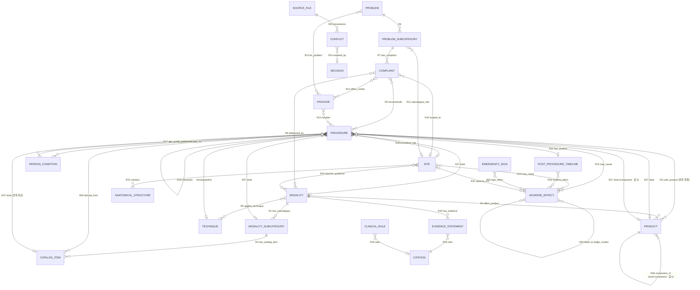

# ERD v3.3 — 피부과 시술 허브 메달리온 시맨틱 정의

작성 2026-11-06 · 상태 **초안(사용자 승인 전)** · 원장 = 브론즈 **3판** `bronze/phub-ledger/`(HASHES.txt 21 일치 · CHANGELOG 3 · 2판 `bronze/phub-ledger-v2/` 보존) + step1 · 발주서 `erd-v3.3-brief.md`(사용자 결정 2026-11-06 「erd 다 정해서 빌드 해보고」 · 변경 A~G). 동결 v3.2(`ERD-FROZEN.md` v3.2 절)를 바탕으로 한 **소개정** — 사용자 정의 1·2·3 · 명시 예외 · 원칙 A~D 글자 그대로 · 바뀌는 것은 A~G 뿐.

기계용 동본 `erd-v3.3.json` · 값 사전 `erd-v3.3-dictionaries.json`(49 · 값 변경 2 자리 · category 삭제 · provenance) · 행선지 `erd-v3.3-column-map.md`(이동 0 · 비고 26 · 미래 칸 3) · 실측 `erd-v3.3-tuples.py`(→ `erd-v3.3-tuples.json` · §9 · 3판) · 검산 `erd-v3.3-check.py`(§10). 생성기 `erd_spec_v33.py`·`erd_colmap_v33.py`·`erd_build_v33.py`. 이전 판 산출물은 그대로 두었다. **v3.2 → v3.3 변경 목록은 §11**, 「사용자 결정 필요」 §12, 「출처 없는 값」 §13, 관찰 §14.

**개체 22(그대로) · 관계 35(34 + R36 component_of) · 사전 49 · 결정 kind 20(그대로 · 새 kind 0 — §5 G 검토) · 행선지 1072(이동 0 · 미래 칸 3)**.

## 0. 사용자 정의 · 첫 규칙 · 원칙 (v3.2 글자 그대로)

동결 원문(ERD-FROZEN · 글자 그대로):

1. 시술 = (무엇을, 어디에, 어떻게) 튜플. 미상 칸이 있으면 접지 않음. 조각 버리지 않음. 엣지 끝 = 시술 튜플.
2. 부작용 = (사건, 부위, 경과) 튜플. 원인 시술은 엣지. 표현은 가리키기만.
3. 원장 불변. 충돌은 레코드(④ 자동 해결도 기록). 결정 16 kind · 안정 키 · 적용 순서 ①~⑦. 빌드는 approved 만 읽음.

v3.1 문장(정의 2 개정판 · v3.3 도 이것을 쓴다):

1. 시술 = (무엇을, 어디에, 어떻게) 튜플. 미상 칸이 있으면 접지 않음. 조각 버리지 않음. 엣지 끝 = 시술 튜플.
2. 부작용 = **(사건, 부위, 물질)** 단위. 부위는 단위를 실제로 가르는 것만 — 조직층(layer) 또는 시술 자리와 무관한 절대 부위(필러 뒤 「시력 변화」의 눈) — 이고, 상대 부위(주사 부위·시술 부위)는 none 과 같다(시술 자리는 기본값). 경과(일시·지연·지속·영구·재발)는 단위 칸이 아니라 R15 엣지 속성(어느 시술 뒤 얼마나 가나). 원인 시술은 엣지. 표현은 가리키기만 — 문구는 개체가 아니라 문구 사전 항목이며 엣지·단위의 부록이다. (사용자 결정 2026-11-05 · V3.1-9 · V3.1-10)
3. 원장 불변. 충돌은 레코드(④ 자동 해결도 기록). 결정 20 kind(v3 17 + product_reclassify · dictionary_remove · phrase_map) · 안정 키(REF-…#m<i>·#s<i> · PRD- 는 product_reclassify 뒤 새 id · 옛 id 는 alias · 문구 사전 항목 PHR- = 정규화형 유도) · 적용 순서 ⓪(원장 적재 때 reclassification·product_reclassify) ①~⑦(① dictionary_add → canonical_rename → dictionary_remove → phrase_map). 빌드는 approved 만 읽음. (V3.1-1 · V3.1-3 · V3.1-10)

**명시 예외(v3.1 개정판 · 유지)**: 부작용 축에서 **부위 없음(none) · 물질 없음(none)은 사전 값으로 본다**(사용자 결정 2026-11-05 · 경과는 단위 칸에서 나갔으므로 「경과 미상」은 더 이상 단위의 값이 아니라 엣지 속성의 빈값이다). (부종, none, none) 은 하나의 단위라 「주사 부위 부종」「일시적 부종」「경미한 부종」이 전부 같은 단위에 닿고, 「멍 (타박상)」「멍 / 반상출혈」「멍·타박상」은 (멍, none, none) 에 닿는다 — 보톡스 부종과 필러 부종은 같은 부작용이며 지속 기간은 시술의 성질(엣지)이다. 시술 축의 「미상이면 접지 않음」과 다른 이유는 v2.4 와 같다: 부작용의 부위 없음은 「모름」이 아니라 「어디서든 나는 사건」이고, 어느 시술에서 나는지는 R15 엣지가 든다. 「지연성 염증성 결절」은 단위 (결절, none, none) + 엣지 경과 지연(+ 수식어 염증성은 문구 사전 parsed)으로 표현된다. 멍·타박상·반상출혈 = 동의어 유지. 분리는 결정 event_split 으로.

**v3.3 과 정의의 관계**: v3.3 은 사용자 정의 1·2·3 · 명시 예외 · 원칙 A~D 의 글자를 바꾸지 않는다(소개정). 바뀌는 것은 사용자 결정 A~G(2026-11-06)뿐 — 구성품 구조(값 0) · 토큰화 규칙 문장(목록 → 형태소 분석기) · 사건 사전 값에도 R2(「혈관 폐색」1 값 · 부위 3 값 · 폐색 ≠ 색전) · 접미사 표기 꼴 규칙 · category 삭제 · 세분 묶음 설계안(적용 0) · 원장 3판 실측. v3.3 은 **A~G 밖의 개체·속성·사전 값·분류를 새로 만들지 않았다** — 애매한 것은 §12 「사용자 결정 필요」 표에 빈 자리로 있다. 사전 값·속성마다 원장 출처(파일·키·locator)를 실측으로 붙였고(§4 provenance), 출처가 없는 v3.2 값은 §4 「출처 없는 값」 표에 전수로 적었다(삭제는 사용자).

### 0.1 첫 규칙 — 문구 종류 분류 먼저 (V3.2-0 · 그대로)

**§0 첫 규칙(V3.2-0 · 사용자 2026-11-05 「왜 미연결을 억지로 붙이려 하냐」)**: 원장 문구는 먼저 **「어느 테이블 것인가」**로 분류하고, 부작용 단위에는 **부작용 문구만** 붙인다. 나머지는 자기 테이블로 정규화한 뒤 부작용·조건을 **참조만** 한다(단위를 세우지 않는다). 「미연결(unlinked)」 집계는 부작용 문구 종류에서만 세고(v3.2 에서는 0 — 아래 노드 원칙), 다른 종류는 각자 테이블의 「참조 성공 / 없음」으로 센다. 문구 사전(phrase_dictionary)은 부작용 문구 종류에만 적용하고, 다른 테이블의 줄은 자기 parsed 속성을 가진다.

| 문구 종류 | 원장 자리 | 자기 테이블 | 부작용과의 관계 |
|---|---|---|---|
| 부작용 이름·문구 | complications 이름 · extracted/taxonomy(계열·항목·제품) safety.common/uncommon/serious/emergency/long_term/common_adverse_effects/serious_adverse_effects/common_side_effects | 부작용 단위 + R15 + 문구 사전 | 붙임(단위 생성·연결 · 사전에 없으면 원장 사건 노드) |
| 시술 후 경과 | post-procedure-timeline timelines[].phases[].normal/abnormal/caution/emergency[] | post_procedure_timeline(V3.2-9) | 줄이 참조(adverse_ref · R34) · 정상 줄은 참조 없으면 경과 메모 |
| 동의서 | consent-checklist mandatory_disclosures · contraindications · emergency_signs | clinical_rule(disclosure) · person_condition · emergency_sign(V3.2-0) | 참조(adverse_ref · R35) · 금기는 조건 축 |
| 시술 전 확인 | pre-procedure-checklist universal_checks · category_specific checks | person_condition(kind=check · v3.1 구조 그대로) | 참조 없음(조건 축 · R16) |
| 메모·설명문·문헌·환자 설명 | safety 안의 메모/설명문(V3.2-7) · literature adverse_effects · patient_* | 문구 사전 메모 항목(status note\|sentence) · evidence_statement(kind=adverse_effects) | 참조(adverse_ref) 또는 없음 · 단위 general_description |

### 0.2 부작용 축 노드 원칙 (V3.2-0 · 그대로 · v3.3: 토큰화는 §1.3 분석기 · 사전 값에도 R2 는 §1.5)

**부작용 축 노드 원칙(V3.2-0 · 사용자 2026-11-05 「경결감이 있으면 새 노드로 만들면 되잖아」 · 검토 S-1 반영 · 시술 축과 대칭)**: 부작용 문구(complications 이름 · safety.*)의 멤버를 **접속 조사(와·과·이나·나)가 붙은 토큰 뒤에서 토막**으로 나누고 토막마다 — (1) **사전 사건이 닿으면 그 사건에 exact 로 붙인다**(부위·경과·물질은 원칙 C 그대로 · 한 토막에 사건이 둘이면 단위 둘 · 원칙 B). 그 토막의 남은 미등록 토큰은 단위 칸이 아니라 **side**(문구 사전 parsed.side · 보존 · 노드 후보 목록)로 둔다 — 「시술 후 일시적인 홍조와 부종」→ 홍조 | 부종 → 부종 exact + 홍조 new · 「이식 부위의 약간의 부종」→ 부종 exact + side[이식, 부위]. (2) **사전 사건이 0 인 토막만** 핵심어(미등록 토큰 + 대체 핵심어 수식어(약화·악화·감소·증가·변화·저하·상승) · 원문 순서 · 그것도 없으면 용언 꼴(predicate))를 **새 사건 값**으로 세운다 — adverse_event_type 의 항목(origin=ledger · status=unreviewed · id = DIC-sha256(adverse_event_type|핵심어) · 출처 = 그 핵심어가 나온 locator 전부 · 설명 = 원장 문맥(문구 원문 · 계열 · 빈도 등급 · severity)). 조사·어미·문법 낱말(V3.2-1) · 수식어(V3.1-8) · 부위·상대 부위·경과·물질 · gloss · 핵심어 제외 낱말(이하·미만·이내·초과·포함·약·기저) · 한글 문구 안의 라틴 문자만인 토큰 · 기호는 핵심어에 들지 않는다. 핵심어의 정규화형이 사전 사건 표면형과 같으면 그 사건(exact). 괄호 안 묶음은 사건 조각이 하나라도 있을 때만(사건 나열) 같은 규칙, 아니면 설명(parsed.explanation · 보존). 핵심어는 바탕 분해(사전 그대로)에서 결정론으로 정해지므로 문구 순서와 무관하다. 그래서 「같은 세 칸은 어느 출처든 같은 단위」(정의 2)가 지켜진다 — 사전 사건은 새 노드에 흡수되지 않는다. **⑦ duplicate_candidate(검토 S-2)는 노드끼리만** — 원장 사건 노드 ↔ 사전 사건(정준값·동의어) · 원장 노드 ↔ 원장 노드(문구 ↔ 노드 쌍은 ⑦ 이 아니다). 표기 규칙의 등급: **strong**(기본 게이트) = 원장 병기 「X(Y)」 · 「X+감·증·형성·감각 ↔ X」 · 짧은 쪽이 긴 쪽의 낱말 · 자모 1 치환 / **weak**(표시만 · 기본 게이트에 올리지 않음) = 낱말 경계 없는 부분 문자열(「반응 ↔ 이물반응」) · 공통 접두 2자 이상 · 첫 음절이 같은 2자 이하. stable_key duplicate_candidate|adverse_event_type|가|나 · 접기는 fold_approve · 유사도 점수·추정 매칭 없음. 부작용 축에는 미연결 상태와 이름 단위(옛 raw_name)가 없다 — 모든 부작용 문구는 기존 단위에 exact 로 붙거나 새 단위를 세운다(new). 다른 테이블의 줄은 원장 사건 노드를 포함한 **이미 있는 단위만** 가리킨다(refer · 세우지 않음 · 사건 옆 토큰은 미등록으로 남아 ref_partial).

**사전 열림/닫힘(V3.2-3 · 사용자 2026-11-05)**: 열린 사전 중 **원장 칸이 종류를 선언한 것**은 원장 어휘가 곧 씨앗이라 자동으로 세운다 — 사건(부작용 문구 칸 · 위 노드 원칙) · 장비 제품(장비 계열·하위분류의 taxonomy 항목 · V3.2-5). 닫힌 사전(부위·조직층 = site · 상대 부위 · 경과 · 물질 = adverse_qualifier)은 승인 절차를 유지한다 — kind·계층·경과 구분은 임상 해석이라 원장 어휘가 바로 값이 되지 않는다. 성분은 열린 사전이지만 원장이 성분 칸으로 선언한 곳(products.json ingredient/material)은 이미 사전이고 그 밖은 라벨의 문맥(바로 옆 토큰 필링·필러·실)으로 **추정**해야 하므로 승인 묶음으로 둔다(「아이 필러」의 아이). 시술 조각(종류 추정 규칙 밖)도 승인 묶음.

**원칙(A~D · v3.2 글자 그대로)**: **A.** 부작용 이름·문구의 토막에 사전 사건이 있으면 그 사건에 exact 로 붙고(옆 미등록 토큰은 side 보존), **사전 사건이 0 인 토막만 그 핵심어를 새 사건 값(origin=ledger · unreviewed)으로 세운다** — 사전 사건은 새 노드에 흡수되지 않는다 · 노드끼리 표기가 비슷하면 ⑦ duplicate_candidate(strong/weak) · 접기는 fold_approve(추정 매칭 0 · v3.2 V3.2-0 · 검토 S-1/S-2) **B.** 조각을 버리지 않는다. 한 칸에 후보가 둘이면 단위를 둘로 나누거나(부위 「이마/눈가」→ 둘) 미해결로 둔다. **C.** 수식어(경과·부위)는 **같은 멤버 안에서 바로 붙은 사건**에만 준다. 이름 전체에서 끌어오지 않는다. **D.** 표현(원장 문구)은 단위를 **가리키기만** 한다 — 단위는 부작용 문구 종류(이름 · safety.*)만 세우고, 그 칸은 전부 사전 값(원장 사건 값 포함)이다. 다른 테이블의 줄은 이미 있는 단위만 참조한다(V3.2-0).

## 1. 규칙

층(브론즈 · 시맨틱 · 실버 · 골드)은 v3.2 §1 그대로. v3.3: 원장은 3판(G) · 토큰화는 형태소 분석기(B · 실버 lib 몫) · 사건 사전 값에도 R2(C). 지식은 원장 21(3판·2판)·컬럼 스캔·erd-v3.2 산출물·발주서·HANDOFF-2026-11-05(「11-06 추가」)·ERD-FROZEN·`ERD-V3-CANDIDATES.md`·`silver-v3/out-dryrun{,2,3}/report.md`·`bronze/phub-ledger/CHANGELOG.md` 에서만 가져왔다(silver-v3/lib 는 열지 않았다).

### 1.1 정규화 norm_v2 · norm_v3(d) · 식별자

- norm_v1(v3.1 그대로): unicodedata.normalize('NFKC') → str.casefold() → 모든 공백 문자 제거 (스페이스·탭·전각공백) → 그 외 문자(괄호·슬래시·하이픈·점 포함)는 그대로 둔다 — 괄호 안이 부위·용량·제품을 구분하는 경우가 있어 벗기지 않는다
- norm_v2(V3.2-2 그대로): norm_v1(NFKC · casefold · 공백 제거) · (a) 병기 괄호: 괄호 하나가 바로 앞 토큰에 붙고 괄호 안이 멤버 하나·숫자 없음·한글만↔라틴만이면 병기 — 사전에 닿은 쪽이 있고 다른 쪽이 라틴 문자만이면 라틴 쪽은 조각이 아니라 gloss(보존) · 아니면 둘 다 그대로 + 쌍은 후보 · (b) 자모 변형 쌍: 원장 전체 어휘(어간)에서 같은 자리 자모 하나 치환(편집거리 1)인 쌍을 목록으로 — 승인되면 사전 동의어(dictionary_add) · 자동 적용 0 · (c) 조사·어미 제거 뒤 재일치(V3.2-1) — norm_v2 는 「같은 것」 판정 규칙이다 — (a)(c) 는 결정론 규칙으로 분해에 적용되고 (b) 는 목록 승인 뒤에만 사전으로 들어간다. 유사도 점수·추측 매칭은 여전히 없다.
- **norm_v3(V3.3-D)**: (d) 접미사 표기 꼴(V3.3-D): X+감·증·형성 ↔ X 는 같은 사건의 표기 꼴 — 값은 결정(fold_approve · canonical_rename)으로만 바뀐다 · 자동 적용 0 — norm_v2 는 「같은 것」 판정 규칙이다 — (a)(c) 는 결정론 규칙으로 분해에 적용되고 (b) 는 목록 승인 뒤에만 사전으로 들어간다. 유사도 점수·추측 매칭은 여전히 없다. (d) 는 판정 규칙이지 자동 접기가 아니다.
- 식별자 `adverse_effect`: v3.2: ADV-<sha256(event_id|site_id|qualifier_id)[:10]> — event_id 는 ERD 사건 사전 id 또는 원장 사건 노드 id(DIC-sha256(adverse_event_type|핵심어)) · site_id = site 개체 id(anatomical·layer·region) | 'none' · qualifier_id = adverse_qualifier 사전 id | 'none'. 경과는 식별자에 없다(R15.course). 같은 세 칸은 어느 출처에서 와도 같은 id
- 식별자 `ledger_event`: DIC-sha256(adverse_event_type|핵심어)[:10] — 핵심어 = 바탕 분해의 멤버 핵심어(원문 토큰 공백 연결) · 정규화형이 같으면 같은 값
- 식별자 `equipment_product`: DIC-sha256(product_name|항목 이름)[:10] · 개체 PRD-sha256(계열|이름) — 같은 이름 여러 계열이면 code `|`
- 식별자 `product_component`: v3.3(V3.3-A): PRD-<sha256(기기 PRD- id|norm(구성품 이름))[:10]> — 구성품은 기기 제품 안에서 유일 · 값 0
- 식별자 `post_procedure_timeline`: TML-sha256(timelines[].id)[:10]
- 식별자 `emergency_sign`: SGN-sha256(정규화 문장)[:10]
- 식별자 `phrase`: PHR-<sha256(normalized)[:10]> — normalized = 수식어 목록·패턴 토큰을 뺀 토큰들의 norm_v1 연결(공백 없음). 문구 사전 항목 id · 안정 키의 조건(S-5): 원장 바이트·수식어 목록·**경과 사전과 분해 사전(사건·부위·상대 부위·수식)** 이 같을 때 같다 — 경과·수식어·사전 값이 바뀌면(dictionary_add 「지속」 뒤 「안면 비대칭 지속」이 별 항목으로 갈리듯) 정규화형이 바뀔 수 있으므로, 옛 항목(approved 포함)은 **raw_variants 로 새 항목에 재귀속**하고 옛 PHR- 는 alias 로 남긴다(결정 target 이 끊기지 않게) · v3.2: 부작용 문구 종류만 · 정규화형은 토큰화(V3.2-1) 뒤 어간·핵심어 기준(「멍이」= 「멍」) — v3.1 항목은 raw_variants 로 재귀속
- 식별자 `product`: PRD-<sha256(계열 코드|norm(제품명))[:10]> — v3.1(V3.1-1): product_reclassify 가 계열 코드를 바꾸면 재계산 · 옛 id 는 aliases(reclassified_from) · 새 (계열|제품명) 의 PRD- 가 이미 있으면 그 레코드로 합침
- 결정 target · 접힘 조건 · locator 규칙은 v3.2 §1.1 그대로(`erd-v3.3.json → id_rule`).

### 1.2 다이어그램

### 1.3 토큰화 = 형태소 분석기 (V3.3-B · v3.2 목록은 보조)

**토큰화(V3.3-B · 사용자 2026-11-06 「형태소 분석기를 쓴다」 · 근거 `silver-v3/out-dryrun/report.md` · `out-dryrun2/report.md` · `out-dryrun3/report.md`)**: 부작용 문구·조건·시술 라벨의 토큰은 「조사·어미 목록에서 뗀다」가 아니라 **형태소 분석기 kiwipiepy(판 고정 0.24 · 사전 값 전부 사용자 단어 등록)의 품사**로 가른다. **핵심어** = 명사(NNG·NNP · 사용자 단어로 등록된 사전 값은 SL 포함) + **용언 어간 + ㅁ/음 명사형 어절**(ETN · 어절 그대로가 이름 — 따가움·막힘·처짐 · 뒤 접속 조사·기호만 뗀다). 조사(J*)·어미(E*)·접사(XS*)·부사(MAG·MAJ)·수사(NR·SN)·기호(S*)·동사/형용사(VV·VA · 명사형 어절 안은 제외)는 핵심어가 될 수 없다. **문장꼴** = 절이 있을 때만 — 용언 + 연결/종결 어미(EC·EF · 「-게」 부사형 제외), 또는 관형형(ETM)·부사형 어절 앞에 그 용언의 논항(격조사 어절)이 있을 때, 또는 관형형 뒤 어절 머리가 의존명사(NNB)·「현상·느낌·증상·경우」일 때. 절 없이 명사 앞에 붙은 **관형어 하나는 수식어**(R1 · R15 qualifier_text · 보존). 「이상」은 수식어가 아니다(1차 드라이런 오분해 — 색소이상→색소). 사건 말 앞의 부위·구조 말(부위 사전 · R2)은 **붙여 써도** 분석기가 형태소로 갈라 부위 칸으로 뗀다(「동맥폐색」「혈관폐색」→ (폐색, 동맥)·(폐색, 혈관) · 뒤 말이 사전 사건일 때만 · 뒤 말이 사전 사건이 아니면 애매 → 사용자). 괄호 안 영문 약어·수치·%·비교(「(Vascular Occlusion)」「(0.04mL)」「(박피에 비해 작음)」)는 사건 후보가 아니다 — R15 속성 또는 문헌 후보(parsed.explanation 보존). 같은 묶음의 「--」「—」「:」 뒤는 서술(predicate · 보존). 분석기 결과도 사전 통째 일치가 먼저다(V3-6 · V3.1-6 · 사전 값은 사용자 단어라 한 형태소로 나온다). **v3.2 의 목록**(조사 27 · 용언 어미 18 · 문법 낱말 21 · relaxed 접미 9 · predicate 어미 7 · 접속 조사 5 · note_words 35 · core_exclude 7 · fallback_core 7)은 규칙이 아니라 **분석기 보조 목록**(analyzer_assist)이다 — 분석기가 어절을 가르지 못한 자리(미등록 외래어·붙여 쓴 꼴)에서만 뒤에 쓰고, 뗀 조각은 grammar_tokens[] 로 보존한다(원칙 B). ERD 실측(`erd-v3.3-tuples.py`)은 분석기 없이 돈다(실버 빌더 lib 가 분석기를 든다 · 8차) — 그래서 §9 의 노드 수는 v3.2 규칙 수치이고 분석기 적용 수치는 드라이런 3차 §5(새 노드 179 · 사건 노드 222 · ⑦ strong 36)에 있다. 판 고정은 실측이 센다(§9.19 kiwipiepy 버전 · 등록할 사전 값 수).

- 분석기: kiwipiepy 0.24(판 고정 · `silver-v3/.venv-kiwi/bin/python`) · 핵심어 품사 ['NNG', 'NNP', 'SL(사전 값)', '용언 어간+ETN(-ㅁ/-음) 명사형 어절'] · 핵심어 불가 ['J*', 'E*', 'XS*', 'MAG', 'MAJ', 'NR', 'SN', 'S*', 'VV', 'VA'] · 절 판정 「용언+EC/EF(-게 제외) | ETM·부사형 앞 격조사 논항 | ETM 뒤 NNB·현상·느낌·증상·경우」 · 수식어 아님 ['이상'] · 서술 표지 ['--', '—', ':'] · 등록할 사전 표면형 1118(실측 §9.19).
- 순서: 사전 통째 일치(사용자 단어) → 형태소 분석(kiwipiepy 0.24) — 품사로 핵심어·수식어·문장꼴 → 분석기 보조 목록(어절을 못 가른 자리만) — 수식어·stopword·표지어 → 문법 낱말 → 조사·어미 → 미등록 · 보존 grammar_tokens[] · predicate · explanation.
- **분석기 보조 목록(analyzer_assist · v3.2 V3.2-1 목록 그대로 · 규칙 아님)** — 조사 27: 에서는 · 에서 · 으로 · 부터 · 까지 · 보다 · 에게 · 에는 · 에도 · 와의 · 이나 · 이며 · 이고 · 이 · 가 · 을 · 를 · 은 · 는 · 의 · 에 · 로 · 와 · 과 · 도 · 만 · 나
  - 용언 어미 18: 합니다 · 됩니다 · 하며 · 되며 · 하는 · 되는 · 하여 · 되어 · 하면 · 하게 · 되지 · 시킬 · 할 · 될 · 한 · 된 · 함 · 됨 · 문법 낱말 21: 있으며 · 있는 · 있을 · 있고 · 있어 · 있으나 · 있으면 · 없이 · 없습니다 · 인해 · 의해 · 비해 · 대한 · 위해 · 따른 · 않음 · 않으며 · 않는 · 않았습니다 · 합니다 · 후에 · relaxed 접미 9 · predicate 어미 7 — 원소마다 locator(§9.11).
- 참조 분해 3단계 · stopwords · 회사 괄호 · 조합 기호 · 회·차 · 겹침은 v3.1 §1.3 그대로(`resolve_rules`). v3.2 토큰화 문장은 `erd-v3.3.json → tokenize_rule_v32_assist`.

### 1.4 시술 튜플 — what 규칙 v3.3 (V3.3-A 구성품 · V3.2-5 장비 · V3.2-6 성분 · V3.3-F 설계안)

**제품 구성품(V3.3-A · 사용자 2026-11-06 「포텐자 시술이면 포텐자 팁도 무엇을에 포함 되야 하는거 아니야 ? 기기 시술은 기기 시술도구도 포함」)**: 기기 시술의 「무엇을」은 기기 제품 또는 그 제품의 **구성품**(소모품 · 팁·카트리지·핸드피스·트랜스듀서 같은 교체·장착 부품)이다 — 성분 what(V3.2-6)과 대칭. 구조: product 개체에 `kind ∈ {product, component}` · component 는 R36 component_of(component → 기기 product · N:1)로 기기에 묶이고, 시술 튜플의 what 은 기기 product 또는 그 component(what_kind=component · R27 끝 product(kind=component) · 접힘 조건은 사전 what 과 같다). **값 0 · 구조만** — 원장 21 에 구성품 칸이 없다(「포텐자 팁」0회 · 팁·카트리지·핸드피스는 주의·설명 문장 안에만 · 실측 §9.18). 구성품 값은 원장에 구성품 칸이 생길 때(기기 사진·기법 설명 조사 파일 입구 · V3-7 media_refs 와 같은 길) 그 칸에서 세운다 — 문장 안의 낱말로 추정해 세우지 않는다(추정 금지). column-map 에는 「원장 칸 없음 · 미래 칸」으로 표기.

**장비 = 제품 자동 등록(V3.2-5)**: 장비 계열(M8·M9·M10·M11·M13·M14) + 기타 장비 하위분류(M12-1·M12-2·M15-3·M15-4·M15-6·물광/메조건)의 taxonomy 항목 이름은 제품(장비) 값이다 — product_name 사전 항목(origin=taxonomy · status=unreviewed · license_status=미확인 · code=계열 · 같은 이름은 합침)으로 **자동 등록**. 제외: 하위분류 라벨에 「프로그램」(시술 묶음) · 이름에 토닝·필링·관리·프로그램·주사(시술명) · 이미 계열/하위분류/제품/기법 사전 값. 그래서 「항목 자신이 시술」(catalog_item what)이던 장비 항목은 §1.4 what 규칙(자기 이름은 분류 항목 색인에서 빼고 제품 사전에 닿으면 product)으로 **product 로 승격**된다. 줄임말·옛 이름은 「정식명이 줄임말을 접두로 포함」(또는 반대) 규칙으로 후보를 뽑아 승인 묶음으로(써마지→써마지FLX · 인모드FX→인모드 · 자동 아님) · 자동 장비 제품이 기존 제품과 접두로 닿으면 ⑦ duplicate_candidate.

**성분 what(V3.2-6 · §1.4)**: 시술 분해 사전에 ingredient_material(성분)을 더한다(primary 다음 순서 · 통째 일치 우선). 한 라벨에 다른 primary(계열·하위분류·제품·분류 항목)가 있으면 성분 조각은 ingredient_fragments(보존 · 칸 아님), 없으면 **what = 성분**(what_kind=ingredient · what_id = 성분 사전 항목 DIC- · 접힘 가능한 사전 what) — 「TCA 필링」= (성분 TCA, 부위, 기법)(TCA 승인 · 필링 → 기법 topical 동의어 승인 뒤). 성분 씨앗: 필링 산(TCA·글리콜산·살리실산·페놀·젖산·만델릭산·제스너) · 필러 성분(HA·히알루론산 …) · 실 재질 · 원장 전수 locator. 톡신 단위(U)는 성분이 아니라 규격(spec·unit 사전).

**「무엇을·어떻게 세분」 묶음(V3.3-F · 설계안만 · 결정은 사용자)**: 지금 ERD 에 자리가 없어 ⑨ 미해결 또는 수식어로 떨어지는 값 넷 — 성분(필러 HA · 필링 산 · v3.2 ingredient what 있음) · 소모품(V3.3-A 구조만) · 실 재질/형태(M7 하위분류 재질별 PDO·PCL / 형태별 코그·모노·볼륨실 / 브랜드 — 한 시술이 셋을 동시에 가짐 · 지금 what 하나만) · **깊이·세기**(심부 필링 · 얕은 필링 · HA 필러(딥) · 필링(약한 산) · 케미컬 필링(중간 깊이) · 저출력 IPL/Nd:YAG/피코토닝 — 수식어로 버리면 심부/얕은 필링 튜플이 같아져 금기 엣지가 섞임). 선택지 셋을 원장 근거(§9.24 실측)와 영향 수치와 함께 §9.24 표로 둔다 — **어느 안도 적용하지 않았다**(개체·속성·사전 값 추가 0 · 사용자 결정 필요 표).

그 밖 §1.4(접힘 · site · technique · 엣지 끝)는 v3.2 그대로.

### 1.5 부작용 단위·문구 (V3.3-C R2 사전 값 · V3.3-D 접미사 · V3.3-E category 삭제 · V3.2 그대로)

- 단위 = (사건, 부위, 물질) 세 칸 · 경과는 R15 · 상대 부위 none · 수식어 목록(V3.1-8) — v3.2 그대로. **노드 원칙**: §0.2 그대로.
- **R2 를 기존 사건 사전 값에도(V3.3-C(1) · 사용자 2026-11-06 「R2 는 기존 사전 43값에도」 · 드라이런 3차 §3.3 N3)**: 사건 사전 값(정준값·동의어)이 「부위 말 + 사건 말」을 **띄어 쓴 꼴**이면 사건 말이 값이고 부위 말은 부위 칸이다 — 「혈관 폐색」→ 사건 **폐색** + 부위 **혈관**(site · layer) · 동의어 「Vascular Occlusion」은 폐색의 동의어로 간다 · 옛 값 「혈관 폐색」은 사전 값이 아니라 **분해 꼴**(decomposed_from · 옛 DIC- id 는 alias)로 남고 문구 사전 raw_variants 가 원문을 보존한다. 그래서 「동맥 폐색」「안동맥 폐색」「혈관 폐색」은 같은 사건 폐색의 부위가 다른 단위가 된다(정의 2). 띄어쓰기 없이 붙은 값(「정맥염」「혈관외유출」)은 뒤 말이 사건 말인지 애매하므로 분해하지 않고 「사용자 결정 필요」에 둔다 — 추정으로 가르지 않는다(원장 문구의 붙은 꼴 「혈관폐색」은 뒤 말 폐색이 사전 사건이라 분석기(V3.3-B)가 가른다 · 목록 규칙 실측에서는 새 노드 1 로 남는다 §9.20). 동의어 중 「피부 딤플링」「피부 괴사」는 이미 정준값(딤플링·괴사)으로 접히므로 값 변경이 없다(N3 동치표 일치). 사전 43 값 중 분해 1 · 애매 2 · 분해 안 함 40(§9.20).
- **폐색 ≠ 색전(V3.3-C(3) · 사용자 2026-11-06)**: 폐색(Occlusion)과 색전(Embolism)은 다른 사건이다 — 접지 않고 동의어로도 두지 않는다(드라이런 3차 N5: 한 묶음인 자리 0). 「혈관폐색/색전」의 `/` 는 대안(또는)이라 두 사건에 다 붙는다(V3-4). 원장 문구가 둘을 한 문장에 인과로 적은 자리(「혈관 막힘으로 인한 피부 괴사」「혈관 폐색(역행성 색전 메커니즘)」)는 **R30 leads_to 후보 — 색전 → 폐색 · 폐색 → 괴사** 로 §9.20 에 제안만 둔다(edge_create 결정이 approved 일 때만 엣지 · 지금 R30 엣지 0 · 레코드 만들지 않았다).
- **접미사 표기 꼴(V3.3-D · 사용자 2026-11-06 「형성은 같은거고 … 둘다 증상아니야 ?」→「응 같다고 하자」)**: 사건 말에 **~감 · ~증 · ~형성** 이 붙은 꼴은 같은 사건의 **표기 꼴**이다 — 대표 이름(정준값)은 **현상 이름**(건조·경결·흉터·색전·자반·가피·수포·결절·반흔·경화·경직·마비·박탈·자극·통증·화상·따가움)이고 접미 꼴은 동의어(표기 변형)로 내려가며 원문은 문구 사전 raw_variants 에 그대로 남는다. 이것은 사전 값 변경이므로 ERD 가 값을 고치지 않는다 — 드라이런 3차 §3.6 의 **쌍 20 은 fold_approve 결정 레코드**(⑦ 닫기 · 8차 적용 · 사전 쪽이 접미 꼴인 쌍(자극감 ↔ 자극)은 canonical_rename 도 함께 · §9.22 표). 접미사가 아닌 3쌍(압통감 ↔ 통증 · 저림감 ↔ 감각 이상 · 가려움증 ↔ 소양감)은 임상 동치라 사용자가 따로 본다(「사용자 결정 필요」). ⑦ strong 규칙의 「감각」(「감각 ↔ X」)은 사용자 결정에 없으므로 표기 꼴이 아니라 ⑦ 후보 그대로. 새로 나오는 접미 쌍도 규칙으로 자동 접지 않는다 — ⑦ strong 후보로 올라와 fold_approve 로 닫는다(규칙 단위 승인은 이번 20 쌍까지).
- **사건 사전 category 삭제(V3.3-E · 사용자 2026-11-06 「묶음 라벨이 필요한거야 ? 왜 만드냐고」)**: adverse_event_type 의 7분류(국소 일시 반응 · 염증/감염 · 혈관 · 신경 · 색소 · 구조/이물 · 전신)는 원장 21 파일에 **0회** — ERD v2 발주서가 지어 넣은 라벨(사용자 지시 아님 · 이름부터 틀림: 1달 가는 통증도 「일시 반응」). 사전 항목의 `category`·`category_review` · 결정 kind dictionary_add·event_split 의 new_value `category` · 단위 레코드의 `event_category` · 보고서의 「분류」 열을 전부 뺀다(§9.23 전수 표). 부작용의 분류는 **원장 값만** — complications `severity`(mild~critical · R15 속성) · taxonomy/extracted safety 칸(common / uncommon / serious · R15 frequency_class) · 엣지 경과(R15 course). 게이트의 「노드별 종류」 질문도 없어진다.
- **문구 종류 판정(V3.2-7 그대로)**: **부작용 문구 종류 판정(V3.2-7 · tuple_rules.phrase_kinds)**: 부작용 문구 칸(safety.*)에 있어도 부작용이 아닌 문구가 있다. 바탕 분해(사전 그대로)로 차례로 판정한다 — (1) exact: 사건이 있고 사전 밖 토큰 0 → 그대로 · (2) **not_adverse_note**(status=note): 사건 조각 0 이고 바깥 묶음에 메모 어휘(note_words · 정상·유지·소실·발현·여부·자료·부족·금기·금지·상담 …)가 있거나, 사건 0·핵심어 0 · (3) **explanatory_sentence**(status=sentence): 바깥 멤버 하나의 토큰 ≥ sentence_min_tokens 이거나 바깥 문법 토큰 ≥ sentence_min_grammar 이거나 라틴 문자 비율 ≥ sentence_latin_ratio · (4) 그 밖 new(핵심어 노드). 메모·설명문은 **unlinked 로 세지 않고** 별도 집계(메모 N · 설명문 N)로 두며 원문·locator 는 문구 사전 메모 항목(memo_phrases)에 보존한다 — 설명문은 phrase_map 대상(사람 지정). phrase_shape 값에 not_adverse_note · explanatory_sentence 를 더한다. 타임라인 normal 은 V3.2-9 타임라인 줄(참조 · 정상 메모)로 간다.
  - 메모 어휘 35 · 설명문 문턱(멤버 토큰 ≥7 · 문법 ≥3 · 라틴 비율 ≥0.8) · 대체 핵심어 ['약화', '악화', '감소', '증가', '변화', '저하', '상승'] · 핵심어 제외 ['이하', '미만', '이내', '초과', '포함', '약', '기저'] — 전부 **분석기 보조 목록**(V3.3-B) · ⑦ 규칙 {'strong': ['paren_pair(원장 병기 X(Y))', 'suffix_감|증|형성(표기 꼴 · V3.3-D · 닫기는 fold_approve)', 'suffix_감각(⑦ 후보 · 사용자 결정 없음)', 'word_contains(짧은 쪽이 긴 쪽의 낱말)', 'jamo1'], 'weak(표시만 · 기본 게이트 아님)': ['substring', 'prefix≥2', 'first_syllable(둘 다 2자 이하)']} · 표기 꼴 접미 ['감', '증', '형성'] · 대표 이름(현상) ['건조', '경결', '흉터', '색전', '자반', '가피', '수포', '결절', '반흔', '경화', '경직', '마비', '박탈', '자극', '통증', '화상', '따가움'].
- **R15 속성 상속(V3.2-8 그대로)**: **R15 속성 상속(V3.2-8 · 사용자 「시술에 부종이 붙는데 부종에 대한 정보가 없다」)**: 세 층 — ① 부작용 단위 자체의 일반 정보: `general_description`(그 단위를 참조하는 문헌 adverse_effects evidence_statement id·locator) · `general_management`(그 단위로 접힌 complications 이름들의 management locator) · ② 계열 → 단위 R15(complications 표 행)의 severity·incidence·onset·duration·mechanism·management·prevention·risk_factors · ③ 항목/제품 → 단위 R15 는 항목 고유 값(safety 문구 parsed · frequency_class)만. 조회 규칙: 항목·제품 엣지에 값이 없으면 같은 계열(R2/R4 로 올라간 계열 코드)의 계열 엣지 값을, 거기도 없으면 단위 일반값을 **참조**하고 속성마다 `basis: item|family|unit|none` 과 `ref`(참조 대상 R15 키 또는 단위 속성) · `ref_locator` 를 단다. **값을 복사하지 않는다**(원장 불변 · provenance 는 참조 대상 locator) — 실버 레코드에는 참조만, 골드에서 펼친다. 실측 §9.15.

### 1.6 사람 조건 — v3.2 그대로 + 토큰화는 분석기(V3.3-B)

조건 사전·완전 일치·raw_name 단위·문장 부록은 v3.1 §1.6 그대로. v3.3: 조사·어미를 떼는 것은 분석기 품사(J*·E*)로 — 목록은 보조. 실측 §9.7 · §9.10.

### 1.7 사전 씨앗 규칙 (V3.2-3 · V3.2-4 그대로 · V3.3-C 승인 씨앗은 결정 레코드)

**사전 씨앗 규칙(V3.2-3 · §1.7)**: 사전 초기값은 특정 파일이 아니라 **원장 전체 어휘**(분해하는 문자열 자리 전부 — 부작용 이름·문구 · 타임라인 · 동의서 · 문헌 · 조건 · 시술 라벨)에서 온다. 조각(규칙 적용 뒤 미등록 토큰)을 뽑고 **어느 칸(key path)에서 나왔는지로 종류**를 정한다 — 부작용 문구 칸 → 사건(열림 · 원장 칸 선언 → **자동** · 위 노드 원칙) / 장비 계열·하위분류 항목 → 장비 제품(열림 · **자동** · V3.2-5) / 부위 닫힌 목록 값·동의어 → 부위(닫힘 · 승인) / 라벨에서 바로 옆 토큰이 필링·필러·실 이거나 발주서 명시 성분 → 성분(추정 · 승인) / 그 밖 시술 라벨 조각 → 시술 조각(사전 선택 · 승인) / 제품 이름과 접두 관계 → 줄임말·옛 이름(승인). 승인 묶음은 빈도 ≥2 또는 locator ≥2 인 것만 proposed(그 밖은 「빈도 1」) · 출처 locator 전부 · 추천 종류 · 사전마다 닫힘 여부. 승인된 씨앗이 결정 dictionary_add 로 사전 값이 된다(적용 0 · `erd-v3.2-seed-candidates.json/.md`).

**부위 사전 전수(V3.2-4)**: 닫힌 목록 = 얼굴 세부(이마·미간·관자놀이·눈가·눈 주변·눈밑·눈꺼풀·코·코끝·팔자주름(팔자)·볼·광대·턱·턱선·사각턱·입술·목·목주름·이중턱/턱밑) · 바디(복부·옆구리·팔뚝·허벅지·종아리·힙·등·가슴·겨드랑이·손·발·승모근) · 두피 · 전체(얼굴 전체·바디 전체) · 조직층 5 · 상대 2. 값마다 kind(anatomical·region·layer·relative) · **parent**(계층 · 눈밑 ⊂ 눈가 ⊂ 얼굴 · 몸 부위 ⊂ 바디 전체) · 원장 locator(토큰 열 일치 · 조사 뗀 꼴 포함) · 동의어 후보(전체얼굴·풀페이스 → 얼굴 전체 …). site 사전 항목에 `parent` 필드를 두고(v3.1 값은 null · 제안은 씨앗 묶음) 값 추가는 승인으로만. 「등」처럼 수식어·문법 낱말과 꼴이 같은 값은 동형어 — 자리 수는 상한(확인 필요). v3.3(V3.3-C(2)): 동맥·정맥·안동맥 추가(사전 값 · parent).

**승인 씨앗(V3.3-C(4))** — 승인됨 · 8차 적용(dictionary_add 결정 레코드 · 사용자 2026-11-06 「부위는 일단 추가 해야하는게 맞지」 · 성분 6 = 17 중 성분인 것 · 11 은 기계 오추출로 버림(코디 판단 · 표에 보임)) — ERD 사전 값 아님 · parent 는 v3.2-4 계층. 부위 15: 눈밑(anatomical · parent 눈가) · 눈꺼풀(anatomical · parent 눈가) · 코끝(anatomical · parent 코) · 목주름(anatomical · parent 목) · 얼굴 전체(region · parent 얼굴) · 바디 전체(region · parent —) · 복부(anatomical · parent 바디 전체) · 옆구리(anatomical · parent 바디 전체) · 팔뚝(anatomical · parent 바디 전체) · 허벅지(anatomical · parent 바디 전체) · 종아리(anatomical · parent 바디 전체) · 힙(anatomical · parent 바디 전체) · 가슴(anatomical · parent 바디 전체) · 겨드랑이(anatomical · parent 바디 전체) · 두피(region · parent —) · 성분 6: HA · 히알루론산 · TCA · 글리콜산 · 살리실산 · 페놀. locator 는 §9.21. 이 값들은 **erd-v3.3-dictionaries.json 에 없다**(8차 dictionary_add 뒤 사전 값이 된다).

사전 닫힘: site 닫힘 · relative_site 닫힘 · course 닫힘 · adverse_qualifier 닫힘 · adverse_event_type 열림 · ingredient_material 열림 · product_name 열림 · 그 밖 사전은 씨앗 규칙 대상 아님(closed=null).

### 1.8 자기 테이블 — 타임라인 · 응급 징후 · 고지 · 문헌 (V3.2-9 · V3.2-0 그대로)

- **post_procedure_timeline(V3.2-9 · 사용자 「타임라인 테이블이 필요한 영역 아니냐」)**: post-procedure-timeline.json timelines → phases → 줄(reaction_level normal|abnormal|caution|emergency · 원문 · locator · parsed · adverse_ref[] · ref_status ref|ref_partial|none|normal_memo). 줄은 V3.2-0 refer 로 분해해 **이미 있는** 부작용 단위에 닿으면 참조(R34 timeline_refers: 줄 → adverse_effect · 속성 reaction_level · period · phase_label), 정상 줄이 닿지 않으면 경과 메모(normal_memo · 원문 보존). R15 는 타임라인 줄을 출처로 「계열 → 단위」 엣지에 timeline_refs[] 를 **참조로** 얻는다 — v3.1 의 R15 period · phase_label · reaction_level 속성은 이 참조로 대체된다. 타임라인 문구는 문구 사전에 들지 않는다. 골드 「시술 후 안내」는 이 개체를 그대로 쓴다.
- **emergency_sign(V3.2-0 · 「응급 징후도 타임라인 줄처럼 자기 자리」)**: consent-checklist categories[].emergency_signs[] — 정규화 문장 하나가 레코드(SGN- · 같은 문장 여러 계열이면 modality_codes 여럿) · parsed · adverse_ref[] · ref_status. R35 sign_refers: emergency_sign → adverse_effect(참조). R15 「계열 → 단위」 엣지는 emergency_sign_refs[] 를 참조로 얻는다. 단위를 세우지 않는다.
- **필수 고지(V3.1-7 · v3.2 V3.2-0)**: clinical_rule(kind=disclosure) + R32(basis=ledger) 는 v3.1 그대로. v3.1 의 「같은 문장을 문구 사전(kind=disclosure)으로도 두어 단위에 닿는다」는 **삭제** — 고지는 자기 테이블(clinical_rule)의 parsed · adverse_ref[] · ref_status 로 단위를 참조만 한다(phrase_ids 속성 대신 adverse_ref).
- **문헌 adverse_effects(V3.2-0)**: v3.1 의 문구 사전 항목이 아니라 **evidence_statement(kind=adverse_effects)** 레코드 — statement · patient_text(ko·en·zh·ja) · accuracy · R19 cites · R20(계열 → 근거). statement 와 patient_ko 를 refer 로 분해해 닿은 단위를 adverse_ref[] 로 가리키고, 그 단위의 general_description 이 이 레코드를 참조한다(V3.2-8 ①).

### 1.9 원장 3판 (V3.3-G)

**원장 3판(V3.3-G · 사용자 2026-11-06 · `bronze/phub-ledger/CHANGELOG.md` 3)**: synergy from/to 줄임말 18종 59자리 → taxonomy 정식 이름(「Mxx-」 접두 제거 · 부위가 붙으면 「이름 부위」) · taxonomy M8›기타 항목 2 신설(「저출력레이저(LLLT)」「다이오드 레이저」 · name 만) · README 규칙 2(synergy 는 taxonomy 정식 이름 그대로 · 없으면 taxonomy 에 먼저 세운다). ERD: 분류 항목 521 → 523 · synergy 노드 라벨은 §1.3 분해에서 「Mxx-」 접두 없이 바로 정식 이름에 닿는다(남은 「Mxx-」 접두 자리는 4판 후보 · 사용자 답 대기). 실측 전부 3판으로 재생성(§9 · v3.2 2판 열과 나란히). 2판은 `bronze/phub-ledger-v2/` 에 보존(v3.2 검산 재실행용).

## 2. 개체 목록

개체 22(v3.2 그대로). v3.3 에서 바뀐 것: product(kind product|component · component_of · component_kind — 값 0) · procedure(what_kind component) · site(동맥·정맥·안동맥 · parent 값) · adverse_effect(정의 비고 — R2 사전 값 · 폐색 ≠ 색전). 새 개체 0(F 설계안 F-3 의 procedure_spec 은 적용하지 않았다).

### 2.1 `source_file` — 원장 파일 (접두 `SRC`)

- 정의: 브론즈 스냅샷(2026-10-26)의 원장 JSON 21 + 조사 산출물 step1-products.json(10-29). 실버의 모든 값이 가리키는 출처의 뿌리.
- 식별자: 파일 SHA256
- aliases: 없음

| 속성 | 타입 | 필수 | 출처 원장 키 | 규칙 |
|---|---|---|---|---|
| file_name | str | ○ | (파생/ERD 정의) | 파일명 |
| sha256 | str | ○ | (파생/ERD 정의) | 바이트 해시 = 식별자 |
| bytes | int | ○ | (파생/ERD 정의) |  |
| snapshot_date | date | ○ | (파생/ERD 정의) | 2026-10-26 고정 |
| trust_tier | int(1~4) | ○ | (파생/ERD 정의) | §5 신뢰 순위 표 |
| kind | enum(ledger\|research_artifact) | ○ | (파생/ERD 정의) | 원장 21 = ledger, step1 = research_artifact |
| trust_basis | str | ○ | (파생/ERD 정의) | 순위 근거 키 |
| trust_flag | str\|null |  | (파생/ERD 정의) | 8-1 「AI 컨센서스 추정」 · step1 「허가 필드만 조건부 2」 |
| version | str\|null |  | `*:version` | 없는 파일(taxonomy·extracted·complications)은 null |
| updated | date\|null |  | `*:updated` |  |
| description | str\|null |  | `*:description` |  |
| method | str\|null |  | `*:consensus_method` `literature-evidence.json:source_method` |  |
| currency | str\|null |  | `market-pricing.json:currency` | 가격 단위 사전과 연결 |
| note | str\|null |  | `market-pricing.json:note` |  |

### 2.2 `modality` — 계열 (접두 `MOD`)

- 정의: 시술 계열 M1~M17. 정본 코드·이름은 taxonomy.json (질문 1). v3.1(V3.1-7): 필수 고지(consent mandatory_disclosures[])는 속성이 아니라 clinical_rule(kind=disclosure) 레코드이며 R32 rule_applies_to(basis=ledger)로 이 계열에 닿는다 — 동의서 뷰는 골드에서 조립한다.
- 식별자: taxonomy modality[].id (M 코드)
- aliases: extracted.json {code}.procedure_id (M1-BOTOX 형) · post-procedure-timeline id(timeline name 이 계열명과 정규화 일치할 때만) · products.json 섹션 키(category_id 가 단일 코드일 때)

| 속성 | 타입 | 필수 | 출처 원장 키 | 규칙 |
|---|---|---|---|---|
| code | str | ○ | `taxonomy.json:modality[].id` | M1~M17 |
| name | str | ○ | `taxonomy.json:modality[].category` | 정본 한글명 |
| name_en | str | ○ | `taxonomy.json:modality[].category_en` |  |
| group | dict:modality_group | ○ | `taxonomy.json:modality[].group` |  |
| overview | str[src] |  | `extracted.json:{code}.overview` `taxonomy.json:modality[].extracted.overview` | 두 출처 모두 보존, 다르면 충돌 (질문 2) |
| mechanism | str[src] |  | `extracted.json:{code}.mechanism` `taxonomy.json:modality[].extracted.mechanism` | 질문 2 |
| indications_primary | str[][src] |  | `extracted.json:{code}.indications.primary[]` `taxonomy.json:modality[].extracted.indications.primary[]` | 자유 텍스트. 주호소 연결은 사전 일치만 |
| indications_extended | str[][src] |  | `extracted.json:{code}.indications.extended[]` `taxonomy.json:modality[].extracted.indications.extended[]` |  |
| onset | str[src] |  | `extracted.json:{code}.onset_duration.onset` `taxonomy.json:modality[].extracted.onset_duration.onset` |  |
| peak | str[src] |  | `extracted.json:{code}.onset_duration.peak` `taxonomy.json:modality[].extracted.onset_duration.peak` |  |
| duration | str[src] |  | `extracted.json:{code}.onset_duration.duration` `taxonomy.json:modality[].extracted.onset_duration.duration` |  |
| aftercare | str[][src] |  | `extracted.json:{code}.aftercare[]` `taxonomy.json:modality[].extracted.aftercare[]` `procedure-profiles.json:profiles[].aftercare[]` |  |
| related_techniques | str[][src] |  | `extracted.json:{code}.related_techniques[]` `taxonomy.json:modality[].extracted.related_techniques[]` | 설명 문장. 기법 사전 연결은 하지 않음 |
| extracted_meta | obj |  | `extracted.json:{code}.source_type` `extracted.json:{code}.extracted_at` `extracted.json:{code}.guardrail_version` `extracted.json:{code}.updated` | extracted.json 레코드 메타. source(교과서)는 citation 개체 |
| patient_name | str |  | `patient-education.json:categories[].patient_name` | 환자용 별칭 — 사전 동의어로도 등록 |
| patient_simple_explanation | str |  | `patient-education.json:categories[].simple_explanation` |  |
| patient_how_it_works | str |  | `patient-education.json:categories[].how_it_works` |  |
| patient_duration_simple | str |  | `patient-education.json:categories[].duration_simple` |  |
| patient_pain_level | str |  | `patient-education.json:categories[].pain_level` |  |
| patient_downtime | str |  | `patient-education.json:categories[].downtime` |  |
| faq | obj |  | `patient-education.json:categories[].common_concerns[].q` `patient-education.json:categories[].common_concerns[].a` | FAQ = 속성 |
| floor_phase | dict:floor_phase |  | `procedure-profiles.json:profiles[].phase` |  |
| floor_phase_order | int |  | `procedure-profiles.json:profiles[].phaseOrder` | 중복값 있음(95·90·85) — 원문 보존 |
| flags | obj(bool) |  | `procedure-profiles.json:profiles[].hasProtein` `procedure-profiles.json:profiles[].hasHA` `procedure-profiles.json:profiles[].usesGel` `procedure-profiles.json:profiles[].createsWound` `procedure-profiles.json:profiles[].createsChannel` `procedure-profiles.json:profiles[].needsCleansing` |  |
| risk_scores | obj(int 0~3) |  | `procedure-profiles.json:profiles[].thermalLoad` `procedure-profiles.json:profiles[].bleedingRisk` `procedure-profiles.json:profiles[].swellingRisk` |  |
| anesthesia | dict:anesthesia |  | `procedure-profiles.json:profiles[].needsAnesthesia` |  |
| position | dict:position |  | `procedure-profiles.json:profiles[].position` |  |
| prep_time_min | int |  | `procedure-profiles.json:profiles[].prepTime` | 단위 분 |
| prep_notes | str |  | `procedure-profiles.json:profiles[].prepNotes` |  |
| duration_min | int |  | `procedure-profiles.json:profiles[].durationMin` | 단위 분 |
| duration_max | int |  | `procedure-profiles.json:profiles[].durationMax` | 단위 분 |
| moa_summary | str |  | `procedure-profiles.json:profiles[].moa_summary` |  |
| practical_notes | str[] |  | `procedure-profiles.json:profiles[].practicalNotes[]` |  |
| price_items | obj |  | `market-pricing.json:categories[].items[].name` `market-pricing.json:categories[].items[].unit` `market-pricing.json:categories[].items[].low` `market-pricing.json:categories[].items[].mid` `market-pricing.json:categories[].items[].high` | 가격 = 속성. label 의 시술/제품 연결은 사전 일치만(질문 11) |
| pih_note | str |  | `pih-risk.json:notes.{code}` | `M1_to_M7` 범위 키는 M1~M7 일곱 계열에 같은 값을 둔다(③ 형식 교정) |
| same_session_order | obj(order,phase,reason) |  | `treatment-sequence.json:sequence_order[].order` `treatment-sequence.json:sequence_order[].phase` `treatment-sequence.json:sequence_order[].reason` | categories[] 가 가리키는 계열/하위분류에 둔다. 미해결 참조는 ⑨ |
| evidence_statement_count | obj\|null |  | `literature-evidence.json:categories.{code}.moa` `literature-evidence.json:categories.{code}.adverse_effects` `literature-evidence.json:categories.{code}.effects` | 빈 배열 = null(미입력) (질문 13) |
| products_present | bool\|null |  | `taxonomy.json:modality[].products` | 빈 배열 = null(미입력) (질문 15) |

### 2.3 `modality_subcategory` — 계열 하위분류 (접두 `SUB`)

- 정의: taxonomy modality[].subcategories 74. 계열 아래, 단위 시술 위의 분류 층. 참조 깊이 「하위분류」의 대상. 8-4 처분: 하위분류 label 64(distinct)는 기법이 아니라 이 개체의 label 로만 둔다. pih-risk subcategory 는 이 label 과 일치할 때만 연결. v2.4: 분류 항목(CAT-)의 「계열 코드」는 이 하위분류가 놓인 taxonomy 트리 위치의 계열(modality[].id)이며, reclassification(reclassified_to)은 R2 재배치만 바꾸고 CAT- id 를 바꾸지 않는다(§2.4 · 3-B′). v3(V3-8): R5 의 from 이 될 수 있다(하위분류 단위 기본 기법 — canonical_mapping target.from_ref=R5:<하위분류 id>).
- 식별자: 계열 코드 + 정규화 label
- aliases: taxonomy subcategories[].id · treatment-sequence/post-procedure-timeline 의 코드+라벨 합성값(실존 하위분류 id 와 일치할 때만, 질문 7)

| 속성 | 타입 | 필수 | 출처 원장 키 | 규칙 |
|---|---|---|---|---|
| code | str | ○ | `taxonomy.json:modality[].subcategories[].id` | M1-2 형 56 + 기타 18 형식 혼재 — alias 로도 보존 |
| label | str | ○ | `taxonomy.json:modality[].subcategories[].label` | 중복 `기타`·`추가` 는 계열 코드로 구분 |
| description | str\|null |  | `taxonomy.json:modality[].subcategories[].description` |  |
| items_present | bool\|null |  | `taxonomy.json:modality[].subcategories[].items` | 빈 배열 = null(미입력) |
| same_session_order | obj |  | (파생/ERD 정의) | treatment-sequence categories[] 가 하위분류를 가리킬 때(M15-도포·M15-팩) |

### 2.4 `catalog_item` — 분류 항목(taxonomy 항목) (접두 `CAT`)

- 정의: taxonomy modality 항목 521 을 **있는 그대로** 담는 분류 항목. taxonomy 는 제품·마케팅명·부위 붙은 메뉴·기법이 섞인 분류 트리(10-27 결정)라 단위 시술이 아니다. v1.1 `procedure` 의 속성·alias·출처를 전부 여기로 옮겼다. 계층(계열→하위분류→항목)도 그대로(R1·R2). 각 항목은 분해 규칙(§1.4)으로 튜플 하나(procedure)로 내려가고 R26 derived_from 으로 매단다. v2.1: 이름 조각에 미등록이 있거나 primary 조각이 없는 항목은 그 항목 자신이 튜플의 what(what_kind=catalog_item)이며 다른 항목과 접히지 않는다(부모 하위분류 fallback 삭제). v2.2: 이름 조각에 primary·site·technique 가 둘 이상이거나 what 으로 못 쓰는 primary 가 있어도 항목 자신이 what(tuple_status ambiguous) — 버리고 접지 않는다. 항목 자신 튜플은 식별자에 CAT- anchor 가 들어가 항목마다 고유하다. v2.4: 식별자의 계열 코드 = taxonomy 트리 위치(원장 · reclassification 적용 전) 고정(3-B′).
- 식별자: 계열 코드 + 정규화 항목 이름 (v1.1 procedure 와 같음) — v2.4: CAT- 식별자의 「계열 코드」 = **taxonomy 트리 위치**(원장 `taxonomy.json:modality[].id` — 그 항목이 적힌 계열 · reclassification 메모 적용 전). reclassification(reclassified_to · 적용 ⓪)은 R2(하위분류 → 항목) 재배치만 바꾸고 CAT- id 는 바꾸지 않는다 — 소프라노 티타늄 = sha256(`M9|소프라노티타늄`) 그대로(M9 → M8 재배치 뒤에도) · 볼뉴머 M4/M9 는 각각의 트리 위치로 서로 다른 CAT-. 결정·R26·anchor 튜플 id 가 가리키는 CAT- 는 다른 결정 뒤에도 바뀌지 않는다(검토 3-B′)
- aliases: taxonomy items[].id (M1-2-1 · auto-M4-… · auto-63-… 전부) — 외부 참조 여부 무관하게 alias (질문 4). v1.1 PRC- id 는 CAT- 로 바뀐다(canonical_key 는 같음)

| 속성 | 타입 | 필수 | 출처 원장 키 | 규칙 |
|---|---|---|---|---|
| name | str | ○ | `taxonomy.json:modality[].subcategories[].items[].name` | 중복 `볼뉴머`(M4·M9) 는 계열 코드로 구분 → ⑦ 후보 |
| detail | str\|null |  | `taxonomy.json:modality[].subcategories[].items[].detail` | 빈 문자열 20 = null |
| overview | str |  | `taxonomy.json:modality[].subcategories[].items[].extracted.overview` |  |
| mechanism | str |  | `taxonomy.json:modality[].subcategories[].items[].extracted.mechanism` |  |
| indications_primary | str[] |  | `taxonomy.json:modality[].subcategories[].items[].extracted.indications.primary[]` |  |
| indications_extended | str[] |  | `taxonomy.json:modality[].subcategories[].items[].extracted.indications.extended[]` `taxonomy.json:modality[].subcategories[].items[].extracted.indications.secondary[]` | `secondary` 는 동의 키로 합친다(질문 20 기본값) — 재검토 §8-3 |
| onset | str |  | `taxonomy.json:modality[].subcategories[].items[].extracted.onset_duration.onset` |  |
| duration | str |  | `taxonomy.json:modality[].subcategories[].items[].extracted.onset_duration.duration` |  |
| peak | str |  | `taxonomy.json:modality[].subcategories[].items[].extracted.onset_duration.peak` `taxonomy.json:modality[].subcategories[].items[].extracted.onset_duration.peak_effect` | `peak_effect` 동의 키 (질문 20) |
| maintenance | str |  | `taxonomy.json:modality[].subcategories[].items[].extracted.onset_duration.maintenance` |  |
| aftercare | str[] |  | `taxonomy.json:modality[].subcategories[].items[].extracted.aftercare[]` |  |
| safety_note | str |  | `taxonomy.json:modality[].subcategories[].items[].extracted.safety.note` |  |
| is_marketing_name | bool |  | `taxonomy.json:modality[].subcategories[].items[].is_marketing_name` |  |
| ingredient_basis | str |  | `taxonomy.json:modality[].subcategories[].items[].ingredient_basis` |  |
| naming_caveat | str |  | `taxonomy.json:modality[].subcategories[].items[].naming_caveat` |  |
| tuple_status | enum(complete\|partial\|ambiguous) |  | (파생/ERD 정의) | 분해 결과: complete = 미등록 조각 0 · partial = 미등록 조각 ≥1 · ambiguous(v2.2) = primary/site/technique 둘 이상 또는 what 으로 못 쓰는 primary(항목 자신 what) |
| unregistered_fragments | str[] |  | (파생/ERD 정의) | 이름 분해에서 어느 사전에도 닿지 않은 조각(공백 토큰 단위). 사전 추가는 이번 범위 아님 — 목록만 |

### 2.5 `procedure` — 단위 시술 (접두 `PRC`)

- 정의: **단위 시술 = 튜플 (what, site, technique)** — 무엇을 × 어디에 × 어떻게. what = modality | modality_subcategory | product (사전 값) 또는 catalog_item(분류 항목 자신). 접힘 조건: **세 칸 전부 사전 값일 때만** 다른 항목·참조와 접힌다 — what 이 사전 값(product | modality_subcategory | modality)이고 site 가 부위 사전 값이고 technique 가 기법 사전 값일 때. 미상(site none · technique none)은 식별자 값이 아니다: 미상 칸이 하나라도 있거나 what 이 분류 항목 자신(CAT-)이면 식별자에 anchor 를 섞어 항목·참조마다 고유하다(접히지 않음). anchor = 분류 항목은 CAT- id, 참조(②③)는 REF-sha256(norm(label)|hint)[:10], 조합 멤버는 anchor#m<i>. 참조(또는 조합 멤버)가 분류 항목 이름과 정규화 완전 일치(①)하면 그 항목 자체라 그 항목의 anchor 를 쓴다(같은 튜플 — 접힘 아님). 같은 라벨·같은 힌트의 참조도 ① 이라 자리가 달라도 같은 anchor. 규격·수식·계열명 조각이 붙은 라벨은 자기 anchor(미상 칸이 있으면 접히지 않는다). **조각을 버리고 접지 않는다**(v2.2): 분류 항목 이름의 조각이 전부 사전에 닿았어도 primary(what 후보) 조각이 둘 이상(조합 아님) · site 조각이 둘 이상 · technique 조각이 둘 이상 · what 으로 못 쓰는 primary 조각이 있으면 사전 값으로 조립하지 않는다 — 분류 항목은 what = 항목 자신(status ambiguous · 조각 전부 extra_primaries/extra_sites 에 실값), 참조(②③)는 미해결(⑨). 같은 계열의 계열명 조각(what 의 계열과 같은 modality 조각)은 what 의 상위(R1·R4)로 이미 담기므로 버린 조각이 아니다. 조각 중 하나라도 미등록이면 v2.1 그대로 what = 항목 자신(partial · candidate_name). primary 조각이 없으면(부위만·계열명만) 항목 자신(complete). 부모 하위분류 fallback 없음. site = 부위 사전 값 | none. technique = 이름 조각이 기법 사전에 닿을 때만 그 값 | none — **계열 기본값(R5)을 튜플에 붙이지 않는다**(v2.2 · 결정 kind canonical_mapping 후보로만 §9.5.6). 원천: ① 분류 항목 521 ② 자유 텍스트 참조(§9.2 자리 전부) ③ market-pricing 122. 조합 기호로 같은 묶음 안에 primary 멤버가 둘 이상이고 멤버 밖에 primary·site 조각이 없으면 package(kind=combo_ref)로 보내고 멤버 각각을 튜플화한다. v2.3: 시술 축 엣지(R3·R9·R12·R15·R16·R17·R18)의 끝은 이 튜플이다(§3 엣지 끝 규칙).
- 식별자: 세 칸 전부 사전 값이면 PRC-<sha256(what_id|site_id|technique_id)[:10]>, 아니면(site none · technique none · what=CAT- 중 하나라도) PRC-<sha256(what_id|site_id|technique_id|anchor)[:10]>. what_id = MOD-/SUB-/PRD-/CAT-, site_id = site 개체 id 또는 'none', technique_id = 기법 사전 id 또는 'none', anchor = CAT- id(분류 항목) · REF- id(참조, REF-sha256(norm(label)|hint)[:10]) · 조합 멤버는 anchor#m<i>. v2.2: 미상은 식별자 값이 아니다 — 세 칸 전부 사전 값일 때만 같은 튜플 = 같은 시술
- aliases: 없음 (분류 항목 id·이름은 catalog_item 의 alias. 참조 원문은 엣지 속성 target_label)

| 속성 | 타입 | 필수 | 출처 원장 키 | 규칙 |
|---|---|---|---|---|
| what_kind | enum(modality\|modality_subcategory\|product\|catalog_item\|ingredient\|component) | ○ | (파생/ERD 정의) | 무엇을. §1.4 what 규칙(v2.2: primary 조각이 하나일 때만 사전 값 what · 미등록 있으면 partial · 둘 이상·못 쓰면 ambiguous · 없으면 complete — 셋 다 catalog_item = 항목 자신) · v3.2(V3.2-6): ingredient = 성분 사전 값(primary 가 없을 때) · v3.3(V3.3-A): component = 기기 구성품(product.kind=component) — 성분 what 과 대칭 · 값 0 |
| what_id | str | ○ | `taxonomy.json:modality[].subcategories[].items[].name` `market-pricing.json:categories[].items[].name` `synergy.json:links[].from` `synergy.json:links[].to` `problem-packages.json:problems[].complaints[].procedures[].name` `problem-packages.json:problems[].complaints[].combos[].combo[]` `problem-packages.json:problems[].complaints[].procedures[].products[]` `procedure-comparison.json:comparisons[].procedures[].name` `treatment-optimization.json:by_concern[].severity_levels[].optimal_combo[]` `treatment-optimization.json:by_age_group[].recommended_base[]` `treatment-optimization.json:by_age_group[].avoid[]` `treatment-optimization.json:by_age_group[].upgrade[]` `treatment-optimization.json:annual_plans[].schedule[].procedures[]` `treatment-sequence.json:sequence_order[].categories[]` `treatment-sequence.json:incompatible_same_day[].pair[]` `treatment-sequence.json:minimum_intervals[].from` `treatment-sequence.json:minimum_intervals[].to` `treatment-sequence.json:common_combos[].sequence[]` `post-procedure-timeline.json:timelines[].name` | MOD-/SUB-/PRD-/CAT- 개체 id (R27). 출처 = 튜플을 만든 이름·참조 자리 |
| candidate_name | str[] |  | `taxonomy.json:modality[].subcategories[].items[].name` | v2.1: what_kind=catalog_item 일 때 이름 분해에서 어느 사전에도 닿지 않은 조각(제품명·기법·부위 후보). 사전 추가는 실버 빌드의 결정 묶음 — 보존만 |
| site_id | str\|none | ○ | `taxonomy.json:modality[].subcategories[].items[].name` `market-pricing.json:categories[].items[].name` `synergy.json:links[].from` `synergy.json:links[].to` `problem-packages.json:problems[].complaints[].procedures[].name` `problem-packages.json:problems[].complaints[].combos[].combo[]` `problem-packages.json:problems[].complaints[].procedures[].products[]` `procedure-comparison.json:comparisons[].procedures[].name` `treatment-optimization.json:by_concern[].severity_levels[].optimal_combo[]` `treatment-optimization.json:by_age_group[].recommended_base[]` `treatment-optimization.json:by_age_group[].avoid[]` `treatment-optimization.json:by_age_group[].upgrade[]` `treatment-optimization.json:annual_plans[].schedule[].procedures[]` `treatment-sequence.json:sequence_order[].categories[]` `treatment-sequence.json:incompatible_same_day[].pair[]` `treatment-sequence.json:minimum_intervals[].from` `treatment-sequence.json:minimum_intervals[].to` `treatment-sequence.json:common_combos[].sequence[]` `post-procedure-timeline.json:timelines[].name` | site 개체 id 또는 none (R28). 부위 사전 21(v1.1 그대로, 공유 사전). v2.4: 출처는 이름·참조 자리의 키(what_id 와 같은 19 — 부위 조각은 그 문자열에서 읽는다 · 3-C′) · 사전은 §4 site |
| technique_id | dict:technique\|none |  | `taxonomy.json:modality[].subcategories[].items[].name` `market-pricing.json:categories[].items[].name` `synergy.json:links[].from` `synergy.json:links[].to` `problem-packages.json:problems[].complaints[].procedures[].name` `problem-packages.json:problems[].complaints[].combos[].combo[]` `problem-packages.json:problems[].complaints[].procedures[].products[]` `procedure-comparison.json:comparisons[].procedures[].name` `treatment-optimization.json:by_concern[].severity_levels[].optimal_combo[]` `treatment-optimization.json:by_age_group[].recommended_base[]` `treatment-optimization.json:by_age_group[].avoid[]` `treatment-optimization.json:by_age_group[].upgrade[]` `treatment-optimization.json:annual_plans[].schedule[].procedures[]` `treatment-sequence.json:sequence_order[].categories[]` `treatment-sequence.json:incompatible_same_day[].pair[]` `treatment-sequence.json:minimum_intervals[].from` `treatment-sequence.json:minimum_intervals[].to` `treatment-sequence.json:common_combos[].sequence[]` `post-procedure-timeline.json:timelines[].name` | 기법 사전 값 또는 none. **이름 조각이 기법 사전에 완전 일치할 때만**(fragment) — 출처는 이름·참조 자리의 키(what_id 와 같다)이고 사전은 §4 technique(정준값 출처 procedure-profiles mechanism[]). v2.3: 출처를 이름 키로(검토 1-B). 계열 기본값은 붙이지 않는다 — canonical_mapping(target.from_ref=R5:<계열>) approved 일 때만 |
| technique_origin | enum(fragment\|none) | ○ | (파생/ERD 정의) | v2.2: inherited 삭제 · v2.3: fragment = 이름 조각이 기법 사전에 닿음 · none = 미상. canonical_mapping 결정으로 붙은 값은 실버 빌드에서 decision 출처(decision_id)로 남는다 |
| origins | enum | ○ | (파생/ERD 정의) | ① ② ③ 중 이 튜플을 만든 원천(합집합) |
| status | enum(complete\|partial\|ambiguous) | ○ | (파생/ERD 정의) | complete = 미등록 조각 0 · partial = 미등록 조각 ≥1 · ambiguous(v2.2) = 조각은 전부 닿았지만 primary·site·technique 가 둘 이상이거나 what 으로 못 쓰는 primary 가 있어 사전 값으로 조립하지 않은 분류 항목 자신 튜플 |
| unregistered_fragments | str[] |  | (파생/ERD 정의) | 이 튜플을 만든 이름들의 미등록 조각(합집합) |
| anchor | str\|null | ○ | (파생/ERD 정의) | v2.2 식별자 anchor. 세 칸 전부 사전 값이면 null(접힘 가능), 아니면 CAT- id(분류 항목) · REF- id(참조 자리) · …#m<i>(조합 멤버) — 식별자에 들어가 항목·참조마다 고유 |
| all_dict_values | bool | ○ | (파생/ERD 정의) | v2.2: what·site·technique 세 칸이 전부 사전 값(미상 없음)이면 true — 그때만 접힘 |
| extra_primaries | str[] | ○ | (파생/ERD 정의) | v2.2: 사전 값 what 튜플이면 . 항목 자신 튜플이면 이름에서 닿은 primary 조각 전부(실값 · null 아님) |
| extra_sites | str[] | ○ | (파생/ERD 정의) | v2.2: 칸에 들어가지 않은 부위 조각 전부(실값 · null 아님). 사전 값 what 튜플이면 [] |
| ingredient_fragments | str[] |  | (파생/ERD 정의) | v3.2(V3.2-6): primary 가 있는 라벨의 성분 조각(보존 · 칸 아님) |
| grammar_tokens | str[] |  | (파생/ERD 정의) | v3.2(V3.2-1): 떼어낸 조사·어미·문법 낱말(보존) |

### 2.6 `product` — 제품 (접두 `PRD`)

- 정의: 제조사 기준 제품(약제·기기·실). products.json 59 와 taxonomy modality[].products 59 를 합치되 어긋난 3건은 충돌 (질문 3). v1.1: step1-products.json 395 항목을 제품 속성(허가·공식명·허가권자·제조원·허가 상태·KPIC·출처 질의)의 **출처 키**로 편입한다. 원장 59 와의 대응은 B 분해 규칙(이름 분해·동의어)으로만 하고, 원장에 없는 제품은 origin=survey 로 올린다. step1 의 ledger_id·1_identity 같은 설계·식별자는 들이지 않는다(브론즈). v3(V3-7): description(출처 locator 필수) · media_refs를 가진다 — 새 브론즈 원천(조사 파일) 입구로 채운다. v3.1(V3.1-1): 계열은 결정 product_reclassify(⓪)로 옮길 수 있다 — id 재계산 · 옛 id alias · R4 이동 · 제품 끝 엣지 전부 새 id(§5.2). v3.1(V3.1-2): note·legal_warning·regulatory_status 의 규칙 문장은 clinical_rule(kind=product_note) 출처 후보로 열거된다(§9.7.2 · 레코드·R32 는 edge_create 로만). **장비 = 제품 자동 등록(V3.2-5)**: 장비 계열(M8·M9·M10·M11·M13·M14) + 기타 장비 하위분류(M12-1·M12-2·M15-3·M15-4·M15-6·물광/메조건)의 taxonomy 항목 이름은 제품(장비) 값이다 — product_name 사전 항목(origin=taxonomy · status=unreviewed · license_status=미확인 · code=계열 · 같은 이름은 합침)으로 **자동 등록**. 제외: 하위분류 라벨에 「프로그램」(시술 묶음) · 이름에 토닝·필링·관리·프로그램·주사(시술명) · 이미 계열/하위분류/제품/기법 사전 값. 그래서 「항목 자신이 시술」(catalog_item what)이던 장비 항목은 §1.4 what 규칙(자기 이름은 분류 항목 색인에서 빼고 제품 사전에 닿으면 product)으로 **product 로 승격**된다. 줄임말·옛 이름은 「정식명이 줄임말을 접두로 포함」(또는 반대) 규칙으로 후보를 뽑아 승인 묶음으로(써마지→써마지FLX · 인모드FX→인모드 · 자동 아님) · 자동 장비 제품이 기존 제품과 접두로 닿으면 ⑦ duplicate_candidate. **제품 구성품(V3.3-A · 사용자 2026-11-06 「포텐자 시술이면 포텐자 팁도 무엇을에 포함 되야 하는거 아니야 ? 기기 시술은 기기 시술도구도 포함」)**: 기기 시술의 「무엇을」은 기기 제품 또는 그 제품의 **구성품**(소모품 · 팁·카트리지·핸드피스·트랜스듀서 같은 교체·장착 부품)이다 — 성분 what(V3.2-6)과 대칭. 구조: product 개체에 `kind ∈ {product, component}` · component 는 R36 component_of(component → 기기 product · N:1)로 기기에 묶이고, 시술 튜플의 what 은 기기 product 또는 그 component(what_kind=component · R27 끝 product(kind=component) · 접힘 조건은 사전 what 과 같다). **값 0 · 구조만** — 원장 21 에 구성품 칸이 없다(「포텐자 팁」0회 · 팁·카트리지·핸드피스는 주의·설명 문장 안에만 · 실측 §9.18). 구성품 값은 원장에 구성품 칸이 생길 때(기기 사진·기법 설명 조사 파일 입구 · V3-7 media_refs 와 같은 길) 그 칸에서 세운다 — 문장 안의 낱말로 추정해 세우지 않는다(추정 금지). column-map 에는 「원장 칸 없음 · 미래 칸」으로 표기.
- 식별자: 계열 코드 + 정규화 제품명 (survey 제품은 계열 코드 없으면 'survey' + 정규화 display_name; 원장 대응이 되면 원장 제품 id 를 쓰고 step1 쪽은 alias). v3.1(V3.1-1): product_reclassify 가 계열 코드를 바꾸면 PRD- 재계산 · 옛 id 는 alias(reclassified_from)
- aliases: taxonomy products[].id (M1-P-0 형) · products.json 의 섹션 키(소속) · step1 ledger_id · step1 display_name/ledger_name/search_names

| 속성 | 타입 | 필수 | 출처 원장 키 | 규칙 |
|---|---|---|---|---|
| name | str | ○ | `products.json:*.products[].name` `taxonomy.json:modality[].products[].name` |  |
| name_en | str |  | `products.json:*.products[].name_en` `taxonomy.json:modality[].products[].name_en` |  |
| manufacturer | dict:manufacturer |  | `products.json:*.products[].manufacturer` `taxonomy.json:modality[].products[].manufacturer` | `-` 자리표시자 = null |
| country | dict:country |  | `products.json:*.products[].country` `taxonomy.json:modality[].products[].country` | `-` = null |
| mfds | bool\|null |  | `products.json:*.products[].mfds` `taxonomy.json:modality[].products[].mfds` | 신뢰 2(식약처). 키 없음/null = null(미입력) (질문 16) |
| ingredient_material | dict:ingredient_material |  | `products.json:*.products[].ingredient` `products.json:*.products[].material` `taxonomy.json:modality[].products[].ingredient` `taxonomy.json:modality[].products[].material` |  |
| product_type | dict:product_type |  | `products.json:*.products[].type` `taxonomy.json:modality[].products[].type` |  |
| note | str |  | `products.json:*.products[].note` `taxonomy.json:modality[].products[].note` | 스킨보톡스 「별도 제품 아님」 → not_separate_product 플래그 (질문 18) |
| not_separate_product | bool |  | (파생/ERD 정의) | note 가 「별도 제품 아님」일 때 true (질문 18) |
| legal_warning | str |  | `products.json:prp_exosome.products[].legal_warning` |  |
| regulatory_status | str |  | `products.json:prp_exosome.products[].regulatory_status` |  |
| overview | str |  | `taxonomy.json:modality[].products[].extracted.overview` |  |
| mechanism | str |  | `taxonomy.json:modality[].products[].extracted.mechanism` |  |
| indications_primary | str[] |  | `taxonomy.json:modality[].products[].extracted.indications.primary[]` |  |
| indications_extended | str[] |  | `taxonomy.json:modality[].products[].extracted.indications.secondary[]` | secondary → extended 동의 키 |
| onset | str |  | `taxonomy.json:modality[].products[].extracted.onset_duration.onset` |  |
| duration | str |  | `taxonomy.json:modality[].products[].extracted.onset_duration.duration` |  |
| peak | str |  | `taxonomy.json:modality[].products[].extracted.onset_duration.peak_effect` | peak_effect → peak |
| diffusion | str |  | `taxonomy.json:modality[].products[].extracted.onset_duration.diffusion` |  |
| aftercare | str[] |  | `taxonomy.json:modality[].products[].extracted.aftercare[]` |  |
| safety_note | str |  | `taxonomy.json:modality[].products[].extracted.safety.note` |  |
| contraindication_notes | str[] |  | `taxonomy.json:modality[].products[].extracted.safety.contraindications[]` | 병합 금기 문장(PDO+비가교HA). 시술↔시술 엣지로의 변환은 사람 결정 |
| origin | enum(ledger\|survey\|taxonomy) | ○ | (파생/ERD 정의) | 원장 59 = ledger, step1 에만 있는 제품 = survey(원장 밖 · 현장/웹 조사) · v3.2(V3.2-5): taxonomy = 장비 계열 항목 이름에서 자동 등록(status=unreviewed · license_status=미확인) |
| survey_ledger_id | str\|null |  | `step1-products.json:items[].ledger_id` | step1 ledger_id 는 alias 로만 보존 (설계 식별자 아님) |
| survey_names | obj |  | `step1-products.json:items[].2_names.display_name` `step1-products.json:items[].2_names.ledger_name` `step1-products.json:items[].2_names.search_names[].name` `step1-products.json:items[].2_names.search_names[].lang` | aliases. 원장 대응은 이 이름들을 B 규칙으로 분해해 제품 사전 일치만 |
| survey_family_code | str\|null |  | `step1-products.json:items[].family.code` | B 규칙 1단계 계열 힌트. `현장 기기`·`원천 항목 없음` = null(계열 없음 → 이름의 계열 동의어로) |
| license_status | dict:license_status |  | `step1-products.json:items[].4_license.status` | 정상·확인 불가·허가 대상 아님·허가 취소(이력)·미허가·허가번호 미확인 — 「확인 불가」는 null 이 아니라 그 값 그대로. 신뢰 3(판정) |
| license_kind | dict:license_kind |  | `step1-products.json:items[].4_license.kind` | 의약품/의료기기. null = 미입력 |
| licenses | obj |  | `step1-products.json:items[].4_license.licenses[].license_no` `step1-products.json:items[].4_license.licenses[].kind` `step1-products.json:items[].4_license.licenses[].state` `step1-products.json:items[].4_license.licenses[].item` `step1-products.json:items[].4_license.licenses[].official_name` `step1-products.json:items[].4_license.licenses[].official_name_en` `step1-products.json:items[].4_license.licenses[].holder` `step1-products.json:items[].4_license.licenses[].holder_biz` `step1-products.json:items[].4_license.licenses[].manufacturer` `step1-products.json:items[].4_license.licenses[].date` `step1-products.json:items[].4_license.licenses[].pack_unit` `step1-products.json:items[].4_license.licenses[].models[]` `step1-products.json:items[].4_license.licenses[].model` `step1-products.json:items[].4_license.licenses[].company` `step1-products.json:items[].4_license.licenses[].key` `step1-products.json:items[].4_license.licenses[].source` `step1-products.json:items[].4_license.licenses[].kpic.drug_code` `step1-products.json:items[].4_license.licenses[].kpic.drug_name` `step1-products.json:items[].4_license.licenses[].kpic.ingredient` `step1-products.json:items[].4_license.licenses[].kpic.atc` | 허가 건(연결 허가). 잎 키 이름 그대로 보존. `source` 가 `식약처.*API` 에 맞는 건만 신뢰 2(식약처 공식), 아니면 3. kpic.drug_code = KPIC 코드 |
| license_history | obj |  | `step1-products.json:items[].4_license.history[].license_no` `step1-products.json:items[].4_license.history[].state` `step1-products.json:items[].4_license.history[].official_name` `step1-products.json:items[].4_license.history[].holder` `step1-products.json:items[].4_license.history[].date` | 취소·취하 이력 허가 건. 신뢰 규칙은 licenses 와 같다 |
| spec | obj |  | `step1-products.json:items[].5_spec.license[].license_no` `step1-products.json:items[].5_spec.license[].pack_unit` `step1-products.json:items[].5_spec.license[].content` `step1-products.json:items[].5_spec.license[].models_with_volume[]` `step1-products.json:items[].5_spec.license[].basis` `step1-products.json:items[].5_spec.license_spec[].license_key` `step1-products.json:items[].5_spec.license_spec[].pack_unit` `step1-products.json:items[].5_spec.license_spec[].content` | 허가 기준 포장단위·함량. 시장가 복사본(5_spec.market*)은 market-pricing.json 파생이라 브론즈 |
| companies | obj(manufacturer[], importer[], seller[], license_holder[], other[])(name, basis, original, role, period) |  | `step1-products.json:items[].6_companies.manufacturer[].name` `step1-products.json:items[].6_companies.manufacturer[].basis` `step1-products.json:items[].6_companies.importer[].name` `step1-products.json:items[].6_companies.importer[].basis` `step1-products.json:items[].6_companies.seller[].name` `step1-products.json:items[].6_companies.seller[].basis` `step1-products.json:items[].6_companies.license_holder[].name` `step1-products.json:items[].6_companies.other[].name` | 회사 역할별 이름 + 근거 문장. `근거 없음`·`해당 없음` 은 값 그대로(판정값, 신뢰 3). 제조사 사전(manufacturer)과는 정규화 일치만 |
| survey_note | str\|null |  | `step1-products.json:items[].note` | 조사 메모. 신뢰 3 |
| description | str\|null |  | (파생/ERD 정의) | v3(V3-7): 설명문. 출처 locator 필수(원장 잎 키 또는 새 브론즈 원천(조사 파일)) — 출처 없는 값 금지. 원장 21 에는 없어 지금은 null(실버가 만들지 않는다) |
| media_refs | obj\|null |  | (파생/ERD 정의) | v3(V3-7): 매체 참조(사진·도판·영상·문서). 파일은 브론즈 밖 에셋, 실버는 path·sha256 참조만. kind ∈ {photo, diagram, video, document}. 새 브론즈 원천 입구로 채움(현장 기기 사진 109장 등) · 지금은 null |
| reclassified_from | str[]\|null |  | (파생/ERD 정의) | v3.1(V3.1-1): product_reclassify 로 계열이 바뀐 제품의 옛 PRD- id(alias) · 바뀐 적 없으면 null |
| kind | enum(product\|component) | ○ | (파생/ERD 정의) | v3.3(V3.3-A): product = 제품(약제·기기·실 · 기본) · component = 기기 구성품(소모품) · 원장 칸 없음 → 지금 전부 product(값 0) |
| component_of | PRD-\|null |  | (파생/ERD 정의) | v3.3(V3.3-A): kind=component 일 때 붙는 기기 product(R36) · 아니면 null · 값 0 |
| component_kind | str\|null |  | (파생/ERD 정의) | v3.3(V3.3-A): 구성품 종류 라벨 — 원장 칸이 생길 때 그 값 그대로(열거형 정하지 않음) · 지금 null |

### 2.7 `technique` — 기법 (접두 `TEC`)

- 정의: 에너지원·작용 방식 단위. 8-4 처분(사용자): 원장에서 기법 키(technique·mechanism·method 류)로 명시된 값만 — procedure-profiles `mechanism[]` 하나뿐이다. taxonomy 하위분류 label 은 `modality_subcategory` 개체로만, products energy_device `type` 은 product_type 사전으로만, pih-risk `subcategory` 는 하위분류 라벨 일치(R15.subcategory_label)로만. extracted `related_techniques[]` 는 키 이름에 technique 가 있으나 값이 설명 문장이라 기법 값이 아니다(v1 §2.2 유지). v2.3: procedure 튜플의 technique 축은 **이름 조각이 기법 사전에 완전 일치할 때만** 그 값이고, 아니면 none(미상)이다. 계열 기본값을 튜플에 붙이지 않는다 — R5(계열↔기법)는 관계로만 남고, 결정 kind canonical_mapping(target.from_ref=R5:<계열> · scope=anchor 목록)이 approved 일 때만 그 scope 의 technique=none 튜플에 적용된다(§9.5.6 후보 목록). v3(V3-7): description(출처 locator 필수) · media_refs를 가진다 — 새 브론즈 원천(조사 파일) 입구로 채운다. v3(V3-8): R5 는 modality|modality_subcategory → technique. 계열 기본 기법의 상속 결정(canonical_mapping)은 하위분류 단위로 둘 수 있고 섞인 계열(M16)은 하위분류별·항목별 지정 — 자동 상속은 여전히 없다.
- 식별자: 정규화 정준값
- aliases: 사전 동의어

| 속성 | 타입 | 필수 | 출처 원장 키 | 규칙 |
|---|---|---|---|---|
| name | str | ○ | `procedure-profiles.json:profiles[].mechanism[]` | 사전 technique 정준값(12) |
| description | str\|null |  | (파생/ERD 정의) | v3(V3-7): 설명문. 출처 locator 필수(원장 잎 키 또는 새 브론즈 원천(조사 파일)) — 출처 없는 값 금지. 원장 21 에는 없어 지금은 null(실버가 만들지 않는다) |
| media_refs | obj\|null |  | (파생/ERD 정의) | v3(V3-7): 매체 참조(사진·도판·영상·문서). 파일은 브론즈 밖 에셋, 실버는 path·sha256 참조만. kind ∈ {photo, diagram, video, document}. 새 브론즈 원천 입구로 채움(현장 기기 사진 109장 등) · 지금은 null |

### 2.8 `site` — 부위 (접두 `SIT`)

- 정의: 해부학적 부위. 8-2 처분(사용자): anatomy-danger-zones 11 zone(뼈대) + taxonomy problem 하위분류 라벨 중 실제 부위만(10). 「(확장)」 51개 정준값은 없앴고, 부위가 아닌 41개는 고민 하위분류 라벨 사전(problem_subcategory_label)으로 재배치(§8-2 표). 복합 라벨(이마/관자놀이 등)은 `/` 분해로 뼈대 멤버를 기록한다. v2: procedure 튜플과 adverse_effect 튜플이 함께 쓰는 공유 사전(21 유지). 상대 부위(주사 부위·시술 부위)는 별도 사전 relative_site. v3(V3-5): 값마다 kind ∈ {anatomical, relative, layer, region}. 조직층(layer) 값 5(피부 · 피하 지방층 · 근육 · 혈관 · 점막)가 사전에 들어왔다(값마다 anatomy-danger-zones 층 정보·complications 이름·prevention 출처). relative(주사 부위·시술 부위)는 사전 relative_site 의 값으로 id 가 바뀌지 않는다. region = 얼굴(바디·두피는 아직 미등록 조각). 시술 튜플의 site 칸에는 anatomical·region 만, 부작용 튜플의 site 칸에는 네 kind 전부. **부위 사전 전수(V3.2-4)**: 닫힌 목록 = 얼굴 세부(이마·미간·관자놀이·눈가·눈 주변·눈밑·눈꺼풀·코·코끝·팔자주름(팔자)·볼·광대·턱·턱선·사각턱·입술·목·목주름·이중턱/턱밑) · 바디(복부·옆구리·팔뚝·허벅지·종아리·힙·등·가슴·겨드랑이·손·발·승모근) · 두피 · 전체(얼굴 전체·바디 전체) · 조직층 5 · 상대 2. 값마다 kind(anatomical·region·layer·relative) · **parent**(계층 · 눈밑 ⊂ 눈가 ⊂ 얼굴 · 몸 부위 ⊂ 바디 전체) · 원장 locator(토큰 열 일치 · 조사 뗀 꼴 포함) · 동의어 후보(전체얼굴·풀페이스 → 얼굴 전체 …). site 사전 항목에 `parent` 필드를 두고(v3.1 값은 null · 제안은 씨앗 묶음) 값 추가는 승인으로만. 「등」처럼 수식어·문법 낱말과 꼴이 같은 값은 동형어 — 자리 수는 상한(확인 필요). v3.3(V3.3-C(2)): 조직층 혈관 아래 **동맥 · 정맥 · 안동맥(parent 동맥)** 을 사전 값으로(사용자 승인 2026-11-06 · kind layer · parent 로 계층) — 부작용 단위의 부위 칸(「동맥 폐색」→ (폐색, 동맥)).
- 식별자: 정규화 정준값 (뼈대는 zone id)
- aliases: zone id(영문 슬러그) · 사전 동의어 · cc_group 원문(부위 라벨 10 에 한함)

| 속성 | 타입 | 필수 | 출처 원장 키 | 규칙 |
|---|---|---|---|---|
| name_ko | str | ○ | `anatomy-danger-zones.json:zones[].name_ko` |  |
| name_en | str |  | `anatomy-danger-zones.json:zones[].name_en` |  |
| site_kind | enum(backbone\|taxonomy_site_label\|layer) | ○ | (파생/ERD 정의) | anatomy 11 = backbone, taxonomy 부위 라벨 10 = taxonomy_site_label, v3 조직층 5 = layer (값의 출처 종류) |
| kind | enum(anatomical\|relative\|layer\|region) | ○ | `anatomy-danger-zones.json:zones[].name_ko` `taxonomy.json:problem[].subcategories[].label` `complications.json:categories[].complications[].name` `complications.json:categories[].complications[].prevention` `anatomy-danger-zones.json:zones[].safe_injection_depth` `anatomy-danger-zones.json:zones[].clinical_pearls[]` `anatomy-danger-zones.json:zones[].vessels[].danger` | v3(V3-5): **부위 kind(V3-5)**: site 사전(개체 site)의 값마다 kind ∈ {anatomical(얼굴 부위 — anatomy 11 + taxonomy 부위 라벨 9), relative(주사 부위·시술 부위 — 사전 relative_site 의 값 · id 불변), layer(조직층 — 피부 · 피하 지방층 · 근육 · 혈관 · 점막), region(넓은 구역 — 얼굴 · 바디·두피 는 사전 값이 아직 없어 미등록 조각 · dictionary_add 후보)}. layer 값은 anatomy-danger-zones 층 정보(safe_injection_depth · tissue_data.notes · clinical_pearls · vessels[].danger)와 complications 이름·prevention 에서 derived 로 왔다(값마다 출처). 시술 튜플의 site 는 anatomical·region 만 쓴다(layer 는 시술 자리가 아니다 — 시술 이름의 layer 조각은 미등록이 아니라 `layer_fragments` 로 보존 · 칸에 넣지 않는다). 부작용 튜플의 site 는 네 kind 전부 — (괴사, 피부) · (괴사, 피하 지방층) 이 가능해진다(지정은 adverse_tuple_assign · 「피부 괴사」「지방괴사」는 지금 사건 사전 동의어라 자동으로 갈리지 않는다 · §12). |
| members | site[]\|null |  | (파생/ERD 정의) | 복합 라벨을 `/` 로 분해해 모든 조각이 부위 사전에 닿을 때만 멤버(이마/관자놀이 → 이마, 관자놀이) |
| danger_level | dict:danger_level |  | `anatomy-danger-zones.json:zones[].danger_level` | danger_color·filler risk_level 과 같은 값 — color 는 사전 라벨 |
| safe_injection_depth | str |  | `anatomy-danger-zones.json:zones[].safe_injection_depth` |  |
| tissue_data | obj(키 보존) |  | `anatomy-danger-zones.json:zones[].tissue_data.*` | 부위마다 키가 다른 자유 구조 — 키 이름 그대로 보존. `rhinion_data_source` 는 citation 개체로도 등록 |
| clinical_pearls | str[] |  | `anatomy-danger-zones.json:zones[].clinical_pearls[]` |  |
| parent | SIT-\|null |  | (파생/ERD 정의) | v3.2(V3.2-4): 부위 계층(눈밑 ⊂ 눈가 ⊂ 얼굴) — 사전 site 항목 parent · 값은 승인(씨앗 묶음) · v3.3(V3.3-C): 동맥·정맥 → 혈관 · 안동맥 → 동맥(값 있음) · 그 밖은 null(승인 씨앗 parent 는 8차 결정 레코드) |

### 2.9 `anatomical_structure` — 해부 구조(혈관·신경) (접두 `ANA`)

- 정의: 부위 안의 혈관·신경. 같은 혈관이 여러 부위에 반복되므로 부위↔구조 엣지에 깊이·주행을 싣는다.
- 식별자: 정규화 이름(한글 (영문) 합성 원문)
- aliases: 원문 합성 이름

| 속성 | 타입 | 필수 | 출처 원장 키 | 규칙 |
|---|---|---|---|---|
| name_raw | str | ○ | `anatomy-danger-zones.json:zones[].vessels[].name` `anatomy-danger-zones.json:zones[].nerves[].name` | `한글 (영문)` 합성 — name_ko/name_en 분리는 ③ 형식 교정, 원문은 alias |
| kind | enum(vessel\|nerve) | ○ | (파생/ERD 정의) | 키 이름(vessels/nerves)에서 |
| nerve_type | dict:nerve_type |  | `anatomy-danger-zones.json:zones[].nerves[].type` | 신경만 |

### 2.10 `problem` — 고민 (접두 `PRB`)

- 정의: 환자 고민 축 P1~P14. 정본은 taxonomy problem (질문 12). 다른 파일의 분류(treatment-optimization concern·procedure-comparison id·combo-recipes goal·synergy target)는 동의어가 아니면 미해결 후보.
- 식별자: taxonomy problem[].id
- aliases: problem-packages/problem-combos problem 이름(코드 연결)

| 속성 | 타입 | 필수 | 출처 원장 키 | 규칙 |
|---|---|---|---|---|
| code | str | ○ | `taxonomy.json:problem[].id` |  |
| name | str | ○ | `taxonomy.json:problem[].category` |  |
| name_en | str | ○ | `taxonomy.json:problem[].category_en` |  |

### 2.11 `problem_subcategory` — 고민 하위분류 (접두 `PSB`)

- 정의: taxonomy problem[].subcategories 53. 8-2 처분: 라벨 53 은 사전 problem_subcategory_label 의 정준값이고, problem-packages cc_group 은 (problem_id, label) 로 이 개체에 결합한다(R7 그룹). 부위인 라벨 10 은 부위 사전에도 있다(R11).
- 식별자: 고민 코드 + 정규화 label
- aliases: subcategories[].id

| 속성 | 타입 | 필수 | 출처 원장 키 | 규칙 |
|---|---|---|---|---|
| code | str | ○ | `taxonomy.json:problem[].subcategories[].id` | P1-1 형. problem-combos packages[].id 와 문자열 충돌 — 그쪽은 패키지 alias 로만 (질문 6) |
| label | str | ○ | `taxonomy.json:problem[].subcategories[].label` |  |

### 2.12 `complaint` — 주호소(cc) (접두 `CMP`)

- 정의: 고민 하위분류 아래의 구체 호소(코필러·코실리프팅 …). taxonomy problem 항목 117 이 원천, problem-packages complaints 115 는 이름 일치가 유일할 때만 자동 결합 (질문 9).
- 식별자: 고민 코드 + 하위분류 label + 정규화 이름
- aliases: taxonomy items[].id (auto-#-timestamp)

| 속성 | 타입 | 필수 | 출처 원장 키 | 규칙 |
|---|---|---|---|---|
| name | str | ○ | `taxonomy.json:problem[].subcategories[].items[].name` `problem-packages.json:problems[].complaints[].cc` | 중복 6 (아그네스·스킨보톡스·프락셔널레이저·니들RF·서브시전·브이올렛) = 충돌 |
| detail | str |  | `taxonomy.json:problem[].subcategories[].items[].detail` `problem-packages.json:problems[].complaints[].cc_detail` |  |
| alternatives | str[] |  | `problem-packages.json:problems[].complaints[].alternatives[]` | 대안 문장 = 속성 |
| combos_present | bool\|null |  | `problem-packages.json:problems[].complaints[].combos` | 빈 배열 = null |
| modality_ref_present | bool\|null |  | `taxonomy.json:problem[].subcategories[].items[].modality_ref` | 빈 배열 26 = null → 질문 14 두 묶음 |
| cc_group_raw | str |  | `problem-packages.json:problems[].complaints[].cc_group` | 원문 보존. 하위분류 결합은 사전 problem_subcategory_label (problem_id, label) 일치 |

### 2.13 `package` — 묶음(패키지·조합·비교·플랜) (접두 `PKG`)

- 정의: 단위 시술(또는 계열) 묶음. 상담 패키지·레시피·세션 조합·cc 조합·중증도별 최적 조합·연간 플랜·비교표를 `kind` 로 구분한다. 멤버는 R12 엣지. id 는 새로 발급하고 옛 id 는 alias (질문 6). v2: 분해에서 조합 기호로 멤버가 둘 이상인 참조는 kind=combo_ref 패키지로 보내고 멤버 각각을 procedure 튜플로 R12 에 매단다. v3(V3-4): combo_ref 멤버 엣지(R12)에 member_mode(and|or). 「무엇을 하나 × 부위 여럿」 참조는 combo_ref 가 아니라 같은 what 의 튜플 여럿이며 R12 가 각각 붙는다(member_mode and).
- 식별자: kind + 출처 파일 + 정규화 이름(+ 상위 키: 고민/주호소/연령)
- aliases: problem-combos packages[].id (P1-1 …) · combo-recipes id (R1~R7) · procedure-comparison id (lifting …)

| 속성 | 타입 | 필수 | 출처 원장 키 | 규칙 |
|---|---|---|---|---|
| kind | enum(consult_package\|recipe\|session_combo\|cc_combo\|optimization_plan\|annual_plan\|comparison\|combo_ref) | ○ | (파생/ERD 정의) | 출처 파일별 고정. v2: combo_ref = 이름 분해에서 조합 기호(+·/)로 멤버가 둘 이상인 참조(멤버는 각각 procedure 튜플, R12) |
| name | str | ○ | `problem-combos.json:combos[].packages[].name` `combo-recipes.json:recipes[].name` `treatment-sequence.json:common_combos[].name` `problem-packages.json:problems[].complaints[].combos[].name` `treatment-optimization.json:annual_plans[].plan_name` `procedure-comparison.json:comparisons[].title` | optimization_plan 은 concern+level 합성 이름 |
| subtitle | str |  | `combo-recipes.json:recipes[].subtitle` `procedure-comparison.json:comparisons[].subtitle` |  |
| tier | dict:package_tier |  | `problem-combos.json:combos[].packages[].tier` `problem-combos.json:combos[].packages[].tierLabel` `combo-recipes.json:recipes[].intensity` |  |
| product_tier | dict:product_tier |  | `problem-combos.json:combos[].packages[].productTier` |  |
| purpose | dict:purpose_label |  | `combo-recipes.json:recipes[].goal` |  |
| products_text | str |  | `problem-combos.json:combos[].packages[].products[]` | 조합 문장 1개. 제품 사전 일치는 자동 아님(합성 문장) |
| price_range | str |  | `problem-combos.json:combos[].packages[].priceRange` `treatment-optimization.json:annual_plans[].annual_budget_range` | 원문 보존 + 단위 정규화(질문 22) |
| expected_result | str |  | `problem-combos.json:combos[].packages[].expectedResult` `combo-recipes.json:recipes[].expectedResults` |  |
| sales_pitch | str |  | `problem-combos.json:combos[].packages[].salesPitch` |  |
| upsell_hook | str |  | `problem-combos.json:combos[].packages[].upsellHook` |  |
| clinical_rationale | str |  | `problem-combos.json:combos[].packages[].clinicalRationale` `treatment-optimization.json:by_concern[].severity_levels[].rationale` |  |
| risk_benefit | str |  | `problem-combos.json:combos[].packages[].riskBenefit` |  |
| patient_explanation | str |  | `combo-recipes.json:recipes[].patientExplanation` |  |
| analogy | str |  | `combo-recipes.json:recipes[].analogy` |  |
| repeat_cycle | str |  | `combo-recipes.json:recipes[].repeatCycle` |  |
| follow_up | obj |  | `combo-recipes.json:recipes[].followUp[].week` `combo-recipes.json:recipes[].followUp[].action` |  |
| sequence_text | str |  | `treatment-optimization.json:by_concern[].severity_levels[].sequence` |  |
| expected_sessions | str |  | `treatment-optimization.json:by_concern[].severity_levels[].expected_sessions` |  |
| total_duration | str |  | `treatment-optimization.json:by_concern[].severity_levels[].total_duration` `treatment-sequence.json:common_combos[].total_time` |  |
| evidence_level | dict:evidence_level |  | `treatment-optimization.json:by_concern[].severity_levels[].evidence_level` |  |
| contraindicated_combos | str[]\|null |  | `treatment-optimization.json:by_concern[].severity_levels[].contraindicated_combos[]` `treatment-optimization.json:by_concern[].severity_levels[].contraindicated_combos` | 빈 배열 = null. 시술↔시술 엣지 변환은 사전 일치만 |
| caveats | str[] |  | `treatment-optimization.json:by_concern[].severity_levels[].caveats[]` |  |
| age_group | dict:age_group |  | `treatment-optimization.json:annual_plans[].age_group` |  |
| focus | str |  | `treatment-optimization.json:annual_plans[].focus` |  |
| note | str |  | `treatment-sequence.json:common_combos[].note` |  |
| evidence_notes | str[] |  | `procedure-comparison.json:comparisons[].evidence_notes[]` |  |

### 2.14 `adverse_effect` — 부작용(합병증) (접두 `ADV`)

- 정의: 독립 개체 · **(사건, 부위, 물질) 단위**(v3.1 V3.1-9 · 사용자 정의 2 개정). 시술·계열·제품·부위와 엣지(R15)로만 연결되고 등급·발생률·시기·**경과**·지속·대처는 엣지 속성. 단위는 complications 65 이름과 auto 문구(문구 사전 · 조각 전부 사전 값)에서 생긴다 — 같은 세 칸은 어느 출처에서 와도 같은 단위. **부작용 단위(V3.1-9 · 사용자 정의 2 개정)**: 단위 = (사건, 부위, 물질) 세 칸 · 식별자 ADV-<sha256(event_id|site_id|qualifier_id)[:10]>. 부위 칸은 **단위를 실제로 가르는 부위만** — site 사전의 조직층(layer) · 절대 부위(anatomical · region: 필러 뒤 「시력 변화」의 눈 주변처럼 시술 자리와 무관할 수 있는 곳) — 이고 **상대 부위(relative_site: 주사 부위 · 시술 부위)는 none 과 같다**(시술 자리는 기본값 · 조각은 parsed.relative_site 에 보존). **경과(course · 일시 · 지연 · 영구 · 재발)는 단위 칸이 아니라 R15 엣지 속성**이다 — 어느 시술 뒤 얼마나 가는지는 시술의 성질(보톡스 부종과 필러 부종은 같은 단위 · 지속 기간은 엣지). 물질·기전(qualifier · adverse_qualifier 사전 · 없음 = none 값)은 v3 그대로 단위 칸. 분해 규칙(원칙 C: 사건이 놓인 멤버 안의 부위·경과·수식만 · 원칙 B: 한 칸에 후보 둘이면 단위 둘 · 경과 후보 둘이면 엣지 경과 둘)은 v2.4 그대로이고 칸만 바뀐다. complications 65 이름: 조각이 전부 사전 값이고 사건에 붙지 않은 조각이 없으면 세 칸 단위(접힘 · 칸은 none/none · 접히지 않음 · adverse_tuple_assign 의 대상) — v2.4 원칙 A 그대로. 수식어 목록에 있으면 parsed). 「주사 부위 부종」→ (부종, none, none) · parsed.relative_site=주사 부위. 「혈관 폐색(미간·코)」→ (혈관 폐색, 미간, none) + (혈관 폐색, 코, none)(절대 부위는 칸). 「공기색전」→ (색전, none, 공기). 원칙 A~D 는 §0(v3.1 문장). v3.2(V3.2-0): 사건 칸은 사전 값 — ERD 사건 사전 또는 **원장 사건 노드**(adverse_event_type 항목 origin=ledger · status=unreviewed · 부작용 문구의 핵심어). 단위를 세우는 것은 부작용 문구 종류(이름 · safety.*)뿐. v3.2(V3.2-8): general_description · general_management(참조) (v3.1 까지의 옛 단위 문장 생략 — v3.2 §0.2) v3.3(V3.3-C): 사건 사전 값 자체에도 R2 — 「혈관 폐색」은 사건 폐색 + 부위 혈관(§1.5 R2_DICT_RULE) · 폐색 ≠ 색전 · R30 후보는 제안(§9.20).
- 식별자: sha256(event_id|site_id|qualifier_id)[:10] — 세 칸 전부 사전 값(사건 = ERD 값 또는 원장 사건 노드 · site·qualifier 없음 = 'none' 값 · 상대 부위는 none)
- aliases: 없음 (표면형은 사건 사전 동의어 · 문구 표면형은 문구 사전 항목 raw_variants)

| 속성 | 타입 | 필수 | 출처 원장 키 | 규칙 |
|---|---|---|---|---|
| event_kind | enum(dict\|ledger) | ○ | (파생/ERD 정의) | v3.2: dict = ERD 사건 사전 값 · ledger = 원장 사건 노드(핵심어 · unreviewed · ⑦ 후보는 conflict) |
| event | dict:adverse_event_type | ○ | `complications.json:categories[].complications[].name` | 사건 사전 값 — ERD 사전 값 또는 원장 사건 노드(origin=ledger · §0.2) |
| site_ref_kind | enum(site\|none) | ○ | `complications.json:categories[].complications[].name` | v3.1: site 개체(R31 · anatomical·layer·region) \| none — 상대 부위(relative_site)는 none(조각은 R15/문구 parsed.relative_site) |
| site_ref_id | str\|none | ○ | `complications.json:categories[].complications[].name` | v3.1: site 개체 id(anatomical·layer·region) 또는 none — 상대 부위 사전 id 는 칸에 오지 않는다(none · relative_site_text 보존). 부위 규칙: 부위(site)는 원칙 C — **사건이 놓인 멤버(조합 기호 `· / , + 및 또는 — -- :` 로 나뉜 조각) 안의 부위 조각(부위 사전 21 · 상대 부위 사전)만** 그 사건의 부위다. 멤버 밖(같은 묶음 · 바깥 묶음 · 이름 전체)에서 가져오지 않는다 — v2.3 의 「멤버 → 같은 묶음 → outer 묶음 → 이름 전체 유일값」 순서는 없앴다(「주사 부위 반응 (부종·압통)」의 바깥 부위는 괄호 안 사건에 붙지 않는다). 부위 조각만으로 된 멤버(사건·경과·미등록 조각 0)가 같은 묶음 안에서 사건 멤버 **바로 앞**에 있으면 그 멤버와 한 멤버로 읽는다(부위 나열 — 「이마/눈가 당김감」= 부위 후보 {이마, 눈가} × 당김감). 한 멤버에 부위 후보가 둘 이상이면 원칙 B — 버리지 않고 **부위마다 튜플**(당김감×이마 + 당김감×눈가). 경과 후보가 둘 이상이어도 같은 방식(경과마다). 사건에 붙지 않은 부위·경과 조각(사건 없는 멤버 · 괄호 안 부위 나열 「혈관 폐색(미간·코)」)은 버리지 않고 **extra_sites · 없으면 site=none(v3.1: 경과는 칸이 아니라 R15.course · 없으면 null). 실측 §9.6.2b: 멤버 밖에서 온 site 0 · 「두통 × 주사 부위」 0 · 부위 나열 합치기 전부 · 나눈 단위 전부 · 보존한 조각 전부. · v3.1(V3.1-9): 상대 부위(주사 부위 · 시술 부위) 조각은 칸이 아니라 none + parsed.relative_site(보존) · 절대 부위(anatomical·layer·region)만 칸 (v3.1 까지의 옛 단위 문장 생략 — v3.2 §0.2) |
| qualifier | dict:adverse_qualifier\|none | ○ | `complications.json:categories[].complications[].name` | v3(V3-1): 물질·기전 수식(공기 · 필러 · 지방 · 혈전 · 역행성) · 사건이 놓인 멤버 안의 수식 조각만(원칙 C) · 없으면 none(값) |
| qualifier_id | str\|none | ○ | (파생/ERD 정의) | adverse_qualifier 사전 id 또는 'none' — 식별자에 들어간다 |
| qualifier_basis | enum(member\|prefix_split)\|null |  | (파생/ERD 정의) | v3: 수식이 어디서 왔나 — member(멤버 안 독립 조각) · prefix_split(「공기색전」처럼 토큰 접두를 가른 것) · null(none) |
| status | enum(complete) | ○ | (파생/ERD 정의) | v3.2: 단위는 늘 세 칸 사전 값(원장 사건 노드 포함)이므로 complete 하나 |
| origins | str[] | ○ | `complications.json:categories[].complications[].name` `extracted.json:{code}.safety.common[]` `extracted.json:{code}.safety.uncommon[]` `extracted.json:{code}.safety.serious[]` `extracted.json:{code}.safety.emergency[]` `taxonomy.json:modality[].extracted.safety.common[]` `taxonomy.json:modality[].extracted.safety.uncommon[]` `taxonomy.json:modality[].extracted.safety.serious[]` `taxonomy.json:modality[].subcategories[].items[].extracted.safety.common[]` `taxonomy.json:modality[].subcategories[].items[].extracted.safety.serious[]` `taxonomy.json:modality[].subcategories[].items[].extracted.safety.common_adverse_effects[]` `taxonomy.json:modality[].subcategories[].items[].extracted.safety.serious_adverse_effects[]` `taxonomy.json:modality[].subcategories[].items[].extracted.safety.long_term[]` `taxonomy.json:modality[].products[].extracted.safety.common[]` `taxonomy.json:modality[].products[].extracted.safety.serious[]` `taxonomy.json:modality[].products[].extracted.safety.common_side_effects[]` | v3.2(V3.2-0): 이 단위를 세운 원천 — complications \| safety_phrase(부작용 문구 종류)뿐 · 다른 테이블은 참조만 |
| all_dict_values | bool | ○ | (파생/ERD 정의) | v3.2: 늘 true — 세 칸 전부 사전 값(원장 사건 노드 포함) |
| extra_sites | str[] | ○ | (파생/ERD 정의) | 사건에 붙지 않은 부위 조각(원칙 B 보존 · 단위 칸 아님) |
| extra_qualifiers | str[] | ○ | (파생/ERD 정의) | 사건에 붙지 않은 수식 조각(원칙 B 보존 · 단위 칸 아님) |
| site_basis | enum(member\|site_list)\|null |  | (파생/ERD 정의) | v2.4: dict 튜플의 site 가 어디서 왔나 — member(사건 멤버 안) · site_list(바로 앞 부위 나열 멤버) · null(none). 멤버 밖은 없다(검산) |
| relative_site_text | str[] | ○ | (파생/ERD 정의) | v3.1(V3.1-9): 이름에서 사건에 붙은 상대 부위 조각(주사 부위 · 시술 부위) — 칸은 none · 보존 |
| created_by_phrase | str\|null |  | (파생/ERD 정의) | v3.1(V3.1-10): 이 단위를 처음 세운 문구 사전 항목 PHR- id(complications 유래면 null) |
| explanations | obj | ○ | (파생/ERD 정의) | v3.1(V3.1-10): 특정 시술이 아니라 단위에 대한 문구 부록 — 문헌 statement·환자 설명(translations)·auto 문구 전부(phrase_id) |
| event_origin_locators | str[] |  | (파생/ERD 정의) | v3.2: event_kind=ledger 일 때 그 사건 값이 나온 원장 locator 전부(사전 항목 sources 와 같다) |
| general_description | obj |  | `literature-evidence.json:categories.{code}.adverse_effects[].statement` | v3.2(V3.2-8 ①): 이 단위를 참조하는 문헌 adverse_effects 근거 문장 — 참조만(값 복사 없음) |
| general_management | obj |  | `complications.json:categories[].complications[].management` | v3.2(V3.2-8 ①): 이 단위로 접힌 complications 이름들의 management locator — 참조만 |
| side_fragments | str[] |  | (파생/ERD 정의) | v3.2(검토 S-1): 사전 사건 옆의 미등록 토큰 — 단위 칸이 아니라 문구 사전 항목 parsed.side 에 보존(노드 후보 목록) |

### 2.15 `person_condition` — 사람 조건(금기·주의·확인·연령) (접두 `CND`)

- 정의: 시술 대상자의 상태·병력·복용·체질·연령대. 금기(절대/상대)·동의서 금기·시술 전 확인 항목·연령대 권고가 모두 이 개체와의 엣지. v3.1(V3.1-4): **조건 단위** — 식별자는 문자열이 아니라 조건 사전(person_condition)의 정준값(+kind)이고, 원장 이름이 사전 값(+표지어)으로 완전히 분해되지 않으면 raw_name 단위(접히지 않음). 원장 문장은 phrases[] 부록으로 보존된다. **조건 사전(V3.1-4 · 발주서의 condition_dictionary · 사전 이름 `person_condition`)**: 사람 조건 개체(§2.15)는 v3 까지 정규화 이름 문자열이 식별자였다(298). v3.1 은 **사전 정준값이 식별자**다 — CND-<sha256(kind|정준값)[:10]>(kind ∈ condition·check·age_group 은 원장 키에서(표 CONDITION_KIND_BY_SOURCE) · 같은 정준값이 두 kind 에서 오면 단위 둘 · 발주서 「(+ kind)」). 사전 person_condition: 정준값 · 동의어 · kind(그 값이 나타난 kind 들) · 출처 필수(값·동의어 전부 사람 조건 이름 9 키 값의 부분 문자열 · derived). 초기값은 원장 이름 298 의 분해 조각에서 ERD 가 고른 조건 핵심 98(부작용 사건 사전과 같은 방식 · 값마다 출처 횟수) · 동의어는 괄호 동치(이름이 「X(Y)」꼴이고 Y 가 다른 이름에서 독립 멤버로도 나타남 · 출현 많은 쪽이 정준값)와 표기 변형(한랭/한냉/냉 · 병 접미)뿐 — 뜻이 같은 다른 말은 합치지 않는다(dictionary_add 결정). **분해(부작용 축과 같은 원칙)**: 이름 전체가 사전 값(+kind 무관)과 정규화 완전 일치하면 그대로 그 값(「50대+」처럼 조합 기호가 든 값을 쪼개지 않는다) · 아니면 이름을 괄호로 outer/inner, `· / , + 및 또는 — :` 로 멤버로 나누고 멤버마다 공백 토큰을 왼쪽부터 가장 긴 구간으로 사전(정준값·동의어 · 정규화 완전 일치)에 맞춘다. 표지어(CONDITION_MARKERS 확인 · 여부 · 환자 · 경우 · 사람 · 있는 · 주의 · 필요 · 중 · 시 · 등 · 사용자 · 장착자 · 부위 — 독립 토큰 · 규칙 데이터 · 단어마다 locator)는 조각이 아니라 문장 부록의 qualifier_text. 남는 토큰 = 미등록 조각. **완전 일치만 접는다**: 이름의 조각이 전부 사전 값(+표지어)이면 멤버 안 조건 조각마다 단위 하나(원칙 B · 「임신 및 수유 중」→ (임신) + (수유)) 로 접히고, 미등록 조각이 하나라도 있으면 그 이름은 **raw_name 단위**(CND-<sha256(RAW:kind|정규화 원문)[:10]> · 같은 원문·같은 kind 는 하나 · 닿은 조각은 condition_fragments 에 보존 · 접히지 않음 · 원칙 A). 유사도·조사 분리·추측은 없다 — 「자가면역질환이 있는 경우 …」의 「자가면역질환이」는 조사가 붙어 완전 일치가 아니므로 raw_name(§12 관찰). **문장 보존(부록 · V3.1-10 과 같은 원칙)**: 원장 문장 자리 하나(9 키 · 471)는 개체가 아니라 그 이름이 만든 단위의 `phrases[]` 부록(text · kind · locator · modality_code · level_hint · match exact|raw · 조각·미등록·표지어·괄호 원문)이고, R16/R17/R18 엣지는 `source_phrases[]`(locator)로 어느 문장에서 왔는지 든다. 문장은 단위를 세우지 않는다 — 단위는 이름이 만든다(이름 = 문장 원문이므로 문장마다 단위가 있다 · exact = 사전 단위 · raw = raw_name 단위). R16·R17·R18 의 person_condition 끝은 단위 id 다. 발주서의 「condition_expression 또는 adverse_expression 공용」 중 어느 쪽도 두지 않는 까닭: V3.1-10 이 부작용 표현 개체를 없애고 문구를 부록으로 내렸으므로, 조건 문장도 같은 원칙(문장은 개체가 아니라 단위·엣지의 부록)을 따르는 쪽이 일관된다. raw_name 조건을 사전 단위로 옮기는 길은 dictionary_add(person_condition · 동의어 = 원문 전체 또는 조각) 뒤 재분해 — 전용 kind 는 두지 않는다(§12). 실측 §9.7.
- 식별자: v3.1(V3.1-4): 사전 단위 CND-<sha256(kind|정준값)[:10]>(kind ∈ condition·check·age_group · 정준값 = 사전 person_condition) · raw_name 단위 CND-<sha256(RAW:kind|norm(원문))[:10]>(같은 원문·같은 kind 는 하나 · anchor = 첫 locator · 전 locator 는 phrases[]). v3 의 CND-<sha256(정규화 이름)> 은 쓰지 않는다
- aliases: pre-procedure universal_checks[].id (allergies …)

| 속성 | 타입 | 필수 | 출처 원장 키 | 규칙 |
|---|---|---|---|---|
| name | str | ○ | `consent-checklist.json:categories[].contraindications[]` `extracted.json:{code}.contraindications.absolute[]` `extracted.json:{code}.contraindications.relative[]` `taxonomy.json:modality[].extracted.contraindications.absolute[]` `taxonomy.json:modality[].extracted.contraindications.relative[]` `taxonomy.json:modality[].subcategories[].items[].extracted.safety.contraindications[]` `pre-procedure-checklist.json:universal_checks[].label` `pre-procedure-checklist.json:category_specific[].checks[].label` `treatment-optimization.json:by_age_group[].age` | v3.1: 사전 단위 = 사전 정준값 · raw_name 단위 = 이름 원문. 반복 문자열(임신 및 수유 중 15회)은 하나로 병합(같은 정규화 원문 · 같은 kind) |
| name_kind | enum(dict\|raw_name) | ○ | (파생/ERD 정의) | v3.1(V3.1-4): dict = 사전 정준값 단위(접힘 가능) · raw_name = 미등록 조각이 있는 이름 자신(접히지 않음 · dictionary_add 의 대상) |
| kind | enum(condition\|check\|age_group) | ○ | (파생/ERD 정의) | 원장 키에서(CONDITION_KIND_BY_SOURCE) · 식별자에 들어간다 |
| dictionary_id | str\|null |  | (파생/ERD 정의) | v3.1: 사전 person_condition 항목 DIC- id(dict 단위) · raw_name 은 null |
| candidate_name | str[] | ○ | `consent-checklist.json:categories[].contraindications[]` `extracted.json:{code}.contraindications.absolute[]` `extracted.json:{code}.contraindications.relative[]` `taxonomy.json:modality[].extracted.contraindications.absolute[]` `taxonomy.json:modality[].extracted.contraindications.relative[]` `taxonomy.json:modality[].subcategories[].items[].extracted.safety.contraindications[]` `pre-procedure-checklist.json:universal_checks[].label` `pre-procedure-checklist.json:category_specific[].checks[].label` `treatment-optimization.json:by_age_group[].age` | v3.1: raw_name 단위의 미등록 조각(사전 추가의 재료) · dict 단위는 [] |
| condition_fragments | str[] | ○ | (파생/ERD 정의) | v3.1: 이름에서 사전에 닿은 조건 조각 전부(실값 · 버리지 않는다) · dict 단위는 [정준값] |
| qualifier_text | str[] | ○ | (파생/ERD 정의) | v3.1: 표지어(CONDITION_MARKERS)로 뗀 토큰 원문 — 조각이 아니다 |
| anchor | str\|null | ○ | (파생/ERD 정의) | v3.1: raw_name 단위의 원장 locator(첫 자리 · 전 자리는 phrases[]) · dict 단위는 null |
| phrases | obj | ○ | `consent-checklist.json:categories[].contraindications[]` `extracted.json:{code}.contraindications.absolute[]` `extracted.json:{code}.contraindications.relative[]` `taxonomy.json:modality[].extracted.contraindications.absolute[]` `taxonomy.json:modality[].extracted.contraindications.relative[]` `taxonomy.json:modality[].subcategories[].items[].extracted.safety.contraindications[]` `pre-procedure-checklist.json:universal_checks[].label` `pre-procedure-checklist.json:category_specific[].checks[].label` `treatment-optimization.json:by_age_group[].age` | v3.1(V3.1-4 · V3.1-10 과 같은 원칙): 이 단위를 만든 원장 문장 자리 전부(부록 · 개체 아님) — 문장은 단위를 세우지 않는다(단위는 이름이 만든다) |
| description | str |  | `pre-procedure-checklist.json:universal_checks[].description` |  |
| universal | bool |  | (파생/ERD 정의) | pre-procedure universal_checks = true (계열 엣지 없이 전 계열 적용) |
| universal_level | dict:condition_level |  | `pre-procedure-checklist.json:universal_checks[].type` |  |
| maintenance | str |  | `treatment-optimization.json:by_age_group[].maintenance` | 연령대만 |
| annual_focus | str |  | `treatment-optimization.json:by_age_group[].annual_focus` | 연령대만 |
| note | str |  | `treatment-optimization.json:by_age_group[].note` |  |

### 2.16 `citation` — 문헌 인용 (접두 `CIT`)

- 정의: 논문·URL·교과서·가이드라인 문자열. literature-evidence 인용은 PMID 로 동일성 판정(20종/119회).
- 식별자: pmid > doi > url > 정규화 원문
- aliases: 없음

| 속성 | 타입 | 필수 | 출처 원장 키 | 규칙 |
|---|---|---|---|---|
| kind | enum(pubmed\|url\|textbook\|guideline_text) | ○ | (파생/ERD 정의) |  |
| pmid | str |  | `literature-evidence.json:categories.{code}.moa[].citations[].pmid` `literature-evidence.json:categories.{code}.adverse_effects[].citations[].pmid` `literature-evidence.json:categories.{code}.effects[].citations[].pmid` |  |
| doi | str |  | `literature-evidence.json:categories.{code}.moa[].citations[].doi` `literature-evidence.json:categories.{code}.adverse_effects[].citations[].doi` `literature-evidence.json:categories.{code}.effects[].citations[].doi` |  |
| pmc | str |  | `literature-evidence.json:categories.{code}.moa[].citations[].pmc` `literature-evidence.json:categories.{code}.adverse_effects[].citations[].pmc` `literature-evidence.json:categories.{code}.effects[].citations[].pmc` |  |
| oa_url | str |  | `literature-evidence.json:categories.{code}.moa[].citations[].oa_url` `literature-evidence.json:categories.{code}.adverse_effects[].citations[].oa_url` `literature-evidence.json:categories.{code}.effects[].citations[].oa_url` |  |
| title | str |  | `literature-evidence.json:categories.{code}.moa[].citations[].title` `literature-evidence.json:categories.{code}.adverse_effects[].citations[].title` `literature-evidence.json:categories.{code}.effects[].citations[].title` |  |
| authors | str |  | `literature-evidence.json:categories.{code}.moa[].citations[].authors` `literature-evidence.json:categories.{code}.adverse_effects[].citations[].authors` `literature-evidence.json:categories.{code}.effects[].citations[].authors` |  |
| journal | str |  | `literature-evidence.json:categories.{code}.moa[].citations[].journal` `literature-evidence.json:categories.{code}.adverse_effects[].citations[].journal` `literature-evidence.json:categories.{code}.effects[].citations[].journal` |  |
| year | int |  | `literature-evidence.json:categories.{code}.moa[].citations[].year` `literature-evidence.json:categories.{code}.adverse_effects[].citations[].year` `literature-evidence.json:categories.{code}.effects[].citations[].year` |  |
| url | str |  | `complications.json:categories[].complications[].evidence` `step1-products.json:items[].evidence[].urls[]` `step1-products.json:items[].4_license.distribution_sources[].url` | `;` 로 이어진 복수 URL 은 분리(③) — 원문은 브론즈. step1 evidence/유통 근거 URL 도 kind=url |
| text | str |  | `extracted.json:{code}.source` `treatment-optimization.json:combination_rules[].evidence` `treatment-sequence.json:minimum_intervals[].source` `anatomy-danger-zones.json:zones[].tissue_data.rhinion_data_source` `step1-products.json:items[].4_license.distribution_sources[].text` | 교과서 장·가이드라인 문자열. `일반 의학 지식`·`임상 가이드` 도 값 그대로 |

### 2.17 `evidence_statement` — 문헌 근거 문장 (접두 `EVS`)

- 정의: literature-evidence 의 moa·effects 문장(87). 인용 개체와 연결되고 환자용 4개 국어 문장을 가진다. v3.1(V3.1-10): 개체 유지 — moa·effects 는 계열 근거 문장(R20·R19)이고 단위에 닿는 분해 대상이 아니다. adverse_effects 문장 32 는 문구 사전(kind=evidence_statement)으로. **문헌 adverse_effects(V3.2-0)**: v3.1 의 문구 사전 항목이 아니라 **evidence_statement(kind=adverse_effects)** 레코드 — statement · patient_text(ko·en·zh·ja) · accuracy · R19 cites · R20(계열 → 근거). statement 와 patient_ko 를 refer 로 분해해 닿은 단위를 adverse_ref[] 로 가리키고, 그 단위의 general_description 이 이 레코드를 참조한다(V3.2-8 ①) (v3.1 까지의 옛 단위 문장 생략 — v3.2 §0.2)
- 식별자: 계열 코드 + kind + 정규화 statement
- aliases: 없음

| 속성 | 타입 | 필수 | 출처 원장 키 | 규칙 |
|---|---|---|---|---|
| kind | enum(moa\|effect\|adverse_effects) | ○ | (파생/ERD 정의) | v3.2: adverse_effects 추가(V3.2-0) |
| statement | str | ○ | `literature-evidence.json:categories.{code}.moa[].statement` `literature-evidence.json:categories.{code}.effects[].statement` `literature-evidence.json:categories.{code}.adverse_effects[].statement` |  |
| patient_text | obj(ko,en,zh,ja) |  | `literature-evidence.json:categories.{code}.moa[].patient_ko` `literature-evidence.json:categories.{code}.moa[].patient_en` `literature-evidence.json:categories.{code}.moa[].patient_zh` `literature-evidence.json:categories.{code}.moa[].patient_ja` `literature-evidence.json:categories.{code}.effects[].patient_ko` `literature-evidence.json:categories.{code}.effects[].patient_en` `literature-evidence.json:categories.{code}.effects[].patient_zh` `literature-evidence.json:categories.{code}.effects[].patient_ja` `literature-evidence.json:categories.{code}.adverse_effects[].patient_ko` `literature-evidence.json:categories.{code}.adverse_effects[].patient_en` `literature-evidence.json:categories.{code}.adverse_effects[].patient_zh` `literature-evidence.json:categories.{code}.adverse_effects[].patient_ja` | 질문 19 정제 |
| accuracy_score | int |  | `literature-evidence.json:categories.{code}.moa[].accuracy_score` `literature-evidence.json:categories.{code}.effects[].accuracy_score` `literature-evidence.json:categories.{code}.adverse_effects[].accuracy_score` |  |
| accuracy_note | str |  | `literature-evidence.json:categories.{code}.moa[].accuracy_note` `literature-evidence.json:categories.{code}.effects[].accuracy_note` `literature-evidence.json:categories.{code}.adverse_effects[].accuracy_note` |  |
| added_at | date |  | `literature-evidence.json:categories.{code}.moa[].added_at` `literature-evidence.json:categories.{code}.effects[].added_at` `literature-evidence.json:categories.{code}.adverse_effects[].added_at` |  |
| adverse_ref | str[]\|null |  | (파생/ERD 정의) | v3.2(V3.2-0): kind=adverse_effects 의 statement·patient_ko 가 참조하는 부작용 단위 |
| ref_status | enum(ref\|ref_partial\|none)\|null |  | (파생/ERD 정의) | v3.2 |

### 2.18 `clinical_rule` — 임상 규칙 문장 (접두 `RUL`)

- 정의: 특정 개체에 자동으로 붙일 수 없는 원칙·규칙·안전 사실 문장(29). 사람이 결정 개체로 시술 쌍·부작용에 연결할 때까지 독립 개체로 둔다. v3.1(V3.1-2): R32 rule_applies_to 로 제품·기법·시술 축에 닿는다(basis edge_create · 값은 결정으로만). v3.1(V3.1-7): kind=disclosure — consent 필수 고지 문장(계열 17 × 109 · 원문 그대로 · locator) · R32(basis=ledger)로 그 계열에 · 같은 문장의 문구 사전 항목(kind=disclosure)이 부작용 단위에 닿는다(phrase_ids). kind=product_note — 제품 note 규칙 문장(출처 후보 열거 · edge_create 가 세울 때만 레코드). **필수 고지(V3.1-7 · 사용자 「동의서도 테이블이 필요한 거 아니냐」)**: consent-checklist.json `categories[].mandatory_disclosures[]`(계열 17 × 문장 109)는 v3 까지 modality.mandatory_disclosures 문자열 속성이었다. v3.1 은 문장마다 **clinical_rule 레코드(kind=disclosure · text = 원문 그대로 · 식별자 = kind + 정규화 문장 — 같은 문장이 여러 계열에 있으면 레코드 하나)를 두고 R32 rule_applies_to(basis=ledger · scope=modality · severity=info · source_locator)로 그 계열(categories[].id)에 연결한다**. modality.mandatory_disclosures 속성은 뺀다(column-map 행선지 이동: modality.mandatory_disclosures → clinical_rule.text). 고지 문장 안의 부작용 조각(혈관폐색 · 괴사 · 실명 · 멍 · 부종 …)은 **같은 문장을 문구 사전(phrase_dictionary · kind=disclosure · 같은 locator) 항목으로도 두어** §1.5 규칙 그대로 단위에 닿는다 — 조각이 전부 사전 값이면 auto(단위 조합 · R15 from=그 계열 · disclosure=true · source_phrases) · clinical_rule(disclosure).phrase_ids 가 그 PHR- 항목을 가리킨다(파생 · 같은 locator). 동의서 뷰(계열별 고지 R32 + R16 금기 + emergency_signs 문구의 R15)는 **골드 뷰이며 실버 레코드로 조립 가능하다** — ERD 는 이 한 줄만 둔다. pre-procedure-checklist 의 규칙 문장(checks[].label 의 「— 대기 원칙」류)에 같은 원칙을 적용할지는 §12 관찰. **필수 고지(V3.1-7 · v3.2 V3.2-0)**: clinical_rule(kind=disclosure) + R32(basis=ledger) 는 v3.1 그대로. v3.1 의 「같은 문장을 문구 사전(kind=disclosure)으로도 두어 단위에 닿는다」는 **삭제** — 고지는 자기 테이블(clinical_rule)의 parsed · adverse_ref[] · ref_status 로 단위를 참조만 한다(phrase_ids 속성 대신 adverse_ref) (v3.1 까지의 옛 단위 문장 생략 — v3.2 §0.2)
- 식별자: kind + 정규화 문장 (v3.1: disclosure 도 같은 규칙 — 같은 문장이 여러 계열에 있으면 레코드 하나 · R32 여럿)
- aliases: 없음

| 속성 | 타입 | 필수 | 출처 원장 키 | 규칙 |
|---|---|---|---|---|
| kind | enum(principle\|combination_rule\|critical_safety_fact\|disclosure\|product_note) | ○ | (파생/ERD 정의) | v3.1: disclosure = consent mandatory_disclosures · product_note = 제품 note·legal_warning·regulatory_status 의 규칙 문장(V3.1-2 · edge_create 가 locator 를 가리킬 때만 레코드) |
| text | str | ○ | `treatment-sequence.json:principles[]` `treatment-optimization.json:optimization_principles[]` `treatment-optimization.json:combination_rules[].rule` `anatomy-danger-zones.json:critical_safety_facts.minimum_filler_for_blindness` `anatomy-danger-zones.json:critical_safety_facts.blindness_highest_risk_zones` `anatomy-danger-zones.json:critical_safety_facts.mechanism` `anatomy-danger-zones.json:critical_safety_facts.caveat` `consent-checklist.json:categories[].mandatory_disclosures[]` `products.json:prp_exosome.products[].legal_warning` `products.json:prp_exosome.products[].regulatory_status` `products.json:*.products[].note` `taxonomy.json:modality[].products[].note` | critical_safety_facts 는 키 이름을 topic 으로 · v3.1: 고지 문장은 원문 그대로(V3.1-7) · 제품 note 키는 후보 출처(product_note · 레코드는 결정 뒤) |
| topic | str |  | (파생/ERD 정의) | critical_safety_facts 의 키 이름 |
| detail | str |  | `treatment-optimization.json:combination_rules[].detail` |  |
| consensus | dict:consensus |  | `treatment-optimization.json:combination_rules[].consensus` |  |
| priority | dict:rule_priority |  | `treatment-optimization.json:combination_rules[].priority` |  |
| source_locator | str | ○ | (파생/ERD 정의) | v3.1: 문장의 원장 locator(식별 보조 · R32.source_locator 와 같다 · 같은 문장이 여러 자리면 전부 sources) |
| modality_codes | str[] |  | `consent-checklist.json:categories[].id` | v3.1(V3.1-7): disclosure 가 놓인 계열 코드 전부(= R32 basis=ledger 의 끝) |
| parsed | obj\|null |  | (파생/ERD 정의) | v3.2(V3.2-0): disclosure 문장의 분해 조각(사건·부위·수식어·문법 · 자기 속성) |
| adverse_ref | str[]\|null |  | (파생/ERD 정의) | v3.2(V3.2-0): disclosure 가 참조하는 부작용 단위 ADV- (이미 있는 것만 · 세우지 않는다) · v3.1 phrase_ids 대체 |
| ref_status | enum(ref\|ref_partial\|none)\|null |  | (파생/ERD 정의) | v3.2: disclosure 참조 결과 |

### 2.19 `conflict` — 충돌 (접두 `CFL`)

- 정의: 같은 사실에 원장 값이 다르면 기계가 남기는 레코드 — 신뢰 순위로 자동 해결된 것(④ · status=auto_resolved_by_trust)도, 순위로 안 풀리는 것(⑥ · open)도 전부. 유사도만 높은 중복(⑦), 사전 밖 값(⑧), 참조 깨짐·미해결(⑨)도 같다. 실버에 값 전부 보관, 골드는 open 제외(auto_resolved_by_trust 는 chosen_value 로 골드에 간다). 사람 판정은 decision(kind=conflict_override)으로만. v2.3: 사람 판정은 decision(kind=conflict_override — 값을 고름 · conflict_close — 고르지 않고 닫음: not_same | both_valid | needs_source)으로만, 둘 다 conflict.stable_key 를 가리킨다. 조각·후보 보존) (v3.1 까지의 옛 단위 문장 생략 — v3.2 §0.2)
- 식별자: 레코드 id = 대상 id + 속성/엣지 + 출처 집합 해시(CFL- · 파생). **안정 키 stable_key = {kind, locators[]}**(값 출처 원장 locator 정렬 쌍 + 종류) — 결정은 이것만 가리킨다(v2.3 · 검토 3-B)
- aliases: 없음

| 속성 | 타입 | 필수 | 출처 원장 키 | 규칙 |
|---|---|---|---|---|
| kind | enum(value_conflict\|duplicate_candidate\|unregistered_value\|unresolved_reference) | ○ | (파생/ERD 정의) | ⑥⑦⑧⑨ |
| target_type | str | ○ | (파생/ERD 정의) | 개체 키 또는 관계 번호 |
| target_id | str\|null | ○ | (파생/ERD 정의) | 미해결 참조는 null |
| stable_key | obj(kind, locators: str[] — 정렬) | ○ | (파생/ERD 정의) | v2.3: 결정이 가리키는 안정 키. locators = values[] 의 (source_file:source_path@record) 전부(정렬). target_id 가 파생 id(PRC-/ADV-)여도 이 키는 바뀌지 않는다 |
| field | str | ○ | (파생/ERD 정의) |  |
| values | obj | ○ | `step1-products.json:items[].6_companies.conflicts[].field` `step1-products.json:items[].6_companies.conflicts[].license` `step1-products.json:items[].6_companies.conflicts[].other` `step1-products.json:items[].6_companies.conflicts[].source` `step1-products.json:items[].6_companies.conflicts[].note` | step1 6_companies.conflicts(12) 는 허가 값 vs 다른 출처 값의 value_conflict 로 그대로 적재(「덮어쓰지 않음」 유지) · v2.2: trust_tier 는 필수(④ 판정 근거) |
| resolution_rule | str | ○ | (파생/ERD 정의) | 적용 시도한 규칙(①~⑤) 과 결과 |
| rule_ref | enum(④\|⑥\|⑦\|⑧\|⑨) | ○ | (파생/ERD 정의) | v2.2: 이 레코드를 만든 규칙 번호(§5) |
| chosen_value | any\|null |  | (파생/ERD 정의) | v2.2: ④ 자동 채택 값(높은 순위 값) 또는 conflict_override 의 값. ⑥ open 은 null |
| close_verdict | enum(not_same\|both_valid\|needs_source)\|null |  | (파생/ERD 정의) | v2.3: conflict_close 결정(approved)의 verdict. status=dismissed 와 함께 |
| status | enum(open\|auto_resolved_by_trust\|resolved\|dismissed) | ○ | (파생/ERD 정의) | v2.2: ④ 자동 채택 = auto_resolved_by_trust · ⑥~⑨ 사람 판정 전 = open · conflict_override(approved) = resolved · v2.3: conflict_close(approved) = dismissed · v3(V3-10): fold_approve(approved)가 접는 anchor 쌍의 ⑦ 은 resolved · decision_id |
| decision_id | str\|null |  | (파생/ERD 정의) |  |

### 2.20 `decision` — 결정 (접두 `DEC`)

- 정의: 사람이 판정한 레코드. 원장은 고치지 않고 결정만 쌓는다. **실버 빌드가 그대로 읽어 적용하는 모양**(v2.2): 공통 필드 id · kind · target(구조체) · new_value(구조체) · reason · decided_by · decided_at · status(proposed|approved|rejected) · source_refs[] — target·new_value 의 모양은 kind 마다 정해져 있다(§5.2 표). 빌드는 status=approved 인 결정만 읽는다(proposed·rejected 는 목록만). build_reads=true 인 kind 만 실버 값을 바꾼다 — 나머지 kind 는 ERD 개정·원장 메모 기록. taxonomy 안의 교정 메모 키는 원장 작성자 결정(status=approved · decided_by=원장 작성자)으로 적재한다(질문 23). v2.3: target 은 안정 키만(CAT-/REF-/원장 locator/고정 id/사전 값/conflict.stable_key — PRC-/ADV-/CFL- 금지) · 적용 순서 ①~⑦ 고정(§5 표) · kind 16(12 + edge_create · tuple_assign_multi · adverse_tuple_assign · conflict_close). v2.4: adverse_tuple_assign 대상 = raw_name 전부 · 표현 레코드 전부(3-A′) · CAT- 는 트리 위치 계열 코드로 고정(3-B′). v3: kind 17(+canonical_rename · V3-6) · tuple_assign(_multi)·adverse_tuple_assign 는 미해결·조합 anchor 에도 적용(V3-9) · fold_approve 가 ⑦ 을 닫는다(V3-10). v3.1: kind 20(+product_reclassify ⓪ · +dictionary_remove ① · +phrase_map ①) · edge_create 가 R32 와 조건 사전 dict_value 와 세 칸 adverse_tuple 을 받는다. v3.2: kind 20 그대로 — fold_approve 가 원장 사건 노드(⑦ duplicate_candidate)를 기존 사건으로 접는 것을 받는다(새 값을 기존 값의 동의어로).
- 식별자: DEC-<적용일>-<일련 2자리> (적용일 = 레코드 적재일)
- aliases: 없음

| 속성 | 타입 | 필수 | 출처 원장 키 | 규칙 |
|---|---|---|---|---|
| id | str | ○ | (파생/ERD 정의) | DEC-YYYY-MM-DD-NN |
| kind | enum(dictionary_add\|canonical_rename\|dictionary_remove\|phrase_map\|canonical_mapping\|tuple_assign\|tuple_assign_multi\|adverse_tuple_assign\|fold_approve\|event_split\|edge_create\|conflict_override\|conflict_close\|exclude\|reclassification\|product_reclassify\|ledger_correction_note\|verification_hold\|conflict_resolution\|scope_review) | ○ | (파생/ERD 정의) | §5.2 표(20 · v3 17 + v3.1 product_reclassify · dictionary_remove · phrase_map). 빌드 적용 kind(build_reads=true): dictionary_add · canonical_rename · dictionary_remove · phrase_map · canonical_mapping · tuple_assign · tuple_assign_multi · adverse_tuple_assign · fold_approve · event_split · edge_create · conflict_override · conflict_close · exclude · reclassification · product_reclassify · 적용 순서 §5 표 |
| target | obj(kind별) | ○ | (파생/ERD 정의) | 무엇에 적용하나 — kind별 구조체(§5.2). v2.3: 안정 키만(검산 K-2: PRC-/ADV-/CFL- 0) |
| new_value | obj(kind별) | ○ | `taxonomy.json:modality[].subcategories[].items[].reclassified_to` `taxonomy.json:modality[].subcategories[].items[].canonical_category` | 무엇으로 — kind별 구조체(§5.2). reclassified_to → reclassification.modality_id · canonical_category → canonical_mapping.to_id(하위분류 사전 일치만) |
| reason | str | ○ | `taxonomy.json:modality[].subcategories[].items[].classification_issue` `taxonomy.json:modality[].subcategories[].items[].correction_note` `taxonomy.json:modality[].subcategories[].items[].verification_needed` | 왜(v2.1 what+why). 원장 메모는 원문 그대로 |
| decided_by | str\|null | ○ | (파생/ERD 정의) | 승인한 사람. status=proposed 면 null(제안 주체는 reason · source_refs) — 승인 시점에 채운다(검토 3-E). 원장 메모는 `원장 작성자(taxonomy.json)` |
| decided_at | date\|null | ○ | (파생/ERD 정의) | 승인 일자. proposed 면 null. 원장 메모는 null(원장에 일자 없음) |
| status | enum(proposed\|approved\|rejected) | ○ | (파생/ERD 정의) | 빌드는 status=approved 인 결정만 읽는다(proposed·rejected 는 목록만). build_reads=true 인 kind 만 실버 값을 바꾼다 — 나머지 kind 는 ERD 개정·원장 메모 기록 |
| source_refs | obj | ○ | (파생/ERD 정의) | 근거 — 원장 (파일:키 경로[레코드]) · 발주서 · 검토서 · ERD 절 |

### 2.21 `post_procedure_timeline` — 시술 후 경과 타임라인 (접두 `TML`)

- 정의: **post_procedure_timeline(V3.2-9 · 사용자 「타임라인 테이블이 필요한 영역 아니냐」)**: post-procedure-timeline.json timelines → phases → 줄(reaction_level normal|abnormal|caution|emergency · 원문 · locator · parsed · adverse_ref[] · ref_status ref|ref_partial|none|normal_memo). 줄은 V3.2-0 refer 로 분해해 **이미 있는** 부작용 단위에 닿으면 참조(R34 timeline_refers: 줄 → adverse_effect · 속성 reaction_level · period · phase_label), 정상 줄이 닿지 않으면 경과 메모(normal_memo · 원문 보존). R15 는 타임라인 줄을 출처로 「계열 → 단위」 엣지에 timeline_refs[] 를 **참조로** 얻는다 — v3.1 의 R15 period · phase_label · reaction_level 속성은 이 참조로 대체된다. 타임라인 문구는 문구 사전에 들지 않는다. 골드 「시술 후 안내」는 이 개체를 그대로 쓴다.
- 식별자: TML-sha256(timelines[].id)[:10]
- aliases: 없음

| 속성 | 타입 | 필수 | 출처 원장 키 | 규칙 |
|---|---|---|---|---|
| ledger_id | str | ○ | `post-procedure-timeline.json:timelines[].id` | 원장 id(botox …) |
| name | str | ○ | `post-procedure-timeline.json:timelines[].name` | 시술명 원문 — R33 끝은 §1.3 분해 결과 |
| category | str | ○ | `post-procedure-timeline.json:timelines[].category` | 계열 코드(M16-DCA 는 하위분류) |
| phases | obj | ○ | `post-procedure-timeline.json:timelines[].phases[].period` `post-procedure-timeline.json:timelines[].phases[].label` | 단계 — period(dict:period) · label(dict:phase_label) · 순서 |
| lines | obj | ○ | `post-procedure-timeline.json:timelines[].phases[].normal[]` `post-procedure-timeline.json:timelines[].phases[].abnormal[]` `post-procedure-timeline.json:timelines[].phases[].caution[]` `post-procedure-timeline.json:timelines[].phases[].emergency[]` | 단계마다의 줄 — reaction_level(dict:reaction_level) · adverse_ref 는 참조만(세우지 않음) · ref_status ref\|ref_partial\|none\|normal_memo |

### 2.22 `emergency_sign` — 응급 징후 (접두 `SGN`)

- 정의: **emergency_sign(V3.2-0 · 「응급 징후도 타임라인 줄처럼 자기 자리」)**: consent-checklist categories[].emergency_signs[] — 정규화 문장 하나가 레코드(SGN- · 같은 문장 여러 계열이면 modality_codes 여럿) · parsed · adverse_ref[] · ref_status. R35 sign_refers: emergency_sign → adverse_effect(참조). R15 「계열 → 단위」 엣지는 emergency_sign_refs[] 를 참조로 얻는다. 단위를 세우지 않는다.
- 식별자: SGN-sha256(정규화 문장)[:10]
- aliases: 없음

| 속성 | 타입 | 필수 | 출처 원장 키 | 규칙 |
|---|---|---|---|---|
| text | str | ○ | `consent-checklist.json:categories[].emergency_signs[]` | 원문(첫 표면형) |
| modality_codes | str[] | ○ | `consent-checklist.json:categories[].id` | 그 문장이 놓인 계열 전부 |
| locators | str[] | ○ | (파생/ERD 정의) | 원장 자리 전부 |
| parsed | obj | ○ | (파생/ERD 정의) | 분해 조각(자기 속성) |
| adverse_ref | str[] | ○ | (파생/ERD 정의) | 참조하는 부작용 단위(이미 있는 것만) |
| ref_status | enum(ref\|ref_partial\|none) | ○ | (파생/ERD 정의) |  |

## 3. 관계 목록

관계 35. v3.3: **R36 component_of**(product(kind=component) → product · 값 0) 신설 · R27 끝에 product(kind=component) · R30 비고(후보 제안) · R31 비고(부위 3). 엣지 끝 규칙: v2.3 엣지 끝 규칙(검토 1-A): 시술 축(proc_axis)을 끝으로 쓰는 엣지는, 그 자리의 참조가 §1.4 로 **procedure 튜플**(또는 combo_ref 의 멤버 튜플)로 해결됐으면 그 **튜플 id 를 끝**으로 쓴다(target_depth=procedure · 미상 칸이 있는 anchor 튜플도 같다 · 참조가 분류 항목 이름과 일치하면 그 항목의 튜플이며 via_catalog_item=CAT- id). 계열(modality)·하위분류(modality_subcategory)·제품(product) 노드에 직접 붙는 것은 **참조가 그 층까지만 적혀 있을 때뿐**이다 — M 코드만(M1) → modality · 실존 하위분류 id(M1-2 · M16-DCA) → subcategory · 제품 사전 전용 자리(products[]) 와 제품 레코드(taxonomy products[]) → product — 그 깊이를 target_depth 로 표시한다. 분류 항목 id(M8-1-1 · auto-…) 나 taxonomy 항목 레코드에 붙은 자리는 그 항목의 튜플(procedure)이다 — 항목 521 전부 튜플이 있으므로 catalog_item 은 끝이 아니다. 미해결(⑨)은 끝이 없다(unresolved_reference 레코드). 실측: §9.5.8 엣지 자리별 끝 분포(erd-v2.3-tuples.py)

### R1 `has_subcategory` — modality → modality_subcategory (1:N)

- 출처: `taxonomy.json:modality[].subcategories[].id`
- 규칙: taxonomy 트리

### R2 `has_catalog_item` — modality_subcategory → catalog_item (1:N)

- 출처: `taxonomy.json:modality[].subcategories[].items[].id`
- 규칙: taxonomy 트리. v2: 끝이 catalog_item(v1.1 procedure). 결정(reclassified_to)으로 재배치될 수 있음

### R3 `uses_product` — procedure → product (N:M)

| 엣지 속성 | 타입 | 비고 |
|---|---|---|
| target_depth | enum(modality\|subcategory\|procedure\|product) | v2.3: 끝의 깊이(procedure 기본) |
| via_catalog_item | str\|null | 참조가 분류 항목 이름과 일치해 그 항목의 튜플을 끝으로 썼을 때 그 항목 id(CAT-) |

- 출처: `taxonomy.json:modality[].subcategories[].items[].name`
- 규칙: v2.3: 항목 이름 = 같은 계열 제품명(정규화 완전 일치)일 때만 자동. 끝(from)은 그 항목의 튜플(what=product · via_catalog_item=CAT-). v2.3 엣지 끝 규칙(검토 1-A): 시술 축(proc_axis)을 끝으로 쓰는 엣지는, 그 자리의 참조가 §1.4 로 **procedure 튜플**(또는 combo_ref 의 멤버 튜플)로 해결됐으면 그 **튜플 id 를 끝**으로 쓴다(target_depth=procedure · 미상 칸이 있는 anchor 튜플도 같다 · 참조가 분류 항목 이름과 일치하면 그 항목의 튜플이며 via_catalog_item=CAT- id). 계열(modality)·하위분류(modality_subcategory)·제품(product) 노드에 직접 붙는 것은 **참조가 그 층까지만 적혀 있을 때뿐**이다 — M 코드만(M1) → modality · 실존 하위분류 id(M1-2 · M16-DCA) → subcategory · 제품 사전 전용 자리(products[]) 와 제품 레코드(taxonomy products[]) → product — 그 깊이를 target_depth 로 표시한다. 분류 항목 id(M8-1-1 · auto-…) 나 taxonomy 항목 레코드에 붙은 자리는 그 항목의 튜플(procedure)이다 — 항목 521 전부 튜플이 있으므로 catalog_item 은 끝이 아니다. 미해결(⑨)은 끝이 없다(unresolved_reference 레코드). 실측: §9.5.8 엣지 자리별 끝 분포(erd-v2.3-tuples.py) · v3.1(V3.1-1): 제품 끝은 product_reclassify 뒤 새 PRD- id(옛 id alias)

### R4 `offers_product` — modality → product (1:N)

| 엣지 속성 | 타입 | 비고 |
|---|---|---|
| section_key | str | products.json 섹션 키 |

- 출처: `products.json:botulinum_toxin.category_id`, `products.json:filler_ha.category_id`, `products.json:biostimulator.category_id`, `products.json:skin_booster.category_id`, `products.json:thread_lift.category_id`, `products.json:energy_device.category_id[]`, `products.json:prp_exosome.category_id`, `products.json:stem_cell.category_id`, `taxonomy.json:modality[].products[].id`, `step1-products.json:items[].family.code`
- 규칙: energy_device 는 category_id 가 [M8,M9,M11] 집합 — 개별 제품의 계열은 taxonomy modality[].products 소속으로 확정, products.json 쪽 집합은 검증 제약. step1 family.code 는 survey 제품의 계열 힌트(M 코드일 때만), `현장 기기`·`원천 항목 없음` 은 계열 없음 · v3.1(V3.1-1): product_reclassify(⓪)가 적용되면 from 은 새 계열(원장 category_id 와 다르면 결정 derived_from) · 끝 PRD- 는 새 id

### R5 `applies_technique` — modality|modality_subcategory → technique (N:M)

| 엣지 속성 | 타입 | 비고 |
|---|---|---|
| basis | enum(ledger\|canonical_mapping) | v3: ledger = procedure-profiles mechanism · canonical_mapping = 결정으로 둔 하위분류 단위 기본 기법(decision_id) |

- 출처: `procedure-profiles.json:profiles[].mechanism[]`
- 규칙: 8-4 처분: 기법 사전 = mechanism[] 12 값만. 하위분류 label·energy_device type·pih subcategory 는 기법이 아니다. v3(V3-8): **기법 상속(V3-8)**: R5 applies_technique 는 modality **또는 modality_subcategory** → technique. 계열 기본 기법(procedure-profiles mechanism[])은 계열 단위 출처뿐이지만, 상속 결정은 **하위분류 단위**로 둘 수 있다 — canonical_mapping(target.from_ref = R5:<계열> 또는 R5:<하위분류 id> · scope = 그 아래 CAT-/REF- 목록). 계열이 섞여 있으면(M16 수액 — intravenous 일괄 불가 · 지방분해주사·두피 메조 등 피하/근육 주사 혼재) 하위분류별 또는 항목별(scope 를 항목 CAT- 하나로) 지정한다. 상속은 결정(canonical_mapping)으로만 — 자동 아님(v2.2 유지 · technique_inheritance=false). §9.5.6 후보 표는 하위분류별로 scope 를 가른다.

### R6 `has_problem_subcategory` — problem → problem_subcategory (1:N)

- 출처: `taxonomy.json:problem[].subcategories[].id`

### R7 `has_complaint` — problem_subcategory → complaint (1:N)

- 출처: `taxonomy.json:problem[].subcategories[].items[].id`, `problem-packages.json:problems[].complaints[].cc`
- 규칙: problem-packages 는 problem_id + cc 이름 유일 일치로 결합 (질문 9)

### R8 `addressed_by_modality` — complaint → modality (N:M)

- 출처: `taxonomy.json:problem[].subcategories[].items[].modality_ref[]`, `taxonomy.json:problem[].subcategories[].items[].modality_ref`
- 규칙: 빈 배열 26 = null → 질문 14 두 묶음(매핑 후보 / 계열 없음 격리 + 범위 검토)

### R9 `recommends` — complaint → proc_axis (N:M)

| 엣지 속성 | 타입 | 비고 |
|---|---|---|
| target_label | str | procedures[].name 원문 — 「시술 종류」층 (질문 10) |
| target_depth | enum(modality\|subcategory\|procedure\|product) | v2.3: 끝의 깊이 — procedure(참조가 튜플로 해결됨 · 기본) · modality/subcategory/product(참조가 그 층까지만 적힘). catalog_item 은 끝이 아니다(항목 전부 튜플이 있다) |
| modality_code | str | procedures[].category |
| role | str | 자유 텍스트 |
| products | str[]\|null | 제품 사전 일치 → product id, 미일치 → ⑨. 빈 배열 = null |
| via_catalog_item | str\|null | 참조가 분류 항목 이름과 일치해 그 항목의 튜플을 끝으로 썼을 때 그 항목 id(CAT-) |
| qualifier_text | str[] | v3(V3-3): stopwords 로 뗀 수식어 원문 · v3.1(V3.1-5): 이 자리의 `\d+회`·`\d+차` 규격 원문도 여기(엣지 속성 자리 없음) |
| alternatives | str[]\|null | v3(V3-4): 괄호 안 대안 — 끝은 바깥 what 하나 |
| member_mode | enum(and\|or)\|null | v3(V3-4): 참조가 같은 what 의 부위별 튜플 여럿이면 and(엣지가 튜플마다) · 대안이면 or |

- 출처: `problem-packages.json:problems[].complaints[].procedures[].name`, `problem-packages.json:problems[].complaints[].procedures[].category`, `problem-packages.json:problems[].complaints[].procedures[].role`, `problem-packages.json:problems[].complaints[].procedures[].products[]`, `problem-packages.json:problems[].complaints[].procedures[].products`
- 규칙: name 을 B 분해 규칙으로 해결: 사전 일치면 그 깊이, 분해 성공·항목 없음이면 조합 보존, 조각이 사전에 없으면 ⑨. v2.3 엣지 끝 규칙(검토 1-A): 시술 축(proc_axis)을 끝으로 쓰는 엣지는, 그 자리의 참조가 §1.4 로 **procedure 튜플**(또는 combo_ref 의 멤버 튜플)로 해결됐으면 그 **튜플 id 를 끝**으로 쓴다(target_depth=procedure · 미상 칸이 있는 anchor 튜플도 같다 · 참조가 분류 항목 이름과 일치하면 그 항목의 튜플이며 via_catalog_item=CAT- id). 계열(modality)·하위분류(modality_subcategory)·제품(product) 노드에 직접 붙는 것은 **참조가 그 층까지만 적혀 있을 때뿐**이다 — M 코드만(M1) → modality · 실존 하위분류 id(M1-2 · M16-DCA) → subcategory · 제품 사전 전용 자리(products[]) 와 제품 레코드(taxonomy products[]) → product — 그 깊이를 target_depth 로 표시한다. 분류 항목 id(M8-1-1 · auto-…) 나 taxonomy 항목 레코드에 붙은 자리는 그 항목의 튜플(procedure)이다 — 항목 521 전부 튜플이 있으므로 catalog_item 은 끝이 아니다. 미해결(⑨)은 끝이 없다(unresolved_reference 레코드). 실측: §9.5.8 엣지 자리별 끝 분포(erd-v2.3-tuples.py) · v3.1(V3.1-5): 회·차 규격은 qualifier_text 만(R12 가 아니다)

### R10 `located_at` — complaint → site (N:1)

| 엣지 속성 | 타입 | 비고 |
|---|---|---|
| label_raw | str | cc_group 원문 |

- 출처: `problem-packages.json:problems[].complaints[].cc_group`
- 규칙: 8-2 처분: cc_group 이 부위 사전(뼈대 11 + taxonomy 부위 라벨 10)에 있을 때만. 나머지 cc_group 은 R7 그룹(사전 problem_subcategory_label)

### R11 `subcategory_site` — problem_subcategory → site (N:1)

- 출처: `taxonomy.json:problem[].subcategories[].label`
- 규칙: 라벨이 부위 사전(taxonomy 부위 라벨 10)에 있을 때만

### R12 `member` — package → proc_axis (N:M)

| 엣지 속성 | 타입 | 비고 |
|---|---|---|
| target_label | str | 원문 멤버 문자열 |
| target_depth | enum(modality\|subcategory\|procedure\|product) | v2.3: 끝의 깊이 — procedure(참조가 튜플로 해결됨 · 기본) · modality/subcategory/product(참조가 그 층까지만 적힘). catalog_item 은 끝이 아니다(항목 전부 튜플이 있다) |
| order | int\|null | 순서(sequence·schedule) |
| month | int\|null | annual_plans schedule |
| modality_code | str\|null | comparison procedures[].category |
| mechanism_simple | str | comparison |
| pain | dict:pain_scale | comparison |
| downtime | str | comparison |
| onset | str | comparison |
| duration | str | comparison |
| cost_range | str | comparison |
| best_for | str | comparison |
| limitations | str | comparison |
| pih_risk | dict:pih_risk_level | comparison |
| asian_skin_note | str | comparison |
| via_catalog_item | str\|null | 참조가 분류 항목 이름과 일치해 그 항목의 튜플을 끝으로 썼을 때 그 항목 id(CAT-) |
| member_mode | enum(and\|or) | v3(V3-4): and = 함께(`+` · 부위 나열 · 「무엇을 하나 × 부위 여럿」의 튜플마다) · or = 대안(`/` 대안 · 괄호 안 대안) |
| session_index | int\|null | v3(V3-3) · v3.1(V3.1-5): 회차 수식(「1차」) — 규격 `\d+차` 에서 · R12 자리에만(R9/R17/R18 는 qualifier_text) |
| qualifier_text | str[] | v3(V3-3): stopwords 로 뗀 수식어 원문(유지 · 집중 · 연말 …) — 튜플 칸이 아니다 |
| alternatives | str[]\|null | v3(V3-4): 괄호 안 대안(HIFU(슈링크/울쎄라)의 슈링크·울쎄라 — 사전에 닿은 조각의 id 목록) · 끝은 바깥 what 하나 |
| session_count | int\|null | v3.1(V3.1-5): 횟수 수식(「4회」「3회 패키지」) — 규격 `\d+회` 에서 · R12 자리에만 · 둘 이상이면 첫 값(나머지는 qualifier_text) |

- 출처: `combo-recipes.json:recipes[].procedures[]`, `problem-combos.json:combos[].packages[].procedures[]`, `problem-packages.json:problems[].complaints[].combos[].combo[]`, `treatment-optimization.json:by_concern[].severity_levels[].optimal_combo[]`, `treatment-optimization.json:annual_plans[].schedule[].month`, `treatment-optimization.json:annual_plans[].schedule[].procedures[]`, `treatment-sequence.json:common_combos[].sequence[]`, `procedure-comparison.json:comparisons[].procedures[].name`, `procedure-comparison.json:comparisons[].procedures[].category`, `procedure-comparison.json:comparisons[].procedures[].mechanism_simple`, `procedure-comparison.json:comparisons[].procedures[].pain`, `procedure-comparison.json:comparisons[].procedures[].downtime`, `procedure-comparison.json:comparisons[].procedures[].onset`, `procedure-comparison.json:comparisons[].procedures[].duration`, `procedure-comparison.json:comparisons[].procedures[].cost_range`, `procedure-comparison.json:comparisons[].procedures[].best_for`, `procedure-comparison.json:comparisons[].procedures[].limitations`, `procedure-comparison.json:comparisons[].procedures[].pih_risk`, `procedure-comparison.json:comparisons[].procedures[].asian_skin_note`
- 규칙: M 코드 멤버는 계열 깊이로 확정. 자유 텍스트 멤버는 B 분해 규칙(§1.3) — 사전 일치 · 분해 성공·항목 없음 · ⑨. v2.3 엣지 끝 규칙(검토 1-A): 시술 축(proc_axis)을 끝으로 쓰는 엣지는, 그 자리의 참조가 §1.4 로 **procedure 튜플**(또는 combo_ref 의 멤버 튜플)로 해결됐으면 그 **튜플 id 를 끝**으로 쓴다(target_depth=procedure · 미상 칸이 있는 anchor 튜플도 같다 · 참조가 분류 항목 이름과 일치하면 그 항목의 튜플이며 via_catalog_item=CAT- id). 계열(modality)·하위분류(modality_subcategory)·제품(product) 노드에 직접 붙는 것은 **참조가 그 층까지만 적혀 있을 때뿐**이다 — M 코드만(M1) → modality · 실존 하위분류 id(M1-2 · M16-DCA) → subcategory · 제품 사전 전용 자리(products[]) 와 제품 레코드(taxonomy products[]) → product — 그 깊이를 target_depth 로 표시한다. 분류 항목 id(M8-1-1 · auto-…) 나 taxonomy 항목 레코드에 붙은 자리는 그 항목의 튜플(procedure)이다 — 항목 521 전부 튜플이 있으므로 catalog_item 은 끝이 아니다. 미해결(⑨)은 끝이 없다(unresolved_reference 레코드). 실측: §9.5.8 엣지 자리별 끝 분포(erd-v2.3-tuples.py). v3(V3-4): **조합 기호 규칙(V3-4 · 확정)**: `+` 는 **항상 함께**(and). `/` 는 **양쪽 조각으로** 정한다 — 같은 what 의 **부위** 둘 → 함께(and) · **대안**(계열 · 하위분류 · 장비 · 재질 · 제품 — primary 조각) 둘 → 또는(or) · **괄호 안 대안은 바깥 하나**(what = 바깥 primary · 괄호 안은 `alternatives[]` 속성 · member_mode or). **「무엇을 하나 × 부위 여럿」**(「보톡스 이마+미간」「보톡스(턱선+광대)」「필러 볼+턱」 — primary 를 가진 멤버가 하나이고 나머지 멤버가 부위 조각뿐)은 조합 패키지(combo_ref)가 아니라 **같은 what 의 시술 튜플 여럿**(부위마다 하나 · anchor = REF-…#s<i>)이며 패키지 멤버 엣지(R12)가 각각 붙는다(member_mode and). primary 를 가진 멤버가 둘 이상이면 combo_ref(멤버마다 튜플 · member_mode = 기호에 따라 and|or · 한 라벨 안에 `+` 와 `/` 가 섞이면 mixed 로 두고 미해결 사유 combo_mixed). 한 멤버 안에 분리 기호 없이 부위 조각이 둘이면 v2.2 그대로 multi_site(버리고 접지 않음 · ⑨). 기호 뜻은 원장 작성 규칙(`bronze/phub-ledger/README.md`: `+` 함께 · `/` 대안)과 같다 — 2판은 부위 나열의 `/` 6곳을 `+` 로 고쳤다(CHANGELOG). 어느 쪽 조각이 미등록이면 규칙은 적용되지 않고 ⑨(unregistered)다(규칙은 사전 값을 만들지 않는다). · v3.1(V3.1-5): **「회」·「N차」 자리(V3.1-5)**: 규격 정규식이 잡는 `\d+회`(횟수)·`\d+차`(회차)는 튜플 칸이 아니라 엣지 속성이다 — 참조 자리가 R12 member(annual_plans · optimal_combo · sequence · comparison · combos)이면 **R12.session_count**(회 · int)·**R12.session_index**(차 · int)로, R9/R17/R18 자리이면 엣지 속성 자리가 없으므로 **qualifier_text 에 규격 원문**(「4회」「1차」)으로만 보존한다. market-pricing(③ · 엣지 아님)은 참조 레코드의 qualifier_text. 한 라벨에 회·차가 둘 이상이면 첫 값이 속성, 나머지는 qualifier_text(버리지 않음). v3 의 「`회` 는 count 로 간다」 문장은 이 속성으로 바뀐다. 실측 §9.5.12(라벨마다 자리 · 관계 · 간 곳).

### R13 `package_for_problem` — package → problem (N:M)

| 엣지 속성 | 타입 | 비고 |
|---|---|---|
| problem_label | str | concern / comparison id 원문 |
| severity | dict:concern_severity | optimization_plan |
| severity_detail | str | level 괄호 안(③ 형식 교정) |

- 출처: `problem-combos.json:combos[].problem_id`, `treatment-optimization.json:by_concern[].concern`, `treatment-optimization.json:by_concern[].concern_en`, `treatment-optimization.json:by_concern[].icon`, `treatment-optimization.json:by_concern[].severity_levels[].level`, `procedure-comparison.json:comparisons[].id`
- 규칙: problem_id 는 확정. concern·comparison id 는 고민 사전 일치만(질문 12), 나머지 ⑨

### R14 `offers_combo` — complaint → package (N:M)

| 엣지 속성 | 타입 | 비고 |
|---|---|---|
| reason | str |  |
| evidence | str | 근거 문장(인용 아님) |

- 출처: `problem-packages.json:problems[].complaints[].combos[].name`, `problem-packages.json:problems[].complaints[].combos[].reason`, `problem-packages.json:problems[].complaints[].combos[].evidence`
- 규칙: cc_combo 패키지는 이름+멤버 집합으로 동일성 판정

### R15 `may_cause` — proc_axis|site → adverse_effect (N:M)

| 엣지 속성 | 타입 | 비고 |
|---|---|---|
| target_depth | enum(modality\|subcategory\|procedure\|product) | v2.3: 끝의 깊이 — procedure(참조가 튜플로 해결됨 · 기본) · modality/subcategory/product(참조가 그 층까지만 적힘). catalog_item 은 끝이 아니다(항목 전부 튜플이 있다) |
| source_label | str | pih name · timeline name 등 원문 라벨 |
| frequency_class | dict:frequency_class | common/uncommon/serious/emergency/long_term |
| severity | dict:severity | complications |
| incidence | str |  |
| onset | str |  |
| duration | str |  |
| mechanism | str |  |
| management | str |  |
| prevention | str |  |
| risk_factors | str[]\|null | 빈 배열 = null |
| evidence_ref | citation[] | URL 인용 |
| pih_risk | dict:pih_risk_level | pih-risk |
| pih_rate | str | pih-risk |
| fitzpatrick_note | str | pih-risk |
| subcategory_label | str | pih-risk subcategory 원문 — modality_subcategory.label 정규화 일치 시 하위분류 연결, 아니면 라벨만 |
| via_catalog_item | str\|null | 참조가 분류 항목 이름과 일치해 그 항목의 튜플을 끝으로 썼을 때 그 항목 id(CAT-) |
| course | dict:course[]\|null | v3.1(V3.1-9 · S-1): **경과는 엣지 속성** — 그 단위의 사건이 놓인 멤버에 붙은 경과 조각만(원칙 C · 일시 · 지연 · 영구 · 재발 · 둘 이상이면 전부) · 없으면 null(미상). 문구 유래면 source_phrases 항목의 **parsed.candidates[단위].courses**(항목 전체 parsed.courses 가 아니다 — 「주사 부위 일시적 부종 및 멍」의 멍 엣지는 null), 이름 유래면 그 이름의 dict_tuples 중 그 사건의 경과. 경과 값 집합 = course 사전(ERD 값 5 · 결정 dictionary_add 로 확장 가능 — 승인된 실버 결정 DICT-COURSE-01 「지속」이 ① 에서 들어오면 그 뒤 「지속」「지속적」은 수식어가 아니라 경과로 읽힌다) |
| source_phrases | str[] | v3.1(V3.1-10): 이 엣지를 낸 문구 사전 항목 PHR- id 전부(부록 — text · kind · locator · frequency_class · phrase_shape · parsed 조각은 항목에 있다) · complications 유래면 [] |
| degree_text | ref(PHR- · parsed.degree)\|null | v3.1(V3.1-8): 값 복사가 아니라 문구 사전 항목 참조 |
| timing_text | ref(PHR- · parsed.timing)\|null | v3.1(V3.1-8): 문구 사전 항목 참조 |
| incidence_text | ref(PHR- · parsed.incidence)\|null | v3.1(V3.1-9): 발생률 조각 — 문구 사전 항목 참조(incidence 문자열 속성과 별개 · 문구에서 온 것) |
| condition_text | ref(PHR- · parsed.condition)\|null | v3.1(V3.1-9): 조건 조각 — 문구 사전 항목 참조 |
| created_by_phrase | bool | v3.1(V3.1-10): 끝 단위를 문구가 세웠으면 true |
| timeline_refs | str[] | v3.2(V3.2-9): 이 엣지를 낸 타임라인 줄 locator(참조) — v3.1 period·phase_label·reaction_level 속성 대체(값은 줄에) |
| emergency_sign_refs | str[] | v3.2(V3.2-0): 이 엣지를 낸 emergency_sign SGN- (참조) |
| inheritance | obj | v3.2(V3.2-8): 속성마다 값이 어디서 오는지 — 참조만 · 값 복사 금지 |
| layer | enum(family\|item) | v3.2(V3.2-8): family = 계열 출발(complications 표 행 · 계열 safety · 타임라인 · 응급) · item = 분류 항목·제품 출발 |

- 출처: `complications.json:categories[].id`, `complications.json:categories[].complications[].severity`, `complications.json:categories[].complications[].incidence`, `complications.json:categories[].complications[].onset`, `complications.json:categories[].complications[].mechanism`, `complications.json:categories[].complications[].management`, `complications.json:categories[].complications[].prevention`, `complications.json:categories[].complications[].duration`, `complications.json:categories[].complications[].risk_factors`, `complications.json:categories[].complications[].risk_factors[]`, `extracted.json:{code}.safety.serious`, `pih-risk.json:procedures[].category`, `pih-risk.json:procedures[].subcategory`, `pih-risk.json:procedures[].name`, `pih-risk.json:procedures[].procedure_ref`, `pih-risk.json:procedures[].pih_risk`, `pih-risk.json:procedures[].pih_rate`, `pih-risk.json:procedures[].fitzpatrick_note`, `pih-risk.json:procedures[].risk_factors[]`, `pih-risk.json:procedures[].prevention`, `post-procedure-timeline.json:timelines[].category`, `post-procedure-timeline.json:timelines[].name`, `extracted.json:{code}.safety.common[]`, `extracted.json:{code}.safety.uncommon[]`, `extracted.json:{code}.safety.serious[]`, `extracted.json:{code}.safety.emergency[]`, `taxonomy.json:modality[].extracted.safety.common[]`, `taxonomy.json:modality[].extracted.safety.uncommon[]`, `taxonomy.json:modality[].extracted.safety.serious[]`, `taxonomy.json:modality[].subcategories[].items[].extracted.safety.common[]`, `taxonomy.json:modality[].subcategories[].items[].extracted.safety.serious[]`, `taxonomy.json:modality[].subcategories[].items[].extracted.safety.common_adverse_effects[]`, `taxonomy.json:modality[].subcategories[].items[].extracted.safety.serious_adverse_effects[]`, `taxonomy.json:modality[].subcategories[].items[].extracted.safety.long_term[]`, `taxonomy.json:modality[].products[].extracted.safety.common[]`, `taxonomy.json:modality[].products[].extracted.safety.serious[]`, `taxonomy.json:modality[].products[].extracted.safety.common_side_effects[]`
- 규칙: pih procedure_ref 는 가장 구체 수준 그대로 + target_depth (질문 5). extracted safety.serious null = 미입력. v2: 끝은 adverse_effect 튜플이며 문구 하나가 사건을 둘 이상 담으면 튜플마다 엣지 하나(같은 엣지 속성). 등급·빈도·시기·지속·대처·예방·위험 요인·예상/이상/주의/응급 표시는 전부 이 엣지 속성(튜플에 넣지 않는다). v2.3 엣지 끝 규칙(검토 1-A): 시술 축(proc_axis)을 끝으로 쓰는 엣지는, 그 자리의 참조가 §1.4 로 **procedure 튜플**(또는 combo_ref 의 멤버 튜플)로 해결됐으면 그 **튜플 id 를 끝**으로 쓴다(target_depth=procedure · 미상 칸이 있는 anchor 튜플도 같다 · 참조가 분류 항목 이름과 일치하면 그 항목의 튜플이며 via_catalog_item=CAT- id). 계열(modality)·하위분류(modality_subcategory)·제품(product) 노드에 직접 붙는 것은 **참조가 그 층까지만 적혀 있을 때뿐**이다 — M 코드만(M1) → modality · 실존 하위분류 id(M1-2 · M16-DCA) → subcategory · 제품 사전 전용 자리(products[]) 와 제품 레코드(taxonomy products[]) → product — 그 깊이를 target_depth 로 표시한다. 분류 항목 id(M8-1-1 · auto-…) 나 taxonomy 항목 레코드에 붙은 자리는 그 항목의 튜플(procedure)이다 — 항목 521 전부 튜플이 있으므로 catalog_item 은 끝이 아니다. 미해결(⑨)은 끝이 없다(unresolved_reference 레코드). 실측: §9.5.8 엣지 자리별 끝 분포(erd-v2.3-tuples.py). v2.2: duration · incidence 는 이 엣지의 속성으로만 — 경과 칸(adverse_effect.course)을 정하지 않는다 v2.4: v3.1(V3.1-10): 문구 유래 엣지는 문구 사전 항목이 auto|approved 일 때 생기고 끝 단위는 문구가 세웠을 수 있다(created_by_phrase) · 경과·정도·시간·발생률·조건은 항목 parsed 를 참조. · v3: 끝 튜플의 수식 칸(qualifier)은 튜플의 것 — 엣지에 넣지 않는다 · v3.1(V3.1-9): 경과는 이 엣지의 course 속성(단위 칸이 아니다) · v3.2(V3.2-0): 엣지를 내는 것은 complications 이름(계열) · 부작용 문구(safety.* · 항목·제품·계열) · 타임라인 줄 참조(R34 → 계열) · 응급 징후 참조(R35 → 계열). 고지·문헌은 엣지를 내지 않는다(참조 속성). **R15 속성 상속(V3.2-8 · 사용자 「시술에 부종이 붙는데 부종에 대한 정보가 없다」)**: 세 층 — ① 부작용 단위 자체의 일반 정보: `general_description`(그 단위를 참조하는 문헌 adverse_effects evidence_statement id·locator) · `general_management`(그 단위로 접힌 complications 이름들의 management locator) · ② 계열 → 단위 R15(complications 표 행)의 severity·incidence·onset·duration·mechanism·management·prevention·risk_factors · ③ 항목/제품 → 단위 R15 는 항목 고유 값(safety 문구 parsed · frequency_class)만. 조회 규칙: 항목·제품 엣지에 값이 없으면 같은 계열(R2/R4 로 올라간 계열 코드)의 계열 엣지 값을, 거기도 없으면 단위 일반값을 **참조**하고 속성마다 `basis: item|family|unit|none` 과 `ref`(참조 대상 R15 키 또는 단위 속성) · `ref_locator` 를 단다. **값을 복사하지 않는다**(원장 불변 · provenance 는 참조 대상 locator) — 실버 레코드에는 참조만, 골드에서 펼친다. 실측 §9.15 (v3.1 까지의 옛 단위 문장 생략 — v3.2 §0.2)

### R16 `contraindicated_for` — proc_axis → person_condition (N:M)

| 엣지 속성 | 타입 | 비고 |
|---|---|---|
| level | dict:condition_level | absolute/relative/consent/must_check … |
| target_depth | enum(modality\|subcategory\|procedure\|product) | v2.3: 끝의 깊이 — procedure(참조가 튜플로 해결됨 · 기본) · modality/subcategory/product(참조가 그 층까지만 적힘). catalog_item 은 끝이 아니다(항목 전부 튜플이 있다) |
| via_catalog_item | str\|null | 참조가 분류 항목 이름과 일치해 그 항목의 튜플을 끝으로 썼을 때 그 항목 id(CAT-) |
| source_phrases | str[] | v3.1(V3.1-4): 이 엣지를 낸 조건 문장의 원장 locator 전부(단위 phrases[] 부록의 키) |

- 출처: `consent-checklist.json:categories[].id`, `pre-procedure-checklist.json:category_specific[].id`, `pre-procedure-checklist.json:category_specific[].checks[].type`
- 규칙: universal_checks 는 엣지 없이 person_condition.universal=true. v2.3 엣지 끝 규칙(검토 1-A): 시술 축(proc_axis)을 끝으로 쓰는 엣지는, 그 자리의 참조가 §1.4 로 **procedure 튜플**(또는 combo_ref 의 멤버 튜플)로 해결됐으면 그 **튜플 id 를 끝**으로 쓴다(target_depth=procedure · 미상 칸이 있는 anchor 튜플도 같다 · 참조가 분류 항목 이름과 일치하면 그 항목의 튜플이며 via_catalog_item=CAT- id). 계열(modality)·하위분류(modality_subcategory)·제품(product) 노드에 직접 붙는 것은 **참조가 그 층까지만 적혀 있을 때뿐**이다 — M 코드만(M1) → modality · 실존 하위분류 id(M1-2 · M16-DCA) → subcategory · 제품 사전 전용 자리(products[]) 와 제품 레코드(taxonomy products[]) → product — 그 깊이를 target_depth 로 표시한다. 분류 항목 id(M8-1-1 · auto-…) 나 taxonomy 항목 레코드에 붙은 자리는 그 항목의 튜플(procedure)이다 — 항목 521 전부 튜플이 있으므로 catalog_item 은 끝이 아니다. 미해결(⑨)은 끝이 없다(unresolved_reference 레코드). 실측: §9.5.8 엣지 자리별 끝 분포(erd-v2.3-tuples.py) · v3.1(V3.1-4): person_condition 끝은 조건 단위 id(CND- · 사전 단위 또는 raw_name 단위) — 문장이 아니라 그 문장이 만든 단위. level 은 문장의 level_hint·원장 키에서

### R17 `age_group_guidance` — person_condition(age_group) → proc_axis|problem (N:M)

| 엣지 속성 | 타입 | 비고 |
|---|---|---|
| relation_kind | enum(primary_concern\|recommended_base\|avoid\|upgrade) |  |
| target_label | str | 원문 |
| via_catalog_item | str\|null | 참조가 분류 항목 이름과 일치해 그 항목의 튜플을 끝으로 썼을 때 그 항목 id(CAT-) |
| target_depth | enum(modality\|subcategory\|procedure\|product) | v2.3: 끝의 깊이 — procedure(참조가 튜플로 해결됨 · 기본) · modality/subcategory/product(참조가 그 층까지만 적힘). catalog_item 은 끝이 아니다(항목 전부 튜플이 있다) |
| qualifier_text | str[] | v3(V3-3): stopwords 로 뗀 수식어 원문 · v3.1(V3.1-5): 이 자리의 `\d+회`·`\d+차` 규격 원문도 여기(엣지 속성 자리 없음) |
| alternatives | str[]\|null | v3(V3-4): 괄호 안 대안 — 끝은 바깥 what 하나 |
| member_mode | enum(and\|or)\|null | v3(V3-4): 참조가 같은 what 의 부위별 튜플 여럿이면 and(엣지가 튜플마다) · 대안이면 or |
| source_phrases | str[] | v3.1(V3.1-4): 이 엣지를 낸 조건 문장의 원장 locator 전부(단위 phrases[] 부록의 키) |

- 출처: `treatment-optimization.json:by_age_group[].primary_concerns[]`, `treatment-optimization.json:by_age_group[].recommended_base[]`, `treatment-optimization.json:by_age_group[].avoid[]`, `treatment-optimization.json:by_age_group[].upgrade[]`
- 규칙: 자유 텍스트 → B 분해 규칙, 고민 라벨은 고민 사전 일치만. v2.3 엣지 끝 규칙(검토 1-A): 시술 축(proc_axis)을 끝으로 쓰는 엣지는, 그 자리의 참조가 §1.4 로 **procedure 튜플**(또는 combo_ref 의 멤버 튜플)로 해결됐으면 그 **튜플 id 를 끝**으로 쓴다(target_depth=procedure · 미상 칸이 있는 anchor 튜플도 같다 · 참조가 분류 항목 이름과 일치하면 그 항목의 튜플이며 via_catalog_item=CAT- id). 계열(modality)·하위분류(modality_subcategory)·제품(product) 노드에 직접 붙는 것은 **참조가 그 층까지만 적혀 있을 때뿐**이다 — M 코드만(M1) → modality · 실존 하위분류 id(M1-2 · M16-DCA) → subcategory · 제품 사전 전용 자리(products[]) 와 제품 레코드(taxonomy products[]) → product — 그 깊이를 target_depth 로 표시한다. 분류 항목 id(M8-1-1 · auto-…) 나 taxonomy 항목 레코드에 붙은 자리는 그 항목의 튜플(procedure)이다 — 항목 521 전부 튜플이 있으므로 catalog_item 은 끝이 아니다. 미해결(⑨)은 끝이 없다(unresolved_reference 레코드). 실측: §9.5.8 엣지 자리별 끝 분포(erd-v2.3-tuples.py) · v3.1(V3.1-5): 회·차 규격은 qualifier_text 만(R12 가 아니다) · v3.1(V3.1-4): from 은 age_group 단위(사전 person_condition kind=age_group · 20대 …)

### R18 `interaction` — proc_axis|person_condition → proc_axis (N:M (방향 있음))

| 엣지 속성 | 타입 | 비고 |
|---|---|---|
| kind | enum(synergy_together\|synergy_after\|synergy_instead\|pair_rule\|incompatible_same_day\|minimum_interval) | 시너지·순서·간격·시술간 금기 전부 이 엣지 하나 |
| from_label | str |  |
| to_label | str |  |
| from_modality | str |  |
| to_modality | str |  |
| level | dict:interaction_level | contraindications |
| interval_text | str |  |
| min_interval_value | int\|null |  |
| min_interval_unit | dict:unit | day/month 원문 단위 보존 (질문 22) |
| reason | str |  |
| timing | str | synergy |
| target | dict:purpose_label | synergy |
| note | str |  |
| source_ref | citation | minimum_intervals source |
| via_catalog_item | str\|null | 참조가 분류 항목 이름과 일치해 그 항목의 튜플을 끝으로 썼을 때 그 항목 id(CAT-) |
| target_depth | enum(modality\|subcategory\|procedure\|product) | v2.3: 끝의 깊이 — procedure(참조가 튜플로 해결됨 · 기본) · modality/subcategory/product(참조가 그 층까지만 적힘). catalog_item 은 끝이 아니다(항목 전부 튜플이 있다) |
| qualifier_text | str[] | v3(V3-3): stopwords 로 뗀 수식어 원문 · v3.1(V3.1-5): 이 자리의 `\d+회`·`\d+차` 규격 원문도 여기(엣지 속성 자리 없음) |
| alternatives | str[]\|null | v3(V3-4): 괄호 안 대안 — 끝은 바깥 what 하나 |
| member_mode | enum(and\|or)\|null | v3(V3-4): 참조가 같은 what 의 부위별 튜플 여럿이면 and(엣지가 튜플마다) · 대안이면 or |
| source_phrases | str[] | v3.1(V3.1-4): 이 엣지를 낸 조건 문장의 원장 locator 전부(단위 phrases[] 부록의 키) |

- 출처: `synergy.json:links[].from`, `synergy.json:links[].from_category`, `synergy.json:links[].to`, `synergy.json:links[].to_category`, `synergy.json:links[].type`, `synergy.json:links[].reason`, `synergy.json:links[].timing`, `synergy.json:links[].target`, `contraindications.json:rules[].from`, `contraindications.json:rules[].to`, `contraindications.json:rules[].level`, `contraindications.json:rules[].interval`, `contraindications.json:rules[].note`, `treatment-sequence.json:incompatible_same_day[].pair[]`, `treatment-sequence.json:incompatible_same_day[].reason`, `treatment-sequence.json:minimum_intervals[].from`, `treatment-sequence.json:minimum_intervals[].to`, `treatment-sequence.json:minimum_intervals[].min_days`, `treatment-sequence.json:minimum_intervals[].min_months`, `treatment-sequence.json:minimum_intervals[].reason`
- 규칙: synergy 노드 `M코드-이름` 은 코드로 계열 확정(B 1단계), 이름은 분해 규칙. 자유 텍스트 쌍도 같은 규칙. v2.3 엣지 끝 규칙(검토 1-A): 시술 축(proc_axis)을 끝으로 쓰는 엣지는, 그 자리의 참조가 §1.4 로 **procedure 튜플**(또는 combo_ref 의 멤버 튜플)로 해결됐으면 그 **튜플 id 를 끝**으로 쓴다(target_depth=procedure · 미상 칸이 있는 anchor 튜플도 같다 · 참조가 분류 항목 이름과 일치하면 그 항목의 튜플이며 via_catalog_item=CAT- id). 계열(modality)·하위분류(modality_subcategory)·제품(product) 노드에 직접 붙는 것은 **참조가 그 층까지만 적혀 있을 때뿐**이다 — M 코드만(M1) → modality · 실존 하위분류 id(M1-2 · M16-DCA) → subcategory · 제품 사전 전용 자리(products[]) 와 제품 레코드(taxonomy products[]) → product — 그 깊이를 target_depth 로 표시한다. 분류 항목 id(M8-1-1 · auto-…) 나 taxonomy 항목 레코드에 붙은 자리는 그 항목의 튜플(procedure)이다 — 항목 521 전부 튜플이 있으므로 catalog_item 은 끝이 아니다. 미해결(⑨)은 끝이 없다(unresolved_reference 레코드). 실측: §9.5.8 엣지 자리별 끝 분포(erd-v2.3-tuples.py) · v3.1(V3.1-5): 회·차 규격은 qualifier_text 만(R12 가 아니다) · v3.1(V3.1-4): person_condition 끝은 조건 단위 id

### R19 `cites` — evidence_statement|clinical_rule → citation (N:1)

- 출처: `literature-evidence.json:categories.{code}.moa[].citations[].pmid`, `literature-evidence.json:categories.{code}.effects[].citations[].pmid`, `literature-evidence.json:categories.{code}.adverse_effects[].citations[].pmid`, `treatment-optimization.json:combination_rules[].evidence`, `extracted.json:{code}.source`
- 규칙: v3.2(V3.2-0): 문헌 adverse_effects 의 인용도 evidence_statement(kind=adverse_effects) → citation

### R20 `has_evidence` — modality → evidence_statement (1:N)

- 출처: `literature-evidence.json:categories.{code}.name`
- 규칙: 코드 키로 확정. v3.2(V3.2-0): evidence_statement kind=adverse_effects 도 끝이다(문헌 adverse_effects 문장)

### R21 `contains_structure` — site → anatomical_structure (N:M)

| 엣지 속성 | 타입 | 비고 |
|---|---|---|
| depth_mm | float\|null |  |
| depth_range_mm | float[2]\|null | 단일값/범위 두 형태 원문 보존 |
| diameter_mm | float |  |
| course | str |  |
| danger | str |  |
| note | str |  |
| significance | str | 신경 |

- 출처: `anatomy-danger-zones.json:zones[].vessels[].depth_mm`, `anatomy-danger-zones.json:zones[].vessels[].depth_range_mm[]`, `anatomy-danger-zones.json:zones[].vessels[].diameter_mm`, `anatomy-danger-zones.json:zones[].vessels[].course`, `anatomy-danger-zones.json:zones[].vessels[].danger`, `anatomy-danger-zones.json:zones[].vessels[].note`, `anatomy-danger-zones.json:zones[].nerves[].significance`

### R22 `injection_guidance` — site → modality (N:M)

| 엣지 속성 | 타입 | 비고 |
|---|---|---|
| target_muscle | str | M1 |
| risk_text | str | 자유 문장(부작용 개체 추출은 자동 아님) |
| safe_zone | str | M1 |
| diffusion_range_cm | str | M1 |
| key_warning | str | M1 |
| dose_range | str | M1 |
| risk_level | dict:danger_level | M2 |
| primary_risk | str | M2 |
| safe_technique | str | M2 |
| max_per_point_ml | float | M2 |
| preferred_product | str | M2 — 제품 연결은 사전 일치만 |
| emergency_protocol | str | M2 |

- 출처: `anatomy-danger-zones.json:zones[].botox_specific.target_muscle`, `anatomy-danger-zones.json:zones[].botox_specific.risk`, `anatomy-danger-zones.json:zones[].botox_specific.safe_zone`, `anatomy-danger-zones.json:zones[].botox_specific.diffusion_range_cm`, `anatomy-danger-zones.json:zones[].botox_specific.key_warning`, `anatomy-danger-zones.json:zones[].botox_specific.dose_range`, `anatomy-danger-zones.json:zones[].filler_specific.risk_level`, `anatomy-danger-zones.json:zones[].filler_specific.primary_risk`, `anatomy-danger-zones.json:zones[].filler_specific.safe_technique`, `anatomy-danger-zones.json:zones[].filler_specific.max_per_point_ml`, `anatomy-danger-zones.json:zones[].filler_specific.preferred_product`, `anatomy-danger-zones.json:zones[].filler_specific.emergency_protocol`
- 규칙: 키 이름 botox_specific → M1, filler_specific → M2 (사전 동의어 botox·filler). 재검토 §8-13

### R23 `concerns` — conflict → (임의 개체|엣지) (N:1)

- 출처: (ERD 정의)
- 규칙: 다형 참조 (target_type, target_id). v2.2: ④ 자동 해결(auto_resolved_by_trust)도 이 엣지를 가진다. v2.3: conflict.stable_key(kind + 출처 locator 쌍)가 결정의 대상

### R24 `applies_to` — decision → (임의 개체|엣지|충돌) (N:M)

- 출처: (ERD 정의)
- 규칙: decision.target 구조체(kind별)가 끝점 — v2.3: 안정 키만(CAT-/REF-/원장 locator/고정 id/사전 값/conflict.stable_key). 빌드는 status=approved 만 §5 적용 순서로 따라간다

### R25 `provenance` — (모든 개체·엣지·속성값) → source_file (N:1)

| 엣지 속성 | 타입 | 비고 |
|---|---|---|
| path | str | 잎 키 경로 |
| record_locator | str | 배열 인덱스·코드 키 |

- 출처: (ERD 정의)
- 규칙: 실버 모든 값의 출처. 다이어그램에는 그리지 않는다

### R26 `derived_from` — procedure → catalog_item (1:N)

| 엣지 속성 | 타입 | 비고 |
|---|---|---|
| decomposition | obj(what_basis, fragments{primaries,sites,techniques}, family_fragments, extra_primaries, extra_sites, qualifiers, unregistered_fragments, self_reason) | 항목 이름을 어떻게 분해해 이 튜플이 됐는지(§1.4) · v2.2 extra_* 는 실값 |

- 출처: `taxonomy.json:modality[].subcategories[].items[].name`
- 규칙: 분류 항목 하나 → 튜플 하나. v2.2: 접힘은 세 칸 전부 사전 값일 때만 — 미상 칸이 있거나 what 이 CAT- 인 튜플은 식별자에 CAT- anchor 가 들어가 1:1. §9.5 접힌 표

### R27 `procedure_what` — procedure → modality|modality_subcategory|product|product(kind=component)|catalog_item (N:1)

| 엣지 속성 | 타입 | 비고 |
|---|---|---|
| what_kind | enum(modality\|modality_subcategory\|product\|catalog_item\|ingredient\|component) |  |

- 출처: (ERD 정의)
- 규칙: 튜플의 what 축. §1.4 what 규칙. v2.2: primary 조각이 하나일 때만 사전 값 what — 미등록·둘 이상·못 쓰는 primary·primary 없음이면 what=catalog_item(항목 자신) · v3.1(V3.1-1): 제품 끝은 product_reclassify 뒤 새 PRD- id(옛 id alias) · v3.3(V3.3-A): 끝이 product(kind=component)일 수 있다(what_kind=component) — 값 0

### R28 `procedure_site` — procedure → site (N:1 (없으면 none))

- 출처: (ERD 정의)
- 규칙: 튜플의 site 축. 부위 사전 21 공유. 사전에 없는 부위 조각은 미등록 기록 + none

### R30 `leads_to` — adverse_effect → adverse_effect (N:M (방향 있음))

| 엣지 속성 | 타입 | 비고 |
|---|---|---|
| basis | str | 근거 문장(출처 잎 키) |

- 출처: (ERD 정의)
- 규칙: 인과(혈관 폐색 → 피부 괴사). 원장은 인과를 구조화하지 않았다(incidence·mechanism 문장 안에만 있음) — 자동 생성 없음. v2.3: 결정 kind edge_create(target.relation=R30 · from_ref/to_ref = (event, site, qualifier — 없음은 none) 사전 값 세 쌍(V3.1-9) · new_value.attrs.basis) 가 approved 일 때만 값이 생긴다(적용 ⑤) · v3.3(V3.3-C(3)): 후보 색전 → 폐색 · 폐색 → 괴사 는 원장 문구 근거와 함께 §9.20 에 제안만(edge_create 는 사용자 · 엣지 0)

### R31 `adverse_site` — adverse_effect → site (N:1 (상대 부위는 사전 relative_site · 없으면 none))

- 출처: `complications.json:categories[].complications[].name`
- 규칙: 튜플의 site 축. 공유 부위 사전 21 + relative_site(주사 부위·시술 부위) + none v2.4: site 축 값은 §1.5 부위 규칙(사건이 놓인 멤버 안의 부위만 · 원칙 C) · raw_name 은 none · v3(V3-5): site 의 kind 는 anatomical|layer|region(조직층 값 5 추가) — (괴사, 피부)·(괴사, 피하 지방층) 가능 · v3.1(V3.1-9): 끝은 anatomical·layer·region 만 — 상대 부위는 none(엣지 없음 · 단위 relative_site_text) · v3.3(V3.3-C): layer 값에 동맥·정맥·안동맥(parent 계층) — (폐색, 혈관)·(폐색, 동맥)·(폐색, 안동맥)은 다른 단위

### R32 `rule_applies_to` — clinical_rule → product|technique|proc_axis (N:M)

| 엣지 속성 | 타입 | 비고 |
|---|---|---|
| scope | enum(all\|modality\|product) | v3.1(V3.1-2): all = 끝과 무관하게 전 계열(기법 끝) · modality = 그 계열의 제품·시술 전부(끝이 계열) · product = 그 제품 하나 |
| severity | enum(prohibited\|caution\|info) | v3.1(V3.1-2): ERD 열거형(원장 출처 없음) — 「불법」「금지」prohibited · 주의 caution · 고지 info(disclosure 기본) |
| source_locator | str | v3.1: 규칙 문장의 원장 locator(clinical_rule.source_locator 와 같다) |
| decision_id | str\|null | v3.1: edge_create 결정 id(basis=edge_create) · ledger 면 null |
| basis | enum(ledger\|edge_create) | v3.1(V3.1-7): ledger = consent mandatory_disclosures → 계열(빌드가 만든다) · edge_create = 그 밖(결정으로만) |
| target_depth | enum(modality\|subcategory\|procedure\|product\|technique) | v3.1: 끝의 깊이 |

- 출처: `consent-checklist.json:categories[].id`, `consent-checklist.json:categories[].mandatory_disclosures[]`
- 규칙: **R32 rule_applies_to(V3.1-2 · V3.1-7)**: clinical_rule → product | technique | proc_axis(계열 · 하위분류 · 시술 튜플). 속성 scope(all = 끝과 무관하게 전 계열(기법 끝 「주사 기법 전부」) · modality = 그 계열의 제품·시술 전부(끝이 계열) · product = 그 제품 하나) · severity(prohibited · caution · info — ERD 열거형 · 「불법」「금지」는 prohibited) · source_locator(규칙 문장의 원장 locator) · decision_id(edge_create 결정 · basis=edge_create 일 때) · basis(ledger | edge_create). **값의 두 길**: (a) basis=ledger — consent-checklist categories[].mandatory_disclosures는 원장이 계열(categories[].id)로 구조화했으므로 clinical_rule(kind=disclosure) → modality 엣지를 빌드가 만든다(scope=modality · severity=info · source_locator=그 문장 locator). (b) basis=edge_create — 그 밖(제품 note 의 규칙 문장 「화장품 허가 (주사 사용 불법)」 · 이소트레티노인 대기 기간 같은 규칙 문장)은 원장이 구조화하지 않았으므로 **edge_create 로만** 값이 생긴다(from_ref = clinical_rule 의 locator(kind=locator) · to_ref = dict_value(product_name · technique · modality) 또는 anchor/procedure_tuple). 제품 note·legal_warning·regulatory_status 에 규칙 문장이 있으면 clinical_rule(kind=product_note)의 **출처 후보로 열거만** 한다(§9.7.2 전수 · 레코드와 엣지는 edge_create 가 locator 를 가리킬 때 세운다 — 값 자동 생성은 하지 않는다 · 어느 문장이 「규칙」인지는 사람 판정). 끝이 product 면 product_reclassify 뒤 새 PRD- id 로 따라간다(V3.1-1). proc_axis 끝은 v2.3 엣지 끝 규칙(튜플 또는 그 층까지만 적힌 노드)을 따른다.

### R33 `has_timeline` — proc_axis → post_procedure_timeline (N:1)

| 엣지 속성 | 타입 | 비고 |
|---|---|---|
| target_depth | enum(modality\|subcategory\|procedure) | 끝의 깊이 — 타임라인 이름이 튜플로 해결되면 procedure · 아니면 category 계열 |

- 출처: `post-procedure-timeline.json:timelines[].category`, `post-procedure-timeline.json:timelines[].name`
- 규칙: v3.2(V3.2-9): **post_procedure_timeline(V3.2-9 · 사용자 「타임라인 테이블이 필요한 영역 아니냐」)**: post-procedure-timeline.json timelines → phases → 줄(reaction_level normal|abnormal|caution|emergency · 원문 · locator · parsed · adverse_ref[] · ref_status ref|ref_partial|none|normal_memo). 줄은 V3.2-0 refer 로 분해해 **이미 있는** 부작용 단위에 닿으면 참조(R34 timeline_refers: 줄 → adverse_effect · 속성 reaction_level · period · phase_label), 정상 줄이 닿지 않으면 경과 메모(normal_memo · 원문 보존). R15 는 타임라인 줄을 출처로 「계열 → 단위」 엣지에 timeline_refs[] 를 **참조로** 얻는다 — v3.1 의 R15 period · phase_label · reaction_level 속성은 이 참조로 대체된다. 타임라인 문구는 문구 사전에 들지 않는다. 골드 「시술 후 안내」는 이 개체를 그대로 쓴다.

### R34 `timeline_refers` — post_procedure_timeline → adverse_effect (N:M)

| 엣지 속성 | 타입 | 비고 |
|---|---|---|
| line_locator | str | 줄 locator |
| reaction_level | dict:reaction_level |  |
| period | dict:period |  |
| phase_label | dict:phase_label |  |

- 출처: `post-procedure-timeline.json:timelines[].phases[].normal[]`, `post-procedure-timeline.json:timelines[].phases[].abnormal[]`, `post-procedure-timeline.json:timelines[].phases[].caution[]`, `post-procedure-timeline.json:timelines[].phases[].emergency[]`
- 규칙: v3.2(V3.2-9): 줄 → 이미 있는 단위(참조만)

### R35 `sign_refers` — emergency_sign → adverse_effect (N:M)

- 출처: `consent-checklist.json:categories[].emergency_signs[]`
- 규칙: v3.2(V3.2-0): **emergency_sign(V3.2-0 · 「응급 징후도 타임라인 줄처럼 자기 자리」)**: consent-checklist categories[].emergency_signs[] — 정규화 문장 하나가 레코드(SGN- · 같은 문장 여러 계열이면 modality_codes 여럿) · parsed · adverse_ref[] · ref_status. R35 sign_refers: emergency_sign → adverse_effect(참조). R15 「계열 → 단위」 엣지는 emergency_sign_refs[] 를 참조로 얻는다. 단위를 세우지 않는다.

### R36 `component_of` — product(kind=component) → product (N:1)

| 엣지 속성 | 타입 | 비고 |
|---|---|---|
| component_kind | str\|null | v3.3(V3.3-A): 구성품 종류 라벨(원장 칸 생길 때) · 지금 null |

- 출처: (ERD 정의)
- 규칙: v3.3(V3.3-A): **제품 구성품(V3.3-A · 사용자 2026-11-06 「포텐자 시술이면 포텐자 팁도 무엇을에 포함 되야 하는거 아니야 ? 기기 시술은 기기 시술도구도 포함」)**: 기기 시술의 「무엇을」은 기기 제품 또는 그 제품의 **구성품**(소모품 · 팁·카트리지·핸드피스·트랜스듀서 같은 교체·장착 부품)이다 — 성분 what(V3.2-6)과 대칭. 구조: product 개체에 `kind ∈ {product, component}` · component 는 R36 component_of(component → 기기 product · N:1)로 기기에 묶이고, 시술 튜플의 what 은 기기 product 또는 그 component(what_kind=component · R27 끝 product(kind=component) · 접힘 조건은 사전 what 과 같다). **값 0 · 구조만** — 원장 21 에 구성품 칸이 없다(「포텐자 팁」0회 · 팁·카트리지·핸드피스는 주의·설명 문장 안에만 · 실측 §9.18). 구성품 값은 원장에 구성품 칸이 생길 때(기기 사진·기법 설명 조사 파일 입구 · V3-7 media_refs 와 같은 길) 그 칸에서 세운다 — 문장 안의 낱말로 추정해 세우지 않는다(추정 금지). column-map 에는 「원장 칸 없음 · 미래 칸」으로 표기.

### 3.1 ERD 정의 열거형

| 열거형 | 값 |
|---|---|
| target_depth | modality, subcategory, procedure, product |
| package.kind | consult_package, recipe, session_combo, cc_combo, optimization_plan, annual_plan, comparison, combo_ref |
| person_condition.kind | condition, check, age_group |
| citation.kind | pubmed, url, textbook, guideline_text |
| evidence_statement.kind | moa, effect, adverse_effects |
| clinical_rule.kind | principle, combination_rule, critical_safety_fact, disclosure, product_note |
| conflict.kind | value_conflict, duplicate_candidate, unregistered_value, unresolved_reference |
| conflict.status | open, auto_resolved_by_trust, resolved, dismissed |
| decision.kind | dictionary_add, canonical_rename, dictionary_remove, phrase_map, canonical_mapping, tuple_assign, tuple_assign_multi, adverse_tuple_assign, fold_approve, event_split, edge_create, conflict_override, conflict_close, exclude, reclassification, product_reclassify, ledger_correction_note, verification_hold, conflict_resolution, scope_review |
| R17.relation_kind | primary_concern, recommended_base, avoid, upgrade |
| R18.kind | synergy_together, synergy_after, synergy_instead, pair_rule, incompatible_same_day, minimum_interval |
| anatomical_structure.kind | vessel, nerve |
| product.origin | ledger, survey, taxonomy |
| site.site_kind | backbone, taxonomy_site_label, layer |
| source_file.kind | ledger, research_artifact |
| reference.status | resolved, decomposed, unresolved |
| reference.decomposed_shape | single_primary_qualified, combo, qualifier_only |
| procedure.what_kind | modality, modality_subcategory, product, catalog_item, ingredient, component |
| procedure.technique_origin | fragment, none |
| procedure.origins | catalog_item, reference, market_pricing |
| tuple.status | complete, partial |
| adverse_effect.site_ref_kind | site, none |
| catalog_item.tuple_status | complete, partial, ambiguous |
| procedure.status | complete, partial, ambiguous |
| reference.unresolved_reason | unregistered, multi_primary, multi_site, multi_technique, unusable_primary, combo_outside_fragment, company_product, combo_mixed |
| conflict.rule_ref | ④, ⑥, ⑦, ⑧, ⑨ |
| decision.status | proposed, approved, rejected |
| decision.source_refs.kind | ledger, brief, review, erd |
| edge_end_kind | procedure, modality, subcategory, product, unresolved, component |
| adverse_effect.event_kind | dict, ledger |
| conflict.close_verdict | not_same, both_valid, needs_source |
| decision.apply_order | dictionary_add / canonical_rename / dictionary_remove / phrase_map, canonical_mapping, tuple_assign / tuple_assign_multi / adverse_tuple_assign, fold_approve / event_split, edge_create, conflict_override / conflict_close, exclude |
| adverse_effect.status | complete |
| adverse_effect.site_basis | member, site_list |
| site.kind | anatomical, relative, layer, region |
| adverse_qualifier.kind | 물질, 기전 |
| adverse_effect.qualifier_basis | member, prefix_split |
| R12.member_mode | and, or |
| media_refs.kind | photo, diagram, video, document |
| reference.result | tuple, multi_tuple, combo_ref, node, unresolved, none |
| phrase_dictionary.status | exact, new, approved, note, sentence |
| phrase_dictionary.kind | safety_phrase |
| phrase_dictionary.phrase_shape | event_only, event_site, event_degree_course, event_incidence_condition, explanatory, unresolved, not_adverse_note, explanatory_sentence |
| phrase_dictionary.fragment_class | event, site, relative_site, course, qualifier, degree, timing, incidence, condition, connector, misc, explanation, unregistered, grammar, gloss, core |
| adverse_stopword.class | degree, timing, incidence, condition, connector, misc |
| R32.scope | all, modality, product |
| R32.severity | prohibited, caution, info |
| R32.basis | ledger, edge_create |
| person_condition.name_kind | dict, raw_name |
| condition_phrase.match | exact, raw |
| R15.inheritance.basis | item, family, unit, none |
| R15.layer | family, item |
| dictionary.entry_origin | erd, ledger, taxonomy |
| dictionary.entry_status | approved, unreviewed |
| tokenize.kind | particle, ending, word |
| phrase_kind | 부작용 이름·문구, 시술 후 경과, 동의서, 시술 전 확인, 메모·설명문·문헌·환자 설명 |
| table_line.ref_status | ref, ref_partial, none, normal_memo |
| product.kind | product, component |
| tokenize.list_role | analyzer_assist |
| tokenize.core_pos | NNG, NNP, SL(사전 값), 용언 어간+ETN(-ㅁ/-음) 명사형 어절 |

## 4. 값 사전

`erd-v3.3-dictionaries.json` — 49 사전. ERD 값·동의어·순서는 v3.2 와 같고 바뀐 자리는 둘: adverse_event_type **「혈관 폐색」→「폐색」**(V3.3-C(1) · 옛 id `DIC-34071e9965` alias · decomposed_from) · site **+3**(동맥 · 정맥 · 안동맥 · V3.3-C(2)). 뺀 것: `category`·`category_review`(V3.3-E · 302 자리). 더한 것: 값마다 `provenance`(원장 locator 실측 · §9.26) · 열린 사전의 파생 항목(adverse_event_type origin=ledger 262 · product_name origin=taxonomy 153 — status=unreviewed · category 없음) · 문구 사전 v3.3(3판).

| 사전 | 종류 | closed | ERD 값 | 파생 항목 | 동의어 | 출처 ledger | ledger(key) | 미선언(v3.3 추가) | erd_default | missing |
|---|---|---|---|---|---|---|---|---|---|---|
| modality | value | None | 17 | 0 | 118 | 17 | 0 | 0 | 0 | 0 |
| problem | value | None | 14 | 0 | 30 | 14 | 0 | 0 | 0 | 0 |
| site | value | True | 29 | 0 | 17 | 26 | 0 | 3 | 0 | 0 |
| technique | value | None | 12 | 0 | 0 | 12 | 0 | 0 | 0 | 0 |
| severity | value | None | 4 | 0 | 0 | 4 | 0 | 0 | 0 | 0 |
| reaction_level | value | None | 4 | 0 | 0 | 0 | 4 | 0 | 0 | 0 |
| pih_risk_level | value | None | 6 | 0 | 0 | 6 | 0 | 0 | 0 | 0 |
| interaction_level | value | None | 3 | 0 | 0 | 3 | 0 | 0 | 0 | 0 |
| condition_level | value | None | 7 | 0 | 2 | 4 | 3 | 0 | 0 | 0 |
| synergy_type | value | None | 3 | 0 | 0 | 3 | 0 | 0 | 0 | 0 |
| package_tier | value | None | 6 | 0 | 4 | 6 | 0 | 0 | 0 | 0 |
| product_tier | value | None | 7 | 0 | 0 | 7 | 0 | 0 | 0 | 0 |
| unit | value | None | 26 | 0 | 0 | 18 | 8 | 0 | 0 | 0 |
| period | value | None | 12 | 0 | 0 | 12 | 0 | 0 | 0 | 0 |
| phase_label | value | None | 24 | 0 | 0 | 24 | 0 | 0 | 0 | 0 |
| evidence_level | value | None | 2 | 0 | 0 | 2 | 0 | 0 | 0 | 0 |
| rule_priority | value | None | 4 | 0 | 0 | 4 | 0 | 0 | 0 | 0 |
| consensus | value | None | 3 | 0 | 0 | 3 | 0 | 0 | 0 | 0 |
| accuracy_rubric | value | None | 5 | 0 | 0 | 5 | 0 | 0 | 0 | 0 |
| anesthesia | value | None | 6 | 0 | 0 | 6 | 0 | 0 | 0 | 0 |
| position | value | None | 2 | 0 | 0 | 2 | 0 | 0 | 0 | 0 |
| floor_phase | value | None | 9 | 0 | 0 | 9 | 0 | 0 | 0 | 0 |
| session_phase | value | None | 11 | 0 | 0 | 11 | 0 | 0 | 0 | 0 |
| modality_group | value | None | 3 | 0 | 0 | 3 | 0 | 0 | 0 | 0 |
| source_type | value | None | 3 | 0 | 0 | 3 | 0 | 0 | 0 | 0 |
| nerve_type | value | None | 2 | 0 | 0 | 2 | 0 | 0 | 0 | 0 |
| danger_level | value | None | 4 | 0 | 4 | 4 | 0 | 0 | 0 | 0 |
| purpose_label | value | None | 33 | 0 | 0 | 33 | 0 | 0 | 0 | 0 |
| country | value | None | 7 | 0 | 0 | 7 | 0 | 0 | 0 | 0 |
| manufacturer | value | None | 39 | 0 | 0 | 39 | 0 | 0 | 0 | 0 |
| ingredient_material | value | False | 10 | 0 | 0 | 10 | 0 | 0 | 0 | 0 |
| product_type | value | None | 15 | 0 | 0 | 15 | 0 | 0 | 0 | 0 |
| age_group | value | None | 5 | 0 | 0 | 5 | 0 | 0 | 0 | 0 |
| concern_severity | value | None | 3 | 0 | 24 | 3 | 0 | 0 | 0 | 0 |
| pain_scale | value | None | 4 | 0 | 0 | 4 | 0 | 0 | 0 | 0 |
| frequency_class | value | None | 5 | 0 | 3 | 0 | 5 | 0 | 0 | 0 |
| problem_subcategory_label | value | None | 53 | 0 | 53 | 53 | 0 | 0 | 0 | 0 |
| product_name | entity_name_index | False | 61 | 153 | 63 | 61 | 0 | 0 | 0 | 0 |
| modality_subcategory_label | entity_name_index | None | 71 | 0 | 74 | 71 | 0 | 0 | 0 | 0 |
| license_status | value | None | 6 | 0 | 0 | 6 | 0 | 0 | 0 | 0 |
| license_kind | value | None | 2 | 0 | 0 | 2 | 0 | 0 | 0 | 0 |
| license_state | value | None | 8 | 0 | 0 | 8 | 0 | 0 | 0 | 0 |
| catalog_item_name | entity_name_index | None | 520 | 0 | 0 | 520 | 0 | 0 | 0 | 0 |
| adverse_event_type | value | False | 40 | 262 | 71 | 40 | 0 | 0 | 0 | 0 |
| course | value | True | 5 | 0 | 9 | 4 | 0 | 0 | 1 | 0 |
| relative_site | value | True | 2 | 0 | 1 | 2 | 0 | 0 | 0 | 0 |
| adverse_qualifier | value | True | 5 | 0 | 0 | 5 | 0 | 0 | 0 | 0 |
| person_condition | value | None | 98 | 0 | 9 | 98 | 0 | 0 | 0 | 0 |
| phrase_dictionary | phrase_index | None | — | 558 | 0 | 0 | 0 | 0 | 0 | 0 |

**출처 없는 값 1**(§13 전수 · 삭제하지 않았다 — 사용자). 승인 씨앗 21(§1.7 · §9.21)은 이 파일에 없다.

## 5. 결정

결정 kind 20(v3.2 그대로 · **새 kind 0** · 비고만 바뀐 kind: `dictionary_add`(V3.3-E category 삭제 · V3.3-C site parent) · `event_split`(V3.3-E category 삭제) · `fold_approve`(V3.3-D 접미사 쌍 20) · `canonical_rename`(V3.3-G 조합 절차)). 적용 순서 ⓪①~⑦ · target 안정 키 · 빌드는 approved 만 — v3.1 §5 그대로.

| kind | 빌드 적용 | target | new_value | 비고 |
|---|---|---|---|---|
| `dictionary_add` | ○ | obj(dictionary: 사전 이름) | obj(canonical: str, synonyms: str[], kind: str\|null — site 는 kind·parent · person_condition 은 kind) | 사전에 값·동의어 추가(출처는 source_refs). 빌드는 분해를 다시 돌린다. §9.5.6·§12-3 의 미등록 조각·제품 사전 확장이 갈 자리. 적용 ①. v3.1: person_condition(조건 사전)도 대상 — 동의어 = 원문 전체 또는 조각 · 적용 뒤 조건 분해를 다시 돌린다(raw_name → 사전 단위) · new_value.kind(condition\|check\|age_group)는 사전 person_condition 일 때 읽는다. 문구 사전(phrase_dictionary)은 dictionary_add 가 |
| `canonical_rename` | ○ | obj(dictionary: 사전 이름, code: str\|null — 계열 코드 등, canonical: str — 지금 정준값) | obj(canonical: str — 새 정준값, old_as_synonym: true, old_id_as_alias: true — 옛 DIC- id 는 alias(renamed_from), is_marketing_name: bool\|null) | v3(V3-6): **canonical_rename(V3-6 · R-2)**: 사전 정준값 교체 — 코드가 있는 값(계열 M1 등)은 **코드 기반 개체 id(MOD-<code> · CAT-·PRD- 의 계열 코드)가 그대로**라 정준값을 바꿔도 개체·튜플·엣지의 id 는 바뀌지 않는다. 사전 항목 id 는 유도식 DIC-sha256(사전\|정준값)(§1.1)이라 **재계산되며 옛 DIC- id 는 alias(renamed_from)로 남는다**. 옛 정준값은 동의어로 내리고(link=renamed_from) 선택적으로 is_mark |
| `dictionary_remove` | ○ | obj(dictionary: 사전 이름, canonical: str — 정준값, synonym: str\|null — 있으면 그 동의어 하나 제거 · 없으면 값 제거) | obj(removed: true) | v3.1(V3.1-3): **dictionary_remove(V3.1-3)**: 사전 값의 **동의어 하나**(target.synonym 있음) 또는 **값 자체**(target.synonym 없음)를 뺀다. 값 제거는 그 값을 쓰는 레코드(사전 값이 곧 개체 식별인 개체 레코드 · 그 값을 what/site/technique/event/qualifier/조건 칸이나 R15.course 속성으로 쓰는 튜플·단위·엣지 · 그 값이 끝인 엣지)가 하나라도 있으면 **거부**(rejected · 사유 in_use — 먼저 그 레코드를 옮 |
| `phrase_map` | ○ | obj(phrase_id: PHR-id \| normalized: str — 둘 중 하나) | obj(units: obj — 없으면 [] = 부작용 아님, courses: str[]\|null — 경과 사전 정준값, status: approved) | v3.1(V3.1-10): **phrase_map(V3.1-10)**: 문구 사전 항목의 지도를 사람이 정한다 — target 은 PHR- id(정규화형 유도 · 안정 키) 또는 normalized 문자열. new_value.units 는 (사건, 부위, 물질) 사전 정준값(없으면 none)의 목록(하나 이상 · 없으면 [] = 부작용 아님 판정), courses/parsed 는 선택(엣지 경과 등 덮어쓰기). 적용하면 status=approved · units 에 없는 단위는 세운다(지정값은 사전 값이어야 · 아니면 rejecte |
| `canonical_mapping` | ○ | obj(from_ref: str — 원천 참조(R5:<계열> · MOD-/SUB-/PRD- id · 라벨 · 원장 canonical_category 의 CAT- id), scope: str[] — 적용 범위의 anchor 목록(CAT-/REF-) 또는 ["*"]) | obj(to_id: str — MOD-/SUB-/PRD-/TEC- 고정 id) | from_ref 를 to_id 로 읽는다(scope 의 anchor 안에서만 · v2.3: scope 는 자유 문자열이 아니라 id 목록 — §9.5.6 의 분류 항목 목록이 그 scope). R5 계열 기법 후보(§9.5.6) · 보톡스 product↔modality(검토 1-E) · 원장 canonical_category(질문 23). 적용 ② |
| `tuple_assign` | ○ | obj(catalog_item_id: CAT-id \| ref_id: REF-id — 둘 중 하나) | obj(what_kind, what_id, site_id, technique_id) | 분해 결과 대신 그 항목·참조의 튜플 세 칸을 지정(「사각턱보톡스 = 보톡스×턱×injection」). 지정값이 세 칸 전부 사전 값이면 접힐 수 있고 아니면 anchor 그대로. 적용 ③. v3(V3-9): target.ref_id 가 미해결 참조(튜플 없음)·조합 참조(REF-…#m<i>)여도 적용 — 결정이 그 anchor 의 튜플을 세운다(빌더는 anchor 부재로 거부하지 않는다) |
| `tuple_assign_multi` | ○ | obj(catalog_item_id: CAT-id \| ref_id: REF-id — 둘 중 하나) | obj(tuples: obj — 둘 이상, member_mode: and\|or — 같은 what × 부위 여럿이면 and 고정) | v2.3: 항목·참조 하나를 튜플 **여럿**으로 지정(「보톡스 이마/미간」= 보톡스×이마 + 보톡스×미간 · 「필러 볼/턱」). v3(R-3 · V3-4): 같은 what 의 부위 여럿이면 multi_tuple(튜플 여럿 · R12 가 각각 · member_mode and · anchor REF-…#s<i>), primary 가 둘 이상(대안·함께)이면 combo_ref(member_mode 는 new_value.member_mode) · 분류 항목이면 튜플마다 R26. §9.5.4 multi_site·multi_primary 미 |
| `adverse_tuple_assign` | ○ | obj(locator: 원장 locator — complications 이름 또는 부작용 문구 자리, kind: name\|phrase) | obj(tuples: obj — 하나 이상, courses: str[]\|null) | 부작용 이름·문구 자리의 단위를 사람이 지정한다(원장 사건 노드 대신 · 지정 단위가 없으면 세운다 — 세 칸 사전 값이어야). 적용 ③. v3.2(V3.2-0): 옛 판의 이름 단위 대상 결정은 같은 locator 로 닿는다 |
| `fold_approve` | ○ | obj(anchors: str[] ≥2 — CAT-/REF- id 또는 조합 멤버 anchor(…#m<i>) · 부위별 튜플 anchor(…#s<i> · V3-4 · R-1)) | obj(keep_anchor: str — anchors 중 하나) | anchor 가 가리키는 튜플 둘 이상을 하나로(시술 축 · 부작용 단위는 세 칸이 같으면 이미 같은 id 라 fold 대상이 아니다)(v2.3: PRC- 가 아니라 anchor 를 받는다 — 검토 3-B). 나머지 anchor 의 튜플 출처·R26·엣지를 keep_anchor 의 튜플로 옮기고 나머지 튜플 id 는 alias. 적용 ④. v3(V3-10): 접는 anchor 쌍의 ⑦ duplicate_candidate 를 status=resolved · decision_id 로 닫는다. v3.2(V3.2-0): target 이 사 |
| `event_split` | ○ | obj(event: 사건 사전 정준값) | obj(new_events: obj) | 사건 사전 값 하나를 여럿으로(과민반응 ≠ 아나필락시스 등). 옮긴 동의어는 원 값에서 빠진다. 빌드는 부작용 분해를 다시 돌린다. 적용 ④. v3.3(V3.3-E): new_events 의 category 삭제 |
| `edge_create` | ○ | obj(relation: R# — R30 등 결정으로만 값이 생기는 관계, from_ref: ref 구조체, to_ref: ref 구조체) | obj(attrs: obj — 그 관계의 엣지 속성) | v2.3: 원장이 구조화하지 않은 엣지를 사람이 만든다 — R30 leads_to(혈관 폐색 → 피부 괴사) · R32 rule_applies_to(clinical_rule → product\|technique\|proc_axis · V3.1-2 · basis=edge_create · attrs scope·severity) 등. ref 구조체 = obj(kind: anchor\|locator\|procedure_tuple\|adverse_tuple\|dict_value, anchor: CAT-/REF- \| locator: str \| tuple |
| `conflict_override` | ○ | obj(conflict_key: obj(kind, locators[]) — conflict.stable_key) | obj(chosen_value: any) | 규칙 ④ 자동 해결(auto_resolved_by_trust) 또는 ⑥ open 충돌의 값을 사람이 정한다(v2.3: CFL- 가 아니라 안정 키). conflict.status → resolved · decision_id. 적용 ⑥ |
| `conflict_close` | ○ | obj(conflict_key: obj(kind, locators[]) — conflict.stable_key) | obj(verdict: enum(not_same\|both_valid\|needs_source), note: str) | v2.3: 값을 고르지 않고 충돌을 닫는다 — not_same(⑦ 후보는 같은 것이 아니다 · 각자 유지) · both_valid(둘 다 맞다 · 실버에 둘 다, 골드도 둘 다) · needs_source(원장 밖 근거가 필요 · 골드 제외 유지). 셋 다 conflict.status → dismissed · verdict·note 는 conflict.close_verdict 에 보존. 「단계 끝 = open 0」에 닿는 길. 적용 ⑥ |
| `exclude` | ○ | obj(kind: enum(catalog_item\|reference\|ledger_record\|dictionary_value), key: CAT-id \| REF-id \| 원장 locator \| obj(dictionary, canonical)) | obj(excluded: true) | 실버·골드에서 뺀다(원장은 그대로 · v2.3: 아무 id 가 아니라 고정 키만). 사유는 reason. 적용 ⑦ |
| `reclassification` | ○ | obj(catalog_item_id: CAT-id) | obj(modality_id: MOD-id) | v1: 원장 reclassified_to → R2 재배치(질문 23). 원장 메모 결정 — 적용 ⓪(원장 적재 때). v2.4: CAT- 의 계열 코드는 taxonomy 트리 위치(원장)로 고정 — 이 결정은 R2 만 바꾸고 CAT- id 를 바꾸지 않는다(3-B′ · §2.4) |
| `product_reclassify` | ○ | obj(product_id: PRD-id \| product: obj(dictionary: product_name, canonical: str) — 둘 중 하나) | obj(to_modality_code: str — 새 계열 코드(M코드)) | v3.1(V3.1-1): 적용 ⓪(원장 적재 직후 · reclassification 과 같은 자리). **product_reclassify(V3.1-1)**: 제품(PRD-)의 **계열 코드를 교체**하는 결정. target 은 PRD- id(안정 키 · 계열 코드 + 제품명으로 유도) 또는 (dictionary=product_name, canonical=제품명). new_value.to_modality_code 는 계열 코드(M코드 · modality 사전 code). 제품 id 는 계열 코드 기반(§2.6 식별자 = 계열 코드  |
| `ledger_correction_note` | 기록만 | obj(catalog_item_id: CAT-id) | obj(note: str) | v1: 원장 교정 메모 보존(classification_issue · correction_note). 빌드가 값을 바꾸지 않는다 |
| `verification_hold` | 기록만 | obj(catalog_item_id: CAT-id) | obj(hold: true) | v1: 원장 verification_needed — 확인 대기 표시만 |
| `conflict_resolution` | 기록만 | obj(erd_ref: str — ERD 절·개체·속성 · review_item: str\|null) | obj(disposition: str) | v1.1: ERD 개정 기록(처분). ERD 문서에 반영 — 빌드가 다시 적용하지 않는다 |
| `scope_review` | 기록만 | obj(erd_ref: str — ERD 절·개체·관계 · review_item: str\|null) | obj(disposition: str) | v1.1~: ERD 개정 기록(구조 변경·범위). ERD 문서에 반영 — 빌드가 다시 적용하지 않는다 |

**「사전 값 이름 교체 + 부위 분리」 결정 kind 검토(V3.3-G · dryrun3 §8 「dictionary_add + canonical_rename 조합은 미검증」)**: 사실 — canonical_rename 은 정준값 글자만 바꾸고 부위 칸 인자가 없다 · 사전 통째 일치가 먼저라 「혈관 폐색」이 값(정준값·동의어)으로 남아 있는 한 부위가 서지 않는다 · dictionary_add(site) 는 부위 값만 더한다. 판정: **새 kind 는 만들지 않는다.** 이유 — (1) 띄어 쓴 「부위 말 + 사건 말」 꼴은 v3.3 부터 ERD 규칙(R2_DICT_RULE)이 적재 때 가르므로 결정이 필요 없다(이번 1 값 「혈관 폐색」은 ERD 개정으로 반영 · 실측 §9.20 이 (폐색, 혈관) 단위를 센다 — 조합 결과는 추정이 아니라 실측). (2) 남는 자리는 붙은 꼴 2(정맥염·혈관외유출)뿐이고 사용자가 「분해」로 정하면 조합 절차로 닫힌다 — **조합 절차**: ① dictionary_add(site · 부위 말 · parent) → ① canonical_rename(adverse_event_type · 「X Y」→「Y」 · old_as_synonym=false · 옛 DIC- id alias) → 빌드 재분해에서 「X Y」 글자가 부위 X + 사건 Y 로 갈린다(§1.5 원칙 C 같은 멤버) → 검산 「옛 값이 어느 사전 표면형에도 없음 · (Y, X) 단위 있음」. 사용자가 「분해 안 함」으로 정하면 결정 0. 둘 다 같은 kind 둘로 되므로 kind 수는 20 그대로 — 조합을 한 레코드로 묶는 것은 적용 순서 ① 안의 같은 자리라 원자성 문제가 없다(둘 다 approved 여야 빌드가 읽는다). 새 kind 가 필요해지는 조건은 「부위 말이 사전 밖이면서 동시에 여러 사전 값을 한 번에 가를 때」인데 지금 그런 자리는 0 이다.

결정 레코드: v3.2 의 28 이관(모양·값 그대로) + DEC-2026-11-06-29(v3.3 개정 · scope_review · proposed). 승인 씨앗 21(dictionary_add) · 접미사 쌍 20(fold_approve) · R30 후보(edge_create)는 **레코드로 만들지 않았다** — 8차 결정 묶음의 자리(§9.21 · §9.22 · §9.20).

## 6~8. 원장 파일 매핑 · 질문 25 · 처분

v3.1 §6~§8 그대로. 브론즈 3판: 2판과 바이트가 다른 파일 2(synergy.json, taxonomy.json) · HASHES.txt 21 일치 · CHANGELOG 3판 행 있음. 잎 키 행선지 변경은 `erd-v3.3-column-map.md`(이동 0 · 비고 26 · 미래 칸 3).

## 9. 실측 (`erd-v3.3-tuples.py` 실제 실행 · 원장 3판 · 숫자는 목표가 아니다)

### 9.5 시술 튜플 (v3.3 · 3판 · v3.2 2판 열과 나란히)

#### 9.5.1 분류 항목 521 → 튜플 (v2.4 → v3 나란히 · 원장 2판)

| 항목 | v2.4 | v3 |
|---|---|---|
| 분류 항목 | 521 | 523 |
| 분해 결과 | tuple=521 | tuple=523 |
| 튜플 수(distinct) | **521** (비율 1.0) | **523** (521 → N · 비율 1.0) |
| 둘 이상 항목이 접힌 튜플 | 0 개 튜플에 항목 0 개 | 0 개 튜플에 항목 0 개 |
| what 축 | catalog_item=324, product=187, modality_subcategory=7, ingredient=3 · 근거: self:unregistered=322, product=187, self:no_primary=2, subcategory=7, ingredient=3 | catalog_item=324, product=189, modality_subcategory=7, ingredient=3 · 근거: self:unregistered=322, product=189, self:no_primary=2, subcategory=7, ingredient=3 |
| 항목 자신(catalog_item)이 what 인 항목 | 324 | 324 (사유: unregistered=322, no_primary=2 · 그중 부위 칸 있음 3) |
| site 축 | none 518 / 항목 기준 0.994 · 튜플 기준 0.994 | none 520 / 항목 기준 none 비율 0.994 · 튜플 기준 0.994 |
| technique 축 | none=521 · 항목 기준 none 1.0 | none=523 · 항목 기준 none 비율 1.0 · 튜플 기준 1.0 |
| 항목 상태 | partial=322, complete=199 | partial=322, complete=201 |
| v3 신설 — 부위 여럿(multi_tuple) 항목 · stopwords 가 뗀 항목 · layer 조각 항목 · 회사 괄호 적용 항목 | — | 0 · 0 · 0 · 0 |

#### 9.5.2 접힌 결과 — 둘 이상의 분류 항목이 같은 튜플로 간 것 전부 (세 칸 전부 사전 값만 남는다 · v2.4 와 같은 규칙)

(없음 — 접힌 분류 항목 0. v2.4 0 과 같다)

#### 9.5.3 항목 하나짜리 튜플 (접히지 않은 것 전부 · v2.4 와 동일 규칙 + v3 stopwords/layer/회사 괄호)

| # | what 종류 | what | site | technique | 상태 | 분류 항목 | 미등록 조각(candidate_name) | extra(실값 · P=primary S=site Q=stopword L=layer) |
|---|---|---|---|---|---|---|---|---|
| 1 | catalog_item | AAPE | none | none | partial | AAPE[M17] | AAPE | — |
| 2 | catalog_item | ACR | none | none | partial | ACR[M5] | ACR | — |
| 3 | catalog_item | AHA/BHA 필링 | none | none | partial | AHA/BHA 필링[M15] | AHA, BHA, 필링 | — |
| 4 | catalog_item | ALA-PDT | none | none | partial | ALA-PDT[M15] | ALA-PDT | — |
| 5 | catalog_item | ASA필 | none | none | partial | ASA필[M15] | ASA필 | — |
| 6 | catalog_item | ASCE+엑소좀 | none | none | partial | ASCE+엑소좀[M4] | ASCE | P:modality_subcategory:엑소좀 |
| 7 | catalog_item | CGF | none | none | partial | CGF[M5] | CGF | — |
| 8 | catalog_item | CO2필 | none | none | partial | CO2필[M15] | CO2필 | — |
| 9 | catalog_item | CPR | none | none | partial | CPR[M5] | CPR | — |
| 10 | catalog_item | DNA리셋프로그램 | none | none | partial | DNA리셋프로그램[M9] | DNA리셋프로그램 | — |
| 11 | catalog_item | EGF크림 | none | none | partial | EGF크림[M15] | EGF크림 | — |
| 12 | catalog_item | FCR필 | none | none | partial | FCR필[M15] | FCR필 | — |
| 13 | catalog_item | GA필 | none | none | partial | GA필[M15] | GA필 | — |
| 14 | catalog_item | GPC주사 | none | none | partial | GPC주사[M16] | GPC주사 | — |
| 15 | catalog_item | HArmonyCa | none | none | partial | HArmonyCa[M3] | HArmonyCa | — |
| 16 | catalog_item | HP주사(감초주사) | none | none | partial | HP주사(감초주사)[M16] | HP주사, 감초주사 | — |
| 17 | catalog_item | LDM초음파관리 | none | none | partial | LDM초음파관리[M16] | LDM초음파관리 | — |
| 18 | catalog_item | LHA필링 | none | none | partial | LHA필링[M15] | LHA필링 | — |
| 19 | catalog_item | LLLT (저출력 레이저) | none | none | partial | LLLT (저출력 레이저)[M15] | LLLT, 저출력 | P:modality:레이저 |
| 20 | catalog_item | MPE | none | none | partial | MPE[M17] | MPE | — |
| 21 | catalog_item | NAD+ | none | none | partial | NAD+[M16] | NAD | — |
| 22 | catalog_item | NAD+ 주사 | none | none | partial | NAD+ 주사[M16] | NAD, 주사 | — |
| 23 | catalog_item | NCTF 필로르가 | none | none | partial | NCTF 필로르가[M4] | NCTF, 필로르 | — |
| 24 | catalog_item | N코그 | none | none | partial | N코그[M7] | N코그 | — |
| 25 | catalog_item | PCA실 | none | none | partial | PCA실[M7] | PCA실 | — |
| 26 | catalog_item | PDT블루라이트 | none | none | partial | PDT블루라이트[M15] | PDT블루라이트 | — |
| 27 | catalog_item | PHA필 | none | none | partial | PHA필[M15] | PHA필 | — |
| 28 | catalog_item | PLCL | none | none | partial | PLCL[M7] | PLCL | — |
| 29 | catalog_item | PLLA+PCL복합실 | none | none | partial | PLLA+PCL복합실[M7] | PCL복합실 | P:procedure:PLLA |
| 30 | catalog_item | PLLA-SCA | none | none | partial | PLLA-SCA[M3] | PLLA-SCA | — |
| 31 | catalog_item | PRF | none | none | partial | PRF[M5] | PRF | — |
| 32 | catalog_item | PRP | none | none | partial | PRP[M5] | PRP | — |
| 33 | catalog_item | PRX필 | none | none | partial | PRX필[M15] | PRX필 | — |
| 34 | catalog_item | SNP솔루션 | none | none | partial | SNP솔루션[M4] | SNP솔루션 | — |
| 35 | catalog_item | SVF | none | none | partial | SVF[M17] | SVF | — |
| 36 | catalog_item | TCA 필링 | none | none | partial | TCA 필링[M15] | TCA, 필링 | — |
| 37 | catalog_item | V라인주사 | none | none | partial | V라인주사[M16] | V라인주사 | — |
| 38 | catalog_item | V리프트 | none | none | partial | V리프트[M7] | V리프트 | — |
| 39 | catalog_item | 고농도C | none | none | partial | 고농도C[M16] | 고농도C | — |
| 40 | catalog_item | 고용량 비타민C 주사 | none | none | partial | 고용량 비타민C 주사[M16] | 고용량, 비타민C, 주사 | — |
| 41 | catalog_item | 고우리 | none | none | partial | 고우리[M3] | 고우리 | — |
| 42 | catalog_item | 골드필 | none | none | partial | 골드필[M15] | 골드필 | — |
| 43 | catalog_item | 그린필 | none | none | partial | 그린필[M15] | 그린필 | — |
| 44 | catalog_item | 글리콜산 필링 | none | none | partial | 글리콜산 필링[M15] | 글리콜산, 필링 | — |
| 45 | catalog_item | 글리콜산크림 | none | none | partial | 글리콜산크림[M15] | 글리콜산크림 | — |
| 46 | catalog_item | 기타 엑소좀 | none | none | partial | 기타 엑소좀[M4] | 기타 | P:modality_subcategory:엑소좀 |
| 47 | catalog_item | 꿀광주사 | none | none | partial | 꿀광주사[M4] | 꿀광주사 | — |
| 48 | catalog_item | 꿀광토닝 | none | none | partial | 꿀광토닝[M8] | 꿀광토닝 | — |
| 49 | catalog_item | 나드주사 | none | none | partial | 나드주사[M16] | 나드주사 | — |
| 50 | catalog_item | 나이아신아마이드 | none | none | partial | 나이아신아마이드[M15] | 나이아신아마이드 | — |
| 51 | catalog_item | 넥큐레이션 | none | none | partial | 넥큐레이션[M1] | 넥큐레이션 | — |
| 52 | catalog_item | 노바스템 | none | none | partial | 노바스템[M17] | 노바스템 | — |
| 53 | catalog_item | 뉴라미스 | none | none | partial | 뉴라미스[M2] | 뉴라미스 | — |
| 54 | catalog_item | 뉴비쥬 | none | none | partial | 뉴비쥬[M16] | 뉴비쥬 | — |
| 55 | catalog_item | 다복스 | none | none | partial | 다복스[M1] | 다복스 | — |
| 56 | catalog_item | 다빼주사 | none | none | partial | 다빼주사[M16] | 다빼주사 | — |
| 57 | catalog_item | 다한증 | none | none | partial | 다한증[M1] | 다한증 | — |
| 58 | catalog_item | 닥토필 | none | none | partial | 닥토필[M15] | 닥토필 | — |
| 59 | catalog_item | 더채움프리미어 | none | none | partial | 더채움프리미어[M2] | 더채움프리미어 | — |
| 60 | catalog_item | 도자기피부관리 | none | none | partial | 도자기피부관리[M15] | 도자기피부관리 | — |
| 61 | catalog_item | 도트필 | none | none | partial | 도트필[M15] | 도트필 | — |
| 62 | catalog_item | 도프ECM | none | none | partial | 도프ECM[M3] | 도프ECM | — |
| 63 | catalog_item | 두피 PRP | none | none | partial | 두피 PRP[M15] | 두피 | P:procedure:PRP |
| 64 | catalog_item | 두피 메조테라피 | none | none | partial | 두피 메조테라피[M15] | 두피, 메조테라피 | — |
| 65 | catalog_item | 두피LED | none | none | partial | 두피LED[M15] | 두피LED | — |
| 66 | catalog_item | 두피스케일링 | none | none | partial | 두피스케일링[M15] | 두피스케일링 | — |
| 67 | catalog_item | 드원셀 | none | none | partial | 드원셀[M4] | 드원셀 | — |
| 68 | catalog_item | 등살주사 | none | none | partial | 등살주사[M16] | 등살주사 | — |
| 69 | catalog_item | 디멜라필 | none | none | partial | 디멜라필[M15] | 디멜라필 | — |
| 70 | catalog_item | 디클래씨 | none | none | partial | 디클래씨[M3] | 디클래씨 | — |
| 71 | catalog_item | 라라닥터 | none | none | partial | 라라닥터[M15] | 라라닥터 | — |
| 72 | catalog_item | 라라젯 (클렌징) | none | none | partial | 라라젯 (클렌징)[M15] | 클렌징 | P:procedure:라라젯 |
| 73 | catalog_item | 라라필 | none | none | partial | 라라필[M15] | 라라필 | — |
| 74 | catalog_item | 라풀렌 | none | none | partial | 라풀렌[M3] | 라풀렌 | — |
| 75 | catalog_item | 락틱산 필링 | none | none | partial | 락틱산 필링[M15] | 락틱산, 필링 | — |
| 76 | catalog_item | 러브핸들주사 | none | none | partial | 러브핸들주사[M16] | 러브핸들주사 | — |
| 77 | catalog_item | 런치필 | none | none | partial | 런치필[M15] | 런치필 | — |
| 78 | catalog_item | 레나토S | none | none | partial | 레나토S[M4] | 레나토S | — |
| 79 | catalog_item | 레드라이트 | none | none | partial | 레드라이트[M15] | 레드라이트 | — |
| 80 | catalog_item | 레보실 | none | none | partial | 레보실[M7] | 레보실 | — |
| 81 | catalog_item | 레스틸렌스킨부스터 | none | none | partial | 레스틸렌스킨부스터[M4] | 레스틸렌스킨부스터 | — |
| 82 | catalog_item | 레이저토닝 | none | none | partial | 레이저토닝[M8] | 레이저토닝 | — |
| 83 | catalog_item | 레이저토닝pro | none | none | partial | 레이저토닝pro[M8] | 레이저토닝pro | — |
| 84 | catalog_item | 레이저토닝듀얼 | none | none | partial | 레이저토닝듀얼[M8] | 레이저토닝듀얼 | — |
| 85 | catalog_item | 레티놀 | none | none | partial | 레티놀[M15] | 레티놀 | — |
| 86 | catalog_item | 레티놀 필링 | none | none | partial | 레티놀 필링[M15] | 필링 | P:procedure:레티놀 |
| 87 | catalog_item | 레티젠 | none | none | partial | 레티젠[M3] | 레티젠 | — |
| 88 | catalog_item | 로즈실 | none | none | partial | 로즈실[M7] | 로즈실 | — |
| 89 | catalog_item | 리듐 | none | none | partial | 리듐[M4] | 리듐 | — |
| 90 | catalog_item | 리드파인 | none | none | partial | 리드파인[M7] | 리드파인 | — |
| 91 | catalog_item | 리바이브 | none | none | partial | 리바이브[M4] | 리바이브 | — |
| 92 | catalog_item | 리바이브 글리세롤 | none | none | partial | 리바이브 글리세롤[M4] | 글리세롤 | P:procedure:리바이브 |
| 93 | catalog_item | 리쥬비엘 | none | none | partial | 리쥬비엘[M2] | 리쥬비엘 | — |
| 94 | catalog_item | 리쥬하이 | none | none | partial | 리쥬하이[M15] | 리쥬하 | — |
| 95 | catalog_item | 리즈톡신 | none | none | partial | 리즈톡신[M1] | 리즈톡신 | — |
| 96 | catalog_item | 리투오 | none | none | partial | 리투오[M3] | 리투오 | — |
| 97 | catalog_item | 리투오파인 | none | none | partial | 리투오파인[M3] | 리투오파인 | — |
| 98 | catalog_item | 리포린 | none | none | partial | 리포린[M16] | 리포린 | — |
| 99 | catalog_item | 린피니 | none | none | partial | 린피니[M3] | 린피니 | — |
| 100 | catalog_item | 릴리이드M | none | none | partial | 릴리이드M[M4] | 릴리이드M | — |
| 101 | catalog_item | 마꾸필 | none | none | partial | 마꾸필[M15] | 마꾸필 | — |
| 102 | catalog_item | 마늘주사 | none | none | partial | 마늘주사[M16] | 마늘주사 | — |
| 103 | catalog_item | 마이어스칵테일 | none | none | partial | 마이어스칵테일[M16] | 마이어스칵테일 | — |
| 104 | catalog_item | 만델릭산 필링 | none | none | partial | 만델릭산 필링[M15] | 만델릭산, 필링 | — |
| 105 | catalog_item | 매끈V주사 | none | none | partial | 매끈V주사[M16] | 매끈V주사 | — |
| 106 | catalog_item | 매쿰7 | none | none | partial | 매쿰7[M4] | 매쿰7 | — |
| 107 | catalog_item | 멀티미네랄 | none | none | partial | 멀티미네랄[M16] | 멀티미네랄 | — |
| 108 | catalog_item | 멀티비타민수액 | none | none | partial | 멀티비타민수액[M16] | 멀티비타민수액 | — |
| 109 | catalog_item | 메테로 | none | none | partial | 메테로[M2] | 메테로 | — |
| 110 | catalog_item | 면사리프트 | none | none | partial | 면사리프트[M7] | 면사리프트 | — |
| 111 | catalog_item | 면포압출 | none | none | partial | 면포압출[M15] | 면포압출 | — |
| 112 | catalog_item | 모노 | none | none | partial | 모노[M7] | 모노 | — |
| 113 | catalog_item | 목주름/턱선 | 턱선 | none | partial | 목주름/턱선[M1] | 목주름 | — |
| 114 | catalog_item | 몰드리프트 | none | none | partial | 몰드리프트[M7] | 몰드리프트 | — |
| 115 | catalog_item | 물톡스 | none | none | partial | 물톡스[M15] | 물톡스 | — |
| 116 | catalog_item | 미녹시딜 두피 메조 | none | none | partial | 미녹시딜 두피 메조[M16] | 미녹시딜, 두피, 메조 | — |
| 117 | catalog_item | 미라셀 | none | none | partial | 미라셀[M17] | 미라셀 | — |
| 118 | catalog_item | 미라콜 | none | none | partial | 미라콜[M3] | 미라콜 | — |
| 119 | catalog_item | 미라클필링 | none | none | partial | 미라클필링[M15] | 미라클필링 | — |
| 120 | catalog_item | 미라필링 | none | none | partial | 미라필링[M15] | 미라필링 | — |
| 121 | catalog_item | 미스코 | none | none | partial | 미스코[M7] | 미스코 | — |
| 122 | catalog_item | 밀리핏주사 | none | none | partial | 밀리핏주사[M16] | 밀리핏주사 | — |
| 123 | catalog_item | 밀크필 | none | none | partial | 밀크필[M15] | 밀크필 | — |
| 124 | catalog_item | 바디큐레이션 | none | none | partial | 바디큐레이션[M1] | 바디큐레이션 | — |
| 125 | catalog_item | 바이리즌 | none | none | partial | 바이리즌[M4] | 바이리즌 | — |
| 126 | catalog_item | 바이블주 | none | none | partial | 바이블주[M16] | 바이블주 | — |
| 127 | catalog_item | 백옥주사 | none | none | partial | 백옥주사[M16] | 백옥주사 | — |
| 128 | catalog_item | 베이비필 | none | none | partial | 베이비필[M15] | 베이비필 | — |
| 129 | catalog_item | 벤조일퍼옥사이드 | none | none | partial | 벤조일퍼옥사이드[M15] | 벤조일퍼옥사이드 | — |
| 130 | catalog_item | 벨라스트 | none | none | partial | 벨라스트[M2] | 벨라스트 | — |
| 131 | catalog_item | 벨라콜린 | none | none | partial | 벨라콜린[M16] | 벨라콜린 | — |
| 132 | catalog_item | 벨벳주사 | none | none | partial | 벨벳주사[M4] | 벨벳주사 | — |
| 133 | catalog_item | 벨카이라 | none | none | partial | 벨카이라[M16] | 벨카이라 | — |
| 134 | catalog_item | 벨피엔 프로 | none | none | partial | 벨피엔 프로[M4] | 프로 | P:product:벨피엔 |
| 135 | catalog_item | 보리톡스 | none | none | partial | 보리톡스[M1] | 보리톡스 | — |
| 136 | catalog_item | 보톡스(엘러간) | none | none | partial | 보톡스(엘러간)[M1] | 엘러간 | P:modality:보톡스 |
| 137 | catalog_item | 복부슬림주사 | none | none | partial | 복부슬림주사[M16] | 복부슬림주사 | — |
| 138 | catalog_item | 볼륨실 | none | none | partial | 볼륨실[M7] | 볼륨실 | — |
| 139 | catalog_item | 브이올렛 | none | none | partial | 브이올렛[M16] | 브이올렛 | — |
| 140 | catalog_item | 블랙필 | none | none | partial | 블랙필[M15] | 블랙필 | — |
| 141 | catalog_item | 블랙필링 | none | none | partial | 블랙필링[M15] | 블랙필링 | — |
| 142 | catalog_item | 블루로즈클레어 | none | none | partial | 블루로즈클레어[M7] | 블루로즈클레어 | — |
| 143 | catalog_item | 비비톡신 | none | none | partial | 비비톡신[M1] | 비비톡신 | — |
| 144 | catalog_item | 비오틴주사 | none | none | partial | 비오틴주사[M16] | 비오틴주사 | — |
| 145 | catalog_item | 비타란 | none | none | partial | 비타란[M4] | 비타란 | — |
| 146 | catalog_item | 비타민D | none | none | partial | 비타민D[M16] | 비타민D | — |
| 147 | catalog_item | 비타민D주사 | none | none | partial | 비타민D주사[M16] | 비타민D주사 | — |
| 148 | catalog_item | 빼당주사 | none | none | partial | 빼당주사[M16] | 빼당주사 | — |
| 149 | catalog_item | 사각턱 | 사각턱 | none | complete | 사각턱[M1] | — | — |
| 150 | catalog_item | 사이토케어 | none | none | partial | 사이토케어[M4] | 사이토케어 | — |
| 151 | catalog_item | 산소필 | none | none | partial | 산소필[M15] | 산소필 | — |
| 152 | catalog_item | 살리실산 필링 | none | none | partial | 살리실산 필링[M15] | 살리실산, 필링 | — |
| 153 | catalog_item | 살몬필 | none | none | partial | 살몬필[M15] | 살몬필 | — |
| 154 | catalog_item | 생크림필 | none | none | partial | 생크림필[M15] | 생크림필 | — |
| 155 | catalog_item | 서브시전 | none | none | partial | 서브시전[M15] | 서브시전 | — |
| 156 | catalog_item | 선크림SPF50 | none | none | partial | 선크림SPF50[M15] | 선크림SPF50 | — |
| 157 | catalog_item | 성장호르몬주사 | none | none | partial | 성장호르몬주사[M16] | 성장호르몬주사 | — |
| 158 | catalog_item | 세라마이드 | none | none | partial | 세라마이드[M15] | 세라마이드 | — |
| 159 | catalog_item | 센독스 | none | none | partial | 센독스[M1] | 센독스 | — |
| 160 | catalog_item | 셀디톡스수액 | none | none | partial | 셀디톡스수액[M16] | 셀디톡스수액 | — |
| 161 | catalog_item | 셀레늄 | none | none | partial | 셀레늄[M16] | 셀레늄 | — |
| 162 | catalog_item | 셀레늄 주사 | none | none | partial | 셀레늄 주사[M16] | 주사 | P:procedure:셀레늄 |
| 163 | catalog_item | 셀레스텔라 | none | none | partial | 셀레스텔라[M2] | 셀레스텔라 | — |
| 164 | catalog_item | 셀룰라이트주사 | none | none | partial | 셀룰라이트주사[M16] | 셀룰라이트주사 | — |
| 165 | catalog_item | 셀르디엠 | none | none | partial | 셀르디엠[M3] | 셀르디엠 | — |
| 166 | catalog_item | 셀리부트프로그램 | none | none | partial | 셀리부트프로그램[M9] | 셀리부트프로그램 | — |
| 167 | catalog_item | 셀엑소좀 | none | none | partial | 셀엑소좀[M4] | 셀엑소좀 | — |
| 168 | catalog_item | 소노PDRN | none | none | partial | 소노PDRN[M4] | 소노PDRN | — |
| 169 | catalog_item | 소프트필 | none | none | partial | 소프트필[M15] | 소프트필 | — |
| 170 | catalog_item | 솔코세릴필링 | none | none | partial | 솔코세릴필링[M15] | 솔코세릴필링 | — |
| 171 | catalog_item | 수소필링 | none | none | partial | 수소필링[M15] | 수소필링 | — |
| 172 | catalog_item | 슈퍼투턱주사 | none | none | partial | 슈퍼투턱주사[M16] | 슈퍼투턱주사 | — |
| 173 | catalog_item | 스네일샷 | none | none | partial | 스네일샷[M4] | 스네일샷 | — |
| 174 | catalog_item | 스노우주사 | none | none | partial | 스노우주사[M16] | 스노우주사 | — |
| 175 | catalog_item | 스킨바이브 | none | none | partial | 스킨바이브[M4] | 스킨바이브 | — |
| 176 | catalog_item | 스킨부스터오마카세 | none | none | partial | 스킨부스터오마카세[M15] | 스킨부스터오마카세 | — |
| 177 | catalog_item | 스타일에이지 | none | none | partial | 스타일에이지[M2] | 스타일에이지 | — |
| 178 | catalog_item | 스테로이드 병변내 주사 | none | none | partial | 스테로이드 병변내 주사[M15] | 스테로이드, 병변내, 주사 | — |
| 179 | catalog_item | 스피로노락톤 | none | none | partial | 스피로노락톤[M15] | 스피로노락톤 | — |
| 180 | catalog_item | 승모근 | 승모근 | none | complete | 승모근[M1] | — | — |
| 181 | catalog_item | 신데렐라주사 | none | none | partial | 신데렐라주사[M16] | 신데렐라주사 | — |
| 182 | catalog_item | 실리콘겔 | none | none | partial | 실리콘겔[M15] | 실리콘겔 | — |
| 183 | catalog_item | 실리콘시트 | none | none | partial | 실리콘시트[M15] | 실리콘시트 | — |
| 184 | catalog_item | 실크필 | none | none | partial | 실크필[M15] | 실크필 | — |
| 185 | catalog_item | 아기주사 | none | none | partial | 아기주사[M4] | 아기주사 | — |
| 186 | catalog_item | 아다팔렌 | none | none | partial | 아다팔렌[M15] | 아다팔렌 | — |
| 187 | catalog_item | 아디떼 | none | none | partial | 아디떼[M3] | 아디떼 | — |
| 188 | catalog_item | 아띠에르 | none | none | partial | 아띠에르[M2] | 아띠에르 | — |
| 189 | catalog_item | 아르기닌주사 | none | none | partial | 아르기닌주사[M16] | 아르기닌주사 | — |
| 190 | catalog_item | 아말리안 | none | none | partial | 아말리안[M2] | 아말리안 | — |
| 191 | catalog_item | 아미노필 | none | none | partial | 아미노필[M15] | 아미노필 | — |
| 192 | catalog_item | 아젤라산 | none | none | partial | 아젤라산[M15] | 아젤라산 | — |
| 193 | catalog_item | 아쿠아미드 | none | none | partial | 아쿠아미드[M2] | 아쿠아미드 | — |
| 194 | catalog_item | 아쿠아퓨어 | none | none | partial | 아쿠아퓨어[M15] | 아쿠아퓨어 | — |
| 195 | catalog_item | 아쿠아필 | none | none | partial | 아쿠아필[M15] | 아쿠아필 | — |
| 196 | catalog_item | 아큐주사 | none | none | partial | 아큐주사[M16] | 아큐주사 | — |
| 197 | catalog_item | 아큐탄 | none | none | partial | 아큐탄[M15] | 아큐탄 | — |
| 198 | catalog_item | 아크네필 | none | none | partial | 아크네필[M15] | 아크네필 | — |
| 199 | catalog_item | 아테콜 | none | none | partial | 아테콜[M2] | 아테콜 | — |
| 200 | catalog_item | 알라딘필링 | none | none | partial | 알라딘필링[M15] | 알라딘필링 | — |
| 201 | catalog_item | 알렉스토닝 | none | none | partial | 알렉스토닝[M8] | 알렉스토닝 | — |
| 202 | catalog_item | 알렉스필 | none | none | partial | 알렉스필[M15] | 알렉스필 | — |
| 203 | catalog_item | 알부틴 | none | none | partial | 알부틴[M15] | 알부틴 | — |
| 204 | catalog_item | 알파리포산주사 | none | none | partial | 알파리포산주사[M16] | 알파리포산주사 | — |
| 205 | catalog_item | 앨리필 | none | none | partial | 앨리필[M2] | 앨리필 | — |
| 206 | catalog_item | 앵커리프트 | none | none | partial | 앵커리프트[M7] | 앵커리프트 | — |
| 207 | catalog_item | 양파추출물연고 | none | none | partial | 양파추출물연고[M15] | 양파추출물연고 | — |
| 208 | catalog_item | 에너지부스트수액 | none | none | partial | 에너지부스트수액[M16] | 에너지부스트수액 | — |
| 209 | catalog_item | 에스테필 | none | none | partial | 에스테필[M3] | 에스테필 | — |
| 210 | catalog_item | 에이비오톡신 | none | none | partial | 에이비오톡신[M1] | 에이비오톡신 | — |
| 211 | catalog_item | 에피로크 | none | none | partial | 에피로크[M2] | 에피로크 | — |
| 212 | catalog_item | 에피티크 | none | none | partial | 에피티크[M2] | 에피티크 | — |
| 213 | catalog_item | 엑소좀 두피주사 | none | none | partial | 엑소좀 두피주사[M15] | 두피주사 | P:modality_subcategory:엑소좀 |
| 214 | catalog_item | 엑소좀필 | none | none | partial | 엑소좀필[M15] | 엑소좀필 | — |
| 215 | catalog_item | 엑소힐러 | none | none | partial | 엑소힐러[M4] | 엑소힐러 | — |
| 216 | catalog_item | 엔자이매틱필링 | none | none | partial | 엔자이매틱필링[M15] | 엔자이매틱필링 | — |
| 217 | catalog_item | 엘라비에프라임 | none | none | partial | 엘라비에프라임[M2] | 엘라비에프라임 | — |
| 218 | catalog_item | 엘리실 | none | none | partial | 엘리실[M7] | 엘리실 | — |
| 219 | catalog_item | 여신토닝 | none | none | partial | 여신토닝[M8] | 여신토닝 | — |
| 220 | catalog_item | 여우필 | none | none | partial | 여우필[M15] | 여우필 | — |
| 221 | catalog_item | 예스필 | none | none | partial | 예스필[M15] | 예스필 | — |
| 222 | catalog_item | 옐로우필링 | none | none | partial | 옐로우필링[M15] | 옐로우필링 | — |
| 223 | catalog_item | 오메가3수액 | none | none | partial | 오메가3수액[M16] | 오메가3수액 | — |
| 224 | catalog_item | 오메가리프트 | none | none | partial | 오메가리프트[M7] | 오메가리프트 | — |
| 225 | catalog_item | 옥시덤 | none | none | partial | 옥시덤[M15] | 옥시덤 | — |
| 226 | catalog_item | 올리디아 | none | none | partial | 올리디아[M3] | 올리디아 | — |
| 227 | catalog_item | 올리핏주 | none | none | partial | 올리핏주[M16] | 올리핏주 | — |
| 228 | catalog_item | 올타이트 | none | none | partial | 올타이트[M15] | 올타이트 | — |
| 229 | catalog_item | 우유필 | none | none | partial | 우유필[M15] | 우유필 | — |
| 230 | catalog_item | 울트라V | none | none | partial | 울트라V[M7] | 울트라V | — |
| 231 | catalog_item | 울트라콜 | none | none | partial | 울트라콜[M3] | 울트라콜 | — |
| 232 | catalog_item | 원더브이 | none | none | partial | 원더브이[M16] | 원더브 | — |
| 233 | catalog_item | 원더톡스 | none | none | partial | 원더톡스[M1] | 원더톡스 | — |
| 234 | catalog_item | 유리피부관리 | none | none | partial | 유리피부관리[M15] | 유리피부관리 | — |
| 235 | catalog_item | 유스필 | none | none | partial | 유스필[M2] | 유스필 | — |
| 236 | catalog_item | 이노톡스 | none | none | partial | 이노톡스[M1] | 이노톡스 | — |
| 237 | catalog_item | 이뮨코어수액 | none | none | partial | 이뮨코어수액[M16] | 이뮨코어수액 | — |
| 238 | catalog_item | 이소트레티노인 | none | none | partial | 이소트레티노인[M15] | 이소트레티노인 | — |
| 239 | catalog_item | 이지피틱필 | none | none | partial | 이지피틱필[M15] | 이지피틱필 | — |
| 240 | catalog_item | 인에이블 | none | none | partial | 인에이블[M4] | 인에이블 | — |
| 241 | catalog_item | 인형피부관리 | none | none | partial | 인형피부관리[M15] | 인형피부관리 | — |
| 242 | catalog_item | 입꼬리/잇몸미소/코끝 | none | none | partial | 입꼬리/잇몸미소/코끝[M1] | 입꼬리, 잇몸미소, 코끝 | — |
| 243 | catalog_item | 잼버실 | none | none | partial | 잼버실[M7] | 잼버실 | — |
| 244 | catalog_item | 제네시스토닝 | none | none | partial | 제네시스토닝[M8] | 제네시스토닝 | — |
| 245 | catalog_item | 제네오X | none | none | partial | 제네오X[M15] | 제네오X | — |
| 246 | catalog_item | 제스너필링 | none | none | partial | 제스너필링[M15] | 제스너필링 | — |
| 247 | catalog_item | 제트필 | none | none | partial | 제트필[M15] | 제트필 | — |
| 248 | catalog_item | 종아리 | none | none | partial | 종아리[M1] | 종아리 | — |
| 249 | catalog_item | 종합비타민수액 | none | none | partial | 종합비타민수액[M16] | 종합비타민수액 | — |
| 250 | catalog_item | 종합아미노산수액 | none | none | partial | 종합아미노산수액[M16] | 종합아미노산수액 | — |
| 251 | catalog_item | 주근깨토닝 | none | none | partial | 주근깨토닝[M8] | 주근깨토닝 | — |
| 252 | catalog_item | 주름 | none | none | partial | 주름[M1] | 주름 | — |
| 253 | catalog_item | 줄기세포유래 엑소좀 | none | none | partial | 줄기세포유래 엑소좀[M17] | 줄기세포유래 | P:modality_subcategory:엑소좀 |
| 254 | catalog_item | 줄기세포필 | none | none | partial | 줄기세포필[M15] | 줄기세포필 | — |
| 255 | catalog_item | 쥬브아셀 | none | none | partial | 쥬브아셀[M3] | 쥬브아셀 | — |
| 256 | catalog_item | 지방분해주사(PPC) | none | none | partial | 지방분해주사(PPC)[M16] | 지방분해주사, PPC | — |
| 257 | catalog_item | 진주필 | none | none | partial | 진주필[M15] | 진주필 | — |
| 258 | catalog_item | 징크주사 | none | none | partial | 징크주사[M16] | 징크주사 | — |
| 259 | catalog_item | 철분주사 | none | none | partial | 철분주사[M16] | 철분주사 | — |
| 260 | catalog_item | 체리필 | none | none | partial | 체리필[M15] | 체리필 | — |
| 261 | catalog_item | 카복시테라피 | none | none | partial | 카복시테라피[M16] | 카복시테라피 | — |
| 262 | catalog_item | 카이벨라 | none | none | partial | 카이벨라[M16] | 카이벨라 | — |
| 263 | catalog_item | 카탈리스트 | none | none | partial | 카탈리스트[M4] | 카탈리스트 | — |
| 264 | catalog_item | 칼슘주사 | none | none | partial | 칼슘주사[M16] | 칼슘주사 | — |
| 265 | catalog_item | 캐번실 | none | none | partial | 캐번실[M7] | 캐번실 | — |
| 266 | catalog_item | 코그(Cog) | none | none | partial | 코그(Cog)[M7] | 코그, Cog | — |
| 267 | catalog_item | 코그실루프 | none | none | partial | 코그실루프[M7] | 코그실루프 | — |
| 268 | catalog_item | 코어톡스 | none | none | partial | 코어톡스[M1] | 코어톡스 | — |
| 269 | catalog_item | 코조각주사 | none | none | partial | 코조각주사[M16] | 코조각주사 | — |
| 270 | catalog_item | 코직산 | none | none | partial | 코직산[M15] | 코직산 | — |
| 271 | catalog_item | 콘드로이틴주사 | none | none | partial | 콘드로이틴주사[M16] | 콘드로이틴주사 | — |
| 272 | catalog_item | 콜라겐수액 | none | none | partial | 콜라겐수액[M16] | 콜라겐수액 | — |
| 273 | catalog_item | 콜라겐핀 | none | none | partial | 콜라겐핀[M3] | 콜라겐핀 | — |
| 274 | catalog_item | 콜라겐필 | none | none | partial | 콜라겐필[M15] | 콜라겐필 | — |
| 275 | catalog_item | 콜라쥬 | none | none | partial | 콜라쥬[M3] | 콜라쥬 | — |
| 276 | catalog_item | 쿨핏프로그램 | none | none | partial | 쿨핏프로그램[M14] | 쿨핏프로그램 | — |
| 277 | catalog_item | 쿰스필 | none | none | partial | 쿰스필[M15] | 쿰스필 | — |
| 278 | catalog_item | 퀸즈필 | none | none | partial | 퀸즈필[M15] | 퀸즈필 | — |
| 279 | catalog_item | 큐젤 | none | none | partial | 큐젤[M2] | 큐젤 | — |
| 280 | catalog_item | 큐젤MAX | none | none | partial | 큐젤MAX[M2] | 큐젤MAX | — |
| 281 | catalog_item | 큐티필 | none | none | partial | 큐티필[M2] | 큐티필 | — |
| 282 | catalog_item | 크라이오셀 | none | none | partial | 크라이오셀[M15] | 크라이오셀 | — |
| 283 | catalog_item | 크랜베리필 | none | none | partial | 크랜베리필[M15] | 크랜베리필 | — |
| 284 | catalog_item | 크리스탈필 | none | none | partial | 크리스탈필[M15] | 크리스탈필 | — |
| 285 | catalog_item | 탄앤막필링 | none | none | partial | 탄앤막필링[M15] | 탄앤막필링 | — |
| 286 | catalog_item | 태반주사(라엔넥) | none | none | partial | 태반주사(라엔넥)[M16] | 태반주사, 라엔넥 | — |
| 287 | catalog_item | 태반주사멜스몬 | none | none | partial | 태반주사멜스몬[M16] | 태반주사멜스몬 | — |
| 288 | catalog_item | 턱선보톡스 | none | none | partial | 턱선보톡스[M1] | 턱선보톡스 | — |
| 289 | catalog_item | 테오시알 | none | none | partial | 테오시알[M2] | 테오시알 | — |
| 290 | catalog_item | 테오시알레디세스 | none | none | partial | 테오시알레디세스[M4] | 테오시알레디세스 | — |
| 291 | catalog_item | 텐선실 | none | none | partial | 텐선실[M7] | 텐선실 | — |
| 292 | catalog_item | 톡스온 | none | none | partial | 톡스온[M1] | 톡스온 | — |
| 293 | catalog_item | 투 (TU) | none | none | partial | 투 (TU)[M4] | 투, TU | — |
| 294 | catalog_item | 투와이실 | none | none | partial | 투와이실[M7] | 투와이실 | — |
| 295 | catalog_item | 트라넥삼산 | none | none | partial | 트라넥삼산[M15] | 트라넥삼산 | — |
| 296 | catalog_item | 트레티노인 | none | none | partial | 트레티노인[M15] | 트레티노인 | — |
| 297 | catalog_item | 파셀라 메디컬 경락 | none | none | partial | 파셀라 메디컬 경락[M15] | 파셀라, 메디컬, 경락 | — |
| 298 | catalog_item | 팻킬주사 | none | none | partial | 팻킬주사[M16] | 팻킬주사 | — |
| 299 | catalog_item | 퍼펙타 | none | none | partial | 퍼펙타[M2] | 퍼펙타 | — |
| 300 | catalog_item | 펀치시술 | none | none | partial | 펀치시술[M15] | 펀치시술 | — |
| 301 | catalog_item | 페놀필링 | none | none | partial | 페놀필링[M15] | 페놀필링 | — |
| 302 | catalog_item | 페이스앤넥큐레이션 | none | none | partial | 페이스앤넥큐레이션[M1] | 페이스앤넥큐레이션 | — |
| 303 | catalog_item | 펜카이라주 | none | none | partial | 펜카이라주[M16] | 펜카이라주 | — |
| 304 | catalog_item | 풀페이스큐레이션 | none | none | partial | 풀페이스큐레이션[M1] | 풀페이스큐레이션 | — |
| 305 | catalog_item | 퓨어녹스 | none | none | partial | 퓨어녹스[M1] | 퓨어녹스 | — |
| 306 | catalog_item | 프로락틴주사 | none | none | partial | 프로락틴주사[M16] | 프로락틴주사 | — |
| 307 | catalog_item | 프로파일로 | none | none | partial | 프로파일로[M4] | 프로파일로 | — |
| 308 | catalog_item | 프린세스 | none | none | partial | 프린세스[M2] | 프린세스 | — |
| 309 | catalog_item | 프린스리프트 | none | none | partial | 프린스리프트[M7] | 프린스리프트 | — |
| 310 | catalog_item | 플라필 | none | none | partial | 플라필[M15] | 플라필 | — |
| 311 | catalog_item | 피나스테리드도포 | none | none | partial | 피나스테리드도포[M15] | 피나스테리드도포 | — |
| 312 | catalog_item | 피코토닝 | none | none | partial | 피코토닝[M8] | 피코토닝 | — |
| 313 | catalog_item | 필로르가135HA | none | none | partial | 필로르가135HA[M4] | 필로르가135HA | — |
| 314 | catalog_item | 핑크필 | none | none | partial | 핑크필[M15] | 핑크필 | — |
| 315 | catalog_item | 하모니카 | none | none | partial | 하모니카[M2] | 하모니카 | — |
| 316 | catalog_item | 하이드라페이셜 | none | none | partial | 하이드라페이셜[M15] | 하이드라페이셜 | — |
| 317 | catalog_item | 하이드로퀴논 | none | none | partial | 하이드로퀴논[M15] | 하이드로퀴논 | — |
| 318 | catalog_item | 해초필 | none | none | partial | 해초필[M15] | 해초필 | — |
| 319 | catalog_item | 해피리프트 | none | none | partial | 해피리프트[M7] | 해피리프트 | — |
| 320 | catalog_item | 허니스킨관리 | none | none | partial | 허니스킨관리[M15] | 허니스킨관리 | — |
| 321 | catalog_item | 허니콤실 | none | none | partial | 허니콤실[M7] | 허니콤실 | — |
| 322 | catalog_item | 헤어셀 | none | none | partial | 헤어셀[M15] | 헤어셀 | — |
| 323 | catalog_item | 호박필 | none | none | partial | 호박필[M15] | 호박필 | — |
| 324 | catalog_item | 힐로웨이브 | none | none | partial | 힐로웨이브[M4] | 힐로웨이브 | — |
| 325 | ingredient | PCL | none | none | complete | PCL[M7] | — | — |
| 326 | ingredient | PDO | none | none | complete | PDO[M7] | — | — |
| 327 | ingredient | PLLA | none | none | complete | PLLA[M7] | — | — |
| 328 | modality_subcategory | M13-2 콜드플라즈마 | none | none | complete | 콜드플라즈마[M13] | — | — |
| 329 | modality_subcategory | M15-5 이온토포레시스 | none | none | complete | 이온토포레시스[M15] | — | — |
| 330 | modality_subcategory | M17-1 줄기세포배양액 | none | none | complete | 줄기세포배양액[M17] | — | — |
| 331 | modality_subcategory | M6-1 마이크로지방이식 | none | none | complete | 마이크로지방이식[M6] | — | — |
| 332 | modality_subcategory | M6-2 나노지방이식 | none | none | complete | 나노지방이식[M6] | — | — |
| 333 | modality_subcategory | M6-3 SVF지방이식 | none | none | complete | SVF지방이식[M6] | — | — |
| 334 | modality_subcategory | M8-3 IPL | none | none | complete | IPL[M8] | — | — |
| 335 | product | BBL | none | none | complete | BBL[M8] | — | — |
| 336 | product | BBL스킨타이트 | none | none | complete | BBL스킨타이트[M8] | — | — |
| 337 | product | BBL클리어 | none | none | complete | BBL클리어[M8] | — | — |
| 338 | product | BBL포에버영 | none | none | complete | BBL포에버영[M8] | — | — |
| 339 | product | BBL히어로 | none | none | complete | BBL히어로[M8] | — | — |
| 340 | product | CO2프락셔널 | none | none | complete | CO2프락셔널[M8] | — | — |
| 341 | product | E-MAX | none | none | complete | E-MAX[M8] | — | — |
| 342 | product | KTP레이저 | none | none | complete | KTP레이저[M8] | — | — |
| 343 | product | LDM | none | none | complete | LDM[M15] | — | — |
| 344 | product | MTS롤러 | none | none | complete | MTS롤러[M12] | — | — |
| 345 | product | SUNNY | none | none | complete | SUNNY[M9] | — | — |
| 346 | product | 나보타 | none | none | complete | 나보타[M1] | — | — |
| 347 | product | 노보젯 | none | none | complete | 노보젯[M15] | — | — |
| 348 | product | 노블린 | none | none | complete | 노블린[M8] | — | — |
| 349 | product | 뉴라클플라즈마 | none | none | complete | 뉴라클플라즈마[M13] | — | — |
| 350 | product | 다이오드 레이저 | none | none | complete | 다이오드 레이저[M8] | — | — |
| 351 | product | 더마롤러 | none | none | complete | 더마롤러[M12] | — | — |
| 352 | product | 더마브이 | none | none | complete | 더마브이[M8] | — | — |
| 353 | product | 더마샤인 | none | none | complete | 더마샤인[M15] | — | — |
| 354 | product | 더마스탬프 | none | none | complete | 더마스탬프[M12] | — | — |
| 355 | product | 더마펜4 | none | none | complete | 더마펜4[M12] | — | — |
| 356 | product | 더블로 | none | none | complete | 더블로[M9] | — | — |
| 357 | product | 더블로골드 | none | none | complete | 더블로골드[M9] | — | — |
| 358 | product | 더블로골드S | none | none | complete | 더블로골드S[M9] | — | — |
| 359 | product | 더채움 | none | none | complete | 더채움[M2] | — | — |
| 360 | product | 더톡신 | none | none | complete | 더톡신[M1] | — | — |
| 361 | product | 데마루치 | none | none | complete | 데마루치[M15] | — | — |
| 362 | product | 듀오타이트 | none | none | complete | 듀오타이트[M9] | — | — |
| 363 | product | 디스커버리피코 | none | none | complete | 디스커버리피코[M8] | — | — |
| 364 | product | 디스포트 | none | none | complete | 디스포트[M1] | — | — |
| 365 | product | 라라젯 | none | none | complete | 라라젯[M15] | — | — |
| 366 | product | 라이트쉬어듀엣 | none | none | complete | 라이트쉬어듀엣[M8] | — | — |
| 367 | product | 래디어스 | none | none | complete | 래디어스[M3] | — | — |
| 368 | product | 레블라이트SI | none | none | complete | 레블라이트SI[M8] | — | — |
| 369 | product | 레스틸렌 | none | none | complete | 레스틸렌[M2] | — | — |
| 370 | product | 로제라이트 | none | none | complete | 로제라이트[M8] | — | — |
| 371 | product | 루비레이저 | none | none | complete | 루비레이저[M8] | — | — |
| 372 | product | 리니어펌 | none | none | complete | 리니어펌[M9] | — | — |
| 373 | product | 리레이저 | none | none | complete | 리레이저[M8] | — | — |
| 374 | product | 리저브 | none | none | complete | 리저브[M9] | — | — |
| 375 | product | 리쥬란 HB+ | none | none | complete | 리쥬란HB+[M4] | — | — |
| 376 | product | 리쥬란 힐러 | none | none | complete | 리쥬란힐러[M4] | — | — |
| 377 | product | 리쥬란아이 | none | none | complete | 리쥬란아이[M4] | — | — |
| 378 | product | 리팟 | none | none | complete | 리팟[M8] | — | — |
| 379 | product | 리프세라 | none | none | complete | 리프세라[M9] | — | — |
| 380 | product | 리프테라 | none | none | complete | 리프테라[M9] | — | — |
| 381 | product | 메디오스타넥스트프로 | none | none | complete | 메디오스타넥스트프로[M8] | — | — |
| 382 | product | 메디톡신 | none | none | complete | 메디톡신[M1] | — | — |
| 383 | product | 메소건 | none | none | complete | 메소건[M15] | — | — |
| 384 | product | 모르페우스8 | none | none | complete | 모르페우스8[M11] | — | — |
| 385 | product | 모자이크 | none | none | complete | 모자이크[M8] | — | — |
| 386 | product | 미라젯 | none | none | complete | 미라젯[M15] | — | — |
| 387 | product | 민트리프트 | none | none | complete | 민트리프트[M7] | — | — |
| 388 | product | 바넥스 | none | none | complete | 바넥스[M14] | — | — |
| 389 | product | 바넥스프로 | none | none | complete | 바넥스프로[M10] | — | — |
| 390 | product | 바이오프로톤 | none | none | complete | 바이오프로톤[M15] | — | — |
| 391 | product | 바이캐빈 | none | none | complete | 바이캐빈[M9] | — | — |
| 392 | product | 바이탈라이즈 | none | none | complete | 바이탈라이즈[M8] | — | — |
| 393 | product | 버츄RF | none | none | complete | 버츄RF[M9] | — | — |
| 394 | product | 벡터스 | none | none | complete | 벡터스[M8] | — | — |
| 395 | product | 벨라소닉 | none | none | complete | 벨라소닉[M15] | — | — |
| 396 | product | 벨로테로 | none | none | complete | 벨로테로[M2] | — | — |
| 397 | product | 보툴렉스 | none | none | complete | 보툴렉스[M1] | — | — |
| 398 | product | 볼뉴머 | none | none | complete | 볼뉴머[M4] | — | — |
| 399 | product | 볼뉴머 | none | none | complete | 볼뉴머[M9] | — | — |
| 400 | product | 볼뉴머RF | none | none | complete | 볼뉴머RF[M9] | — | — |
| 401 | product | 브라이트닝레이저 | none | none | complete | 브라이트닝레이저[M8] | — | — |
| 402 | product | 브이빔 | none | none | complete | 브이빔[M8] | — | — |
| 403 | product | 브이빔퍼펙타 | none | none | complete | 브이빔퍼펙타[M8] | — | — |
| 404 | product | 비바체 | none | none | complete | 비바체[M11] | — | — |
| 405 | product | 비타인젝터 | none | none | complete | 비타인젝터[M15] | — | — |
| 406 | product | 사이노슈어아이콘 | none | none | complete | 사이노슈어아이콘[M8] | — | — |
| 407 | product | 사파이어레이저 | none | none | complete | 사파이어레이저[M8] | — | — |
| 408 | product | 셀라이트 | none | none | complete | 셀라이트[M15] | — | — |
| 409 | product | 셀렉V | none | none | complete | 셀렉V[M8] | — | — |
| 410 | product | 셀리뉴 | none | none | complete | 셀리뉴[M11] | — | — |
| 411 | product | 소노퀸 | none | none | complete | 소노퀸[M15] | — | — |
| 412 | product | 소프라노 티타늄 | none | none | complete | 소프라노 티타늄[M9] | — | — |
| 413 | product | 소프웨이브 | none | none | complete | 소프웨이브[M9] | — | — |
| 414 | product | 슈링크 | none | none | complete | 슈링크[M9] | — | — |
| 415 | product | 슈링크유니버스 | none | none | complete | 슈링크유니버스[M9] | — | — |
| 416 | product | 스마트사이드 | none | none | complete | 스마트사이드[M8] | — | — |
| 417 | product | 스칼렛프로 | none | none | complete | 스칼렛프로[M11] | — | — |
| 418 | product | 스컬트라 | none | none | complete | 스컬트라[M3] | — | — |
| 419 | product | 스킨보톡스 | none | none | complete | 스킨보톡스[M1] | — | — |
| 420 | product | 스킨스탬프 | none | none | complete | 스킨스탬프[M12] | — | — |
| 421 | product | 스타워커 | none | none | complete | 스타워커[M8] | — | — |
| 422 | product | 스텔라M22 | none | none | complete | 스텔라M22[M8] | — | — |
| 423 | product | 스팀슈어 | none | none | complete | 스팀슈어[M10] | — | — |
| 424 | product | 스플렌더X | none | none | complete | 스플렌더X[M8] | — | — |
| 425 | product | 슬렌더엑스 | none | none | complete | 슬렌더엑스[M8] | — | — |
| 426 | product | 시너론 아이플러스 | none | none | complete | 시너론 아이플러스[M8] | — | — |
| 427 | product | 시크릿RF | none | none | complete | 시크릿RF[M11] | — | — |
| 428 | product | 시크릿맥스 | none | none | complete | 시크릿맥스[M9] | — | — |
| 429 | product | 실루엣소프트 | none | none | complete | 실루엣소프트[M7] | — | — |
| 430 | product | 실펌X | none | none | complete | 실펌X[M11] | — | — |
| 431 | product | 써마지FLX | none | none | complete | 써마지FLX[M9] | — | — |
| 432 | product | 아그네스 | none | none | complete | 아그네스[M11] | — | — |
| 433 | product | 아발란체 | none | none | complete | 아발란체[M8] | — | — |
| 434 | product | 아스트로더 | none | none | complete | 아스트로더[M15] | — | — |
| 435 | product | 아쿠아젯 | none | none | complete | 아쿠아젯[M15] | — | — |
| 436 | product | 아큐어 | none | none | complete | 아큐어[M9] | — | — |
| 437 | product | 아포지엘리트플러스 | none | none | complete | 아포지엘리트플러스[M8] | — | — |
| 438 | product | 아폴로 | none | none | complete | 아폴로[M9] | — | — |
| 439 | product | 알렉산드라이트 | none | none | complete | 알렉산드라이트[M8] | — | — |
| 440 | product | 어븀야그 프락셔널 | none | none | complete | 어븀야그 프락셔널[M8] | — | — |
| 441 | product | 에브넥 | none | none | complete | 에브넥[M9] | — | — |
| 442 | product | 에어젯 | none | none | complete | 에어젯[M15] | — | — |
| 443 | product | 에이전 | none | none | complete | 에이전[M9] | — | — |
| 444 | product | 에이팩 | none | none | complete | 에이팩[M12] | — | — |
| 445 | product | 에코2 | none | none | complete | 에코2[M8] | — | — |
| 446 | product | 에코2에볼루션 | none | none | complete | 에코2에볼루션[M8] | — | — |
| 447 | product | 엑셀V+ | none | none | complete | 엑셀V+[M8] | — | — |
| 448 | product | 엑셀브이 | none | none | complete | 엑셀브이[M8] | — | — |
| 449 | product | 엔라이튼 | none | none | complete | 엔라이튼[M8] | — | — |
| 450 | product | 엘라비에 | none | none | complete | 엘라비에[M2] | — | — |
| 451 | product | 엘란쎄 | none | none | complete | 엘란쎄[M3] | — | — |
| 452 | product | 엠스컬프트 | none | none | complete | 엠스컬프트[M10] | — | — |
| 453 | product | 엠스컬프트NEO | none | none | complete | 엠스컬프트NEO[M10] | — | — |
| 454 | product | 엠스컬프트네오 | none | none | complete | 엠스컬프트네오[M10] | — | — |
| 455 | product | 엠페이스 | none | none | complete | 엠페이스[M10] | — | — |
| 456 | product | 엠페이스(EMFACE) | none | none | complete | 엠페이스(EMFACE)[M10] | — | — |
| 457 | product | 온다 | none | none | complete | 온다[M9] | — | — |
| 458 | product | 올리지오 | none | none | complete | 올리지오[M9] | — | — |
| 459 | product | 올리지오X | none | none | complete | 올리지오X[M9] | — | — |
| 460 | product | 옴니럭스 | none | none | complete | 옴니럭스[M15] | — | — |
| 461 | product | 옴니룩스 | none | none | complete | 옴니룩스[M15] | — | — |
| 462 | product | 울쎄라 | none | none | complete | 울쎄라[M9] | — | — |
| 463 | product | 울쎄라피프라임 | none | none | complete | 울쎄라피프라임[M9] | — | — |
| 464 | product | 울트라셀 | none | none | complete | 울트라셀[M9] | — | — |
| 465 | product | 울트라셀Q+ | none | none | complete | 울트라셀Q+[M9] | — | — |
| 466 | product | 울트라펄스 | none | none | complete | 울트라펄스[M8] | — | — |
| 467 | product | 울트라포머MPT | none | none | complete | 울트라포머MPT[M9] | — | — |
| 468 | product | 이볼브 | none | none | complete | 이볼브[M10] | — | — |
| 469 | product | 이브아르 | none | none | complete | 이브아르[M2] | — | — |
| 470 | product | 인모드 | none | none | complete | 인모드[M9] | — | — |
| 471 | product | 인피니 | none | none | complete | 인피니[M11] | — | — |
| 472 | product | 일렉트로포레이션 | none | none | complete | 일렉트로포레이션[M15] | — | — |
| 473 | product | 저출력레이저(LLLT) | none | none | complete | 저출력레이저(LLLT)[M8] | — | — |
| 474 | product | 제오민 | none | none | complete | 제오민[M1] | — | — |
| 475 | product | 젠틀레이즈 | none | none | complete | 젠틀레이즈[M8] | — | — |
| 476 | product | 젠틀맥스프로 | none | none | complete | 젠틀맥스프로[M8] | — | — |
| 477 | product | 젠틀맥스프로+ | none | none | complete | 젠틀맥스프로+[M8] | — | — |
| 478 | product | 쥬베룩 | none | none | complete | 쥬베룩[M3] | — | — |
| 479 | product | 쥬베룩볼륨 | none | none | complete | 쥬베룩볼륨[M3] | — | — |
| 480 | product | 쥬비덤 | none | none | complete | 쥬비덤[M2] | — | — |
| 481 | product | 쿨미니 | none | none | complete | 쿨미니[M14] | — | — |
| 482 | product | 쿨소닉 | none | none | complete | 쿨소닉[M9] | — | — |
| 483 | product | 쿨스컬프팅 | none | none | complete | 쿨스컬프팅[M14] | — | — |
| 484 | product | 쿨톤 | none | none | complete | 쿨톤[M10] | — | — |
| 485 | product | 쿨페이즈 | none | none | complete | 쿨페이즈[M9] | — | — |
| 486 | product | 쿼드세이 | none | none | complete | 쿼드세이[M11] | — | — |
| 487 | product | 큐어젯 | none | none | complete | 큐어젯[M15] | — | — |
| 488 | product | 크라이오듀얼 | none | none | complete | 크라이오듀얼[M14] | — | — |
| 489 | product | 클라리티2 | none | none | complete | 클라리티2[M8] | — | — |
| 490 | product | 클라리티2 (혈관) | none | none | complete | 클라리티2 (혈관)[M8] | — | — |
| 491 | product | 클래리파이 | none | none | complete | 클래리파이[M9] | — | — |
| 492 | product | 클리어앤브릴리언트 | none | none | complete | 클리어앤브릴리언트[M8] | — | — |
| 493 | product | 테스리프트 | none | none | complete | 테스리프트[M7] | — | — |
| 494 | product | 텍스쳐스무딩 | none | none | complete | 텍스쳐스무딩[M11] | — | — |
| 495 | product | 텐써마 | none | none | complete | 텐써마[M9] | — | — |
| 496 | product | 텐쎄라 | none | none | complete | 텐쎄라[M9] | — | — |
| 497 | product | 튠페이스 | none | none | complete | 튠페이스[M9] | — | — |
| 498 | product | 트루스컬프트 | none | none | complete | 트루스컬프트[M10] | — | — |
| 499 | product | 트루피코 | none | none | complete | 트루피코[M8] | — | — |
| 500 | product | 트리니티 | none | none | complete | 트리니티[M8] | — | — |
| 501 | product | 트릴리프트 | none | none | complete | 트릴리프트[M9] | — | — |
| 502 | product | 트윈픽셀 | none | none | complete | 트윈픽셀[M11] | — | — |
| 503 | product | 펜타입 | none | none | complete | 펜타입[M12] | — | — |
| 504 | product | 펠레베 | none | none | complete | 펠레베[M9] | — | — |
| 505 | product | 포커스듀얼 | none | none | complete | 포커스듀얼[M9] | — | — |
| 506 | product | 포텐자 | none | none | complete | 포텐자[M11] | — | — |
| 507 | product | 포토나4D | none | none | complete | 포토나4D[M8] | — | — |
| 508 | product | 포토나SP다이나미스 | none | none | complete | 포토나SP다이나미스[M8] | — | — |
| 509 | product | 포토나스타발브 | none | none | complete | 포토나스타발브[M8] | — | — |
| 510 | product | 프라임RF | none | none | complete | 프라임RF[M11] | — | — |
| 511 | product | 프락셀듀얼 | none | none | complete | 프락셀듀얼[M8] | — | — |
| 512 | product | 플라듀오 | none | none | complete | 플라듀오[M13] | — | — |
| 513 | product | 플라스젠 | none | none | complete | 플라스젠[M13] | — | — |
| 514 | product | 피코슈어 | none | none | complete | 피코슈어[M8] | — | — |
| 515 | product | 피코슈어 프락셀 | none | none | complete | 피코슈어 프락셀[M8] | — | — |
| 516 | product | 피코케어 | none | none | complete | 피코케어[M8] | — | — |
| 517 | product | 피코코어 | none | none | complete | 피코코어[M8] | — | — |
| 518 | product | 피코프락셀 | none | none | complete | 피코프락셀[M8] | — | — |
| 519 | product | 피코플러스 | none | none | complete | 피코플러스[M8] | — | — |
| 520 | product | 하이쿡스 | none | none | complete | 하이쿡스[M15] | — | — |
| 521 | product | 하이푸니 | none | none | complete | 하이푸니[M9] | — | — |
| 522 | product | 할리우드스펙트라 | none | none | complete | 할리우드스펙트라[M8] | — | — |
| 523 | product | 힐라이트 | none | none | complete | 힐라이트[M15] | — | — |

#### 9.5.4 참조 자리 전부(②) + market-pricing(③) → 튜플 (v3: multi_tuple(부위 여럿) · member_mode · alternatives · qualifier_text · 원장 2판)

| 참조 자리 | 건 | 튜플 | multi_tuple(v3) | combo_ref | node | 미해결(⑨) | 미해결 사유 | 튜플 불가 | distinct 튜플 | ①에 없는 새 튜플 | member_mode | alternatives | qualifier_text | session_index | v2.4 튜플/combo/미해결/distinct |
|---|---|---|---|---|---|---|---|---|---|---|---|---|---|---|---|
| synergy.links[].from/to (노드 52) | 52 | 45 | 0 | 0 | 0 | 7 | unregistered=7 | 0 | 45 | 24 | — | 0 | 0 | 0 | 33/0/19/33 |
| problem-packages.procedures[].name (시술 종류 29) | 29 | 15 | 0 | 0 | 0 | 14 | unregistered=14 | 0 | 15 | 12 | — | 0 | 0 | 0 | 15/0/14/15 |
| problem-packages.combos[].combo[] (멤버 29) | 29 | 13 | 0 | 0 | 0 | 16 | unregistered=16 | 0 | 13 | 10 | — | 0 | 0 | 0 | 13/0/16/13 |
| problem-packages.procedures[].products[] (제품 34) | 34 | 30 | 0 | 0 | 0 | 4 | unregistered=4 | 0 | 30 | 9 | — | 0 | 0 | 0 | 30/0/4/30 |
| procedure-comparison.procedures[].name (39) | 38 | 3 | 0 | 0 | 0 | 35 | unregistered=32, multi_primary=3 | 0 | 3 | 2 | — | 0 | 0 | 0 | 3/0/35/3 |
| treatment-optimization.optimal_combo[] (57) | 57 | 21 | 1 | 0 | 0 | 35 | unregistered=35 | 0 | 23 | 15 | and=1, or=2 | 2 | 2 | 0 | 21/0/35/23 |
| treatment-optimization.by_age_group recommended_base/avoid/upgrade (22) | 22 | 8 | 0 | 0 | 0 | 14 | unregistered=14 | 0 | 8 | 7 | or=1 | 1 | 5 | 0 | 8/0/14/8 |
| treatment-optimization.annual_plans.schedule[].procedures[] (29) | 29 | 13 | 1 | 0 | 0 | 15 | unregistered=15 | 0 | 15 | 14 | and=1 | 0 | 11 | 8 | 13/0/15/15 |
| treatment-sequence.sequence_order[].categories[] (19) | 19 | 3 | 0 | 0 | 9(modality=7, subcategory=2) | 7 | unregistered=7 | 0 | 3 | 2 | — | 0 | 0 | 0 | 3/0/7/3 |
| treatment-sequence.incompatible_same_day[].pair[] (14 distinct) | 14 | 5 | 0 | 0 | 0 | 9 | unregistered=9 | 0 | 5 | 4 | — | 0 | 0 | 0 | 5/0/9/5 |
| treatment-sequence.minimum_intervals from/to (14 distinct) | 12 | 4 | 0 | 0 | 0 | 8 | unregistered=8 | 0 | 4 | 3 | — | 0 | 0 | 0 | 4/0/8/4 |
| treatment-sequence.common_combos[].sequence[] (22 distinct) | 22 | 5 | 2 | 0 | 0 | 15 | unregistered=15 | 0 | 9 | 6 | and=2 | 0 | 0 | 0 | 5/0/15/9 |
| post-procedure-timeline.timelines[].name (10) | 10 | 4 | 0 | 0 | 0 | 6 | unregistered=6 | 0 | 4 | 4 | — | 0 | 0 | 0 | 4/0/6/4 |
| **② 합계** | 367 | 169 | 4 | 0 | 9(modality=7, subcategory=2) | 185 | unregistered=182, multi_primary=3 | 0 | 109 | 74 | and=4, or=3 | 3 | 18 | 8 | 157/0/197/101 |
| **③ market-pricing.items[].name (122)** | 122 | 16 | 0 | 0 | 0 | 106 | multi_primary=9, unregistered=97 | 0 | 16 | 13 | — | 0 | 6 | 0 | 16/0/106/16 |

②·③ 튜플의 what 종류: ② product=73, modality=67, catalog_item=19, modality_subcategory=18 · ③ catalog_item=3, product=8, modality=5. 코드 참조 9 건은 노드 끝(v2.3).

참조 행 전부 (라벨 → 결과 · [and]/[or] = member_mode · {…} = alternatives · «…» = qualifier_text):

- **synergy.links[].from/to (노드 52)**: `보톡스`@M1 → (product:보톡스×none×none) · `필러`@M2 → (modality:필러×none×none) · `스킨부스터`@M4 → (modality:스킨부스터×none×none) · `기기 리프팅` → (modality:기기 리프팅×none×none) · `보툴리눔 톡신 사각턱` → 미해결 미등록[보툴리눔,톡신] · `필러 턱` → (modality:필러×턱×none) · `HIFES/EMS` → (modality:HIFES/EMS×none×none) · `포텐자`@M11 → (product:포텐자×none×none) · `시크릿`@M11 → (product:시크릿×none×none) · `인트라셀`@M11 → (product:인트라셀×none×none) · `니들RF`@M11 → (modality:니들RF×none×none) · `마이크로니들링(MTS)` → (modality:마이크로니들링(MTS)×none×none) · `필링` → 미해결 미등록[필링] · `PRP`@M5 → (catalog_item:PRP×none×none) · `엑소좀`@M17 → (modality_subcategory:M17-3 엑소좀×none×none) · `플라즈마`@M13 → (modality:플라즈마×none×none) · `메디컬스킨케어`@M15 → (modality:메디컬스킨케어×none×none) · `크라이오리포라이시스` → (modality:크라이오리포라이시스×none×none) · `HIFES/EMS 바디` → 미해결 미등록[HIFES,EMS,바디] · `인모드(바디)`@M9 → 미해결 미등록[바디] · `수액치료`@M16 → (modality:수액치료×none×none) · `레이저토닝`@M8 → (catalog_item:레이저토닝×none×none) · `줄기세포치료` → (modality:줄기세포치료×none×none) · `저출력레이저(LLLT) 두피` → 미해결 미등록[저출력레이저,두피,LLLT] · `실리프팅`@M7 → (modality:실리프팅×none×none) · `필러 코` → (modality:필러×코×none) · `보톡스(코끝)`@M1 → 미해결 미등록[코끝] · `엘란쎄`@M3 → (product:엘란쎄×none×none) · `래디어스`@M3 → (product:래디어스×none×none) · `스컬트라`@M3 → (product:스컬트라×none×none) · `써마지FLX` → (product:써마지FLX×none×none) · `울쎄라`@M9 → (product:울쎄라×none×none) · `바이오스티뮬레이터` → (modality:바이오스티뮬레이터/콜라겐부스터×none×none) · `리쥬란힐러` → (product:리쥬란 힐러×none×none) · `쥬베룩`@M4 → (product:쥬베룩×none×none) · `마이크로니들링(MTS) 두피` → 미해결 미등록[마이크로니들링,두피,MTS] · `프락셔널`@M8 → (modality_subcategory:M8-2 프락셔널×none×none) · `지방이식`@M6 → (modality:지방이식×none×none) · `서브시전`@M8 → (catalog_item:서브시전×none×none) · `피코슈어`@M8 → (product:피코슈어×none×none) · `피코웨이`@M8 → (product:피코웨이×none×none) · `피코토닝`@M8 → (catalog_item:피코토닝×none×none) · `혈관` → (modality_subcategory:M8-4 혈관×none×none) · `알렉산드라이트`@M8 → (product:알렉산드라이트×none×none) · `다이오드 레이저` → (product:다이오드 레이저×none×none) · `IPL`@M8 → (modality_subcategory:M8-3 IPL×none×none) · `CO2프락셔널` → (product:CO2프락셔널×none×none) · `더블로`@M9 → (product:더블로×none×none) · `볼뉴머`@M9 → (product:볼뉴머×none×none) · `슈링크`@M9 → (product:슈링크×none×none) · `올리지오`@M9 → (product:올리지오×none×none) · `인모드`@M9 → (product:인모드×none×none)
- **problem-packages.procedures[].name (시술 종류 29)**: `필러`@M2 → (modality:필러×none×none) · `보톡스`@M1 → (product:보톡스×none×none) · `실리프팅`@M7 → (modality:실리프팅×none×none) · `지방이식`@M6 → (modality:지방이식×none×none) · `PRP/자가혈`@M5 → (modality:PRP/자가혈×none×none) · `스킨부스터`@M4 → (modality:스킨부스터×none×none) · `반영구화장`@M15 → 미해결 미등록[반영구화장] · `리프팅기기`@M9 → 미해결 미등록[리프팅기기] · `크라이오`@M14 → 미해결 미등록[크라이오] · `바이오스티뮬레이터/콜라겐부스터`@M3 → (modality:바이오스티뮬레이터/콜라겐부스터×none×none) · `PRP`@M5 → (catalog_item:PRP×none×none) · `수액`@M16 → 미해결 미등록[수액] · `레이저`@M8 → (modality:레이저×none×none) · `미백주사`@M16 → 미해결 미등록[미백주사] · `니들RF`@M11 → (modality:니들RF×none×none) · `메디컬스킨케어`@M15 → (modality:메디컬스킨케어×none×none) · `혈관레이저`@M8 → 미해결 미등록[혈관레이저] · `프락셔널`@M8 → (modality_subcategory:M8-2 프락셔널×none×none) · `서브시전`@M8 → (catalog_item:서브시전×none×none) · `병변내 스테로이드주사`@M15 → 미해결 미등록[병변내,스테로이드주사] · `제모레이저`@M8 → 미해결 미등록[제모레이저] · `지방분해`@M14 → 미해결 미등록[지방분해] · `인모드`@M9 → (product:인모드×none×none) · `HIFES`@M10 → 미해결 미등록[HIFES] · `마이크로니들링(MTS)`@M12 → (modality:마이크로니들링(MTS)×none×none) · `약물치료`@M15 → 미해결 미등록[약물치료] · `모발이식`@M15 → 미해결 미등록[모발이식] · `피코레이저`@M8 → 미해결 미등록[피코레이저] · `미라드라이`@M9 → 미해결 미등록[미라드라]
- **problem-packages.combos[].combo[] (멤버 29)**: `필러` → (modality:필러×none×none) · `보톡스` → (product:보톡스×none×none) · `실리프팅` → (modality:실리프팅×none×none) · `지방이식` → (modality:지방이식×none×none) · `PRP` → (catalog_item:PRP×none×none) · `스킨부스터` → (modality:스킨부스터×none×none) · `반영구화장` → 미해결 미등록[반영구화장] · `리프팅기기` → 미해결 미등록[리프팅기기] · `크라이오` → 미해결 미등록[크라이오] · `바이오스티뮬레이터/콜라겐부스터` → (modality:바이오스티뮬레이터/콜라겐부스터×none×none) · `바이오스티뮬레이터` → (modality:바이오스티뮬레이터/콜라겐부스터×none×none) · `수액` → 미해결 미등록[수액] · `레이저` → (modality:레이저×none×none) · `미백주사` → 미해결 미등록[미백주사] · `니들RF` → (modality:니들RF×none×none) · `필링` → 미해결 미등록[필링] · `혈관레이저` → 미해결 미등록[혈관레이저] · `프락셔널` → (modality_subcategory:M8-2 프락셔널×none×none) · `서브시전` → (catalog_item:서브시전×none×none) · `병변내 스테로이드주사` → 미해결 미등록[병변내,스테로이드주사] · `제모레이저` → 미해결 미등록[제모레이저] · `지방분해` → 미해결 미등록[지방분해] · `인모드` → (product:인모드×none×none) · `HIFES` → 미해결 미등록[HIFES] · `MTS` → 미해결 미등록[MTS] · `약물치료` → 미해결 미등록[약물치료] · `모발이식` → 미해결 미등록[모발이식] · `피코레이저` → 미해결 미등록[피코레이저] · `미라드라이` → 미해결 미등록[미라드라]
- **problem-packages.procedures[].products[] (제품 34)**: `쥬비덤` → (product:쥬비덤×none×none) · `이브아르` → (product:이브아르×none×none) · `보톡스` → (product:보톡스×none×none) · `나보타` → (product:나보타×none×none) · `민트리프트` → (product:민트리프트×none×none) · `테스리프트` → (product:테스리프트×none×none) · `실루엣소프트` → (product:실루엣소프트×none×none) · `레스틸렌` → (product:레스틸렌×none×none) · `셀피아` → (product:셀피아×none×none) · `리젠ACR` → (product:리젠ACR×none×none) · `보툴렉스` → (product:보툴렉스×none×none) · `리쥬란 HB+` → (product:리쥬란 HB+×none×none) · `쥬베룩` → (product:쥬베룩×none×none) · `울쎄라` → (product:울쎄라×none×none) · `써마지FLX` → (product:써마지FLX×none×none) · `슈링크유니버스` → (product:슈링크유니버스×none×none) · `리쥬란 힐러` → (product:리쥬란 힐러×none×none) · `스컬트라` → (product:스컬트라×none×none) · `엘란쎄` → (product:엘란쎄×none×none) · `피코슈어` → (product:피코슈어×none×none) · `피코웨이` → (product:피코웨이×none×none) · `포텐자` → (product:포텐자×none×none) · `제니스` → (product:제니스×none×none) · `시크릿` → (product:시크릿×none×none) · `엑셀V` → (product:엑셀V×none×none) · `프락셀` → (product:프락셀×none×none) · `인트라셀` → (product:인트라셀×none×none) · `트리암시놀론(±5-FU)` → 미해결 미등록[트리암시놀론,±5-FU] · `PDL(V빔)` → 미해결 미등록[PDL,V빔] · `클라리티2` → (product:클라리티2×none×none) · `올리지오` → (product:올리지오×none×none) · `인모드` → (product:인모드×none×none) · `헤어맥스(LLLT)` → 미해결 미등록[헤어맥스,LLLT] · `CO2레이저` → 미해결 미등록[CO2레이저]
- **procedure-comparison.procedures[].name (39)**: `울쎄라 (HIFU)`@M9 → (product:울쎄라×none×none) · `써마지FLX (RF)`@M9 → 미해결 미등록[RF] · `실리프팅 (PDO코그)`@M7 → 미해결 미등록[PDO코그] · `인모드FX (RF마이크로니들)`@M11 → 미해결 미등록[인모드FX,RF마이크로니들] · `보톡스 (보툴리눔톡신)`@M1 → 미해결 미등록[보툴리눔톡신] · `히알루론산 필러`@M2 → 미해결 미등록[히알루론산] · `프락셀 (프랙셔널 레이저)`@M8 → 미해결 미등록[프랙셔널] · `리쥬란 (PN주사)`@M4 → 미해결 미등록[리쥬란,PN주사] · `스컬트라 (PLLA)`@M3 → 미해결 multi_primary[catalog_item:스컬트라[M3]→product:스컬트라,catalog_item:PLLA[M7]→ingredient:PLLA] · `엘란쎄 (PCL)`@M3 → 미해결 multi_primary[catalog_item:엘란쎄[M3]→product:엘란쎄,catalog_item:PCL[M7]→ingredient:PCL] · `자가지방이식`@M6 → 미해결 미등록[자가지방이식] · `마이크로니들RF (시크릿/인모드)`@M11 → 미해결 미등록[마이크로니들RF] · `CO2 프랙셔널 레이저`@M8 → 미해결 미등록[CO2,프랙셔널] · `MTS (더마펜/더마스탬프)`@M12 → 미해결 미등록[MTS,더마펜] · `피코 프랙셔널`@M8 → 미해결 미등록[피코,프랙셔널] · `실리콘피부관리 (아쿠아필/하이드라)`@M15 → 미해결 미등록[실리콘피부관리,하이드라] · `피코토닝`@M8 → (catalog_item:피코토닝×none×none) · `Q-스위치 Nd:YAG`@M8 → 미해결 미등록[Q-스위치,Nd:YAG] · `IPL (광선치료)`@M9 → 미해결 미등록[광선치료] · `레이저토닝 (저출력 Nd:YAG)`@M8 → 미해결 미등록[저출력,Nd:YAG] · `알렉산드라이트 (755nm)`@M8 → 미해결 미등록[755nm] · `다이오드 (808nm/810nm)`@M8 → 미해결 미등록[다이오드,808nm,810nm] · `Nd:YAG (1064nm)`@M8 → 미해결 미등록[Nd:YAG,1064nm] · `IPL 제모`@M9 → 미해결 multi_primary[catalog_item:IPL[M8]→modality_subcategory:M8-3 IPL,subcategory:M8-5 제모] · `쿨스컬프팅 (냉동지방분해)`@M14 → 미해결 미등록[냉동지방분해] · `리포셀 (HIFU 지방)`@M10 → 미해결 미등록[리포셀,HIFU,지방] · `스컬프슈어 (레이저 지방분해)`@M8 → 미해결 미등록[스컬프슈어,지방분해] · `바넬라 (고주파 바디)`@M9 → 미해결 미등록[바넬라,고주파,바디] · `아그네스 (RF 니들 피지선)`@M11 → 미해결 미등록[RF,니들,피지선] · `PDT (광역동치료)`@M8 → 미해결 미등록[PDT,광역동치료] · `살리실릭 필링`@M15 → 미해결 미등록[살리실릭,필링] · `압출+스킨스케일링`@M15 → 미해결 미등록[압출,스킨스케일링] · `제네시스 (Nd:YAG 롱펄스)`@M8 → 미해결 미등록[제네시스,Nd:YAG,롱펄스] · `스킨부스터 (쥬베룩/리쥬란)`@M4 → 미해결 미등록[리쥬란] · `PRP (자가혈 재생)`@M5 → 미해결 미등록[자가혈,재생] · `엑소좀 (줄기세포 유래)`@M17 → 미해결 미등록[줄기세포,유래] · `물광주사 (메소테라피)`@M4 → 미해결 미등록[물광주사,메소테라피] · `바이오스티뮬레이터 (쥬베룩볼륨)`@M3 → (product:쥬베룩볼륨×none×none)
- **treatment-optimization.optimal_combo[] (57)**: `레이저토닝` → (catalog_item:레이저토닝×none×none) · `스킨부스터(리쥬란)` → 미해결 미등록[리쥬란] · `보톡스` → (product:보톡스×none×none) · `필러` → (modality:필러×none×none) · `스킨부스터` → (modality:스킨부스터×none×none) · `HIFU/RF` → 미해결 미등록[HIFU,RF] · `써마지/RF` → 미해결 미등록[써마지,RF] · `HIFU(슈링크/울쎄라)` → 미해결 미등록[HIFU] · `보톡스(턱선+광대)` → 튜플 여럿[and](product:보톡스×턱선×none + product:보톡스×광대×none) · `바이오스티뮬레이터` → (modality:바이오스티뮬레이터/콜라겐부스터×none×none) · `울쎄라 HIFU` → 미해결 미등록[HIFU] · `실리프팅(PDO/PCL)` → (modality:실리프팅×none×none)[or] {PDO, PCL} · `HA 볼류마이징 스킨부스터` → 미해결 미등록[HA,볼류마이징] · `바이오스티뮬레이터(쥬베룩)` → (product:쥬베룩×none×none) · `HA 필러` → 미해결 미등록[HA] · `바이오스티뮬레이터(스컬트라/엘란쎄)` → (modality:바이오스티뮬레이터/콜라겐부스터×none×none)[or] {스컬트라, 엘란쎄} · `HA 필러(딥)` → 미해결 미등록[HA,딥] · `CaHA(레디에스)` → 미해결 미등록[레디에스] · `지방이식` → (modality:지방이식×none×none) · `필링(약한 산)` → 미해결 미등록[필링,약한,산] · `프락셔널 레이저` → (modality_subcategory:M8-2 프락셔널×none×none) · `MTS/니들RF` → 미해결 미등록[MTS] · `CO2 프락셔널` → (product:CO2프락셔널×none×none) · `PRP (엑소좀은 보조·근거 제한적)` → 미해결 미등록[보조·근거,제한적] · `니들RF` → (modality:니들RF×none×none) · `피코토닝` → (catalog_item:피코토닝×none×none) · `IPL` → (modality_subcategory:M8-3 IPL×none×none) · `비타민C 이온토포레시스` → 미해결 미등록[비타민C] · `트라넥삼산(경구/국소)` → 미해결 미등록[경구,국소] · `스킨부스터(미백성분)` → 미해결 미등록[미백성분] · `저출력 IPL(병용 보조)` → 미해결 미등록[저출력] «병용, 보조» · `저출력 피코토닝` → 미해결 미등록[저출력] · `트라넥삼산(경구+주사)` → 미해결 미등록[경구,주사] · `마이크로니들링+미백약물` → 미해결 미등록[마이크로니들링,미백약물] · `ALA-PDT` → (catalog_item:ALA-PDT×none×none) · `필링(살리실산/글리콜산)` → 미해결 미등록[필링,살리실산,글리콜산] · `LED(블루라이트)` → 미해결 미등록[LED,블루라이트] · `서브시전(subcision)` → (catalog_item:서브시전×none×none) · `PRP` → (catalog_item:PRP×none×none) · `서브시전` → (catalog_item:서브시전×none×none) · `필러(HA/CaHA)` → 미해결 미등록[HA] · `TCA Cross` → 미해결 미등록[TCA,Cross] · `PRP/엑소좀` → (modality:PRP/자가혈×none×none) · `다이오드 레이저(810nm)` → 미해결 미등록[810nm] · `알렉산드라이트(755nm)` → 미해결 미등록[755nm] · `다이오드(810nm)` → 미해결 미등록[다이오드,810nm] · `듀얼파장(알렉+다이오드 or 다이오드+Nd:YAG)` → 미해결 미등록[듀얼파장,알렉,다이오드,or,다이오드,Nd:YAG] · `IPL(유지)` → (modality_subcategory:M8-3 IPL×none×none) «유지» · `크라이오(냉동지방분해)` → 미해결 미등록[크라이오,냉동지방분해] · `고주파 바디 RF` → 미해결 미등록[고주파,바디,RF] · `지방분해주사(데옥시콜산)` → 미해결 미등록[지방분해주사,데옥시콜산] · `크라이오` → 미해결 미등록[크라이오] · `바디 RF` → 미해결 미등록[바디,RF] · `카복시테라피` → (catalog_item:카복시테라피×none×none) · `지방흡입(리포)` → 미해결 미등록[지방흡입,리포] · `바디 HIFU(리포셀)` → 미해결 미등록[바디,HIFU,리포셀] · `RF 타이트닝` → 미해결 미등록[RF,타이트닝]
- **treatment-optimization.by_age_group recommended_base/avoid/upgrade (22)**: `스킨부스터` → (modality:스킨부스터×none×none) · `필링` → 미해결 미등록[필링] · `토닝` → 미해결 미등록[토닝] · `LED` → 미해결 미등록[LED] · `과도한 필러 (자연스러운 노화 중요)` → 미해결 미등록[자연스러운,노화,중요] «과도한» · `불필요한 보톡스(예방 목적 과잉 금지)` → 미해결 미등록[불필요한,예방,목적,과잉,금지] · `보톡스` → (product:보톡스×none×none) · `IPL` → (modality_subcategory:M8-3 IPL×none×none) · `과도한 필러량(자연스러움 유지)` → 미해결 미등록[필러량,자연스러움] «과도한, 유지» · `바이오스티뮬레이터 (콜라겐 예방적 투자)` → 미해결 미등록[예방적,투자] · `필러` → (modality:필러×none×none) · `HIFU/RF` → 미해결 미등록[HIFU,RF] · `바이오스티뮬레이터` → (modality:바이오스티뮬레이터/콜라겐부스터×none×none) · `과도한 시술 빈도(피부 회복력 저하 고려)` → 미해결 미등록[시술,회복력,저하,고려] «과도한, 빈도» · `실리프팅(PCL/PDO)` → (modality:실리프팅×none×none)[or] {PCL, PDO} · `프락셔널 레이저` → (modality_subcategory:M8-2 프락셔널×none×none) · `HIFU(울쎄라급)` → 미해결 미등록[HIFU,울쎄라급] · `실리프팅` → (modality:실리프팅×none×none) · `과도한 필러(부자연스러운 외관)` → 미해결 미등록[부자연스러운,외관] «과도한» · `회복력 초과 시술 빈도` → 미해결 미등록[회복력,초과,시술] «빈도» · `프락셔널 CO2(피부결)` → 미해결 미등록[CO2,피부결] · `목전용 HIFU/RF` → 미해결 미등록[목전용,HIFU,RF]
- **treatment-optimization.annual_plans.schedule[].procedures[] (29)**: `토닝 4회` → 미해결 미등록[토닝] · `필링 1회` → 미해결 미등록[필링] · `스킨부스터 1차` → (modality:스킨부스터×none×none) 회차1 · `IPL(색소 관리)` → 미해결 미등록[색소] «관리» · `스킨부스터 2차` → (modality:스킨부스터×none×none) 회차2 · `LED 집중(여름철)` → 미해결 미등록[LED] «집중, 여름철» · `스킨부스터 3차` → (modality:스킨부스터×none×none) 회차3 · `IPL(가을 색소 관리)` → 미해결 미등록[색소] «가을, 관리» · `스킨부스터 4차` → (modality:스킨부스터×none×none) 회차4 · `연말 집중 케어(필링+LED)` → 미해결 미등록[필링,LED] «연말, 집중, 케어» · `보톡스 이마+미간` → 튜플 여럿[and](product:보톡스×이마×none + product:보톡스×미간×none) · `스킨부스터` → (modality:스킨부스터×none×none) · `보톡스 터치업` → (product:보톡스×none×none) «터치업» · `IPL` → (modality_subcategory:M8-3 IPL×none×none) · `보톡스` → (product:보톡스×none×none) · `바이오스티뮬레이터 1차` → (modality:바이오스티뮬레이터/콜라겐부스터×none×none) 회차1 · `바이오스티뮬레이터 2차` → (modality:바이오스티뮬레이터/콜라겐부스터×none×none) 회차2 · `바이오스티뮬레이터 3차` → (modality:바이오스티뮬레이터/콜라겐부스터×none×none) 회차3 · `연말 특별 관리(필링+LED)` → 미해결 미등록[필링,LED] «연말, 특별, 관리» · `보톡스 풀페이스` → 미해결 미등록[풀페이스] · `HIFU(울쎄라/슈링크)` → 미해결 미등록[HIFU] · `토닝 2회` → 미해결 미등록[토닝] · `필러(팔자/볼)` → 미해결 미등록[팔자] · `프락셔널(피부결)` → 미해결 미등록[피부결] · `HIFU/RF(하반기)` → 미해결 미등록[HIFU,RF] «하반기» · `필러 터치업` → (modality:필러×none×none) «터치업» · `IPL(가을 색소)` → 미해결 미등록[색소] «가을» · `바이오스티뮬레이터(유지 1차)` → (modality:바이오스티뮬레이터/콜라겐부스터×none×none) «유지» 회차1 · `연말 리프팅 관리(RF/HIFU 터치)` → 미해결 미등록[리프팅,RF,HIFU] «연말, 관리, 터치»
- **treatment-sequence.sequence_order[].categories[] (19)**: `클렌징`@M15 → 미해결 미등록[클렌징] · `국소마취` → 미해결 미등록[국소마취] · `연고마취` → 미해결 미등록[연고마취] · `HIFU`@M9 → 미해결 미등록[HIFU] · `RF`@M9 → 미해결 미등록[RF] · `IPL`@M8 → (modality_subcategory:M8-3 IPL×none×none) · `토닝`@M8 → 미해결 미등록[토닝] · `프락셔널`@M8 → (modality_subcategory:M8-2 프락셔널×none×none) · `혈관`@M8 → (modality_subcategory:M8-4 혈관×none×none) · `M11`@M11 → node:modality · `M12`@M12 → node:modality · `M2`@M2 → node:modality · `M3`@M3 → node:modality · `M4`@M4 → node:modality · `M1`@M1 → node:modality · `M5`@M5 → node:modality · `M15-도포`@M15 → node:subcategory · `LED`@M15 → 미해결 미등록[LED] · `M15-팩`@M15 → node:subcategory
- **treatment-sequence.incompatible_same_day[].pair[] (14 distinct)**: `CO2 프락셔널` → (product:CO2프락셔널×none×none) · `필러` → (modality:필러×none×none) · `심부 필링(페놀)` → 미해결 미등록[심부,필링,페놀] · `레이저` → (modality:레이저×none×none) · `PDO실` → 미해결 미등록[PDO실] · `비가교HA` → 미해결 미등록[비가교HA] · `이소트레티노인 복용 중` → 미해결 미등록[복용,중] · `프락셔널/필링` → 미해결 미등록[필링] · `HA 필러 주입 후 RF/HIFU` → 미해결 미등록[HA,주입,후,RF,HIFU] · `HA 필러` → 미해결 미등록[HA] · `심부 필링(TCA 50%+/페놀)` → 미해결 미등록[심부,필링,TCA,50%,페놀] · `모든 시술` → 미해결 미등록[모든,시술] · `프락셔널 레이저` → (modality_subcategory:M8-2 프락셔널×none×none) · `케미컬 필링` → (modality_subcategory:M15-1 케미컬필링×none×none)
- **treatment-sequence.minimum_intervals from/to (14 distinct)**: `HA 필러` → 미해결 미등록[HA] · `RF/HIFU` → 미해결 미등록[RF,HIFU] · `레이저` → (modality:레이저×none×none) · `이소트레티노인` → (catalog_item:이소트레티노인×none×none) · `프락셔널/얕은 필링` → 미해결 미등록[얕은,필링] · `박리성(ablative) 레이저/심부 필링` → 미해결 미등록[박리성,심부,필링] · `심부 필링` → 미해결 미등록[심부,필링] · `프락셔널 CO2` → 미해결 미등록[CO2] · `필러` → (modality:필러×none×none) · `보톡스` → (product:보톡스×none×none) · `필러 (별도 세션)` → 미해결 미등록[별도,세션] · `필러 (동일 부위 재시술)` → 미해결 미등록[동일,부위,재시술]
- **treatment-sequence.common_combos[].sequence[] (22 distinct)**: `슈링크 HIFU` → 미해결 미등록[HIFU] · `보톡스 이마+미간` → 튜플 여럿[and](product:보톡스×이마×none + product:보톡스×미간×none) · `필러 팔자` → 미해결 미등록[팔자] · `IPL` → (modality_subcategory:M8-3 IPL×none×none) · `레이저토닝` → (catalog_item:레이저토닝×none×none) · `스킨부스터` → (modality:스킨부스터×none×none) · `울쎄라 HIFU` → 미해결 미등록[HIFU] · `보톡스 턱선` → (product:보톡스×턱선×none) · `필러 볼+턱` → 튜플 여럿[and](modality:필러×볼×none + modality:필러×턱×none) · `MTS(미세채널 오픈)` → 미해결 미등록[MTS,미세채널,오픈] · `ALA 도포·배양` → 미해결 미등록[ALA,도포·배양] · `광조사(PDT)` → 미해결 미등록[광조사,PDT] · `진정팩` → 미해결 미등록[진정팩] · `피코토닝` → (catalog_item:피코토닝×none×none) · `비타민C 이온토포레시스` → 미해결 미등록[비타민C] · `필러 팔자+볼` → 미해결 미등록[팔자] · `스킨부스터 리쥬란` → 미해결 미등록[리쥬란] · `HIFU 울쎄라` → 미해결 미등록[HIFU] · `토닝` → 미해결 미등록[토닝] · `프락셔널 CO2` → 미해결 미등록[CO2] · `MTS` → 미해결 미등록[MTS] · `PRP 도포` → 미해결 미등록[도포]
- **post-procedure-timeline.timelines[].name (10)**: `보톡스`@M1 → (product:보톡스×none×none) · `HA 필러`@M2 → 미해결 미등록[HA] · `HIFU/RF 리프팅`@M9 → 미해결 미등록[HIFU,RF,리프팅] · `프락셔널 CO2 레이저`@M8 → 미해결 미등록[CO2] · `실리프팅`@M7 → (modality:실리프팅×none×none) · `DCA 지방분해 주사`@M16 → 미해결 미등록[DCA,지방분해,주사] · `니들RF (미세침 고주파)`@M11 → 미해결 미등록[미세침,고주파] · `스킨부스터`@M4 → (modality:스킨부스터×none×none) · `바이오스티뮬레이터/콜라겐부스터`@M3 → (modality:바이오스티뮬레이터/콜라겐부스터×none×none) · `케미컬 필링 (중간 깊이)`@M15 → 미해결 미등록[중간,깊이]
- **market-pricing.items[].name (122)**: `이마 주름 (수입)`@M1 → 미해결 multi_primary[catalog_item:주름[M1]→catalog_item:주름,subcategory:M1-2 수입] · `이마 주름 (국산)`@M1 → 미해결 multi_primary[catalog_item:주름[M1]→catalog_item:주름,subcategory:M1-1 국산] · `미간 주름 (수입)`@M1 → 미해결 multi_primary[catalog_item:주름[M1]→catalog_item:주름,subcategory:M1-2 수입] · `미간 주름 (국산)`@M1 → 미해결 multi_primary[catalog_item:주름[M1]→catalog_item:주름,subcategory:M1-1 국산] · `눈가 주름 (수입)`@M1 → 미해결 multi_primary[catalog_item:주름[M1]→catalog_item:주름,subcategory:M1-2 수입] · `눈가 주름 (국산)`@M1 → 미해결 multi_primary[catalog_item:주름[M1]→catalog_item:주름,subcategory:M1-1 국산] · `사각턱 (수입)`@M1 → 미해결 multi_primary[catalog_item:사각턱[M1]→catalog_item:사각턱,subcategory:M1-2 수입] · `사각턱 (국산)`@M1 → 미해결 multi_primary[catalog_item:사각턱[M1]→catalog_item:사각턱,subcategory:M1-1 국산] · `승모근`@M1 → (catalog_item:승모근×승모근×none) · `목주름 (네페르티티)`@M1 → 미해결 미등록[목주름,네페르티티] · `팔자주름 (HA 1cc)`@M2 → 미해결 미등록[HA] · `입술 볼륨 (HA 1cc)`@M2 → 미해결 미등록[볼륨,HA] · `코 필러 (HA 1cc)`@M2 → 미해결 미등록[HA] · `턱 끝 볼륨 (HA 1cc)`@M2 → 미해결 미등록[끝,볼륨,HA] · `이마 볼륨 (HA 2cc)`@M2 → 미해결 미등록[볼륨,HA] · `볼 볼륨 (HA 1cc)`@M2 → 미해결 미등록[볼륨,HA] · `눈밑 꺼짐 (HA 1cc)`@M2 → 미해결 미등록[눈밑,꺼짐,HA] · `관자놀이 (HA 2cc)`@M2 → 미해결 미등록[HA] · `스컬트라 (1바이알)`@M3 → (product:스컬트라×none×none) · `스컬트라 (3회 패키지)`@M3 → (product:스컬트라×none×none) «3회 패키지» · `엘란쎄 S (1cc)`@M3 → 미해결 미등록[S] · `엘란쎄 M (1cc)`@M3 → 미해결 미등록[M] · `쥬베룩 볼륨 (2cc)`@M3 → (product:쥬베룩볼륨×none×none) · `쥬베룩 볼륨 (4cc)`@M3 → (product:쥬베룩볼륨×none×none) · `래디에스 (1.5cc)`@M3 → 미해결 미등록[래디에스] · `리쥬란 힐러 (2cc)`@M4 → (product:리쥬란 힐러×none×none) · `리쥬란 아이 (1cc)`@M4 → (product:리쥬란아이×none×none) · `쥬베룩 파인 (2cc)`@M4 → 미해결 미등록[파인] · `쥬베룩 울트라 (2cc)`@M4 → 미해결 미등록[울트라] · `프로파일로 (2ml)`@M4 → (catalog_item:프로파일로×none×none) · `볼뉴머`@M4 → (product:볼뉴머×none×none) · `스킨부스터 물광주사 (전체얼굴)`@M4 → 미해결 미등록[물광주사,전체얼굴] · `PRP (전체얼굴)`@M5 → 미해결 미등록[전체얼굴] · `PRP (두피)`@M5 → 미해결 미등록[두피] · `엑소좀 (전체얼굴)`@M5 → 미해결 미등록[전체얼굴] · `엑소좀 (두피)`@M5 → 미해결 미등록[두피] · `PDRN 주사 (부위당)`@M5 → 미해결 미등록[PDRN,주사,부위당] · `PRP + MTS 콤보`@M5 → 미해결 미등록[MTS] «콤보» · `이마 지방이식`@M6 → (modality:지방이식×이마×none) · `볼 지방이식`@M6 → (modality:지방이식×볼×none) · `눈밑 지방이식`@M6 → 미해결 미등록[눈밑] · `풀페이스 지방이식`@M6 → 미해결 미등록[풀페이스] · `관자놀이 지방이식`@M6 → (modality:지방이식×관자놀이×none) · `턱 끝 지방이식`@M6 → 미해결 미등록[끝] · `나노 지방이식 (전체얼굴)`@M6 → 미해결 미등록[전체얼굴] · `PDO 실 (10줄 기준)`@M7 → 미해결 미등록[실] · `코그 실 리프팅 (양쪽 8줄)`@M7 → 미해결 미등록[코그] · `민트 리프팅 (양쪽)`@M7 → 미해결 미등록[민트,리프팅] · `몰딩 실 (V라인)`@M7 → 미해결 미등록[몰딩,실,V라인] · `코 실리프팅`@M7 → (modality:실리프팅×코×none) · `풀페이스 실리프팅 (20줄 이상)`@M7 → 미해결 미등록[풀페이스] · `목 실리프팅`@M7 → (modality:실리프팅×목×none) · `피코토닝 (전체얼굴)`@M8 → 미해결 미등록[전체얼굴] · `피코프락셀 (전체얼굴)`@M8 → 미해결 미등록[전체얼굴] · `CO2 프락셔널 (전체얼굴)`@M8 → 미해결 미등록[전체얼굴] · `제네시스 (전체얼굴)`@M8 → 미해결 미등록[제네시스,전체얼굴] · `엑셀V (혈관/홍조)`@M8 → 미해결 미등록[홍조] · `IPL (전체얼굴)`@M8 → 미해결 미등록[전체얼굴] · `레이저 제모 (겨드랑이)`@M8 → 미해결 미등록[겨드랑] · `레이저 제모 (전신)`@M8 → 미해결 미등록[전신] · `점 제거 (1개당)`@M8 → 미해결 미등록[점,제거] · `문신 제거 (10cm2)`@M8 → 미해결 미등록[문신,제거] · `울쎄라 (풀페이스)`@M9 → 미해결 미등록[풀페이스] · `울쎄라 (턱라인)`@M9 → 미해결 미등록[턱라인] · `슈링크 유니버스 (풀페이스)`@M9 → 미해결 미등록[풀페이스] · `슈링크 유니버스 (턱라인)`@M9 → 미해결 미등록[턱라인] · `더블로골드 (풀페이스)`@M9 → 미해결 미등록[풀페이스] · `써마지 FLX (풀페이스 900샷)`@M9 → 미해결 미등록[풀페이스] · `써마지 FLX (눈가 450샷)`@M9 → (product:써마지FLX×눈가×none) · `인모드 (풀페이스)`@M9 → 미해결 미등록[풀페이스] · `이모드 (복부)`@M10 → 미해결 미등록[이모드,복부] · `이모드 (힙)`@M10 → 미해결 미등록[이모드,힙] · `이모드 (복부+힙 동시)`@M10 → 미해결 미등록[이모드,복부,힙] «동시» · `이모드 (4회 패키지)`@M10 → 미해결 미등록[이모드] «4회 패키지» · `안면 EMS (표정근 강화)`@M10 → 미해결 미등록[안면,EMS,표정근,강화] · `EMS 바디 (팔뚝/허벅지)`@M10 → 미해결 미등록[EMS,바디,팔뚝,허벅지] · `시크릿 (전체얼굴)`@M11 → 미해결 미등록[전체얼굴] · `인피니 (전체얼굴)`@M11 → 미해결 미등록[전체얼굴] · `모피어스8 (전체얼굴)`@M11 → 미해결 미등록[모피어스8,전체얼굴] · `포텐자 (전체얼굴)`@M11 → 미해결 미등록[전체얼굴] · `니들RF (여드름 흉터)`@M11 → 미해결 미등록[여드름,흉터] · `니들RF (모공축소)`@M11 → 미해결 미등록[모공축소] · `니들RF (목주름)`@M11 → 미해결 미등록[목주름] · `MTS (전체얼굴)`@M12 → 미해결 미등록[MTS,전체얼굴] · `MTS + PRP (전체얼굴)`@M12 → 미해결 미등록[MTS,전체얼굴] · `MTS + 스킨부스터`@M12 → 미해결 미등록[MTS] · `더마펜4 (전체얼굴)`@M12 → 미해결 미등록[전체얼굴] · `MTS (여드름 흉터 집중)`@M12 → 미해결 미등록[MTS,여드름,흉터] «집중» · `MTS (두피 탈모)`@M12 → 미해결 미등록[MTS,두피,탈모] · `플라즈마 리프팅 (전체얼굴)`@M13 → 미해결 미등록[리프팅,전체얼굴] · `플라즈마 (눈가 주름)`@M13 → 미해결 multi_primary[modality:플라즈마,catalog_item:주름[M1]→catalog_item:주름] · `플라즈마 (여드름 치료)`@M13 → 미해결 미등록[여드름,치료] · `플라즈마 (쥐젖/사마귀 1개)`@M13 → 미해결 미등록[쥐젖,사마귀] · `플라즈마 (눈꺼풀 처짐 비수술)`@M13 → 미해결 미등록[눈꺼풀,처짐,비수술] · `플라즈마 샤워 (진정/재생)`@M13 → 미해결 미등록[샤워,진정,재생] · `쿨스컬프팅 (복부 1부위)`@M14 → 미해결 미등록[복부] · `쿨스컬프팅 (러브핸들 양쪽)`@M14 → 미해결 미등록[러브핸들] · `쿨스컬프팅 (턱밑 이중턱)`@M14 → 미해결 미등록[턱밑,이중턱] · `쿨스컬프팅 (허벅지 안쪽 양쪽)`@M14 → 미해결 미등록[허벅지,안쪽] · `쿨스컬프팅 (팔뚝 양쪽)`@M14 → 미해결 미등록[팔뚝] · `쿨미니 (소부위 1개)`@M14 → 미해결 미등록[소부위] · `아쿠아필 (전체얼굴)`@M15 → 미해결 미등록[전체얼굴] · `화학 박피 (살리실산/글리콜산)`@M15 → 미해결 미등록[화학,박피,살리실산,글리콜산] · `LDM 초음파 관리`@M15 → (catalog_item:LDM초음파관리×none×none) · `LED 광선치료 (전체얼굴)`@M15 → 미해결 미등록[LED,광선치료,전체얼굴] · `이온토포레시스 (비타민C)`@M15 → 미해결 미등록[비타민C] · `진정관리 (시술 후 재생팩)`@M15 → 미해결 미등록[진정관리,시술,후,재생팩] · `프리미엄 스킨케어 (풀코스)`@M15 → 미해결 미등록[프리미엄,스킨케어,풀코스] · `백옥주사 (글루타치온)`@M16 → 미해결 미등록[글루타치온] · `신데렐라주사 (알파리포산)`@M16 → 미해결 미등록[알파리포산] · `마늘주사 (비타민B1)`@M16 → 미해결 미등록[비타민B1] · `감초주사 (간해독)`@M16 → 미해결 미등록[감초주사,간해독] · `고농도 비타민C 수액`@M16 → 미해결 미등록[고농도,비타민C,수액] · `면역 수액 (종합 비타민)`@M16 → 미해결 미등록[면역,수액,종합,비타민] · `태반주사 (라이넥)`@M16 → 미해결 미등록[태반주사,라이넥] · `다이어트 수액`@M16 → 미해결 미등록[다이어트,수액] · `줄기세포 배양액 주입 (전체얼굴)`@M17 → 미해결 미등록[주입,전체얼굴] · `줄기세포 엑소좀 (전체얼굴)`@M17 → 미해결 미등록[줄기세포,전체얼굴] · `줄기세포 + MTS (전체얼굴)`@M17 → 미해결 미등록[줄기세포,MTS,전체얼굴] · `줄기세포 두피치료 (탈모)`@M17 → 미해결 미등록[줄기세포,두피치료,탈모] · `줄기세포 관절치료`@M17 → 미해결 미등록[줄기세포,관절치료] · `줄기세포 3회 패키지 (전체얼굴)`@M17 → 미해결 미등록[줄기세포,전체얼굴] «3회 패키지»

#### 9.5.5 튜플 전체 집계 (① ② ③ 합집합 · v2.4 → v3)

| 항목 | v2.4 | v3 |
|---|---|---|
| 튜플 수 | **600** | **610** |
| 원천별 | catalog_item=521, reference=101, market_pricing=16 | catalog_item=523, reference=109, market_pricing=16 |
| what 종류 | catalog_item=326, product=216, modality_subcategory=14, ingredient=3, modality=41 | catalog_item=326, product=219, modality_subcategory=15, ingredient=3, modality=47 |
| 상태 | partial=322, complete=278 | partial=322, complete=288 |
| site none 비율 | 0.973 | 0.97 (what 이 사전 값인 튜플만: 0.947) |
| site kind 분포(v3) | — | none=592, anatomical=18 · layer 가 시술 site 칸에 들어간 튜플 0 |
| technique none 비율 | 1.0 · 출처 none=600 | 1.0 · 출처 none=610 |
| 세 칸 전부 사전 값 튜플 / anchor 튜플 | 0 / 600 | 0 / 610 |
| 서로 다른 anchor(항목·참조)가 둘 이상 들어간 튜플 | 0 | 0 (그중 미상 칸 있는 것 0) |
| 미등록 조각 | distinct 559 · 총 827 | distinct 558 · 총 818 (stopwords 적용 후 · 전후는 §9.5.10) |

#### 9.5.6 R5 계열 기법 → 결정 kind `canonical_mapping` 후보 (적용하지 않음 · v3(V3-8): 하위분류 단위 scope)

R5 계열 → 기법이 하나인 계열(procedure-profiles mechanism[]). 튜플에 붙이지 않는다. v3: from_ref 는 R5:<계열> 또는 R5:<하위분류 id>, scope 는 그 아래 CAT- 목록(`erd-v3-tuples.json → procedure.inheritance_candidates[].by_subcategory[].scope`). 섞인 계열은 하위분류별·항목별 지정.

| # | from_ref(계열) | to (기법) | to_id | technique none 튜플 | scope(분류 항목 수) | 하위분류별 from_ref(scope 수) |
|---|---|---|---|---|---|---|
| 1 | R5:M1 | injection | DIC-6634bee670 | 38 | 31 | R5:M1-2(M1-2 수입 · 4) · R5:M1-1(M1-1 국산 · 14) · R5:M1-3(M1-3 용도별 · 13) |
| 2 | R5:M10 | electromagnetic_stimulation | DIC-7a0fe6944c | 11 | 10 | R5:M10-1(M10-1 페이셜 EMS · 2) · R5:M10-2(M10-2 바디 EMS · 8) |
| 3 | R5:M12 | mechanical | DIC-e56953c8a4 | 9 | 7 | R5:M12-1(M12-1 수동 MTS · 3) · R5:M12-2(M12-2 전동 MTS · 4) |
| 4 | R5:M13 | plasma_energy | DIC-4b2a9beee6 | 5 | 4 | R5:M13-1(M13-1 핫플라즈마 · 2) · R5:M13-2(M13-2 콜드플라즈마 · 2) |
| 5 | R5:M14 | cooling | DIC-1b5617c9ff | 6 | 5 | R5:M14-1(M14-1 냉각지방분해 · 5) |
| 6 | R5:M16 | intravenous | DIC-3b91a4b7ec | 64 | 63 | R5:M16-1(M16-1 미백/항산화 · 7) · R5:M16-2(M16-2 피로회복 · 8) · R5:M16-3(M16-3 재생/면역 · 9) · R5:M16-4(M16-4 영양보충 · 5) · R5:M16-DCA(M16-DCA DCA (지방세포파괴) · 11) · R5:M16-LIPO(M16-LIPO 지방분해주사 (마케팅명) · 9) · R5:M16-new-1774325959851(M16-new-1774325959851 기타 · 14) |
| 7 | R5:M2 | injection | DIC-6634bee670 | 36 | 29 | R5:M2-1(M2-1 국산 HA · 18) · R5:M2-2(M2-2 수입 HA · 9) · R5:M2-3(M2-3 비HA 필러 · 2) |
| 8 | R5:M7 | mechanical | DIC-e56953c8a4 | 39 | 33 | R5:M7-1(M7-1 재질별 · 6) · R5:M7-2(M7-2 형태별 · 3) · R5:M7-3(M7-3 브랜드 · 24) |
| 9 | R5:M9 | thermal | DIC-1261caec50 | 47 | 44 | R5:M9-1(M9-1 HIFU (초음파) · 16) · R5:M9-2(M9-2 RF (고주파) · 17) · R5:M9-3(M9-3 마이크로웨이브 · 2) · R5:M9-4(M9-4 복합 에너지 · 7) · R5:M9-SIG(M9-SIG 시그니처 프로그램 · 2) |

후보 불가 계열(R5 기법 둘 이상 또는 없음 — 하위분류별·항목별 지정 대상): M11, M15, M17, M3, M4, M5, M6, M8.

| 계열 | R5 기법(procedure-profiles) | 하위분류(항목 수) |
|---|---|---|
| M11 | thermal, mechanical | M11-1 니들RF 장비(13) |
| M15 | topical, infusion | M15-1 케미컬필링(61) · M15-2 딥클렌징(8) · M15-3 광치료(LED)(7) · M15-4 초음파관리(2) · M15-5 이온토포레시스(1) · M15-6 주입장비(10) · M15-7 추가(1) · M15-8 추가(1) · auto-M15-1775360912 물광/메조건(2) · auto-M15-1775360998 탈모(비수술)(8) · auto-1775361777 약물/토피컬(14) · auto-1775361850 흉터 전용(6) · auto-1775361870 여드름 전용(7) · auto-1775402620 시그니처프로그램(8) · M15-도포 약물 도포 관리(0) · M15-팩 진정팩 관리(0) |
| M17 | injection, regeneration | M17-1 줄기세포배양액(2) · M17-2 SVF (자가지방줄기세포)(1) · M17-3 엑소좀(2) · M17-new-1774325986969 자가혈유래 줄기세포(2) |
| M3 | injection, regenerative | M3-1 PLLA (폴리-L-락틱산)(4) · M3-2 CaHA (칼슘하이드록시아파타이트)(3) · M3-5 콜라겐(4) · M3-3 PCL (폴리카프로락톤)(4) · M3-4 PDLLA (폴리-D,L-락틱산)(2) · M3-new-1774324237649 무세포동종진피(hADM)(6) · M3-new-1774324512965 PDO (폴리디옥사논)(1) |
| M4 | injection, regenerative | M4-1 PN/PDRN(8) · M4-2 HA (물광)(16) · M4-3 엑소좀/성장인자(5) · auto-new-M4-1775360442 콜라겐/신규(6) |
| M5 | injection, regenerative | M5-1 PRP (혈소판풍부혈장)(1) · M5-2 PRF (피브린풍부혈장)(2) · M5-3 MCT (메타셀)(1) · M5-new-1774324656750 ACT(1) |
| M6 | injection, regenerative | M6-1 마이크로지방이식(1) · M6-2 나노지방이식(1) · M6-3 SVF지방이식(1) |
| M8 | thermal, ablative | M8-1 색소/토닝(17) · M8-2 프락셔널(10) · M8-3 IPL(6) · M8-4 혈관(10) · M8-5 제모(13) · M8-6 기타(15) · auto-new-M8-1775360463 피코초(Picosecond)(3) |

#### 9.5.7 미등록 조각 상위 30 (v2.4 distinct 559/총 827 → v3 distinct 558/총 818 — stopwords(V3-3)가 뗀 만큼 줄었다 · 사전은 조직층 5 값 외 바뀌지 않았다)

- 전체: `전체얼굴`×23 · `필링`×22 · `HIFU`×18 · `HA`×16 · `RF`×15 · `MTS`×13 · `두피`×8 · `풀페이스`×8 · `주사`×7 · `바디`×7 · `LED`×7 · `줄기세포`×6 · `비타민C`×5 · `수액`×5 · `CO2`×5 · `Nd:YAG`×5 · `토닝`×5 · `저출력`×4 · `크라이오`×4 · `지방분해`×4 · `리쥬란`×4 · `다이오드`×4 · `시술`×4 · `리프팅`×4 · `심부`×4 · `볼륨`×4 · `이모드`×4 · `목주름`×3 · `TCA`×3 · `글리콜산`×3
- catalog_item: `필링`×7 · `주사`×4 · `두피`×3 · `NAD`×2 · `엘러간`×1 · `다복스`×1 · `코어톡스`×1 · `이노톡스`×1 · `원더톡스`×1 · `리즈톡신`×1 · `비비톡신`×1 · `톡스온`×1 · `에이비오톡신`×1 · `센독스`×1 · `보리톡스`×1 · `퓨어녹스`×1 · `주름`×1 · `종아리`×1 · `다한증`×1 · `입꼬리`×1 · `잇몸미소`×1 · `코끝`×1 · `턱선보톡스`×1 · `목주름`×1 · `풀페이스큐레이션`×1 · `바디큐레이션`×1 · `넥큐레이션`×1 · `페이스앤넥큐레이션`×1 · `뉴라미스`×1 · `벨라스트`×1
- reference: `HIFU`×18 · `필링`×15 · `RF`×15 · `HA`×8 · `바디`×6 · `MTS`×6 · `LED`×6 · `CO2`×5 · `Nd:YAG`×5 · `토닝`×5 · `크라이오`×4 · `지방분해`×4 · `리쥬란`×4 · `다이오드`×4 · `심부`×4 · `HIFES`×3 · `프랙셔널`×3 · `저출력`×3 · `810nm`×3 · `고주파`×3 · `시술`×3 · `색소`×3 · `팔자`×3 · `두피`×2 · `LLLT`×2 · `마이크로니들링`×2 · `반영구화장`×2 · `리프팅기기`×2 · `수액`×2 · `미백주사`×2
- market_pricing: `전체얼굴`×23 · `HA`×8 · `MTS`×7 · `풀페이스`×7 · `줄기세포`×5 · `볼륨`×4 · `이모드`×4 · `두피`×3 · `복부`×3 · `여드름`×3 · `수액`×3 · `목주름`×2 · `끝`×2 · `눈밑`×2 · `실`×2 · `리프팅`×2 · `제거`×2 · `턱라인`×2 · `힙`×2 · `EMS`×2 · `팔뚝`×2 · `허벅지`×2 · `흉터`×2 · `탈모`×2 · `비타민C`×2 · `네페르티티`×1 · `꺼짐`×1 · `S`×1 · `M`×1 · `래디에스`×1

#### 9.5.8 엣지 자리별 끝 분포 (v2.3 규칙 그대로 · v3: multi_tuple 끝 · member_mode)

| 관계 | 자리 종류 | 자리 | 건 | procedure | modality | subcategory | product | unresolved | anchor 튜플 | via 항목 | and | or | multi_tuple | 비고 |
|---|---|---|---|---|---|---|---|---|---|---|---|---|---|---|
| R18 | text | synergy.links[].from/to (노드 52) | 52 | 45 | 0 | 0 | 0 | 7 | 45 | 21 | 0 | 0 | 0 | kind=synergy_* |
| R9 | text | problem-packages.procedures[].name (시술 종류 29) | 29 | 15 | 0 | 0 | 0 | 14 | 15 | 3 | 0 | 0 | 0 | target_label |
| R12 | text | problem-packages.combos[].combo[] (멤버 29) | 29 | 13 | 0 | 0 | 0 | 16 | 13 | 3 | 0 | 0 | 0 | cc_combo 멤버 |
| R9 | text | problem-packages.procedures[].products[] (제품 34) | 34 | 0 | 0 | 0 | 30 | 4 | 0 | 0 | 0 | 0 | 0 | products 속성 — 제품 사전 전용 자리 · 끝은 product(제품 층까지만 적힌 참조) |
| R12 | text | procedure-comparison.procedures[].name (39) | 38 | 3 | 0 | 0 | 0 | 35 | 3 | 2 | 0 | 0 | 0 | comparison 멤버 |
| R12 | text | treatment-optimization.optimal_combo[] (57) | 57 | 22 | 0 | 0 | 0 | 35 | 22 | 10 | 1 | 2 | 1 | optimization_plan 멤버 |
| R17 | text | treatment-optimization.by_age_group recommended_base/avoid/upgrade (22) | 22 | 8 | 0 | 0 | 0 | 14 | 8 | 1 | 0 | 1 | 0 | age_group → proc_axis |
| R12 | text | treatment-optimization.annual_plans.schedule[].procedures[] (29) | 29 | 14 | 0 | 0 | 0 | 15 | 14 | 1 | 1 | 0 | 1 | annual_plan 멤버 |
| R18 | text | treatment-sequence.sequence_order[].categories[] (19) | 19 | 3 | 7 | 2 | 0 | 7 | 3 | 1 | 0 | 0 | 0 | kind=pair_rule(순서) |
| R18 | text | treatment-sequence.incompatible_same_day[].pair[] (14 distinct) | 14 | 5 | 0 | 0 | 0 | 9 | 5 | 1 | 0 | 0 | 0 | kind=incompatible_same_day |
| R18 | text | treatment-sequence.minimum_intervals from/to (14 distinct) | 12 | 4 | 0 | 0 | 0 | 8 | 4 | 1 | 0 | 0 | 0 | kind=minimum_interval |
| R12 | text | treatment-sequence.common_combos[].sequence[] (22 distinct) | 22 | 7 | 0 | 0 | 0 | 15 | 7 | 3 | 2 | 0 | 2 | session_combo 멤버 |
| R15 | text | post-procedure-timeline.timelines[].name (10) | 10 | 4 | 0 | 0 | 0 | 6 | 4 | 0 | 0 | 0 | 0 | from(timeline name) |
| — | text | market-pricing.items[].name (122) | 122 | 16 | 0 | 0 | 0 | 106 | 16 | 11 | 0 | 0 | 0 | ③ market-pricing items[].name — 엣지가 아니라 modality.price_items.label 의 튜플 연결(참고 행) |
| R3 | code | taxonomy.json:modality[].subcategories[].items[].name = 같은 계열 제품명 (①) | 186 | 186 | 0 | 0 | 0 | 0 | 186 | 186 | 0 | 0 | 0 | uses_product — 항목 이름이 같은 계열 제품명과 정규화 완전 일치. from 끝 = 그 항목의 튜플(what=product) |
| R15 | code | complications.json:categories[].id (10) | 10 | 0 | 10 | 0 | 0 | 0 | — | 0 | 0 | 0 | 0 | from — 계열 코드 자리(이름 65 의 원인 시술) |
| R15 | code | pih-risk.json:procedures[].procedure_ref (26) | 26 | 16 | 3 | 7 | 0 | 0 | — | 16 | 0 | 0 | 0 | from — 가장 구체 수준 그대로(질문 5): 항목 id → 그 항목의 튜플 · 하위분류 id → subcategory · M 코드 → modality |
| R15 | code | post-procedure-timeline.json:timelines[].category (10) | 10 | 0 | 9 | 1 | 0 | 0 | — | 0 | 0 | 0 | 0 | from — M 코드 → modality · M16-DCA → subcategory(질문 7) |
| R15 | code | post-procedure-timeline.json:timelines[].phases[].normal/abnormal/caution/emergency[] 문구 (문구 사전 → R15 · v3.1) | 435 | 0 | 383 | 52 | 0 | 0 | — | 0 | 0 | 0 | 0 | from = 그 타임라인의 category |
| R15 | code | consent-checklist.json:categories[].emergency_signs[] 문구 (문구 사전 → R15 · v3.1) | 55 | 0 | 55 | 0 | 0 | 0 | — | 0 | 0 | 0 | 0 | from = categories[].id |
| R15 | code | extracted.json:{code}.safety.common/uncommon/serious/emergency[] 문구 (문구 사전 → R15 · v3.1) | 143 | 0 | 143 | 0 | 0 | 0 | — | 0 | 0 | 0 | 0 | from = 코드 키(계열) |
| R15 | code | taxonomy.json:modality[].extracted.safety.common/uncommon/serious[] 문구 (문구 사전 → R15 · v3.1) | 141 | 0 | 141 | 0 | 0 | 0 | — | 0 | 0 | 0 | 0 | from = 계열 레코드 |
| R15 | code | taxonomy.json:modality[].subcategories[].items[].extracted.safety.* 문구 (문구 사전 → R15 · v3.1) | 1713 | 1713 | 0 | 0 | 0 | 0 | — | 1713 | 0 | 0 | 0 | from = 항목 레코드 → 그 항목의 튜플(procedure) |
| R15 | code | taxonomy.json:modality[].products[].extracted.safety.* 문구 (문구 사전 → R15 · v3.1) | 288 | 0 | 0 | 0 | 288 | 0 | — | 0 | 0 | 0 | 0 | from = 제품 레코드 → product(제품 층까지만 적힘) |
| R15 | code | literature-evidence.json:categories.{code}.adverse_effects[] (문구 사전 → R15 · v3.1) | 32 | 0 | 32 | 0 | 0 | 0 | — | 0 | 0 | 0 | 0 | from = 코드 키(계열) |
| R16 | code | consent-checklist.json:categories[].id (17) | 17 | 0 | 17 | 0 | 0 | 0 | — | 0 | 0 | 0 | 0 | from — 계열 코드 자리 |
| R16 | code | pre-procedure-checklist.json:category_specific[].id (17) | 17 | 0 | 17 | 0 | 0 | 0 | — | 0 | 0 | 0 | 0 | from — 계열 코드 자리 |
| R18 | code | contraindications.json:rules[].from/to (27×2) | 54 | 0 | 54 | 0 | 0 | 0 | — | 0 | 0 | 0 | 0 | kind=pair_rule — M 코드 자리 |
| R12 | code | combo-recipes.json:recipes[].procedures[] (M 코드) | 19 | 0 | 19 | 0 | 0 | 0 | — | 0 | 0 | 0 | 0 | recipe 멤버 — M 코드 자리 |
| R12 | code | problem-combos.json:combos[].packages[].procedures[] (M 코드) | 63 | 0 | 63 | 0 | 0 | 0 | — | 0 | 0 | 0 | 0 | consult_package 멤버 — M 코드 자리 |
| **합계(③ 제외)** |  |  | 3576 | 2058 | 953 | 62 | 318 | 185 |  |  | 4 | 3 | 4 |  |

관계별 합계: **R18** procedure=57, modality=61, subcategory=2, product=0, unresolved=31 (건 151) · **R9** procedure=15, modality=0, subcategory=0, product=30, unresolved=18 (건 63) · **R12** procedure=59, modality=82, subcategory=0, product=0, unresolved=116 (건 257) · **R17** procedure=8, modality=0, subcategory=0, product=0, unresolved=14 (건 22) · **R15** procedure=1733, modality=776, subcategory=60, product=288, unresolved=6 (건 2863) · **R3** procedure=186, modality=0, subcategory=0, product=0, unresolved=0 (건 186) · **R16** procedure=0, modality=34, subcategory=0, product=0, unresolved=0 (건 34)

#### 9.5.9 괄호 안 회사·제품 규칙 실측 (V3-2) — 괄호 안 조각 하나짜리 전수(참조 자리 ②③ + 분류 항목 ① + 속성 문장)

- 후보 242 · 회사 사전에 닿음 **0** · 제품 사전에 닿음 **2** · 어느 쪽에도 안 닿음 240 · 규칙 적용(what 이 바뀜) **2** · company_product 모호 0.
- 「보톡스(엘러간)」·「더모톡신」 자리 9: [① taxonomy 항목] 「보톡스(엘러간)」 inner=`엘러간` → - · [problem-combos.json:combos[].packages[].] 「보톡스(엘러간) + 쥬비덤 + 리쥬란」 inner=`엘러간` → - · [problem-combos.json:combos[].packages[].] 「보톡스(엘러간) + 쥬비덤 + 울쎄라 + 리쥬란」 inner=`엘러간` → - · [problem-combos.json:combos[].packages[].] 「실루엣소프트 + 울쎄라 + 보톡스(엘러간) + 쥬비덤 + 리쥬란」 inner=`엘러간` → - · [problem-combos.json:combos[].packages[].] 「울쎄라 + 보톡스(엘러간) or 나보타」 inner=`엘러간` → - · [problem-combos.json:combos[].packages[].] 「울쎄라 + 보톡스(엘러간) + 쥬비덤 + 리쥬란」 inner=`엘러간` → - · [problem-combos.json:combos[].packages[].] 「실루엣소프트 + 울쎄라 + 쥬비덤 + 보톡스(엘러간)」 inner=`엘러간` → - · [extracted.json:{code}.related_techniques] 「메조보톡스 (더모톡신) — 피부 탄력 개선, 리프팅 효과」 inner=`더모톡신` → - · [taxonomy.json:modality[].extracted.relat] 「메조보톡스 (더모톡신) — 피부 탄력 개선, 리프팅 효과」 inner=`더모톡신` → -
- 「엘러간」은 회사 사전 정준값 「앨러간/애브비」와 정규화 일치하지 않는다(앨≠엘) — 회사 동의어 dictionary_add 뒤에 규칙이 적용된다(규칙은 데이터로 있고 사전 값은 결정 · §12).
- 적용된 것 전부: 「바이오스티뮬레이터 (쥬베룩볼륨)」→ 제품 → 쥬베룩볼륨[M3] · 「바이오스티뮬레이터(쥬베룩)」→ 제품 → 쥬베룩[M3]
- 안 닿은 inner 조각 상위: `전체얼굴`×23 · `RF`×11 · `엘러간`×7 · `HA 1cc`×6 · `마이크로니들링`×6 · `냉동지방분해`×4 · `수입`×4 · `국산`×4 · `2cc`×4 · `풀페이스`×4 · `혈소판풍부혈장`×4 · `기질혈관분획`×4 · `MTS`×3 · `LLLT`×3 · `1cc`×3 · `HIFU`×2 · `755nm`×2 · `810nm`×2 · `피부결`×2 · `HA 2cc`×2 · `두피`×2 · `턱라인`×2 · `미세 열손상 → 재생`×2 · `필링`×2 · `초음파`×2 · `AAPE`×2 · `더모톡신`×2 · `물광주사`×2 · `Mesolift`×2 · `Mesopecia`×2

| # | 자리 | 라벨 | 괄호 안 | 닿음 | 회사 | 제품 |
|---|---|---|---|---|---|---|
| 1 | procedure-comparison.procedures[].name (39) | 바이오스티뮬레이터 (쥬베룩볼륨) | 쥬베룩볼륨 | product | — | 쥬베룩볼륨 |
| 2 | treatment-optimization.optimal_combo[] (57) | 바이오스티뮬레이터(쥬베룩) | 쥬베룩 | product | — | 쥬베룩 |

#### 9.5.10 stopwords 실측 (V3-3) — 단어마다 locator · 적용 전후 미등록 조각

- 미등록 조각 **전** distinct 575 · 총 850 → **후** distinct 558 · 총 818. 단어 19 중 원장 locator 가 있는 단어 **19**. stopwords 만으로 결과(튜플/미해결)가 바뀐 참조 21(새로 튜플이 된 참조 4 — 수식어를 떼도 남는 조각이 있으면 여전히 ⑨).

| 단어 | 출처 | 토큰 적중 | 미등록(전→후) | 사전 값과 겹침 | locator(실측 · 최대 12) |
|---|---|---|---|---|---|
| 회 | brief | 6 | 0→0 |  | `REF-337cb8a563:토닝 4회 (규격 4회)` · `REF-40abe088e0:필링 1회 (규격 1회)` · `REF-7ee58cf7da:토닝 2회 (규격 2회)` · `REF-1b23aed442:스컬트라 (3회 패키지) (규격 3회 패키지)` · `REF-bfff23f5f3:이모드 (4회 패키지) (규격 4회 패키지)` · `REF-ce59a9fdff:줄기세포 3회 패키지 (전체얼굴) (규격 3회 패키지)` |
| 차 | brief | 8 | 0→0 |  | `REF-0baa3a11da:스킨부스터 1차 (규격 1차)` · `REF-325b31ad75:스킨부스터 2차 (규격 2차)` · `REF-cf7ba13db2:스킨부스터 3차 (규격 3차)` · `REF-61c9368e47:스킨부스터 4차 (규격 4차)` · `REF-7d92cefd80:바이오스티뮬레이터 1차 (규격 1차)` · `REF-160fceeb16:바이오스티뮬레이터 2차 (규격 2차)` · `REF-8a352da6f9:바이오스티뮬레이터 3차 (규격 3차)` · `REF-a5aea36d26:바이오스티뮬레이터(유지 1차) (규격 1차)` |
| 터치업 | brief | 2 | 2→0 |  | `REF-b24d3790d9:보톡스 터치업` · `REF-3204815658:필러 터치업` |
| 유지 | brief | 3 | 3→0 |  | `REF-673e1858f4:IPL(유지)` · `REF-1433f23837:과도한 필러량(자연스러움 유지)` · `REF-a5aea36d26:바이오스티뮬레이터(유지 1차)` |
| 집중 | brief | 3 | 3→0 |  | `REF-84e619bad0:LED 집중(여름철)` · `REF-a0f2dc8268:연말 집중 케어(필링+LED)` · `REF-3e2882e0f8:MTS (여드름 흉터 집중)` |
| 연말 | brief | 3 | 3→0 |  | `REF-a0f2dc8268:연말 집중 케어(필링+LED)` · `REF-6c5d5b2089:연말 특별 관리(필링+LED)` · `REF-b009d7edf1:연말 리프팅 관리(RF/HIFU 터치)` |
| 하반기 | brief | 1 | 1→0 |  | `REF-db89800cfc:HIFU/RF(하반기)` |
| 가을 | brief | 2 | 2→0 |  | `REF-c640464ff3:IPL(가을 색소 관리)` · `REF-5da7193b15:IPL(가을 색소)` |
| 관리 | brief | 4 | 4→0 |  | `REF-b572fd0bf1:IPL(색소 관리)` · `REF-c640464ff3:IPL(가을 색소 관리)` · `REF-6c5d5b2089:연말 특별 관리(필링+LED)` · `REF-b009d7edf1:연말 리프팅 관리(RF/HIFU 터치)` |
| 케어 | brief | 1 | 1→0 |  | `REF-a0f2dc8268:연말 집중 케어(필링+LED)` |
| 과도한 | brief | 4 | 0→0 |  | `REF-a8105d006e:과도한 필러 (자연스러운 노화 중요)` · `REF-1433f23837:과도한 필러량(자연스러움 유지)` · `REF-c84d7db12d:과도한 시술 빈도(피부 회복력 저하 고려)` · `REF-86e92b8035:과도한 필러(부자연스러운 외관)` |
| 빈도 | brief | 2 | 2→0 |  | `REF-c84d7db12d:과도한 시술 빈도(피부 회복력 저하 고려)` · `REF-9e9471f373:회복력 초과 시술 빈도` |
| 특별 | ledger | 1 | 1→0 |  | `REF-6c5d5b2089:연말 특별 관리(필링+LED)` |
| 터치 | ledger | 1 | 1→0 |  | `REF-b009d7edf1:연말 리프팅 관리(RF/HIFU 터치)` |
| 여름철 | ledger | 1 | 1→0 |  | `REF-84e619bad0:LED 집중(여름철)` |
| 병용 | ledger | 1 | 1→0 |  | `REF-4da628970c:저출력 IPL(병용 보조)` |
| 보조 | ledger | 1 | 1→0 |  | `REF-4da628970c:저출력 IPL(병용 보조)` |
| 동시 | ledger | 1 | 1→0 |  | `REF-0abc21e857:이모드 (복부+힙 동시)` |
| 콤보 | ledger | 1 | 1→0 |  | `REF-34a10b058f:PRP + MTS 콤보` |

결과가 바뀐 참조 전부:

| 라벨 | 힌트 | 전 | 후 | qualifier_text |
|---|---|---|---|---|
| 저출력 IPL(병용 보조) | — | unresolved:unregistered[저출력,병용,보조] | unresolved:unregistered[저출력] | 병용, 보조 |
| IPL(유지) | — | unresolved:unregistered[유지] | tuple:[] | 유지 |
| 과도한 필러 (자연스러운 노화 중요) | — | unresolved:unregistered[과도,자연스러운,노화,중요] | unresolved:unregistered[자연스러운,노화,중요] | 과도한 |
| 과도한 필러량(자연스러움 유지) | — | unresolved:unregistered[과도,필러량,자연스러움,유지] | unresolved:unregistered[필러량,자연스러움] | 과도한, 유지 |
| 과도한 시술 빈도(피부 회복력 저하 고려) | — | unresolved:unregistered[과도,시술,빈도,회복력,저하,고려] | unresolved:unregistered[시술,회복력,저하,고려] | 과도한, 빈도 |
| 과도한 필러(부자연스러운 외관) | — | unresolved:unregistered[과도,부자연스러운,외관] | unresolved:unregistered[부자연스러운,외관] | 과도한 |
| 회복력 초과 시술 빈도 | — | unresolved:unregistered[회복력,초과,시술,빈도] | unresolved:unregistered[회복력,초과,시술] | 빈도 |
| IPL(색소 관리) | — | unresolved:unregistered[색소,관리] | unresolved:unregistered[색소] | 관리 |
| LED 집중(여름철) | — | unresolved:unregistered[LED,집중,여름철] | unresolved:unregistered[LED] | 집중, 여름철 |
| IPL(가을 색소 관리) | — | unresolved:unregistered[가을,색소,관리] | unresolved:unregistered[색소] | 가을, 관리 |
| 연말 집중 케어(필링+LED) | — | unresolved:unregistered[연말,집중,케어,필링,LED] | unresolved:unregistered[필링,LED] | 연말, 집중, 케어 |
| 보톡스 터치업 | — | unresolved:unregistered[터치업] | tuple:[] | 터치업 |
| 연말 특별 관리(필링+LED) | — | unresolved:unregistered[연말,특별,관리,필링,LED] | unresolved:unregistered[필링,LED] | 연말, 특별, 관리 |
| HIFU/RF(하반기) | — | unresolved:unregistered[HIFU,RF,하반기] | unresolved:unregistered[HIFU,RF] | 하반기 |
| 필러 터치업 | — | unresolved:unregistered[터치업] | tuple:[] | 터치업 |
| IPL(가을 색소) | — | unresolved:unregistered[가을,색소] | unresolved:unregistered[색소] | 가을 |
| 바이오스티뮬레이터(유지 1차) | — | unresolved:unregistered[유지] | tuple:[] | 유지 |
| 연말 리프팅 관리(RF/HIFU 터치) | — | unresolved:unregistered[연말,리프팅,관리,RF,HIFU,터치] | unresolved:unregistered[리프팅,RF,HIFU] | 연말, 관리, 터치 |
| PRP + MTS 콤보 | M5 | unresolved:unregistered[MTS,콤보] | unresolved:unregistered[MTS] | 콤보 |
| 이모드 (복부+힙 동시) | M10 | unresolved:unregistered[이모드,복부,힙,동시] | unresolved:unregistered[이모드,복부,힙] | 동시 |
| MTS (여드름 흉터 집중) | M12 | unresolved:unregistered[MTS,여드름,흉터,집중] | unresolved:unregistered[MTS,여드름,흉터] | 집중 |

#### 9.5.11 `+`/`/` 규칙 실측 (V3-4) — 조합 기호가 든 라벨 전수(참조 자리 ②③ + 분류 항목 ①) · 2판 `+` 4곳은 1판 이름을 함께

- 라벨 68 · 결과 분포: tuple=14, unresolved:unregistered=43, multi_tuple=4, tuple:unregistered=7 · member_mode and=4, or=3 · 「무엇을 하나 × 부위 여럿」 4 · 괄호 안 대안 3.
- 2B 12건의 목록 파일은 읽기 범위 밖(silver-v3/decisions)이라 그 12 를 따로 고르지 않고 treatment-optimization·treatment-sequence 를 포함한 **전수**를 아래 표로 보인다(12 는 이 안에 있다). 2판 `+` 4곳은 v1_name 열에 1판 이름.

| # | 자리 | 라벨(2판) | 1판 이름 | 기호 | 결과 | 사유/미등록 | member_mode | 부위 | alternatives | 튜플 | qualifier_text |
|---|---|---|---|---|---|---|---|---|---|---|---|
| 1 | synergy.links[].from/to (노드 52) | HIFES/EMS | — | / | tuple |  | — | — | — | modality:HIFES/EMS×none×none | — |
| 2 | synergy.links[].from/to (노드 52) | HIFES/EMS 바디 | — | / | unresolved | unregistered[HIFES,EMS,바디] | — | — | — | — | — |
| 3 | problem-packages.procedures[].name (시술 종 | PRP/자가혈 | — | / | tuple |  | — | — | — | modality:PRP/자가혈×none×none | — |
| 4 | problem-packages.procedures[].name (시술 종 | 바이오스티뮬레이터/콜라겐부스터 | — | / | tuple |  | — | — | — | modality:바이오스티뮬레이터/콜라겐부스터×none×none | — |
| 5 | problem-packages.combos[].combo[] (멤버 29 | 바이오스티뮬레이터/콜라겐부스터 | — | / | tuple |  | — | — | — | modality:바이오스티뮬레이터/콜라겐부스터×none×none | — |
| 6 | problem-packages.procedures[].products[] | 리쥬란 HB+ | — | + | tuple |  | — | — | — | product:리쥬란 HB+×none×none | — |
| 7 | procedure-comparison.procedures[].name ( | 마이크로니들RF (시크릿/인모드) | — | / | unresolved | unregistered[마이크로니들RF] | — | — | — | — | — |
| 8 | procedure-comparison.procedures[].name ( | MTS (더마펜/더마스탬프) | — | / | unresolved | unregistered[MTS,더마펜] | — | — | — | — | — |
| 9 | procedure-comparison.procedures[].name ( | 실리콘피부관리 (아쿠아필/하이드라) | — | / | unresolved | unregistered[실리콘피부관리,하이드라] | — | — | — | — | — |
| 10 | procedure-comparison.procedures[].name ( | 다이오드 (808nm/810nm) | — | / | unresolved | unregistered[다이오드,808nm,810nm] | — | — | — | — | — |
| 11 | procedure-comparison.procedures[].name ( | 압출+스킨스케일링 | — | + | unresolved | unregistered[압출,스킨스케일링] | — | — | — | — | — |
| 12 | procedure-comparison.procedures[].name ( | 스킨부스터 (쥬베룩/리쥬란) | — | / | unresolved | unregistered[리쥬란] | — | — | — | — | — |
| 13 | treatment-optimization.optimal_combo[] ( | HIFU/RF | — | / | unresolved | unregistered[HIFU,RF] | — | — | — | — | — |
| 14 | treatment-optimization.optimal_combo[] ( | 써마지/RF | — | / | unresolved | unregistered[써마지,RF] | — | — | — | — | — |
| 15 | treatment-optimization.optimal_combo[] ( | HIFU(슈링크/울쎄라) | — | / | unresolved | unregistered[HIFU] | — | — | — | — | — |
| 16 | treatment-optimization.optimal_combo[] ( | 보톡스(턱선+광대) | 보톡스(턱선/광대) | + | multi_tuple |  | and | 턱선, 광대 | — | product:보톡스×턱선×none + product:보톡스×광대×none | — |
| 17 | treatment-optimization.optimal_combo[] ( | 실리프팅(PDO/PCL) | — | / | tuple |  | or | — | PDO, PCL | modality:실리프팅×none×none | — |
| 18 | treatment-optimization.optimal_combo[] ( | 바이오스티뮬레이터(스컬트라/엘란쎄) | — | / | tuple |  | or | — | 스컬트라, 엘란쎄 | modality:바이오스티뮬레이터/콜라겐부스터×none×none | — |
| 19 | treatment-optimization.optimal_combo[] ( | MTS/니들RF | — | / | unresolved | unregistered[MTS] | — | — | — | — | — |
| 20 | treatment-optimization.optimal_combo[] ( | 트라넥삼산(경구/국소) | — | / | unresolved | unregistered[경구,국소] | — | — | — | — | — |
| 21 | treatment-optimization.optimal_combo[] ( | 트라넥삼산(경구+주사) | — | + | unresolved | unregistered[경구,주사] | — | — | — | — | — |
| 22 | treatment-optimization.optimal_combo[] ( | 마이크로니들링+미백약물 | — | + | unresolved | unregistered[마이크로니들링,미백약물] | — | — | — | — | — |
| 23 | treatment-optimization.optimal_combo[] ( | 필링(살리실산/글리콜산) | — | / | unresolved | unregistered[필링,살리실산,글리콜산] | — | — | — | — | — |
| 24 | treatment-optimization.optimal_combo[] ( | 필러(HA/CaHA) | — | / | unresolved | unregistered[HA] | — | — | — | — | — |
| 25 | treatment-optimization.optimal_combo[] ( | PRP/엑소좀 | — | / | tuple |  | — | — | — | modality:PRP/자가혈×none×none | — |
| 26 | treatment-optimization.optimal_combo[] ( | 듀얼파장(알렉+다이오드 or 다이오드+Nd:YAG) | — | + | unresolved | unregistered[듀얼파장,알렉,다이오드,or,다이오드,Nd:YAG] | — | — | — | — | — |
| 27 | treatment-optimization.by_age_group reco | HIFU/RF | — | / | unresolved | unregistered[HIFU,RF] | — | — | — | — | — |
| 28 | treatment-optimization.by_age_group reco | 실리프팅(PCL/PDO) | — | / | tuple |  | or | — | PCL, PDO | modality:실리프팅×none×none | — |
| 29 | treatment-optimization.by_age_group reco | 목전용 HIFU/RF | — | / | unresolved | unregistered[목전용,HIFU,RF] | — | — | — | — | — |
| 30 | treatment-optimization.annual_plans.sche | 연말 집중 케어(필링+LED) | — | + | unresolved | unregistered[필링,LED] | — | — | — | — | 연말, 집중, 케어 |
| 31 | treatment-optimization.annual_plans.sche | 보톡스 이마+미간 | 보톡스 이마/미간 | + | multi_tuple |  | and | 이마, 미간 | — | product:보톡스×이마×none + product:보톡스×미간×none | — |
| 32 | treatment-optimization.annual_plans.sche | 연말 특별 관리(필링+LED) | — | + | unresolved | unregistered[필링,LED] | — | — | — | — | 연말, 특별, 관리 |
| 33 | treatment-optimization.annual_plans.sche | HIFU(울쎄라/슈링크) | — | / | unresolved | unregistered[HIFU] | — | — | — | — | — |
| 34 | treatment-optimization.annual_plans.sche | 필러(팔자/볼) | — | / | unresolved | unregistered[팔자] | — | — | — | — | — |
| 35 | treatment-optimization.annual_plans.sche | HIFU/RF(하반기) | — | / | unresolved | unregistered[HIFU,RF] | — | — | — | — | 하반기 |
| 36 | treatment-optimization.annual_plans.sche | 연말 리프팅 관리(RF/HIFU 터치) | — | / | unresolved | unregistered[리프팅,RF,HIFU] | — | — | — | — | 연말, 관리, 터치 |
| 37 | treatment-sequence.incompatible_same_day | 프락셔널/필링 | — | / | unresolved | unregistered[필링] | — | — | — | — | — |
| 38 | treatment-sequence.incompatible_same_day | HA 필러 주입 후 RF/HIFU | — | / | unresolved | unregistered[HA,주입,후,RF,HIFU] | — | — | — | — | — |
| 39 | treatment-sequence.incompatible_same_day | 심부 필링(TCA 50%+/페놀) | — | +/ | unresolved | unregistered[심부,필링,TCA,50%,페놀] | — | — | — | — | — |
| 40 | treatment-sequence.minimum_intervals fro | RF/HIFU | — | / | unresolved | unregistered[RF,HIFU] | — | — | — | — | — |
| 41 | treatment-sequence.minimum_intervals fro | 프락셔널/얕은 필링 | — | / | unresolved | unregistered[얕은,필링] | — | — | — | — | — |
| 42 | treatment-sequence.minimum_intervals fro | 박리성(ablative) 레이저/심부 필링 | — | / | unresolved | unregistered[박리성,심부,필링] | — | — | — | — | — |
| 43 | treatment-sequence.common_combos[].seque | 보톡스 이마+미간 | 보톡스 이마/미간 | + | multi_tuple |  | and | 이마, 미간 | — | product:보톡스×이마×none + product:보톡스×미간×none | — |
| 44 | treatment-sequence.common_combos[].seque | 필러 볼+턱 | 필러 볼/턱 | + | multi_tuple |  | and | 볼, 턱 | — | modality:필러×볼×none + modality:필러×턱×none | — |
| 45 | treatment-sequence.common_combos[].seque | 필러 팔자+볼 | 필러 팔자/볼 | + | unresolved | unregistered[팔자] | — | — | — | — | — |
| 46 | post-procedure-timeline.timelines[].name | HIFU/RF 리프팅 | — | / | unresolved | unregistered[HIFU,RF,리프팅] | — | — | — | — | — |
| 47 | post-procedure-timeline.timelines[].name | 바이오스티뮬레이터/콜라겐부스터 | — | / | tuple |  | — | — | — | modality:바이오스티뮬레이터/콜라겐부스터×none×none | — |
| 48 | market-pricing.items[].name (122) | PRP + MTS 콤보 | — | + | unresolved | unregistered[MTS] | — | — | — | — | 콤보 |
| 49 | market-pricing.items[].name (122) | 엑셀V (혈관/홍조) | — | / | unresolved | unregistered[홍조] | — | — | — | — | — |
| 50 | market-pricing.items[].name (122) | 이모드 (복부+힙 동시) | — | + | unresolved | unregistered[이모드,복부,힙] | — | — | — | — | 동시 |
| 51 | market-pricing.items[].name (122) | EMS 바디 (팔뚝/허벅지) | — | / | unresolved | unregistered[EMS,바디,팔뚝,허벅지] | — | — | — | — | — |
| 52 | market-pricing.items[].name (122) | MTS + PRP (전체얼굴) | — | + | unresolved | unregistered[MTS,전체얼굴] | — | — | — | — | — |
| 53 | market-pricing.items[].name (122) | MTS + 스킨부스터 | — | + | unresolved | unregistered[MTS] | — | — | — | — | — |
| 54 | market-pricing.items[].name (122) | 플라즈마 (쥐젖/사마귀 1개) | — | / | unresolved | unregistered[쥐젖,사마귀] | — | — | — | — | — |
| 55 | market-pricing.items[].name (122) | 플라즈마 샤워 (진정/재생) | — | / | unresolved | unregistered[샤워,진정,재생] | — | — | — | — | — |
| 56 | market-pricing.items[].name (122) | 화학 박피 (살리실산/글리콜산) | — | / | unresolved | unregistered[화학,박피,살리실산,글리콜산] | — | — | — | — | — |
| 57 | market-pricing.items[].name (122) | 줄기세포 + MTS (전체얼굴) | — | + | unresolved | unregistered[줄기세포,MTS,전체얼굴] | — | — | — | — | — |
| 58 | ① taxonomy 항목 | 입꼬리/잇몸미소/코끝 | — | / | tuple | unregistered[입꼬리,잇몸미소,코끝] | — | — | — | catalog_item:입꼬리/잇몸미소/코끝×none×none | — |
| 59 | ① taxonomy 항목 | 목주름/턱선 | — | / | tuple | unregistered[목주름] | — | — | — | catalog_item:목주름/턱선×턱선×none | — |
| 60 | ① taxonomy 항목 | 리쥬란HB+ | — | + | tuple |  | — | — | — | product:리쥬란 HB+×none×none | — |
| 61 | ① taxonomy 항목 | ASCE+엑소좀 | — | + | tuple | unregistered[ASCE] | — | — | — | catalog_item:ASCE+엑소좀×none×none | — |
| 62 | ① taxonomy 항목 | PLLA+PCL복합실 | — | + | tuple | unregistered[PCL복합실] | — | — | — | catalog_item:PLLA+PCL복합실×none×none | — |
| 63 | ① taxonomy 항목 | 엑셀V+ | — | + | tuple |  | — | — | — | product:엑셀V+×none×none | — |
| 64 | ① taxonomy 항목 | 젠틀맥스프로+ | — | + | tuple |  | — | — | — | product:젠틀맥스프로+×none×none | — |
| 65 | ① taxonomy 항목 | 울트라셀Q+ | — | + | tuple |  | — | — | — | product:울트라셀Q+×none×none | — |
| 66 | ① taxonomy 항목 | AHA/BHA 필링 | — | / | tuple | unregistered[AHA,BHA,필링] | — | — | — | catalog_item:AHA/BHA 필링×none×none | — |
| 67 | ① taxonomy 항목 | NAD+ | — | + | tuple | unregistered[NAD] | — | — | — | catalog_item:NAD+×none×none | — |
| 68 | ① taxonomy 항목 | NAD+ 주사 | — | + | tuple | unregistered[NAD,주사] | — | — | — | catalog_item:NAD+ 주사×none×none | — |

2판 `+` 4곳(1판 `/` → `+`)의 규칙만으로의 결과:

| 라벨(2판) | 1판 | v3 결과 | 튜플 | 비고 |
|---|---|---|---|---|
| 보톡스(턱선+광대) | 보톡스(턱선/광대) | multi_tuple | product:보톡스×턱선×none + product:보톡스×광대×none | 같은 what 의 튜플 2 · R12 member_mode and |
| 보톡스 이마+미간 | 보톡스 이마/미간 | multi_tuple | product:보톡스×이마×none + product:보톡스×미간×none | 같은 what 의 튜플 2 · R12 member_mode and |
| 보톡스 이마+미간 | 보톡스 이마/미간 | multi_tuple | product:보톡스×이마×none + product:보톡스×미간×none | 같은 what 의 튜플 2 · R12 member_mode and |
| 필러 볼+턱 | 필러 볼/턱 | multi_tuple | modality:필러×볼×none + modality:필러×턱×none | 같은 what 의 튜플 2 · R12 member_mode and |
| 필러 팔자+볼 | 필러 팔자/볼 | unresolved:unregistered | — | 조각 미등록(팔자) → 규칙이 사전 값을 만들지 않는다 · dictionary_add 뒤 |

#### 9.5.12 「회」·「N차」 자리 실측 (V3.1-5) — 규격 토큰이 든 참조 전부 · 자리의 관계 · 간 곳

- 규격 토큰 14(회 6 · 차 8) · 자리의 관계 R12=11, —=3 · 간 곳 R12.session_index/session_count=11, qualifier_text=3 — R12.session_index 8 · R12.session_count 3 · qualifier_text(R9/R17/R18/③) 3.

| # | 자리 | 관계 | 라벨 | 토큰 | 종류 | 값 | 간 곳 | 결과 | session_index | session_count | qualifier_text |
|---|---|---|---|---|---|---|---|---|---|---|---|
| 1 | treatment-optimization.annual_plans.schedule[ | R12 | 토닝 4회 | 4회 | 회 | 4 | R12.session_index/session_count | unresolved | — | 4 | — |
| 2 | treatment-optimization.annual_plans.schedule[ | R12 | 필링 1회 | 1회 | 회 | 1 | R12.session_index/session_count | unresolved | — | 1 | — |
| 3 | treatment-optimization.annual_plans.schedule[ | R12 | 스킨부스터 1차 | 1차 | 차 | 1 | R12.session_index/session_count | tuple | 1 | — | — |
| 4 | treatment-optimization.annual_plans.schedule[ | R12 | 스킨부스터 2차 | 2차 | 차 | 2 | R12.session_index/session_count | tuple | 2 | — | — |
| 5 | treatment-optimization.annual_plans.schedule[ | R12 | 스킨부스터 3차 | 3차 | 차 | 3 | R12.session_index/session_count | tuple | 3 | — | — |
| 6 | treatment-optimization.annual_plans.schedule[ | R12 | 스킨부스터 4차 | 4차 | 차 | 4 | R12.session_index/session_count | tuple | 4 | — | — |
| 7 | treatment-optimization.annual_plans.schedule[ | R12 | 바이오스티뮬레이터 1차 | 1차 | 차 | 1 | R12.session_index/session_count | tuple | 1 | — | — |
| 8 | treatment-optimization.annual_plans.schedule[ | R12 | 바이오스티뮬레이터 2차 | 2차 | 차 | 2 | R12.session_index/session_count | tuple | 2 | — | — |
| 9 | treatment-optimization.annual_plans.schedule[ | R12 | 바이오스티뮬레이터 3차 | 3차 | 차 | 3 | R12.session_index/session_count | tuple | 3 | — | — |
| 10 | treatment-optimization.annual_plans.schedule[ | R12 | 토닝 2회 | 2회 | 회 | 2 | R12.session_index/session_count | unresolved | — | 2 | — |
| 11 | treatment-optimization.annual_plans.schedule[ | R12 | 바이오스티뮬레이터(유지 1차) | 1차 | 차 | 1 | R12.session_index/session_count | tuple | 1 | — | 유지 |
| 12 | market-pricing.items[].name (122) | — | 스컬트라 (3회 패키지) | 3회 패키지 | 회 | 3 | qualifier_text | tuple | — | — | 3회 패키지 |
| 13 | market-pricing.items[].name (122) | — | 이모드 (4회 패키지) | 4회 패키지 | 회 | 4 | qualifier_text | unresolved | — | — | 4회 패키지 |
| 14 | market-pricing.items[].name (122) | — | 줄기세포 3회 패키지 (전체얼굴) | 3회 패키지 | 회 | 3 | qualifier_text | unresolved | — | — | 3회 패키지 |

#### 9.5.13 stopwords 와 사전 값 겹침 (V3.1-6) — 48 사전 전수

- 사전 48 의 정준값·동의어와 정규화 완전 일치하는 stopword: **1** — `관리` ↔ modality_group:관리(canonical). 분해 사전 7 과의 겹침(in_dictionary)은 §9.5.10 표 그대로(0). 규칙: 통째 일치가 먼저, stopword 는 남은 토큰에만.

### 9.7 조건 축 · 결정 kind 실측 (v3.1 신설)

#### 9.7.0 조건 사전 접힘 실측 (V3.1-4) — 이름 298 → 단위 N · 접힌 표 전부 · raw_name

- 원장 문장 자리 471(9 키) · 정규화 distinct 이름 **298**(kind 포함 299) → 단위 **310**(사전 단위 100 + raw_name 210) — 298 → 310 (kind 포함 299 → 310 · 사전 단위 100 + raw 210). 사전 값으로 완전히 분해된 이름 89 · raw_name 이름 210 · 조건 조각 둘 이상인 이름 55(원칙 B). kind 별 단위 condition=170, check=136, age_group=4(사전 condition=46, check=50, age_group=4 · raw condition=124, check=86).
- 사전 person_condition: 정준값 98 · 동의어 9 · 쓰인 값 98 · 안 쓰인 값 0 · kind 분포 check|condition=48, condition=25, check=21, age_group=4. 표지어 14(locator 없는 것 0). 문장 부록 471(exact 150 · raw 321 · 단위에 붙은 부록 529 · distinct locator 471) · 문장이 세운 단위 0(단위는 이름이 만든다).
- raw_name 의 미등록 조각 distinct 497 · 총 1485 · 상위: `시술`×59 · `위험`×35 · `중인`×34 · `질환`×26 · `의사`×20 · `복용`×20 · `피부`×19 · `설명`×19 · `중이거나`×18 · `레이저`×15 · `성분`×14 · `알레르기`×14 · `혈액`×14 · `후`×13 · `약물`×13 · `필링`×12 · `최근`×12 · `이력`×12 · `필러`×11 · `심한`×11 · `효과`×11 · `중일`×10 · `수`×10 · `병력`×9 · `이전`×9 · `흉터`×9 · `안내`×9 · `중단`×8 · `6개월`×8 · `이내`×8

이소트레티노인·레티노이드 문장 전부(어디로 갔나):

| # | kind | 원문 | status | 단위 |
|---|---|---|---|---|
| 1 | condition | 이소트레티노인 복용 중 또는 중단 후 6개월 이내의 프락셔널/얕은 필링, 12개월 이내의 박리성(ablative) 레이저 (비박리성 얕은 시술은 의사 판단 하에  | raw | 이소트레티노인 복용 중 또는 중단 후 6개월 이내의 프락셔널/얕은 필링, 12개월 이내의 박리성(ablative) 레이저 (비박리성 얕은 시술은 의사 판단 하에 조기 시행 고려 가능) |
| 2 | condition | 임신 및 수유 중(특히 이소트레티노인, 레티노이드 절대 금기) | raw | 임신 및 수유 중(특히 이소트레티노인, 레티노이드 절대 금기) |
| 3 | condition | 이소트레티노인 복용 중 또는 중단 후 6개월 이내의 중간·심부 박피는 금기. 얕은 박피는 의사 판단 하에 조기 고려 가능(2017 ASDS Task Force(W | raw | 이소트레티노인 복용 중 또는 중단 후 6개월 이내의 중간·심부 박피는 금기. 얕은 박피는 의사 판단 하에 조기 고려 가능(2017 ASDS Task Force(Waldman et al., Dermatol Surg 2017)) |
| 4 | condition | 비타민유도체(이소트레티노인) 복용 중인 경우 박피 후 반흔 우려 | raw | 비타민유도체(이소트레티노인) 복용 중인 경우 박피 후 반흔 우려 |
| 5 | condition | 이소트레티노인(여드름 치료제) 복용 후 6개월 이내 | raw | 이소트레티노인(여드름 치료제) 복용 후 6개월 이내 |
| 6 | condition | 이소트레티노인(여드름 치료제) 복용 후 6개월 이내 | raw | 이소트레티노인(여드름 치료제) 복용 후 6개월 이내 |
| 7 | condition | 비타민유도체(이소트레티노인) 복용 중인 경우 박피 후 반흔 우려 | raw | 비타민유도체(이소트레티노인) 복용 중인 경우 박피 후 반흔 우려 |
| 8 | check | 이소트레티노인 복용력 | exact | 이소트레티노인 복용력 |
| 9 | check | 이소트레티노인 복용 여부/중단 시점 확인 — 프락셔널/얕은 필링 6개월, 박리성 레이저 12개월 대기 원칙. 2017 AAD Task Force 이후 비박리성 얕 | raw | 이소트레티노인 복용 여부/중단 시점 확인 — 프락셔널/얕은 필링 6개월, 박리성 레이저 12개월 대기 원칙. 2017 AAD Task Force 이후 비박리성 얕은 시술은 의사 판단 하에 조기 고려 가능 |
| 10 | check | 이소트레티노인 복용 여부/중단 시점 확인 — 프락셔널/얕은 필링 6개월, 박리성 레이저 12개월 대기 원칙 (비박리성 얕은 시술은 의사 판단 하에 조기 고려 가능 | raw | 이소트레티노인 복용 여부/중단 시점 확인 — 프락셔널/얕은 필링 6개월, 박리성 레이저 12개월 대기 원칙 (비박리성 얕은 시술은 의사 판단 하에 조기 고려 가능) |
| 11 | check | 이소트레티노인 복용 여부/중단 시점 확인 — 프락셔널/얕은 필링 6개월, 박리성 레이저 12개월 대기 원칙 (비박리성 얕은 시술은 의사 판단 하에 조기 고려 가능 | raw | 이소트레티노인 복용 여부/중단 시점 확인 — 프락셔널/얕은 필링 6개월, 박리성 레이저 12개월 대기 원칙 (비박리성 얕은 시술은 의사 판단 하에 조기 고려 가능) |
| 12 | check | 이소트레티노인 복용 여부/중단 시점 확인 — 프락셔널/얕은 필링 6개월, 박리성 레이저 12개월 대기 원칙. 2017 AAD Task Force 이후 비박리성 얕 | raw | 이소트레티노인 복용 여부/중단 시점 확인 — 프락셔널/얕은 필링 6개월, 박리성 레이저 12개월 대기 원칙. 2017 AAD Task Force 이후 비박리성 얕은 시술은 의사 판단 하에 조기 고려 가능 |
| 13 | check | 임신 테스트 (레티노이드 처방 시 필수) | raw | 임신 테스트 (레티노이드 처방 시 필수) |
| 14 | check | 간기능 검사 결과 확인 (레티노이드/이소트레티노인 처방 시) | raw | 간기능 검사 결과 확인 (레티노이드/이소트레티노인 처방 시) |
| 15 | check | 지질 수치 확인 (이소트레티노인 처방 시) | raw | 지질 수치 확인 (이소트레티노인 처방 시) |

표지어 실측:

| 표지어 | 적중 | locator(최대 6) |
|---|---|---|
| 확인 | 36 | `consent-checklist.json:categories[].contraindications[]@M7/5` · `pre-procedure-checklist.json:universal_checks[].label@4` · `pre-procedure-checklist.json:category_specific[].checks[].label@M1/0` · `pre-procedure-checklist.json:category_specific[].checks[].label@M1/3` · `pre-procedure-checklist.json:category_specific[].checks[].label@M2/1` · `pre-procedure-checklist.json:category_specific[].checks[].label@M2/4` |
| 여부 | 61 | `pre-procedure-checklist.json:universal_checks[].label@3` · `pre-procedure-checklist.json:universal_checks[].label@9` · `pre-procedure-checklist.json:category_specific[].checks[].label@M1/1` · `pre-procedure-checklist.json:category_specific[].checks[].label@M1/2` · `pre-procedure-checklist.json:category_specific[].checks[].label@M1/4` · `pre-procedure-checklist.json:category_specific[].checks[].label@M1/5` |
| 환자 | 22 | `consent-checklist.json:categories[].contraindications[]@M5/3` · `consent-checklist.json:categories[].contraindications[]@M17/0` · `extracted.json:{code}.contraindications.relative[]@M10/0` · `extracted.json:{code}.contraindications.relative[]@M10/1` · `extracted.json:{code}.contraindications.absolute[]@M16/1` · `extracted.json:{code}.contraindications.absolute[]@M16/2` |
| 경우 | 108 | `consent-checklist.json:categories[].contraindications[]@M6/1` · `consent-checklist.json:categories[].contraindications[]@M7/5` · `extracted.json:{code}.contraindications.absolute[]@M10/0` · `extracted.json:{code}.contraindications.absolute[]@M10/2` · `extracted.json:{code}.contraindications.absolute[]@M11/0` · `extracted.json:{code}.contraindications.relative[]@M11/1` |
| 사람 | 8 | `extracted.json:{code}.contraindications.relative[]@M15/1` · `extracted.json:{code}.contraindications.absolute[]@M9/2` · `extracted.json:{code}.contraindications.absolute[]@M9/3` · `extracted.json:{code}.contraindications.relative[]@M9/1` · `taxonomy.json:modality[].extracted.contraindications.absolute[]@M9/2` · `taxonomy.json:modality[].extracted.contraindications.absolute[]@M9/3` |
| 있는 | 72 | `extracted.json:{code}.contraindications.absolute[]@M10/0` · `extracted.json:{code}.contraindications.relative[]@M10/2` · `extracted.json:{code}.contraindications.absolute[]@M11/0` · `extracted.json:{code}.contraindications.absolute[]@M11/2` · `extracted.json:{code}.contraindications.relative[]@M11/2` · `extracted.json:{code}.contraindications.absolute[]@M12/0` |
| 주의 | 12 | `extracted.json:{code}.contraindications.relative[]@M12/0` · `extracted.json:{code}.contraindications.relative[]@M12/1` · `extracted.json:{code}.contraindications.relative[]@M16/1` · `extracted.json:{code}.contraindications.relative[]@M4/1` · `extracted.json:{code}.contraindications.relative[]@M5/1` · `extracted.json:{code}.contraindications.relative[]@M8/3` |
| 필요 | 15 | `consent-checklist.json:categories[].contraindications[]@M5/5` · `consent-checklist.json:categories[].contraindications[]@M7/5` · `consent-checklist.json:categories[].contraindications[]@M9/3` · `extracted.json:{code}.contraindications.relative[]@M17/1` · `extracted.json:{code}.contraindications.relative[]@M17/2` · `extracted.json:{code}.contraindications.relative[]@M2/2` |
| 중 | 35 | `consent-checklist.json:categories[].contraindications[]@M1/0` · `consent-checklist.json:categories[].contraindications[]@M1/4` · `consent-checklist.json:categories[].contraindications[]@M1/5` · `consent-checklist.json:categories[].contraindications[]@M2/0` · `consent-checklist.json:categories[].contraindications[]@M2/5` · `consent-checklist.json:categories[].contraindications[]@M3/0` |
| 시 | 22 | `consent-checklist.json:categories[].contraindications[]@M4/3` · `consent-checklist.json:categories[].contraindications[]@M15/3` · `consent-checklist.json:categories[].contraindications[]@M16/1` · `consent-checklist.json:categories[].contraindications[]@M16/4` · `extracted.json:{code}.contraindications.absolute[]@M16/1` · `extracted.json:{code}.contraindications.absolute[]@M2/2` |
| 등 | 31 | `consent-checklist.json:categories[].contraindications[]@M1/1` · `consent-checklist.json:categories[].contraindications[]@M2/2` · `consent-checklist.json:categories[].contraindications[]@M3/5` · `consent-checklist.json:categories[].contraindications[]@M8/0` · `consent-checklist.json:categories[].contraindications[]@M10/1` · `extracted.json:{code}.contraindications.relative[]@M12/0` |
| 사용자 | 8 | `extracted.json:{code}.contraindications.absolute[]@M10/1` · `extracted.json:{code}.contraindications.absolute[]@M11/1` · `extracted.json:{code}.contraindications.absolute[]@M13/0` · `extracted.json:{code}.contraindications.absolute[]@M9/1` · `taxonomy.json:modality[].extracted.contraindications.absolute[]@M9/1` · `taxonomy.json:modality[].extracted.contraindications.absolute[]@M10/1` |
| 장착자 | 1 | `taxonomy.json:modality[].subcategories[].items[].extracted.safety.contraindications[]@M9/볼뉴머/1` |
| 부위 | 31 | `consent-checklist.json:categories[].contraindications[]@M3/5` · `consent-checklist.json:categories[].contraindications[]@M8/1` · `consent-checklist.json:categories[].contraindications[]@M9/4` · `consent-checklist.json:categories[].contraindications[]@M10/4` · `consent-checklist.json:categories[].contraindications[]@M11/6` · `consent-checklist.json:categories[].contraindications[]@M14/4` |

접힌 표 전부 — 단위마다 어떤 이름이 갔는지(사전 단위 먼저 · 이름 수 순 · raw_name 은 이름 하나씩):

| # | name_kind | kind | 단위(정준값 / raw 원문) | 이름 수 | 자리 수 | 이름 전부 | 미등록 조각 | 표지어 |
|---|---|---|---|---|---|---|---|---|
| 1 | dict | condition | 임신 | 4 | 19 | 임신 및 수유 중 · 임신/수유 중 · 임신·수유 중 · 임신 중 | — | 중 |
| 2 | dict | condition | 수유 | 3 | 18 | 임신 및 수유 중 · 임신/수유 중 · 임신·수유 중 | — | 중 |
| 3 | dict | condition | 심장박동기 | 3 | 9 | 심장박동기(페이스메이커) 또는 이식형 제세동기 사용자 · 심장박동기(페이스메이커) 사용자 · 심장박동기 장착자 | — | 사용자, 장착자 |
| 4 | dict | condition | 항응고제 복용 | 3 | 5 | 항응고제 복용 중 · 항응고제 복용 중 또는 출혈 경향 · 항응고제 복용 | — | 중 |
| 5 | dict | condition | 활동성 감염 | 3 | 4 | 활동성 감염 또는 패혈증 · 활동성 감염 · 활동성 감염 부위 | — | 부위 |
| 6 | dict | check | 간질 | 2 | 2 | 신경계 질환 여부 (간질 등) · 간질/경련성 질환 여부 | — | 여부, 등 |
| 7 | dict | check | 감염 | 2 | 2 | 활동성 여드름/감염 부위 확인 · 활동성 여드름/감염/헤르페스 여부 | — | 부위, 확인, 여부 |
| 8 | dict | check | 시술 부위 감염 | 2 | 2 | 시술 부위 감염/염증 여부 · 시술 부위 감염/활동성 피부질환 여부 | — | 여부 |
| 9 | dict | check | 심장박동기 | 2 | 3 | 체내 금속 임플란트/페이스메이커 여부 · 페이스메이커/전자 의료기기 여부 | — | 여부 |
| 10 | dict | check | 응고장애 | 2 | 2 | 출혈 경향/응고장애 여부 · 혈액질환/응고장애 여부 | — | 여부 |
| 11 | dict | check | 자가면역질환 | 2 | 3 | 자가면역질환 · 자가면역질환 여부 | — | 여부 |
| 12 | dict | check | 혈액질환 | 2 | 2 | 혈소판감소증/혈액질환 여부 · 혈액질환/응고장애 여부 | — | 여부 |
| 13 | dict | check | 활동성 여드름 | 2 | 2 | 활동성 여드름/감염 부위 확인 · 활동성 여드름/감염/헤르페스 여부 | — | 부위, 확인, 여부 |
| 14 | dict | condition | 시술 부위 감염 | 2 | 2 | 시술 부위 감염 · 시술 부위 감염 또는 활동성 피부질환 | — | — |
| 15 | dict | condition | 시술 부위 활동성 감염 | 2 | 6 | 시술 부위 활동성 감염 또는 염증 · 시술 부위 활동성 감염 | — | — |
| 16 | dict | condition | 암 | 2 | 2 | 암 환자 또는 혈액암 · 악성 종양 | — | 환자 |
| 17 | dict | condition | 혈소판 기능 장애 | 2 | 3 | 혈소판 기능 장애 또는 혈액 질환 · 혈소판 기능 장애가 있는 경우 | — | 있는, 경우 |
| 18 | dict | condition | 혈액 응고 장애 | 2 | 5 | 혈액 응고 장애 · 혈액 응고 장애가 있는 경우 | — | 있는, 경우 |
| 19 | dict | age_group | 20대 | 1 | 1 | 20대 | — | — |
| 20 | dict | age_group | 30대 | 1 | 1 | 30대 | — | — |
| 21 | dict | age_group | 40대 | 1 | 1 | 40대 | — | — |
| 22 | dict | age_group | 50대+ | 1 | 1 | 50대+ | — | — |
| 23 | dict | check | Fitzpatrick 피부타입 | 1 | 1 | Fitzpatrick 피부타입 확인 (I-VI) | — | 확인 |
| 24 | dict | check | HA 성분 알레르기 | 1 | 1 | HA 성분 알레르기 여부 | — | 여부 |
| 25 | dict | check | 건선 | 1 | 1 | 활동성 피부염/습진/건선 여부 | — | 여부 |
| 26 | dict | check | 경련성 질환 | 1 | 1 | 간질/경련성 질환 여부 | — | 여부 |
| 27 | dict | check | 기대치 | 1 | 1 | 기대치 확인 | — | 확인 |
| 28 | dict | check | 기저질환 | 1 | 1 | 기저질환 | — | — |
| 29 | dict | check | 레이노 증후군 | 1 | 1 | 레이노 증후군 여부 | — | 여부 |
| 30 | dict | check | 만성감염 | 1 | 1 | 피부결핵/매독 등 만성감염 여부 | — | 등, 여부 |
| 31 | dict | check | 매독 | 1 | 1 | 피부결핵/매독 등 만성감염 여부 | — | 등, 여부 |
| 32 | dict | check | 발작성 한랭 혈색소뇨증 | 1 | 1 | 발작성 한냉혈색소뇨증 여부 | — | 여부 |
| 33 | dict | check | 수유 | 1 | 1 | 수유 여부 | — | 여부 |
| 34 | dict | check | 습진 | 1 | 1 | 활동성 피부염/습진/건선 여부 | — | 여부 |
| 35 | dict | check | 시술 부위 금속 임플란트 | 1 | 1 | 시술 부위 금속 임플란트 여부 | — | 여부 |
| 36 | dict | check | 시술 부위 피부 상태 | 1 | 1 | 시술 부위 피부 상태 | — | — |
| 37 | dict | check | 시술 부위 활동성 감염 | 1 | 2 | 시술 부위 활동성 감염 여부 | — | 여부 |
| 38 | dict | check | 신경계 질환 | 1 | 1 | 신경계 질환 여부 (간질 등) | — | 여부, 등 |
| 39 | dict | check | 신경근접합부 질환 | 1 | 1 | 신경근접합부 질환(중증근무력증 등) 확인 | — | 확인, 등 |
| 40 | dict | check | 알레르기 병력 | 1 | 1 | 알레르기 병력 | — | — |
| 41 | dict | check | 염증 | 1 | 1 | 시술 부위 감염/염증 여부 | — | 여부 |
| 42 | dict | check | 이소트레티노인 복용력 | 1 | 1 | 이소트레티노인 복용력 | — | — |
| 43 | dict | check | 임신 | 1 | 1 | 임신 여부 | — | 여부 |
| 44 | dict | check | 전자 의료기기 | 1 | 1 | 페이스메이커/전자 의료기기 여부 | — | 여부 |
| 45 | dict | check | 중증근무력증 | 1 | 1 | 신경근접합부 질환(중증근무력증 등) 확인 | — | 확인, 등 |
| 46 | dict | check | 체내 금속 임플란트 | 1 | 2 | 체내 금속 임플란트/페이스메이커 여부 | — | 여부 |
| 47 | dict | check | 최근 시술 이력 | 1 | 1 | 최근 시술 이력 | — | — |
| 48 | dict | check | 출혈 경향 | 1 | 1 | 출혈 경향/응고장애 여부 | — | 여부 |
| 49 | dict | check | 켈로이드 체질 | 1 | 5 | 켈로이드 체질 확인 | — | 확인 |
| 50 | dict | check | 패혈증 | 1 | 2 | 활동성 감염/패혈증 여부 | — | 여부 |
| 51 | dict | check | 피부결핵 | 1 | 1 | 피부결핵/매독 등 만성감염 여부 | — | 등, 여부 |
| 52 | dict | check | 한랭 글로불린혈증 | 1 | 1 | 한냉두드러기/한냉글로불린혈증 여부 | — | 여부 |
| 53 | dict | check | 한랭두드러기 | 1 | 1 | 한냉두드러기/한냉글로불린혈증 여부 | — | 여부 |
| 54 | dict | check | 항응고제 | 1 | 1 | 항응고제/항혈소판제 | — | — |
| 55 | dict | check | 항응고제 복용 | 1 | 1 | 항응고제 복용 여부 | — | 여부 |
| 56 | dict | check | 항혈소판제 | 1 | 1 | 항응고제/항혈소판제 | — | — |
| 57 | dict | check | 헤르페스 | 1 | 1 | 활동성 여드름/감염/헤르페스 여부 | — | 여부 |
| 58 | dict | check | 헤르페스 병력 | 1 | 1 | 헤르페스 병력 | — | — |
| 59 | dict | check | 현재 복용 약물 | 1 | 1 | 현재 복용 약물 | — | — |
| 60 | dict | check | 혈소판감소증 | 1 | 1 | 혈소판감소증/혈액질환 여부 | — | 여부 |
| 61 | dict | check | 활동성 감염 | 1 | 2 | 활동성 감염/패혈증 여부 | — | 여부 |
| 62 | dict | check | 활동성 피부염 | 1 | 1 | 활동성 피부염/습진/건선 여부 | — | 여부 |
| 63 | dict | check | 활동성 피부질환 | 1 | 1 | 시술 부위 감염/활동성 피부질환 여부 | — | 여부 |
| 64 | dict | check | 히알루로니다아제 알레르기 | 1 | 1 | 히알루로니다아제 알레르기 여부 | — | 여부 |
| 65 | dict | condition | 간질 | 1 | 1 | 간질 또는 경련 질환 | — | — |
| 66 | dict | condition | 개방성 상처 | 1 | 1 | 활동성 피부 감염 또는 개방성 상처 | — | — |
| 67 | dict | condition | 경련 질환 | 1 | 1 | 간질 또는 경련 질환 | — | — |
| 68 | dict | condition | 고혈압 | 1 | 2 | 고혈압 환자 | — | 환자 |
| 69 | dict | condition | 광과민성 약물 복용 | 1 | 1 | 광과민성 약물 복용 중 | — | 중 |
| 70 | dict | condition | 광과민성 질환 | 1 | 1 | 광과민성 질환 | — | — |
| 71 | dict | condition | 금속 임플란트 | 1 | 1 | 금속 임플란트 부위 | — | 부위 |
| 72 | dict | condition | 단순포진 | 1 | 2 | 활동성 바이러스 감염 (단순포진 등) | — | 등 |
| 73 | dict | condition | 당뇨병 | 1 | 2 | 당뇨병 환자 | — | 환자 |
| 74 | dict | condition | 면역억제 상태 | 1 | 2 | 면역억제 상태 | — | — |
| 75 | dict | condition | 발작성 한랭 혈색소뇨증 | 1 | 1 | 발작성 한랭 혈색소뇨증 | — | — |
| 76 | dict | condition | 시술 부위 금속 임플란트 | 1 | 1 | 시술 부위 금속 임플란트 | — | — |
| 77 | dict | condition | 신경근 질환 | 1 | 1 | 신경근 질환 | — | — |
| 78 | dict | condition | 신경근육 질환 | 1 | 1 | 신경근육 질환 | — | — |
| 79 | dict | condition | 신경근접합부 질환 | 1 | 1 | 신경근접합부 질환(중증근무력증 등) | — | 등 |
| 80 | dict | condition | 신장질환 | 1 | 2 | 신장질환 환자 | — | 환자 |
| 81 | dict | condition | 심박조율기 | 1 | 3 | 심박조율기 또는 이식형 전자장치 | — | — |
| 82 | dict | condition | 아미노글리코시드 항생제 복용 | 1 | 1 | 아미노글리코시드 항생제 복용 중 | — | 중 |
| 83 | dict | condition | 염증 | 1 | 3 | 시술 부위 활동성 감염 또는 염증 | — | — |
| 84 | dict | condition | 이식형 전자장치 | 1 | 3 | 심박조율기 또는 이식형 전자장치 | — | — |
| 85 | dict | condition | 이식형 제세동기 | 1 | 2 | 심장박동기(페이스메이커) 또는 이식형 제세동기 사용자 | — | 사용자 |
| 86 | dict | condition | 임산부 | 1 | 2 | 임산부 | — | — |
| 87 | dict | condition | 자가면역질환 | 1 | 4 | 자가면역 질환 | — | — |
| 88 | dict | condition | 중증근무력증 | 1 | 1 | 신경근접합부 질환(중증근무력증 등) | — | 등 |
| 89 | dict | condition | 체내 금속 임플란트 | 1 | 2 | 체내 금속 임플란트가 있는 부위 | — | 있는, 부위 |
| 90 | dict | condition | 출혈 경향 | 1 | 1 | 항응고제 복용 중 또는 출혈 경향 | — | 중 |
| 91 | dict | condition | 켈로이드 체질 | 1 | 10 | 켈로이드 체질 | — | — |
| 92 | dict | condition | 탈장 | 1 | 1 | 헤르니아(탈장) | — | — |
| 93 | dict | condition | 패혈증 | 1 | 1 | 활동성 감염 또는 패혈증 | — | — |
| 94 | dict | condition | 한랭 글로불린혈증 | 1 | 1 | 한랭 글로불린혈증(cryoglobulinemia) | — | — |
| 95 | dict | condition | 한랭두드러기 | 1 | 1 | 한랭 두드러기(cold urticaria) | — | — |
| 96 | dict | condition | 혈액암 | 1 | 1 | 암 환자 또는 혈액암 | — | 환자 |
| 97 | dict | condition | 혈액질환 | 1 | 1 | 혈소판 기능 장애 또는 혈액 질환 | — | — |
| 98 | dict | condition | 활동성 바이러스 감염 | 1 | 2 | 활동성 바이러스 감염 (단순포진 등) | — | 등 |
| 99 | dict | condition | 활동성 피부 감염 | 1 | 1 | 활동성 피부 감염 또는 개방성 상처 | — | — |
| 100 | dict | condition | 활동성 피부질환 | 1 | 1 | 시술 부위 감염 또는 활동성 피부질환 | — | — |
| 101 | raw_name | check | 48시간 이내 비행기 탑승 예정 여부 — 기내 기압이 필러를 이동시키지는 않으나, 장시간 비행 시 붓기·멍이 더 도드라져 보일 수 있음(미용상) | 1 | 1 | 48시간 이내 비행기 탑승 예정 여부 — 기내 기압이 필러를 이동시키지는 않으나, 장시간 비행 시 붓기·멍이 | 48시간, 이내, 비행기, 탑승, 예정, 기내, 기압, 필러, 이동시키지는, 않으나, 장시간, 비행, 붓기, 멍이, 더, 도드라져, 보일, 수, 있음, 미용상 | 여부, 시 |
| 102 | raw_name | check | BMI/체형 적합성 평가 (피하지방 두께 측정) | 1 | 1 | BMI/체형 적합성 평가 (피하지방 두께 측정) | BMI, 체형, 적합성, 평가, 피하지방, 두께, 측정 | — |
| 103 | raw_name | check | D-페니실라민 복용 여부 (신경근접합부 기능 감소 — 보톡스 효과 예측 불가) | 1 | 1 | D-페니실라민 복용 여부 (신경근접합부 기능 감소 — 보톡스 효과 예측 불가) | 신경근접합부, 기능, 감소, 보톡스, 효과, 예측, 불가 | 여부 |
| 104 | raw_name | check | G6PD 결핍증 여부 (고용량 비타민 C 금기) | 1 | 1 | G6PD 결핍증 여부 (고용량 비타민 C 금기) | 고용량, 비타민, C, 금기 | 여부 |
| 105 | raw_name | check | HA vs 비HA 필러 선택 및 용해 가능 여부 설명 | 1 | 1 | HA vs 비HA 필러 선택 및 용해 가능 여부 설명 | HA, vs, 비HA, 필러, 선택, 용해, 가능, 설명 | 여부 |
| 106 | raw_name | check | NSAIDs 복용 중단 여부 (시술 1주 전) | 1 | 1 | NSAIDs 복용 중단 여부 (시술 1주 전) | 중단, 시술, 1주, 전 | 여부 |
| 107 | raw_name | check | PIH 위험도 평가 (고위험군 사전 미백 치료) | 1 | 1 | PIH 위험도 평가 (고위험군 사전 미백 치료) | PIH, 위험, 평가, 고위험군, 사전, 미백, 치료 | — |
| 108 | raw_name | check | 간기능 검사 결과 확인 (레티노이드/이소트레티노인 처방 시) | 1 | 1 | 간기능 검사 결과 확인 (레티노이드/이소트레티노인 처방 시) | 간기능, 검사, 결과, 이소트레티노인, 처방 | 확인, 시 |
| 109 | raw_name | check | 감염 예방 항생제 준비 확인 | 1 | 1 | 감염 예방 항생제 준비 확인 | 예방, 항생제, 준비 | 확인 |
| 110 | raw_name | check | 감염/종양 발생 위험성 고지 | 1 | 1 | 감염/종양 발생 위험성 고지 | 종양, 발생, 위험성, 고지 | — |
| 111 | raw_name | check | 결절/육아종 발생 가능성 설명 | 1 | 1 | 결절/육아종 발생 가능성 설명 | 결절, 발생, 가능성, 설명 | — |
| 112 | raw_name | check | 공여 부위 충분한 지방량 확인 | 1 | 1 | 공여 부위 충분한 지방량 확인 | 공여, 충분한, 지방량 | 부위, 확인 |
| 113 | raw_name | check | 광과민성 약물 복용 여부 (독시사이클린, 아미오다론 등) | 1 | 1 | 광과민성 약물 복용 여부 (독시사이클린, 아미오다론 등) | 독시사이클린, 아미오다론 | 여부, 등 |
| 114 | raw_name | check | 광과민성 질환/약물 복용 여부 | 1 | 1 | 광과민성 질환/약물 복용 여부 | 약물, 복용 | 여부 |
| 115 | raw_name | check | 규제 현황 및 근거 수준 설명 | 1 | 1 | 규제 현황 및 근거 수준 설명 | 규제, 현황, 근거, 수준, 설명 | — |
| 116 | raw_name | check | 금속 임플란트 확인 — RF/HIFU 병행 시 금속 발열 위험 | 1 | 1 | 금속 임플란트 확인 — RF/HIFU 병행 시 금속 발열 위험 | RF, HIFU, 병행, 금속, 발열, 위험 | 확인, 시 |
| 117 | raw_name | check | 기대 효과 및 한계 설명 (지방감소가 아닌 근육강화) | 1 | 1 | 기대 효과 및 한계 설명 (지방감소가 아닌 근육강화) | 기대, 효과, 한계, 설명, 지방감소, 아닌, 근육강화 | — |
| 118 | raw_name | check | 기대 효과의 한계 및 부작용 가능성 설명 | 1 | 1 | 기대 효과의 한계 및 부작용 가능성 설명 | 기대, 효과, 한계, 부작용, 가능성, 설명 | — |
| 119 | raw_name | check | 니들 깊이별 다운타임 설명 | 1 | 1 | 니들 깊이별 다운타임 설명 | 니들, 깊이별, 다운타임, 설명 | — |
| 120 | raw_name | check | 다운타임 안내 (붉어짐, 구진 1-3일) | 1 | 1 | 다운타임 안내 (붉어짐, 구진 1-3일) | 다운타임, 안내, 붉어짐, 구진, 1-3일 | — |
| 121 | raw_name | check | 당뇨/면역저하 상태 (감염 위험 증가) | 1 | 1 | 당뇨/면역저하 상태 (감염 위험 증가) | 면역저하, 상태, 위험, 증가 | — |
| 122 | raw_name | check | 레이저 종류별 다운타임 설명 | 1 | 1 | 레이저 종류별 다운타임 설명 | 레이저, 종류별, 다운타임, 설명 | — |
| 123 | raw_name | check | 마취 알레르기 여부 (리도카인 등) | 1 | 1 | 마취 알레르기 여부 (리도카인 등) | 마취, 알레르기, 리도카인 | 여부, 등 |
| 124 | raw_name | check | 마취크림 도포 및 시간 안내 | 1 | 1 | 마취크림 도포 및 시간 안내 | 마취크림, 도포, 시간, 안내 | — |
| 125 | raw_name | check | 보호안경/눈 보호 준비 확인 | 1 | 1 | 보호안경/눈 보호 준비 확인 | 보호안경, 눈, 보호, 준비 | 확인 |
| 126 | raw_name | check | 비대칭/과교정/흡수 가능성 설명 | 1 | 1 | 비대칭/과교정/흡수 가능성 설명 | 비대칭, 과교정, 흡수, 가능성, 설명 | — |
| 127 | raw_name | check | 생착률 안내 (30-70%, 개인차) | 1 | 1 | 생착률 안내 (30-70%, 개인차) | 생착률, 안내, 30-70%, 개인차 | — |
| 128 | raw_name | check | 수액 조성 및 기대 효과 설명 | 1 | 1 | 수액 조성 및 기대 효과 설명 | 수액, 조성, 기대, 효과, 설명 | — |
| 129 | raw_name | check | 시술 부위 피부 감각 이상/무감각 가능성 안내 | 1 | 1 | 시술 부위 피부 감각 이상/무감각 가능성 안내 | 시술, 피부, 감각, 이상, 무감각, 가능성, 안내 | 부위 |
| 130 | raw_name | check | 시술 부위 필러/실리콘 존재 여부 | 1 | 1 | 시술 부위 필러/실리콘 존재 여부 | 시술, 필러, 실리콘, 존재 | 부위, 여부 |
| 131 | raw_name | check | 시술 부위 활동성 여드름/감염 여부 | 1 | 1 | 시술 부위 활동성 여드름/감염 여부 | 시술 | 부위, 여부 |
| 132 | raw_name | check | 시술 후 붉어짐/부종 다운타임 설명 | 1 | 1 | 시술 후 붉어짐/부종 다운타임 설명 | 시술, 후, 붉어짐, 부종, 다운타임, 설명 | — |
| 133 | raw_name | check | 시술 후 자외선 차단 필수 안내 | 1 | 1 | 시술 후 자외선 차단 필수 안내 | 시술, 후, 자외선, 차단, 필수, 안내 | — |
| 134 | raw_name | check | 시술 후 크게 입벌리기/마사지 제한 안내 | 1 | 1 | 시술 후 크게 입벌리기/마사지 제한 안내 | 시술, 후, 크게, 입벌리기, 마사지, 제한, 안내 | — |
| 135 | raw_name | check | 신장 기능 확인 (고용량 비타민 C 시) | 1 | 1 | 신장 기능 확인 (고용량 비타민 C 시) | 신장, 기능, 고용량, 비타민, C | 확인, 시 |
| 136 | raw_name | check | 실 돌출/감염/비대칭 가능성 설명 | 1 | 1 | 실 돌출/감염/비대칭 가능성 설명 | 실, 돌출, 비대칭, 가능성, 설명 | — |
| 137 | raw_name | check | 실 종류(녹는 실 vs 비녹는 실) 및 장단점 설명 | 1 | 1 | 실 종류(녹는 실 vs 비녹는 실) 및 장단점 설명 | 실, 종류, 장단점, 설명, 녹는, 실, vs, 비녹는, 실 | — |
| 138 | raw_name | check | 심부전/신부전 여부 (수분 과부하 위험) | 1 | 1 | 심부전/신부전 여부 (수분 과부하 위험) | 수분, 과부하, 위험 | 여부 |
| 139 | raw_name | check | 아미노글리코시드 항생제 복용 여부 (보톡스 효과 증강 위험 — 겐타마이신, 토브라마이신 등) | 1 | 1 | 아미노글리코시드 항생제 복용 여부 (보톡스 효과 증강 위험 — 겐타마이신, 토브라마이신 등) | 보톡스, 효과, 증강, 위험, 겐타마이신, 토브라마이신 | 여부, 등 |
| 140 | raw_name | check | 악성종양 병력/활동성 암 여부 | 1 | 1 | 악성종양 병력/활동성 암 여부 | 병력, 활동성 | 여부 |
| 141 | raw_name | check | 약물 알레르기 여부 (비타민제 포함) | 1 | 1 | 약물 알레르기 여부 (비타민제 포함) | 약물, 알레르기, 비타민제, 포함 | 여부 |
| 142 | raw_name | check | 역설적 지방증식(PAH) 가능성 설명 (0.005-0.39%) | 1 | 1 | 역설적 지방증식(PAH) 가능성 설명 (0.005-0.39%) | 역설적, 지방증식, 가능성, 설명, PAH, 0.005-0.39% | — |
| 143 | raw_name | check | 이소트레티노인 복용 여부/중단 시점 확인 — 프락셔널/얕은 필링 6개월, 박리성 레이저 12개월 대기 원칙 (비박리성 얕은 시술은 의사 판단 하 | 1 | 2 | 이소트레티노인 복용 여부/중단 시점 확인 — 프락셔널/얕은 필링 6개월, 박리성 레이저 12개월 대기 원칙  | 중단, 시점, 프락셔널, 얕은, 필링, 6개월, 박리성, 레이저, 12개월, 대기, 원칙, 비박리성, 얕은, 시술, 의사, 판단, 하에, 조기, 고려, 가능 | 여부, 확인 |
| 144 | raw_name | check | 이소트레티노인 복용 여부/중단 시점 확인 — 프락셔널/얕은 필링 6개월, 박리성 레이저 12개월 대기 원칙. 2017 AAD Task Force | 1 | 2 | 이소트레티노인 복용 여부/중단 시점 확인 — 프락셔널/얕은 필링 6개월, 박리성 레이저 12개월 대기 원칙. | 중단, 시점, 프락셔널, 얕은, 필링, 6개월, 박리성, 레이저, 12개월, 대기, 원칙, 2017, AAD, Task, Force, 이후, 비박리성, 얕은, 시술, 의사, 판단, 하에, 조기, 고려, 가능 | 여부, 확인 |
| 145 | raw_name | check | 이전 바이오스티뮬레이터 시술 이력 및 제품 확인 | 1 | 1 | 이전 바이오스티뮬레이터 시술 이력 및 제품 확인 | 이전, 바이오스티뮬레이터, 시술, 이력, 제품 | 확인 |
| 146 | raw_name | check | 이전 보툴리눔 독소 시술 후 이상반응 여부 | 1 | 1 | 이전 보툴리눔 독소 시술 후 이상반응 여부 | 이전, 보툴리눔, 독소, 시술, 후, 이상반응 | 여부 |
| 147 | raw_name | check | 이전 실리프팅 이력 확인 (잔여 실) | 1 | 1 | 이전 실리프팅 이력 확인 (잔여 실) | 이전, 실리프팅, 이력, 잔여, 실 | 확인 |
| 148 | raw_name | check | 이전 필러 시술 부위 및 제품 확인 (잔여 필러) | 1 | 1 | 이전 필러 시술 부위 및 제품 확인 (잔여 필러) | 이전, 필러, 시술, 제품, 잔여, 필러 | 부위, 확인 |
| 149 | raw_name | check | 임신 여부 (복부 시술 시 특히 중요) | 1 | 1 | 임신 여부 (복부 시술 시 특히 중요) | 복부, 시술, 특히, 중요 | 여부, 시 |
| 150 | raw_name | check | 임신 테스트 (레티노이드 처방 시 필수) | 1 | 1 | 임신 테스트 (레티노이드 처방 시 필수) | 테스트, 처방, 필수 | 시 |
| 151 | raw_name | check | 자가면역질환 여부 (육아종 위험) | 1 | 1 | 자가면역질환 여부 (육아종 위험) | 위험 | 여부 |
| 152 | raw_name | check | 자가면역질환 여부 (이물반응 위험) | 1 | 1 | 자가면역질환 여부 (이물반응 위험) | 위험 | 여부 |
| 153 | raw_name | check | 자외선 차단 생활습관 확인 | 1 | 1 | 자외선 차단 생활습관 확인 | 자외선, 차단, 생활습관 | 확인 |
| 154 | raw_name | check | 잔여 영구필러(실리콘/PMMA) 존재 여부 — 이물반응, 합병증 위험 대폭 증가 | 1 | 1 | 잔여 영구필러(실리콘/PMMA) 존재 여부 — 이물반응, 합병증 위험 대폭 증가 | 잔여, 영구필러, 존재, 합병증, 위험, 대폭, 증가, 실리콘, PMMA | 여부 |
| 155 | raw_name | check | 줄기세포 유래(자가/동종) 및 채취 부위 설명 | 1 | 1 | 줄기세포 유래(자가/동종) 및 채취 부위 설명 | 줄기세포, 유래, 채취, 설명, 자가, 동종 | 부위 |
| 156 | raw_name | check | 중등도 이상 필링 후 최소 2주 대기 확인 — 피부 장벽 회복 전 레이저 시 합병증 위험 | 1 | 1 | 중등도 이상 필링 후 최소 2주 대기 확인 — 피부 장벽 회복 전 레이저 시 합병증 위험 | 중등도, 이상, 필링, 후, 최소, 2주, 대기, 피부, 장벽, 회복, 전, 레이저, 합병증, 위험 | 확인, 시 |
| 157 | raw_name | check | 지방색전증 위험 설명 | 1 | 1 | 지방색전증 위험 설명 | 지방색전증, 위험, 설명 | — |
| 158 | raw_name | check | 지방층 두께 확인 (HIFU 시 화상 위험) | 1 | 1 | 지방층 두께 확인 (HIFU 시 화상 위험) | 지방층, 두께, HIFU, 화상, 위험 | 확인, 시 |
| 159 | raw_name | check | 지질 수치 확인 (이소트레티노인 처방 시) | 1 | 1 | 지질 수치 확인 (이소트레티노인 처방 시) | 지질, 수치, 이소트레티노인, 처방 | 확인, 시 |
| 160 | raw_name | check | 채혈량 및 원심분리 과정 설명 | 1 | 1 | 채혈량 및 원심분리 과정 설명 | 채혈량, 원심분리, 과정, 설명 | — |
| 161 | raw_name | check | 체내 금속 임플란트 여부 (시술 부위) | 1 | 1 | 체내 금속 임플란트 여부 (시술 부위) | 시술 | 여부, 부위 |
| 162 | raw_name | check | 초음파/RF 에너지별 특성 및 통증 수준 설명 | 1 | 1 | 초음파/RF 에너지별 특성 및 통증 수준 설명 | 초음파, RF, 에너지별, 특성, 통증, 수준, 설명 | — |
| 163 | raw_name | check | 최근 골드 실/금속 실 시술 이력 | 1 | 1 | 최근 골드 실/금속 실 시술 이력 | 최근, 골드, 실, 금속, 실, 시술, 이력 | — |
| 164 | raw_name | check | 최근 레이저/시술 이력 (필링 간격) | 1 | 1 | 최근 레이저/시술 이력 (필링 간격) | 최근, 레이저, 시술, 이력, 필링, 간격 | — |
| 165 | raw_name | check | 최근 보톡스 시술 시기 확인 (항체 내성) | 1 | 1 | 최근 보톡스 시술 시기 확인 (항체 내성) | 최근, 보톡스, 시술, 시기, 항체, 내성 | 확인 |
| 166 | raw_name | check | 최근 복부/시술 부위 수술 이력 | 1 | 1 | 최근 복부/시술 부위 수술 이력 | 최근, 복부, 시술, 수술, 이력 | 부위 |
| 167 | raw_name | check | 최근 일광노출/태닝 여부 — 2-4주 이내 자외선 노출 시 에너지 감소 or 시술 연기 판단 | 1 | 1 | 최근 일광노출/태닝 여부 — 2-4주 이내 자외선 노출 시 에너지 감소 or 시술 연기 판단 | 최근, 일광노출, 태닝, 2-4주, 이내, 자외선, 노출, 에너지, 감소, or, 시술, 연기, 판단 | 여부, 시 |
| 168 | raw_name | check | 최근 치과 시술 여부 확인 — 구강 내 세균이 혈행성 전파로 필러 감염 경로가 될 수 있음 | 1 | 1 | 최근 치과 시술 여부 확인 — 구강 내 세균이 혈행성 전파로 필러 감염 경로가 될 수 있음 | 최근, 치과, 시술, 구강, 내, 세균, 혈행성, 전파로, 필러, 경로, 될, 수, 있음 | 여부, 확인 |
| 169 | raw_name | check | 최근 피부 시술 이력 (레이저, 필링 등) | 1 | 1 | 최근 피부 시술 이력 (레이저, 필링 등) | 최근, 피부, 시술, 이력, 레이저, 필링 | 등 |
| 170 | raw_name | check | 켈로이드 체질 확인 (어블레이티브 레이저) | 1 | 1 | 켈로이드 체질 확인 (어블레이티브 레이저) | 어블레이티브, 레이저 | 확인 |
| 171 | raw_name | check | 크러스트(딱지) 형성 및 관리 방법 설명 | 1 | 1 | 크러스트(딱지) 형성 및 관리 방법 설명 | 크러스트, 형성, 관리, 방법, 설명, 딱지 | — |
| 172 | raw_name | check | 탈장 여부 (복부 시술 시) | 1 | 1 | 탈장 여부 (복부 시술 시) | 복부, 시술 | 여부, 시 |
| 173 | raw_name | check | 항응고제 복용 여부 (멍 위험 안내) | 1 | 1 | 항응고제 복용 여부 (멍 위험 안내) | 멍, 위험, 안내 | 여부 |
| 174 | raw_name | check | 항응고제 복용 여부 (출혈 위험) | 1 | 1 | 항응고제 복용 여부 (출혈 위험) | 출혈, 위험 | 여부 |
| 175 | raw_name | check | 항응고제/아스피린 복용 여부 (멍 위험) | 1 | 1 | 항응고제/아스피린 복용 여부 (멍 위험) | 복용, 멍, 위험 | 여부 |
| 176 | raw_name | check | 항응고제/항혈소판제 복용 여부 | 1 | 2 | 항응고제/항혈소판제 복용 여부 | 복용 | 여부 |
| 177 | raw_name | check | 헤르페스 병력 확인 — 구순/안면 레이저 시 예방적 항바이러스제 (아시클로비르 400mg x2 또는 발라시클로비르 500mg x2, 시술 3일  | 1 | 1 | 헤르페스 병력 확인 — 구순/안면 레이저 시 예방적 항바이러스제 (아시클로비르 400mg x2 또는 발라시클 | 구순, 안면, 레이저, 예방적, 항바이러스제, 아시클로비르, 400mg, x2, 발라시클로비르, 500mg, x2, 시술, 3일, 전부터, 시작, 7-10일, 복용 | 확인, 시 |
| 178 | raw_name | check | 현재 복용 중인 영양제/약물 확인 (상호작용) | 1 | 1 | 현재 복용 중인 영양제/약물 확인 (상호작용) | 현재, 복용, 중인, 영양제, 약물, 상호작용 | 확인 |
| 179 | raw_name | check | 현재 사용 중인 스킨케어 제품 확인 | 1 | 1 | 현재 사용 중인 스킨케어 제품 확인 | 현재, 사용, 중인, 스킨케어, 제품 | 확인 |
| 180 | raw_name | check | 혈관 접근 상태 확인 | 1 | 1 | 혈관 접근 상태 확인 | 혈관, 접근, 상태 | 확인 |
| 181 | raw_name | check | 혈관폐색 응급 프로토콜 준비 확인 | 1 | 1 | 혈관폐색 응급 프로토콜 준비 확인 | 혈관폐색, 응급, 프로토콜, 준비 | 확인 |
| 182 | raw_name | check | 화학적 필링 제제 알레르기 여부 (살리실산, 글리콜산 등) | 1 | 1 | 화학적 필링 제제 알레르기 여부 (살리실산, 글리콜산 등) | 화학적, 필링, 제제, 알레르기, 살리실산, 글리콜산 | 여부, 등 |
| 183 | raw_name | check | 횡문근융해증 위험 설명 (과도한 세팅) | 1 | 1 | 횡문근융해증 위험 설명 (과도한 세팅) | 횡문근융해증, 위험, 설명, 과도, 세팅 | — |
| 184 | raw_name | check | 효과 발현 시기 안내 (1-3개월 점진적) | 1 | 1 | 효과 발현 시기 안내 (1-3개월 점진적) | 효과, 발현, 시기, 안내, 1-3개월, 점진적 | — |
| 185 | raw_name | check | 효과 발현 시기 안내 (2-4개월 점진적) | 1 | 1 | 효과 발현 시기 안내 (2-4개월 점진적) | 효과, 발현, 시기, 안내, 2-4개월, 점진적 | — |
| 186 | raw_name | check | 히알루로니다아제 비상 비치 확인 | 1 | 1 | 히알루로니다아제 비상 비치 확인 | 히알루로니다아제, 비상, 비치 | 확인 |
| 187 | raw_name | condition | G6PD 결핍(비타민C 고용량 시) | 1 | 1 | G6PD 결핍(비타민C 고용량 시) | 비타민C, 고용량 | 시 |
| 188 | raw_name | condition | G6PD 결핍증 환자 (고용량 비타민C 투여 시 용혈 위험) | 1 | 2 | G6PD 결핍증 환자 (고용량 비타민C 투여 시 용혈 위험) | 고용량, 비타민C, 투여, 용혈, 위험 | 환자, 시 |
| 189 | raw_name | condition | NSAIDs 복용 중(채혈 전 1주일 중단 필요) | 1 | 1 | NSAIDs 복용 중(채혈 전 1주일 중단 필요) | 채혈, 전, 1주일, 중단 | 중, 필요 |
| 190 | raw_name | condition | 간질(뇌전증) 환자 | 1 | 2 | 간질(뇌전증) 환자 | 뇌전증 | 환자 |
| 191 | raw_name | condition | 과도한 기대를 하는 경우 | 1 | 2 | 과도한 기대를 하는 경우 | 과도, 기대, 하는 | 경우 |
| 192 | raw_name | condition | 과도한 면역반응 병력 | 1 | 1 | 과도한 면역반응 병력 | 과도, 면역반응, 병력 | — |
| 193 | raw_name | condition | 광과민성 질환이 있는 경우 (빛에 과민하게 반응하는 질환) | 1 | 2 | 광과민성 질환이 있는 경우 (빛에 과민하게 반응하는 질환) | 빛에, 과민, 반응, 질환 | 있는, 경우 |
| 194 | raw_name | condition | 금속 물질을 몸 안에 착용한 경우 (금속 제거 후 시술) | 1 | 2 | 금속 물질을 몸 안에 착용한 경우 (금속 제거 후 시술) | 금속, 물질, 몸, 안에, 착용한, 금속, 제거, 후, 시술 | 경우 |
| 195 | raw_name | condition | 냉글로불린혈증 (찬 온도에 의해 혈중 단백질이 굳는 질환) | 1 | 2 | 냉글로불린혈증 (찬 온도에 의해 혈중 단백질이 굳는 질환) | 찬, 온도, 혈중, 단백질, 굳는, 질환 | — |
| 196 | raw_name | condition | 당뇨병 등 상처 회복이 느린 전신 질환 | 1 | 2 | 당뇨병 등 상처 회복이 느린 전신 질환 | 상처, 회복, 느린, 전신, 질환 | 등 |
| 197 | raw_name | condition | 당뇨병 환자 (포도당 포함 수액 주의) | 1 | 2 | 당뇨병 환자 (포도당 포함 수액 주의) | 포도당, 포함, 수액 | 환자, 주의 |
| 198 | raw_name | condition | 당뇨병(상처 회복 지연) | 1 | 1 | 당뇨병(상처 회복 지연) | 상처, 회복, 지연 | — |
| 199 | raw_name | condition | 레이노 현상 (추위에 의해 손끝/발끝이 하얗게 변하는 증상) | 1 | 2 | 레이노 현상 (추위에 의해 손끝/발끝이 하얗게 변하는 증상) | 추위, 손끝, 발끝, 하얗게, 변하는, 증상 | — |
| 200 | raw_name | condition | 레이노 현상(중증) | 1 | 1 | 레이노 현상(중증) | 중증 | — |
| 201 | raw_name | condition | 매우 어두운 피부(Fitzpatrick V-VI)에서 일부 레이저 금기 | 1 | 1 | 매우 어두운 피부(Fitzpatrick V-VI)에서 일부 레이저 금기 | 매우, 어두운, 피부, 에서, 일부, 레이저, 금기, Fitzpatrick, V-VI | — |
| 202 | raw_name | condition | 발작성 냉혈색소뇨증 (추위에 의해 혈색소가 파괴되는 질환) | 1 | 2 | 발작성 냉혈색소뇨증 (추위에 의해 혈색소가 파괴되는 질환) | 추위, 혈색소, 파괴되는, 질환 | — |
| 203 | raw_name | condition | 방사선 치료 중인 사람 | 1 | 2 | 방사선 치료 중인 사람 | 중인 | 사람 |
| 204 | raw_name | condition | 배양액 성분 과민반응 병력 | 1 | 1 | 배양액 성분 과민반응 병력 | 배양액, 성분, 과민반응, 병력 | — |
| 205 | raw_name | condition | 보톡스 성분 과민반응 병력 | 1 | 1 | 보톡스 성분 과민반응 병력 | 보톡스, 성분, 과민반응, 병력 | — |
| 206 | raw_name | condition | 보톡스 성분(알부민)에 알레르기가 있는 경우 | 1 | 2 | 보톡스 성분(알부민)에 알레르기가 있는 경우 | 보톡스, 성분, 에, 알레르기, 알부민 | 있는, 경우 |
| 207 | raw_name | condition | 비타민유도체(이소트레티노인) 복용 중인 경우 박피 후 반흔 우려 | 1 | 2 | 비타민유도체(이소트레티노인) 복용 중인 경우 박피 후 반흔 우려 | 비타민유도체, 복용, 중인, 박피, 후, 반흔, 우려, 이소트레티노인 | 경우 |
| 208 | raw_name | condition | 색소성 질환에 대한 치료 효과는 적은 편 | 1 | 2 | 색소성 질환에 대한 치료 효과는 적은 편 | 색소성, 질환, 치료, 효과, 적은, 편 | — |
| 209 | raw_name | condition | 소 콜라겐 필러 사용 시 피부반응검사에서 양성 반응이 나온 경우 | 1 | 2 | 소 콜라겐 필러 사용 시 피부반응검사에서 양성 반응이 나온 경우 | 소, 콜라겐, 필러, 사용, 피부반응검사, 양성, 반응, 나온 | 시, 경우 |
| 210 | raw_name | condition | 시술 결과에 비현실적인 기대를 가진 경우 | 1 | 2 | 시술 결과에 비현실적인 기대를 가진 경우 | 시술, 결과, 비현실적인, 기대, 가진 | 경우 |
| 211 | raw_name | condition | 시술 부위 금속 임플란트 또는 전자 장치(심박조율기) | 1 | 1 | 시술 부위 금속 임플란트 또는 전자 장치(심박조율기) | 전자, 장치 | — |
| 212 | raw_name | condition | 시술 부위 금속 임플란트(인공관절 등) | 1 | 1 | 시술 부위 금속 임플란트(인공관절 등) | 인공관절 | 등 |
| 213 | raw_name | condition | 시술 부위 최근 수술 또는 흉터 | 1 | 1 | 시술 부위 최근 수술 또는 흉터 | 시술, 흉터 | 부위 |
| 214 | raw_name | condition | 시술 부위 최근 실리프팅(2-3개월 이내) | 1 | 1 | 시술 부위 최근 실리프팅(2-3개월 이내) | 시술, 최근, 실리프팅, 2-3개월, 이내 | 부위 |
| 215 | raw_name | condition | 시술 부위 탈장(hernia) | 1 | 1 | 시술 부위 탈장(hernia) | 시술 | 부위 |
| 216 | raw_name | condition | 시술 부위 피부 상태가 나쁜 경우나 면역결핍 상태 | 1 | 2 | 시술 부위 피부 상태가 나쁜 경우나 면역결핍 상태 | 나쁜, 면역결핍, 상태 | 경우 |
| 217 | raw_name | condition | 시술 부위 활동성 습진, 건선 | 1 | 1 | 시술 부위 활동성 습진, 건선 | 시술, 활동성 | 부위 |
| 218 | raw_name | condition | 시술 부위 활동성 피부질환 | 1 | 1 | 시술 부위 활동성 피부질환 | 시술 | 부위 |
| 219 | raw_name | condition | 시술 부위에 감염이나 염증이 진행 중인 경우 | 1 | 2 | 시술 부위에 감염이나 염증이 진행 중인 경우 | 시술, 진행, 중인 | 부위, 경우 |
| 220 | raw_name | condition | 시술 부위에 금속 임플란트가 있는 경우 | 1 | 2 | 시술 부위에 금속 임플란트가 있는 경우 | 시술 | 부위, 있는, 경우 |
| 221 | raw_name | condition | 시술 부위에 심한 피부 질환이 있는 경우 | 1 | 2 | 시술 부위에 심한 피부 질환이 있는 경우 | 시술, 심한, 피부, 질환 | 부위, 있는, 경우 |
| 222 | raw_name | condition | 시술 부위에 탈장이 있는 경우 | 1 | 2 | 시술 부위에 탈장이 있는 경우 | 시술 | 부위, 있는, 경우 |
| 223 | raw_name | condition | 시술 부위에 피부 질환이 있는 경우 | 1 | 2 | 시술 부위에 피부 질환이 있는 경우 | 시술, 피부, 질환 | 부위, 있는, 경우 |
| 224 | raw_name | condition | 시술 부위에 활동성 감염이 있는 경우 | 1 | 4 | 시술 부위에 활동성 감염이 있는 경우 | 시술 | 부위, 있는, 경우 |
| 225 | raw_name | condition | 시술 부위에 활동성 감염이나 염증이 있는 경우 | 1 | 2 | 시술 부위에 활동성 감염이나 염증이 있는 경우 | 시술 | 부위, 있는, 경우 |
| 226 | raw_name | condition | 시술 성분에 대한 알레르기 병력 | 1 | 1 | 시술 성분에 대한 알레르기 병력 | 시술, 성분 | — |
| 227 | raw_name | condition | 신장석 병력(비타민C 고용량 시 옥살산 결석 위험) | 1 | 1 | 신장석 병력(비타민C 고용량 시 옥살산 결석 위험) | 신장석, 병력, 비타민C, 고용량, 옥살산, 결석, 위험 | 시 |
| 228 | raw_name | condition | 실 소재(PDO, PLLA 등)에 알레르기가 있는 경우 | 1 | 2 | 실 소재(PDO, PLLA 등)에 알레르기가 있는 경우 | 실, 소재, 에, 알레르기, PDO, PLLA | 있는, 경우, 등 |
| 229 | raw_name | condition | 심각한 심폐질환 환자 | 1 | 2 | 심각한 심폐질환 환자 | 심각한 | 환자 |
| 230 | raw_name | condition | 심부전 또는 신부전(수분 과부하 위험) | 1 | 1 | 심부전 또는 신부전(수분 과부하 위험) | 수분, 과부하, 위험 | — |
| 231 | raw_name | condition | 심부전 환자 (과다한 수액으로 심장 부담) | 1 | 2 | 심부전 환자 (과다한 수액으로 심장 부담) | 과다, 수액, 심장, 부담 | 환자 |
| 232 | raw_name | condition | 심한 신부전 환자 (전해질 불균형 위험) | 1 | 2 | 심한 신부전 환자 (전해질 불균형 위험) | 심한, 전해질, 불균형, 위험 | 환자 |
| 233 | raw_name | condition | 심한 여드름 흉터가 있는 부위 | 1 | 2 | 심한 여드름 흉터가 있는 부위 | 심한, 흉터 | 있는, 부위 |
| 234 | raw_name | condition | 심한 여드름이 진행 중인 경우 | 1 | 2 | 심한 여드름이 진행 중인 경우 | 심한, 진행, 중인 | 경우 |
| 235 | raw_name | condition | 심한 피부 손상이 있는 부위 | 1 | 2 | 심한 피부 손상이 있는 부위 | 심한, 피부, 손상 | 있는, 부위 |
| 236 | raw_name | condition | 심한 피부 이완(수술적 교정 필요) | 1 | 1 | 심한 피부 이완(수술적 교정 필요) | 심한, 피부, 이완, 수술적, 교정 | 필요 |
| 237 | raw_name | condition | 악성 종양(암)이 있는 경우 | 1 | 2 | 악성 종양(암)이 있는 경우 | 이 | 있는, 경우 |
| 238 | raw_name | condition | 악성종양을 치료 중인 사람 | 1 | 2 | 악성종양을 치료 중인 사람 | 치료, 중인 | 사람 |
| 239 | raw_name | condition | 암 환자 또는 암 병력(세포 증식 촉진 우려) | 1 | 1 | 암 환자 또는 암 병력(세포 증식 촉진 우려) | 병력, 세포, 증식, 촉진, 우려 | 환자 |
| 240 | raw_name | condition | 이물반응/육아종 병력 | 1 | 1 | 이물반응/육아종 병력 | 병력 | — |
| 241 | raw_name | condition | 이소트레티노인 복용 중 또는 중단 후 6개월 이내의 중간·심부 박피는 금기. 얕은 박피는 의사 판단 하에 조기 고려 가능(2017 ASDS Ta | 1 | 1 | 이소트레티노인 복용 중 또는 중단 후 6개월 이내의 중간·심부 박피는 금기. 얕은 박피는 의사 판단 하에 조 | 중단, 후, 6개월, 이내, 중간, 심부, 박피, 금기, 얕은, 박피, 의사, 판단, 하에, 조기, 고려, 가능(2017, ASDS, Task, Force, ), Waldman, et, al, Dermatol, Surg, 2017 | 중 |
| 242 | raw_name | condition | 이소트레티노인 복용 중 또는 중단 후 6개월 이내의 프락셔널/얕은 필링, 12개월 이내의 박리성(ablative) 레이저 (비박리성 얕은 시술은 | 1 | 1 | 이소트레티노인 복용 중 또는 중단 후 6개월 이내의 프락셔널/얕은 필링, 12개월 이내의 박리성(ablati | 중단, 후, 6개월, 이내, 프락셔널, 얕은, 필링, 12개월, 이내, 박리성, 레이저, ablative, 비박리성, 얕은, 시술, 의사, 판단, 하에, 조기, 시행, 고려, 가능 | 중 |
| 243 | raw_name | condition | 이소트레티노인(여드름 치료제) 복용 후 6개월 이내 | 1 | 2 | 이소트레티노인(여드름 치료제) 복용 후 6개월 이내 | 후, 6개월, 이내, 치료제 | — |
| 244 | raw_name | condition | 이전 골 수술이나 안면 수술 이력이 있는 경우 의사와 상의 | 1 | 2 | 이전 골 수술이나 안면 수술 이력이 있는 경우 의사와 상의 | 이전, 골, 수술, 안면, 수술, 이력, 의사, 상의 | 있는, 경우 |
| 245 | raw_name | condition | 이전 리프팅 시술 이력이 있는 경우 | 1 | 2 | 이전 리프팅 시술 이력이 있는 경우 | 이전, 리프팅, 시술, 이력 | 있는, 경우 |
| 246 | raw_name | condition | 이전 실리프팅 실이 남아있는 경우(확인 필요) | 1 | 1 | 이전 실리프팅 실이 남아있는 경우(확인 필요) | 이전, 실리프팅, 실이, 남아있는 | 경우, 확인, 필요 |
| 247 | raw_name | condition | 임산부, 생리 중인 경우 주의 필요 | 1 | 2 | 임산부, 생리 중인 경우 주의 필요 | 생리, 중인 | 경우, 주의, 필요 |
| 248 | raw_name | condition | 임산부, 생리 중인 사람 | 1 | 2 | 임산부, 생리 중인 사람 | 생리, 중인 | 사람 |
| 249 | raw_name | condition | 임신 및 수유 중(성분에 따라) | 1 | 1 | 임신 및 수유 중(성분에 따라) | 성분, 따라 | 중 |
| 250 | raw_name | condition | 임신 및 수유 중(특히 이소트레티노인, 레티노이드 절대 금기) | 1 | 1 | 임신 및 수유 중(특히 이소트레티노인, 레티노이드 절대 금기) | 특히, 이소트레티노인, 절대, 금기 | 중 |
| 251 | raw_name | condition | 임신 중이거나 수유 중인 경우 | 1 | 8 | 임신 중이거나 수유 중인 경우 | 중이거나, 중인 | 경우 |
| 252 | raw_name | condition | 임신 중이거나 수유 중일 때 | 1 | 4 | 임신 중이거나 수유 중일 때 | 중이거나, 중일, 때 | — |
| 253 | raw_name | condition | 임신 중이거나 수유 중일 때는 미루는 게 좋음 | 1 | 6 | 임신 중이거나 수유 중일 때는 미루는 게 좋음 | 중이거나, 중일, 때는, 미루는, 게, 좋음 | — |
| 254 | raw_name | condition | 임신 중인 경우 | 1 | 2 | 임신 중인 경우 | 중인 | 경우 |
| 255 | raw_name | condition | 입술, 눈꺼풀 등 얇은 피부 부위(PLLA) | 1 | 1 | 입술, 눈꺼풀 등 얇은 피부 부위(PLLA) | 입술, 눈꺼풀, 얇은, 피부 | 등, 부위 |
| 256 | raw_name | condition | 자가면역 질환(루푸스, 류마티스 관절염 등) | 1 | 1 | 자가면역 질환(루푸스, 류마티스 관절염 등) | 루푸스, 류마티스, 관절염 | 등 |
| 257 | raw_name | condition | 자가면역질환이 있는 경우 의사와 상의 필요 | 1 | 6 | 자가면역질환이 있는 경우 의사와 상의 필요 | 의사, 상의 | 있는, 경우, 필요 |
| 258 | raw_name | condition | 자외선 차단이 불가능한 사람 | 1 | 2 | 자외선 차단이 불가능한 사람 | 자외선, 차단, 불가능한 | 사람 |
| 259 | raw_name | condition | 장기적인 부작용에 대한 평가가 아직 미흡한 상태이므로 신중한 결정 필요 | 1 | 2 | 장기적인 부작용에 대한 평가가 아직 미흡한 상태이므로 신중한 결정 필요 | 장기적인, 부작용, 평가, 아직, 미흡, 상태이므로, 신중한, 결정 | 필요 |
| 260 | raw_name | condition | 전신 감염이 있는 경우 | 1 | 2 | 전신 감염이 있는 경우 | 전신 | 있는, 경우 |
| 261 | raw_name | condition | 제품 성분 과민반응 병력 | 1 | 1 | 제품 성분 과민반응 병력 | 제품, 성분, 과민반응, 병력 | — |
| 262 | raw_name | condition | 조절되지 않는 당뇨 | 1 | 3 | 조절되지 않는 당뇨 | 조절 | — |
| 263 | raw_name | condition | 조절이 안 되는 당뇨병 | 1 | 2 | 조절이 안 되는 당뇨병 | 조절, 안, 되는 | — |
| 264 | raw_name | condition | 주사 맞을 부위에 염증이나 감염이 있는 경우 | 1 | 2 | 주사 맞을 부위에 염증이나 감염이 있는 경우 | 주사, 맞을 | 부위, 있는, 경우 |
| 265 | raw_name | condition | 주사 맞을 부위에 염증이나 감염이 진행 중인 경우 | 1 | 2 | 주사 맞을 부위에 염증이나 감염이 진행 중인 경우 | 주사, 맞을, 진행, 중인 | 부위, 경우 |
| 266 | raw_name | condition | 주사 부위에 활동성 감염이나 염증이 있는 경우 | 1 | 2 | 주사 부위에 활동성 감염이나 염증이 있는 경우 | 주사 | 부위, 있는, 경우 |
| 267 | raw_name | condition | 주입 물질 성분에 알레르기가 있는 경우 | 1 | 2 | 주입 물질 성분에 알레르기가 있는 경우 | 주입, 물질, 성분, 알레르기 | 있는, 경우 |
| 268 | raw_name | condition | 주입 성분에 알레르기가 있는 경우 | 1 | 2 | 주입 성분에 알레르기가 있는 경우 | 주입, 성분, 알레르기 | 있는, 경우 |
| 269 | raw_name | condition | 주입 약물에 과민반응을 보이는 경우 | 1 | 2 | 주입 약물에 과민반응을 보이는 경우 | 주입, 약물, 과민반응, 보이는 | 경우 |
| 270 | raw_name | condition | 중증 로사세아(필링 시) | 1 | 1 | 중증 로사세아(필링 시) | 중증, 로사세아, 필링 | 시 |
| 271 | raw_name | condition | 중증근무력증 / 루게릭병 (근육이 점점 약해지는 질환) 환자 | 1 | 2 | 중증근무력증 / 루게릭병 (근육이 점점 약해지는 질환) 환자 | 근육, 점점, 약해지는, 질환 | 환자 |
| 272 | raw_name | condition | 지방 채취가 불가능할 정도로 체지방이 적은 경우 | 1 | 2 | 지방 채취가 불가능할 정도로 체지방이 적은 경우 | 지방, 채취, 불가능할, 정도, 체지방, 적은 | 경우 |
| 273 | raw_name | condition | 채취할 지방이 부족한 경우 | 1 | 1 | 채취할 지방이 부족한 경우 | 채취, 지방, 부족 | 경우 |
| 274 | raw_name | condition | 채취할 지방이 충분하지 않은 경우 (극심한 저체중) | 1 | 2 | 채취할 지방이 충분하지 않은 경우 (극심한 저체중) | 채취, 지방, 충분하지, 않은, 극심한, 저체중 | 경우 |
| 275 | raw_name | condition | 체내 금속 임플란트가 시술 부위에 있는 경우 | 1 | 2 | 체내 금속 임플란트가 시술 부위에 있는 경우 | 시술 | 부위, 있는, 경우 |
| 276 | raw_name | condition | 체내에 금속 악세사리나 임플란트가 있는 부위 | 1 | 2 | 체내에 금속 악세사리나 임플란트가 있는 부위 | 체내, 금속, 악세사리나, 임플란트 | 있는, 부위 |
| 277 | raw_name | condition | 최근 과도한 자외선 노출 또는 인공 태닝 | 1 | 1 | 최근 과도한 자외선 노출 또는 인공 태닝 | 최근, 과도, 자외선, 노출, 인공, 태닝 | — |
| 278 | raw_name | condition | 최근 과도한 자외선 노출이나 인공 태닝을 한 경우 (색소침착 위험 증가) | 1 | 2 | 최근 과도한 자외선 노출이나 인공 태닝을 한 경우 (색소침착 위험 증가) | 최근, 과도, 자외선, 노출, 인공, 태닝, 한, 색소침착, 위험, 증가 | 경우 |
| 279 | raw_name | condition | 최근 수술 이력이 있는 부위 | 1 | 2 | 최근 수술 이력이 있는 부위 | 이력 | 있는, 부위 |
| 280 | raw_name | condition | 최근 수술(시술 부위 6주 이내) | 1 | 1 | 최근 수술(시술 부위 6주 이내) | 시술, 6주, 이내 | 부위 |
| 281 | raw_name | condition | 최근 필러 주입 부위(HA 필러 분해 위험, 4주 이상 간격) | 1 | 1 | 최근 필러 주입 부위(HA 필러 분해 위험, 4주 이상 간격) | 최근, 필러, 주입, HA, 필러, 분해, 위험, 4주, 이상, 간격 | 부위 |
| 282 | raw_name | condition | 출혈성 질환이 있거나 아스피린 등 혈액 응고에 영향을 주는 약을 복용 중인 경우 주의 | 1 | 2 | 출혈성 질환이 있거나 아스피린 등 혈액 응고에 영향을 주는 약을 복용 중인 경우 주의 | 출혈성, 질환, 있거나, 혈액, 응고, 영향, 주는, 약을, 복용, 중인 | 등, 경우, 주의 |
| 283 | raw_name | condition | 치료 부위에 활동성 감염이 있는 경우 | 1 | 2 | 치료 부위에 활동성 감염이 있는 경우 | 치료 | 부위, 있는, 경우 |
| 284 | raw_name | condition | 켈로이드 체질 (단, 일반적인 니들RF는 켈로이드 위험이 낮음) | 1 | 2 | 켈로이드 체질 (단, 일반적인 니들RF는 켈로이드 위험이 낮음) | 단, 일반적인, 니들RF, 켈로이드, 위험, 낮음 | — |
| 285 | raw_name | condition | 켈로이드 체질 (박피형 레이저 시) | 1 | 2 | 켈로이드 체질 (박피형 레이저 시) | 박피형, 레이저 | 시 |
| 286 | raw_name | condition | 켈로이드 체질 (흉터가 비정상적으로 부풀어오르는 체질) | 1 | 6 | 켈로이드 체질 (흉터가 비정상적으로 부풀어오르는 체질) | 흉터, 비정상적, 부풀어오르는, 체질 | — |
| 287 | raw_name | condition | 켈로이드 체질(박리성 레이저) | 1 | 1 | 켈로이드 체질(박리성 레이저) | 박리성, 레이저 | — |
| 288 | raw_name | condition | 특정 약물(항생제 일부, 근이완제 등) 복용 중이면 효과가 과하게 나타날 수 있으니 의사에게 알릴 것 | 1 | 2 | 특정 약물(항생제 일부, 근이완제 등) 복용 중이면 효과가 과하게 나타날 수 있으니 의사에게 알릴 것 | 특정, 약물, 복용, 중이면, 효과, 과하게, 나타날, 수, 있으니, 의사, 알릴, 것, 항생제, 일부, 근이완제 | 등 |
| 289 | raw_name | condition | 패혈증이나 전신 감염이 있는 경우 | 1 | 2 | 패혈증이나 전신 감염이 있는 경우 | 전신 | 있는, 경우 |
| 290 | raw_name | condition | 피부 유형 IV~VI형 (어두운 피부)에서 깊은 필링은 색소장애 위험 | 1 | 2 | 피부 유형 IV~VI형 (어두운 피부)에서 깊은 필링은 색소장애 위험 | 피부, 유형, IV~VI형, 에서, 깊은, 필링, 색소장애, 위험, 어두운, 피부 | — |
| 291 | raw_name | condition | 피부가 얇은 부위 (이마, 관자놀이 등)는 조심해서 시술 | 1 | 2 | 피부가 얇은 부위 (이마, 관자놀이 등)는 조심해서 시술 | 피부, 얇은, 는, 조심해서, 시술, 이마, 관자놀 | 부위, 등 |
| 292 | raw_name | condition | 피부색이 어두운 경우 (색소침착·탈색 위험이 높아 파장·설정 주의 필요) | 1 | 2 | 피부색이 어두운 경우 (색소침착·탈색 위험이 높아 파장·설정 주의 필요) | 피부색, 어두운, 색소침착, 탈색, 위험, 높아, 파장, 설정 | 경우, 주의, 필요 |
| 293 | raw_name | condition | 피부에 감염성 질환이 있는 경우 | 1 | 2 | 피부에 감염성 질환이 있는 경우 | 피부, 감염성, 질환 | 있는, 경우 |
| 294 | raw_name | condition | 필러 성분 과민반응 병력 | 1 | 1 | 필러 성분 과민반응 병력 | 필러, 성분, 과민반응, 병력 | — |
| 295 | raw_name | condition | 필러 성분(히알루론산, 콜라겐 등)에 알레르기가 있는 경우 | 1 | 2 | 필러 성분(히알루론산, 콜라겐 등)에 알레르기가 있는 경우 | 필러, 성분, 에, 알레르기, 히알루론산, 콜라겐 | 있는, 경우, 등 |
| 296 | raw_name | condition | 한랭두드러기 (추위에 의한 두드러기) | 1 | 2 | 한랭두드러기 (추위에 의한 두드러기) | 추위, 의한, 두드러기 | — |
| 297 | raw_name | condition | 항응고제 복용 중(출혈 위험 증가) | 1 | 2 | 항응고제 복용 중(출혈 위험 증가) | 출혈, 위험, 증가 | 중 |
| 298 | raw_name | condition | 항응고제 복용 중(출혈/멍 위험 증가) | 1 | 1 | 항응고제 복용 중(출혈/멍 위험 증가) | 출혈, 멍, 위험, 증가 | 중 |
| 299 | raw_name | condition | 항응고제 복용 중인 경우 (멍이 잘 들 수 있음) | 1 | 2 | 항응고제 복용 중인 경우 (멍이 잘 들 수 있음) | 중인, 멍이, 잘, 들, 수, 있음 | 경우 |
| 300 | raw_name | condition | 해산물 알레르기(PDRN/연어주사 시) | 1 | 1 | 해산물 알레르기(PDRN/연어주사 시) | 해산물, 알레르기, PDRN, 연어주사 | 시 |
| 301 | raw_name | condition | 허혈성 심질환 (심장에 혈액 공급이 부족한 질환) | 1 | 2 | 허혈성 심질환 (심장에 혈액 공급이 부족한 질환) | 심장, 혈액, 공급, 부족, 질환 | — |
| 302 | raw_name | condition | 혈액 응고 장애가 있거나 항응고제 복용 중인 경우 | 1 | 2 | 혈액 응고 장애가 있거나 항응고제 복용 중인 경우 | 있거나, 중인 | 경우 |
| 303 | raw_name | condition | 혈액 응고에 영향을 주는 약물 복용 중이면 의사에게 알릴 것 | 1 | 2 | 혈액 응고에 영향을 주는 약물 복용 중이면 의사에게 알릴 것 | 혈액, 응고, 영향, 주는, 약물, 복용, 중이면, 의사, 알릴, 것 | — |
| 304 | raw_name | condition | 혈액 응고에 영향을 주는 약물(아스피린 등) 복용 중이면 멍이 잘 들 수 있으니 의사에게 알릴 것 | 1 | 2 | 혈액 응고에 영향을 주는 약물(아스피린 등) 복용 중이면 멍이 잘 들 수 있으니 의사에게 알릴 것 | 혈액, 응고, 영향, 주는, 약물, 복용, 중이면, 멍이, 잘, 들, 수, 있으니, 의사, 알릴, 것 | 등 |
| 305 | raw_name | condition | 혈액 응고에 영향을 주는 약물(아스피린 등) 복용 중이면 출혈 위험이 높아질 수 있음 | 1 | 2 | 혈액 응고에 영향을 주는 약물(아스피린 등) 복용 중이면 출혈 위험이 높아질 수 있음 | 혈액, 응고, 영향, 주는, 약물, 복용, 중이면, 출혈, 위험, 높아질, 수, 있음 | 등 |
| 306 | raw_name | condition | 혈액으로 인한 감염성 질환이 있는 경우 주의 | 1 | 4 | 혈액으로 인한 감염성 질환이 있는 경우 주의 | 혈액, 인한, 감염성, 질환 | 있는, 경우, 주의 |
| 307 | raw_name | condition | 활동성 여드름 또는 피부 감염 | 1 | 1 | 활동성 여드름 또는 피부 감염 | 피부 | — |
| 308 | raw_name | condition | 활동성 피부 감염(HSV, 세균감염 등) | 1 | 1 | 활동성 피부 감염(HSV, 세균감염 등) | HSV, 세균감염 | 등 |
| 309 | raw_name | condition | 흡연 및 경구 피임약, 갱년기 에스트로겐 복용 중 | 1 | 2 | 흡연 및 경구 피임약, 갱년기 에스트로겐 복용 중 | 갱년기, 에스트로겐, 복용 | 중 |
| 310 | raw_name | condition | 흡연(생착률 저하) | 1 | 1 | 흡연(생착률 저하) | 생착률, 저하 | — |

#### 9.7.1 product_reclassify 대상 예 (V3.1-1) — id 재계산(값은 결정 · EXO-02)

- 제품 214 · 계열별 M1=12, M2=8, M3=6, M4=5, M5=5, M7=5, M8=68, M9=42, M11=16, M17=2, M8|M9|M11=1, M10=10, M12=7, M13=3, M14=4, M15=20.
| 제품 | 지금 계열 | 지금 PRD- | → 계열 | 새 PRD- | alias(reclassified_from) | 새 자리에 같은 이름 있음 |
|---|---|---|---|---|---|---|
| ASCEplus | M5 | PRD-be57673deb | M4 | PRD-e45033395c | PRD-be57673deb |  |
| EXOSOME SKIN | M5 | PRD-8a1d788eec | M4 | PRD-f4264ddf37 | PRD-8a1d788eec |  |

#### 9.7.2 R32 출처 후보 열거 (V3.1-2) — 제품 note·legal_warning·regulatory_status 문장 전수 (레코드·엣지는 edge_create 로만)

- 후보 14(제품 5 · 키별 note=10, legal_warning=2, regulatory_status=2). 어느 문장이 규칙인지는 사람 판정(「주사 사용 금지」류는 severity=prohibited 후보).

| # | locator | 제품 | 계열 | PRD- | 키 | 문장 |
|---|---|---|---|---|---|---|
| 1 | `products.json:botulinum_toxin.products[].note@10` | 레티보 | M1 | PRD-ac461abb33 | note | 휴젤 보툴렉스의 수출용 브랜드명(미국·중국·유럽 등) |
| 2 | `products.json:skin_booster.products[].note@3` | 스킨보톡스 | M4 | PRD-1690ac2cc1 | note | 보톡스 희석 피내주사법 (별도 제품 아님) |
| 3 | `products.json:skin_booster.products[].note@4` | 벨피엔 | M4 | PRD-c9f235bb94 | note | 2026 하반기 출시 예정, PN+HA 복합 |
| 4 | `products.json:prp_exosome.products[].note@3` | ASCEplus | M5 | PRD-be57673deb | note | 화장품 허가. 주사/주입 사용 금지 |
| 5 | `products.json:prp_exosome.products[].legal_warning@3` | ASCEplus | M5 | PRD-be57673deb | legal_warning | 국내 의료기관의 주사(injection) 용도 사용은 의료법·화장품법 위반 소지가 있으며 식약처가 반복 경고·단속한 사안입니다. 시술 표기·광고 시 '주입'이 아닌 '도포(MTS·니들RF 후 경피 전달)'로만 표현해 |
| 6 | `products.json:prp_exosome.products[].regulatory_status@3` | ASCEplus | M5 | PRD-be57673deb | regulatory_status | 화장품 허가만 받은 제품 — 식약처의 주사·주입 용도 허가 없음 |
| 7 | `products.json:prp_exosome.products[].note@4` | EXOSOME SKIN | M5 | PRD-8a1d788eec | note | 화장품 허가. 주사/주입 사용 금지 |
| 8 | `products.json:prp_exosome.products[].legal_warning@4` | EXOSOME SKIN | M5 | PRD-8a1d788eec | legal_warning | 국내 의료기관의 주사(injection) 용도 사용은 의료법·화장품법 위반 소지가 있으며 식약처가 반복 경고·단속한 사안입니다. 시술 표기·광고 시 '주입'이 아닌 '도포(MTS·니들RF 후 경피 전달)'로만 표현해 |
| 9 | `products.json:prp_exosome.products[].regulatory_status@4` | EXOSOME SKIN | M5 | PRD-8a1d788eec | regulatory_status | 화장품 허가만 받은 제품 — 식약처의 주사·주입 용도 허가 없음 |
| 10 | `taxonomy.json:modality[].products[].note@M1/10` | 레티보 | M1 | PRD-ac461abb33 | note | 중국 수출명 |
| 11 | `taxonomy.json:modality[].products[].note@M4/3` | 스킨보톡스 | M4 | PRD-1690ac2cc1 | note | 보톡스 희석 피내주사법 (별도 제품 아님) |
| 12 | `taxonomy.json:modality[].products[].note@M4/4` | 벨피엔 | M4 | PRD-c9f235bb94 | note | 2026 하반기 출시 예정, PN+HA 복합 |
| 13 | `taxonomy.json:modality[].products[].note@M5/3` | ASCEplus | M5 | PRD-be57673deb | note | 화장품 허가 (주사 사용 불법) |
| 14 | `taxonomy.json:modality[].products[].note@M5/4` | EXOSOME SKIN | M5 | PRD-8a1d788eec | note | 화장품 허가 |

### 9.9~9.17 v3.2 실측(3판 재생성) · 9.18~9.27 v3.3 실측

#### 9.9 원장 문구 종류별 표 (V3.2-0 · §0 첫 규칙) — 종류마다 자기 테이블 · 부작용 단위에는 부작용 문구만

| 문구 종류 | 원장 자리 | 자리 수 | 자기 테이블 · 행 | 부작용과의 관계 | 참조·연결 성공 | 참조 없음 / 메모 | 진짜 unlinked |
|---|---|---|---|---|---|---|---|
| 부작용 이름 | complications.json name | 65 | 부작용 단위 · 이름 유래 44 | 붙임(단위 생성·연결) | exact 61 · new 4 | raw_name 0 | 0 |
| 부작용 문구 | safety.common/uncommon/serious/emergency/long_term/…(taxonomy·extracted·제품) | 2285 | 문구 사전 530(exact 190 · new 340) + 메모 28 | 붙임 · 없으면 새 사건 노드 | exact 1405 · new 837 | 메모 30 · 설명문 13 | 0 |
| 시술 후 경과 | post-procedure-timeline phases[].normal/abnormal/caution/emergency | 435 | post_procedure_timeline 10 · 단계 43 · 줄 435 | 줄이 참조(R34) | ref 192 · 부분 110 | 없음 55 · 정상 메모 78 | — (참조 테이블) |
| 응급 징후 | consent-checklist emergency_signs[] | 55 | emergency_sign 52 | 참조(R35) | ref 26 · 부분 20 | 없음 6 | — (참조 테이블) |
| 필수 고지 | consent-checklist mandatory_disclosures[] | 109 | clinical_rule(disclosure) 109 | 참조(adverse_ref) | ref 10 · 부분 42 | 없음 57 | — (참조 테이블) |
| 금기(조건) | consent·extracted·taxonomy contraindications · pre-procedure label | 471 | person_condition 단위 310(사전 100 · raw 210) | 엣지(R16·R18) · 부작용 참조 없음 | 사전 단위 문장 150 | raw 321 | — (조건 축) |
| 문헌·환자 설명 | literature adverse_effects statement·patient_* | 32 | evidence_statement(kind=adverse_effects) 32 · 번역은 부록 | 참조(adverse_ref) · 단위 general_description | ref 0 · 부분 12 | 없음 20 | — (설명 부록) |

「unlinked」는 부작용 문구 종류에서만 센다 — 부작용 축은 v3.2 에서 「사전에 없으면 원장 핵심어로 새 사건 노드」이므로 그 값은 0 이다(검산). 다른 종류는 자기 테이블의 참조 성공/없음으로 센다.

#### 9.10 규칙·원장 적용 전후 (① v3.2 사전·2판 = erd-v3.2-tuples.json · ② v3.2 사전·3판(G 만) · ③ v3.3 사전·3판(정본) · ④ 참고: 승인 씨앗 21 적용 가정 — 적용 아님)

| 지표 | ① v3.2·2판 | ② v3.2·3판 | ③ v3.3·3판 | ④ 참고(씨앗 21) |
|---|---|---|---|---|
| adverse_kind_unregistered | 0 | 0 | 0 | 0 |
| reference_tables_unregistered_distinct | 524 | 524 | 523 | 521 |
| reference_tables_unregistered_total | 916 | 916 | 913 | 911 |
| safety_by_status | {'new': 835, 'exact': 1407, 'sentence': 13, 'note': 30} | {'new': 835, 'exact': 1407, 'sentence': 13, 'note': 30} | {'new': 837, 'exact': 1405, 'sentence': 13, 'note': 30} | {'new': 837, 'exact': 1405, 'sentence': 13, 'note': 30} |
| units | 328 | 328 | 333 | 337 |
| ledger_events | 262 | 262 | 262 | 260 |
| raw_name_units | 0 | 0 | 0 | 0 |
| ref_unresolved | 197 | 185 | 185 | 178 |
| market_unresolved | 106 | 106 | 106 | 96 |
| unresolved_9 | 303 | 291 | 291 | 274 |
| catalog_self | 324 | 324 | 324 | 324 |
| catalog_by_what_kind | {'catalog_item': 324, 'product': 187, 'modality_subcategory': 7, 'ingredient': 3} | {'catalog_item': 324, 'product': 189, 'modality_subcategory': 7, 'ingredient': 3} | {'catalog_item': 324, 'product': 189, 'modality_subcategory': 7, 'ingredient': 3} | {'catalog_item': 324, 'product': 189, 'modality_subcategory': 7, 'ingredient': 3} |
| procedure_unregistered_distinct | 559 | 558 | 558 | 541 |
| procedure_unregistered_total | 827 | 818 | 818 | 763 |
| condition_units | 310 | 310 | 310 | 310 |
| condition_raw | 210 | 210 | 210 | 210 |
| condition_unregistered_distinct | 497 | 497 | 497 | 497 |
| condition_unregistered_total | 1485 | 1485 | 1485 | 1485 |
| equipment_products | 151 | 153 | 153 | 153 |
| ingredient_what | 3 | 3 | 3 | 3 |

- ④ 참고 실행에서 더한 값: site:value=15, ingredient_material:value=6 — 사전 파일에 쓰지 않았다(승인 씨앗은 8차 결정 레코드).
- 토큰화가 없앤 조각(v3.1 규칙 기준 · 3판): adverse 443 · procedure 6 · condition 86.

#### 9.11 토큰화(V3.2-1) — 조사 · 용언 어미 · 문법 낱말 · 적중 · locator · 사라진 조각

- 목록 82(조사 27 · 어미 18 · 문법 낱말 21) · 적중 합 1872 · locator 없는 원소 0.

| 원소 | 종류 | 적중(자리) | locator(최대 4) |
|---|---|---|---|
| 에서는 | particle | 1 | `consent-checklist.json:categories[].mandatory_disclosures[]@M14/0` |
| 에서 | particle | 28 | `extracted.json:{code}.safety.serious[]@M12/0` · `extracted.json:{code}.safety.serious[]@M15/1` · `extracted.json:{code}.safety.uncommon[]@M2/1` · `extracted.json:{code}.safety.uncommon[]@M3/1` …(+8) |
| 으로 | particle | 50 | `extracted.json:{code}.safety.serious[]@M11/0` · `extracted.json:{code}.safety.common[]@M12/2` · `extracted.json:{code}.safety.uncommon[]@M16/0` · `extracted.json:{code}.safety.serious[]@M2/1` …(+8) |
| 부터 | particle | 1 | `consent-checklist.json:categories[].mandatory_disclosures[]@M17/0` |
| 까지 | particle | 5 | `extracted.json:{code}.safety.uncommon[]@M12/1` · `taxonomy.json:modality[].extracted.safety.uncommon[]@M12/1` · `consent-checklist.json:categories[].mandatory_disclosures[]@M5/3` · `consent-checklist.json:categories[].mandatory_disclosures[]@M6/5` …(+1) |
| 보다 | particle | 3 | `post-procedure-timeline.json:timelines[].phases[].normal[]@5/1/0` · `consent-checklist.json:categories[].mandatory_disclosures[]@M9/4` · `literature-evidence.json:categories.{code}.adverse_effects[].patient_ko@M3/0` |
| 에게 | particle | 10 | `consent-checklist.json:categories[].mandatory_disclosures[]@M2/7` · `consent-checklist.json:categories[].mandatory_disclosures[]@M8/7` · `consent-checklist.json:categories[].mandatory_disclosures[]@M9/6` · `consent-checklist.json:categories[].mandatory_disclosures[]@M17/0` …(+6) |
| 에는 | particle | 1 | `consent-checklist.json:categories[].mandatory_disclosures[]@M15/4` |
| 에도 | particle | 4 | `taxonomy.json:modality[].subcategories[].items[].extracted.safety.serious[]@M2/24` · `post-procedure-timeline.json:timelines[].phases[].abnormal[]@0/4/0` · `post-procedure-timeline.json:timelines[].phases[].emergency[]@8/3/0` · `consent-checklist.json:categories[].mandatory_disclosures[]@M15/6` |
| 와의 | particle | 1 | `taxonomy.json:modality[].subcategories[].items[].extracted.safety.serious[]@M7/7` |
| 이나 | particle | 29 | `extracted.json:{code}.safety.common[]@M8/2` · `extracted.json:{code}.safety.serious[]@M9/2` · `taxonomy.json:modality[].extracted.safety.common[]@M8/2` · `taxonomy.json:modality[].extracted.safety.serious[]@M9/2` …(+8) |
| 이며 | particle | 8 | `consent-checklist.json:categories[].mandatory_disclosures[]@M2/6` · `consent-checklist.json:categories[].mandatory_disclosures[]@M8/2` · `consent-checklist.json:categories[].mandatory_disclosures[]@M8/3` · `consent-checklist.json:categories[].mandatory_disclosures[]@M9/5` …(+4) |
| 이고 | particle | 1 | `consent-checklist.json:categories[].emergency_signs[]@M14/2` |
| 이 | particle | 214 | `label:리쥬하이` · `label:원더브이` · `label:미라드라이` · `label:레이저 제모 (겨드랑이)` …(+8) |
| 가 | particle | 126 | `label:NCTF 필로르가` · `extracted.json:{code}.safety.common[]@M12/1` · `extracted.json:{code}.safety.uncommon[]@M15/0` · `extracted.json:{code}.safety.serious[]@M15/2` …(+8) |
| 을 | particle | 50 | `extracted.json:{code}.safety.serious[]@M2/2` · `extracted.json:{code}.safety.emergency[]@M2/0` · `extracted.json:{code}.safety.serious[]@M3/0` · `extracted.json:{code}.safety.serious[]@M5/0` …(+8) |
| 를 | particle | 27 | `extracted.json:{code}.safety.serious[]@M2/0` · `extracted.json:{code}.safety.serious[]@M2/2` · `taxonomy.json:modality[].extracted.safety.serious[]@M2/0` · `taxonomy.json:modality[].extracted.safety.serious[]@M2/2` …(+8) |
| 은 | particle | 30 | `label:PRP (엑소좀은 보조·근거 제한적)` · `post-procedure-timeline.json:timelines[].phases[].abnormal[]@5/3/0` · `consent-checklist.json:categories[].mandatory_disclosures[]@M2/6` · `consent-checklist.json:categories[].mandatory_disclosures[]@M3/2` …(+8) |
| 는 | particle | 30 | `extracted.json:{code}.safety.serious[]@M17/0` · `extracted.json:{code}.safety.serious[]@M6/1` · `extracted.json:{code}.safety.serious[]@M9/2` · `taxonomy.json:modality[].extracted.safety.serious[]@M6/1` …(+8) |
| 의 | particle | 35 | `extracted.json:{code}.safety.common[]@M17/0` · `extracted.json:{code}.safety.common[]@M17/1` · `extracted.json:{code}.safety.serious[]@M17/0` · `extracted.json:{code}.safety.common[]@M6/0` …(+8) |
| 에 | particle | 115 | `extracted.json:{code}.safety.uncommon[]@M11/0` · `extracted.json:{code}.safety.common[]@M12/2` · `extracted.json:{code}.safety.uncommon[]@M12/2` · `extracted.json:{code}.safety.serious[]@M12/0` …(+8) |
| 로 | particle | 22 | `extracted.json:{code}.safety.serious[]@M2/2` · `extracted.json:{code}.safety.serious[]@M3/0` · `extracted.json:{code}.safety.common[]@M6/2` · `extracted.json:{code}.safety.serious[]@M9/0` …(+8) |
| 와 | particle | 14 | `extracted.json:{code}.safety.common[]@M10/0` · `taxonomy.json:modality[].subcategories[].items[].extracted.safety.common[]@M8/28` · `taxonomy.json:modality[].extracted.safety.common[]@M10/0` · `taxonomy.json:modality[].subcategories[].items[].extracted.safety.common[]@M15/26` …(+8) |
| 과 | particle | 25 | `extracted.json:{code}.safety.common[]@M12/0` · `extracted.json:{code}.safety.common[]@M14/4` · `extracted.json:{code}.safety.common[]@M17/0` · `extracted.json:{code}.safety.common[]@M6/0` …(+8) |
| 도 | particle | 2 | `taxonomy.json:modality[].subcategories[].items[].extracted.safety.serious[]@M2/19` · `pre-procedure-checklist.json:category_specific[].checks[].label@M8/6` |
| 만 | particle | 1 | `post-procedure-timeline.json:timelines[].phases[].caution[]@0/2/0` |
| 나 | particle | 9 | `extracted.json:{code}.safety.uncommon[]@M11/0` · `extracted.json:{code}.safety.common[]@M1/5` · `taxonomy.json:modality[].extracted.safety.common[]@M1/5` · `taxonomy.json:modality[].subcategories[].items[].extracted.safety.common[]@M4/53` …(+5) |
| 합니다 | ending | 21 | `consent-checklist.json:categories[].mandatory_disclosures[]@M1/3` · `consent-checklist.json:categories[].mandatory_disclosures[]@M2/2` · `consent-checklist.json:categories[].mandatory_disclosures[]@M4/1` · `consent-checklist.json:categories[].mandatory_disclosures[]@M4/2` …(+8) |
| 됩니다 | ending | 15 | `consent-checklist.json:categories[].mandatory_disclosures[]@M1/0` · `consent-checklist.json:categories[].mandatory_disclosures[]@M3/0` · `consent-checklist.json:categories[].mandatory_disclosures[]@M3/3` · `consent-checklist.json:categories[].mandatory_disclosures[]@M4/0` …(+8) |
| 하며 | ending | 7 | `consent-checklist.json:categories[].mandatory_disclosures[]@M3/4` · `consent-checklist.json:categories[].mandatory_disclosures[]@M3/5` · `consent-checklist.json:categories[].mandatory_disclosures[]@M7/0` · `consent-checklist.json:categories[].mandatory_disclosures[]@M9/0` …(+3) |
| 되며 | ending | 8 | `consent-checklist.json:categories[].mandatory_disclosures[]@M5/3` · `consent-checklist.json:categories[].mandatory_disclosures[]@M6/5` · `consent-checklist.json:categories[].mandatory_disclosures[]@M11/4` · `consent-checklist.json:categories[].mandatory_disclosures[]@M12/1` …(+4) |
| 하는 | ending | 10 | `extracted.json:{code}.safety.uncommon[]@M2/1` · `extracted.json:{code}.safety.uncommon[]@M3/1` · `taxonomy.json:modality[].extracted.safety.uncommon[]@M2/1` · `taxonomy.json:modality[].extracted.safety.uncommon[]@M3/1` …(+6) |
| 되는 | ending | 3 | `post-procedure-timeline.json:timelines[].phases[].caution[]@0/0/0` · `post-procedure-timeline.json:timelines[].phases[].caution[]@0/1/0` · `consent-checklist.json:categories[].emergency_signs[]@M12/1` |
| 하여 | ending | 2 | `consent-checklist.json:categories[].mandatory_disclosures[]@M2/0` · `consent-checklist.json:categories[].mandatory_disclosures[]@M5/0` |
| 되어 | ending | 6 | `extracted.json:{code}.safety.uncommon[]@M17/0` · `taxonomy.json:modality[].extracted.safety.uncommon[]@M17/0` · `consent-checklist.json:categories[].mandatory_disclosures[]@M1/4` · `consent-checklist.json:categories[].mandatory_disclosures[]@M1/6` …(+2) |
| 하면 | ending | 4 | `consent-checklist.json:categories[].mandatory_disclosures[]@M13/1` · `consent-checklist.json:categories[].mandatory_disclosures[]@M14/4` · `literature-evidence.json:categories.{code}.adverse_effects[].patient_ko@M3/0` · `literature-evidence.json:categories.{code}.adverse_effects[].patient_ko@M12/1` |
| 하게 | ending | 2 | `extracted.json:{code}.contraindications.absolute[]@M8/1` · `taxonomy.json:modality[].extracted.contraindications.absolute[]@M8/1` |
| 되지 | ending | 5 | `consent-checklist.json:categories[].mandatory_disclosures[]@M8/6` · `literature-evidence.json:categories.{code}.adverse_effects[].patient_ko@M17/0` · `consent-checklist.json:categories[].contraindications[]@M6/4` · `consent-checklist.json:categories[].contraindications[]@M9/5` …(+1) |
| 시킬 | ending | 1 | `literature-evidence.json:categories.{code}.adverse_effects[].patient_ko@M8/0` |
| 할 | ending | 37 | `post-procedure-timeline.json:timelines[].phases[].abnormal[]@4/0/0` · `consent-checklist.json:categories[].mandatory_disclosures[]@M1/1` · `consent-checklist.json:categories[].mandatory_disclosures[]@M1/2` · `consent-checklist.json:categories[].mandatory_disclosures[]@M1/4` …(+8) |
| 될 | ending | 5 | `consent-checklist.json:categories[].mandatory_disclosures[]@M5/2` · `consent-checklist.json:categories[].mandatory_disclosures[]@M8/7` · `consent-checklist.json:categories[].mandatory_disclosures[]@M14/2` · `consent-checklist.json:categories[].mandatory_disclosures[]@M14/5` …(+1) |
| 한 | ending | 29 | `label:과도한 필러 (자연스러운 노화 중요)` · `label:과도한 필러량(자연스러움 유지)` · `label:과도한 시술 빈도(피부 회복력 저하 고려)` · `label:과도한 필러(부자연스러운 외관)` …(+8) |
| 된 | ending | 8 | `extracted.json:{code}.safety.uncommon[]@M17/0` · `extracted.json:{code}.safety.uncommon[]@M6/0` · `taxonomy.json:modality[].subcategories[].items[].extracted.safety.common[]@M2/61` · `taxonomy.json:modality[].products[].extracted.safety.common[]@M2/12` …(+4) |
| 함 | ending | 17 | `extracted.json:{code}.safety.uncommon[]@M11/1` · `taxonomy.json:modality[].subcategories[].items[].extracted.safety.common[]@M1/50` · `taxonomy.json:modality[].subcategories[].items[].extracted.safety.common[]@M7/24` · `taxonomy.json:modality[].products[].extracted.safety.common_side_effects[]@M7/2` …(+8) |
| 됨 | ending | 3 | `extracted.json:{code}.safety.serious[]@M7/0` · `taxonomy.json:modality[].extracted.safety.serious[]@M7/0` · `post-procedure-timeline.json:timelines[].phases[].normal[]@8/0/0` |
| 있으며 | word | 18 | `consent-checklist.json:categories[].mandatory_disclosures[]@M2/0` · `consent-checklist.json:categories[].mandatory_disclosures[]@M2/3` · `consent-checklist.json:categories[].mandatory_disclosures[]@M3/1` · `consent-checklist.json:categories[].mandatory_disclosures[]@M4/0` …(+8) |
| 있는 | word | 5 | `extracted.json:{code}.safety.serious[]@M12/0` · `taxonomy.json:modality[].products[].extracted.safety.common[]@M3/0` · `taxonomy.json:modality[].products[].extracted.safety.common[]@M3/14` · `taxonomy.json:modality[].extracted.safety.serious[]@M12/0` …(+1) |
| 있을 | word | 2 | `extracted.json:{code}.safety.uncommon[]@M5/0` · `taxonomy.json:modality[].extracted.safety.uncommon[]@M5/0` |
| 있고 | word | 1 | `consent-checklist.json:categories[].mandatory_disclosures[]@M14/0` |
| 있어 | word | 1 | `post-procedure-timeline.json:timelines[].phases[].abnormal[]@5/3/0` |
| 있으나 | word | 1 | `literature-evidence.json:categories.{code}.adverse_effects[].patient_ko@M5/1` |
| 있으면 | word | 1 | `post-procedure-timeline.json:timelines[].phases[].normal[]@7/1/1` |
| 없이 | word | 1 | `post-procedure-timeline.json:timelines[].phases[].caution[]@1/2/0` |
| 없습니다 | word | 2 | `literature-evidence.json:categories.{code}.adverse_effects[].patient_ko@M2/0` · `literature-evidence.json:categories.{code}.adverse_effects[].patient_ko@M12/2` |
| 인해 | word | 2 | `extracted.json:{code}.safety.common[]@M6/2` · `taxonomy.json:modality[].extracted.safety.common[]@M6/2` |
| 의해 | word | 9 | `extracted.json:{code}.safety.common[]@M12/2` · `taxonomy.json:modality[].extracted.safety.common[]@M12/2` · `post-procedure-timeline.json:timelines[].phases[].normal[]@4/1/1` · `extracted.json:{code}.contraindications.absolute[]@M14/0` …(+5) |
| 비해 | word | 3 | `extracted.json:{code}.safety.uncommon[]@M11/0` · `taxonomy.json:modality[].subcategories[].items[].extracted.safety.serious[]@M8/4` · `taxonomy.json:modality[].extracted.safety.uncommon[]@M11/0` |
| 대한 | word | 7 | `extracted.json:{code}.safety.serious[]@M17/0` · `taxonomy.json:modality[].extracted.safety.serious[]@M17/0` · `consent-checklist.json:categories[].contraindications[]@M16/0` · `extracted.json:{code}.contraindications.relative[]@M17/2` …(+3) |
| 위해 | word | 2 | `consent-checklist.json:categories[].mandatory_disclosures[]@M4/1` · `consent-checklist.json:categories[].mandatory_disclosures[]@M10/2` |
| 따른 | word | 2 | `taxonomy.json:modality[].subcategories[].items[].extracted.safety.serious[]@M1/39` · `taxonomy.json:modality[].subcategories[].items[].extracted.safety.common[]@M15/172` |
| 않음 | word | 2 | `extracted.json:{code}.safety.serious[]@M17/0` · `taxonomy.json:modality[].extracted.safety.serious[]@M17/0` |
| 않으며 | word | 2 | `consent-checklist.json:categories[].mandatory_disclosures[]@M3/0` · `consent-checklist.json:categories[].mandatory_disclosures[]@M8/6` |
| 않는 | word | 4 | `consent-checklist.json:categories[].mandatory_disclosures[]@M1/6` · `consent-checklist.json:categories[].contraindications[]@M6/4` · `consent-checklist.json:categories[].contraindications[]@M9/5` · `consent-checklist.json:categories[].contraindications[]@M13/4` |
| 않았습니다 | word | 2 | `consent-checklist.json:categories[].mandatory_disclosures[]@M14/0` · `consent-checklist.json:categories[].mandatory_disclosures[]@M17/0` |
| 합니다 | word | 12 | `consent-checklist.json:categories[].mandatory_disclosures[]@M1/5` · `consent-checklist.json:categories[].mandatory_disclosures[]@M2/3` · `consent-checklist.json:categories[].mandatory_disclosures[]@M2/7` · `consent-checklist.json:categories[].mandatory_disclosures[]@M7/6` …(+8) |
| 후에 | word | 1 | `literature-evidence.json:categories.{code}.adverse_effects[].patient_ko@M2/2` |
| 에서 | relaxed | 28 | `extracted.json:{code}.safety.serious[]@M12/0` · `extracted.json:{code}.safety.serious[]@M15/1` · `extracted.json:{code}.safety.uncommon[]@M2/1` · `extracted.json:{code}.safety.uncommon[]@M3/1` …(+8) |
| 으로 | relaxed | 50 | `extracted.json:{code}.safety.serious[]@M11/0` · `extracted.json:{code}.safety.common[]@M12/2` · `extracted.json:{code}.safety.uncommon[]@M16/0` · `extracted.json:{code}.safety.serious[]@M2/1` …(+8) |
| 이 | relaxed | 214 | `label:리쥬하이` · `label:원더브이` · `label:미라드라이` · `label:레이저 제모 (겨드랑이)` …(+8) |
| 가 | relaxed | 126 | `label:NCTF 필로르가` · `extracted.json:{code}.safety.common[]@M12/1` · `extracted.json:{code}.safety.uncommon[]@M15/0` · `extracted.json:{code}.safety.serious[]@M15/2` …(+8) |
| 을 | relaxed | 50 | `extracted.json:{code}.safety.serious[]@M2/2` · `extracted.json:{code}.safety.emergency[]@M2/0` · `extracted.json:{code}.safety.serious[]@M3/0` · `extracted.json:{code}.safety.serious[]@M5/0` …(+8) |
| 를 | relaxed | 27 | `extracted.json:{code}.safety.serious[]@M2/0` · `extracted.json:{code}.safety.serious[]@M2/2` · `taxonomy.json:modality[].extracted.safety.serious[]@M2/0` · `taxonomy.json:modality[].extracted.safety.serious[]@M2/2` …(+8) |
| 의 | relaxed | 35 | `extracted.json:{code}.safety.common[]@M17/0` · `extracted.json:{code}.safety.common[]@M17/1` · `extracted.json:{code}.safety.serious[]@M17/0` · `extracted.json:{code}.safety.common[]@M6/0` …(+8) |
| 에 | relaxed | 115 | `extracted.json:{code}.safety.uncommon[]@M11/0` · `extracted.json:{code}.safety.common[]@M12/2` · `extracted.json:{code}.safety.uncommon[]@M12/2` · `extracted.json:{code}.safety.serious[]@M12/0` …(+8) |
| 시 | relaxed | 11 | `taxonomy.json:modality[].subcategories[].items[].extracted.safety.serious[]@M9/3` · `taxonomy.json:modality[].subcategories[].items[].extracted.safety.serious[]@M9/11` · `taxonomy.json:modality[].subcategories[].items[].extracted.safety.serious[]@M9/35` · `taxonomy.json:modality[].subcategories[].items[].extracted.safety.serious[]@M14/1` …(+7) |
| 는 | predicate | 71 | `extracted.json:{code}.safety.serious[]@M12/0` · `extracted.json:{code}.safety.common[]@M14/4` · `extracted.json:{code}.safety.uncommon[]@M14/1` · `extracted.json:{code}.safety.serious[]@M14/0` …(+8) |
| 된 | predicate | 5 | `extracted.json:{code}.safety.serious[]@M2/3` · `taxonomy.json:modality[].extracted.safety.serious[]@M2/3` · `taxonomy.json:modality[].subcategories[].items[].extracted.safety.common[]@M2/57` · `consent-checklist.json:categories[].mandatory_disclosures[]@M9/4` …(+1) |
| 운 | predicate | 15 | `extracted.json:{code}.safety.common[]@M1/5` · `extracted.json:{code}.safety.uncommon[]@M7/4` · `taxonomy.json:modality[].extracted.safety.common[]@M1/5` · `taxonomy.json:modality[].extracted.safety.uncommon[]@M7/4` …(+8) |
| 지고 | predicate | 3 | `extracted.json:{code}.safety.common[]@M12/1` · `taxonomy.json:modality[].extracted.safety.common[]@M12/1` · `literature-evidence.json:categories.{code}.adverse_effects[].patient_ko@M12/4` |
| 하게 | predicate | 10 | `extracted.json:{code}.safety.common[]@M6/2` · `extracted.json:{code}.safety.uncommon[]@M6/1` · `extracted.json:{code}.safety.emergency[]@M8/0` · `taxonomy.json:modality[].extracted.safety.common[]@M6/2` …(+6) |
| 하므로 | predicate | 6 | `extracted.json:{code}.safety.serious[]@M5/0` · `taxonomy.json:modality[].extracted.safety.serious[]@M5/0` · `consent-checklist.json:categories[].mandatory_disclosures[]@M5/0` · `consent-checklist.json:categories[].mandatory_disclosures[]@M11/0` …(+2) |
| 되며 | predicate | 1 | `consent-checklist.json:categories[].mandatory_disclosures[]@M10/0` |

- **adverse** v3.1 미등록 조각 중 토큰화로 사라진 것 distinct **443**(결과별 modifier=111, stem=260, grammar=21, span=56 — span = 사전 값에 닿음 · modifier = 수식어 · grammar = 문법 낱말 · stem = 어간 조각으로 합쳐짐): 1-2주로, 1-3개월이, 10%에, 14에도, 1개월까지, 1회로, 2-3개월에, 2-3개월이, 2-4주가, 2025년부터, 30-70%로, 50%에, 6-12개월이며, 6-18개월이며, CO2는, HIFU는, PIH가, 가능성이, 가능의, 가능하여, 가능합니다, 가슴으로, 가시실을, 갈색으로, 감소가, 감소할, 감염이, 감염이나, 개선이, 개인차가, 거부반응이, 건조가, 건조함, 검사가, 검증되지, 결과가, 결과는, 결과에, 결절이, 경계면의
- **procedure** v3.1 미등록 조각 중 토큰화로 사라진 것 distinct **6**(결과별 stem=5, span=1 — span = 사전 값에 닿음 · modifier = 수식어 · grammar = 문법 낱말 · stem = 어간 조각으로 합쳐짐): 겨드랑이, 리쥬하이, 미라드라이, 엑소좀은, 원더브이, 필로르가
- **condition** v3.1 미등록 조각 중 토큰화로 사라진 것 distinct **86**(결과별 stem=70, grammar=3, span=13, modifier=2 — span = 사전 값에 닿음 · modifier = 수식어 · grammar = 문법 낱말 · stem = 어간 조각으로 합쳐짐): 감염이, 감염이나, 결과에, 경로가, 경우나, 공급이, 과다한, 과도한, 과민반응을, 과민하게, 관자놀이, 근육이, 기대를, 기압이, 노출이나, 니들RF는, 단백질이, 대한, 물질을, 미흡한, 박피는, 반응이, 반응하는, 발끝이, 부위에, 부작용에, 부족한, 비정상적으로, 상태가, 성분에, 세균이, 손상이, 수술이나, 수액으로, 시술은, 심장에, 악성종양을, 않는, 알레르기가, 약물에

변환 표본(상위 60 · 원 토큰 → 결과 · 어간 · 뗀 접미): 발생할→modifier:발생+할×27 · 부위에→modifier:부위+에×26 · 부위가→span:시술 부위+가×21 · 피부가→span:피부+가×20 · 건조함→span:건조+함×19 · 있으며→grammar:있으며+×18 · 필러가→span:필러+가×16 · 감염이→span:감염+이×15 · 일시적으로→span:일시적+으로×13 · 시술이→modifier:시술+이×13 · 지방이→span:지방+이×12 · 위치에서→stem:위치+에서×12 · 혈관에→span:혈관+에×12 · 합니다→grammar:합니다+×12 · 질환이→stem:질환+이×12 · 과도한→stem:과도+한×11 · 의해→grammar:의해+×11 · 필요합니다→modifier:필요+합니다×11 · 멍이→span:멍+이×10 · 부위의→stem:부위+의×10 · 홍반과→span:홍반+과×10 · 영향을→stem:영향+을×10 · 흉터가→stem:흉터+가×10 · 알레르기가→stem:알레르기+가×10 · 있는→grammar:있는+×9 · 대한→grammar:대한+×9 · 피부에서→span:피부+에서×9 · 눈썹이→stem:눈썹+이×8 · 이동하는→stem:이동+하는×8 · 이물질로→stem:이물질+로×8 · 염증을→stem:염증+을×8 · 의사에게→stem:의사+에게×8 · 장애가→span:장애+가×8 · 응고에→stem:응고+에×8 · 의사와→stem:의사+와×8 · 약물에→stem:약물+에×7 · 효과는→modifier:효과+는×7 · 통증이나→span:통증+이나×7 · 부종이→span:부종+이×7 · 감염이나→span:감염+이나×7 · 비해→grammar:비해+×6 · 환자에서→stem:환자+에서×6 · 혈관이→span:혈관+이×6 · 물질을→stem:물질+을×6 · 혈액을→stem:혈액+을×6 · 피부색이→stem:피부색+이×6 · 울퉁불퉁함→stem:울퉁불퉁+함×6 · 홍조와→stem:홍조+와×6 · 발적과→span:발적+과×6 · 피부의→span:피부+의×6 · 개인차가→stem:개인차+가×6 · 성분에→stem:성분+에×6 · 임플란트가→span:임플란트+가×6 · 이력이→stem:이력+이×6 · 위험이→stem:위험+이×6 · 비정상적으로→stem:비정상적+으로×6 · 추위에→stem:추위+에×6 · 자가면역질환이→span:자가면역질환+이×6 · 염증이→span:염증+이×6 · 부위에→span:시술 부위+에×5

#### 9.12 표기 변형(V3.2-2) — 병기 괄호 · 자모 변형 쌍(목록 승인 · 적용 0)

- (a) 병기 괄호 쌍 106(축별 adverse=62, procedure=36, condition=8 · distinct 92) — 사전에 닿은 쪽 + 라틴 문자 쪽이면 라틴 쪽이 gloss(보존), 아니면 둘 다 그대로(쌍은 후보). 표본: CaHA(래디에스) · CaHA(레디에스) · EMS(표정근 강화) · HIFU(리포셀) · HIFU(울쎄라급) · IPL(가을 색소) · IPL(가을 색소 관리) · IPL(광선치료) · IPL(병용 보조) · IPL(색소 관리) · IPL(유지) · IPL(전체얼굴) · LED(블루라이트) · LLLT(저출력 레이저) · MTS(두피 탈모) · MTS(미세채널 오픈) · MTS(여드름 흉터 집중) · MTS(전체얼굴) · PDT(광역동치료) · PIH(사후염증성 색소침착) · PIH(색소침착) · PIH(시술 후 과색소침착) · PIH(시술 후 색소침착) · PIH(염증 후 과색소침착) · PIH(염증후 색소침착) · PIH(주사 자국 색소침착) · PIH(후염증성 색소침착) · PRP(두피) · PRP(자가혈 재생) · PRP(전체얼굴) · RF(하반기) · frost(과도한 침투) · 결절(Nodule) · 결절(nodule) · 광조사(PDT) · 그물반(livedo reticularis) · 글로불린혈증(cryoglobulinemia) · 냉동주머니증(cryolipolysis-induced panniculitis) · 노출(Thread Exposure) · 돌기(papule) · 돌출(extrusion) · 두드러기(cold urticaria) · 마이크로니들링(MTS) · 박리성(ablative) · 반흔(Scarring) · 배양액(conditioned media) · 변화(blanching) · 부위(PLLA) · 부종(Edema) · 불규칙(dimpling) · 비대칭(Asymmetry) · 색소이상증(ROE) · 색소침착(PIH) · 색소침착후(PIH) · 색전증(fat embolism) · 서브시전(subcision) · 소양감(Pruritus) · 스컬트라(PLLA) · 시스트(oil cyst) · 시작(PIH)
- (b) 자모 변형 쌍 **194**(원장 전체 어휘 · 어간 기준 · 같은 자리 자모 하나 치환 · 한글 2자 이상·라틴 4자 이상 · 숫자·문법 낱말·수식어 제외) — 전부 status=proposed · applied=false. 한쪽이 사전 값 35 · 둘 다 사전 값 11 · 둘 다 사전 밖 148. 승인되면 사전 동의어(dictionary_add) — 쌍 전부는 `erd-v3.2-seed-candidates.json` variant_pairs.

| # | a | b | a 사전 | b 사전 | a 횟수 | b 횟수 | locator(a · 최대 2 / b · 최대 2) |
|---|---|---|---|---|---|---|---|
| 1 | 부족 | 부종 | — | adverse_event_type:부종 | 7 | 477 | `post-procedure-timeline.json:timelines[].phases[].abnormal[]@M1/5` · `post-procedure-timeline.json:timelines[].phases[].abnormal[]@M1/7` …(+5) / `complications.json:categories[].complications[].name@M1/2` · `complications.json:categories[].complications[].name@M2/1` …(+10) |
| 2 | 일시적 | 임시적 | course:일시 | — | 449 | 1 | `complications.json:categories[].complications[].name@M9/4` · `complications.json:categories[].complications[].name@M11/4` …(+10) / `taxonomy.json:modality[].subcategories[].items[].extracted.safety.common[]@M8/77` |
| 3 | 부위 | 추위 | — | — | 410 | 6 | `complications.json:categories[].complications[].name@M1/0` · `complications.json:categories[].complications[].name@M1/2` …(+10) / `extracted.json:{code}.contraindications.absolute[]@M14/1` · `extracted.json:{code}.contraindications.absolute[]@M14/2` …(+4) |
| 4 | 부위 | 주위 | — | — | 410 | 5 | `complications.json:categories[].complications[].name@M1/0` · `complications.json:categories[].complications[].name@M1/2` …(+10) / `consent-checklist.json:categories[].emergency_signs[]@M8/1` · `post-procedure-timeline.json:timelines[].phases[].normal[]@M8/1` …(+3) |
| 5 | 필러 | 힐러 | modality:필러 | — | 115 | 33 | `post-procedure-timeline.json:timelines[].phases[].normal[]@M2/15` · `extracted.json:{code}.safety.serious[]@M9/2` …(+10) / `problem-packages.json:problems[].complaints[].procedures[].products[]@1/0/2/0` · `problem-packages.json:problems[].complaints[].procedures[].products[]@1/1/2/0` …(+10) |
| 6 | 여부 | 외부 | — | — | 64 | 1 | `post-procedure-timeline.json:timelines[].phases[].normal[]@M1/14` · `post-procedure-timeline.json:timelines[].phases[].normal[]@M2/16` …(+10) / `literature-evidence.json:categories.{code}.adverse_effects[].patient_ko@M5/1` |
| 7 | 예상 | 이상 | — | — | 9 | 50 | `post-procedure-timeline.json:timelines[].phases[].caution[]@M1/7` · `post-procedure-timeline.json:timelines[].phases[].abnormal[]@M2/2` …(+7) / `consent-checklist.json:categories[].emergency_signs[]@M6/2` · `consent-checklist.json:categories[].emergency_signs[]@M10/0` …(+10) |
| 8 | 프락셔널 | 프랙셔널 | product_type:프락셔널 | — | 56 | 3 | `literature-evidence.json:categories.{code}.adverse_effects[].patient_ko@M8/0` · `consent-checklist.json:categories[].mandatory_disclosures[]@M8/1` …(+10) / `procedure-comparison.json:comparisons[].procedures[].name@1/2` · `procedure-comparison.json:comparisons[].procedures[].name@3/1` …(+1) |
| 9 | 때는 | 또는 | — | — | 6 | 49 | `extracted.json:{code}.contraindications.relative[]@M1/0` · `extracted.json:{code}.contraindications.relative[]@M2/0` …(+4) / `consent-checklist.json:categories[].emergency_signs[]@M1/3` · `consent-checklist.json:categories[].emergency_signs[]@M2/2` …(+10) |
| 10 | 화상 | 화장 | adverse_event_type:화상 | — | 52 | 2 | `complications.json:categories[].complications[].name@M9/0` · `complications.json:categories[].complications[].name@M11/3` …(+10) / `consent-checklist.json:categories[].mandatory_disclosures[]@M11/5` · `consent-checklist.json:categories[].mandatory_disclosures[]@M12/5` |
| 11 | 결절 | 결정 | adverse_event_type:결절 | — | 49 | 2 | `complications.json:categories[].complications[].name@M2/4` · `complications.json:categories[].complications[].name@M3/0` …(+10) / `extracted.json:{code}.contraindications.relative[]@M17/2` · `taxonomy.json:modality[].extracted.contraindications.relative[]@M17/2` |
| 12 | 비상 | 이상 | — | — | 1 | 50 | `pre-procedure-checklist.json:category_specific[].checks[].label@M2/5` / `consent-checklist.json:categories[].emergency_signs[]@M6/2` · `consent-checklist.json:categories[].emergency_signs[]@M10/0` …(+10) |
| 13 | 미상 | 이상 | course:미상 | — | 0 | 50 | — / `consent-checklist.json:categories[].emergency_signs[]@M6/2` · `consent-checklist.json:categories[].emergency_signs[]@M10/0` …(+10) |
| 14 | 중인 | 중일 | — | — | 35 | 10 | `consent-checklist.json:categories[].mandatory_disclosures[]@M17/2` · `extracted.json:{code}.contraindications.absolute[]@M10/2` …(+10) / `extracted.json:{code}.contraindications.relative[]@M1/0` · `extracted.json:{code}.contraindications.relative[]@M2/0` …(+8) |
| 15 | 세포 | 수포 | — | adverse_event_type:수포 | 6 | 35 | `extracted.json:{code}.safety.uncommon[]@M17/0` · `taxonomy.json:modality[].extracted.safety.uncommon[]@M17/0` …(+4) / `complications.json:categories[].complications[].name@M9/0` · `consent-checklist.json:categories[].emergency_signs[]@M8/0` …(+10) |
| 16 | 태닝 | 토닝 | — | — | 4 | 33 | `consent-checklist.json:categories[].contraindications[]@M8/5` · `pre-procedure-checklist.json:category_specific[].checks[].label@M8/1` …(+2) / `treatment-optimization.json:by_age_group[].recommended_base[]@0/2` · `treatment-optimization.json:by_age_group[].recommended_base[]@1/2` …(+10) |
| 17 | 각질 | 간질 | — | person_condition:간질 | 30 | 5 | `complications.json:categories[].complications[].name@M15/2` · `post-procedure-timeline.json:timelines[].phases[].normal[]@M11/7` …(+10) / `consent-checklist.json:categories[].contraindications[]@M10/3` · `extracted.json:{code}.contraindications.relative[]@M10/0` …(+3) |
| 18 | 설명 | 실명 | — | — | 19 | 16 | `pre-procedure-checklist.json:category_specific[].checks[].label@M2/6` · `pre-procedure-checklist.json:category_specific[].checks[].label@M3/3` …(+10) / `extracted.json:{code}.safety.serious[]@M2/3` · `taxonomy.json:modality[].extracted.safety.serious[]@M2/3` …(+10) |
| 19 | 유사 | 의사 | — | — | 5 | 23 | `complications.json:categories[].complications[].name@M1/5` · `post-procedure-timeline.json:timelines[].phases[].normal[]@M9/3` …(+3) / `consent-checklist.json:categories[].mandatory_disclosures[]@M8/7` · `consent-checklist.json:categories[].mandatory_disclosures[]@M17/0` …(+10) |
| 20 | 불편감 | 불편함 | adverse_event_type:통증 | — | 26 | 1 | `complications.json:categories[].complications[].name@M2/2` · `complications.json:categories[].complications[].name@M14/5` …(+10) / `literature-evidence.json:categories.{code}.adverse_effects[].patient_ko@M12/2` |
| 21 | 출혈 | 충혈 | — | — | 25 | 1 | `consent-checklist.json:categories[].emergency_signs[]@M12/1` · `post-procedure-timeline.json:timelines[].phases[].normal[]@M8/2` …(+10) / `taxonomy.json:modality[].products[].extracted.safety.common[]@M4/8` |
| 22 | 이마 | 이하 | site:이마 | — | 14 | 11 | `post-procedure-timeline.json:timelines[].phases[].normal[]@M1/8` · `extracted.json:{code}.safety.serious[]@M2/3` …(+10) / `taxonomy.json:modality[].subcategories[].items[].extracted.safety.serious[]@M8/4` · `taxonomy.json:modality[].subcategories[].items[].extracted.safety.serious[]@M8/5` …(+9) |
| 23 | 교정 | 표정 | — | — | 4 | 19 | `extracted.json:{code}.safety.serious[]@M9/2` · `taxonomy.json:modality[].extracted.safety.serious[]@M9/2` …(+2) / `post-procedure-timeline.json:timelines[].phases[].normal[]@M1/7` · `post-procedure-timeline.json:timelines[].phases[].normal[]@M1/11` …(+10) |
| 24 | 점상 | 정상 | — | license_status:정상 | 5 | 17 | `post-procedure-timeline.json:timelines[].phases[].normal[]@M8/2` · `post-procedure-timeline.json:timelines[].phases[].normal[]@M11/1` …(+3) / `post-procedure-timeline.json:timelines[].phases[].normal[]@M1/4` · `post-procedure-timeline.json:timelines[].phases[].normal[]@M2/0` …(+10) |
| 25 | 시력 | 이력 | — | — | 7 | 13 | `consent-checklist.json:categories[].emergency_signs[]@M1/3` · `consent-checklist.json:categories[].emergency_signs[]@M2/2` …(+5) / `extracted.json:{code}.contraindications.relative[]@M10/2` · `extracted.json:{code}.contraindications.relative[]@M7/2` …(+10) |
| 26 | 얇은 | 얕은 | — | — | 4 | 16 | `consent-checklist.json:categories[].mandatory_disclosures[]@M3/1` · `consent-checklist.json:categories[].contraindications[]@M3/5` …(+2) / `taxonomy.json:modality[].subcategories[].items[].extracted.safety.common[]@M2/5` · `taxonomy.json:modality[].subcategories[].items[].extracted.safety.common[]@M2/26` …(+8) |
| 27 | 따가운 | 따가움 | — | — | 1 | 18 | `taxonomy.json:modality[].subcategories[].items[].extracted.safety.common[]@M8/96` / `extracted.json:{code}.safety.common[]@M15/2` · `taxonomy.json:modality[].subcategories[].items[].extracted.safety.common[]@M8/16` …(+10) |
| 28 | 물질 | 물집 | — | — | 9 | 10 | `extracted.json:{code}.safety.uncommon[]@M3/1` · `taxonomy.json:modality[].extracted.safety.uncommon[]@M3/1` …(+7) / `post-procedure-timeline.json:timelines[].phases[].caution[]@M9/0` · `post-procedure-timeline.json:timelines[].phases[].emergency[]@M9/0` …(+8) |
| 29 | 박리 | 박피 | — | — | 9 | 10 | `complications.json:categories[].complications[].name@M15/2` · `taxonomy.json:modality[].subcategories[].items[].extracted.safety.common[]@M15/37` …(+7) / `extracted.json:{code}.safety.uncommon[]@M11/0` · `taxonomy.json:modality[].extracted.safety.uncommon[]@M11/0` …(+7) |
| 30 | 처짐 | 커짐 | — | — | 16 | 2 | `post-procedure-timeline.json:timelines[].phases[].caution[]@M1/4` · `post-procedure-timeline.json:timelines[].phases[].caution[]@M1/5` …(+10) / `post-procedure-timeline.json:timelines[].phases[].abnormal[]@M16/5` · `post-procedure-timeline.json:timelines[].phases[].caution[]@M4/4` |
| 31 | 기간 | 미간 | — | site:미간 | 6 | 11 | `post-procedure-timeline.json:timelines[].phases[].normal[]@M15/7` · `post-procedure-timeline.json:timelines[].phases[].normal[]@M15/15` …(+4) / `taxonomy.json:modality[].subcategories[].items[].extracted.safety.serious[]@M2/0` · `taxonomy.json:modality[].subcategories[].items[].extracted.safety.serious[]@M2/5` …(+9) |
| 32 | 꺼짐 | 처짐 | — | — | 1 | 16 | `market-pricing.json:categories[].items[].name@M2/6` / `post-procedure-timeline.json:timelines[].phases[].caution[]@M1/4` · `post-procedure-timeline.json:timelines[].phases[].caution[]@M1/5` …(+10) |
| 33 | 미간 | 미만 | site:미간 | — | 11 | 5 | `taxonomy.json:modality[].subcategories[].items[].extracted.safety.serious[]@M2/0` · `taxonomy.json:modality[].subcategories[].items[].extracted.safety.serious[]@M2/5` …(+9) / `taxonomy.json:modality[].subcategories[].items[].extracted.safety.serious[]@M8/17` · `taxonomy.json:modality[].subcategories[].items[].extracted.safety.serious[]@M8/39` …(+3) |
| 34 | 자국 | 자극 | — | — | 4 | 12 | `post-procedure-timeline.json:timelines[].phases[].abnormal[]@M4/5` · `taxonomy.json:modality[].subcategories[].items[].extracted.safety.common[]@M2/36` …(+2) / `extracted.json:{code}.safety.uncommon[]@M16/0` · `taxonomy.json:modality[].extracted.safety.uncommon[]@M16/0` …(+10) |
| 35 | 처짐 | 쳐짐 | — | problem:쳐짐 | 16 | 0 | `post-procedure-timeline.json:timelines[].phases[].caution[]@M1/4` · `post-procedure-timeline.json:timelines[].phases[].caution[]@M1/5` …(+10) / — |
| 36 | 혈종 | 혈중 | adverse_event_type:혈종 | — | 12 | 3 | `complications.json:categories[].complications[].name@M7/7` · `complications.json:categories[].complications[].name@M16/2` …(+10) / `consent-checklist.json:categories[].mandatory_disclosures[]@M15/4` · `extracted.json:{code}.contraindications.absolute[]@M14/0` …(+1) |
| 37 | 예방 | 예상 | — | — | 5 | 9 | `post-procedure-timeline.json:timelines[].phases[].normal[]@M3/6` · `consent-checklist.json:categories[].mandatory_disclosures[]@M3/6` …(+2) / `post-procedure-timeline.json:timelines[].phases[].caution[]@M1/7` · `post-procedure-timeline.json:timelines[].phases[].abnormal[]@M2/2` …(+7) |
| 38 | 이하 | 이후 | — | — | 11 | 3 | `taxonomy.json:modality[].subcategories[].items[].extracted.safety.serious[]@M8/4` · `taxonomy.json:modality[].subcategories[].items[].extracted.safety.serious[]@M8/5` …(+9) / `consent-checklist.json:categories[].mandatory_disclosures[]@M8/7` · `pre-procedure-checklist.json:category_specific[].checks[].label@M8/2` …(+1) |
| 39 | 중간 | 중단 | — | — | 2 | 12 | `consent-checklist.json:categories[].contraindications[]@M15/5` · `post-procedure-timeline.json:timelines[].name@9` / `extracted.json:{code}.safety.emergency[]@M8/0` · `consent-checklist.json:categories[].mandatory_disclosures[]@M8/7` …(+9) |
| 40 | 경향 | 영향 | — | — | 3 | 10 | `consent-checklist.json:categories[].mandatory_disclosures[]@M14/0` · `consent-checklist.json:categories[].contraindications[]@M12/2` …(+1) / `consent-checklist.json:categories[].mandatory_disclosures[]@M1/6` · `consent-checklist.json:categories[].mandatory_disclosures[]@M5/4` …(+8) |
| 41 | 기내 | 이내 | — | — | 1 | 11 | `pre-procedure-checklist.json:category_specific[].checks[].label@M2/8` / `extracted.json:{code}.safety.serious[]@M15/0` · `taxonomy.json:modality[].extracted.safety.serious[]@M15/0` …(+8) |
| 42 | 농양 | 종양 | — | — | 8 | 4 | `post-procedure-timeline.json:timelines[].phases[].emergency[]@M2/12` · `post-procedure-timeline.json:timelines[].phases[].emergency[]@M7/8` …(+6) / `consent-checklist.json:categories[].contraindications[]@M10/5` · `extracted.json:{code}.contraindications.absolute[]@M17/0` …(+2) |
| 43 | 이하 | 피하 | — | — | 11 | 1 | `taxonomy.json:modality[].subcategories[].items[].extracted.safety.serious[]@M8/4` · `taxonomy.json:modality[].subcategories[].items[].extracted.safety.serious[]@M8/5` …(+9) / `taxonomy.json:modality[].products[].extracted.safety.common[]@M7/3` |
| 44 | 비타민c | 비타민d | — | — | 10 | 1 | `consent-checklist.json:categories[].mandatory_disclosures[]@M16/5` · `consent-checklist.json:categories[].contraindications[]@M16/1` …(+8) / `taxonomy.json:modality[].subcategories[].items[].name@M16/3/0` |
| 45 | 주위 | 추위 | — | — | 5 | 6 | `consent-checklist.json:categories[].emergency_signs[]@M8/1` · `post-procedure-timeline.json:timelines[].phases[].normal[]@M8/1` …(+3) / `extracted.json:{code}.contraindications.absolute[]@M14/1` · `extracted.json:{code}.contraindications.absolute[]@M14/2` …(+4) |
| 46 | 경구 | 영구 | — | course:영구 | 5 | 5 | `consent-checklist.json:categories[].mandatory_disclosures[]@M15/3` · `extracted.json:{code}.contraindications.relative[]@M15/5` …(+3) / `post-procedure-timeline.json:timelines[].phases[].emergency[]@M16/8` · `post-procedure-timeline.json:timelines[].phases[].emergency[]@M16/10` …(+3) |
| 47 | 기기 | 시기 | — | — | 7 | 3 | `synergy.json:links[].to@2` · `synergy.json:links[].to@3` …(+5) / `pre-procedure-checklist.json:category_specific[].checks[].label@M1/3` · `pre-procedure-checklist.json:category_specific[].checks[].label@M3/4` …(+1) |
| 48 | 기대 | 비대 | — | — | 8 | 2 | `consent-checklist.json:categories[].mandatory_disclosures[]@M14/1` · `extracted.json:{code}.contraindications.relative[]@M15/3` …(+6) / `taxonomy.json:modality[].subcategories[].items[].extracted.safety.serious[]@M14/1` · `consent-checklist.json:categories[].mandatory_disclosures[]@M14/0` |
| 49 | 신부전 | 심부전 | person_condition:신부전 | person_condition:심부전 | 5 | 5 | `complications.json:categories[].complications[].name@M16/11` · `consent-checklist.json:categories[].contraindications[]@M16/2` …(+3) / `complications.json:categories[].complications[].name@M16/11` · `consent-checklist.json:categories[].contraindications[]@M16/2` …(+3) |
| 50 | 기기 | 기미 | — | problem_subcategory_label:기미 | 7 | 2 | `synergy.json:links[].to@2` · `synergy.json:links[].to@3` …(+5) / `taxonomy.json:modality[].subcategories[].items[].extracted.safety.serious[]@M8/68` · `literature-evidence.json:categories.{code}.adverse_effects[].patient_ko@M8/4` |

- (c) 조사 제거 뒤 재일치 = §9.11(어간이 사전 값이면 span).

#### 9.13 부작용 축 노드 원칙(V3.2-0 교체) — 원장 사건 노드 · ⑦ 후보 · exact/new 분포 · 시술 축과 대칭

- 원장 사건 노드(origin=ledger · status=unreviewed) **262** — locator 없는 노드 0 · 설명(원장 문맥) 없는 노드 0. 이 노드를 쓰는 단위 272 / 단위 333.
- 부작용 문구 2285 자리: exact **1405** · new **837** (그중 ⑦ 후보가 있는 노드를 가리키는 자리 629) · 메모 30 · 설명문 13 · 어느 노드에도 안 붙은 부작용 문구 **0**. complications 이름 65: exact=61, new=4 · raw_name 0.
- ⑦ duplicate_candidate(노드끼리 · 검토 S-2) 쌍 **308** = strong **98**(기본 게이트) + weak 210(표시만) · 원장 노드 ↔ 원장 노드 223 · 관련 노드 195 · 규칙별 word_contains=71, suffix_감=14, paren_pair=1, suffix_형성=5, suffix_증=4, jamo1=3, first_syllable=27, substring=64, prefix4=6, prefix2=107, prefix3=6. 점수·유사도 없음 · 접기는 fold_approve.
- 사전 사건 옆 미등록 토큰(side · 노드 후보 · 단위 칸 아님): 문구 항목 41 · distinct 54.
- 시술 축 대칭: 분류 항목 자신(catalog_item) v3.1 477 → v3.2 **324**(장비 승격 뒤) · 실버 6차(결정 뒤) 355 ↔ 부작용 원장 사건 노드 262 — 둘 다 「사전에 없으면 원장 이름이 그 자신의 노드」이고 ⑦ 로 접는다.

원장 사건 노드 상위 50(locator 수 순 · 전부 JSON adverse.ledger_events):

| # | 노드 | id | 자리 수 | ⑦ 후보 | 문맥(첫 자리 · 계열 · 빈도 등급) | locator(최대 3) |
|---|---|---|---|---|---|---|
| 1 | 홍조 | DIC-5aaeb6a419 | 99 | 장기간 홍조 | safety_phrase · M4 · common · 「시술 부위 일시적 홍조 및 부종」 | `taxonomy.json:modality[].subcategories[].items[].extracted.safety.common[]@M4/61` · `taxonomy.json:modality[].subcategories[].items[].extracted.safety.common[]@M4/62` · `taxonomy.json:modality[].subcategories[].items[].extracted.safety.common[]@M4/65` …(+96) |
| 2 | 알레르기 반응 | DIC-e3b3a94751 | 45 | 알레르기 | safety_phrase · M15 · uncommon · 「알레르기 반응」 | `extracted.json:{code}.safety.uncommon[]@M15/2` · `extracted.json:{code}.safety.uncommon[]@M16/1` · `extracted.json:{code}.safety.uncommon[]@M4/0` …(+42) |
| 3 | 건조감 | DIC-6d7d122da6 | 42 | 건조 | safety_phrase · M13 · uncommon · 「피부 건조감」 | `extracted.json:{code}.safety.uncommon[]@M13/0` · `taxonomy.json:modality[].subcategories[].items[].extracted.safety.common[]@M8/27` · `taxonomy.json:modality[].subcategories[].items[].extracted.safety.common[]@M8/46` …(+39) |
| 4 | 신경 손상 | DIC-9f432298e5 | 37 | 손상 | safety_phrase · M5 · serious · 「신경 손상」 | `taxonomy.json:modality[].subcategories[].items[].extracted.safety.serious[]@M5/6` · `taxonomy.json:modality[].products[].extracted.safety.serious[]@M5/3` · `taxonomy.json:modality[].products[].extracted.safety.serious[]@M5/7` …(+34) |
| 5 | 딱지 | DIC-10346e1f05 | 23 | — | safety_phrase · M8 · common · 「가벼운 딱지 형성」 | `extracted.json:{code}.safety.common[]@M8/3` · `taxonomy.json:modality[].extracted.safety.common[]@M8/3` · `taxonomy.json:modality[].subcategories[].items[].extracted.safety.common[]@M8/25` …(+20) |
| 6 | 흉터 | DIC-be7e18035d | 23 | 흉터 악화, 흉터형성 | safety_phrase · M8 · serious · 「흉터 (에너지가 과한 경우)」 | `extracted.json:{code}.safety.serious[]@M8/0` · `extracted.json:{code}.safety.serious[]@M9/0` · `taxonomy.json:modality[].extracted.safety.serious[]@M8/0` …(+20) |
| 7 | 경결감 | DIC-ce878aa28e | 22 | 경결 | safety_phrase · M3 · common · 「경결감」 | `taxonomy.json:modality[].subcategories[].items[].extracted.safety.common[]@M3/47` · `taxonomy.json:modality[].subcategories[].items[].extracted.safety.common[]@M3/51` · `taxonomy.json:modality[].subcategories[].items[].extracted.safety.common[]@M3/55` …(+19) |
| 8 | 각질 | DIC-24e707738d | 21 | 각질 탈락, 필링 각질 | safety_phrase · M15 · common · 「시술 후 2~3일간 피부 건조 및 각질 발생」 | `extracted.json:{code}.safety.common[]@M15/0` · `taxonomy.json:modality[].subcategories[].items[].extracted.safety.common[]@M8/31` · `taxonomy.json:modality[].subcategories[].items[].extracted.safety.common[]@M8/66` …(+18) |
| 9 | 안검하수 | DIC-9077a7d667 | 19 | 눈꺼풀 처짐 | safety_phrase · M1 · serious · 「안검하수(눈꺼풀 처짐)」 | `taxonomy.json:modality[].subcategories[].items[].extracted.safety.serious[]@M1/0` · `taxonomy.json:modality[].subcategories[].items[].extracted.safety.serious[]@M1/2` · `taxonomy.json:modality[].subcategories[].items[].extracted.safety.serious[]@M1/6` …(+16) |
| 10 | 따가움 | DIC-83efd6dfe2 | 18 | 따가움감 | safety_phrase · M15 · common · 「약간의 따가움」 | `extracted.json:{code}.safety.common[]@M15/2` · `taxonomy.json:modality[].subcategories[].items[].extracted.safety.common[]@M8/16` · `taxonomy.json:modality[].subcategories[].items[].extracted.safety.common[]@M8/158` …(+15) |
| 11 | 실명 | DIC-d36f417100 | 15 | — | safety_phrase · M2 · serious · 「실명 위험 (코, 이마 등 혈관이 눈동맥과 연결된 부위 시술 시 극히 드」 | `extracted.json:{code}.safety.serious[]@M2/3` · `taxonomy.json:modality[].extracted.safety.serious[]@M2/3` · `taxonomy.json:modality[].subcategories[].items[].extracted.safety.serious[]@M2/1` …(+12) |
| 12 | 근력 약화 | DIC-6b50e616e7 | 14 | — | safety_phrase · M1 · common · 「일시적 근력 약화」 | `taxonomy.json:modality[].subcategories[].items[].extracted.safety.common[]@M1/17` · `taxonomy.json:modality[].subcategories[].items[].extracted.safety.common[]@M1/21` · `taxonomy.json:modality[].subcategories[].items[].extracted.safety.serious[]@M1/19` …(+11) |
| 13 | 색소 변화 | DIC-ab72243150 | 14 | — | safety_phrase · M8 · serious · 「영구적 색소 변화」 | `taxonomy.json:modality[].subcategories[].items[].extracted.safety.serious[]@M8/7` · `taxonomy.json:modality[].subcategories[].items[].extracted.safety.common[]@M8/43` · `taxonomy.json:modality[].subcategories[].items[].extracted.safety.serious[]@M8/26` …(+11) |
| 14 | 색소탈실 | DIC-de24228c8a | 13 | 임시 색소탈실 | safety_phrase · M15 · serious · 「색소탈실 (피부가 하얗게 변하는 것, 특히 페놀 필링)」 | `extracted.json:{code}.safety.serious[]@M15/2` · `extracted.json:{code}.safety.uncommon[]@M8/1` · `taxonomy.json:modality[].extracted.safety.uncommon[]@M8/1` …(+10) |
| 15 | 가려움증 | DIC-001124cf23 | 11 | 소양감 | safety_phrase · M2 · common · 「가려움증」 | `taxonomy.json:modality[].subcategories[].items[].extracted.safety.common[]@M2/4` · `taxonomy.json:modality[].subcategories[].items[].extracted.safety.common[]@M3/5` · `taxonomy.json:modality[].subcategories[].items[].extracted.safety.common[]@M3/24` …(+8) |
| 16 | 근육통 | DIC-bc234a0ba6 | 10 | 근육통 유사 감각 | safety_phrase · M10 · common · 「시술 부위 근육통 (운동 후와 비슷한 느낌)」 | `extracted.json:{code}.safety.common[]@M10/0` · `taxonomy.json:modality[].subcategories[].items[].extracted.safety.common[]@M9/37` · `taxonomy.json:modality[].subcategories[].items[].extracted.safety.common[]@M9/82` …(+7) |
| 17 | 연하곤란 | DIC-debeafd66f | 10 | — | safety_phrase · M1 · serious · 「연하곤란」 | `taxonomy.json:modality[].subcategories[].items[].extracted.safety.serious[]@M1/46` · `taxonomy.json:modality[].subcategories[].items[].extracted.safety.serious[]@M16/24` · `taxonomy.json:modality[].subcategories[].items[].extracted.safety.serious[]@M16/27` …(+7) |
| 18 | 하악변연신경 손상 | DIC-98167136a6 | 10 | — | safety_phrase · M16 · serious · 「하악변연신경 손상(일시적)」 | `taxonomy.json:modality[].subcategories[].items[].extracted.safety.serious[]@M16/21` · `taxonomy.json:modality[].subcategories[].items[].extracted.safety.serious[]@M16/23` · `taxonomy.json:modality[].subcategories[].items[].extracted.safety.serious[]@M16/26` …(+7) |
| 19 | 피로감 | DIC-166a24c4ee | 9 | — | safety_phrase · M1 · serious · 「드물게 메스꺼움, 피로감, 감기 비슷한 증상 (20년간 치명적 부작용 보」 | `extracted.json:{code}.safety.serious[]@M1/0` · `taxonomy.json:modality[].extracted.safety.serious[]@M1/0` · `taxonomy.json:modality[].subcategories[].items[].extracted.safety.common[]@M1/83` …(+6) |
| 20 | 박리 | DIC-58650e472d | 7 | 중등도 박리 | safety_phrase · M15 · common · 「박리」 | `taxonomy.json:modality[].subcategories[].items[].extracted.safety.common[]@M15/37` · `taxonomy.json:modality[].subcategories[].items[].extracted.safety.common[]@M15/40` · `taxonomy.json:modality[].subcategories[].items[].extracted.safety.common[]@M15/46` …(+4) |
| 21 | 어지러움 | DIC-1b79ff4310 | 7 | — | safety_phrase · M16 · common · 「일시적 어지러움」 | `extracted.json:{code}.safety.common[]@M16/2` · `taxonomy.json:modality[].extracted.safety.common[]@M16/2` · `taxonomy.json:modality[].subcategories[].items[].extracted.safety.common[]@M16/1` …(+4) |
| 22 | 눈꺼풀 처짐 | DIC-2e26181014 | 6 | — | safety_phrase · M1 · serious · 「눈꺼풀 처짐(안검하수)」 | `taxonomy.json:modality[].subcategories[].items[].extracted.safety.serious[]@M1/12` · `taxonomy.json:modality[].subcategories[].items[].extracted.safety.common[]@M1/38` · `taxonomy.json:modality[].subcategories[].items[].extracted.safety.common[]@M1/43` …(+3) |
| 23 | 따뜻함 | DIC-7c25386955 | 6 | — | safety_phrase · M9 · common · 「따뜻함 또는 작열감」 | `taxonomy.json:modality[].subcategories[].items[].extracted.safety.common[]@M9/22` · `taxonomy.json:modality[].subcategories[].items[].extracted.safety.common[]@M9/24` · `taxonomy.json:modality[].subcategories[].items[].extracted.safety.common[]@M9/48` …(+3) |
| 24 | 메스꺼움 | DIC-9c03cb9438 | 6 | 미량원소 과잉 메스꺼움 | safety_phrase · M1 · serious · 「드물게 메스꺼움, 피로감, 감기 비슷한 증상 (20년간 치명적 부작용 보」 | `extracted.json:{code}.safety.serious[]@M1/0` · `taxonomy.json:modality[].extracted.safety.serious[]@M1/0` · `taxonomy.json:modality[].subcategories[].items[].extracted.safety.common[]@M16/8` …(+3) |
| 25 | 출혈 | DIC-6c0d7ef9f8 | 6 | 점상 출혈, 불규칙 출혈 | safety_phrase · M12 · common · 「시술 중 약간의 출혈과 진물」 | `extracted.json:{code}.safety.common[]@M12/0` · `taxonomy.json:modality[].subcategories[].items[].extracted.safety.common[]@M7/17` · `taxonomy.json:modality[].extracted.safety.common[]@M12/0` …(+3) |
| 26 | 표정 부자연스러움 | DIC-ea083999b0 | 6 | — | safety_phrase · M1 · serious · 「표정 부자연스러움」 | `taxonomy.json:modality[].subcategories[].items[].extracted.safety.serious[]@M1/24` · `taxonomy.json:modality[].products[].extracted.safety.common[]@M1/3` · `taxonomy.json:modality[].products[].extracted.safety.common[]@M1/14` …(+3) |
| 27 | 필링 | DIC-6779a130ca | 6 | 필링 각질 | safety_phrase · M15 · common · 「필링」 | `taxonomy.json:modality[].subcategories[].items[].extracted.safety.common[]@M15/1` · `taxonomy.json:modality[].subcategories[].items[].extracted.safety.common[]@M15/12` · `taxonomy.json:modality[].subcategories[].items[].extracted.safety.common[]@M15/15` …(+3) |
| 28 | 화끈거림 | DIC-847434baab | 6 | — | safety_phrase · M16 · common · 「주입 중 혈관 따라 약간의 화끈거림」 | `extracted.json:{code}.safety.common[]@M16/1` · `taxonomy.json:modality[].subcategories[].items[].extracted.safety.common[]@M8/143` · `taxonomy.json:modality[].products[].extracted.safety.common[]@M9/27` …(+3) |
| 29 | 가피 | DIC-de3fc3bae5 | 5 | — | safety_phrase · M8 · common · 「가피 형성」 | `taxonomy.json:modality[].subcategories[].items[].extracted.safety.common[]@M8/49` · `taxonomy.json:modality[].subcategories[].items[].extracted.safety.common[]@M8/57` · `taxonomy.json:modality[].subcategories[].items[].extracted.safety.common[]@M8/135` …(+2) |
| 30 | 물집 | DIC-578cbe0214 | 5 | — | safety_phrase · M8 · uncommon · 「물집 형성」 | `extracted.json:{code}.safety.uncommon[]@M8/2` · `taxonomy.json:modality[].extracted.safety.uncommon[]@M8/2` · `taxonomy.json:modality[].subcategories[].items[].extracted.safety.serious[]@M8/35` …(+2) |
| 31 | 색소이상 | DIC-58b480e83a | 5 | — | safety_phrase · M8 · serious · 「지속적 색소이상(드물음)」 | `taxonomy.json:modality[].subcategories[].items[].extracted.safety.serious[]@M8/23` · `taxonomy.json:modality[].subcategories[].items[].extracted.safety.serious[]@M8/37` · `taxonomy.json:modality[].subcategories[].items[].extracted.safety.serious[]@M11/6` …(+2) |
| 32 | 실 촉감 | DIC-24e4059375 | 5 | — | safety_phrase · M7 · common · 「실 촉감」 | `taxonomy.json:modality[].subcategories[].items[].extracted.safety.common[]@M7/44` · `taxonomy.json:modality[].subcategories[].items[].extracted.safety.common[]@M7/60` · `taxonomy.json:modality[].subcategories[].items[].extracted.safety.common[]@M7/67` …(+2) |
| 33 | 약화 | DIC-c84f08bc39 | 5 | 근력 약화, 약화 확산, 확산 인접 약화 | safety_phrase · M1 · serious · 「근육 약화」 | `taxonomy.json:modality[].subcategories[].items[].extracted.safety.serious[]@M1/8` · `taxonomy.json:modality[].subcategories[].items[].extracted.safety.common[]@M1/46` · `taxonomy.json:modality[].subcategories[].items[].extracted.safety.common[]@M1/62` …(+2) |
| 34 | 염증 반응 | DIC-468c3b7dee | 5 | 염증, 이상 염증반응 | safety_phrase · M2 · common · 「경미한 염증 반응」 | `taxonomy.json:modality[].subcategories[].items[].extracted.safety.common[]@M2/44` · `taxonomy.json:modality[].subcategories[].items[].extracted.safety.common[]@M2/67` · `taxonomy.json:modality[].subcategories[].items[].extracted.safety.serious[]@M5/7` …(+2) |
| 35 | 자극 | DIC-7574b3df12 | 5 | 부위 자극, 자극감 | safety_phrase · M9 · common · 「일시적 피부 자극」 | `taxonomy.json:modality[].products[].extracted.safety.common[]@M9/24` · `taxonomy.json:modality[].subcategories[].items[].extracted.safety.common[]@M15/214` · `taxonomy.json:modality[].subcategories[].items[].extracted.safety.common[]@M15/225` …(+2) |
| 36 | 접촉성 피부염 | DIC-7c530310c4 | 5 | — | safety_phrase · M15 · serious · 「시술 직후 접촉성 피부염」 | `taxonomy.json:modality[].subcategories[].items[].extracted.safety.serious[]@M15/10` · `taxonomy.json:modality[].subcategories[].items[].extracted.safety.common[]@M15/200` · `taxonomy.json:modality[].subcategories[].items[].extracted.safety.common[]@M15/223` …(+2) |
| 37 | 막힘 | DIC-6e6b168e3f | 4 | — | safety_phrase · M2 · serious · 「혈관 막힘 (필러가 혈관에 들어가 피부 괴사를 일으킬 수 있음 — 드물지」 | `extracted.json:{code}.safety.serious[]@M2/0` · `extracted.json:{code}.safety.serious[]@M3/1` · `taxonomy.json:modality[].extracted.safety.serious[]@M2/0` …(+1) |
| 38 | 민감도 증가 | DIC-d35ae5313c | 4 | 민감도 | safety_phrase · M4 · common · 「시술 부위 민감도 증가」 | `taxonomy.json:modality[].subcategories[].items[].extracted.safety.common[]@M4/21` · `taxonomy.json:modality[].subcategories[].items[].extracted.safety.common[]@M9/61` · `taxonomy.json:modality[].products[].extracted.safety.common[]@M9/28` …(+1) |
| 39 | 민감성 | DIC-707a8f65f4 | 4 | 두피 민감성, 민감성 자극반응, 민감성 증가 | safety_phrase · M15 · common · 「일시적 민감성」 | `taxonomy.json:modality[].subcategories[].items[].extracted.safety.common[]@M15/62` · `taxonomy.json:modality[].subcategories[].items[].extracted.safety.common[]@M15/139` · `taxonomy.json:modality[].subcategories[].items[].extracted.safety.common[]@M15/259` …(+1) |
| 40 | 소화불편 | DIC-9ebcc19f1d | 4 | — | safety_phrase · M16 · common · 「소화불편」 | `taxonomy.json:modality[].subcategories[].items[].extracted.safety.common[]@M16/2` · `taxonomy.json:modality[].subcategories[].items[].extracted.safety.common[]@M16/4` · `taxonomy.json:modality[].subcategories[].items[].extracted.safety.common[]@M16/16` …(+1) |
| 41 | 이물감 | DIC-c08266ccae | 4 | — | safety_phrase · M2 · common · 「이물감」 | `taxonomy.json:modality[].subcategories[].items[].extracted.safety.common[]@M2/11` · `taxonomy.json:modality[].subcategories[].items[].extracted.safety.common[]@M2/59` · `taxonomy.json:modality[].subcategories[].items[].extracted.safety.common[]@M3/48` …(+1) |
| 42 | 혈관폐색 | DIC-34071e9965 | 4 | — | complication_name · M3 · critical · 「혈관폐색/색전 (Vascular Occlusion/Embolism)」 | `complications.json:categories[].complications[].name@M3/3` · `taxonomy.json:modality[].subcategories[].items[].extracted.safety.serious[]@M2/36` · `taxonomy.json:modality[].products[].extracted.safety.serious[]@M2/5` …(+1) |
| 43 | 호흡곤란 | DIC-662939e59a | 4 | — | safety_phrase · M1 · serious · 「호흡곤란」 | `taxonomy.json:modality[].subcategories[].items[].extracted.safety.serious[]@M1/26` · `taxonomy.json:modality[].subcategories[].items[].extracted.safety.serious[]@M1/38` · `taxonomy.json:modality[].subcategories[].items[].extracted.safety.serious[]@M1/41` …(+1) |
| 44 | 각질 탈락 | DIC-41289c81e9 | 3 | — | safety_phrase · M8 · common · 「각질 탈락」 | `taxonomy.json:modality[].subcategories[].items[].extracted.safety.common[]@M8/169` · `taxonomy.json:modality[].subcategories[].items[].extracted.safety.common[]@M15/77` · `taxonomy.json:modality[].subcategories[].items[].extracted.safety.common[]@M15/106` |
| 45 | 건조증 | DIC-5f97dc5132 | 3 | 건조 | safety_phrase · M9 · common · 「피부 건조증」 | `taxonomy.json:modality[].subcategories[].items[].extracted.safety.common[]@M9/16` · `taxonomy.json:modality[].subcategories[].items[].extracted.safety.common[]@M9/45` · `taxonomy.json:modality[].subcategories[].items[].extracted.safety.common[]@M11/15` |
| 46 | 경화감 | DIC-79b3ade2fd | 3 | 경화 | safety_phrase · M2 · common · 「경화감」 | `taxonomy.json:modality[].subcategories[].items[].extracted.safety.common[]@M2/6` · `taxonomy.json:modality[].subcategories[].items[].extracted.safety.common[]@M2/17` · `taxonomy.json:modality[].subcategories[].items[].extracted.safety.common[]@M2/46` |
| 47 | 광과민성 | DIC-59b98160f8 | 3 | 광과민성 반응 | safety_phrase · M15 · common · 「광과민성」 | `taxonomy.json:modality[].subcategories[].items[].extracted.safety.common[]@M15/209` · `taxonomy.json:modality[].subcategories[].items[].extracted.safety.common[]@M15/224` · `taxonomy.json:modality[].subcategories[].items[].extracted.safety.common[]@M15/231` |
| 48 | 손상 | DIC-b063cf28e5 | 3 | 하악변연신경 손상, 깊이 진피 손상, 손상 색소 변화 | safety_phrase · M6 · serious · 「혈관 손상 (매우 드물음)」 | `taxonomy.json:modality[].subcategories[].items[].extracted.safety.serious[]@M6/0` · `taxonomy.json:modality[].subcategories[].items[].extracted.safety.serious[]@M6/4` · `taxonomy.json:modality[].subcategories[].items[].extracted.safety.serious[]@M16/19` |
| 49 | 압박감 | DIC-670a5e5c52 | 3 | — | safety_phrase · M2 · common · 「압박감」 | `taxonomy.json:modality[].subcategories[].items[].extracted.safety.common[]@M2/35` · `taxonomy.json:modality[].subcategories[].items[].extracted.safety.common[]@M9/41` · `taxonomy.json:modality[].subcategories[].items[].extracted.safety.common[]@M9/79` |
| 50 | 염증 | DIC-29483818ec | 3 | 중증 염증 반응 | safety_phrase · M4 · serious · 「과도한 염증」 | `taxonomy.json:modality[].subcategories[].items[].extracted.safety.serious[]@M4/20` · `taxonomy.json:modality[].products[].extracted.safety.serious[]@M5/8` · `taxonomy.json:modality[].subcategories[].items[].extracted.safety.common[]@M15/278` |

⑦ 후보 쌍 상위 50(strong 먼저):

| # | 노드 | 상대(사전 · 원장 노드) | 상대 종류 | 규칙 | 등급 | 자리 수 |
|---|---|---|---|---|---|---|
| 1 | 홍조 | 장기간 홍조 | ledger | word_contains | strong | 100 |
| 2 | 반응 | 알레르기 반응 | ledger | word_contains | strong | 47 |
| 3 | 알레르기 반응 | 알레르기 | ledger | word_contains | strong | 46 |
| 4 | 건조감 | 건조 | dictionary | suffix_감 | strong | 42 |
| 5 | 신경 손상 | 손상 | ledger | word_contains | strong | 40 |
| 6 | 안검하수 | 눈꺼풀 처짐 | ledger | paren_pair | strong | 25 |
| 7 | 각질 | 각질 탈락 | ledger | word_contains | strong | 24 |
| 8 | 흉터 | 흉터 악화 | ledger | word_contains | strong | 24 |
| 9 | 흉터 | 흉터형성 | ledger | suffix_형성 | strong | 24 |
| 10 | 각질 | 필링 각질 | ledger | word_contains | strong | 22 |
| 11 | 경결감 | 경결 | dictionary | suffix_감 | strong | 22 |
| 12 | 따가움 | 따가움감 | ledger | suffix_감 | strong | 19 |
| 13 | 약화 | 근력 약화 | ledger | word_contains | strong | 19 |
| 14 | 색소탈실 | 임시 색소탈실 | ledger | word_contains | strong | 14 |
| 15 | 손상 | 하악변연신경 손상 | ledger | word_contains | strong | 13 |
| 16 | 가려움증 | 소양감 | dictionary | suffix_증 | strong | 11 |
| 17 | 근육통 | 근육통 유사 감각 | ledger | word_contains | strong | 11 |
| 18 | 박피 | 박리 | ledger | jamo1 | strong | 9 |
| 19 | 출혈 | 점상 출혈 | ledger | word_contains | strong | 9 |
| 20 | 박리 | 중등도 박리 | ledger | word_contains | strong | 8 |
| 21 | 염증 반응 | 염증 | ledger | word_contains | strong | 8 |
| 22 | 자국 | 자극 | ledger | jamo1 | strong | 8 |
| 23 | 표정 | 표정 부자연스러움 | ledger | word_contains | strong | 8 |
| 24 | 메스꺼움 | 미량원소 과잉 메스꺼움 | ledger | word_contains | strong | 7 |
| 25 | 반응 | 염증 반응 | ledger | word_contains | strong | 7 |
| 26 | 출혈 | 불규칙 출혈 | ledger | word_contains | strong | 7 |
| 27 | 필링 | 필링 각질 | ledger | word_contains | strong | 7 |
| 28 | 가피형성 | 가피 | ledger | suffix_형성 | strong | 6 |
| 29 | 안구 자극 | 자극 | ledger | word_contains | strong | 6 |
| 30 | 약화 | 약화 확산 | ledger | word_contains | strong | 6 |
| 31 | 약화 | 확산 인접 약화 | ledger | word_contains | strong | 6 |
| 32 | 염증 반응 | 이상 염증반응 | ledger | word_contains | strong | 6 |
| 33 | 자극 | 부위 자극 | ledger | word_contains | strong | 6 |
| 34 | 장기적 색소이상 | 색소이상 | ledger | word_contains | strong | 6 |
| 35 | 감각신경 손상 | 손상 | ledger | word_contains | strong | 5 |
| 36 | 눈 손상 | 손상 | ledger | word_contains | strong | 5 |
| 37 | 민감도 증가 | 민감도 | ledger | word_contains | strong | 5 |
| 38 | 민감성 | 두피 민감성 | ledger | word_contains | strong | 5 |
| 39 | 민감성 | 민감성 자극반응 | ledger | word_contains | strong | 5 |
| 40 | 민감성 | 민감성 증가 | ledger | word_contains | strong | 5 |
| 41 | 안면신경 손상 | 손상 | ledger | word_contains | strong | 5 |
| 42 | 자극 | 자극감 | dictionary | suffix_감 | strong | 5 |
| 43 | 경화감 | 경화 | ledger | suffix_감 | strong | 4 |
| 44 | 광과민성 | 광과민성 반응 | ledger | word_contains | strong | 4 |
| 45 | 눈 건조증 | 건조증 | ledger | word_contains | strong | 4 |
| 46 | 눈썹 | 윗눈꺼풀이나 눈썹 | ledger | word_contains | strong | 4 |
| 47 | 반응 | 이물질 반응 | ledger | word_contains | strong | 4 |
| 48 | 손상 | 깊이 진피 손상 | ledger | word_contains | strong | 4 |
| 49 | 손상 | 손상 색소 변화 | ledger | word_contains | strong | 4 |
| 50 | 염증 | 중증 염증 반응 | ledger | word_contains | strong | 4 |

메모·설명문(V3.2-7 · unlinked 로 세지 않음 · 원문·locator 보존) 전부:

| # | 판정 | 근거 | 원문(표면형 첫째) | 자리 수 |
|---|---|---|---|---|
| 1 | sentence | why=['tokens≥7'], member_tokens=8, tokens=8, grammar=1, latin=0.0 | 시술 후 피부가 빨개지고 약간 부을 수 있음 (1~2일 내 호전) | 2 |
| 2 | sentence | why=['tokens≥7', 'grammar≥3'], member_tokens=7, tokens=7, grammar=4, latin=0.0 | 출혈에 의해 일시적으로 멍이 들 수 있음 | 2 |
| 3 | note | note_words=['효과가'] | 이식된 세포가 시간이 지나면서 일부 흡수되어 효과가 줄어들 수 있음 | 2 |
| 4 | note | note_words=['효과는', '만족스럽지만', '안전성에', '연구가', '충분하지'] | 줄기세포 치료의 단기 효과는 비교적 만족스럽지만, 장기적 안전성에 대한 연구가 아직 충분하지 않음 | 2 |
| 5 | note | note_words=['효과가'] | 반복 시술 시 몸에서 항체가 생겨 효과가 줄어들 수 있음 | 2 |
| 6 | note | note_words=[], why=사건 0 · 핵심어 0 | 필러가 만져지는 느낌 (덩어리감) | 2 |
| 7 | sentence | why=['grammar≥3'], member_tokens=6, tokens=6, grammar=3, latin=0.0 | 필러가 원래 위치에서 옆으로 이동하는 현상 | 2 |
| 8 | note | note_words=['필요'] | 주사 직후 피부가 하얗게 변하면 혈관이 막혔을 가능성 — 즉시 히알루로니다아제(분해효소) 투여 필요 | 1 |
| 9 | sentence | why=['grammar≥3'], member_tokens=6, tokens=6, grammar=3, latin=0.0 | 주입 물질이 원래 위치에서 이동하는 현상 | 2 |
| 10 | note | note_words=['사람마다', '결과에', '차이가'] | 피부 재생 정도가 사람마다 달라 시술 결과에 차이가 있을 수 있음 | 2 |
| 11 | sentence | why=['grammar≥3'], member_tokens=4, tokens=4, grammar=3, latin=0.0 | 주입된 지방의 불균일한 생착 (울퉁불퉁해지는 것) | 2 |
| 12 | note | note_words=['불만족스러운', '결과'] | 불만족스러운 결과 | 2 |
| 13 | note | note_words=['중단'] | 레이저 시술 중 피부가 심하게 하얗게 변하거나 검게 탄다면 즉시 시술 중단 | 1 |
| 14 | note | note_words=['교정', '필요'] | 심한 함몰이나 흉터는 진피하 절제술, 지방이식, 필러 등으로 교정 필요 | 2 |
| 15 | sentence | why=['tokens≥7'], member_tokens=7, tokens=7, grammar=0, latin=0.0 | 반복 시술 시 1.5% 교근 섬유화 위험 | 2 |
| 16 | note | note_words=['상담'] | 이상반응 시 즉시 의료진 상담 | 1 |
| 17 | note | note_words=['금기'] | 비가교HA와의 동시 사용 금기(24-72시간 분해 상충) | 1 |
| 18 | note | note_words=['금기'] | PDO+비가교HA 병용 금기(24-72시간 급속분해 위험) (in vitro 연구 기반, 임상 증거 제한적) | 1 |
| 19 | sentence | why=['tokens≥7'], member_tokens=7, tokens=15, grammar=1, latin=0.18 | 색소침착후(PIH): 저에너지 반복 조사 시 낮으나 QS Nd:YAG 기반이므로 ~10% 가능의 매우 낮은 발생률 | 1 |
| 20 | note | note_words=['보유자', '금기'] | 심박동기, 금속 임플란트 보유자 금기 | 2 |
| 21 | note | note_words=['금지'] | 임신 중 금지 | 2 |
| 22 | note | note_words=[], why=사건 0 · 핵심어 0 | 매우 낮은 부작용 | 1 |
| 23 | note | note_words=['평가', '불충분'] | 장기 부작용 평가 불충분(의약품 제조 기준 적용) | 1 |
| 24 | note | note_words=['확인', '불충분'] | 엑소좀 소스 및 순도 확인 불충분 | 1 |
| 25 | note | note_words=['규격화', '필요'] | 제품 성분 및 농도 규격화 필요 | 1 |
| 26 | note | note_words=['불충분'] | 성분 안정성 검증 불충분 | 1 |
| 27 | note | note_words=['안전성', '자료', '부족'] | 장기 안전성 자료 부족 | 1 |
| 28 | note | note_words=['필요'] | 의약품 제조 기준 적용 필요 | 1 |

#### 9.14 post_procedure_timeline(V3.2-9) · emergency_sign · 고지 · 문헌 — 참조 실측

- 타임라인 10 · 단계 43 · 줄 435 — 줄 상태 ref_partial=110, normal_memo=78, ref=192, none=55 · 반응 등급별 normal: ref_partial=32, normal_memo=78, ref=52 · abnormal: ref=41, none=24, ref_partial=21 · caution: ref_partial=26, ref=45, none=22 · emergency: ref_partial=31, none=9, ref=54 · R34 timeline_refers 369 · R15 에 타임라인 참조가 붙은 엣지 154.
- R33 has_timeline: 보톡스→procedure · HA 필러→modality · HIFU/RF 리프팅→modality · 프락셔널 CO2 레이저→modality · 실리프팅→procedure · DCA 지방분해 주사→modality · 니들RF (미세침 고주파)→modality · 스킨부스터→procedure · 바이오스티뮬레이터/콜라겐부스터→procedure · 케미컬 필링 (중간 깊이)→modality
- 응급 징후 자리 55 → emergency_sign 52 · ref=26, none=6, ref_partial=20 · R35 70 · R15 에 응급 참조가 붙은 엣지 73.
- 필수 고지 109 · none=57, ref=10, ref_partial=42 (clinical_rule.adverse_ref — 단위를 세우지 않는다).
- 문헌 adverse_effects 32 · none=20, ref_partial=12 · general_description 이 있는 단위 13.

| 타임라인 | 계열 | 단계 | 줄 | ref | 부분 | 없음 | 정상 메모 |
|---|---|---|---|---|---|---|---|
| 보톡스 | M1 | 5 | 43 | 15 | 7 | 10 | 11 |
| HA 필러 | M2 | 5 | 52 | 20 | 21 | 4 | 7 |
| HIFU/RF 리프팅 | M9 | 4 | 39 | 19 | 8 | 6 | 6 |
| 프락셔널 CO2 레이저 | M8 | 5 | 51 | 18 | 13 | 11 | 9 |
| 실리프팅 | M7 | 5 | 56 | 23 | 15 | 8 | 10 |
| DCA 지방분해 주사 | M16-DCA | 5 | 52 | 28 | 13 | 7 | 4 |
| 니들RF (미세침 고주파) | M11 | 3 | 30 | 19 | 5 | 0 | 6 |
| 스킨부스터 | M4 | 3 | 30 | 15 | 6 | 2 | 7 |
| 바이오스티뮬레이터/콜라겐부스터 | M3 | 4 | 39 | 21 | 6 | 1 | 11 |
| 케미컬 필링 (중간 깊이) | M15 | 4 | 43 | 14 | 16 | 6 | 7 |

참조 테이블에서 남은 미등록 조각 상위(타임라인): 확대×10, 가피×10, 발열×9, 이상×8, 볼륨×8, 농×8, 콜라겐×7, 돌기×6, 리프팅×6, 화끈감×5, 시야×5, 변색×5, 고열×5, 촉지×5, 재상피화×5, 비후성×5, 부위×4, 분홍빛×4, 따끔×3, 표정×3, 뚜렷한×3, 불편×3, 심화×3, 피크×3, 자연스러워짐×3, 안면×3, 함몰×3, 질감×3, 점진적×3, 표면×3, 조임감×3, 삼출×3, 농성×3, 조기×3, 탈락×3, 분비물×3, 새×3, 메이크업×3, 켈로이드×3, 입×3

#### 9.15 R15 속성 상속(V3.2-8) — 항목/제품 엣지 → 계열 엣지 → 단위 일반값 (참조만)

- 항목·제품 출발 R15 2183 · 단위 general_management 있는 단위 44 · general_description 13 · basis 없는 상속 값 **0** · 값이 복사된 상속 **0**.

| 속성 | item | family | unit | none |
|---|---|---|---|---|
| severity | 0 | 968 | 0 | 1215 |
| incidence | 0 | 968 | 0 | 1215 |
| onset | 0 | 968 | 0 | 1215 |
| duration | 0 | 134 | 0 | 2049 |
| mechanism | 0 | 968 | 0 | 1215 |
| management | 0 | 968 | 422 | 793 |
| prevention | 0 | 968 | 0 | 1215 |
| risk_factors | 0 | 134 | 0 | 2049 |

| 사건(상위) | 항목 엣지 | severity f/n | incidence f/n | management f/u/n | prevention f/n |
|---|---|---|---|---|---|
| 부종 | 403 | 301/102 | 301/102 | 301/101/1 | 301/102 |
| 홍반 | 257 | 192/65 | 192/65 | 192/60/5 | 192/65 |
| 멍 | 128 | 100/28 | 100/28 | 100/28/0 | 100/28 |
| 통증 | 120 | 90/30 | 90/30 | 90/30/0 | 90/30 |
| 홍조 | 99 | 0/99 | 0/99 | 0/0/99 | 0/99 |
| 색소침착 | 69 | 56/13 | 56/13 | 56/13/0 | 56/13 |
| 감각 이상 | 69 | 25/44 | 25/44 | 25/44/0 | 25/44 |
| 감염 | 58 | 20/38 | 20/38 | 20/37/1 | 20/38 |
| 건조감 | 40 | 0/40 | 0/40 | 0/0/40 | 0/40 |
| 알레르기 반응 | 37 | 0/37 | 0/37 | 0/0/37 | 0/37 |
| 두통 | 37 | 31/6 | 31/6 | 31/6/0 | 31/6 |
| 비대칭 | 37 | 24/13 | 24/13 | 24/12/1 | 24/13 |

#### 9.16 장비 = 제품 자동 등록(V3.2-5) · 성분 what(V3.2-6)

- 장비 계열·하위분류 항목 178 → 등록 153(제품 153 · 같은 이름 합침) · 제외 already=13, name_word=10, subcategory=2. license_status=미확인 · origin=taxonomy · status=unreviewed.
- 제외 항목: 피코슈어(already:product_name:피코슈어) · 레이저토닝(name_word:토닝) · 피코토닝(name_word:토닝) · 알렉스토닝(name_word:토닝) · 제네시스토닝(name_word:토닝) · 레이저토닝pro(name_word:토닝) · 꿀광토닝(name_word:토닝) · 여신토닝(name_word:토닝) · 주근깨토닝(name_word:토닝) · IPL(already:modality_subcategory_label:IPL) · 클라리티2(already:product_name:클라리티2) · 레이저토닝듀얼(name_word:토닝) · 울쎄라(already:product_name:울쎄라) · 슈링크유니버스(already:product_name:슈링크유니버스) · 더블로골드(already:product_name:더블로골드) · 써마지FLX(already:product_name:써마지FLX) · 올리지오(already:product_name:올리지오) · 인모드(already:product_name:인모드) · 볼뉴머(already:product_name:볼뉴머) · 셀리부트프로그램(subcategory:시그니처 프로그램) · DNA리셋프로그램(subcategory:시그니처 프로그램) · 포텐자(already:product_name:포텐자) · 콜드플라즈마(already:modality_subcategory_label:콜드플라즈마) · 쿨핏프로그램(name_word:프로그램) · LDM(already:product_name:LDM)
- 성분 what(분류 항목): 3 — PDO[M7] · PCL[M7] · PLLA[M7]

#### 9.17 사전 씨앗 후보(V3.2-3/4/6) — 적용 0 · 승인 묶음 · 사전별

| 묶음 | 사전 | 닫힌 목록 | 행 | proposed | 그 밖 |
|---|---|---|---|---|---|
| site | site | True | 45 | 15 | 기존 값(parent 제안)=27, 동형어 — 확인 필요(수식어·문법 낱말과 같은 꼴 · 자리 수는 상한)=1, 원장에 없음=2 |
| ingredient_material | ingredient_material | False | 28 | 17 | 빈도 1(후보 아님)=10, 원장에 없음=1 |
| site_fragments | site | True | 18 | 12 | 빈도 1(후보 아님)=6 |
| procedure_term | (선택) | None | 514 | 129 | 빈도 1(후보 아님)=385 |
| product_abbrev | product_name | False | 45 | 32 | ⑦=13 |

##### site — site (닫힘)

- 닫힌 까닭: 부위 kind(anatomical·region·layer·relative)와 계층(parent)은 임상 해석이라 원장 어휘가 바로 값이 되지 않는다 — 목록은 발주서 V3.2-4 로 닫고 승인으로만 연다

| 값 | kind | parent | 기존 | 자리 | 상태 | 동의어 후보(자리) | locator |
|---|---|---|---|---|---|---|---|
| 얼굴 | region | — | ○ | 5 | 기존 값(parent 제안) | — | `extracted.json:{code}.safety.common[]@M1/6` · `extracted.json:{code}.safety.uncommon[]@M1/0` · `taxonomy.json:modality[].extracted.safety.common[]@M1/6` · `taxonomy.json:modality[].extracted.safety.uncommon[]@M1/0` …(+1) |
| 이마 | anatomical | 얼굴 | ○ | 14 | 기존 값(parent 제안) | — | `post-procedure-timeline.json:timelines[].phases[].normal[]@M1/8` · `extracted.json:{code}.safety.common[]@M1/5` · `extracted.json:{code}.safety.serious[]@M2/3` · `taxonomy.json:modality[].extracted.safety.common[]@M1/5` …(+10) |
| 미간 | anatomical | 얼굴 | ○ | 11 | 기존 값(parent 제안) | — | `taxonomy.json:modality[].subcategories[].items[].extracted.safety.serious[]@M2/0` · `taxonomy.json:modality[].subcategories[].items[].extracted.safety.serious[]@M2/5` · `taxonomy.json:modality[].subcategories[].items[].extracted.safety.serious[]@M2/16` · `taxonomy.json:modality[].subcategories[].items[].extracted.safety.serious[]@M2/27` …(+7) |
| 관자놀이 | anatomical | 얼굴 | ○ | 4 | 기존 값(parent 제안) | — | `extracted.json:{code}.contraindications.relative[]@M9/3` · `taxonomy.json:modality[].extracted.contraindications.relative[]@M9/3` · `market-pricing.json:categories[].items[].name@M2/7` · `market-pricing.json:categories[].items[].name@M6/4` |
| 눈가 | anatomical | 얼굴 | ○ | 6 | 기존 값(parent 제안) | — | `post-procedure-timeline.json:timelines[].phases[].normal[]@M1/8` · `taxonomy.json:modality[].products[].extracted.safety.common[]@M4/6` · `market-pricing.json:categories[].items[].name@M1/4` · `market-pricing.json:categories[].items[].name@M1/5` …(+2) |
| 눈 주변 | anatomical | 얼굴 | ○ | 1 | 기존 값(parent 제안) | — | `literature-evidence.json:categories.{code}.adverse_effects[].patient_ko@M1/0` |
| 눈밑 | anatomical | 눈가 |  | 2 | proposed | 눈 밑(2) | `market-pricing.json:categories[].items[].name@M2/6` · `market-pricing.json:categories[].items[].name@M6/2` |
| 눈꺼풀 | anatomical | 눈가 |  | 16 | proposed | 윗눈꺼풀(0), 안검(0) | `post-procedure-timeline.json:timelines[].phases[].caution[]@M1/4` · `post-procedure-timeline.json:timelines[].phases[].caution[]@M1/5` · `post-procedure-timeline.json:timelines[].phases[].emergency[]@M7/1` · `taxonomy.json:modality[].subcategories[].items[].extracted.safety.serious[]@M1/0` …(+12) |
| 코 | anatomical | 얼굴 | ○ | 10 | 기존 값(parent 제안) | — | `extracted.json:{code}.safety.serious[]@M2/3` · `taxonomy.json:modality[].extracted.safety.serious[]@M2/3` · `taxonomy.json:modality[].subcategories[].items[].extracted.safety.serious[]@M2/0` · `taxonomy.json:modality[].subcategories[].items[].extracted.safety.serious[]@M2/5` …(+6) |
| 코끝 | anatomical | 코 |  | 2 | proposed | 코 끝(2) | `taxonomy.json:modality[].subcategories[].items[].name@M1/2/6` · `synergy.json:links[].to@34` |
| 팔자주름 | anatomical | 얼굴 | ○ | 1 | 기존 값(parent 제안) | 팔자(3) | `market-pricing.json:categories[].items[].name@M2/0` |
| 볼 | anatomical | 얼굴 | ○ | 5 | 기존 값(parent 제안) | — | `treatment-optimization.json:annual_plans[].schedule[].procedures[]@2/2/0` · `treatment-sequence.json:common_combos[].sequence[]@2/2` · `treatment-sequence.json:common_combos[].sequence[]@5/0` · `market-pricing.json:categories[].items[].name@M2/5` …(+1) |
| 광대 | anatomical | 얼굴 | ○ | 1 | 기존 값(parent 제안) | — | `treatment-optimization.json:by_concern[].severity_levels[].optimal_combo[]@1/1/1` |
| 턱 | anatomical | 얼굴 | ○ | 5 | 기존 값(parent 제안) | 턱 끝(2), 턱끝(0) | `literature-evidence.json:categories.{code}.adverse_effects[].patient_ko@M1/1` · `synergy.json:links[].to@4` · `treatment-sequence.json:common_combos[].sequence[]@2/2` · `market-pricing.json:categories[].items[].name@M2/3` …(+1) |
| 턱선 | anatomical | 얼굴 | ○ | 4 | 기존 값(parent 제안) | — | `post-procedure-timeline.json:timelines[].phases[].normal[]@M16/17` · `taxonomy.json:modality[].subcategories[].items[].name@M1/2/8` · `treatment-optimization.json:by_concern[].severity_levels[].optimal_combo[]@1/1/1` · `treatment-sequence.json:common_combos[].sequence[]@2/1` |
| 사각턱 | anatomical | 턱 | ○ | 4 | 기존 값(parent 제안) | — | `taxonomy.json:modality[].subcategories[].items[].name@M1/2/1` · `synergy.json:links[].from@4` · `market-pricing.json:categories[].items[].name@M1/6` · `market-pricing.json:categories[].items[].name@M1/7` |
| 입술 | anatomical | 얼굴 | ○ | 5 | 기존 값(parent 제안) | — | `taxonomy.json:modality[].products[].extracted.safety.common[]@M7/2` · `taxonomy.json:modality[].subcategories[].items[].extracted.safety.common[]@M15/252` · `consent-checklist.json:categories[].mandatory_disclosures[]@M3/1` · `consent-checklist.json:categories[].contraindications[]@M3/5` …(+1) |
| 목 | anatomical | — | ○ | 3 | 기존 값(parent 제안) | — | `post-procedure-timeline.json:timelines[].phases[].caution[]@M16/2` · `taxonomy.json:modality[].subcategories[].items[].extracted.safety.common[]@M1/97` · `market-pricing.json:categories[].items[].name@M7/6` |
| 목주름 | anatomical | 목 |  | 3 | proposed | — | `taxonomy.json:modality[].subcategories[].items[].name@M1/2/8` · `market-pricing.json:categories[].items[].name@M1/9` · `market-pricing.json:categories[].items[].name@M11/6` |
| 이중턱/턱밑 | anatomical | 턱 | ○ | 0 | 기존 값(parent 제안) | 이중턱(2), 턱밑(2) | — |
| 승모근 | anatomical | 바디 전체 | ○ | 2 | 기존 값(parent 제안) | — | `taxonomy.json:modality[].subcategories[].items[].name@M1/2/2` · `market-pricing.json:categories[].items[].name@M1/8` |
| 얼굴 전체 | region | 얼굴 |  | 0 | proposed | 전체얼굴(23), 풀페이스(8), full face(0) | — |
| 바디 전체 | region | — |  | 0 | proposed | 바디(7), 전신(13), body(4) | — |
| 복부 | anatomical | 바디 전체 |  | 8 | proposed | 배(0), 뱃살(0) | `consent-checklist.json:categories[].mandatory_disclosures[]@M6/2` · `consent-checklist.json:categories[].mandatory_disclosures[]@M14/0` · `pre-procedure-checklist.json:category_specific[].checks[].label@M10/2` · `pre-procedure-checklist.json:category_specific[].checks[].label@M10/3` …(+4) |
| 옆구리 | anatomical | 바디 전체 |  | 0 | proposed | 러브핸들(1) | — |
| 팔뚝 | anatomical | 바디 전체 |  | 2 | proposed | 팔(1) | `market-pricing.json:categories[].items[].name@M10/5` · `market-pricing.json:categories[].items[].name@M14/4` |
| 허벅지 | anatomical | 바디 전체 |  | 3 | proposed | — | `consent-checklist.json:categories[].mandatory_disclosures[]@M6/2` · `market-pricing.json:categories[].items[].name@M10/5` · `market-pricing.json:categories[].items[].name@M14/3` |
| 종아리 | anatomical | 바디 전체 |  | 1 | proposed | — | `taxonomy.json:modality[].subcategories[].items[].name@M1/2/3` |
| 힙 | anatomical | 바디 전체 |  | 2 | proposed | 엉덩이(0) | `market-pricing.json:categories[].items[].name@M10/1` · `market-pricing.json:categories[].items[].name@M10/2` |
| 등 | anatomical | 바디 전체 |  | 42 | 동형어 — 확인 필요(수식어·문법 낱말과 같은 꼴 · 자리 수는 상한) | 등살(0) | `extracted.json:{code}.safety.serious[]@M12/0` · `extracted.json:{code}.safety.serious[]@M2/3` · `taxonomy.json:modality[].extracted.safety.serious[]@M2/3` · `taxonomy.json:modality[].extracted.safety.serious[]@M12/0` …(+38) |
| 가슴 | anatomical | 바디 전체 |  | 1 | proposed | — | `post-procedure-timeline.json:timelines[].phases[].caution[]@M16/2` |
| 겨드랑이 | anatomical | 바디 전체 |  | 1 | proposed | 액와(0) | `market-pricing.json:categories[].items[].name@M8/6` |
| 손 | anatomical | 바디 전체 |  | 0 | 원장에 없음 | 손등(0) | — |
| 발 | anatomical | 바디 전체 |  | 0 | 원장에 없음 | — | — |
| 두피 | region | — |  | 15 | proposed | — | `taxonomy.json:modality[].subcategories[].items[].extracted.safety.common[]@M15/179` · `taxonomy.json:modality[].subcategories[].items[].extracted.safety.common[]@M15/182` · `taxonomy.json:modality[].subcategories[].items[].extracted.safety.common[]@M15/184` · `taxonomy.json:modality[].subcategories[].items[].extracted.safety.common[]@M15/187` …(+11) |
| 피부 | layer | — | ○ | 154 | 기존 값(parent 제안) | — | `complications.json:categories[].complications[].name@M7/5` · `complications.json:categories[].complications[].name@M14/1` · `consent-checklist.json:categories[].emergency_signs[]@M2/3` · `consent-checklist.json:categories[].emergency_signs[]@M7/1` …(+150) |
| 피하 지방층 | layer | — | ○ | 0 | 기존 값(parent 제안) | — | — |
| 근육 | layer | — | ○ | 25 | 기존 값(parent 제안) | — | `post-procedure-timeline.json:timelines[].phases[].normal[]@M1/3` · `post-procedure-timeline.json:timelines[].phases[].caution[]@M1/2` · `post-procedure-timeline.json:timelines[].phases[].normal[]@M1/6` · `post-procedure-timeline.json:timelines[].phases[].caution[]@M1/7` …(+21) |
| 혈관 | layer | — | ○ | 41 | 기존 값(parent 제안) | — | `consent-checklist.json:categories[].emergency_signs[]@M6/3` · `post-procedure-timeline.json:timelines[].phases[].abnormal[]@M1/0` · `post-procedure-timeline.json:timelines[].phases[].abnormal[]@M2/0` · `post-procedure-timeline.json:timelines[].phases[].abnormal[]@M4/0` …(+37) |
| 점막 | layer | — | ○ | 1 | 기존 값(parent 제안) | — | `taxonomy.json:modality[].subcategories[].items[].extracted.safety.common[]@M15/252` |
| 주사 부위 | relative | — | ○ | 108 | 기존 값(parent 제안) | — | `complications.json:categories[].complications[].name@M1/0` · `complications.json:categories[].complications[].name@M1/2` · `complications.json:categories[].complications[].name@M3/4` · `complications.json:categories[].complications[].name@M16/6` …(+104) |
| 시술 부위 | relative | — | ○ | 192 | 기존 값(parent 제안) | — | `consent-checklist.json:categories[].emergency_signs[]@M2/0` · `consent-checklist.json:categories[].emergency_signs[]@M2/4` · `consent-checklist.json:categories[].emergency_signs[]@M3/0` · `consent-checklist.json:categories[].emergency_signs[]@M3/1` …(+188) |
| 동맥 | layer | 혈관 | ○ | 1 | 기존 값(parent 제안) | — | `taxonomy.json:modality[].products[].extracted.safety.serious[]@M2/2` |
| 정맥 | layer | 혈관 | ○ | 0 | 기존 값(parent 제안) | — | — |
| 안동맥 | layer | 동맥 | ○ | 6 | 기존 값(parent 제안) | — | `consent-checklist.json:categories[].emergency_signs[]@M2/2` · `post-procedure-timeline.json:timelines[].phases[].emergency[]@M2/2` · `taxonomy.json:modality[].subcategories[].items[].extracted.safety.serious[]@M2/8` · `taxonomy.json:modality[].subcategories[].items[].extracted.safety.serious[]@M2/29` …(+2) |

##### ingredient_material — ingredient_material (열림/선택)

- 자동이 아닌 까닭: 성분은 열린 사전이지만 원장이 「성분」이라고 칸으로 선언한 곳은 products.json ingredient/material 뿐(이미 사전 10) — 그 밖은 라벨에서 바로 옆 토큰(필링·필러·실)으로 추정한 것이라(「아이 필러」의 아이) 자동으로 세우지 않고 승인 묶음으로 둔다
- 톡신 단위(U·유닛·단위)는 성분이 아니라 규격 — §1.3 규격 정규식·unit 사전이 받는다(성분 씨앗 대상 아님) — 원장 토큰 0: 

| 값 | 자리 | 상태 | 근거·추천 | 자리 경로 | locator |
|---|---|---|---|---|---|
| HA | 44 | proposed | 발주서 명시(필링 산·성분) | treatment-optimization.json:by_concern[].severity_levels[].optimal_combo[]=4, treatment-sequence.json:incompatible_same_day[].pair[]=2, treatment-sequence.json:minimum_intervals[].from=2, post-procedure-timeline.json:timelines[].name=1, market-pricing.json:categories[].items[].name=8 | `treatment-optimization.json:by_concern[].severity_levels[].optimal_combo[]@2/0/0` · `treatment-optimization.json:by_concern[].severity_levels[].optimal_combo[]@2/1/0` · `treatment-sequence.json:incompatible_same_day[].pair[]@5/0` · `treatment-sequence.json:minimum_intervals[].from@0` …(+13) |
| LED | 13 | proposed | 문맥(바로 옆 토큰 필링) | treatment-optimization.json:by_concern[].severity_levels[].optimal_combo[]=1, treatment-optimization.json:by_age_group[].recommended_base[]=1, treatment-sequence.json:sequence_order[].categories[]=1, treatment-optimization.json:annual_plans[].schedule[].procedures[]=3, market-pricing.json:categories[].items[].name=1 | `treatment-optimization.json:by_concern[].severity_levels[].optimal_combo[]@5/0/2` · `treatment-optimization.json:by_age_group[].recommended_base[]@0/3` · `treatment-sequence.json:sequence_order[].categories[]@10/0` · `treatment-optimization.json:annual_plans[].schedule[].procedures[]@0/6/1` …(+3) |
| 심부 | 8 | proposed | 문맥(바로 옆 토큰 필링) | treatment-sequence.json:incompatible_same_day[].pair[]=2, treatment-sequence.json:minimum_intervals[].to=1, treatment-sequence.json:minimum_intervals[].from=1 | `treatment-sequence.json:incompatible_same_day[].pair[]@1/0` · `treatment-sequence.json:incompatible_same_day[].pair[]@6/0` · `treatment-sequence.json:minimum_intervals[].to@3` · `treatment-sequence.json:minimum_intervals[].from@4` |
| TCA | 5 | proposed | 발주서 명시(필링 산·성분) | taxonomy.json:modality[].subcategories[].items[].name=1, treatment-optimization.json:by_concern[].severity_levels[].optimal_combo[]=1, treatment-sequence.json:incompatible_same_day[].pair[]=1 | `taxonomy.json:modality[].subcategories[].items[].name@M15/0/1` · `treatment-optimization.json:by_concern[].severity_levels[].optimal_combo[]@5/2/3` · `treatment-sequence.json:incompatible_same_day[].pair[]@6/0` |
| 글리콜산 | 4 | proposed | 발주서 명시(필링 산·성분) | taxonomy.json:modality[].subcategories[].items[].name=1, treatment-optimization.json:by_concern[].severity_levels[].optimal_combo[]=1, market-pricing.json:categories[].items[].name=1 | `taxonomy.json:modality[].subcategories[].items[].name@M15/0/9` · `treatment-optimization.json:by_concern[].severity_levels[].optimal_combo[]@5/0/1` · `market-pricing.json:categories[].items[].name@M15/1` |
| 살리실산 | 4 | proposed | 발주서 명시(필링 산·성분) | taxonomy.json:modality[].subcategories[].items[].name=1, treatment-optimization.json:by_concern[].severity_levels[].optimal_combo[]=1, market-pricing.json:categories[].items[].name=1 | `taxonomy.json:modality[].subcategories[].items[].name@M15/0/10` · `treatment-optimization.json:by_concern[].severity_levels[].optimal_combo[]@5/0/1` · `market-pricing.json:categories[].items[].name@M15/1` |
| 페놀 | 4 | proposed | 발주서 명시(필링 산·성분) | treatment-sequence.json:incompatible_same_day[].pair[]=2 | `treatment-sequence.json:incompatible_same_day[].pair[]@1/0` · `treatment-sequence.json:incompatible_same_day[].pair[]@6/0` |
| 주입 | 3 | proposed | 문맥(바로 옆 토큰 필러) | treatment-sequence.json:incompatible_same_day[].pair[]=1, market-pricing.json:categories[].items[].name=1 | `treatment-sequence.json:incompatible_same_day[].pair[]@4/0` · `market-pricing.json:categories[].items[].name@M17/0` |
| 동일 | 2 | proposed | 문맥(바로 옆 토큰 필러) | treatment-sequence.json:minimum_intervals[].to=1 | `treatment-sequence.json:minimum_intervals[].to@8` |
| 딥 | 2 | proposed | 문맥(바로 옆 토큰 필러) | treatment-optimization.json:by_concern[].severity_levels[].optimal_combo[]=1 | `treatment-optimization.json:by_concern[].severity_levels[].optimal_combo[]@2/2/0` |
| 별도 | 2 | proposed | 문맥(바로 옆 토큰 필러) | treatment-sequence.json:minimum_intervals[].to=1 | `treatment-sequence.json:minimum_intervals[].to@6` |
| 부자연스러운 | 2 | proposed | 문맥(바로 옆 토큰 필러) | treatment-optimization.json:by_age_group[].avoid[]=1 | `treatment-optimization.json:by_age_group[].avoid[]@3/0` |
| 약한 | 2 | proposed | 문맥(바로 옆 토큰 필링) | treatment-optimization.json:by_concern[].severity_levels[].optimal_combo[]=1 | `treatment-optimization.json:by_concern[].severity_levels[].optimal_combo[]@3/0/1` |
| 얕은 | 2 | proposed | 문맥(바로 옆 토큰 필링) | treatment-sequence.json:minimum_intervals[].to=1 | `treatment-sequence.json:minimum_intervals[].to@2` |
| 자연스러운 | 2 | proposed | 문맥(바로 옆 토큰 필러) | treatment-optimization.json:by_age_group[].avoid[]=1 | `treatment-optimization.json:by_age_group[].avoid[]@0/0` |
| 코그 | 2 | proposed | 문맥(바로 옆 토큰 실) | taxonomy.json:modality[].subcategories[].items[].name=1, market-pricing.json:categories[].items[].name=1 | `taxonomy.json:modality[].subcategories[].items[].name@M7/1/0` · `market-pricing.json:categories[].items[].name@M7/1` |
| 히알루론산 | 2 | proposed | 발주서 명시(필링 산·성분) | procedure-comparison.json:comparisons[].procedures[].name=2 | `procedure-comparison.json:comparisons[].procedures[].name@1/1` · `procedure-comparison.json:comparisons[].procedures[].name@2/0` |
| BHA | 1 | 빈도 1(후보 아님) | 문맥(바로 옆 토큰 필링) | taxonomy.json:modality[].subcategories[].items[].name=1 | `taxonomy.json:modality[].subcategories[].items[].name@M15/0/0` |
| PDRN | 1 | 빈도 1(후보 아님) | 발주서 명시(필링 산·성분) | market-pricing.json:categories[].items[].name=1 | `market-pricing.json:categories[].items[].name@M5/4` |
| V라인 | 1 | 빈도 1(후보 아님) | 문맥(바로 옆 토큰 실) | market-pricing.json:categories[].items[].name=1 | `market-pricing.json:categories[].items[].name@M7/3` |
| 락틱산 | 1 | 빈도 1(후보 아님) | 발주서 명시(필링 산·성분) | taxonomy.json:modality[].subcategories[].items[].name=1 | `taxonomy.json:modality[].subcategories[].items[].name@M15/0/12` |
| 만델릭산 | 1 | 빈도 1(후보 아님) | 발주서 명시(필링 산·성분) | taxonomy.json:modality[].subcategories[].items[].name=1 | `taxonomy.json:modality[].subcategories[].items[].name@M15/0/11` |
| 몰딩 | 1 | 빈도 1(후보 아님) | 문맥(바로 옆 토큰 실) | market-pricing.json:categories[].items[].name=1 | `market-pricing.json:categories[].items[].name@M7/3` |
| 보툴리눔톡신 | 1 | 빈도 1(후보 아님) | 발주서 명시(필링 산·성분) | procedure-comparison.json:comparisons[].procedures[].name=1 | `procedure-comparison.json:comparisons[].procedures[].name@1/0` |
| 살리실릭 | 1 | 빈도 1(후보 아님) | 문맥(바로 옆 토큰 필링) | procedure-comparison.json:comparisons[].procedures[].name=1 | `procedure-comparison.json:comparisons[].procedures[].name@7/2` |
| 중간 | 1 | 빈도 1(후보 아님) | 문맥(바로 옆 토큰 필링) | post-procedure-timeline.json:timelines[].name=1 | `post-procedure-timeline.json:timelines[].name@9` |
| 젖산 | 0 | 원장에 없음 | 발주서 명시(어휘 전수) |  | — |
| 제스너 | 1 | 빈도 1(후보 아님) | 발주서 명시(합성 토큰 「값+필링/필」) | taxonomy.json:modality[].subcategories[].items[].name=1 | `taxonomy.json:modality[].subcategories[].items[].name@M15/0/15` |

##### site_fragments — site (닫힘)

- 시술 라벨의 미등록 조각 중 부위 닫힌 목록(값·동의어)에 닿는 것 — 승인되면 그 값으로

| 값 | 자리 | 상태 | 근거·추천 | 자리 경로 | locator |
|---|---|---|---|---|---|
| 전체얼굴 | 23 | proposed | 얼굴 전체 | market-pricing.json:categories[].items[].name=23 | `market-pricing.json:categories[].items[].name@M4/6` · `market-pricing.json:categories[].items[].name@M5/0` · `market-pricing.json:categories[].items[].name@M5/2` · `market-pricing.json:categories[].items[].name@M6/6` …(+19) |
| 바디 | 11 | proposed | 바디 전체 | synergy.json:links[].to=2, procedure-comparison.json:comparisons[].procedures[].name=1, treatment-optimization.json:by_concern[].severity_levels[].optimal_combo[]=3, market-pricing.json:categories[].items[].name=1 | `synergy.json:links[].to@20` · `synergy.json:links[].to@21` · `procedure-comparison.json:comparisons[].procedures[].name@6/3` · `treatment-optimization.json:by_concern[].severity_levels[].optimal_combo[]@7/0/1` …(+3) |
| 두피 | 10 | proposed | 두피 | taxonomy.json:modality[].subcategories[].items[].name=3, synergy.json:links[].to=2, market-pricing.json:categories[].items[].name=3 | `taxonomy.json:modality[].subcategories[].items[].name@M15/9/2` · `taxonomy.json:modality[].subcategories[].items[].name@M15/9/3` · `taxonomy.json:modality[].subcategories[].items[].name@M16/6/4` · `synergy.json:links[].to@29` …(+4) |
| 풀페이스 | 9 | proposed | 얼굴 전체 | treatment-optimization.json:annual_plans[].schedule[].procedures[]=1, market-pricing.json:categories[].items[].name=7 | `treatment-optimization.json:annual_plans[].schedule[].procedures[]@2/0/0` · `market-pricing.json:categories[].items[].name@M6/3` · `market-pricing.json:categories[].items[].name@M7/5` · `market-pricing.json:categories[].items[].name@M9/0` …(+4) |
| 팔자 | 6 | proposed | 팔자주름 | treatment-optimization.json:annual_plans[].schedule[].procedures[]=1, treatment-sequence.json:common_combos[].sequence[]=2 | `treatment-optimization.json:annual_plans[].schedule[].procedures[]@2/2/0` · `treatment-sequence.json:common_combos[].sequence[]@0/2` · `treatment-sequence.json:common_combos[].sequence[]@5/0` |
| 목주름 | 3 | proposed | 목주름 | taxonomy.json:modality[].subcategories[].items[].name=1, market-pricing.json:categories[].items[].name=2 | `taxonomy.json:modality[].subcategories[].items[].name@M1/2/8` · `market-pricing.json:categories[].items[].name@M1/9` · `market-pricing.json:categories[].items[].name@M11/6` |
| 복부 | 3 | proposed | 복부 | market-pricing.json:categories[].items[].name=3 | `market-pricing.json:categories[].items[].name@M10/0` · `market-pricing.json:categories[].items[].name@M10/2` · `market-pricing.json:categories[].items[].name@M14/0` |
| 눈밑 | 2 | proposed | 눈밑 | market-pricing.json:categories[].items[].name=2 | `market-pricing.json:categories[].items[].name@M2/6` · `market-pricing.json:categories[].items[].name@M6/2` |
| 코끝 | 2 | proposed | 코끝 | taxonomy.json:modality[].subcategories[].items[].name=1, synergy.json:links[].to=1 | `taxonomy.json:modality[].subcategories[].items[].name@M1/2/6` · `synergy.json:links[].to@34` |
| 팔뚝 | 2 | proposed | 팔뚝 | market-pricing.json:categories[].items[].name=2 | `market-pricing.json:categories[].items[].name@M10/5` · `market-pricing.json:categories[].items[].name@M14/4` |
| 허벅지 | 2 | proposed | 허벅지 | market-pricing.json:categories[].items[].name=2 | `market-pricing.json:categories[].items[].name@M10/5` · `market-pricing.json:categories[].items[].name@M14/3` |
| 힙 | 2 | proposed | 힙 | market-pricing.json:categories[].items[].name=2 | `market-pricing.json:categories[].items[].name@M10/1` · `market-pricing.json:categories[].items[].name@M10/2` |
| 눈꺼풀 | 1 | 빈도 1(후보 아님) | 눈꺼풀 | market-pricing.json:categories[].items[].name=1 | `market-pricing.json:categories[].items[].name@M13/4` |
| 러브핸들 | 1 | 빈도 1(후보 아님) | 옆구리 | market-pricing.json:categories[].items[].name=1 | `market-pricing.json:categories[].items[].name@M14/1` |
| 이중턱 | 1 | 빈도 1(후보 아님) | 이중턱/턱밑 | market-pricing.json:categories[].items[].name=1 | `market-pricing.json:categories[].items[].name@M14/2` |
| 전신 | 1 | 빈도 1(후보 아님) | 바디 전체 | market-pricing.json:categories[].items[].name=1 | `market-pricing.json:categories[].items[].name@M8/7` |
| 종아리 | 1 | 빈도 1(후보 아님) | 종아리 | taxonomy.json:modality[].subcategories[].items[].name=1 | `taxonomy.json:modality[].subcategories[].items[].name@M1/2/3` |
| 턱밑 | 1 | 빈도 1(후보 아님) | 이중턱/턱밑 | market-pricing.json:categories[].items[].name=1 | `market-pricing.json:categories[].items[].name@M14/2` |

##### procedure_term — (선택) (열림/선택)

- 시술 라벨의 남은 미등록 조각 — 어느 사전 동의어인지는 사람이 고른다(종류 추정 규칙 밖)

| 값 | 자리 | 상태 | 근거·추천 | 자리 경로 | locator |
|---|---|---|---|---|---|
| 필링 | 96 | proposed | 시술 조각(사전 선택: modality·modality_subcategory_label·technique 동의어) | taxonomy.json:modality[].subcategories[].items[].name=7, synergy.json:links[].to=3, synergy.json:links[].from=3, problem-packages.json:problems[].complaints[].combos[].combo[]=3, treatment-optimization.json:by_age_group[].recommended_base[]=1, procedure-comparison.json:comparisons[].procedures[].name=1, treatment-optimization.json:by_concern[].severity_levels[].optimal_combo[]=2, treatment-optimization.json:annual_plans[].schedule[].procedures[]=6, treatment-sequence.json:incompatible_same_day[].pair[]=3, treatment-sequence.json:minimum_intervals[].to=2, treatment-sequence.json:minimum_intervals[].from=1 | `taxonomy.json:modality[].subcategories[].items[].name@M15/0/0` · `taxonomy.json:modality[].subcategories[].items[].name@M15/0/1` · `taxonomy.json:modality[].subcategories[].items[].name@M15/0/9` · `taxonomy.json:modality[].subcategories[].items[].name@M15/0/10` …(+28) |
| 리프팅기기 | 82 | proposed | 시술 조각(사전 선택: modality·modality_subcategory_label·technique 동의어) | problem-packages.json:problems[].complaints[].procedures[].name=17, problem-packages.json:problems[].complaints[].combos[].combo[]=24 | `problem-packages.json:problems[].complaints[].procedures[].name@1/0/1` · `problem-packages.json:problems[].complaints[].procedures[].name@1/1/1` · `problem-packages.json:problems[].complaints[].procedures[].name@1/2/1` · `problem-packages.json:problems[].complaints[].procedures[].name@1/3/2` …(+37) |
| 토닝 | 73 | proposed | 시술 조각(사전 선택: modality·modality_subcategory_label·technique 동의어) | treatment-optimization.json:by_age_group[].recommended_base[]=2, treatment-sequence.json:sequence_order[].categories[]=1, treatment-sequence.json:common_combos[].sequence[]=1, treatment-optimization.json:annual_plans[].schedule[].procedures[]=29 | `treatment-optimization.json:by_age_group[].recommended_base[]@0/2` · `treatment-optimization.json:by_age_group[].recommended_base[]@1/2` · `treatment-sequence.json:sequence_order[].categories[]@3/0` · `treatment-sequence.json:common_combos[].sequence[]@6/1` …(+29) |
| 크라이오 | 62 | proposed | 시술 조각(사전 선택: modality·modality_subcategory_label·technique 동의어) | problem-packages.json:problems[].complaints[].procedures[].name=8, problem-packages.json:problems[].complaints[].combos[].combo[]=8, treatment-optimization.json:by_concern[].severity_levels[].optimal_combo[]=2 | `problem-packages.json:problems[].complaints[].procedures[].name@2/2/3` · `problem-packages.json:problems[].complaints[].procedures[].name@11/0/0` · `problem-packages.json:problems[].complaints[].procedures[].name@11/1/0` · `problem-packages.json:problems[].complaints[].procedures[].name@11/2/0` …(+14) |
| MTS | 44 | proposed | 시술 조각(사전 선택: modality·modality_subcategory_label·technique 동의어) | synergy.json:links[].to=1, problem-packages.json:problems[].complaints[].combos[].combo[]=6, treatment-sequence.json:common_combos[].sequence[]=2, procedure-comparison.json:comparisons[].procedures[].name=1, treatment-optimization.json:by_concern[].severity_levels[].optimal_combo[]=2, market-pricing.json:categories[].items[].name=7 | `synergy.json:links[].to@58` · `problem-packages.json:problems[].complaints[].combos[].combo[]@12/0/0/1` · `problem-packages.json:problems[].complaints[].combos[].combo[]@12/1/0/1` · `problem-packages.json:problems[].complaints[].combos[].combo[]@12/2/0/1` …(+15) |
| HIFU | 43 | proposed | product_type 값 「HIFU」 — 계열·하위분류 동의어 후보 | procedure-comparison.json:comparisons[].procedures[].name=1, treatment-optimization.json:by_concern[].severity_levels[].optimal_combo[]=4, treatment-optimization.json:by_age_group[].recommended_base[]=2, treatment-sequence.json:common_combos[].sequence[]=3, treatment-optimization.json:by_age_group[].upgrade[]=1, treatment-optimization.json:annual_plans[].schedule[].procedures[]=3, treatment-sequence.json:sequence_order[].categories[]=1, treatment-sequence.json:incompatible_same_day[].pair[]=1, treatment-sequence.json:minimum_intervals[].to=1, treatment-sequence.json:minimum_intervals[].from=1, post-procedure-timeline.json:timelines[].name=1 | `procedure-comparison.json:comparisons[].procedures[].name@6/1` · `treatment-optimization.json:by_concern[].severity_levels[].optimal_combo[]@0/2/2` · `treatment-optimization.json:by_age_group[].recommended_base[]@2/2` · `treatment-optimization.json:by_concern[].severity_levels[].optimal_combo[]@1/1/0` …(+15) |
| RF | 32 | proposed | product_type 값 「RF」 — 계열·하위분류 동의어 후보 | procedure-comparison.json:comparisons[].procedures[].name=2, treatment-optimization.json:by_concern[].severity_levels[].optimal_combo[]=5, treatment-optimization.json:by_age_group[].recommended_base[]=1, treatment-optimization.json:by_age_group[].upgrade[]=1, treatment-optimization.json:annual_plans[].schedule[].procedures[]=2, treatment-sequence.json:sequence_order[].categories[]=1, treatment-sequence.json:incompatible_same_day[].pair[]=1, treatment-sequence.json:minimum_intervals[].to=1, treatment-sequence.json:minimum_intervals[].from=1, post-procedure-timeline.json:timelines[].name=1 | `procedure-comparison.json:comparisons[].procedures[].name@0/1` · `procedure-comparison.json:comparisons[].procedures[].name@7/0` · `treatment-optimization.json:by_concern[].severity_levels[].optimal_combo[]@0/2/2` · `treatment-optimization.json:by_age_group[].recommended_base[]@2/2` …(+12) |
| 혈관레이저 | 20 | proposed | product_type 값 「혈관레이저」 — 계열·하위분류 동의어 후보 | problem-packages.json:problems[].complaints[].procedures[].name=5, problem-packages.json:problems[].complaints[].combos[].combo[]=5 | `problem-packages.json:problems[].complaints[].procedures[].name@7/0/0` · `problem-packages.json:problems[].complaints[].procedures[].name@7/1/0` · `problem-packages.json:problems[].complaints[].procedures[].name@7/2/0` · `problem-packages.json:problems[].complaints[].procedures[].name@7/3/0` …(+6) |
| 제모레이저 | 18 | proposed | 시술 조각(사전 선택: modality·modality_subcategory_label·technique 동의어) | problem-packages.json:problems[].complaints[].procedures[].name=4, problem-packages.json:problems[].complaints[].combos[].combo[]=5 | `problem-packages.json:problems[].complaints[].procedures[].name@9/0/0` · `problem-packages.json:problems[].complaints[].procedures[].name@9/1/0` · `problem-packages.json:problems[].complaints[].procedures[].name@9/2/0` · `problem-packages.json:problems[].complaints[].procedures[].name@9/3/0` …(+5) |
| 반영구화장 | 16 | proposed | 시술 조각(사전 선택: modality·modality_subcategory_label·technique 동의어) | problem-packages.json:problems[].complaints[].procedures[].name=4, problem-packages.json:problems[].complaints[].combos[].combo[]=4 | `problem-packages.json:problems[].complaints[].procedures[].name@0/13/0` · `problem-packages.json:problems[].complaints[].procedures[].name@0/14/0` · `problem-packages.json:problems[].complaints[].procedures[].name@0/15/0` · `problem-packages.json:problems[].complaints[].procedures[].name@0/16/0` …(+4) |
| PRP | 14 | proposed | 시술 조각(사전 선택: modality·modality_subcategory_label·technique 동의어) | taxonomy.json:modality[].subcategories[].items[].name=1, synergy.json:links[].to=7, synergy.json:links[].from=5, problem-packages.json:problems[].complaints[].procedures[].name=1 | `taxonomy.json:modality[].subcategories[].items[].name@M5/0/0` · `synergy.json:links[].to@13` · `synergy.json:links[].to@16` · `synergy.json:links[].to@52` …(+10) |
| 지방분해 | 14 | proposed | 시술 조각(사전 선택: modality·modality_subcategory_label·technique 동의어) | problem-packages.json:problems[].complaints[].procedures[].name=3, problem-packages.json:problems[].complaints[].combos[].combo[]=3, procedure-comparison.json:comparisons[].procedures[].name=1, post-procedure-timeline.json:timelines[].name=1 | `problem-packages.json:problems[].complaints[].procedures[].name@10/1/0` · `problem-packages.json:problems[].complaints[].procedures[].name@10/2/0` · `problem-packages.json:problems[].complaints[].procedures[].name@10/4/0` · `problem-packages.json:problems[].complaints[].combos[].combo[]@10/1/0/0` …(+4) |
| CO2 | 12 | proposed | 시술 조각(사전 선택: modality·modality_subcategory_label·technique 동의어) | procedure-comparison.json:comparisons[].procedures[].name=1, treatment-optimization.json:by_age_group[].upgrade[]=1, treatment-sequence.json:minimum_intervals[].from=1, treatment-sequence.json:common_combos[].sequence[]=1, post-procedure-timeline.json:timelines[].name=1 | `procedure-comparison.json:comparisons[].procedures[].name@3/1` · `treatment-optimization.json:by_age_group[].upgrade[]@3/0` · `treatment-sequence.json:minimum_intervals[].from@5` · `treatment-sequence.json:common_combos[].sequence[]@7/0` …(+1) |
| 약물치료 | 12 | proposed | 시술 조각(사전 선택: modality·modality_subcategory_label·technique 동의어) | problem-packages.json:problems[].complaints[].procedures[].name=3, problem-packages.json:problems[].complaints[].combos[].combo[]=3 | `problem-packages.json:problems[].complaints[].procedures[].name@12/6/0` · `problem-packages.json:problems[].complaints[].procedures[].name@12/7/0` · `problem-packages.json:problems[].complaints[].procedures[].name@12/8/0` · `problem-packages.json:problems[].complaints[].combos[].combo[]@12/6/0/0` …(+2) |
| 비타민C | 11 | proposed | 시술 조각(사전 선택: modality·modality_subcategory_label·technique 동의어) | taxonomy.json:modality[].subcategories[].items[].name=1, treatment-optimization.json:by_concern[].severity_levels[].optimal_combo[]=1, treatment-sequence.json:common_combos[].sequence[]=1, market-pricing.json:categories[].items[].name=2 | `taxonomy.json:modality[].subcategories[].items[].name@M16/2/5` · `treatment-optimization.json:by_concern[].severity_levels[].optimal_combo[]@4/0/2` · `treatment-sequence.json:common_combos[].sequence[]@4/2` · `market-pricing.json:categories[].items[].name@M15/4` …(+1) |
| 수액 | 11 | proposed | 시술 조각(사전 선택: modality·modality_subcategory_label·technique 동의어) | problem-packages.json:problems[].complaints[].procedures[].name=2, problem-packages.json:problems[].complaints[].combos[].combo[]=2, market-pricing.json:categories[].items[].name=3 | `problem-packages.json:problems[].complaints[].procedures[].name@3/5/0` · `problem-packages.json:problems[].complaints[].procedures[].name@3/6/0` · `problem-packages.json:problems[].complaints[].combos[].combo[]@3/5/0/0` · `problem-packages.json:problems[].complaints[].combos[].combo[]@3/6/0/0` …(+3) |
| HIFES | 10 | proposed | 시술 조각(사전 선택: modality·modality_subcategory_label·technique 동의어) | synergy.json:links[].to=1, problem-packages.json:problems[].complaints[].procedures[].name=2, problem-packages.json:problems[].complaints[].combos[].combo[]=2 | `synergy.json:links[].to@20` · `problem-packages.json:problems[].complaints[].procedures[].name@11/7/0` · `problem-packages.json:problems[].complaints[].procedures[].name@11/10/1` · `problem-packages.json:problems[].complaints[].combos[].combo[]@11/7/0/0` …(+1) |
| LLLT | 9 | proposed | 시술 조각(사전 선택: modality·modality_subcategory_label·technique 동의어) | taxonomy.json:modality[].subcategories[].items[].name=1, synergy.json:links[].to=1, problem-packages.json:problems[].complaints[].procedures[].products[]=3 | `taxonomy.json:modality[].subcategories[].items[].name@M15/9/0` · `synergy.json:links[].to@29` · `problem-packages.json:problems[].complaints[].procedures[].products[]@12/3/0/0` · `problem-packages.json:problems[].complaints[].procedures[].products[]@12/4/0/0` …(+1) |
| 병변내 | 9 | proposed | 시술 조각(사전 선택: modality·modality_subcategory_label·technique 동의어) | taxonomy.json:modality[].subcategories[].items[].name=1, problem-packages.json:problems[].complaints[].procedures[].name=2, problem-packages.json:problems[].complaints[].combos[].combo[]=2 | `taxonomy.json:modality[].subcategories[].items[].name@M15/11/2` · `problem-packages.json:problems[].complaints[].procedures[].name@8/6/0` · `problem-packages.json:problems[].complaints[].procedures[].name@8/7/0` · `problem-packages.json:problems[].complaints[].combos[].combo[]@8/6/0/0` …(+1) |
| 모발이식 | 8 | proposed | 시술 조각(사전 선택: modality·modality_subcategory_label·technique 동의어) | problem-packages.json:problems[].complaints[].procedures[].name=2, problem-packages.json:problems[].complaints[].combos[].combo[]=2 | `problem-packages.json:problems[].complaints[].procedures[].name@12/9/0` · `problem-packages.json:problems[].complaints[].procedures[].name@12/10/0` · `problem-packages.json:problems[].complaints[].combos[].combo[]@12/9/0/0` · `problem-packages.json:problems[].complaints[].combos[].combo[]@12/10/0/0` |
| 미백주사 | 8 | proposed | 시술 조각(사전 선택: modality·modality_subcategory_label·technique 동의어) | problem-packages.json:problems[].complaints[].procedures[].name=2, problem-packages.json:problems[].complaints[].combos[].combo[]=2 | `problem-packages.json:problems[].complaints[].procedures[].name@4/6/2` · `problem-packages.json:problems[].complaints[].procedures[].name@4/7/2` · `problem-packages.json:problems[].complaints[].combos[].combo[]@4/6/1/1` · `problem-packages.json:problems[].complaints[].combos[].combo[]@4/7/1/1` |
| 스테로이드주사 | 8 | proposed | 시술 조각(사전 선택: modality·modality_subcategory_label·technique 동의어) | problem-packages.json:problems[].complaints[].procedures[].name=2, problem-packages.json:problems[].complaints[].combos[].combo[]=2 | `problem-packages.json:problems[].complaints[].procedures[].name@8/6/0` · `problem-packages.json:problems[].complaints[].procedures[].name@8/7/0` · `problem-packages.json:problems[].complaints[].combos[].combo[]@8/6/0/0` · `problem-packages.json:problems[].complaints[].combos[].combo[]@8/7/0/0` |
| 주사 | 8 | proposed | 시술 조각(사전 선택: modality·modality_subcategory_label·technique 동의어) | taxonomy.json:modality[].subcategories[].items[].name=4, treatment-optimization.json:by_concern[].severity_levels[].optimal_combo[]=1, post-procedure-timeline.json:timelines[].name=1, market-pricing.json:categories[].items[].name=1 | `taxonomy.json:modality[].subcategories[].items[].name@M15/11/2` · `taxonomy.json:modality[].subcategories[].items[].name@M16/2/3` · `taxonomy.json:modality[].subcategories[].items[].name@M16/2/4` · `taxonomy.json:modality[].subcategories[].items[].name@M16/2/5` …(+3) |
| 시술 | 7 | proposed | 시술 조각(사전 선택: modality·modality_subcategory_label·technique 동의어) | treatment-optimization.json:by_age_group[].avoid[]=2, treatment-sequence.json:incompatible_same_day[].pair[]=1, market-pricing.json:categories[].items[].name=1 | `treatment-optimization.json:by_age_group[].avoid[]@2/0` · `treatment-optimization.json:by_age_group[].avoid[]@3/1` · `treatment-sequence.json:incompatible_same_day[].pair[]@6/1` · `market-pricing.json:categories[].items[].name@M15/5` |
| Nd:YAG | 6 | proposed | product_type 값 「Nd:YAG」 — 계열·하위분류 동의어 후보 | procedure-comparison.json:comparisons[].procedures[].name=4, treatment-optimization.json:by_concern[].severity_levels[].optimal_combo[]=1 | `procedure-comparison.json:comparisons[].procedures[].name@4/1` · `procedure-comparison.json:comparisons[].procedures[].name@4/3` · `procedure-comparison.json:comparisons[].procedures[].name@5/2` · `procedure-comparison.json:comparisons[].procedures[].name@7/4` …(+1) |
| 레이저토닝 | 6 | proposed | 시술 조각(사전 선택: modality·modality_subcategory_label·technique 동의어) | taxonomy.json:modality[].subcategories[].items[].name=1, synergy.json:links[].to=4, synergy.json:links[].from=1 | `taxonomy.json:modality[].subcategories[].items[].name@M8/0/1` · `synergy.json:links[].to@26` · `synergy.json:links[].to@49` · `synergy.json:links[].to@56` …(+2) |
| 리쥬란 | 6 | proposed | 시술 조각(사전 선택: modality·modality_subcategory_label·technique 동의어) | procedure-comparison.json:comparisons[].procedures[].name=2, treatment-optimization.json:by_concern[].severity_levels[].optimal_combo[]=1, treatment-sequence.json:common_combos[].sequence[]=1 | `procedure-comparison.json:comparisons[].procedures[].name@1/3` · `procedure-comparison.json:comparisons[].procedures[].name@8/0` · `treatment-optimization.json:by_concern[].severity_levels[].optimal_combo[]@0/0/1` · `treatment-sequence.json:common_combos[].sequence[]@5/1` |
| 복용 | 6 | proposed | 시술 조각(사전 선택: modality·modality_subcategory_label·technique 동의어) | treatment-sequence.json:incompatible_same_day[].pair[]=3 | `treatment-sequence.json:incompatible_same_day[].pair[]@3/0` · `treatment-sequence.json:incompatible_same_day[].pair[]@7/0` · `treatment-sequence.json:incompatible_same_day[].pair[]@8/0` |
| 색소 | 6 | proposed | 시술 조각(사전 선택: modality·modality_subcategory_label·technique 동의어) | treatment-optimization.json:annual_plans[].schedule[].procedures[]=3 | `treatment-optimization.json:annual_plans[].schedule[].procedures[]@0/3/1` · `treatment-optimization.json:annual_plans[].schedule[].procedures[]@0/9/1` · `treatment-optimization.json:annual_plans[].schedule[].procedures[]@2/9/1` |
| 저출력 | 6 | proposed | 시술 조각(사전 선택: modality·modality_subcategory_label·technique 동의어) | taxonomy.json:modality[].subcategories[].items[].name=1, procedure-comparison.json:comparisons[].procedures[].name=1, treatment-optimization.json:by_concern[].severity_levels[].optimal_combo[]=2 | `taxonomy.json:modality[].subcategories[].items[].name@M15/9/0` · `procedure-comparison.json:comparisons[].procedures[].name@4/3` · `treatment-optimization.json:by_concern[].severity_levels[].optimal_combo[]@4/1/3` · `treatment-optimization.json:by_concern[].severity_levels[].optimal_combo[]@4/2/0` |
| 줄기세포 | 6 | proposed | 시술 조각(사전 선택: modality·modality_subcategory_label·technique 동의어) | procedure-comparison.json:comparisons[].procedures[].name=1, market-pricing.json:categories[].items[].name=5 | `procedure-comparison.json:comparisons[].procedures[].name@8/2` · `market-pricing.json:categories[].items[].name@M17/1` · `market-pricing.json:categories[].items[].name@M17/2` · `market-pricing.json:categories[].items[].name@M17/3` …(+2) |
| 중 | 6 | proposed | 시술 조각(사전 선택: modality·modality_subcategory_label·technique 동의어) | treatment-sequence.json:incompatible_same_day[].pair[]=3 | `treatment-sequence.json:incompatible_same_day[].pair[]@3/0` · `treatment-sequence.json:incompatible_same_day[].pair[]@7/0` · `treatment-sequence.json:incompatible_same_day[].pair[]@8/0` |
| 헤어맥스 | 6 | proposed | 시술 조각(사전 선택: modality·modality_subcategory_label·technique 동의어) | problem-packages.json:problems[].complaints[].procedures[].products[]=3 | `problem-packages.json:problems[].complaints[].procedures[].products[]@12/3/0/0` · `problem-packages.json:problems[].complaints[].procedures[].products[]@12/4/0/0` · `problem-packages.json:problems[].complaints[].procedures[].products[]@12/5/0/0` |
| 810nm | 5 | proposed | 시술 조각(사전 선택: modality·modality_subcategory_label·technique 동의어) | procedure-comparison.json:comparisons[].procedures[].name=1, treatment-optimization.json:by_concern[].severity_levels[].optimal_combo[]=2 | `procedure-comparison.json:comparisons[].procedures[].name@5/1` · `treatment-optimization.json:by_concern[].severity_levels[].optimal_combo[]@6/0/0` · `treatment-optimization.json:by_concern[].severity_levels[].optimal_combo[]@6/1/1` |
| 다이오드 | 5 | proposed | 시술 조각(사전 선택: modality·modality_subcategory_label·technique 동의어) | procedure-comparison.json:comparisons[].procedures[].name=1, treatment-optimization.json:by_concern[].severity_levels[].optimal_combo[]=2 | `procedure-comparison.json:comparisons[].procedures[].name@5/1` · `treatment-optimization.json:by_concern[].severity_levels[].optimal_combo[]@6/1/1` · `treatment-optimization.json:by_concern[].severity_levels[].optimal_combo[]@6/2/0` |
| 리프팅 | 5 | proposed | 시술 조각(사전 선택: modality·modality_subcategory_label·technique 동의어) | treatment-optimization.json:annual_plans[].schedule[].procedures[]=1, post-procedure-timeline.json:timelines[].name=1, market-pricing.json:categories[].items[].name=2 | `treatment-optimization.json:annual_plans[].schedule[].procedures[]@2/11/1` · `post-procedure-timeline.json:timelines[].name@2` · `market-pricing.json:categories[].items[].name@M7/2` · `market-pricing.json:categories[].items[].name@M13/0` |
| 피코토닝 | 5 | proposed | 시술 조각(사전 선택: modality·modality_subcategory_label·technique 동의어) | taxonomy.json:modality[].subcategories[].items[].name=1, synergy.json:links[].from=3, procedure-comparison.json:comparisons[].procedures[].name=1 | `taxonomy.json:modality[].subcategories[].items[].name@M8/0/2` · `synergy.json:links[].from@80` · `synergy.json:links[].from@81` · `synergy.json:links[].from@82` …(+1) |
| CO2레이저 | 4 | proposed | 시술 조각(사전 선택: modality·modality_subcategory_label·technique 동의어) | problem-packages.json:problems[].complaints[].procedures[].products[]=2 | `problem-packages.json:problems[].complaints[].procedures[].products[]@13/0/0/0` · `problem-packages.json:problems[].complaints[].procedures[].products[]@13/1/0/0` |
| EMS | 4 | proposed | 시술 조각(사전 선택: modality·modality_subcategory_label·technique 동의어) | synergy.json:links[].to=1, market-pricing.json:categories[].items[].name=2 | `synergy.json:links[].to@20` · `market-pricing.json:categories[].items[].name@M10/4` · `market-pricing.json:categories[].items[].name@M10/5` |
| PDL | 4 | proposed | 시술 조각(사전 선택: modality·modality_subcategory_label·technique 동의어) | problem-packages.json:problems[].complaints[].procedures[].products[]=2 | `problem-packages.json:problems[].complaints[].procedures[].products[]@8/6/1/0` · `problem-packages.json:problems[].complaints[].procedures[].products[]@8/7/1/0` |
| V빔 | 4 | proposed | 시술 조각(사전 선택: modality·modality_subcategory_label·technique 동의어) | problem-packages.json:problems[].complaints[].procedures[].products[]=2 | `problem-packages.json:problems[].complaints[].procedures[].products[]@8/6/1/0` · `problem-packages.json:problems[].complaints[].procedures[].products[]@8/7/1/0` |
| ±5-FU | 4 | proposed | 시술 조각(사전 선택: modality·modality_subcategory_label·technique 동의어) | problem-packages.json:problems[].complaints[].procedures[].products[]=2 | `problem-packages.json:problems[].complaints[].procedures[].products[]@8/6/0/0` · `problem-packages.json:problems[].complaints[].procedures[].products[]@8/7/0/0` |
| 경구 | 4 | proposed | 시술 조각(사전 선택: modality·modality_subcategory_label·technique 동의어) | treatment-optimization.json:by_concern[].severity_levels[].optimal_combo[]=2 | `treatment-optimization.json:by_concern[].severity_levels[].optimal_combo[]@4/1/1` · `treatment-optimization.json:by_concern[].severity_levels[].optimal_combo[]@4/2/1` |
| 고주파 | 4 | proposed | 시술 조각(사전 선택: modality·modality_subcategory_label·technique 동의어) | procedure-comparison.json:comparisons[].procedures[].name=1, treatment-optimization.json:by_concern[].severity_levels[].optimal_combo[]=1, post-procedure-timeline.json:timelines[].name=1 | `procedure-comparison.json:comparisons[].procedures[].name@6/3` · `treatment-optimization.json:by_concern[].severity_levels[].optimal_combo[]@7/0/1` · `post-procedure-timeline.json:timelines[].name@6` |
| 마이크로니들링 | 4 | proposed | 시술 조각(사전 선택: modality·modality_subcategory_label·technique 동의어) | synergy.json:links[].to=1, treatment-optimization.json:by_concern[].severity_levels[].optimal_combo[]=1 | `synergy.json:links[].to@58` · `treatment-optimization.json:by_concern[].severity_levels[].optimal_combo[]@4/2/2` |
| 미라드라 | 4 | proposed | 시술 조각(사전 선택: modality·modality_subcategory_label·technique 동의어) | problem-packages.json:problems[].complaints[].procedures[].name=1, problem-packages.json:problems[].complaints[].combos[].combo[]=1 | `problem-packages.json:problems[].complaints[].procedures[].name@13/4/0` · `problem-packages.json:problems[].complaints[].combos[].combo[]@13/4/0/0` |
| 볼륨 | 4 | proposed | 시술 조각(사전 선택: modality·modality_subcategory_label·technique 동의어) | market-pricing.json:categories[].items[].name=4 | `market-pricing.json:categories[].items[].name@M2/1` · `market-pricing.json:categories[].items[].name@M2/3` · `market-pricing.json:categories[].items[].name@M2/4` · `market-pricing.json:categories[].items[].name@M2/5` |
| 이모드 | 4 | proposed | 시술 조각(사전 선택: modality·modality_subcategory_label·technique 동의어) | market-pricing.json:categories[].items[].name=4 | `market-pricing.json:categories[].items[].name@M10/0` · `market-pricing.json:categories[].items[].name@M10/1` · `market-pricing.json:categories[].items[].name@M10/2` · `market-pricing.json:categories[].items[].name@M10/3` |
| 트리암시놀론 | 4 | proposed | 시술 조각(사전 선택: modality·modality_subcategory_label·technique 동의어) | problem-packages.json:problems[].complaints[].procedures[].products[]=2 | `problem-packages.json:problems[].complaints[].procedures[].products[]@8/6/0/0` · `problem-packages.json:problems[].complaints[].procedures[].products[]@8/7/0/0` |
| 피부결 | 4 | proposed | 시술 조각(사전 선택: modality·modality_subcategory_label·technique 동의어) | treatment-optimization.json:by_age_group[].upgrade[]=1, treatment-optimization.json:annual_plans[].schedule[].procedures[]=1 | `treatment-optimization.json:by_age_group[].upgrade[]@3/0` · `treatment-optimization.json:annual_plans[].schedule[].procedures[]@2/6/1` |

##### product_abbrev — product_name (열림/선택)

- 줄임말·옛 이름 — 승인 묶음(자동 아님 · V3.2-5)

| 조각/제품 | 제품 | origin | 규칙 | 자리 | 상태 | locator |
|---|---|---|---|---|---|---|
| 크라이오 | 크라이오듀얼 | taxonomy | 정식명이 줄임말을 접두로 포함 | 62 | proposed | `problem-packages.json:problems[].complaints[].procedures[].name@2/2/3` · `problem-packages.json:problems[].complaints[].procedures[].name@11/0/0` · `problem-packages.json:problems[].complaints[].procedures[].name@11/1/0` · `problem-packages.json:problems[].complaints[].procedures[].name@11/2/0` …(+14) |
| MTS | MTS롤러 | taxonomy | 정식명이 줄임말을 접두로 포함 | 44 | proposed | `synergy.json:links[].to@58` · `problem-packages.json:problems[].complaints[].combos[].combo[]@12/0/0/1` · `problem-packages.json:problems[].complaints[].combos[].combo[]@12/1/0/1` · `problem-packages.json:problems[].complaints[].combos[].combo[]@12/2/0/1` …(+15) |
| CO2 | CO2프락셔널 | taxonomy | 정식명이 줄임말을 접두로 포함 | 12 | proposed | `procedure-comparison.json:comparisons[].procedures[].name@3/1` · `treatment-optimization.json:by_age_group[].upgrade[]@3/0` · `treatment-sequence.json:minimum_intervals[].from@5` · `treatment-sequence.json:common_combos[].sequence[]@7/0` …(+1) |
| 리쥬란 | 리쥬란 힐러 | ledger_product | 정식명이 줄임말을 접두로 포함 | 6 | proposed | `procedure-comparison.json:comparisons[].procedures[].name@1/3` · `procedure-comparison.json:comparisons[].procedures[].name@8/0` · `treatment-optimization.json:by_concern[].severity_levels[].optimal_combo[]@0/0/1` · `treatment-sequence.json:common_combos[].sequence[]@5/1` |
| 리쥬란 | 리쥬란 HB+ | ledger_product | 정식명이 줄임말을 접두로 포함 | 6 | proposed | `procedure-comparison.json:comparisons[].procedures[].name@1/3` · `procedure-comparison.json:comparisons[].procedures[].name@8/0` · `treatment-optimization.json:by_concern[].severity_levels[].optimal_combo[]@0/0/1` · `treatment-sequence.json:common_combos[].sequence[]@5/1` |
| 리쥬란 | 리쥬란아이 | ledger_product | 정식명이 줄임말을 접두로 포함 | 6 | proposed | `procedure-comparison.json:comparisons[].procedures[].name@1/3` · `procedure-comparison.json:comparisons[].procedures[].name@8/0` · `treatment-optimization.json:by_concern[].severity_levels[].optimal_combo[]@0/0/1` · `treatment-sequence.json:common_combos[].sequence[]@5/1` |
| 저출력 | 저출력레이저(LLLT) | taxonomy | 정식명이 줄임말을 접두로 포함 | 6 | proposed | `taxonomy.json:modality[].subcategories[].items[].name@M15/9/0` · `procedure-comparison.json:comparisons[].procedures[].name@4/3` · `treatment-optimization.json:by_concern[].severity_levels[].optimal_combo[]@4/1/3` · `treatment-optimization.json:by_concern[].severity_levels[].optimal_combo[]@4/2/0` |
| 다이오드 | 다이오드 레이저 | taxonomy | 정식명이 줄임말을 접두로 포함 | 5 | proposed | `procedure-comparison.json:comparisons[].procedures[].name@5/1` · `treatment-optimization.json:by_concern[].severity_levels[].optimal_combo[]@6/1/1` · `treatment-optimization.json:by_concern[].severity_levels[].optimal_combo[]@6/2/0` |
| 써마지 | 써마지FLX | ledger_product | 정식명이 줄임말을 접두로 포함 | 2 | proposed | `treatment-optimization.json:by_concern[].severity_levels[].optimal_combo[]@1/0/0` |
| 알렉 | 알렉산드라이트 | taxonomy | 정식명이 줄임말을 접두로 포함 | 2 | proposed | `treatment-optimization.json:by_concern[].severity_levels[].optimal_combo[]@6/2/0` |
| 울쎄라급 | 울쎄라 | ledger_product | 조각이 제품명을 접두로 포함 | 2 | proposed | `treatment-optimization.json:by_age_group[].recommended_base[]@3/0` |
| 저출력레이저 | 저출력레이저(LLLT) | taxonomy | 정식명이 줄임말을 접두로 포함 | 2 | proposed | `synergy.json:links[].to@29` |
| ASCE | ASCEplus | ledger_product | 정식명이 줄임말을 접두로 포함 | 1 | proposed | `taxonomy.json:modality[].subcategories[].items[].name@M4/2/0` |
| LDM초음파관리 | LDM | ledger_product | 조각이 제품명을 접두로 포함 | 1 | proposed | `taxonomy.json:modality[].subcategories[].items[].name@M16/6/5` |
| 더마펜 | 더마펜4 | taxonomy | 정식명이 줄임말을 접두로 포함 | 1 | proposed | `procedure-comparison.json:comparisons[].procedures[].name@3/2` |
| 더블로 | 더블로골드 | ledger_product | 자동 장비 제품 ↔ 기존 제품(접두) — ⑦ duplicate_candidate | 1 | ⑦ | `taxonomy.json:modality[].subcategories[].items[].name@M9/0/4` |
| 더블로골드S | 더블로골드 | ledger_product | 자동 장비 제품 ↔ 기존 제품(접두) — ⑦ duplicate_candidate | 1 | ⑦ | `taxonomy.json:modality[].subcategories[].items[].name@M9/0/15` |
| 더채움프리미어 | 더채움 | ledger_product | 조각이 제품명을 접두로 포함 | 1 | proposed | `taxonomy.json:modality[].subcategories[].items[].name@M2/0/17` |
| 레블라이트SI | 레블라이트 | ledger_product | 자동 장비 제품 ↔ 기존 제품(접두) — ⑦ duplicate_candidate | 1 | ⑦ | `taxonomy.json:modality[].subcategories[].items[].name@M8/0/5` |
| 레스틸렌스킨부스터 | 레스틸렌 | ledger_product | 조각이 제품명을 접두로 포함 | 1 | proposed | `taxonomy.json:modality[].subcategories[].items[].name@M4/1/12` |
| 미라클필링 | 미라클 | ledger_product | 조각이 제품명을 접두로 포함 | 1 | proposed | `taxonomy.json:modality[].subcategories[].items[].name@M15/0/34` |
| 민트 | 민트리프트 | ledger_product | 정식명이 줄임말을 접두로 포함 | 1 | proposed | `market-pricing.json:categories[].items[].name@M7/2` |
| 볼뉴머RF | 볼뉴머 | ledger_product | 자동 장비 제품 ↔ 기존 제품(접두) — ⑦ duplicate_candidate | 1 | ⑦ | `taxonomy.json:modality[].subcategories[].items[].name@M9/1/15` |
| 슈링크 | 슈링크유니버스 | ledger_product | 자동 장비 제품 ↔ 기존 제품(접두) — ⑦ duplicate_candidate | 1 | ⑦ | `taxonomy.json:modality[].subcategories[].items[].name@M9/0/2` |
| 시크릿RF | 시크릿 | ledger_product | 자동 장비 제품 ↔ 기존 제품(접두) — ⑦ duplicate_candidate | 1 | ⑦ | `taxonomy.json:modality[].subcategories[].items[].name@M11/0/1` |
| 시크릿맥스 | 시크릿 | ledger_product | 자동 장비 제품 ↔ 기존 제품(접두) — ⑦ duplicate_candidate | 1 | ⑦ | `taxonomy.json:modality[].subcategories[].items[].name@M9/1/11` |
| 엑셀V+ | 엑셀V | ledger_product | 자동 장비 제품 ↔ 기존 제품(접두) — ⑦ duplicate_candidate | 1 | ⑦ | `taxonomy.json:modality[].subcategories[].items[].name@M8/3/5` |
| 엘라비에프라임 | 엘라비에 | ledger_product | 조각이 제품명을 접두로 포함 | 1 | proposed | `taxonomy.json:modality[].subcategories[].items[].name@M2/0/16` |
| 올리지오X | 올리지오 | ledger_product | 자동 장비 제품 ↔ 기존 제품(접두) — ⑦ duplicate_candidate | 1 | ⑦ | `taxonomy.json:modality[].subcategories[].items[].name@M9/1/8` |
| 울쎄라피프라임 | 울쎄라 | ledger_product | 자동 장비 제품 ↔ 기존 제품(접두) — ⑦ duplicate_candidate | 1 | ⑦ | `taxonomy.json:modality[].subcategories[].items[].name@M9/0/1` |
| 울트라 | 울트라펄스 | taxonomy | 정식명이 줄임말을 접두로 포함 | 1 | proposed | `market-pricing.json:categories[].items[].name@M4/3` |
| 울트라 | 울트라포머MPT | taxonomy | 정식명이 줄임말을 접두로 포함 | 1 | proposed | `market-pricing.json:categories[].items[].name@M4/3` |
| 울트라 | 울트라셀Q+ | taxonomy | 정식명이 줄임말을 접두로 포함 | 1 | proposed | `market-pricing.json:categories[].items[].name@M4/3` |
| 울트라 | 울트라셀 | taxonomy | 정식명이 줄임말을 접두로 포함 | 1 | proposed | `market-pricing.json:categories[].items[].name@M4/3` |
| 인모드FX | 인모드 | ledger_product | 조각이 제품명을 접두로 포함 | 1 | proposed | `procedure-comparison.json:comparisons[].procedures[].name@0/3` |
| 클라리티2 (혈관) | 클라리티2 | ledger_product | 자동 장비 제품 ↔ 기존 제품(접두) — ⑦ duplicate_candidate | 1 | ⑦ | `taxonomy.json:modality[].subcategories[].items[].name@M8/3/0` |
| 프락셀듀얼 | 프락셀 | ledger_product | 자동 장비 제품 ↔ 기존 제품(접두) — ⑦ duplicate_candidate | 1 | ⑦ | `taxonomy.json:modality[].subcategories[].items[].name@M8/1/1` |
| 피코 | 피코슈어 | ledger_product | 정식명이 줄임말을 접두로 포함 | 1 | proposed | `procedure-comparison.json:comparisons[].procedures[].name@3/3` |
| 피코 | 피코웨이 | ledger_product | 정식명이 줄임말을 접두로 포함 | 1 | proposed | `procedure-comparison.json:comparisons[].procedures[].name@3/3` |
| 피코 | 피코케어 | taxonomy | 정식명이 줄임말을 접두로 포함 | 1 | proposed | `procedure-comparison.json:comparisons[].procedures[].name@3/3` |
| 피코 | 피코코어 | taxonomy | 정식명이 줄임말을 접두로 포함 | 1 | proposed | `procedure-comparison.json:comparisons[].procedures[].name@3/3` |
| 피코 | 피코슈어 프락셀 | taxonomy | 정식명이 줄임말을 접두로 포함 | 1 | proposed | `procedure-comparison.json:comparisons[].procedures[].name@3/3` |
| 피코 | 피코프락셀 | taxonomy | 정식명이 줄임말을 접두로 포함 | 1 | proposed | `procedure-comparison.json:comparisons[].procedures[].name@3/3` |
| 피코 | 피코플러스 | taxonomy | 정식명이 줄임말을 접두로 포함 | 1 | proposed | `procedure-comparison.json:comparisons[].procedures[].name@3/3` |
| 피코슈어 프락셀 | 피코슈어 | ledger_product | 자동 장비 제품 ↔ 기존 제품(접두) — ⑦ duplicate_candidate | 1 | ⑦ | `taxonomy.json:modality[].subcategories[].items[].name@M8/1/0` |

#### 9.18 제품 구성품(V3.3-A) — 값 0 의 근거: 팁·카트리지·핸드피스·트랜스듀서가 원장 어디에 나오나

- 원장 21 + step1 잎 문자열 47812 중 구성품 말이 든 자리 **35** · 말별 팁=17, 카트리지=11, 핸드피스=7, 트랜스듀서=0 · 「포텐자」와 「팁」이 같은 값에 있는 자리 0 · **시술 라벨 자리(분류 항목 이름 · 참조 라벨) 적중 0** → 구성품 값 0(구조만 · 미래 칸 3).

| # | 원장 자리(파일:경로) | 자리 수 |
|---|---|---|
| 1 | `complications.json:categories[].complications[].prevention` | 3 |
| 2 | `procedure-profiles.json:profiles[].prepNotes` | 3 |
| 3 | `taxonomy.json:modality[].subcategories[].items[].extracted.mechanism` | 3 |
| 4 | `step1-products.json:items[].4_license.reason` | 3 |
| 5 | `complications.json:categories[].complications[].risk_factors[]` | 2 |
| 6 | `problem-packages.json:problems[].complaints[].combos[].evidence` | 2 |
| 7 | `taxonomy.json:modality[].subcategories[].items[].extracted.overview` | 2 |
| 8 | `taxonomy.json:modality[].subcategories[].items[].detail` | 2 |
| 9 | `extracted.json:{code}.safety.serious[]` | 1 |
| 10 | `pih-risk.json:procedures[].risk_factors[]` | 1 |
| 11 | `pih-risk.json:procedures[].prevention` | 1 |
| 12 | `synergy.json:links[].reason` | 1 |
| 13 | `taxonomy.json:modality[].extracted.safety.serious[]` | 1 |
| 14 | `step1-products.json:items[].1_identity.detail` | 1 |
| 15 | `step1-products.json:items[].evidence[].detail` | 1 |
| 16 | `step1-products.json:items[].gate` | 1 |
| 17 | `step1-products.json:items[].change_vs_draft` | 1 |
| 18 | `step1-products.json:items[].1_identity.basis` | 1 |
| 19 | `step1-products.json:items[].4_license.reference[].why` | 1 |
| 20 | `step1-products.json:items[].2_names.name_basis[]` | 1 |
| 21 | `step1-products.json:items[].4_license.licenses[].holder` | 1 |
| 22 | `step1-products.json:items[].4_license.licenses[].kpic.company` | 1 |
| 23 | `step1-products.json:items[].6_companies.manufacturer[].name` | 1 |

| # | 말 | 파일 | 경로 | 라벨 자리? | 원문 |
|---|---|---|---|---|---|
| 1 | 카트리지 | complications.json | `categories[].complications[].prevention` | — | 과도 중첩·고에너지 회피, 적절한 카트리지 깊이 |
| 2 | 팁 | complications.json | `categories[].complications[].risk_factors[]` | — | 절연 코팅 불량 팁(비절연 니들) |
| 3 | 팁 | complications.json | `categories[].complications[].prevention` | — | Fitzpatrick 피부 타입 평가, 고위험군 시술 전 2주 하이드로퀴논 전처치, 절연 팁(insulated needle) 사용(표피 보호), 보수적 에너지 설정, 시술 후 4-6주 철저한 자외선 차단 |
| 4 | 팁 | complications.json | `categories[].complications[].prevention` | — | 보수적 에너지·펄스폭, 시술 전 니들 절연 팁 무결성 확인, '짧은 니들+고출력' 조합 회피, 패스 간 충분한 냉각·간격 유지, 균일한 피부 접촉 확보, 얇은 부위(관자·안와주위·목) 저에너지, test spot 선 |
| 5 | 핸드피스 | complications.json | `categories[].complications[].risk_factors[]` | — | 대형 어플리케이터/핸드피스(넓은 치료 면적) 사용 |
| 6 | 팁 | extracted.json | `{code}.safety.serious[]` | — | 감염 (1회용 팁 사용으로 위생 관리) |
| 7 | 카트리지 | pih-risk.json | `procedures[].risk_factors[]` | — | 표피에 가까운 카트리지(1.5mm) 사용 시 드물게 가능 |
| 8 | 카트리지 | pih-risk.json | `procedures[].prevention` | — | 적절한 카트리지 깊이 선택, 표피 접촉면 관리 |
| 9 | 핸드피스 | problem-packages.json | `problems[].complaints[].combos[].evidence` | — | 바디 전용 핸드피스 |
| 10 | 핸드피스 | problem-packages.json | `problems[].complaints[].combos[].evidence` | — | 바디 전용 핸드피스 |
| 11 | 카트리지 | procedure-profiles.json | `profiles[].prepNotes` | — | 기기 웜업. 커플링 젤 준비. 시술 부위 세정. HIFU: 카트리지 확인 |
| 12 | 카트리지 | procedure-profiles.json | `profiles[].prepNotes` | — | 니들 카트리지 교체. 깊이·에너지 파라미터 세팅. 도포 마취 30~60분 전 |
| 13 | 카트리지 | procedure-profiles.json | `profiles[].prepNotes` | — | 니들 카트리지 확인. 깊이 설정 (0.5~2.0mm). 도포 마취 30분 전 |
| 14 | 팁 | synergy.json | `links[].reason` | — | 둘 다 니들RF로 모공·흉터에 쓰이며, 팁 종류와 가격 차이로 선택 |
| 15 | 핸드피스 | taxonomy.json | `modality[].subcategories[].items[].extracted.mechanism` | — | 810nm 파장의 다이오드 레이저가 멜라닌과 헤모글로빈에 선택적으로 흡수되어 모낭과 혈관을 파괴합니다. 대면적 핸드피스로 넓은 부위를 효율적으로 치료하며 쿨링 시스템으로 표피를 보호합니다. |
| 16 | 핸드피스 | taxonomy.json | `modality[].subcategories[].items[].extracted.overview` | — | 클래시스의 532nm Q-switched Nd:YAG 레이저 시스템 — 멜라닌·헤모글로빈 선택적 광열분해로 표재성 색소 및 혈관 병변 치료. VSLS(Vascular Selective Laser Surgery) 핸드 |
| 17 | 핸드피스 | taxonomy.json | `modality[].subcategories[].items[].extracted.mechanism` | — | OptimalPulse Technology(OPT)로 균일한 에너지 분포를 달성하는 IPL과 다양한 레이저 핸드피스를 하나의 플랫폼에 통합. 다중 파장으로 색소, 혈관, 모공, 제모를 동시 커버한다. |
| 18 | 팁 | taxonomy.json | `modality[].subcategories[].items[].detail` | — | 사파이어냉각팁 |
| 19 | 팁 | taxonomy.json | `modality[].subcategories[].items[].extracted.overview` | — | 사파이어냉각팁을 활용한 레이저 제모 및 모공관리 시술 |
| 20 | 팁 | taxonomy.json | `modality[].subcategories[].items[].extracted.mechanism` | — | 사파이어냉각팁이 피부 표면을 -5도로 냉각하여 열손상을 최소화합니다. 레이저 에너지가 모낭의 멜라닌에 선택적으로 흡수되어 모낭을 파괴합니다. |
| 21 | 팁 | taxonomy.json | `modality[].subcategories[].items[].detail` | — | 사이노슈어(Cynosure) · 다양한 팁 |
| 22 | 팁 | taxonomy.json | `modality[].extracted.safety.serious[]` | — | 감염 (1회용 팁 사용으로 위생 관리) |
| 23 | 카트리지 | step1-products.json | `items[].1_identity.detail` | — | 아스테라시스 HIFU(고강도집속초음파) 리프팅 기기, 펜타입 카트리지 |
| 24 | 카트리지 | step1-products.json | `items[].evidence[].detail` | — | 아스테라시스 HIFU(고강도집속초음파) 리프팅 기기, 펜타입 카트리지 |
| 25 | 핸드피스 | step1-products.json | `items[].4_license.reason` | — | 제품 정체 · 인모드 RF 핸드피스 관계 확인(inmode.co.kr · FDA K200947) · 국내 허가번호 연결 미확인(19-352 · 21-205 첨부 구성품)(D17) — 10-28 허가번호 미특정 규칙: |
| 26 | 카트리지 | step1-products.json | `items[].4_license.reason` | — | 더마펜4 본체(펜) 허가는 어느 업체 이름으로도 없다. 국내 허가는 두원메디텍의 「Dermapen 4 needle cartridge」(소모품 바늘 카트리지)뿐이고, 국내 수입·판매사는 찾지 못했다.(D19 사용자 결 |
| 27 | 카트리지 | step1-products.json | `items[].gate` | — | Dermapen 4 모델명 허가 없음(TYPE_NAME=Dermapen 2: 우리메카 Dermapen③ · 두원메디텍 카트리지) |
| 28 | 카트리지 | step1-products.json | `items[].change_vs_draft` | — | 초안 연결에서 제외: 제인 19-4223 호 Dermapen needle cartridge외 1건(다른 회사 니들 카트리지((주)두원메디텍)) / 제인 15-4152 호 Dermapen③(다른 회사 국내 제조(Der |
| 29 | 팁 | step1-products.json | `items[].1_identity.basis` | — | web4: 3D 회전팁 워터젯 하이드로더마브레이전+흡입+솔루션 주입+하이드로 나노롤링 K-필링 피부관리 장비(2025 출시) — https://www.rapportian.com/news/articleView.html |
| 30 | 팁 | step1-products.json | `items[].4_license.reference[].why` | — | 일회용 전극 팁(소모품) — 본체 허가 아님(D17 「젤 신고는 본체 허가 아님」과 같은 기준) |

미래 칸(원장 칸 없음 · 생기면 그 칸에서 값을 세운다):

| # | 미래 칸 | 행선지 | 표적 | 비고 |
|---|---|---|---|---|
| 1 | `products.*.products[].components[].name` | 개체 | `product.name(kind=component)` | V3.3-A 미래 칸 — 구성품 이름(팁·카트리지·핸드피스·트랜스듀서 …) · 지금 원장 칸 없음 · 값 0 |
| 2 | `products.*.products[].components[].of` | 엣지 | `R36.component_of(to=기기 product)` | V3.3-A 미래 칸 — 구성품이 붙는 기기 제품 · 값 0 |
| 3 | `products.*.products[].components[].kind` | 개체 | `product.component_kind` | V3.3-A 미래 칸 — 구성품 종류 라벨(원장 칸이 생길 때 그 값 그대로 · 열거형은 정하지 않았다 · 값 0) |

#### 9.19 토큰화 = 형태소 분석기(V3.3-B) — 판 고정 · 등록할 사전 값 · 분해는 v3.2 규칙 그대로(분석기는 실버 lib · 8차)

- kiwipiepy 인터프리터 `silver-v3/.venv-kiwi/bin/python` 있음 True · 설치 판 **0.24.1** · 고정 판 0.24 · 일치 True · 사용자 단어로 등록할 사전 표면형(정준값·동의어 · catalog_item_name·문구 사전 제외) **1118**.
- 이 실측(§9.9~9.17)의 노드·exact/new 수는 **v3.2 목록 규칙**으로 센 값이다(분석기 미적용). 분석기 적용 수치는 `silver-v3/out-dryrun3/report.md` §5(사전 사건 43 · 새 노드 179 · 사건 노드 222 · ⑦ strong 36)에 있고, 8차 빌드가 정본이 된다. v3.2 목록(82 원소)은 §9.11 그대로 보존 — 역할은 「분석기 보조 목록」.

#### 9.20 R2 를 사건 사전 값에도(V3.3-C) — 「혈관 폐색」→ 폐색 + 혈관 · 부위 동맥·정맥·안동맥 · 폐색 ≠ 색전 · R30 후보(제안)

- 사전 값 **「혈관 폐색」(DIC-34071e9965) → 「폐색」(DIC-1049e9d423)** · 부위 말 「혈관」 · 남은 동의어 ['Vascular Occlusion'] · 옛 글자가 사전 표면형에 남아 있나: 아니오(분해 꼴 · raw_variant).
- 사건 「폐색」 단위 **5**: (폐색, none, none) `ADV-53f3c30947` 자리 1 · (폐색, 혈관, none) `ADV-e4cef191c9` 자리 4 · (폐색, 안동맥, none) `ADV-df2c6ea24f` 자리 2 · (폐색, 미간, none) `ADV-54aa74391e` 자리 1 · (폐색, 동맥, none) `ADV-c14c2a44a5` 자리 1 — (폐색, 혈관) 단위 있음 ['ADV-e4cef191c9'].

- 붙은 꼴 「혈관폐색」(자리 4): 붙은 꼴 — 이 실측(v3.2 목록 규칙)은 한 토큰을 가르지 못해 새 노드 · 분석기 적용(8차)에서 R2 로 (폐색, 혈관)에 모인다(dryrun3 §2 (라) N3).

옛 글자 「혈관 폐색」이 든 문구·이름 자리가 어디에 붙었나:

| # | 원문 | 판정 | 사건 조각 | 부위 조각 | 단위 | 자리 수 |
|---|---|---|---|---|---|---|
| 1 | 혈관 폐색(미간·코) (+2 변형) | exact | 폐색 | 혈관 | ADV-e4cef191c9 | 3 |
| 2 | 혈관폐색 육아종 | exact | 육아종 | — | ADV-b144e0faa4 | 1 |
| 3 | 혈관 폐색 (+8 변형) | exact | 폐색 | 혈관 | ADV-e4cef191c9 | 9 |
| 4 | 혈관 폐색(역행성 색전 메커니즘) | exact | 폐색, 색전 | 혈관 | ADV-e4cef191c9, ADV-2fdd843a24 | 1 |
| 5 | 혈관 폐색(0.04mL 안동맥 폐색 임계량) | exact | 폐색 | 혈관, 안동맥 | ADV-e4cef191c9, ADV-df2c6ea24f | 1 |
| 6 | 혈관폐색/색전 (Vascular Occlusion/Embolism) | complications:new | 혈관폐색, 색전, 폐색 | — | ADV-e1ade9681a, ADV-1bb306cfd7, ADV-53f3c30947 | 1 |

부위 3(ERD 값 · 사용자 승인 11-06 · parent 계층):

| # | 값 | kind | parent | id | 토큰 자리 | 부분 문자열 자리 | 경로(상위) | 이 부위를 가진 단위 | 근거 |
|---|---|---|---|---|---|---|---|---|---|
| 1 | 동맥 | layer | 혈관 | DIC-c19c36e2e3 | 1 | 87 | anatomy-danger-zones.json:zones[].vessels[].name=21, anatomy-danger-zones.json:zones[].clinical_pearls[]=16, anatomy-danger-zones.json:zones[].vessels[].danger=10, anatomy-danger-zones.json:zones[].vessels[].course=8, anatomy-danger-zones.json:zones[].filler_specific.primary_risk=7, anatomy-danger-zones.json:zones[].tissue_data.notes=4 | 폐색·ADV-c14c2a44a5 | 사용자 승인 2026-11-06(HANDOFF 「부위 사전에 동맥·정맥·안동맥」) · dryrun3 §3.5 N4 |
| 2 | 정맥 | layer | 혈관 | DIC-3c1c5018e7 | 0 | 73 | taxonomy.json:modality[].subcategories[].items[].extracted.overview=16, taxonomy.json:modality[].subcategories[].items[].extracted.mechanism=14, complications.json:categories[].complications[].mechanism=6, anatomy-danger-zones.json:zones[].vessels[].name=3, anatomy-danger-zones.json:zones[].clinical_pearls[]=2, anatomy-danger-zones.json:zones[].vessels[].danger=2 | — | 사용자 승인 2026-11-06 · dryrun3 §3.5 N4(부위로 떨어진 자리 0 — 정맥염은 붙은 꼴 · 사용자 결정 필요) |
| 3 | 안동맥 | layer | 동맥 | DIC-42ace0c444 | 6 | 24 | anatomy-danger-zones.json:zones[].vessels[].danger=7, anatomy-danger-zones.json:zones[].clinical_pearls[]=3, taxonomy.json:modality[].subcategories[].items[].extracted.safety.serious[]=3, anatomy-danger-zones.json:zones[].filler_specific.primary_risk=2, anatomy-danger-zones.json:zones[].vessels[].course=2, taxonomy.json:modality[].products[].extracted.mechanism=2 | 색전·ADV-95c77571bd, 폐색·ADV-df2c6ea24f | 사용자 승인 2026-11-06 · dryrun3 §3.5 N4(자리 3 · 「안동맥 역행성 색전」「0.04mL 안동맥 폐색 임계량」「안동맥 0.04mL 폐색 위험」) |

- 폐색 ≠ 색전: 공유 동의어 0 · 둘을 잇는 ⑦ 쌍 0 · 한 문구에 둘이 같이 나온 자리 3(한 단위로 접힌 것 0) — 접지 않았다.

| # | 원문(둘 다 나옴) | 사건 조각 | 단위 | 자리 수 |
|---|---|---|---|---|
| 1 | 혈관 폐색(역행성 색전 메커니즘) | 색전, 폐색 | ADV-e4cef191c9, ADV-2fdd843a24 | 1 |
| 2 | 역행성 색전(미간·안동맥 0.04mL 폐색 위험) | 색전, 폐색 | ADV-2fdd843a24, ADV-54aa74391e, ADV-df2c6ea24f | 1 |
| 3 | 혈관폐색/색전 (Vascular Occlusion/Embolism) | 색전, 폐색, 혈관폐색 | ADV-e1ade9681a, ADV-1bb306cfd7, ADV-53f3c30947 | 1 |

R30 leads_to 후보(**제안** · edge_create 는 사용자 · 엣지 0 · 레코드 만들지 않았다) — 원장 한 문구에 두 사건 말이 함께 나온 자리 8:

| # | 후보 | 원문 | 테이블 | 인과 표지 | locator |
|---|---|---|---|---|---|
| 1 | 색전 → 폐색 | 혈관폐색/색전 (Vascular Occlusion/Embolism) | adverse·complication_name | — | `complications.json:categories[].complications[].name@M3/3` |
| 2 | 색전 → 폐색 | 혈관 폐색(역행성 색전 메커니즘) | adverse·safety_phrase | — | `taxonomy.json:modality[].subcategories[].items[].extracted.safety.serious[]@M2/26` |
| 3 | 색전 → 폐색 | 역행성 색전(미간·안동맥 0.04mL 폐색 위험) | adverse·safety_phrase | — | `taxonomy.json:modality[].subcategories[].items[].extracted.safety.serious[]@M2/32` |
| 4 | 폐색 → 괴사 | 혈관 막힘 (필러가 혈관에 들어가 피부 괴사를 일으킬 수 있음 — 드물지만 위험) | adverse·safety_phrase | 예 | `extracted.json:{code}.safety.serious[]@M2/0` |
| 5 | 폐색 → 괴사 | 혈관 막힘으로 인한 피부 괴사 (극히 드묾) | adverse·safety_phrase | 예 | `extracted.json:{code}.safety.serious[]@M6/2` |
| 6 | 폐색 → 괴사 | 혈관 막힘 (필러가 혈관에 들어가 피부 괴사를 일으킬 수 있음 — 드물지만 위험) | adverse·safety_phrase | 예 | `taxonomy.json:modality[].extracted.safety.serious[]@M2/0` |
| 7 | 폐색 → 괴사 | 혈관 막힘으로 인한 피부 괴사 (극히 드묾) | adverse·safety_phrase | 예 | `taxonomy.json:modality[].extracted.safety.serious[]@M6/2` |
| 8 | 폐색 → 괴사 | 혈관폐색 시 피부 괴사, 뇌졸중이 발생할 수 있습니다 | adverse·disclosure | 예 | `consent-checklist.json:categories[].mandatory_disclosures[]@M2/1` |

#### 9.21 승인 씨앗(V3.3-C(4)) — 「승인됨 · 8차 적용」(dictionary_add 결정 레코드 · ERD 사전 값 아님) · locator 는 v3.2 씨앗 후보 행(3판 재실측)

| # | 사전 | 값 | kind | parent | 자리 수 | locator(최대 3) | 동의어 자리 | 상태 | 결정 |
|---|---|---|---|---|---|---|---|---|---|
| 1 | site | 눈밑 | anatomical | 눈가 | 2 | `market-pricing.json:categories[].items[].name@M2/6` · `market-pricing.json:categories[].items[].name@M6/2` | 눈 밑(2) | 승인됨 · 8차 적용 | dictionary_add(site · kind · parent) · 8차 |
| 2 | site | 눈꺼풀 | anatomical | 눈가 | 16 | `post-procedure-timeline.json:timelines[].phases[].caution[]@M1/4` · `post-procedure-timeline.json:timelines[].phases[].caution[]@M1/5` · `post-procedure-timeline.json:timelines[].phases[].emergency[]@M7/1` …(+9) | — | 승인됨 · 8차 적용 | dictionary_add(site · kind · parent) · 8차 |
| 3 | site | 코끝 | anatomical | 코 | 2 | `taxonomy.json:modality[].subcategories[].items[].name@M1/2/6` · `synergy.json:links[].to@34` | 코 끝(2) | 승인됨 · 8차 적용 | dictionary_add(site · kind · parent) · 8차 |
| 4 | site | 목주름 | anatomical | 목 | 3 | `taxonomy.json:modality[].subcategories[].items[].name@M1/2/8` · `market-pricing.json:categories[].items[].name@M1/9` · `market-pricing.json:categories[].items[].name@M11/6` | — | 승인됨 · 8차 적용 | dictionary_add(site · kind · parent) · 8차 |
| 5 | site | 얼굴 전체 | region | 얼굴 | 0 | — | 전체얼굴(23) · 풀페이스(8) | 승인됨 · 8차 적용 | dictionary_add(site · kind · parent) · 8차 |
| 6 | site | 바디 전체 | region | — | 0 | — | 바디(7) · 전신(13) · body(4) | 승인됨 · 8차 적용 | dictionary_add(site · kind · parent) · 8차 |
| 7 | site | 복부 | anatomical | 바디 전체 | 8 | `consent-checklist.json:categories[].mandatory_disclosures[]@M6/2` · `consent-checklist.json:categories[].mandatory_disclosures[]@M14/0` · `pre-procedure-checklist.json:category_specific[].checks[].label@M10/2` …(+5) | — | 승인됨 · 8차 적용 | dictionary_add(site · kind · parent) · 8차 |
| 8 | site | 옆구리 | anatomical | 바디 전체 | 0 | — | 러브핸들(1) | 승인됨 · 8차 적용 | dictionary_add(site · kind · parent) · 8차 |
| 9 | site | 팔뚝 | anatomical | 바디 전체 | 2 | `market-pricing.json:categories[].items[].name@M10/5` · `market-pricing.json:categories[].items[].name@M14/4` | 팔(1) | 승인됨 · 8차 적용 | dictionary_add(site · kind · parent) · 8차 |
| 10 | site | 허벅지 | anatomical | 바디 전체 | 3 | `consent-checklist.json:categories[].mandatory_disclosures[]@M6/2` · `market-pricing.json:categories[].items[].name@M10/5` · `market-pricing.json:categories[].items[].name@M14/3` | — | 승인됨 · 8차 적용 | dictionary_add(site · kind · parent) · 8차 |
| 11 | site | 종아리 | anatomical | 바디 전체 | 1 | `taxonomy.json:modality[].subcategories[].items[].name@M1/2/3` | — | 승인됨 · 8차 적용 | dictionary_add(site · kind · parent) · 8차 |
| 12 | site | 힙 | anatomical | 바디 전체 | 2 | `market-pricing.json:categories[].items[].name@M10/1` · `market-pricing.json:categories[].items[].name@M10/2` | — | 승인됨 · 8차 적용 | dictionary_add(site · kind · parent) · 8차 |
| 13 | site | 가슴 | anatomical | 바디 전체 | 1 | `post-procedure-timeline.json:timelines[].phases[].caution[]@M16/2` | — | 승인됨 · 8차 적용 | dictionary_add(site · kind · parent) · 8차 |
| 14 | site | 겨드랑이 | anatomical | 바디 전체 | 1 | `market-pricing.json:categories[].items[].name@M8/6` | — | 승인됨 · 8차 적용 | dictionary_add(site · kind · parent) · 8차 |
| 15 | site | 두피 | region | — | 15 | `taxonomy.json:modality[].subcategories[].items[].extracted.safety.common[]@M15/179` · `taxonomy.json:modality[].subcategories[].items[].extracted.safety.common[]@M15/182` · `taxonomy.json:modality[].subcategories[].items[].extracted.safety.common[]@M15/184` …(+9) | — | 승인됨 · 8차 적용 | dictionary_add(site · kind · parent) · 8차 |
| 16 | ingredient_material | HA | — | — | 44 | `treatment-optimization.json:by_concern[].severity_levels[].optimal_combo[]@2/0/0` · `treatment-optimization.json:by_concern[].severity_levels[].optimal_combo[]@2/1/0` · `treatment-sequence.json:incompatible_same_day[].pair[]@5/0` …(+9) | 발주서 명시(필링 산·성분) | 승인됨 · 8차 적용 | dictionary_add(ingredient_material) · 8차 |
| 17 | ingredient_material | 히알루론산 | — | — | 2 | `procedure-comparison.json:comparisons[].procedures[].name@1/1` · `procedure-comparison.json:comparisons[].procedures[].name@2/0` | 발주서 명시(필링 산·성분) | 승인됨 · 8차 적용 | dictionary_add(ingredient_material) · 8차 |
| 18 | ingredient_material | TCA | — | — | 5 | `taxonomy.json:modality[].subcategories[].items[].name@M15/0/1` · `treatment-optimization.json:by_concern[].severity_levels[].optimal_combo[]@5/2/3` · `treatment-sequence.json:incompatible_same_day[].pair[]@6/0` | 발주서 명시(필링 산·성분) | 승인됨 · 8차 적용 | dictionary_add(ingredient_material) · 8차 |
| 19 | ingredient_material | 글리콜산 | — | — | 4 | `taxonomy.json:modality[].subcategories[].items[].name@M15/0/9` · `treatment-optimization.json:by_concern[].severity_levels[].optimal_combo[]@5/0/1` · `market-pricing.json:categories[].items[].name@M15/1` | 발주서 명시(필링 산·성분) | 승인됨 · 8차 적용 | dictionary_add(ingredient_material) · 8차 |
| 20 | ingredient_material | 살리실산 | — | — | 4 | `taxonomy.json:modality[].subcategories[].items[].name@M15/0/10` · `treatment-optimization.json:by_concern[].severity_levels[].optimal_combo[]@5/0/1` · `market-pricing.json:categories[].items[].name@M15/1` | 발주서 명시(필링 산·성분) | 승인됨 · 8차 적용 | dictionary_add(ingredient_material) · 8차 |
| 21 | ingredient_material | 페놀 | — | — | 4 | `treatment-sequence.json:incompatible_same_day[].pair[]@1/0` · `treatment-sequence.json:incompatible_same_day[].pair[]@6/0` | 발주서 명시(필링 산·성분) | 승인됨 · 8차 적용 | dictionary_add(ingredient_material) · 8차 |

성분 씨앗 17 중 버린 11(코디 판단 · 기본값 버림 · 「사용자 결정 필요」): LED(13) · 심부(8) · 주입(3) · 동일(2) · 딥(2) · 별도(2) · 부자연스러운(2) · 약한(2) · 얕은(2) · 자연스러운(2) · 코그(2).

#### 9.22 접미사 표기 꼴(V3.3-D) — 쌍 20(fold_approve 결정 · 8차) · 접미사 아닌 3쌍(사용자) · 이 실측(v3.2 규칙)에서의 자리

| # | a | b | 규칙 | 대표 이름(현상 · 사용자 목록) | a 위치 | b 위치 | ⑦ 쌍(이 실측) | 결정 |
|---|---|---|---|---|---|---|---|---|
| 1 | 건조감 | 건조 | suffix_감 | 건조 | ledger_node(42) | dictionary:adverse_event_type:건조 | strong | fold_approve |
| 2 | 흉터형성 | 흉터 | suffix_형성 | 흉터 | ledger_node(1) | ledger_node(23) | strong | fold_approve |
| 3 | 경결감 | 경결 | suffix_감 | 경결 | ledger_node(22) | dictionary:adverse_event_type:경결 | strong | fold_approve |
| 4 | 따가움감 | 따가움 | suffix_감 | 따가움 | ledger_node(1) | ledger_node(18) | strong | fold_approve |
| 5 | 가피형성 | 가피 | suffix_형성 | 가피 | ledger_node(1) | ledger_node(5) | strong | fold_approve |
| 6 | 자극감 | 자극 | suffix_감 | 자극 | dictionary:adverse_event_type:자극감 | ledger_node(5) | strong | fold_approve + canonical_rename(사전 정준값 자극감 → 자극) |
| 7 | 경화감 | 경화 | suffix_감 | 경화 | ledger_node(3) | ledger_node(1) | strong | fold_approve |
| 8 | 건조증 | 건조 | suffix_증 | 건조 | ledger_node(3) | dictionary:adverse_event_type:건조 | strong | fold_approve |
| 9 | 표정 경직감 | 표정 경직 | suffix_감 | 경직(표정 경직은 수식어 표정 + 경직) | ledger_node(1) | ledger_node(2) | strong | fold_approve |
| 10 | 결절감 | 결절 | suffix_감 | 결절 | ledger_node(2) | dictionary:adverse_event_type:결절 | strong | fold_approve |
| 11 | 경직감 | 경직 | suffix_감 | 경직 | ledger_node(1) | ledger_node(1) | strong | fold_approve |
| 12 | 마비감 | 마비 | suffix_감 | 마비 | ledger_node(1) | ledger_node(1) | strong | fold_approve |
| 13 | 박탈감 | 박탈 | suffix_감 | 박탈 | ledger_node(1) | ledger_node(1) | strong | fold_approve |
| 14 | 색전증 | 색전 | suffix_증 | 색전 | ledger_node(2) | dictionary:adverse_event_type:색전 | strong | fold_approve |
| 15 | 수포형성 | 수포 | suffix_형성 | 수포 | ledger_node(2) | dictionary:adverse_event_type:수포 | strong | fold_approve |
| 16 | 자반증 | 자반 | suffix_증 | 자반 | ledger_node(1) | ledger_node(1) | strong | fold_approve |
| 17 | 통증감 | 통증 | suffix_감 | 통증 | ledger_node(2) | dictionary:adverse_event_type:통증 | strong | fold_approve |
| 18 | 화상감 | 화상 | suffix_감 | 화상 | ledger_node(2) | dictionary:adverse_event_type:화상 | strong | fold_approve |
| 19 | 결절형성 | 결절 | suffix_형성 | 결절 | ledger_node(1) | dictionary:adverse_event_type:결절 | strong | fold_approve |
| 20 | 반흔형성 | 반흔 | suffix_형성 | 반흔 | ledger_node(1) | dictionary:adverse_event_type:반흔 | strong | fold_approve |

| # | a | b | a 위치 | b 위치 | ⑦ 쌍 | 결정 |
|---|---|---|---|---|---|---|
| 1 | 압통감 | 통증 | ledger_node(1) | dictionary:adverse_event_type:통증 | 예 | 사용자 결정 필요(임상 동치 · 접미사 아님) |
| 2 | 저림감 | 감각 이상 | ledger_node(2) | dictionary:adverse_event_type:감각 이상 | 예 | 사용자 결정 필요(임상 동치 · 접미사 아님) |
| 3 | 가려움증 | 소양감 | ledger_node(11) | dictionary:adverse_event_type:소양감 | 예 | 사용자 결정 필요(임상 동치 · 접미사 아님) |

- 이 실측의 ⑦ suffix 쌍 23(suffix_감=14, suffix_형성=5, suffix_증=4) · 20 쌍 중 이 실측에도 ⑦ 로 서는 쌍 20 · 「감각」 접미 쌍 0(⑦ 후보 그대로 · 사용자 결정 없음) · 20 쌍을 위해 사전에 더한 동의어 **0**(결정 레코드 몫).

#### 9.23 adverse_event_type.category 삭제(V3.3-E) — 닿은 자리 전수 · 원장 출처 0

- v3.2 산출물의 category 자리(실측): erd-v3.2-dictionaries.json:category=302, erd-v3.2-dictionaries.json:category_review=40, erd-v3.2-tuples.json:event_category=328, erd-v3.2.json:decision_kinds.new_value 「category」=2 · v3.3: dictionaries:category=0, dictionaries:category_review=0, tuples:event_category=0 · 실측 레코드에서 뗀 키 333.
- 7 라벨이 원장 잎 값 그대로인 자리: 국소 일시 반응=0, 염증/감염=0, 구조/이물=0, 전신=0, 색소=5, 신경=0, 혈관=4 — 7 라벨이 원장 잎 값 그대로인 자리 수(부분 문자열 아님 · 「혈관」「색소」「신경」은 낱말로는 나오지만 분류 라벨 값으로는 0).

| # | 산출물 | 자리 | v3.2 수 | 처리 |
|---|---|---|---|---|
| 1 | erd-v3.2-dictionaries.json | adverse_event_type.entries[].category · category_review | entries 302 · category_review 40 | v3.3 사전에서 키 삭제(ERD 값 40 · 파생 262 전부) |
| 2 | erd-v3.2-tuples.json | adverse.tuples[].event_category | 단위 328 | v3.3 실측 레코드에서 키 삭제 |
| 3 | erd-v3.2.json | decision_kinds dictionary_add.new_value 「category: str\|null」 · event_split.new_value 「category」 | kind 2 | v3.3 kind 정의에서 category 삭제(kind 수 20 그대로) |
| 4 | erd-v3.2.md §5 | 결정 kind 표 new_value 열 | 행 2 | v3.3 §5 표에서 빠짐 |
| 5 | erd_spec_v2.py | 주석 「category ∈ {국소 일시 반응 …}」 · 사건 사전 초기값 (canonical, category, synonyms) 튜플 | v2 발주서 창작 — 원천 | 이전 판 파일은 손대지 않음(보존) · 원천 기록 |
| 6 | erd-v2.3 ~ v3.1 tuples/md | complications_by_category · tuples_by_category · adv_folded.category · §9 「분류」 열 | 이전 판 | 보존(판 이력) · v3.3 산출물에는 없음 |
| 7 | silver-v3/lib/adverse31.py · decompose.py | ids.event[*].category · 단위 rec.event_category · adv_folded.category · *_by_category 집계 | lib 참조 자리 10(읽기만 · e.get 이라 키 없으면 None) | 실버 빌더 8차 개정 몫(ERD 범위 밖 · 목록만) |
| 8 | silver-v3/out/gate | 「노드별 종류 묻기」 질문 | HANDOFF 11-06 | 질문 자체가 없어짐(사용자) |
| 9 | adverse_effect 개체 속성 | event_category | v3.2 §2.14 속성 표에 없음(0) | 변경 없음 — 발주서가 든 「adverse_effect.attrs.event_category」는 실측 레코드 키였다 |

#### 9.24 「무엇을·어떻게 세분」 묶음(V3.3-F) — 원장 근거 · 설계안 3 · 영향 수치 · **적용 0**

- 깊이·세기 말(심부, 딥, 얕은, 약한, 중간 깊이, 저출력, 중간)이 든 시술 라벨 자리 **14**(distinct 라벨 14) · 말별 저출력=6, 딥=1, 약한=1, 심부=4, 얕은=1, 중간 깊이=1 · 지금 분해 결과 tuple=2, unresolved=12 · 깊이 말을 수식어로 떼면 **원장의 다른 라벨과 같아지는 묶음 3**: 「저출력 피코토닝」→「피코토닝」 · 「프락셔널/얕은 필링」→「프락셔널/필링」 · 「심부 필링」→「필링」.
- 실 재질/형태 말(PDO, PCL, PLLA, 코그, 모노, 볼륨실, 실)이 든 라벨 자리 19 · 말별 PLLA=4, PDO=6, PCL=5, 코그=5, 모노=1, 볼륨실=1, 실=3 · 한 라벨에 둘 이상 6(상위 40 행 안) · 성분 what 3 · 구성품 what 0.

| # | 라벨 | 자리 | 깊이·세기 말 | 뗀 뒤 | 뗀 뒤 같아지는 원장 라벨 | 결과 | what | locator |
|---|---|---|---|---|---|---|---|---|
| 1 | 저출력레이저(LLLT) | ① taxonomy 항목 | 저출력 | 레이저(lllt) | — | tuple | product | `taxonomy.json:modality[].subcategories[].items[].name@M8/5/13` |
| 2 | LLLT (저출력 레이저) | ① taxonomy 항목 | 저출력 | lllt(레이저) | — | tuple | catalog_item | `taxonomy.json:modality[].subcategories[].items[].name@M15/9/0` |
| 3 | 저출력레이저(LLLT) 두피 | synergy.links[].from/to (노드  | 저출력 | 레이저(lllt)두피 | — | unresolved | — | `synergy.json:links[].to@29` |
| 4 | 레이저토닝 (저출력 Nd:YAG) | procedure-comparison.procedu | 저출력 | 레이저토닝(nd:yag) | — | unresolved | — | `procedure-comparison.json:comparisons[].procedures[].name@4/3` |
| 5 | HA 필러(딥) | treatment-optimization.optim | 딥 | ha필러() | — | unresolved | — | `treatment-optimization.json:by_concern[].severity_levels[].optimal_combo[]@2/2/0` |
| 6 | 필링(약한 산) | treatment-optimization.optim | 약한 | 필링(산) | — | unresolved | — | `treatment-optimization.json:by_concern[].severity_levels[].optimal_combo[]@3/0/1` |
| 7 | 저출력 IPL(병용 보조) | treatment-optimization.optim | 저출력 | ipl(병용보조) | — | unresolved | — | `treatment-optimization.json:by_concern[].severity_levels[].optimal_combo[]@4/1/3` |
| 8 | 저출력 피코토닝 | treatment-optimization.optim | 저출력 | 피코토닝 | 피코토닝 | unresolved | — | `treatment-optimization.json:by_concern[].severity_levels[].optimal_combo[]@4/2/0` |
| 9 | 심부 필링(페놀) | treatment-sequence.incompati | 심부 | 필링(페놀) | — | unresolved | — | `treatment-sequence.json:incompatible_same_day[].pair[]@1/0` |
| 10 | 심부 필링(TCA 50%+/페놀) | treatment-sequence.incompati | 심부 | 필링(tca50%+/페놀) | — | unresolved | — | `treatment-sequence.json:incompatible_same_day[].pair[]@6/0` |
| 11 | 프락셔널/얕은 필링 | treatment-sequence.minimum_i | 얕은 | 프락셔널/필링 | 프락셔널/필링 | unresolved | — | `treatment-sequence.json:minimum_intervals[].to@2` |
| 12 | 박리성(ablative) 레이저/심부 필링 | treatment-sequence.minimum_i | 심부 | 박리성(ablative)레이저/필링 | — | unresolved | — | `treatment-sequence.json:minimum_intervals[].to@3` |
| 13 | 심부 필링 | treatment-sequence.minimum_i | 심부 | 필링 | 필링 | unresolved | — | `treatment-sequence.json:minimum_intervals[].from@4` |
| 14 | 케미컬 필링 (중간 깊이) | post-procedure-timeline.time | 중간 깊이 | 케미컬필링() | — | unresolved | — | `post-procedure-timeline.json:timelines[].name@9` |

| 안 | 구조 | 바뀌는 자리 | 장점 | 단점 · 열린 질문 | 영향(실측) |
|---|---|---|---|---|---|
| F-1 what 복합 키 | procedure.what 을 (what_id, spec) 복합 키로 — spec = {ingredient, component, material, shape, depth, intensity} 중 있는 것(사전 값) · 없으면 빈 칸 · 식별자 PRC-sha256(what_id\|spec\|site\|technique) | procedure 식별자 · R27 · 접힘 조건(spec 까지 같아야 접힘) · what 사전 6개(spec 칸마다 닫힌 사전) | 튜플 하나로 끝(엣지 끝 불변) · 심부/얕은 필링이 다른 튜플 | 식별자가 바뀜(PRC- 전부 재계산 · alias) · spec 칸마다 사전·승인 필요 · 「미상이면 접지 않음」이 spec 칸까지 커진다 | PRC- 식별자 전부 재계산(523 항목 튜플 + 참조 튜플) · 깊이 라벨 자리 14 가 자기 튜플을 가짐 · 충돌 묶음 3 해소 |
| F-2 technique 에 depth·intensity 속성 | 깊이·세기만 technique 축의 속성(technique.depth · technique.intensity · 닫힌 사전) · 성분·소모품·실 재질/형태는 what 축(ingredient what · component what · 실은 재질/형태 둘 중 하나만 what) | technique 개체 속성 2 · 사전 2(depth · intensity) · 실 재질/형태 중 하나는 여전히 수식어 | 식별자 불변(기법 칸 안) · 바꾸는 자리가 작다 | 실의 재질·형태 동시 표현은 못 함 · technique=none 인 튜플(지금 100%)에 깊이만 있는 경우 기법 칸이 「none + depth」가 된다 | technique 속성 2 · 깊이 라벨 자리 14(지금 technique 칸은 전부 none — §9.5 catalog_technique none 비율 1.0) 는 「none + depth」 · 실 재질/형태가 한 라벨에 둘 이상인 자리 6 는 못 받음 |
| F-3 별도 세분 개체 | procedure_spec 개체(PRS- · procedure → spec 1:N · kind ∈ ingredient\|component\|material\|shape\|depth\|intensity · value = 사전 값 · locator) · 튜플 세 칸은 그대로 · 접힘은 spec 집합까지 같을 때만 | 개체 1 · 관계 1(R37 has_spec) · 사전 kind 별 | 세 칸 정의 1 불변 · 한 시술이 재질·형태·브랜드를 동시에 가짐 · 값 추가가 사전·결정으로 닫힘 | 엣지 끝이 「튜플 + spec 집합」이 되어 R15 금기 엣지가 spec 를 봐야 함 · 개체 하나 더 | 개체 1 · 관계 1 · spec 행 ≥ 깊이 14 + 실 재질/형태 19 + 성분 what 3 · 식별자 불변 · R15 금기 엣지가 spec 집합을 봐야 함 |

어느 안도 적용하지 않았다(개체 22 · 속성·사전 값 추가 0) — 「사용자 결정 필요」.

#### 9.25 원장 3판(V3.3-G) — synergy 정식 이름 · M8-6 항목 2 · 분류 항목 523 · 「Mxx-」 접두 남은 자리

- 분류 항목 521 → **523** · synergy 링크 115 · from/to distinct 52 → 52 · 바뀐 자리 59(링크 51) · 남은 「Mxx-」 접두 값 34종 171자리(4판 후보 · 사용자) · 「이름 부위」 꼴 8: 보툴리눔 톡신 사각턱, 필러 코, 기기 리프팅, 필러 턱, HIFES/EMS 바디, 저출력레이저(LLLT) 두피, 마이크로니들링(MTS) 두피, 다이오드 레이저.
- synergy 자리 분해 결과 2판 tuple=33, unresolved=19 → 3판 tuple=45, unresolved=7.

| # | 계열 | 하위분류 | 새 항목(3판) | id | 분류 항목 튜플 |
|---|---|---|---|---|---|
| 1 | M8 | M8-6 기타 | 저출력레이저(LLLT) | auto-M8-1793931444282 | what_kind=product, status=complete, result=tuple |
| 2 | M8 | M8-6 기타 | 다이오드 레이저 | auto-M8-1793931444283 | what_kind=product, status=complete, result=tuple |

| # | 링크 | 2판 from → to | 3판 from → to |
|---|---|---|---|
| 1 | 2 | M1-보톡스 → M9-리프팅기기 | M1-보톡스 → 기기 리프팅 |
| 2 | 3 | M1-보톡스 → M9-리프팅기기 | M1-보톡스 → 기기 리프팅 |
| 3 | 4 | M1-사각턱보톡스 → M2-턱필러 | 보툴리눔 톡신 사각턱 → 필러 턱 |
| 4 | 5 | M10-HIFES → M1-보톡스 | HIFES/EMS → M1-보톡스 |
| 5 | 6 | M10-HIFES → M9-리프팅기기 | HIFES/EMS → 기기 리프팅 |
| 6 | 10 | M11-니들RF → M12-MTS | M11-니들RF → 마이크로니들링(MTS) |
| 7 | 11 | M11-니들RF → M15-필링 | M11-니들RF → 필링 |
| 8 | 14 | M12-MTS → M17-엑소좀 | 마이크로니들링(MTS) → M17-엑소좀 |
| 9 | 15 | M12-MTS → M4-스킨부스터 | 마이크로니들링(MTS) → M4-스킨부스터 |
| 10 | 16 | M12-MTS → M5-PRP | 마이크로니들링(MTS) → M5-PRP |
| 11 | 19 | M14-크라이오 → M10-HIFES | 크라이오리포라이시스 → HIFES/EMS |
| 12 | 20 | M14-크라이오 → M10-HIFES(바디) | 크라이오리포라이시스 → HIFES/EMS 바디 |
| 13 | 21 | M14-크라이오 → M9-인모드(바디) | 크라이오리포라이시스 → M9-인모드(바디) |
| 14 | 22 | M15-필링 → M11-니들RF | 필링 → M11-니들RF |
| 15 | 23 | M15-필링 → M12-MTS | 필링 → 마이크로니들링(MTS) |
| 16 | 24 | M15-필링 → M4-스킨부스터 | 필링 → M4-스킨부스터 |
| 17 | 27 | M17-줄기세포 → M12-MTS | 줄기세포치료 → 마이크로니들링(MTS) |
| 18 | 28 | M17-줄기세포 → M4-스킨부스터 | 줄기세포치료 → M4-스킨부스터 |
| 19 | 29 | M17-줄기세포 → M8-저출력레이저(두피) | 줄기세포치료 → 저출력레이저(LLLT) 두피 |
| 20 | 33 | M2-필러 → M9-리프팅기기 | M2-필러 → 기기 리프팅 |
| 21 | 34 | M2-코필러 → M1-보톡스(코끝) | 필러 코 → M1-보톡스(코끝) |
| 22 | 37 | M3-엘란쎄 → M9-리프팅기기 | M3-엘란쎄 → 기기 리프팅 |
| 23 | 43 | M3-스컬트라 → M9-써마지 | M3-스컬트라 → 써마지FLX |
| 24 | 45 | M3-바이오스티뮬레이터 → M4-스킨부스터 | 바이오스티뮬레이터 → M4-스킨부스터 |
| 25 | 46 | M4-리쥬란 → M1-보톡스 | 리쥬란힐러 → M1-보톡스 |
| 26 | 47 | M4-리쥬란 → M2-필러 | 리쥬란힐러 → M2-필러 |
| 27 | 48 | M4-리쥬란 → M4-쥬베룩 | 리쥬란힐러 → M4-쥬베룩 |
| 28 | 49 | M4-리쥬란 → M8-레이저토닝 | 리쥬란힐러 → M8-레이저토닝 |
| 29 | 53 | M4-스킨부스터 → M12-MTS | M4-스킨부스터 → 마이크로니들링(MTS) |
| 30 | 54 | M4-스킨부스터 → M15-필링 | M4-스킨부스터 → 필링 |
| 31 | 55 | M4-스킨부스터 → M3-바이오스티뮬레이터 | M4-스킨부스터 → 바이오스티뮬레이터 |
| 32 | 58 | M5-PRP → M12-MTS(두피) | M5-PRP → 마이크로니들링(MTS) 두피 |
| 33 | 59 | M5-PRP → M17-줄기세포 | M5-PRP → 줄기세포치료 |
| 34 | 64 | M6-지방이식 → M17-줄기세포 | M6-지방이식 → 줄기세포치료 |
| 35 | 70 | M7-실리프팅 → M9-써마지 | M7-실리프팅 → 써마지FLX |
| 36 | 75 | M8-프락셔널 → M12-MTS | M8-프락셔널 → 마이크로니들링(MTS) |
| 37 | 76 | M8-프락셔널 → M17-줄기세포 | M8-프락셔널 → 줄기세포치료 |
| 38 | 80 | M8-피코토닝 → M4-리쥬란 | M8-피코토닝 → 리쥬란힐러 |
| 39 | 83 | M8-레이저토닝 → M15-필링 | M8-레이저토닝 → 필링 |
| 40 | 84 | M8-혈관레이저 → M4-스킨부스터 | 혈관 → M4-스킨부스터 |
| 41 | 85 | M8-알렉산드라이트 → M8-다이오드 | M8-알렉산드라이트 → 다이오드 레이저 |
| 42 | 87 | M8-CO2레이저 → M17-줄기세포 | CO2프락셔널 → 줄기세포치료 |
| 43 | 88 | M8-CO2레이저 → M4-스킨부스터 | CO2프락셔널 → M4-스킨부스터 |
| 44 | 89 | M8-CO2레이저 → M5-PRP | CO2프락셔널 → M5-PRP |
| 45 | 96 | M9-볼뉴머 → M9-리프팅기기 | M9-볼뉴머 → 기기 리프팅 |
| 46 | 100 | M9-슈링크 → M9-써마지 | M9-슈링크 → 써마지FLX |
| 47 | 101 | M9-써마지 → M9-슈링크 | 써마지FLX → M9-슈링크 |
| 48 | 102 | M9-써마지 → M9-올리지오 | 써마지FLX → M9-올리지오 |
| 49 | 108 | M9-울쎄라 → M9-써마지 | M9-울쎄라 → 써마지FLX |
| 50 | 112 | M9-인모드 → M9-써마지 | M9-인모드 → 써마지FLX |
| 51 | 114 | M9-리프팅기기 → M4-스킨부스터 | 기기 리프팅 → M4-스킨부스터 |

**「사전 값 이름 교체 + 부위 분리」 결정 kind 검토(V3.3-G · dryrun3 §8 「dictionary_add + canonical_rename 조합은 미검증」)**: 사실 — canonical_rename 은 정준값 글자만 바꾸고 부위 칸 인자가 없다 · 사전 통째 일치가 먼저라 「혈관 폐색」이 값(정준값·동의어)으로 남아 있는 한 부위가 서지 않는다 · dictionary_add(site) 는 부위 값만 더한다. 판정: **새 kind 는 만들지 않는다.** 이유 — (1) 띄어 쓴 「부위 말 + 사건 말」 꼴은 v3.3 부터 ERD 규칙(R2_DICT_RULE)이 적재 때 가르므로 결정이 필요 없다(이번 1 값 「혈관 폐색」은 ERD 개정으로 반영 · 실측 §9.20 이 (폐색, 혈관) 단위를 센다 — 조합 결과는 추정이 아니라 실측). (2) 남는 자리는 붙은 꼴 2(정맥염·혈관외유출)뿐이고 사용자가 「분해」로 정하면 조합 절차로 닫힌다 — **조합 절차**: ① dictionary_add(site · 부위 말 · parent) → ① canonical_rename(adverse_event_type · 「X Y」→「Y」 · old_as_synonym=false · 옛 DIC- id alias) → 빌드 재분해에서 「X Y」 글자가 부위 X + 사건 Y 로 갈린다(§1.5 원칙 C 같은 멤버) → 검산 「옛 값이 어느 사전 표면형에도 없음 · (Y, X) 단위 있음」. 사용자가 「분해 안 함」으로 정하면 결정 0. 둘 다 같은 kind 둘로 되므로 kind 수는 20 그대로 — 조합을 한 레코드로 묶는 것은 적용 순서 ① 안의 같은 자리라 원자성 문제가 없다(둘 다 approved 여야 빌드가 읽는다). 새 kind 가 필요해지는 조건은 「부위 말이 사전 밖이면서 동시에 여러 사전 값을 한 번에 가를 때」인데 지금 그런 자리는 0 이다.

#### 9.26 사전 값 출처(provenance) — ERD 값 전부(정준값·동의어)에 원장 locator · 출처 없는 값 전수(삭제 0 · 사용자)

- ERD 사전 값 1220 전수 대조(원장 21 + step1 잎 47812): 상태별 ledger=1196, ledger(경로 미선언 · v3.3 추가 값)=3, ledger(key)=20, erd_default=1. 「ledger(경로 어긋남)」= 선언한 출처 경로가 아닌 자리에서만 찾은 값(출처는 있음 · 경로 비고).

| 사전 | ledger | 경로 어긋남 | erd_default | missing |
|---|---|---|---|---|
| accuracy_rubric | 5 | 0 | 0 | 0 |
| adverse_event_type | 40 | 0 | 0 | 0 |
| adverse_qualifier | 5 | 0 | 0 | 0 |
| age_group | 5 | 0 | 0 | 0 |
| anesthesia | 6 | 0 | 0 | 0 |
| catalog_item_name | 520 | 0 | 0 | 0 |
| concern_severity | 3 | 0 | 0 | 0 |
| condition_level | 4 | 0 | 0 | 0 |
| consensus | 3 | 0 | 0 | 0 |
| country | 7 | 0 | 0 | 0 |
| course | 4 | 0 | 1 | 0 |
| danger_level | 4 | 0 | 0 | 0 |
| evidence_level | 2 | 0 | 0 | 0 |
| floor_phase | 9 | 0 | 0 | 0 |
| frequency_class | 0 | 0 | 0 | 0 |
| ingredient_material | 10 | 0 | 0 | 0 |
| interaction_level | 3 | 0 | 0 | 0 |
| license_kind | 2 | 0 | 0 | 0 |
| license_state | 8 | 0 | 0 | 0 |
| license_status | 6 | 0 | 0 | 0 |
| manufacturer | 39 | 0 | 0 | 0 |
| modality | 17 | 0 | 0 | 0 |
| modality_group | 3 | 0 | 0 | 0 |
| modality_subcategory_label | 71 | 0 | 0 | 0 |
| nerve_type | 2 | 0 | 0 | 0 |
| package_tier | 6 | 0 | 0 | 0 |
| pain_scale | 4 | 0 | 0 | 0 |
| period | 12 | 0 | 0 | 0 |
| person_condition | 98 | 0 | 0 | 0 |
| phase_label | 24 | 0 | 0 | 0 |
| pih_risk_level | 6 | 0 | 0 | 0 |
| position | 2 | 0 | 0 | 0 |
| problem | 14 | 0 | 0 | 0 |
| problem_subcategory_label | 53 | 0 | 0 | 0 |
| product_name | 61 | 0 | 0 | 0 |
| product_tier | 7 | 0 | 0 | 0 |
| product_type | 15 | 0 | 0 | 0 |
| purpose_label | 33 | 0 | 0 | 0 |
| reaction_level | 0 | 0 | 0 | 0 |
| relative_site | 2 | 0 | 0 | 0 |
| rule_priority | 4 | 0 | 0 | 0 |
| session_phase | 11 | 0 | 0 | 0 |
| severity | 4 | 0 | 0 | 0 |
| site | 26 | 0 | 0 | 0 |
| source_type | 3 | 0 | 0 | 0 |
| synergy_type | 3 | 0 | 0 | 0 |
| technique | 12 | 0 | 0 | 0 |
| unit | 18 | 0 | 0 | 0 |

**출처 없는 값 1**(전수 · 삭제하지 않았다):

| # | 사전 | id | 값 | 동의어 | 선언한 출처 | 상태 | 왜 |
|---|---|---|---|---|---|---|---|
| 1 | course | DIC-589c42f2e4 | 미상 | — | `(ERD 정의):(default)` | erd_default | ERD 정의 기본값(원장에 값이 없는 자리를 채우는 정의값) |

#### 9.27 실측 요약 델타 — v3.2(2판) → v3.2 사전·3판(G) → v3.3 사전·3판(C·E)

| 지표 | v3.2·2판 | v3.2·3판 | v3.3·3판 | Δ G | Δ C·E | Δ 합 |
|---|---|---|---|---|---|---|
| units | 328 | 328 | 333 | 0 | 5 | 5 |
| ledger_events | 262 | 262 | 262 | 0 | 0 | 0 |
| unresolved_9 | 303 | 291 | 291 | -12 | 0 | -12 |
| catalog_self | 324 | 324 | 324 | 0 | 0 | 0 |
| ref_unresolved | 197 | 185 | 185 | -12 | 0 | -12 |
| market_unresolved | 106 | 106 | 106 | 0 | 0 | 0 |
| equipment_products | 151 | 153 | 153 | 2 | 0 | 2 |
| ingredient_what | 3 | 3 | 3 | 0 | 0 | 0 |
| adverse_kind_unregistered | 0 | 0 | 0 | 0 | 0 | 0 |
| reference_tables_unregistered_distinct | 524 | 524 | 523 | 0 | -1 | -1 |
| reference_tables_unregistered_total | 916 | 916 | 913 | 0 | -3 | -3 |
| procedure_unregistered_distinct | 559 | 558 | 558 | -1 | 0 | -1 |
| procedure_unregistered_total | 827 | 818 | 818 | -9 | 0 | -9 |
| condition_units | 310 | 310 | 310 | 0 | 0 | 0 |
| condition_raw | 210 | 210 | 210 | 0 | 0 | 0 |

## 10. 검산 결과

`erd-v3.3-check.py` 를 독립 실행한 출력을 그대로 붙였다.
**PASS 89/89**

### P. v3.2 검산 재실행(원장 2판)
- PASS — [P1] erd-v3.2-check.py 재실행(LEDGER → bronze/phub-ledger-v2) PASS 52 · FAIL 0(동결 v3.2 산출물 · 브론즈 2판 그대로)
### A. 잎 키 행선지
- PASS — [A1] 행 1072 = 1,072 · 중복 0
- PASS — [A2] 원장 잎 키 573 전부 행선지 있음(빠짐 0)
- PASS — [A3] 범주 5 안 · 미정 0
- PASS — [A4] 이동 표 0 = v3.2 와 실제로 다른 행 0(v3.3 은 이동 0)
- PASS — [A5] 표적이 ERD 에 정의됨(어긋남 0: [])
- PASS — [A6] 타임라인 행 9 전부 post_procedure_timeline · R33
- PASS — [A7] V3.3-A 미래 칸 3 은 별도 절(1,072 행 밖) · json future_columns_v3_3 3
### B. 사전
- PASS — [B1] 사전 49 = v3.2 이름 · ERD 값·동의어·순서 불변 — 허용된 변경 2(혈관 폐색 → 폐색 · site +3)만(어긋난 사전 [])
- PASS — [B2] 파생 항목 415(사건 262 · 장비 제품 153) 전부 unreviewed · locator 있음 · 열린 사전에만
- PASS — [B3] 닫힌 목록 표시 {'site': True, 'relative_site': True, 'course': True, 'adverse_qualifier': True, 'adverse_event_type': False, 'ingredient_material': False, 'product_name': False}
- PASS — [B4] site 항목 parent 필드 전부 · 동맥→혈관 · 정맥→혈관 · 안동맥→동맥
- PASS — [B5] V3.3-E 사전 항목의 category·category_review 키 0(v3.2 302 + 40)
- PASS — [B6] ERD 사전 값 1220 전부 provenance(상태 {'ledger': 1196, 'ledger(경로 미선언 · v3.3 추가 값)': 3, 'ledger(key)': 20, 'erd_default': 1}) · 출처 없는 값 1 = 실측 목록(§13) · 나머지 locator ≥1
- PASS — [B7] V3.3-C 「혈관 폐색」→「폐색」(id 재계산 · 옛 id alias · Vascular Occlusion 동의어 · 분해 꼴 site 혈관 · 옛 글자는 사전 표면형 아님)
- PASS — [B8] V3.3-C 부위 3(동맥 · 정맥 · 안동맥) kind layer · id · sources(실측) · provenance locator
- PASS — [B9] V3.3-C 승인 씨앗 21 은 ERD 사전 값이 아니다(결정 레코드 · 8차)(사전에 있는 것 [])
### C. 출처 키
- PASS — [C1] 개체 속성·관계 출처 키 전부 잎 키(없는 것 0: [])
### D. 바이트 · 3판
- PASS — [D1] 브론즈 3판 HASHES.txt 21 일치(불일치 [])
- PASS — [D2] CHANGELOG 3판 행 · erd.bronze.version 3 · 실측 bronze_version 3
- PASS — [D3] 2판 보존 · 3판에서 바이트가 다른 파일 = ['synergy.json', 'taxonomy.json'](synergy · taxonomy 만)
### R. 재현
- PASS — [R-procedure] procedure 요약 재실행 = erd-v3.3-tuples.json
- PASS — [R-adverse] adverse 요약 재실행 = erd-v3.3-tuples.json
- PASS — [R-condition] condition 요약 재실행 = erd-v3.3-tuples.json
- PASS — [R4] v3.3 실측(component · suffix · category · f_bundle · deltas) 재실행 = json · bronze_version 3
### O. v3.2 변경(V3.2-0~9) 유지 — v3.3 산출물(3판)
- PASS — [O1] 부작용 문구 중 어느 노드에도 안 붙은 것 0(exact 1405 · new 837)
- PASS — [O2] raw_name 단위 0 · unlinked 상태 없음
- PASS — [O3] 새 사건 노드 262 전부 locator·설명(원장 문맥) 있음
- PASS — [O4] 단위를 세운 원천은 부작용 문구 종류뿐 — {'complications': 44, 'safety_phrase': 317}
- PASS — [O5] 다른 테이블 참조 551 전부 이미 있는 단위(세운 단위 0)
- PASS — [O6] 추정 매칭 0 — 단위 사건 전부 ERD 사전 값 또는 원장 사건 노드(그 밖 0)
- PASS — [O7] ⑦ 후보 308 전부 표기 규칙 근거 · 점수 없음 · 접힘 적용 0
- PASS — [O8] 참고 실행(승인 씨앗 21 적용 가정) 값이 사전 파일에 들어간 것 0
- PASS — [O9] emergency_sign 52 · 고지 109 · 문헌 32 자기 테이블
- PASS — [O10] 분석기 보조 목록 82 원소마다 locator ≥1(없는 것 [])
- PASS — [O11] 제거 토큰 보존(버림 0) — 부작용 축 원장 문구 전수 재분해 · 어디에도 없는 토큰 0 []
- PASS — [O12] 변형 쌍 194 전부 목록 승인(proposed · applied=false · 자동 매칭 0)
- PASS — [O13] 병기 쌍 62 전부 locator
- PASS — [O14] 씨앗 후보(proposed) 205 전부 locator · 빈도 ≥2 또는 locator ≥2
- PASS — [O15] 부위 닫힌 목록 45(v3.2 42 + 동맥·정맥·안동맥) · kind 4 · parent 는 목록 안
- PASS — [O16] 씨앗 적용 0 — site = v3.2 26 + 사용자 승인 3(동맥·정맥·안동맥) · ingredient_material = v3.2 10(승인 6 은 8차)
- PASS — [O17] 장비 제품 153 전부 origin=taxonomy · license_status=미확인 · unreviewed
- PASS — [O18] 항목 자신 324(v3.2) → 324 · product 187 → 189
- PASS — [O19] 줄임말 후보 45 전부 승인 묶음(자동 아님)
- PASS — [O20] 성분 what 3 전부 성분 사전 값 · what_kind 열거형
- PASS — [O21] not_adverse_note 21 전부 사건 조각 0
- PASS — [O22] 설명문 판정 근거 있음 · 문구 사전 status ∈ exact|new(+메모 note|sentence)
- PASS — [O23] basis 없는 상속 0 · 복사된 값 0
- PASS — [O24] family 참조 전부 실제 계열 엣지(어긋남 0)
- PASS — [O25] 타임라인 10 · 단계 43 · 줄 435
- PASS — [O26] R15 period/phase_label/reaction_level → timeline_refs 참조 · inheritance 속성
- PASS — [O27] 구조: 개체 22 · 관계 35(34 + R36) · 결정 kind 20(새 kind 0)
- PASS — [O28] 결정 레코드 v3.2 28 이관 그대로 + DEC-29(proposed) · 승인 씨앗·접미사 쌍·R30 은 레코드 0
### S. 검토 반영 유지(erd-v3.2-review.md S-1~S-4)
- PASS — [S1] 사전 사건을 낱말로 품은 원장 노드 0 — 있음 []
- PASS — [S1b] 실례 「시술 후 일시적인 홍조와 부종」→ 부종 exact + 홍조 new
- PASS — [S2] ⑦ 는 노드끼리 · strong 98 / weak 210
- PASS — [S3] 정의 표에 옛 잔재 0(남은 set()) · table_line.ref_status
- PASS — [S4] 토큰화 보강 목록(관형형·relaxed) 보존 — 역할은 분석기 보조
### U. 사용자 정의
- PASS — [U1] 정의 1·2(v3.1 개정판)·3 · 명시 예외 글자 그대로(v3.2 와 같다)
- PASS — [U2] 원칙 A~D · §0 첫 규칙 · 노드 원칙 글자 그대로(v3.2 와 같다 · v3.3 은 소개정)
### V3.3-A 제품 구성품(구조만 · 값 0)
- PASS — [VA1] product.kind enum(product|component) · component_of · component_kind 속성 · 열거형
- PASS — [VA2] R36 component_of: product(kind=component) → product (N:1) · 출처 (ERD 정의 · 원장 칸 없음)
- PASS — [VA3] what_kind 열거형에 component · R27 끝에 product(kind=component)(성분 what 과 대칭)
- PASS — [VA4] 값 0 — 구성품 말이 든 원장 자리 35(주의·설명 문장) 중 시술 라벨 자리 0 · what_kind=component 0 · R36 엣지 0 · 「포텐자 팁」 0
- PASS — [VA5] 미래 칸 3(원장 칸 없음) · tuple_rules.component.values 0
### V3.3-B 토큰화 = 형태소 분석기
- PASS — [VB1] §1.3 규칙 문장 교체 — 형태소 분석기 kiwipiepy · 판 고정 0.24 · 핵심어 = 명사 + ㅁ/음 명사형 · 문장꼴 = 절 · 괄호·서술
- PASS — [VB2] v3.2 목록(조사 27 · 어미 18 · 문법 21 · relaxed · predicate · note_words …)은 분석기 보조 목록(analyzer_assist)으로 보존
- PASS — [VB3] 설치 kiwipiepy 0.24.1 = 고정 판 0.24.x · 등록할 사전 표면형 1118
### V3.3-C 부작용 사전 · 부위
- PASS — [VC1] R2 를 사전 값에도 — (폐색, 혈관) 단위 ['ADV-e4cef191c9'] · 폐색 단위 5 · 옛 글자 표면형 0
- PASS — [VC2] 부위 3 원장 locator(부분 문자열 87/73/24 · 토큰 1/0/6) · (폐색, 동맥)·(폐색, 안동맥) 단위 있음
- PASS — [VC3] 폐색 ≠ 색전 — 공유 동의어 0 · ⑦ 쌍 0 · 한 단위로 접힌 자리 0(둘 다 나온 문구 3)
- PASS — [VC4] R30 후보 8(색전→폐색 · 폐색→괴사) 전부 원장 locator · 제안(엣지 0 · edge_create 레코드 0)
- PASS — [VC5] 승인 씨앗 부위 15 · 성분 6 — 「승인됨 · 8차 적용」 · 원장 근거(값 또는 동의어 locator) 전부 · 사전 값 아님
- PASS — [VC6] 정맥염 · 혈관외유출 — 분해하지 않고 「사용자 결정 필요」(사전 값 그대로)
### V3.3-D 접미사 표기 꼴
- PASS — [VD1] 규칙 문장 · 접미 3(감·증·형성) · 쌍 20 · 대표 이름 전부 사용자 목록(현상 이름) 안
- PASS — [VD2] 접미사 아닌 3쌍(압통감·저림감·가려움증)은 「사용자 결정 필요」
- PASS — [VD3] 20 쌍을 위해 사전에 더한 동의어 0 · 20 쌍 전부 이 실측에서도 ⑦ strong(fold_approve 자리)
- PASS — [VD4] ⑦ strong 규칙에서 감·증·형성(표기 꼴)과 감각(⑦ 후보 · 사용자 결정 없음) 분리
### V3.3-E category 삭제
- PASS — [VE1] category 키 0 — 사전 0 · 결정 kind new_value 0(v3.2 2) · 실측 단위 event_category 0(v3.2 328) · 열거형 0
- PASS — [VE2] 삭제가 미친 자리 전수 표 9 행 · v3.2 실측(사전 302 · review 40 · 단위 328 · kind 2)
- PASS — [VE3] 7 라벨 중 복합 라벨 5 는 원장 잎 값 0회(색소·혈관은 낱말로만) · 분류는 원장 값 3(severity · frequency_class · course)
### V3.3-F 세분 묶음 설계안(적용 0)
- PASS — [VF1] 설계안 3(F-1 복합 키 · F-2 technique 속성 · F-3 별도 개체) · 영향 수치(실측 · 깊이 라벨 자리 14 · 충돌 묶음 3 · 실 재질/형태 19) · 적용 None
- PASS — [VF2] 어느 안도 적용 안 함 — procedure·technique 에 depth·intensity·spec·material·shape 속성 0 · procedure_spec 개체·R37 없음 · 「사용자 결정 필요」에 F 항목
### V3.3-G 원장 3판 · 결정 kind 검토
- PASS — [VG1] 분류 항목 521 → 523 · bronze_version 3
- PASS — [VG2] synergy 바뀐 자리 59(CHANGELOG 59) · 링크 51 · 남은 「Mxx-」 34종 171자리(4판 후보 · 사용자 결정 필요)
- PASS — [VG3] M8-6 신설 항목 2 = CHANGELOG · 분류 항목 튜플 있음
- PASS — [VG4] 「이름 교체 + 부위 분리」 kind 검토 — 새 kind 0 · 조합 절차 문장 · canonical_rename 비고
- PASS — [VG5] synergy 자리 ⑨ 19 → 7(정식 이름 효과 · 실측)
### UD. 사용자 결정 필요
- PASS — [UD1] 「사용자 결정 필요」 10 행 전부 빈 자리(추측으로 메우지 않았다)

## 11. v3.2 → v3.3 변경 목록

| # | 무엇 | 어디서 반영 | 검산 | 실측(v3.3 · 3판) |
|---|---|---|---|---|
| V3.3-A | 제품 구성품(소모품) 구조 — product.kind · component_of · component_kind · R36 component_of · what_kind component · 값 0(원장 칸 없음 · 미래 칸) | §1.4 · §2 product·procedure · R27 · R36 · 열거형 product.kind·what_kind · column-map 미래 칸 3 · 실측 §9.18 | VA1~VA5 | 구성품 값 0 · 원장 자리 35(라벨 자리 0) · 미래 칸 3 · R36 엣지 0 · what_kind=component 0 |
| V3.3-B | 토큰화 = 형태소 분석기(kiwipiepy 0.24 판 고정 · 사전 값 사용자 단어) — 핵심어·문장꼴·수식어·괄호·서술 규칙 · v3.2 목록은 분석기 보조 목록 | §1.3 · resolve_rules.tokenize(rule·analyzer·list_role) · phrase_kinds.list_role · 실측 §9.19 | VB1~VB3 | kiwipiepy 0.24.1(고정 0.24 · 일치 True) · 등록할 사전 표면형 1118 · 보조 목록 82 원소 locator 보존 |
| V3.3-C | R2 를 사건 사전 값에도(혈관 폐색 → 폐색 + 혈관) · 부위 동맥·정맥·안동맥 · 폐색 ≠ 색전 · R30 후보 제안 · 승인 씨앗 부위 15·성분 6 = 결정 레코드(8차) | §1.5 · §2 site·adverse_effect · R30·R31 · 사전 adverse_event_type(1 값) · site(+3) · tuple_rules.adverse.r2_dictionary · seed.approved_v33 · 실측 §9.20 · §9.21 | VC1~VC6 · B7~B9 | 폐색 단위 5((폐색, 혈관) 있음 True) · 옛 표면형 남음 0 · 붙은 꼴 노드 1 · 부위 3(토큰 자리 1/0/6 · 부분 문자열 87/73/24) · 폐색↔색전 공유 동의어 0 · R30 후보 8(엣지 0) · 승인 씨앗 21(사전 값 아님) |
| V3.3-D | 접미사 ~감·~증·~형성 = 표기 꼴 · 대표 = 현상 이름 · 쌍 20 fold_approve · 3쌍 사용자 · 「감각」은 ⑦ 그대로 | §1.1 norm_v3(d) · §1.5 · phrase_kinds.suffix_* · dup_rules · fold_approve 비고 · 실측 §9.22 | VD1~VD4 | 쌍 20(이 실측 ⑦ strong 로 서는 쌍 20) · 3쌍 사용자 · ⑦ suffix 쌍 23 · 사전에 더한 동의어 0 |
| V3.3-E | adverse_event_type.category 삭제 — 사전·결정 kind·실측 레코드·보고서 · 분류는 원장 값만 | §1.5 · §4 · §5 dictionary_add·event_split · 사전 키 삭제 · 실측 event_category 삭제 · 전수 표 §9.23 | VE1~VE3 · B5 | v3.2 category 자리 302+40+328+2 → v3.3 0 · 7 라벨 원장 잎 값 자리 국소 일시 반응 0 · 염증/감염 0 · 구조/이물 0 · 전신 0 · 색소 5 · 신경 0 · 혈관 4 |
| V3.3-F | 「무엇을·어떻게 세분」 묶음 설계안 3(F-1 복합 키 · F-2 technique 속성 · F-3 별도 개체) — 원장 근거·영향 수치 · 적용 0 | §1.4 · tuple_rules.f_bundle · 실측 §9.24 · 사용자 결정 필요 | VF1~VF2 | 깊이·세기 라벨 자리 14(⑨ 12) · 뗀 뒤 충돌 묶음 3 · 실 재질/형태 자리 19 · 성분 what 3 · 설계안 3 · 적용 0 |
| V3.3-G | 원장 3판(synergy 정식 이름 · M8-6 항목 2 · 분류 항목 523) · 실측 재생성 · 「이름 교체 + 부위 분리」 kind 불필요(조합 절차 문장) | §1 · §5 G 검토 · tuple_rules.bronze · 실측 §9 전부 · §9.25 | VG1~VG5 · D1~D3 · R1~R4 | 분류 항목 521 → 523 · synergy 바뀐 자리 59 · synergy 자리 ⑨ 19 → 7 · 남은 「Mxx-」 34종 171자리 · 새 kind 0 |

- 개체 22 → 22 · 관계 34 → 35(+R36) · 사전 49 → 49(이름 그대로 · 값 변경 2 자리) · 결정 kind 20 → 20 · 행선지 이동 0 · 비고 26 · 결정 레코드 28 → 29.
- 실측 요약 델타(§9.27): units 328 → 328(G) → 333(C·E) · unresolved_9 303 → 291(G) → 291(C·E) · ref_unresolved 197 → 185(G) → 185(C·E) · equipment_products 151 → 153(G) → 153(C·E) · reference_tables_unregistered_distinct 524 → 524(G) → 523(C·E) · reference_tables_unregistered_total 916 → 916(G) → 913(C·E) · procedure_unregistered_distinct 559 → 558(G) → 558(C·E) · procedure_unregistered_total 827 → 818(G) → 818(C·E).

## 12. 사용자 결정 필요 — A~G 안에서 애매한 것(빈 자리 · 추측으로 메우지 않았다)

| # | 항목 | 어디서 나왔나 | 선택지 | 결정 |
|---|---|---|---|---|
| 1 | 「정맥염」 분해 여부 | V3.3-C(1) · dryrun3 §3.3 N3 #21 — 붙은 꼴(정맥 + 염) · 「염」이 단독 사건 말인지 애매 | 분해 안 함(정맥염 유지) / 분해((염, 정맥)) / 다른 사건 말로 | (비어 있음) |
| 2 | 「혈관외유출」 분해 여부 | V3.3-C(1) · dryrun3 §3.3 N3 #24 — 붙은 꼴(혈관 + 외유출) | 분해 안 함(혈관외유출 유지) / 분해((외유출, 혈관)) | (비어 있음) |
| 3 | 접미사 아닌 3쌍 — 압통감 ↔ 통증 · 저림감 ↔ 감각 이상 · 가려움증 ↔ 소양감 | V3.3-D · dryrun3 §3.6 #23 #18 #5 — 임상 동치(접미사 규칙 밖) | 같다(fold_approve) / 다르다(conflict_close not_same) / 쌍마다 | (비어 있음) |
| 4 | ⑦ strong 규칙의 「감각」 접미(「X감각 ↔ X」) | V3.3-D — 사용자 결정은 감·증·형성 셋 · 「감각」은 v3.2 규칙에만 있음 | 표기 꼴에 넣는다 / ⑦ 후보 그대로(기본값 · 지금 ERD) | (비어 있음) |
| 5 | 접미 꼴 단독 정준값 4 — 열감 · 당김감 · 작열감 · 소양감(쌍 없음) | V3.3-D 「대표 이름 = 현상 이름」을 쌍 없는 사전 값에도 적용하나 | 그대로 둠(기본값 · 지금 ERD) / canonical_rename(열·당김·작열·소양) | (비어 있음) |
| 6 | 성분 씨앗 17 중 버린 11(LED · 심부 · 딥 · 얕은 · 약한 · 주입 · 동일 · 별도 · 부자연스러운 · 자연스러운 · 코그) | V3.3-C(4) — 코디 판단 「기계 오추출 · 기본값 버림」 · 심부·딥·얕은·약한 4 는 F 묶음의 깊이·세기 값 | 버림 확정 / 깊이·세기 4 는 F 결정 뒤 | (비어 있음) |
| 7 | 「무엇을·어떻게 세분」 묶음 — F-1 / F-2 / F-3 / 보류 | V3.3-F · §9.24 설계안 표(원장 근거 · 영향 수치) | F-1 what 복합 키 / F-2 technique 속성 / F-3 별도 개체 / 보류(⑨ 유지) | (비어 있음) |
| 8 | 구성품 종류 라벨(팁·카트리지·핸드피스·트랜스듀서 …)의 열거형 | V3.3-A — 원장 칸 없음 · 값 0 · 열거형을 지금 정하면 창작 | 원장 칸 생길 때 그 값 / 지금 정함 | (비어 있음) |
| 9 | synergy 「Mxx-」 접두 34종 171자리 통일(원장 4판 후보) | V3.3-G · HANDOFF 「남은 원장 수정(4판 후보)」 · 사용자 답 대기 | 4판에서 통일 / 그대로 | (비어 있음) |
| 10 | R30 후보 색전 → 폐색 · 폐색 → 괴사(edge_create) | V3.3-C(3) · §9.20 원장 문구 근거 — 제안만 | edge_create approved / 보류 | (비어 있음) |

## 13. 출처 없는 값 — v3.2 사전 값 중 원장 locator 가 없는 것 전수(삭제는 사용자)

ERD 사전 값 1220 전수 대조(§9.26) — 상태별 ledger 1196 · ledger(경로 미선언 · v3.3 추가 값) 3 · ledger(key) 20 · erd_default 1.

| # | 사전 | id | 값 | 동의어 | 선언한 출처 | 상태 | 왜 |
|---|---|---|---|---|---|---|---|
| 1 | course | DIC-589c42f2e4 | 미상 | — | `(ERD 정의):(default)` | erd_default | ERD 정의 기본값(원장에 값이 없는 자리를 채우는 정의값) |

## 14. v3.3 밖 관찰 — 결정·다음 판 후보 (레코드는 만들지 않았다)

| 어디 | 무엇 | decision kind / 자리 |
|---|---|---|
| 8차 결정 묶음 | 승인 씨앗 21(dictionary_add · §9.21) · 접미사 쌍 20(fold_approve · 자극감은 canonical_rename 함께 · §9.22) · R30 후보 8(edge_create · 사용자) · ⑦ strong 98 닫기 | dictionary_add · fold_approve · canonical_rename · edge_create · conflict_close |
| 붙은 꼴 「혈관폐색」 | 이 실측(목록 규칙)에서는 새 노드(자리 4) — 분석기(8차)가 (폐색, 혈관)으로 가른다(dryrun3 N3). 8차 뒤 이 노드가 남으면 fold_approve | 실버 빌더 · fold_approve |
| 「Vascular Occlusion」 | 사용자 결정대로 폐색의 동의어 — complications 이름 「혈관폐색/색전 (Vascular Occlusion/Embolism)」의 영문 쪽이 (폐색, none) 단위 1 을 세운다(부위 말이 영문 안에 있어 R2 가 닿지 않음 · §9.20). 두면 단위 (폐색, none)·(폐색, 혈관) 둘 — 사용자 판단 | adverse_tuple_assign · phrase_map |
| 원장 4판 후보 | synergy 「Mxx-」 접두 34종 171자리 · 「CO2 프랙셔널 레이저」류 3곳 · 「ASCE+엑소좀」(HANDOFF) — 사용자 답 대기 | 원장(브론즈) · ERD 아님 |
| ledger(key) 값 | frequency_class·reaction_level·unit·condition_level 의 20 값은 원장 **키 이름**이 값이다(출처 종류 key) — 값 자체는 원장 잎에 없다. 출처는 있으나 「값 출처」의 뜻이 다르므로 §4 표에 따로 센다 | scope_review |
| F 묶음 | 설계안 3 중 하나를 고르면 그때 ERD 개정(개체·식별자 변경이라 결정 레코드로는 못 한다) · 깊이·세기 4 값(심부·딥·얕은·약한)은 그때까지 ⑨ | ERD 다음 판 |
| v3.2 동결 승계 | v3.2 §12 의 열린 항목(원장 사건 노드 접기 · 핵심어 품질 · raw_name 옛 결정 · 정상 줄 · 조건 축 노드 원칙 · 씨앗 잡음)은 그대로 | v3.2 §12 |
