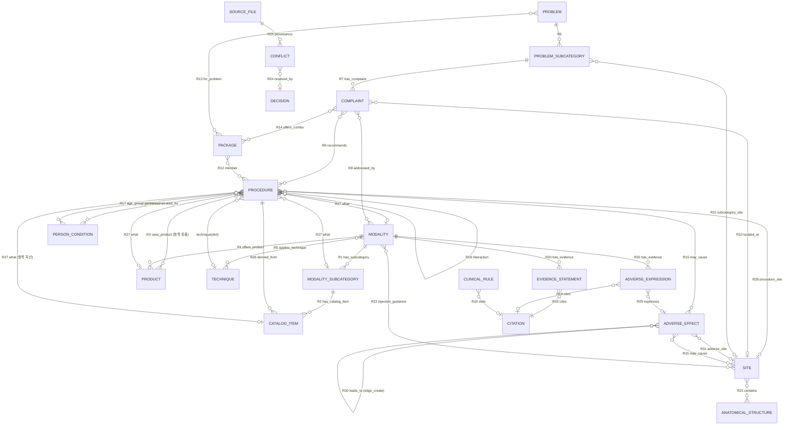

# ERD v3 — 피부과 시술 허브 메달리온 시맨틱 정의

작성 2026-11-05 · 상태 **초안(사용자 승인 전)** · 원장 = **브론즈 2판** `bronze/phub-ledger/`(2026-11-05 · HASHES.txt 21 전부 일치 · 1판 2026-10-26 스냅샷과의 차이 = CHANGELOG 6곳 — 바뀐 파일 treatment-optimization.json, treatment-sequence.json) + 조사 산출물 step1 10-29 · 발주서 `erd-v3-brief.md`(사용자 승인 2026-11-05 「v3 진행하자」) · 근거 `ERD-V3-CANDIDATES.md` V3-1~8 + 실버 빌드 빌더 제약 2(V3-9·10) · 동결 v2.4(`ERD-FROZEN.md`)의 **사용자 정의 3 과 명시 예외는 그대로** · 이전 발주서(v1 ~ v2.4)의 입력·금지·기준·질문 기본값·처분 유지

기계용 동본 `erd-v3.json` · 값 사전 `erd-v3-dictionaries.json`(v2.4 46 + `adverse_qualifier` = 47 · site 에 조직층 5 값 + kind · 사건 동의어 「공기색전」 제거 · 그 밖 값 불변) · 잎 키 행선지 `erd-v3-column-map.md`(v2.4 대비 이동 0 — 변화 없음 · 비고 변경 40 · 2판 잎 키 재스캔 = 1판) · 분해 규칙 실행 `erd-v1.1-resolve.py`(§9.2 · 2판 원장으로 재실행) · 튜플 실측 `erd-v3-tuples.py`(결과 `erd-v3-tuples.json`, §9.5·§9.6 v2.4 와 나란히 + 신설 §9.5.9~11 · §9.6.7~8) · 검산 `erd-v3-check.py` (결과 §10). 이전 판 산출물은 그대로 두었다. **v2.4 → v3 변경 목록(V3-# 대응)은 §11**, v3 밖 관찰은 §12.

**v3 의 범위는 발주서의 변경 10건뿐이다.** **R-1~R-4** 독립 검토(erd-v3-review.md) 문장 수정 4(R-1 §1.1·§5.2 target/fold_approve anchors 에 REF-…#s<i>) · **V3-1** 부작용 튜플 수식 칸 qualifier(§1.5 수식 규칙) · **V3-2** 괄호 안 회사·제품 규칙(§1.3 resolve_rules.step2_decompose.company_paren) · **V3-3** 수식어 제외 목록 stopwords(§1.3 resolve_rules.step2_decompose.stopwords(단어 19) · **V3-4** 조합 기호 규칙 확정 · 부위 여럿 · member_mode(§1.3 resolve_rules.step3_assemble.combo) · **V3-5** 부위 kind 열거형 · 조직층 값 5(§2.8 site.kind(발주서 표기 §2.7)) · **V3-6** 결정 kind canonical_rename(§5.2 kind 17) · **V3-7** technique·product description · media_refs(§2.6 product) · **V3-8** 기법 상속 하위분류 단위(R5 from modality|modality_subcategory) · **V3-9** 결정 적용 대상 확장(미해결·조합 anchor)(§5.2 tuple_assign/tuple_assign_multi/adverse_tuple_assign 비고) · **V3-10** fold_approve 가 ⑦ 을 닫는다(§5 규칙 ⑦). **개체 21 · 관계 31(R5 from · R12 속성) · 사전 47(+adverse_qualifier) · 행선지 1,072** — 그 밖 개체·관계·규칙은 v2.4 그대로. 사전 값·동의어·매핑·접힘 승인·충돌 판정은 결정 레코드이며 ERD 를 열지 않는다(ERD-FROZEN) — v3 가 사전에 손댄 것은 구조가 요구한 셋뿐(조직층 5 · 수식 5 · 「공기색전」 동의어 1).

### 0. 사용자 정의 3 · 명시 예외 (ERD-FROZEN · 그대로)

동결 원문(ERD-FROZEN 동결 조건 · 글자 그대로):

1. 시술 = (무엇을, 어디에, 어떻게) 튜플. 미상 칸이 있으면 접지 않음. 조각 버리지 않음. 엣지 끝 = 시술 튜플.
2. 부작용 = (사건, 부위, 경과) 튜플. 원인 시술은 엣지. 표현은 가리키기만.
3. 원장 불변. 충돌은 레코드(④ 자동 해결도 기록). 결정 16 kind · 안정 키 · 적용 순서 ①~⑦. 빌드는 approved 만 읽음.

v3 승계 문장(R-4 · 정의 2 에 선택 수식 칸 · 정의 3 kind 17 · 안정 키에 #s<i>):

1. 시술 = (무엇을, 어디에, 어떻게) 튜플. 미상 칸이 있으면 접지 않음. 조각 버리지 않음. 엣지 끝 = 시술 튜플.
2. 부작용 = (사건, 부위, 경과) 세 칸 + 선택 수식 칸(물질·기전 · 없음은 none 값) 튜플. 원인 시술은 엣지. 표현은 가리키기만. (R-4 · V3-1)
3. 원장 불변. 충돌은 레코드(④ 자동 해결도 기록). 결정 17 kind · 안정 키(REF-…#m<i>·#s<i> 포함) · 적용 순서 ①~⑦(① dictionary_add/canonical_rename). 빌드는 approved 만 읽음. (R-4 · V3-6 · R-1)

**명시 예외(사용자 결정 2026-11-04)**: 부작용 축에서 부위 없음(none)·경과 미상은 사전 값으로 본다. (멍, none, 미상) 은 하나의 단위라 「멍 (타박상)」「멍 / 반상출혈」「멍·타박상」등이 접힌다. 시술 축의 「미상이면 접지 않음」과 다른 이유: 부작용의 부위 없음은 「모름」이 아니라 「어디서든 나는 사건」이고, 어느 시술에서 나는지는 R15 엣지가 든다. v3: 수식 칸 없음(qualifier none)도 같은 뜻의 값이다 — 「물질·기전이 적히지 않은 사건」이지 미상이 아니다.

**v3 와 정의의 관계**: v3 는 정의 1~3 의 뜻을 뒤집지 않고 확장한다(R-4: 동결 원문은 위에, v3 승계 문장은 아래 — 「그대로」는 뜻이지 글자가 아니다). 정의 2 의 튜플에 **선택** 수식 칸 qualifier 가 더해지고(V3-1 · 없으면 none 값 — 세 칸은 그대로), 정의 3 의 「결정 16 kind」는 canonical_rename 이 더해져 17(V3-6), 적용 순서 ①~⑦ 의 ① 에 canonical_rename 이 들어간다. 그 밖(안정 키 · approved 만 · 원장 불변 · 엣지 끝 = 튜플 · 조각 버리지 않음 · 표현은 가리키기만)은 그대로다. 명시 예외(부작용 축 none·미상은 값)도 그대로이며 qualifier none 은 그 예외와 같은 뜻의 값이다.

**원칙(v2.4 · 시술 축 v2.1~v2.3 과 동일하게 부작용 축에 적용 · 그대로)**: **A.** 미상 칸이 하나라도 있으면 다른 이름과 접지 않는다. **B.** 조각을 버리지 않는다. 한 칸에 후보가 둘이면 단위를 둘로 나누거나(부위 「이마/눈가」→ 둘) 미해결로 둔다. **C.** 수식어(경과·부위)는 **같은 멤버 안에서 바로 붙은 사건**에만 준다. 이름 전체에서 끌어오지 않는다. **D.** 표현(adverse_expression)은 단위를 **가리키기만** 한다. 표현에서 새 단위를 만들지 않는다.

## 1. 범위와 층

| 층 | 무엇 | 규칙 |
|---|---|---|
| 브론즈 | 원장 21개 JSON(**브론즈 2판** `bronze/phub-ledger/` · 원장의 집) + `step1-products.json`(조사 산출물) | 바이트 보존·수정 금지. 파일 SHA256 이 식별자(§6 표 · HASHES.txt). 1판 = `phub-stg-2026-10-26/`(스냅샷 2026-10-26) · 2판 = 1판 복사 + CHANGELOG(부위 나열 `/` → `+` 6곳 · 2026-11-05). 원장을 고칠 때는 파일을 고치고 CHANGELOG 한 줄 — 빌드는 HASHES.txt 로 검증한다 |
| 시맨틱 | 이 ERD + 값 사전 + 분해 규칙(참조 §1.3 · 튜플 §1.4/§1.5) | 문서. 사용자 승인이 정본 조건. 버전으로 개정(v1 → … → v2.4(동결) → v3 → …) |
| 실버 | ERD 를 따르는 정규화 레코드 | **모든 값은 (파일, 잎 키 경로) 출처를 가진다.** 출처 없는 값 금지. 충돌은 둘 다 보관 |
| 골드 | 실버 조합 뷰 | 실버에 없는 사실을 만들지 않는다. 충돌 미판정 레코드 제외 |

지식은 원장 21(2판)·1판(대조)·컬럼 리포트·스캔 결과·erd-v* 산출물·발주서·검토서·`step1-products.json`·`ERD-FROZEN.md`·`ERD-V3-CANDIDATES.md`·`silver-v3/decisions/_batch3-candidates.md`·`silver-v3/out/report.md`·`silver-v3/README.md` 에서만 가져왔다. step2·step3·source-map·DATA-001·DEC-*·silver-*(silver-v3 제외)·silver-v3/lib·`_archive/` 는 열지 않았다 — ERD 가 빌더를 따라가지 않는다.

**브론즈 2판 CHANGELOG(1판과의 차이 전부)**:

- `treatment-optimization.json`: 1판 「보톡스 이마/미간」, 「보톡스(턱선/광대)」 → 2판 「보톡스 이마+미간」, 「보톡스(턱선+광대)」
- `treatment-sequence.json`: 1판 「보톡스 이마/미간」, 「필러 볼/턱」, 「필러 팔자/볼」 → 2판 「보톡스 이마+미간」, 「필러 볼+턱」, 「필러 팔자+볼」

### 1.1 정규화(「같은 것」판정)와 식별자

- 정규화 `norm_v1`: unicodedata.normalize('NFKC') → str.casefold() → 모든 공백 문자 제거 (스페이스·탭·전각공백) → 그 외 문자(괄호·슬래시·하이픈·점 포함)는 그대로 둔다 — 괄호 안이 부위·용량·제품을 구분하는 경우가 있어 벗기지 않는다
- 정규화 결과가 완전히 같을 때만 「같은 것」. 괄호·조합 기호가 섞인 참조는 v1.1 분해 규칙(§1.3)으로 조각을 내어 조각 단위로 완전 일치만 본다. 유사도·추측 매칭은 하지 않는다.
- 식별자: `<PREFIX>-<sha256(canonical_key)[:10]>`. canonical_key 는 개체별(§2 각 표의 「식별자」). 개체별로 정의 (각 개체의 identity 항목). 원장 id·이름·코드는 전부 aliases 로 보존한다 (질문 4·6 기본값)
- survey 제품: step1 제품(origin=survey)은 PRD-<sha256(계열코드|norm(display_name))[:10]>, 계열 코드가 없으면 'survey' 를 계열 자리에. step1 ledger_id 는 alias
- 사전 항목 id(v3 · R-2): DIC-<sha256(사전 이름|정준값)[:10]> — 유도식. canonical_rename(V3-6 · R-2)이 정준값을 바꾸면 재계산되고 옛 DIC- id 는 alias(renamed_from). 코드 기반 개체 id(MOD-<code> · CAT-/PRD- 의 계열 코드)는 정준값과 무관해 바뀌지 않는다
- **튜플 식별자** — procedure(v2.2 · v3 #s<i>): `세 칸 전부 사전 값이면 PRC-<sha256(what_id|site_id|technique_id)[:10]>, 아니면(site none · technique none · what=CAT- 중 하나라도) PRC-<sha256(what_id|site_id|technique_id|anchor)[:10]>. what_id = MOD-/SUB-/PRD-/CAT-, site_id = site 개체 id 또는 'none', technique_id = 기법 사전 id 또는 'none', anchor = CAT- id(분류 항목) · REF- id(참조, REF-sha256(norm(label)|hint)[:10]) · 조합 멤버는 anchor#m<i>. v2.2: 미상은 식별자 값이 아니다 — 세 칸 전부 사전 값일 때만 같은 튜플 = 같은 시술. v3(V3-4): 「무엇을 하나 × 부위 여럿」 참조의 부위별 튜플 anchor 는 REF-…#s<i>(i = 부위 순서) · 조합 멤버는 그대로 #m<i>` · reference anchor: REF-<sha256(norm(label)|hint)[:10]> — 참조 하나(정규화 라벨 · 계열 힌트 — 같은 라벨·힌트는 ① 정규화 완전 일치라 자리가 달라도 같다). v2.2 시술 튜플 anchor · decision tuple_assign 의 target.ref_id. v3(V3-9): 튜플이 없는 미해결 참조의 REF- 도 결정 target 이다 · adverse_effect(**v3 · 수식 칸 포함**): `네 칸(event · site · course · qualifier) 전부 사전 값이면(미등록 조각 0 · 붙지 않은 조각 0 · event_kind=dict) ADV-<sha256(event_id|site_id|course_id|qualifier_id)[:10]>, raw_name 튜플은 ADV-<sha256(RAW:<anchor>|none|<course_id(미상)>|none|<anchor>)[:10]> — event_id = 사건 사전 id, site_id = site 개체 id(anatomical·layer·region) | 상대 부위 사전 id | 'none', course_id = 경과 사전 id('미상' 포함), qualifier_id = adverse_qualifier 사전 id | 'none'(v3 · 없음은 값), anchor = 그 이름의 원장 locator. v3: 수식 칸이 식별자에 들어간다 — (색전, none, 미상, 공기) ≠ (색전, none, 미상, none). 튜플은 complications 65 이름에서만 생긴다(표현은 가리키기만 · 2-C′)` · catalog_item(v2.4 계열 코드 고정): CAT-<sha256(계열 코드|norm(항목 이름))[:10]> — v1.1 procedure 의 식별자 규칙을 그대로 물려받는다. v2.4: CAT- 식별자의 「계열 코드」 = **taxonomy 트리 위치**(원장 `taxonomy.json:modality[].id` — 그 항목이 적힌 계열 · reclassification 메모 적용 전). reclassification(reclassified_to · 적용 ⓪)은 R2(하위분류 → 항목) 재배치만 바꾸고 CAT- id 는 바꾸지 않는다 — 소프라노 티타늄 = sha256(`M9|소프라노티타늄`) 그대로(M9 → M8 재배치 뒤에도) · 볼뉴머 M4/M9 는 각각의 트리 위치로 서로 다른 CAT-. 결정·R26·anchor 튜플 id 가 가리키는 CAT- 는 다른 결정 뒤에도 바뀌지 않는다(검토 3-B′) · adverse_expression: AEX-<sha256(출처 파일|잎 키 경로|레코드 위치|lang)[:10]> — 원문 레코드 하나가 표현 하나 · 표현 후보: 표현 레코드의 candidates[] = (event, site, course, qualifier) 후보 + would_be_id(ADV-sha256(event_id|site_id|course_id|qualifier_id)) + exists. 튜플이 아니다(원칙 D)
- **접힘 조건(v2.2 · 문자 그대로): 「세 칸 전부 사전 값일 때만」** — 접힘 조건: **세 칸 전부 사전 값일 때만** 다른 항목·참조와 접힌다 — what 이 사전 값(product | modality_subcategory | modality)이고 site 가 부위 사전 값이고 technique 가 기법 사전 값일 때. 미상(site none · technique none)은 식별자 값이 아니다: 미상 칸이 하나라도 있거나 what 이 분류 항목 자신(CAT-)이면 식별자에 anchor 를 섞어 항목·참조마다 고유하다(접히지 않음). anchor = 분류 항목은 CAT- id, 참조(②③)는 REF-sha256(norm(label)|hint)[:10], 조합 멤버는 anchor#m<i>. 참조(또는 조합 멤버)가 분류 항목 이름과 정규화 완전 일치(①)하면 그 항목 자체라 그 항목의 anchor 를 쓴다(같은 튜플 — 접힘 아님). 같은 라벨·같은 힌트의 참조도 ① 이라 자리가 달라도 같은 anchor. 규격·수식·계열명 조각이 붙은 라벨은 자기 anchor(미상 칸이 있으면 접히지 않는다).
- **부작용 접힘 조건(v3)**: 부작용 접힘 조건(v2.3 · 검토 2-B · 시술과 같은 원칙): **세 칸 전부 사전 값일 때만** 다른 이름과 접힌다 — 이름의 조각이 전부 사전(사건 · 부위 · 상대 부위 · 경과)에 닿아 미등록 조각이 0 이고 event 가 사건 사전 값일 때. 부작용 축의 site none · course 미상은 v2 그대로 축의 정의값이라 사전 값으로 센다(검토 2-D 「none·미상을 식별자 값으로 둘지」는 동결 후 scope_review — §12). complications 이름에 **미등록 조각이 하나라도 있으면 접지 않는다**(v2.4: 사건에 붙지 않은 부위·경과 조각이 남아도 접지 않는다 — 원칙 A·B): 그 이름은 항목별 고유 튜플(event_kind=raw_name · event=이름 원문 · anchor=그 이름의 원장 locator · candidate_name=미등록 조각 · site=none · course=미상 · 사전 분해 결과는 dict_tuples·event_fragments·extra_* 에 실값 보존)이며 식별자에 anchor 가 들어가 다른 이름과 접히지 않는다. 표현(adverse_expression)은 정체성을 만들지 않는다 — 단위를 가리키기만 한다(원칙 D · v2.4): 기존 단위와 세 칸 완전 일치할 때만 R29(match_status=exact), 아니면 unlinked + candidates. 표현이 raw_name 튜플도 사전 튜플도 만들지 않는다. v3(V3-1): 수식 칸이 다르면 다른 단위 — (색전, none, 미상, 공기) ≠ (색전, none, 미상, none).
- **원장 locator(v2.3)**: 원장 locator = `<파일>:<잎 키 경로>@<레코드 키>` — 레코드 키는 상위 레코드 id 와 배열 위치(예 `complications.json:categories[].complications[].name@M16/12` = M16 묶음의 13번째 이름 · `extracted.json:{code}.safety.common[]@M1/3`). 브론즈는 바이트 보존(sha256)이라 위치가 안정 키다. 결정 레코드의 target 과 conflict 안정 키가 이 locator 를 쓴다.
- **결정 target(v3)**: 결정 target 이 가리켜도 되는 키(v2.3 · 검토 3-B): 분류 항목 id(CAT-) · 참조 자리 id(REF- · 조합 멤버 REF-…#m<i> · 부위별 튜플 REF-…#s<i>(V3-4 · R-1)) · 원장 locator(file:key path@record) · 원장에서 직접 나온 고정 id(MOD-/SUB-/PRD-/SIT-/TEC-) · 사전 값(사전 이름 + 정준값) · conflict 안정 키(kind + locator 쌍). **금지**: 다른 결정을 적용하면 바뀌는 파생 id — PRC-(튜플) · ADV-(부작용 튜플) · CFL-(충돌 레코드) · 부작용 튜플은 (event, site, course, qualifier — 없음은 none) 사전 값 네 쌍으로(R-4), 시술 튜플은 anchor(CAT-/REF-) 또는 (what_id, site_id, technique_id) 로 가리킨다. 검산 K-2 가 전수 확인. v2.4: CAT- 는 taxonomy 트리 위치의 계열 코드로 고정(reclassification 뒤에도 같다 · §2.4). v3(V3-9): REF- 는 튜플이 없는 미해결 참조·조합 멤버(REF-…#m<i>)·부위별 튜플(REF-…#s<i>)도 target 이다. 충돌: CFL- 레코드 id 는 (대상 id + 속성 + 출처 집합) 해시 — **파생 id 라 결정의 target 이 아니다**. 결정이 가리키는 conflict 의 안정 키 = conflict.stable_key = {kind, locators[]}(값 출처 원장 locator 의 정렬 쌍 + 충돌 종류). DEC- 는 (적용일 + 일련).
- 「같은 것」 = 정규화 완전 일치(①) + 사전 동의어(②)만 자동. 참조 문자열은 §1.3 분해 규칙으로 조각내어 조각 단위로 같은 판정을 한다. 튜플은 조각이 가리키는 개체·사전 값의 조합이 같을 때 같은 것이다. 유사도·추측 매칭은 ⑦ 후보로만.

### 1.2 다이어그램 (개체·관계만)

### 1.3 참조 해결 — 결정론 분해 규칙 (v1.1 B · **v3: stopwords · 괄호 안 회사·제품 · 조합 기호 확정**)

v1.1 의 세 단계를 **데이터**(`erd-v3.json → resolve_rules`)로 적고 `erd-v1.1-resolve.py`(§9.2)와 `erd-v3-tuples.py`(§1.4 · stopwords·회사 괄호·조합 기호는 여기서 실행)가 그대로 실행한다. v2 → catalog_item_name · v2.1 fallback_to_parent=false · v2.2 미해결 사유 · v2.3·v2.4 불변 · **v3**: 2단계에 stopwords(V3-3)·company_paren(V3-2), 3단계에 combo(V3-4). 유사도·추측은 없다.

1. **계열 확정** — 참조가 놓인 자리의 상위 계열 코드를 힌트로 쓴다. 없으면 조각 중 계열 사전(modality) 동의어에 닿는 첫 조각의 계열. 자리별 힌트: market-pricing.items[].name: `categories[].id` · synergy.links[].from/to: `노드 접두 M코드 (`M9-울쎄라` → M9)` · problem-packages.procedures[].name: `procedures[].category` · procedure-comparison.procedures[].name: `procedures[].category` · post-procedure-timeline.timelines[].name: `timelines[].category 의 M코드 부분` · treatment-sequence.sequence_order[].categories[]: ``M코드-라벨` 의 M코드` · pih-risk: `procedure_ref 가 id 이므로 분해 대상 아님(id 깊이 판정)` · step1-products.items[]: `family.code (M코드일 때만)` · 그 밖: `힌트 없음`. 코드 정규식 `^(M\d+)(?:[-_ ](.+))?$`
2. **이름 분해** — 괄호 안을 뗀다(`\(([^()]*)\)`). 조합 기호 `+` `/` `&` `,` 로 멤버를 나눈다(**v3 기호 뜻**: `+` 함께(and) · `/` 양쪽 조각으로 — 부위 둘이면 함께(and) · 대안 둘이면 또는(or) · `&` 함께(and) — `+` 와 같다 · `,` 나열 — `+` 와 같다(and)). 조각마다 사전 순서 **product → modality_subcategory → procedure → site → spec → product_tier**(procedure = catalog_item_name) 로 완전 일치를 시도한다(계열 사전에 닿으면 kind=modality). 규격 정규식 `^(\d+(?:\.\d+)?)\s*(cc|ml|mL|바이알|줄|회|샷|개|부위|cm2|cm²|차|단위|U)(?:\s*(기준|이상|패키지|당|동시))?$` + unit 사전. 조각이 통째로 어느 사전에도 안 닿으면 공백으로 토큰을 나누고, 왼쪽부터 가장 긴 연속 토큰 구간을 사전 순서로 시도한다(정확 일치만). 남는 토큰 = 사전에 없는 조각. 계열이 확정되면 제품·하위분류·단위 시술은 그 계열 안에서 먼저 찾고, 없으면 전 계열에서 찾는다(다른 계열의 조합 멤버). 전 계열에서 둘 이상 계열에 닿으면 모호 → 사전에 없는 조각으로 센다. 한 조각이 단위 시술과 제품 양쪽에 닿으면 단위 시술(8-11 처분), 하위분류와 제품 양쪽이면 하위분류.
   - **stopwords(v3 · V3-3)**: **수식어 제외 목록(stopwords · V3-3)**: 분해에서 아래 단어가 **독립 토큰**(공백 토큰 그대로 · 정규화 완전 일치)으로 나오면 조각(미등록 조각)이 아니라 참조의 `qualifier_text` 속성으로 보존한다 — 시술 튜플의 칸을 정하지 않고 미해결 사유도 되지 않는다. 회차·횟수(「1차」「4회」)는 규격 정규식(`\d+(회|차)`)이 먼저 잡으며 `차` 는 R12 엣지 `session_index`, `회` 는 count 로 간다. 목록은 규칙 데이터(resolve_rules.stopwords · 단어마다 원장 locator ≥1 실측 — 출처 없는 단어는 목록에 두지 않는다). 발주서 12 + 원장 실측 추가 7(특별 · 터치 · 여름철 · 병용 · 보조 · 동시 · 콤보). 토큰 일부(「진정관리」의 관리 · 「울쎄라급」)에는 적용하지 않는다(완전 일치만 · 유사도 없음). 사전 값과 겹치는 단어는 없다(검산). 단어 19: `회`(brief · locator 6) · `차`(brief · locator 8) · `터치업`(brief · locator 2) · `유지`(brief · locator 3) · `집중`(brief · locator 3) · `연말`(brief · locator 3) · `하반기`(brief · locator 1) · `가을`(brief · locator 2) · `관리`(brief · locator 4) · `케어`(brief · locator 1) · `과도한`(brief · locator 4) · `빈도`(brief · locator 2) · `특별`(ledger · locator 1) · `터치`(ledger · locator 1) · `여름철`(ledger · locator 1) · `병용`(ledger · locator 1) · `보조`(ledger · locator 1) · `동시`(ledger · locator 1) · `콤보`(ledger · locator 1). 회차 `^(\d+)\s*(차)$` → session_index · 횟수 `^(\d+)\s*(회)$` → count. 실측 §9.5.10
   - **괄호 안 회사·제품(v3 · V3-2)**: **괄호 안 회사·제품 규칙(V3-2)**: 괄호 안(inner 묶음)이 조각 **하나**이고 그 조각이 (a) 회사 사전(manufacturer · 정준값과 동의어 · `/` 로 이어진 복수 회사명은 각각)에 닿으면 바깥 what(계열명 또는 제품명)의 **그 회사 제품**으로 what 을 정한다 — 바깥 what 의 계열 안 제품 중 제조사가 그 회사인 제품이 정확히 하나일 때만(둘 이상·없음은 ambiguous · reason company_product) · (b) 제품 사전에 닿으면 **그 제품**이 what(「스킨부스터(리쥬란)」= 리쥬란 · 바깥은 그 제품의 계열이어야 하며 다른 계열이면 cross_family 표시). 괄호 안 조각이 둘 이상이고 `/` 로 나뉜 대안이면 V3-4(괄호 안 대안은 바깥 하나 · alternatives). 닿지 않으면 기존대로(미등록 조각 → partial/⑨). 「보톡스(엘러간)」은 taxonomy 항목 1 + problem-combos products 문장 7 + extracted related_techniques 2(더모톡신) 에 있으나 「엘러간」은 회사 사전(앨러간/애브비)에 **닿지 않는다** — 규칙은 데이터로 있고 적용은 dictionary_add(회사 동의어) 뒤다(실측 §9.5.9). 실측 §9.5.9
3. **조립** — 튜플 (family, primaries(product|modality_subcategory|procedure|modality), sites, specs, tiers). (a) resolved: 참조 전체가 하나의 사전 값과 통째로 일치(괄호·조합 없이) → 그 깊이(modality|subcategory|procedure|product)로 연결 (b) 분해 성공·항목 없음: 통째 일치는 아니지만 조각이 전부 사전에 닿음 → 「분해 성공·항목 없음」. 조합(튜플) 자체를 보존하고 가격·시너지는 그 조합에 단다. shape = single_primary_qualified(primary 1 + 부위/규격/등급) | combo(primary ≥2) | qualifier_only(primary 0) (c) unresolved: 사전에 없는 조각이 하나라도 있음 → unresolved_reference. 닿은 조각은 partial 로 기록. v2.1: 미해결 참조는 procedure 튜플을 만들지 않는다(힌트 계열·부모 층으로 접지 않음). v2.2: 미등록 조각이 없어도 primary 조각 둘 이상(조합 아님) · site 조각 둘 이상 · technique 조각 둘 이상 · what 으로 못 쓰는 primary 조각이 있으면 튜플 단계(§1.4)에서 미해결(⑨ · unresolved_reason=multi_primary|multi_site|multi_technique|unusable_primary|combo_outside_fragment) — 버리고 접지 않는다. v3: 분리 기호(`+`/`/`)로 나뉜 부위 멤버는 multi_site 가 아니라 같은 what 의 튜플 여럿(V3-4) · 한 멤버 안의 부위 둘은 여전히 multi_site · 기호가 섞이면 combo_mixed
   - **fallback_to_parent = False** — v2.1: 분류 항목 이름의 조각이 하나라도 사전에 없으면 부모 하위분류로 떨어뜨리지 않는다(접힘 금지). what = 그 분류 항목 자신(what_kind=catalog_item). 참조 자리(②)·market-pricing(③)도 같다 — 미등록 조각이 있으면 그 참조는 unresolved(⑨)이며 부모 층 튜플로 접지 않는다
   - **조합 기호(v3 · V3-4)**: **조합 기호 규칙(V3-4 · 확정)**: `+` 는 **항상 함께**(and). `/` 는 **양쪽 조각으로** 정한다 — 같은 what 의 **부위** 둘 → 함께(and) · **대안**(계열 · 하위분류 · 장비 · 재질 · 제품 — primary 조각) 둘 → 또는(or) · **괄호 안 대안은 바깥 하나**(what = 바깥 primary · 괄호 안은 `alternatives[]` 속성 · member_mode or). **「무엇을 하나 × 부위 여럿」**(「보톡스 이마+미간」「보톡스(턱선+광대)」「필러 볼+턱」 — primary 를 가진 멤버가 하나이고 나머지 멤버가 부위 조각뿐)은 조합 패키지(combo_ref)가 아니라 **같은 what 의 시술 튜플 여럿**(부위마다 하나 · anchor = REF-…#s<i>)이며 패키지 멤버 엣지(R12)가 각각 붙는다(member_mode and). primary 를 가진 멤버가 둘 이상이면 combo_ref(멤버마다 튜플 · member_mode = 기호에 따라 and|or · 한 라벨 안에 `+` 와 `/` 가 섞이면 mixed 로 두고 미해결 사유 combo_mixed). 한 멤버 안에 분리 기호 없이 부위 조각이 둘이면 v2.2 그대로 multi_site(버리고 접지 않음 · ⑨). 기호 뜻은 원장 작성 규칙(`bronze/phub-ledger/README.md`: `+` 함께 · `/` 대안)과 같다 — 2판은 부위 나열의 `/` 6곳을 `+` 로 고쳤다(CHANGELOG). 어느 쪽 조각이 미등록이면 규칙은 적용되지 않고 ⑨(unregistered)다(규칙은 사전 값을 만들지 않는다). 실측 §9.5.11

결과는 §9.2 에 v1 수치와 나란히(§9.2 는 v1.1 코드 재실행 — 2판 원장이라 바뀐 이름 4 참조의 수치만 v2.4 와 다르다). (a)·(b) 의 결과는 §1.4 의 튜플 규칙으로 한 번 더 내려가 procedure 튜플이 되고, (c) 미해결은 튜플을 만들지 않는다(v3: 미해결 참조의 REF- 도 결정 target). 그 튜플이 곧 엣지의 끝이다(§3 엣지 끝 규칙 · §9.5.8).

### 1.4 시술 튜플 분해 규칙 (구조 변경 ① · v2.2 수정 1·2·3 · v2.3 엣지 끝 · v2.4 계열 코드 고정 · **v3 V3-2·V3-3·V3-4·V3-5** · 데이터 `erd-v3.json → tuple_rules.procedure` · `erd-v3-tuples.py` 실행)

- 입력: ① taxonomy.json modality[].subcategories[].items[].name 521 (family = 계열 코드, parent = 하위분류 id) — v2.4: family = taxonomy 트리 위치의 계열 코드(modality[].id · reclassification 적용 전) · CAT- id 의 계열 코드와 같다(§2.4) — v3: 원장 = 브론즈 2판(bronze/phub-ledger) · ② v1.1 §9.2 의 자유 텍스트 자리 전부(erd-v1.1-resolve.py slot_items — pih id·고민·부위·canonical_category·step1 제외) + market-pricing items[].name 122(③) — v3: 2판 이름(`+` 6곳) · stopwords 는 조각 전 단계에서 뗀다
- **계열 코드(v2.4 · 검토 3-B′)**: CAT- 식별자의 「계열 코드」 = **taxonomy 트리 위치**(원장 `taxonomy.json:modality[].id` — 그 항목이 적힌 계열 · reclassification 메모 적용 전). reclassification(reclassified_to · 적용 ⓪)은 R2(하위분류 → 항목) 재배치만 바꾸고 CAT- id 는 바꾸지 않는다 — 소프라노 티타늄 = sha256(`M9|소프라노티타늄`) 그대로(M9 → M8 재배치 뒤에도) · 볼뉴머 M4/M9 는 각각의 트리 위치로 서로 다른 CAT-. 결정·R26·anchor 튜플 id 가 가리키는 CAT- 는 다른 결정 뒤에도 바뀌지 않는다(검토 3-B′)
- 조각: v2.1: 먼저 v1.1 3단계 (a) **통째 일치**를 본다 — 라벨(또는 분류 항목 이름, 자기 이름 제외) 전체가 하나의 사전 값(계열·제품·하위분류 라벨·분류 항목 이름)이면 조각 하나(괄호·조합 기호가 값 안에 있어도 쪼개지 않는다 · 「PRP/자가혈」「마이크로니들링(MTS)」「리쥬란 HB+」). 아니면 v1.1 §1.3 2단계 그대로: 괄호 안을 떼고(outer / inner 묶음), 묶음 안을 조합 기호 `+ / & ,` 로 멤버로 나누고, 멤버마다 사전 순서 product → modality_subcategory → catalog_item_name → site → spec → product_tier 로 완전 일치. 통째로 안 닿으면 공백 토큰을 왼쪽부터 가장 긴 구간으로. 남는 토큰 = 미등록 조각. 분류 항목 자신의 이름은 catalog_item_name 색인에서 제외(자기 참조 금지)
- **stopwords(v3)**: **수식어 제외 목록(stopwords · V3-3)**: 분해에서 아래 단어가 **독립 토큰**(공백 토큰 그대로 · 정규화 완전 일치)으로 나오면 조각(미등록 조각)이 아니라 참조의 `qualifier_text` 속성으로 보존한다 — 시술 튜플의 칸을 정하지 않고 미해결 사유도 되지 않는다. 회차·횟수(「1차」「4회」)는 규격 정규식(`\d+(회|차)`)이 먼저 잡으며 `차` 는 R12 엣지 `session_index`, `회` 는 count 로 간다. 목록은 규칙 데이터(resolve_rules.stopwords · 단어마다 원장 locator ≥1 실측 — 출처 없는 단어는 목록에 두지 않는다). 발주서 12 + 원장 실측 추가 7(특별 · 터치 · 여름철 · 병용 · 보조 · 동시 · 콤보). 토큰 일부(「진정관리」의 관리 · 「울쎄라급」)에는 적용하지 않는다(완전 일치만 · 유사도 없음). 사전 값과 겹치는 단어는 없다(검산).
- **괄호 안 회사·제품(v3)**: **괄호 안 회사·제품 규칙(V3-2)**: 괄호 안(inner 묶음)이 조각 **하나**이고 그 조각이 (a) 회사 사전(manufacturer · 정준값과 동의어 · `/` 로 이어진 복수 회사명은 각각)에 닿으면 바깥 what(계열명 또는 제품명)의 **그 회사 제품**으로 what 을 정한다 — 바깥 what 의 계열 안 제품 중 제조사가 그 회사인 제품이 정확히 하나일 때만(둘 이상·없음은 ambiguous · reason company_product) · (b) 제품 사전에 닿으면 **그 제품**이 what(「스킨부스터(리쥬란)」= 리쥬란 · 바깥은 그 제품의 계열이어야 하며 다른 계열이면 cross_family 표시). 괄호 안 조각이 둘 이상이고 `/` 로 나뉜 대안이면 V3-4(괄호 안 대안은 바깥 하나 · alternatives). 닿지 않으면 기존대로(미등록 조각 → partial/⑨). 「보톡스(엘러간)」은 taxonomy 항목 1 + problem-combos products 문장 7 + extracted related_techniques 2(더모톡신) 에 있으나 「엘러간」은 회사 사전(앨러간/애브비)에 **닿지 않는다** — 규칙은 데이터로 있고 적용은 dictionary_add(회사 동의어) 뒤다(실측 §9.5.9).
- **조합(v3 · 확정)**: **조합 기호 규칙(V3-4 · 확정)**: `+` 는 **항상 함께**(and). `/` 는 **양쪽 조각으로** 정한다 — 같은 what 의 **부위** 둘 → 함께(and) · **대안**(계열 · 하위분류 · 장비 · 재질 · 제품 — primary 조각) 둘 → 또는(or) · **괄호 안 대안은 바깥 하나**(what = 바깥 primary · 괄호 안은 `alternatives[]` 속성 · member_mode or). **「무엇을 하나 × 부위 여럿」**(「보톡스 이마+미간」「보톡스(턱선+광대)」「필러 볼+턱」 — primary 를 가진 멤버가 하나이고 나머지 멤버가 부위 조각뿐)은 조합 패키지(combo_ref)가 아니라 **같은 what 의 시술 튜플 여럿**(부위마다 하나 · anchor = REF-…#s<i>)이며 패키지 멤버 엣지(R12)가 각각 붙는다(member_mode and). primary 를 가진 멤버가 둘 이상이면 combo_ref(멤버마다 튜플 · member_mode = 기호에 따라 and|or · 한 라벨 안에 `+` 와 `/` 가 섞이면 mixed 로 두고 미해결 사유 combo_mixed). 한 멤버 안에 분리 기호 없이 부위 조각이 둘이면 v2.2 그대로 multi_site(버리고 접지 않음 · ⑨). 기호 뜻은 원장 작성 규칙(`bronze/phub-ledger/README.md`: `+` 함께 · `/` 대안)과 같다 — 2판은 부위 나열의 `/` 6곳을 `+` 로 고쳤다(CHANGELOG). 어느 쪽 조각이 미등록이면 규칙은 적용되지 않고 ⑨(unregistered)다(규칙은 사전 값을 만들지 않는다).
- 조합(v2.2 문장 · 참고): 같은 묶음(outer 또는 한 괄호) 안에서 조합 기호로 나뉜 멤버 중 primary(modality|modality_subcategory|product|catalog_item) 를 가진 멤버가 둘 이상 → package(kind=combo_ref). 멤버 각각을 튜플화. 괄호는 조합 기호가 아니다(괄호 안 멤버 하나는 수식 조각). v2.2: 멤버 밖(다른 묶음·멤버)에 primary·site·technique 조각이 있으면(멤버 what 의 계열명 조각 제외) 조합으로 보내지 않고 미해결(combo_outside_fragment). 멤버마다 같은 규칙 — 멤버가 모호하면 전체 미해결
- fallback_to_parent: **False** (v2.1) · technique_inheritance: **False** (v2.2 · v3 V3-8 은 결정 scope 만 넓힌다) · fold_condition: **세 칸 전부 사전 값일 때만** (v2.2)
- 접힘(v2.2): 접힘 조건: **세 칸 전부 사전 값일 때만** 다른 항목·참조와 접힌다 — what 이 사전 값(product | modality_subcategory | modality)이고 site 가 부위 사전 값이고 technique 가 기법 사전 값일 때. 미상(site none · technique none)은 식별자 값이 아니다: 미상 칸이 하나라도 있거나 what 이 분류 항목 자신(CAT-)이면 식별자에 anchor 를 섞어 항목·참조마다 고유하다(접히지 않음). anchor = 분류 항목은 CAT- id, 참조(②③)는 REF-sha256(norm(label)|hint)[:10], 조합 멤버는 anchor#m<i>. 참조(또는 조합 멤버)가 분류 항목 이름과 정규화 완전 일치(①)하면 그 항목 자체라 그 항목의 anchor 를 쓴다(같은 튜플 — 접힘 아님). 같은 라벨·같은 힌트의 참조도 ① 이라 자리가 달라도 같은 anchor. 규격·수식·계열명 조각이 붙은 라벨은 자기 anchor(미상 칸이 있으면 접히지 않는다)
- what(필수) — v2.2 규칙 + v3:
  1. 접힘 조건(v2.2): 세 칸 전부 사전 값일 때만 — what·site·technique 가 전부 사전 값일 때만 식별자에 anchor 가 없고 다른 항목·참조와 접힌다. 미상 칸이 하나라도 있으면 anchor(CAT-/REF-)로 항목·참조마다 고유
  2. product 조각(계열 안 우선, 없으면 전 계열) → what=product
  3. catalog_item 조각 → 그 항목의 튜플 what. 분류 항목(①)에서는 그 항목의 what 이 사전 값일 때만 — 항목 자신이 what 인 항목에 닿은 조각은 what 으로 못 쓰는 primary(unusable_primary → 항목 자신 · ambiguous)
  4. modality_subcategory 조각 → what=modality_subcategory (분류 항목에서 다른 계열 라벨은 못 쓰는 primary)
  5. modality 조각 → what=modality (참조 ②③). 분류 항목(①)에서 자기 계열명 조각은 R2 상위로 이미 담긴 family_fragments(버린 조각 아님), 다른 계열명 조각은 못 쓰는 primary. 참조에서도 what 의 계열과 같은 계열명 조각은 family_fragments
  6. 조각이 계열 사전과 제품 색인 양쪽에 닿으면(보톡스·필러) what 은 product (v2.1 그대로 — 검토 1-E 는 결정 레코드 몫)
  7. **버리고 접지 않는다**(v2.2 · v2.1 규칙 8 삭제): 조합이 아닌데 primary 조각이 둘 이상이면(같은 what 을 가리키는 조각은 하나로 센다) 사전 값으로 조립하지 않는다 — 분류 항목은 항목 자신(ambiguous · reason multi_primary), 참조는 미해결(⑨ · multi_primary)
  8. what 으로 못 쓰는 primary 조각이 하나라도 있으면 같은 처리(reason unusable_primary)
  9. 분류 항목(①): 조각 중 하나라도 미등록이면 what = 항목 자신(partial · candidate_name). primary 가 없으면 항목 자신(complete · reason no_primary). 부모 하위분류 fallback 없음
  10. 참조 ②③: 미등록 조각이 있으면 미해결(⑨ · unregistered). primary 가 없으면 자리 힌트 계열(hint_family), 힌트도 없으면 튜플 불가
  11. v3(V3-2): inner 묶음의 유일한 조각이 회사 사전에 닿으면 바깥 what 계열의 그 회사 제품(정확히 하나일 때) · 제품 사전에 닿으면 그 제품
  12. v3(V3-4): inner 묶음이 `/` 대안(primary 둘 이상)이면 what = 바깥 primary · alternatives 보존(or)
- site: site 사전(21) 에 닿은 조각. 서로 다른 부위 조각이 **둘 이상이면 사전 값으로 조립하지 않는다**(v2.2) — 분류 항목은 항목 자신(ambiguous · multi_site · site=none · extra_sites 에 전부), 참조는 미해결(⑨ · multi_site). 참조가 분류 항목에 닿았고 그 항목 튜플에 site 가 있으면 그 값도 센다. 없으면 none(미상 — 식별자 값 아님). 사전에 없는 부위 같은 조각은 미등록 조각 · v3(V3-4): 분리 기호(`+`/`/`)로 나뉜 부위 멤버는 multi_site 가 아니라 같은 what 의 튜플 여럿(anchor REF-…#s<i> · R12 member_mode and) · v3(V3-5): layer 값은 시술 site 칸에 넣지 않는다(layer_fragments 보존)
- technique: 조각이 기법 사전(12)에 닿으면 그 값(fragment). 아니면 **none**(미상은 미상 — 계열 기본값 R5 를 튜플에 붙이지 않는다 · v2.2). 서로 다른 기법 조각이 둘 이상이면 site 와 같은 처리(multi_technique). R5 계열 → 기법은 decision kind canonical_mapping(target.from_ref=R5:<계열>, target.scope=anchor 목록) 후보로만 §9.5.6 에 목록
- 수식 조각: spec(규격)·product_tier 조각은 튜플 칸이 아니라 수식이다 — 참조 레코드(R9/R12/R18 target_label 등) 쪽에 남긴다. v2.2: primary·site·technique 조각은 수식이 아니다(둘 이상이면 위 규칙대로 미해결·항목 자신, 버리지 않는다) · v3(V3-3): stopwords 토큰은 조각이 아니라 참조 속성 qualifier_text · `\d+차` 는 session_index
- extra(v2.2): extra_primaries · extra_sites 는 항상 실제 값 목록(null 아님). 사전 값 what 튜플이면 [] (버린 조각 없음), 항목 자신 튜플·미해결 참조면 닿은 조각 전부
- 식별자: `세 칸 전부 사전 값이면 PRC-<sha256(what_id|site_id|technique_id)[:10]>, 아니면(site none · technique none · what=CAT- 중 하나라도) PRC-<sha256(what_id|site_id|technique_id|anchor)[:10]>. what_id = MOD-/SUB-/PRD-/CAT-, site_id = site 개체 id 또는 'none', technique_id = 기법 사전 id 또는 'none', anchor = CAT- id(분류 항목) · REF- id(참조, REF-sha256(norm(label)|hint)[:10]) · 조합 멤버는 anchor#m<i>. v2.2: 미상은 식별자 값이 아니다 — 세 칸 전부 사전 값일 때만 같은 튜플 = 같은 시술. v3(V3-4): 「무엇을 하나 × 부위 여럿」 참조의 부위별 튜플 anchor 는 REF-…#s<i>(i = 부위 순서) · 조합 멤버는 그대로 #m<i>` · 상태: complete = 미등록 조각 0 · partial = 미등록 조각 ≥1 · ambiguous = 조각 전부 닿았지만 둘 이상·못 쓰는 primary (분류 항목은 셋 다 튜플을 만들되 partial·ambiguous 는 항목 자신이 what · 참조는 partial·ambiguous 면 미해결)
- **코드 참조(v2.3)**: M 코드만(M1)·실존 하위분류 id(M1-2 · M16-DCA)인 참조는 분해하지 않고 그 노드가 끝(modality/subcategory · 튜플 없음). 분류 항목 id(M8-1-1 · auto-…)는 그 항목의 튜플이 끝(procedure)
- **엣지 끝(v2.3)**: v2.3 엣지 끝 규칙(검토 1-A): 시술 축(proc_axis)을 끝으로 쓰는 엣지는, 그 자리의 참조가 §1.4 로 **procedure 튜플**(또는 combo_ref 의 멤버 튜플)로 해결됐으면 그 **튜플 id 를 끝**으로 쓴다(target_depth=procedure · 미상 칸이 있는 anchor 튜플도 같다 · 참조가 분류 항목 이름과 일치하면 그 항목의 튜플이며 via_catalog_item=CAT- id). 계열(modality)·하위분류(modality_subcategory)·제품(product) 노드에 직접 붙는 것은 **참조가 그 층까지만 적혀 있을 때뿐**이다 — M 코드만(M1) → modality · 실존 하위분류 id(M1-2 · M16-DCA) → subcategory · 제품 사전 전용 자리(products[]) 와 제품 레코드(taxonomy products[]) → product — 그 깊이를 target_depth 로 표시한다. 분류 항목 id(M8-1-1 · auto-…) 나 taxonomy 항목 레코드에 붙은 자리는 그 항목의 튜플(procedure)이다 — 항목 521 전부 튜플이 있으므로 catalog_item 은 끝이 아니다. 미해결(⑨)은 끝이 없다(unresolved_reference 레코드). 실측: §9.5.8 엣지 자리별 끝 분포(erd-v2.3-tuples.py)

### 1.5 부작용 튜플 분해 규칙 (구조 변경 ② · v2.3 · v2.4 원칙 A~D · **v3 V3-1 수식 칸 · V3-5 조직층** · 데이터 `erd-v3.json → tuple_rules.adverse`)

- **원칙(v2.4 · 발주서 문장 그대로)**: A. 미상 칸이 하나라도 있으면 다른 이름과 접지 않는다. · B. 조각을 버리지 않는다. 한 칸에 후보가 둘이면 단위를 둘로 나누거나(부위 「이마/눈가」→ 둘) 미해결로 둔다. · C. 수식어(경과·부위)는 **같은 멤버 안에서 바로 붙은 사건**에만 준다. 이름 전체에서 끌어오지 않는다. · D. 표현(adverse_expression)은 단위를 **가리키기만** 한다. 표현에서 새 단위를 만들지 않는다.
- 입력: complications.json categories[].complications[].name 65 (사전 뼈대 + 튜플 ①) · 표현: extracted/taxonomy safety.* 전 문구 · consent emergency_signs · literature adverse_effects statement(+patient_ko) 32 · post-procedure-timeline normal/abnormal/caution/emergency 전 문구
- 분해: 정규화 전 원문을 괄호로 outer/inner 묶음으로 나누고, 묶음 안을 `· / , + 및 또는 — -- :` 로 멤버로 나눈다. 멤버마다 공백 토큰을 왼쪽부터 가장 긴 구간으로 사전 순서 relative_site → site(anatomical·layer·region) → course → adverse_qualifier → adverse_event_type 에 완전 일치(정규화 norm_v1). 남는 토큰 = 미등록 조각 · v3: 통째로 안 닿는 토큰은 접두 수식 + 사건으로 한 번 가른다(공기색전 → 공기 + 색전 · 완전 일치만)
- 튜플: 멤버 안의 사건 조각 하나 = 튜플 하나(멤버에 사건이 둘이면 둘). **course 는 같은 멤버 안의 수식어만**(§1.5 경과 규칙 · v2.3) · **site 도 같은 멤버 안의 부위 조각만**(§1.5 부위 규칙 · v2.4 · 원칙 C) — 둘 다 멤버 밖에서 가져오지 않는다. 한 칸에 후보가 둘 이상이면 후보마다 튜플(원칙 B). 사건에 붙지 않은 부위·경과 조각은 extra_* 에 보존하고 그 문자열은 접지 않는다. 없으면 site=none, course=미상 · v3(V3-1): qualifier 도 같은 멤버 안의 수식 조각만 · 후보 둘 이상이면 수식마다 · 없으면 none(값)
- **경과(course) 규칙(v2.3 · §2.14 · §4 와 같은 문장)**: 경과(course)는 분해하는 문자열(complications 이름 · 표현 원문) 안의 경과 수식어(일시적 · 지연성 · 영구 · 가역적 등 경과 사전 값과 동의어)에서만 읽되, **사건에 바로 붙은 수식어만** 읽는다 — 같은 멤버(조합 기호 `· / , + 및 또는` 로 나뉜 조각) 안의 수식어만 그 사건의 경과다. 이름 안에 사건이 둘 이상이면 수식어가 붙은 사건에만 경과를 주고 나머지는 미상: 「통증·불편감 및 지연성 통증(LOP)」→ (통증, 미상) + (통증, 지연) 둘. 멤버 밖(같은 묶음 · 바깥 묶음 · 이름 전체)의 수식어는 가져오지 않는다. duration · incidence 는 R15 엣지 속성으로만 쓰고 경과 칸을 정하는 데 읽지 않는다. 수식어가 없으면 「미상」.
- **부위(site) 규칙(v2.4 수정 1 · 원칙 B·C)**: 부위(site)는 원칙 C — **사건이 놓인 멤버(조합 기호 `· / , + 및 또는 — -- :` 로 나뉜 조각) 안의 부위 조각(부위 사전 21 · 상대 부위 사전)만** 그 사건의 부위다. 멤버 밖(같은 묶음 · 바깥 묶음 · 이름 전체)에서 가져오지 않는다 — v2.3 의 「멤버 → 같은 묶음 → outer 묶음 → 이름 전체 유일값」 순서는 없앴다(「주사 부위 반응 (부종·압통)」의 바깥 부위는 괄호 안 사건에 붙지 않는다). 부위 조각만으로 된 멤버(사건·경과·미등록 조각 0)가 같은 묶음 안에서 사건 멤버 **바로 앞**에 있으면 그 멤버와 한 멤버로 읽는다(부위 나열 — 「이마/눈가 당김감」= 부위 후보 {이마, 눈가} × 당김감). 한 멤버에 부위 후보가 둘 이상이면 원칙 B — 버리지 않고 **부위마다 튜플**(당김감×이마 + 당김감×눈가). 경과 후보가 둘 이상이어도 같은 방식(경과마다). 사건에 붙지 않은 부위·경과 조각(사건 없는 멤버 · 괄호 안 부위 나열 「혈관 폐색(미간·코)」)은 버리지 않고 **extra_sites · extra_courses 에 보존**하며, 그 문자열은 접지 않는다 — complications 이름이면 raw_name 튜플(anchor=locator), 표현이면 match_status=unlinked(adverse_tuple_assign 의 대상). 없으면 site=none, course=미상(축의 정의값 · 검토 2-D 는 §12). 실측 §9.6.2b: 멤버 밖에서 온 site 0 · 「두통 × 주사 부위」 0 · 부위 나열 합치기 전부 · 나눈 단위 전부 · 보존한 조각 전부.
- **수식(qualifier) 규칙(v3 · V3-1)**: **수식 칸(qualifier · V3-1)**: 부작용 튜플은 (event, site, course, qualifier?) — qualifier 는 **선택** 칸으로 사건의 물질·기전(공기 · 필러 · 지방 · 혈전 — 물질 / 역행성 — 기전)을 적는다. 값은 사전 `adverse_qualifier`(값마다 원장 출처 필수 · 사전에 없는 조각은 미등록)에서만 온다. qualifier 가 없으면 **none(값)** — 명시 예외와 같은 뜻으로 「물질·기전이 적히지 않은 사건」이지 미상이 아니다. 식별자는 qualifier 를 포함한다(ADV-sha256(event_id|site_id|course_id|qualifier_id) · 없으면 'none'). 분해: 수식 조각은 원칙 C — **사건이 놓인 멤버 안의 수식 조각만** 그 사건의 qualifier 다(멤버 밖에서 가져오지 않는다). 토큰이 통째로 어느 사전에도 닿지 않으면 **접두 수식 + 사건**으로 한 번 가른다(「공기색전」→ 공기 + 색전 — 접두가 수식 사전, 나머지가 사건 사전에 완전 일치할 때만 · 유사도 아님). 한 멤버에 수식 후보가 둘 이상이면 원칙 B — 수식마다 튜플. 사건에 붙지 않은 수식 조각은 extra_qualifiers 에 보존하고 그 문자열은 접지 않는다(이름 → raw_name · 표현 → unlinked · 부위·경과와 같다). **접힘 조건**은 「세 칸 + 수식 칸 전부 사전 값일 때만」(qualifier none 은 명시 예외의 값) — 「공기색전」→ (색전, none, 미상, 공기) 와 「혈관폐색/색전」의 (색전, none, 미상, none) 은 다른 단위다(접히지 않음). **표현 연결**은 후보 네 칸이 기존 단위와 완전 일치할 때만 exact(원칙 D 그대로) — 수식 칸이 다르면 no_unit. 사건 사전 동의어 「공기색전」은 v3 에서 뺀다(수식 + 사건으로 가른 결과가 그 자리를 대신한다 — 사전 값 변경은 이 하나뿐 · §11). 「섬유화」(경결 동의어)는 그대로 둔다(기전으로 옮길지는 결정 · §12).
- **접힘 조건(v3)**: 부작용 접힘 조건(v2.3 · 검토 2-B · 시술과 같은 원칙): **세 칸 전부 사전 값일 때만** 다른 이름과 접힌다 — 이름의 조각이 전부 사전(사건 · 부위 · 상대 부위 · 경과)에 닿아 미등록 조각이 0 이고 event 가 사건 사전 값일 때. 부작용 축의 site none · course 미상은 v2 그대로 축의 정의값이라 사전 값으로 센다(검토 2-D 「none·미상을 식별자 값으로 둘지」는 동결 후 scope_review — §12). complications 이름에 **미등록 조각이 하나라도 있으면 접지 않는다**(v2.4: 사건에 붙지 않은 부위·경과 조각이 남아도 접지 않는다 — 원칙 A·B): 그 이름은 항목별 고유 튜플(event_kind=raw_name · event=이름 원문 · anchor=그 이름의 원장 locator · candidate_name=미등록 조각 · site=none · course=미상 · 사전 분해 결과는 dict_tuples·event_fragments·extra_* 에 실값 보존)이며 식별자에 anchor 가 들어가 다른 이름과 접히지 않는다. 표현(adverse_expression)은 정체성을 만들지 않는다 — 단위를 가리키기만 한다(원칙 D · v2.4): 기존 단위와 세 칸 완전 일치할 때만 R29(match_status=exact), 아니면 unlinked + candidates. 표현이 raw_name 튜플도 사전 튜플도 만들지 않는다. v3(V3-1): 수식 칸이 다르면 다른 단위 — (색전, none, 미상, 공기) ≠ (색전, none, 미상, none)
- **raw_name 튜플(v2.4 수정 2)**: complications 이름에 미등록 조각이 하나라도 있거나(partial) 사건에 붙지 않은 부위·경과 조각이 남으면(unresolved): 이름마다 고유한 튜플 하나(event_kind=raw_name · event=이름 원문 · anchor=원장 locator · candidate_name=미등록 조각). **raw_name 튜플에는 course·site 를 주지 않는다 — site=none · course=미상(둘 다 미상 · 식별자 RAW:anchor 만으로 고유).** 이름 전체에서 조각이 하나라고 그 칸에 넣지 않는다(v2.3 의 「닿은 조각이 하나씩일 때만 그 칸」 삭제 — 「통증·불편감 및 지연성 통증(LOP)」의 raw 칸은 지연이 아니라 미상). §1.5 경과·부위 규칙으로 분해한 결과는 dict_tuples(사건, 부위, 경과)·event_fragments·extra_sites·extra_courses 에 **보존만** 한다(adverse_tuple_assign 의 재료 · 튜플 칸이 아니다). 같은 이름이 여러 사건 조각을 가져도 튜플은 하나다. 실측 §9.6.2c: raw 튜플 site none 100% · course 미상 100%.
- **표현(v2.4 수정 3 · 원칙 D · v3 네 칸)**: 표현(adverse_expression)은 원칙 D — 단위를 **가리키기만** 한다. 기존 단위 = complications 65 이름에서 §1.5 로 생긴 사전 튜플(event_kind=dict)뿐이다. 표현을 §1.5 와 같은 규칙으로 분해한 결과(candidates — (event, site, course) 후보 전부)가 **미등록 조각 0 · 사건에 붙지 않은 조각 0 · 후보 전부가 기존 단위와 세 칸 완전 일치**할 때만 R29 로 연결한다(match_status=exact · 후보마다 엣지 하나). 하나라도 아니면 연결하지 않는다(match_status=unlinked · 사유 unregistered | unattached_fragments | no_unit | no_event) — 표현 레코드에 candidates(후보 세 칸 · 기존 단위 존재 여부 · would_be_id)를 보존해 adverse_tuple_assign(kind=expression)의 재료로 둔다. **표현에서 새 단위를 만들지 않는다 — raw_name 튜플도 사전 튜플도**(v2.3 「표현이 만든 사전 튜플은 v2 그대로」 삭제 — 65 에 없던 새 튜플 57 → 0 · partial 인데 연결 0). 문헌 레코드는 statement 와 patient_ko 두 쪽 전부 exact 일 때만 exact. 실측 §9.6.3·§9.6.4. v3(V3-1): 후보 네 칸(수식 포함) 완전 일치일 때만 exact.
- 원장 locator: 원장 locator = `<파일>:<잎 키 경로>@<레코드 키>` — 레코드 키는 상위 레코드 id 와 배열 위치(예 `complications.json:categories[].complications[].name@M16/12` = M16 묶음의 13번째 이름 · `extracted.json:{code}.safety.common[]@M1/3`). 브론즈는 바이트 보존(sha256)이라 위치가 안정 키다. 결정 레코드의 target 과 conflict 안정 키가 이 locator 를 쓴다
- 타임라인 normal: 타임라인 normal 문구는 사전 원천이 아니다. 같은 규칙으로 분해해 닿으면 R29 + R15(reaction_level=normal), 아니면 표현만
- 문헌: 문헌 레코드는 statement(영문)와 patient_ko(한글)를 각각 분해해 합집합 튜플에 닿는다(같은 레코드의 번역). patient_en/zh/ja 표현은 그 레코드의 튜플을 따라간다(basis 기록)
- 식별자: `네 칸(event · site · course · qualifier) 전부 사전 값이면(미등록 조각 0 · 붙지 않은 조각 0 · event_kind=dict) ADV-<sha256(event_id|site_id|course_id|qualifier_id)[:10]>, raw_name 튜플은 ADV-<sha256(RAW:<anchor>|none|<course_id(미상)>|none|<anchor>)[:10]> — event_id = 사건 사전 id, site_id = site 개체 id(anatomical·layer·region) | 상대 부위 사전 id | 'none', course_id = 경과 사전 id('미상' 포함), qualifier_id = adverse_qualifier 사전 id | 'none'(v3 · 없음은 값), anchor = 그 이름의 원장 locator. v3: 수식 칸이 식별자에 들어간다 — (색전, none, 미상, 공기) ≠ (색전, none, 미상, none). 튜플은 complications 65 이름에서만 생긴다(표현은 가리키기만 · 2-C′)` · 상태: complete = 미등록 조각 0 · 붙지 않은 조각 0 · partial = 미등록 조각 ≥1(raw_name) · unresolved = 붙지 않은 부위·경과 조각만 남음(raw_name · v2.4). 표현은 튜플 status 를 바꾸지 않는다(match_status=exact|unlinked 는 표현 레코드의 것)

## 2. 개체 목록

개체 21개 — v2 ~ v2.4 와 같다. v3 에서 바뀐 것: `site`(kind 열거형 · 조직층 5 — V3-5) · `product`·`technique`(description · media_refs — V3-7) · `technique`·`modality_subcategory`(R5 하위분류 — V3-8) · `adverse_effect`(qualifier · qualifier_id · qualifier_basis · extra_qualifiers · 식별자 — V3-1) · `adverse_expression`(candidates 네 칸 — V3-1) · `package`(member_mode — V3-4) · `conflict`(status 비고 — V3-10) · `decision`(kind 17 — V3-6 · V3-9 · V3-10). 그 밖은 v2.4 그대로.

### 2.1 `source_file` — 원장 파일 ★ (접두 `SRC`)

- 정의: 브론즈 스냅샷(2026-10-26)의 원장 JSON 21 + 조사 산출물 step1-products.json(10-29). 실버의 모든 값이 가리키는 출처의 뿌리.
- 식별자(canonical_key): 파일 SHA256
- aliases: 없음

| 속성 | 타입 | 필수 | 출처 원장 키 | 정규화·규칙 |
|---|---|---|---|---|
| file_name | str | ○ | (파생/ERD 정의) | 파일명 |
| sha256 | str | ○ | (파생/ERD 정의) | 바이트 해시 = 식별자 |
| bytes | int | ○ | (파생/ERD 정의) |  |
| snapshot_date | date | ○ | (파생/ERD 정의) | 2026-10-26 고정 |
| trust_tier | int(1~4) | ○ | (파생/ERD 정의) | §5 신뢰 순위 표 |
| kind | enum(ledger\|research_artifact) | ○ | (파생/ERD 정의) | 원장 21 = ledger, step1 = research_artifact |
| trust_basis | str | ○ | (파생/ERD 정의) | 순위 근거 키 |
| trust_flag | str\|null |  | (파생/ERD 정의) | 8-1 「AI 컨센서스 추정」 · step1 「허가 필드만 조건부 2」 |
| version | str\|null |  | `*:version` | 없는 파일(taxonomy·extracted·complications)은 null |
| updated | date\|null |  | `*:updated` |  |
| description | str\|null |  | `*:description` |  |
| method | str\|null |  | `*:consensus_method` `literature-evidence.json:source_method` |  |
| currency | str\|null |  | `market-pricing.json:currency` | 가격 단위 사전과 연결 |
| note | str\|null |  | `market-pricing.json:note` |  |

### 2.2 `modality` — 계열 (접두 `MOD`)

- 정의: 시술 계열 M1~M17. 정본 코드·이름은 taxonomy.json (질문 1).
- 식별자(canonical_key): taxonomy modality[].id (M 코드)
- aliases: extracted.json {code}.procedure_id (M1-BOTOX 형) · post-procedure-timeline id(timeline name 이 계열명과 정규화 일치할 때만) · products.json 섹션 키(category_id 가 단일 코드일 때)

| 속성 | 타입 | 필수 | 출처 원장 키 | 정규화·규칙 |
|---|---|---|---|---|
| code | str | ○ | `taxonomy.json:modality[].id` | M1~M17 |
| name | str | ○ | `taxonomy.json:modality[].category` | 정본 한글명 |
| name_en | str | ○ | `taxonomy.json:modality[].category_en` |  |
| group | dict:modality_group | ○ | `taxonomy.json:modality[].group` |  |
| overview | str[src] |  | `extracted.json:{code}.overview` `taxonomy.json:modality[].extracted.overview` | 두 출처 모두 보존, 다르면 충돌 (질문 2) |
| mechanism | str[src] |  | `extracted.json:{code}.mechanism` `taxonomy.json:modality[].extracted.mechanism` | 질문 2 |
| indications_primary | str[][src] |  | `extracted.json:{code}.indications.primary[]` `taxonomy.json:modality[].extracted.indications.primary[]` | 자유 텍스트. 주호소 연결은 사전 일치만 |
| indications_extended | str[][src] |  | `extracted.json:{code}.indications.extended[]` `taxonomy.json:modality[].extracted.indications.extended[]` |  |
| onset | str[src] |  | `extracted.json:{code}.onset_duration.onset` `taxonomy.json:modality[].extracted.onset_duration.onset` |  |
| peak | str[src] |  | `extracted.json:{code}.onset_duration.peak` `taxonomy.json:modality[].extracted.onset_duration.peak` |  |
| duration | str[src] |  | `extracted.json:{code}.onset_duration.duration` `taxonomy.json:modality[].extracted.onset_duration.duration` |  |
| aftercare | str[][src] |  | `extracted.json:{code}.aftercare[]` `taxonomy.json:modality[].extracted.aftercare[]` `procedure-profiles.json:profiles[].aftercare[]` |  |
| related_techniques | str[][src] |  | `extracted.json:{code}.related_techniques[]` `taxonomy.json:modality[].extracted.related_techniques[]` | 설명 문장. 기법 사전 연결은 하지 않음 |
| extracted_meta | obj |  | `extracted.json:{code}.source_type` `extracted.json:{code}.extracted_at` `extracted.json:{code}.guardrail_version` `extracted.json:{code}.updated` | extracted.json 레코드 메타. source(교과서)는 citation 개체 |
| patient_name | str |  | `patient-education.json:categories[].patient_name` | 환자용 별칭 — 사전 동의어로도 등록 |
| patient_simple_explanation | str |  | `patient-education.json:categories[].simple_explanation` |  |
| patient_how_it_works | str |  | `patient-education.json:categories[].how_it_works` |  |
| patient_duration_simple | str |  | `patient-education.json:categories[].duration_simple` |  |
| patient_pain_level | str |  | `patient-education.json:categories[].pain_level` |  |
| patient_downtime | str |  | `patient-education.json:categories[].downtime` |  |
| faq | obj |  | `patient-education.json:categories[].common_concerns[].q` `patient-education.json:categories[].common_concerns[].a` | FAQ = 속성 |
| mandatory_disclosures | str[] |  | `consent-checklist.json:categories[].mandatory_disclosures[]` | 고지문 = 속성 |
| floor_phase | dict:floor_phase |  | `procedure-profiles.json:profiles[].phase` |  |
| floor_phase_order | int |  | `procedure-profiles.json:profiles[].phaseOrder` | 중복값 있음(95·90·85) — 원문 보존 |
| flags | obj(bool) |  | `procedure-profiles.json:profiles[].hasProtein` `procedure-profiles.json:profiles[].hasHA` `procedure-profiles.json:profiles[].usesGel` `procedure-profiles.json:profiles[].createsWound` `procedure-profiles.json:profiles[].createsChannel` `procedure-profiles.json:profiles[].needsCleansing` |  |
| risk_scores | obj(int 0~3) |  | `procedure-profiles.json:profiles[].thermalLoad` `procedure-profiles.json:profiles[].bleedingRisk` `procedure-profiles.json:profiles[].swellingRisk` |  |
| anesthesia | dict:anesthesia |  | `procedure-profiles.json:profiles[].needsAnesthesia` |  |
| position | dict:position |  | `procedure-profiles.json:profiles[].position` |  |
| prep_time_min | int |  | `procedure-profiles.json:profiles[].prepTime` | 단위 분 |
| prep_notes | str |  | `procedure-profiles.json:profiles[].prepNotes` |  |
| duration_min | int |  | `procedure-profiles.json:profiles[].durationMin` | 단위 분 |
| duration_max | int |  | `procedure-profiles.json:profiles[].durationMax` | 단위 분 |
| moa_summary | str |  | `procedure-profiles.json:profiles[].moa_summary` |  |
| practical_notes | str[] |  | `procedure-profiles.json:profiles[].practicalNotes[]` |  |
| price_items | obj |  | `market-pricing.json:categories[].items[].name` `market-pricing.json:categories[].items[].unit` `market-pricing.json:categories[].items[].low` `market-pricing.json:categories[].items[].mid` `market-pricing.json:categories[].items[].high` | 가격 = 속성. label 의 시술/제품 연결은 사전 일치만(질문 11) |
| pih_note | str |  | `pih-risk.json:notes.{code}` | `M1_to_M7` 범위 키는 M1~M7 일곱 계열에 같은 값을 둔다(③ 형식 교정) |
| same_session_order | obj(order,phase,reason) |  | `treatment-sequence.json:sequence_order[].order` `treatment-sequence.json:sequence_order[].phase` `treatment-sequence.json:sequence_order[].reason` | categories[] 가 가리키는 계열/하위분류에 둔다. 미해결 참조는 ⑨ |
| evidence_statement_count | obj\|null |  | `literature-evidence.json:categories.{code}.moa` `literature-evidence.json:categories.{code}.adverse_effects` `literature-evidence.json:categories.{code}.effects` | 빈 배열 = null(미입력) (질문 13) |
| products_present | bool\|null |  | `taxonomy.json:modality[].products` | 빈 배열 = null(미입력) (질문 15) |

### 2.3 `modality_subcategory` — 계열 하위분류 ★ (접두 `SUB`)

- 정의: taxonomy modality[].subcategories 74. 계열 아래, 단위 시술 위의 분류 층. 참조 깊이 「하위분류」의 대상. 8-4 처분: 하위분류 label 64(distinct)는 기법이 아니라 이 개체의 label 로만 둔다. pih-risk subcategory 는 이 label 과 일치할 때만 연결. v2.4: 분류 항목(CAT-)의 「계열 코드」는 이 하위분류가 놓인 taxonomy 트리 위치의 계열(modality[].id)이며, reclassification(reclassified_to)은 R2 재배치만 바꾸고 CAT- id 를 바꾸지 않는다(§2.4 · 3-B′). v3(V3-8): R5 의 from 이 될 수 있다(하위분류 단위 기본 기법 — canonical_mapping target.from_ref=R5:<하위분류 id>).
- 식별자(canonical_key): 계열 코드 + 정규화 label
- aliases: taxonomy subcategories[].id · treatment-sequence/post-procedure-timeline 의 코드+라벨 합성값(실존 하위분류 id 와 일치할 때만, 질문 7)

| 속성 | 타입 | 필수 | 출처 원장 키 | 정규화·규칙 |
|---|---|---|---|---|
| code | str | ○ | `taxonomy.json:modality[].subcategories[].id` | M1-2 형 56 + 기타 18 형식 혼재 — alias 로도 보존 |
| label | str | ○ | `taxonomy.json:modality[].subcategories[].label` | 중복 `기타`·`추가` 는 계열 코드로 구분 |
| description | str\|null |  | `taxonomy.json:modality[].subcategories[].description` |  |
| items_present | bool\|null |  | `taxonomy.json:modality[].subcategories[].items` | 빈 배열 = null(미입력) |
| same_session_order | obj |  | (파생/ERD 정의) | treatment-sequence categories[] 가 하위분류를 가리킬 때(M15-도포·M15-팩) |

### 2.4 `catalog_item` — 분류 항목(taxonomy 항목) ★ (접두 `CAT`)

- 정의: taxonomy modality 항목 521 을 **있는 그대로** 담는 분류 항목. taxonomy 는 제품·마케팅명·부위 붙은 메뉴·기법이 섞인 분류 트리(10-27 결정)라 단위 시술이 아니다. v1.1 `procedure` 의 속성·alias·출처를 전부 여기로 옮겼다. 계층(계열→하위분류→항목)도 그대로(R1·R2). 각 항목은 분해 규칙(§1.4)으로 튜플 하나(procedure)로 내려가고 R26 derived_from 으로 매단다. v2.1: 이름 조각에 미등록이 있거나 primary 조각이 없는 항목은 그 항목 자신이 튜플의 what(what_kind=catalog_item)이며 다른 항목과 접히지 않는다(부모 하위분류 fallback 삭제). v2.2: 이름 조각에 primary·site·technique 가 둘 이상이거나 what 으로 못 쓰는 primary 가 있어도 항목 자신이 what(tuple_status ambiguous) — 버리고 접지 않는다. 항목 자신 튜플은 식별자에 CAT- anchor 가 들어가 항목마다 고유하다. v2.4: 식별자의 계열 코드 = taxonomy 트리 위치(원장 · reclassification 적용 전) 고정(3-B′).
- 식별자(canonical_key): 계열 코드 + 정규화 항목 이름 (v1.1 procedure 와 같음) — v2.4: CAT- 식별자의 「계열 코드」 = **taxonomy 트리 위치**(원장 `taxonomy.json:modality[].id` — 그 항목이 적힌 계열 · reclassification 메모 적용 전). reclassification(reclassified_to · 적용 ⓪)은 R2(하위분류 → 항목) 재배치만 바꾸고 CAT- id 는 바꾸지 않는다 — 소프라노 티타늄 = sha256(`M9|소프라노티타늄`) 그대로(M9 → M8 재배치 뒤에도) · 볼뉴머 M4/M9 는 각각의 트리 위치로 서로 다른 CAT-. 결정·R26·anchor 튜플 id 가 가리키는 CAT- 는 다른 결정 뒤에도 바뀌지 않는다(검토 3-B′)
- aliases: taxonomy items[].id (M1-2-1 · auto-M4-… · auto-63-… 전부) — 외부 참조 여부 무관하게 alias (질문 4). v1.1 PRC- id 는 CAT- 로 바뀐다(canonical_key 는 같음)

| 속성 | 타입 | 필수 | 출처 원장 키 | 정규화·규칙 |
|---|---|---|---|---|
| name | str | ○ | `taxonomy.json:modality[].subcategories[].items[].name` | 중복 `볼뉴머`(M4·M9) 는 계열 코드로 구분 → ⑦ 후보 |
| detail | str\|null |  | `taxonomy.json:modality[].subcategories[].items[].detail` | 빈 문자열 20 = null |
| overview | str |  | `taxonomy.json:modality[].subcategories[].items[].extracted.overview` |  |
| mechanism | str |  | `taxonomy.json:modality[].subcategories[].items[].extracted.mechanism` |  |
| indications_primary | str[] |  | `taxonomy.json:modality[].subcategories[].items[].extracted.indications.primary[]` |  |
| indications_extended | str[] |  | `taxonomy.json:modality[].subcategories[].items[].extracted.indications.extended[]` `taxonomy.json:modality[].subcategories[].items[].extracted.indications.secondary[]` | `secondary` 는 동의 키로 합친다(질문 20 기본값) — 재검토 §8-3 |
| onset | str |  | `taxonomy.json:modality[].subcategories[].items[].extracted.onset_duration.onset` |  |
| duration | str |  | `taxonomy.json:modality[].subcategories[].items[].extracted.onset_duration.duration` |  |
| peak | str |  | `taxonomy.json:modality[].subcategories[].items[].extracted.onset_duration.peak` `taxonomy.json:modality[].subcategories[].items[].extracted.onset_duration.peak_effect` | `peak_effect` 동의 키 (질문 20) |
| maintenance | str |  | `taxonomy.json:modality[].subcategories[].items[].extracted.onset_duration.maintenance` |  |
| aftercare | str[] |  | `taxonomy.json:modality[].subcategories[].items[].extracted.aftercare[]` |  |
| safety_note | str |  | `taxonomy.json:modality[].subcategories[].items[].extracted.safety.note` |  |
| is_marketing_name | bool |  | `taxonomy.json:modality[].subcategories[].items[].is_marketing_name` |  |
| ingredient_basis | str |  | `taxonomy.json:modality[].subcategories[].items[].ingredient_basis` |  |
| naming_caveat | str |  | `taxonomy.json:modality[].subcategories[].items[].naming_caveat` |  |
| tuple_status | enum(complete\|partial\|ambiguous) |  | (파생/ERD 정의) | 분해 결과: complete = 미등록 조각 0 · partial = 미등록 조각 ≥1 · ambiguous(v2.2) = primary/site/technique 둘 이상 또는 what 으로 못 쓰는 primary(항목 자신 what) |
| unregistered_fragments | str[] |  | (파생/ERD 정의) | 이름 분해에서 어느 사전에도 닿지 않은 조각(공백 토큰 단위). 사전 추가는 이번 범위 아님 — 목록만 |

### 2.5 `procedure` — 단위 시술 (접두 `PRC`)

- 정의: **단위 시술 = 튜플 (what, site, technique)** — 무엇을 × 어디에 × 어떻게. what = modality | modality_subcategory | product (사전 값) 또는 catalog_item(분류 항목 자신). 접힘 조건: **세 칸 전부 사전 값일 때만** 다른 항목·참조와 접힌다 — what 이 사전 값(product | modality_subcategory | modality)이고 site 가 부위 사전 값이고 technique 가 기법 사전 값일 때. 미상(site none · technique none)은 식별자 값이 아니다: 미상 칸이 하나라도 있거나 what 이 분류 항목 자신(CAT-)이면 식별자에 anchor 를 섞어 항목·참조마다 고유하다(접히지 않음). anchor = 분류 항목은 CAT- id, 참조(②③)는 REF-sha256(norm(label)|hint)[:10], 조합 멤버는 anchor#m<i>. 참조(또는 조합 멤버)가 분류 항목 이름과 정규화 완전 일치(①)하면 그 항목 자체라 그 항목의 anchor 를 쓴다(같은 튜플 — 접힘 아님). 같은 라벨·같은 힌트의 참조도 ① 이라 자리가 달라도 같은 anchor. 규격·수식·계열명 조각이 붙은 라벨은 자기 anchor(미상 칸이 있으면 접히지 않는다). **조각을 버리고 접지 않는다**(v2.2): 분류 항목 이름의 조각이 전부 사전에 닿았어도 primary(what 후보) 조각이 둘 이상(조합 아님) · site 조각이 둘 이상 · technique 조각이 둘 이상 · what 으로 못 쓰는 primary 조각이 있으면 사전 값으로 조립하지 않는다 — 분류 항목은 what = 항목 자신(status ambiguous · 조각 전부 extra_primaries/extra_sites 에 실값), 참조(②③)는 미해결(⑨). 같은 계열의 계열명 조각(what 의 계열과 같은 modality 조각)은 what 의 상위(R1·R4)로 이미 담기므로 버린 조각이 아니다. 조각 중 하나라도 미등록이면 v2.1 그대로 what = 항목 자신(partial · candidate_name). primary 조각이 없으면(부위만·계열명만) 항목 자신(complete). 부모 하위분류 fallback 없음. site = 부위 사전 값 | none. technique = 이름 조각이 기법 사전에 닿을 때만 그 값 | none — **계열 기본값(R5)을 튜플에 붙이지 않는다**(v2.2 · 결정 kind canonical_mapping 후보로만 §9.5.6). 원천: ① 분류 항목 521 ② 자유 텍스트 참조(§9.2 자리 전부) ③ market-pricing 122. 조합 기호로 같은 묶음 안에 primary 멤버가 둘 이상이고 멤버 밖에 primary·site 조각이 없으면 package(kind=combo_ref)로 보내고 멤버 각각을 튜플화한다. v2.3: 시술 축 엣지(R3·R9·R12·R15·R16·R17·R18)의 끝은 이 튜플이다(§3 엣지 끝 규칙).
- 식별자(canonical_key): 세 칸 전부 사전 값이면 PRC-<sha256(what_id|site_id|technique_id)[:10]>, 아니면(site none · technique none · what=CAT- 중 하나라도) PRC-<sha256(what_id|site_id|technique_id|anchor)[:10]>. what_id = MOD-/SUB-/PRD-/CAT-, site_id = site 개체 id 또는 'none', technique_id = 기법 사전 id 또는 'none', anchor = CAT- id(분류 항목) · REF- id(참조, REF-sha256(norm(label)|hint)[:10]) · 조합 멤버는 anchor#m<i>. v2.2: 미상은 식별자 값이 아니다 — 세 칸 전부 사전 값일 때만 같은 튜플 = 같은 시술
- aliases: 없음 (분류 항목 id·이름은 catalog_item 의 alias. 참조 원문은 엣지 속성 target_label)

| 속성 | 타입 | 필수 | 출처 원장 키 | 정규화·규칙 |
|---|---|---|---|---|
| what_kind | enum(modality\|modality_subcategory\|product\|catalog_item) | ○ | (파생/ERD 정의) | 무엇을. §1.4 what 규칙(v2.2: primary 조각이 하나일 때만 사전 값 what · 미등록 있으면 partial · 둘 이상·못 쓰면 ambiguous · 없으면 complete — 셋 다 catalog_item = 항목 자신) |
| what_id | str | ○ | `taxonomy.json:modality[].subcategories[].items[].name` `market-pricing.json:categories[].items[].name` `synergy.json:links[].from` `synergy.json:links[].to` `problem-packages.json:problems[].complaints[].procedures[].name` `problem-packages.json:problems[].complaints[].combos[].combo[]` `problem-packages.json:problems[].complaints[].procedures[].products[]` `procedure-comparison.json:comparisons[].procedures[].name` `treatment-optimization.json:by_concern[].severity_levels[].optimal_combo[]` `treatment-optimization.json:by_age_group[].recommended_base[]` `treatment-optimization.json:by_age_group[].avoid[]` `treatment-optimization.json:by_age_group[].upgrade[]` `treatment-optimization.json:annual_plans[].schedule[].procedures[]` `treatment-sequence.json:sequence_order[].categories[]` `treatment-sequence.json:incompatible_same_day[].pair[]` `treatment-sequence.json:minimum_intervals[].from` `treatment-sequence.json:minimum_intervals[].to` `treatment-sequence.json:common_combos[].sequence[]` `post-procedure-timeline.json:timelines[].name` | MOD-/SUB-/PRD-/CAT- 개체 id (R27). 출처 = 튜플을 만든 이름·참조 자리 |
| candidate_name | str[] |  | `taxonomy.json:modality[].subcategories[].items[].name` | v2.1: what_kind=catalog_item 일 때 이름 분해에서 어느 사전에도 닿지 않은 조각(제품명·기법·부위 후보). 사전 추가는 실버 빌드의 결정 묶음 — 보존만 |
| site_id | str\|none | ○ | `taxonomy.json:modality[].subcategories[].items[].name` `market-pricing.json:categories[].items[].name` `synergy.json:links[].from` `synergy.json:links[].to` `problem-packages.json:problems[].complaints[].procedures[].name` `problem-packages.json:problems[].complaints[].combos[].combo[]` `problem-packages.json:problems[].complaints[].procedures[].products[]` `procedure-comparison.json:comparisons[].procedures[].name` `treatment-optimization.json:by_concern[].severity_levels[].optimal_combo[]` `treatment-optimization.json:by_age_group[].recommended_base[]` `treatment-optimization.json:by_age_group[].avoid[]` `treatment-optimization.json:by_age_group[].upgrade[]` `treatment-optimization.json:annual_plans[].schedule[].procedures[]` `treatment-sequence.json:sequence_order[].categories[]` `treatment-sequence.json:incompatible_same_day[].pair[]` `treatment-sequence.json:minimum_intervals[].from` `treatment-sequence.json:minimum_intervals[].to` `treatment-sequence.json:common_combos[].sequence[]` `post-procedure-timeline.json:timelines[].name` | site 개체 id 또는 none (R28). 부위 사전 21(v1.1 그대로, 공유 사전). v2.4: 출처는 이름·참조 자리의 키(what_id 와 같은 19 — 부위 조각은 그 문자열에서 읽는다 · 3-C′) · 사전은 §4 site |
| technique_id | dict:technique\|none |  | `taxonomy.json:modality[].subcategories[].items[].name` `market-pricing.json:categories[].items[].name` `synergy.json:links[].from` `synergy.json:links[].to` `problem-packages.json:problems[].complaints[].procedures[].name` `problem-packages.json:problems[].complaints[].combos[].combo[]` `problem-packages.json:problems[].complaints[].procedures[].products[]` `procedure-comparison.json:comparisons[].procedures[].name` `treatment-optimization.json:by_concern[].severity_levels[].optimal_combo[]` `treatment-optimization.json:by_age_group[].recommended_base[]` `treatment-optimization.json:by_age_group[].avoid[]` `treatment-optimization.json:by_age_group[].upgrade[]` `treatment-optimization.json:annual_plans[].schedule[].procedures[]` `treatment-sequence.json:sequence_order[].categories[]` `treatment-sequence.json:incompatible_same_day[].pair[]` `treatment-sequence.json:minimum_intervals[].from` `treatment-sequence.json:minimum_intervals[].to` `treatment-sequence.json:common_combos[].sequence[]` `post-procedure-timeline.json:timelines[].name` | 기법 사전 값 또는 none. **이름 조각이 기법 사전에 완전 일치할 때만**(fragment) — 출처는 이름·참조 자리의 키(what_id 와 같다)이고 사전은 §4 technique(정준값 출처 procedure-profiles mechanism[]). v2.3: 출처를 이름 키로(검토 1-B). 계열 기본값은 붙이지 않는다 — canonical_mapping(target.from_ref=R5:<계열>) approved 일 때만 |
| technique_origin | enum(fragment\|none) | ○ | (파생/ERD 정의) | v2.2: inherited 삭제 · v2.3: fragment = 이름 조각이 기법 사전에 닿음 · none = 미상. canonical_mapping 결정으로 붙은 값은 실버 빌드에서 decision 출처(decision_id)로 남는다 |
| origins | enum | ○ | (파생/ERD 정의) | ① ② ③ 중 이 튜플을 만든 원천(합집합) |
| status | enum(complete\|partial\|ambiguous) | ○ | (파생/ERD 정의) | complete = 미등록 조각 0 · partial = 미등록 조각 ≥1 · ambiguous(v2.2) = 조각은 전부 닿았지만 primary·site·technique 가 둘 이상이거나 what 으로 못 쓰는 primary 가 있어 사전 값으로 조립하지 않은 분류 항목 자신 튜플 |
| unregistered_fragments | str[] |  | (파생/ERD 정의) | 이 튜플을 만든 이름들의 미등록 조각(합집합) |
| anchor | str\|null | ○ | (파생/ERD 정의) | v2.2 식별자 anchor. 세 칸 전부 사전 값이면 null(접힘 가능), 아니면 CAT- id(분류 항목) · REF- id(참조 자리) · …#m<i>(조합 멤버) — 식별자에 들어가 항목·참조마다 고유 |
| all_dict_values | bool | ○ | (파생/ERD 정의) | v2.2: what·site·technique 세 칸이 전부 사전 값(미상 없음)이면 true — 그때만 접힘 |
| extra_primaries | str[] | ○ | (파생/ERD 정의) | v2.2: 사전 값 what 튜플이면 . 항목 자신 튜플이면 이름에서 닿은 primary 조각 전부(실값 · null 아님) |
| extra_sites | str[] | ○ | (파생/ERD 정의) | v2.2: 칸에 들어가지 않은 부위 조각 전부(실값 · null 아님). 사전 값 what 튜플이면 [] |

### 2.6 `product` — 제품 (접두 `PRD`)

- 정의: 제조사 기준 제품(약제·기기·실). products.json 59 와 taxonomy modality[].products 59 를 합치되 어긋난 3건은 충돌 (질문 3). v1.1: step1-products.json 395 항목을 제품 속성(허가·공식명·허가권자·제조원·허가 상태·KPIC·출처 질의)의 **출처 키**로 편입한다. 원장 59 와의 대응은 B 분해 규칙(이름 분해·동의어)으로만 하고, 원장에 없는 제품은 origin=survey 로 올린다. step1 의 ledger_id·1_identity 같은 설계·식별자는 들이지 않는다(브론즈). v3(V3-7): description(출처 locator 필수) · media_refs를 가진다 — 새 브론즈 원천(조사 파일) 입구로 채운다.
- 식별자(canonical_key): 계열 코드 + 정규화 제품명 (survey 제품은 계열 코드 없으면 'survey' + 정규화 display_name; 원장 대응이 되면 원장 제품 id 를 쓰고 step1 쪽은 alias)
- aliases: taxonomy products[].id (M1-P-0 형) · products.json 의 섹션 키(소속) · step1 ledger_id · step1 display_name/ledger_name/search_names

| 속성 | 타입 | 필수 | 출처 원장 키 | 정규화·규칙 |
|---|---|---|---|---|
| name | str | ○ | `products.json:*.products[].name` `taxonomy.json:modality[].products[].name` |  |
| name_en | str |  | `products.json:*.products[].name_en` `taxonomy.json:modality[].products[].name_en` |  |
| manufacturer | dict:manufacturer |  | `products.json:*.products[].manufacturer` `taxonomy.json:modality[].products[].manufacturer` | `-` 자리표시자 = null |
| country | dict:country |  | `products.json:*.products[].country` `taxonomy.json:modality[].products[].country` | `-` = null |
| mfds | bool\|null |  | `products.json:*.products[].mfds` `taxonomy.json:modality[].products[].mfds` | 신뢰 2(식약처). 키 없음/null = null(미입력) (질문 16) |
| ingredient_material | dict:ingredient_material |  | `products.json:*.products[].ingredient` `products.json:*.products[].material` `taxonomy.json:modality[].products[].ingredient` `taxonomy.json:modality[].products[].material` |  |
| product_type | dict:product_type |  | `products.json:*.products[].type` `taxonomy.json:modality[].products[].type` |  |
| note | str |  | `products.json:*.products[].note` `taxonomy.json:modality[].products[].note` | 스킨보톡스 「별도 제품 아님」 → not_separate_product 플래그 (질문 18) |
| not_separate_product | bool |  | (파생/ERD 정의) | note 가 「별도 제품 아님」일 때 true (질문 18) |
| legal_warning | str |  | `products.json:prp_exosome.products[].legal_warning` |  |
| regulatory_status | str |  | `products.json:prp_exosome.products[].regulatory_status` |  |
| overview | str |  | `taxonomy.json:modality[].products[].extracted.overview` |  |
| mechanism | str |  | `taxonomy.json:modality[].products[].extracted.mechanism` |  |
| indications_primary | str[] |  | `taxonomy.json:modality[].products[].extracted.indications.primary[]` |  |
| indications_extended | str[] |  | `taxonomy.json:modality[].products[].extracted.indications.secondary[]` | secondary → extended 동의 키 |
| onset | str |  | `taxonomy.json:modality[].products[].extracted.onset_duration.onset` |  |
| duration | str |  | `taxonomy.json:modality[].products[].extracted.onset_duration.duration` |  |
| peak | str |  | `taxonomy.json:modality[].products[].extracted.onset_duration.peak_effect` | peak_effect → peak |
| diffusion | str |  | `taxonomy.json:modality[].products[].extracted.onset_duration.diffusion` |  |
| aftercare | str[] |  | `taxonomy.json:modality[].products[].extracted.aftercare[]` |  |
| safety_note | str |  | `taxonomy.json:modality[].products[].extracted.safety.note` |  |
| contraindication_notes | str[] |  | `taxonomy.json:modality[].products[].extracted.safety.contraindications[]` | 병합 금기 문장(PDO+비가교HA). 시술↔시술 엣지로의 변환은 사람 결정 |
| origin | enum(ledger\|survey) | ○ | (파생/ERD 정의) | 원장 59 = ledger, step1 에만 있는 제품 = survey(원장 밖 · 현장/웹 조사) |
| survey_ledger_id | str\|null |  | `step1-products.json:items[].ledger_id` | step1 ledger_id 는 alias 로만 보존 (설계 식별자 아님) |
| survey_names | obj |  | `step1-products.json:items[].2_names.display_name` `step1-products.json:items[].2_names.ledger_name` `step1-products.json:items[].2_names.search_names[].name` `step1-products.json:items[].2_names.search_names[].lang` | aliases. 원장 대응은 이 이름들을 B 규칙으로 분해해 제품 사전 일치만 |
| survey_family_code | str\|null |  | `step1-products.json:items[].family.code` | B 규칙 1단계 계열 힌트. `현장 기기`·`원천 항목 없음` = null(계열 없음 → 이름의 계열 동의어로) |
| license_status | dict:license_status |  | `step1-products.json:items[].4_license.status` | 정상·확인 불가·허가 대상 아님·허가 취소(이력)·미허가·허가번호 미확인 — 「확인 불가」는 null 이 아니라 그 값 그대로. 신뢰 3(판정) |
| license_kind | dict:license_kind |  | `step1-products.json:items[].4_license.kind` | 의약품/의료기기. null = 미입력 |
| licenses | obj |  | `step1-products.json:items[].4_license.licenses[].license_no` `step1-products.json:items[].4_license.licenses[].kind` `step1-products.json:items[].4_license.licenses[].state` `step1-products.json:items[].4_license.licenses[].item` `step1-products.json:items[].4_license.licenses[].official_name` `step1-products.json:items[].4_license.licenses[].official_name_en` `step1-products.json:items[].4_license.licenses[].holder` `step1-products.json:items[].4_license.licenses[].holder_biz` `step1-products.json:items[].4_license.licenses[].manufacturer` `step1-products.json:items[].4_license.licenses[].date` `step1-products.json:items[].4_license.licenses[].pack_unit` `step1-products.json:items[].4_license.licenses[].models[]` `step1-products.json:items[].4_license.licenses[].model` `step1-products.json:items[].4_license.licenses[].company` `step1-products.json:items[].4_license.licenses[].key` `step1-products.json:items[].4_license.licenses[].source` `step1-products.json:items[].4_license.licenses[].kpic.drug_code` `step1-products.json:items[].4_license.licenses[].kpic.drug_name` `step1-products.json:items[].4_license.licenses[].kpic.ingredient` `step1-products.json:items[].4_license.licenses[].kpic.atc` | 허가 건(연결 허가). 잎 키 이름 그대로 보존. `source` 가 `식약처.*API` 에 맞는 건만 신뢰 2(식약처 공식), 아니면 3. kpic.drug_code = KPIC 코드 |
| license_history | obj |  | `step1-products.json:items[].4_license.history[].license_no` `step1-products.json:items[].4_license.history[].state` `step1-products.json:items[].4_license.history[].official_name` `step1-products.json:items[].4_license.history[].holder` `step1-products.json:items[].4_license.history[].date` | 취소·취하 이력 허가 건. 신뢰 규칙은 licenses 와 같다 |
| spec | obj |  | `step1-products.json:items[].5_spec.license[].license_no` `step1-products.json:items[].5_spec.license[].pack_unit` `step1-products.json:items[].5_spec.license[].content` `step1-products.json:items[].5_spec.license[].models_with_volume[]` `step1-products.json:items[].5_spec.license[].basis` `step1-products.json:items[].5_spec.license_spec[].license_key` `step1-products.json:items[].5_spec.license_spec[].pack_unit` `step1-products.json:items[].5_spec.license_spec[].content` | 허가 기준 포장단위·함량. 시장가 복사본(5_spec.market*)은 market-pricing.json 파생이라 브론즈 |
| companies | obj(manufacturer[], importer[], seller[], license_holder[], other[])(name, basis, original, role, period) |  | `step1-products.json:items[].6_companies.manufacturer[].name` `step1-products.json:items[].6_companies.manufacturer[].basis` `step1-products.json:items[].6_companies.importer[].name` `step1-products.json:items[].6_companies.importer[].basis` `step1-products.json:items[].6_companies.seller[].name` `step1-products.json:items[].6_companies.seller[].basis` `step1-products.json:items[].6_companies.license_holder[].name` `step1-products.json:items[].6_companies.other[].name` | 회사 역할별 이름 + 근거 문장. `근거 없음`·`해당 없음` 은 값 그대로(판정값, 신뢰 3). 제조사 사전(manufacturer)과는 정규화 일치만 |
| survey_note | str\|null |  | `step1-products.json:items[].note` | 조사 메모. 신뢰 3 |
| description | str\|null |  | (파생/ERD 정의) | v3(V3-7): 설명문. 출처 locator 필수(원장 잎 키 또는 새 브론즈 원천(조사 파일)) — 출처 없는 값 금지. 원장 21 에는 없어 지금은 null(실버가 만들지 않는다) |
| media_refs | obj\|null |  | (파생/ERD 정의) | v3(V3-7): 매체 참조(사진·도판·영상·문서). 파일은 브론즈 밖 에셋, 실버는 path·sha256 참조만. kind ∈ {photo, diagram, video, document}. 새 브론즈 원천 입구로 채움(현장 기기 사진 109장 등) · 지금은 null |

### 2.7 `technique` — 기법 (접두 `TEC`)

- 정의: 에너지원·작용 방식 단위. 8-4 처분(사용자): 원장에서 기법 키(technique·mechanism·method 류)로 명시된 값만 — procedure-profiles `mechanism[]` 하나뿐이다. taxonomy 하위분류 label 은 `modality_subcategory` 개체로만, products energy_device `type` 은 product_type 사전으로만, pih-risk `subcategory` 는 하위분류 라벨 일치(R15.subcategory_label)로만. extracted `related_techniques[]` 는 키 이름에 technique 가 있으나 값이 설명 문장이라 기법 값이 아니다(v1 §2.2 유지). v2.3: procedure 튜플의 technique 축은 **이름 조각이 기법 사전에 완전 일치할 때만** 그 값이고, 아니면 none(미상)이다. 계열 기본값을 튜플에 붙이지 않는다 — R5(계열↔기법)는 관계로만 남고, 결정 kind canonical_mapping(target.from_ref=R5:<계열> · scope=anchor 목록)이 approved 일 때만 그 scope 의 technique=none 튜플에 적용된다(§9.5.6 후보 목록). v3(V3-7): description(출처 locator 필수) · media_refs를 가진다 — 새 브론즈 원천(조사 파일) 입구로 채운다. v3(V3-8): R5 는 modality|modality_subcategory → technique. 계열 기본 기법의 상속 결정(canonical_mapping)은 하위분류 단위로 둘 수 있고 섞인 계열(M16)은 하위분류별·항목별 지정 — 자동 상속은 여전히 없다.
- 식별자(canonical_key): 정규화 정준값
- aliases: 사전 동의어

| 속성 | 타입 | 필수 | 출처 원장 키 | 정규화·규칙 |
|---|---|---|---|---|
| name | str | ○ | `procedure-profiles.json:profiles[].mechanism[]` | 사전 technique 정준값(12) |
| description | str\|null |  | (파생/ERD 정의) | v3(V3-7): 설명문. 출처 locator 필수(원장 잎 키 또는 새 브론즈 원천(조사 파일)) — 출처 없는 값 금지. 원장 21 에는 없어 지금은 null(실버가 만들지 않는다) |
| media_refs | obj\|null |  | (파생/ERD 정의) | v3(V3-7): 매체 참조(사진·도판·영상·문서). 파일은 브론즈 밖 에셋, 실버는 path·sha256 참조만. kind ∈ {photo, diagram, video, document}. 새 브론즈 원천 입구로 채움(현장 기기 사진 109장 등) · 지금은 null |

### 2.8 `site` — 부위 (접두 `SIT`)

- 정의: 해부학적 부위. 8-2 처분(사용자): anatomy-danger-zones 11 zone(뼈대) + taxonomy problem 하위분류 라벨 중 실제 부위만(10). 「(확장)」 51개 정준값은 없앴고, 부위가 아닌 41개는 고민 하위분류 라벨 사전(problem_subcategory_label)으로 재배치(§8-2 표). 복합 라벨(이마/관자놀이 등)은 `/` 분해로 뼈대 멤버를 기록한다. v2: procedure 튜플과 adverse_effect 튜플이 함께 쓰는 공유 사전(21 유지). 상대 부위(주사 부위·시술 부위)는 별도 사전 relative_site. v3(V3-5): 값마다 kind ∈ {anatomical, relative, layer, region}. 조직층(layer) 값 5(피부 · 피하 지방층 · 근육 · 혈관 · 점막)가 사전에 들어왔다(값마다 anatomy-danger-zones 층 정보·complications 이름·prevention 출처). relative(주사 부위·시술 부위)는 사전 relative_site 의 값으로 id 가 바뀌지 않는다. region = 얼굴(바디·두피는 아직 미등록 조각). 시술 튜플의 site 칸에는 anatomical·region 만, 부작용 튜플의 site 칸에는 네 kind 전부.
- 식별자(canonical_key): 정규화 정준값 (뼈대는 zone id)
- aliases: zone id(영문 슬러그) · 사전 동의어 · cc_group 원문(부위 라벨 10 에 한함)

| 속성 | 타입 | 필수 | 출처 원장 키 | 정규화·규칙 |
|---|---|---|---|---|
| name_ko | str | ○ | `anatomy-danger-zones.json:zones[].name_ko` |  |
| name_en | str |  | `anatomy-danger-zones.json:zones[].name_en` |  |
| site_kind | enum(backbone\|taxonomy_site_label\|layer) | ○ | (파생/ERD 정의) | anatomy 11 = backbone, taxonomy 부위 라벨 10 = taxonomy_site_label, v3 조직층 5 = layer (값의 출처 종류) |
| kind | enum(anatomical\|relative\|layer\|region) | ○ | `anatomy-danger-zones.json:zones[].name_ko` `taxonomy.json:problem[].subcategories[].label` `complications.json:categories[].complications[].name` `complications.json:categories[].complications[].prevention` `anatomy-danger-zones.json:zones[].safe_injection_depth` `anatomy-danger-zones.json:zones[].clinical_pearls[]` `anatomy-danger-zones.json:zones[].vessels[].danger` | v3(V3-5): **부위 kind(V3-5)**: site 사전(개체 site)의 값마다 kind ∈ {anatomical(얼굴 부위 — anatomy 11 + taxonomy 부위 라벨 9), relative(주사 부위·시술 부위 — 사전 relative_site 의 값 · id 불변), layer(조직층 — 피부 · 피하 지방층 · 근육 · 혈관 · 점막), region(넓은 구역 — 얼굴 · 바디·두피 는 사전 값이 아직 없어 미등록 조각 · dictionary_add 후보)}. layer 값은 anatomy-danger-zones 층 정보(safe_injection_depth · tissue_data.notes · clinical_pearls · vessels[].danger)와 complications 이름·prevention 에서 derived 로 왔다(값마다 출처). 시술 튜플의 site 는 anatomical·region 만 쓴다(layer 는 시술 자리가 아니다 — 시술 이름의 layer 조각은 미등록이 아니라 `layer_fragments` 로 보존 · 칸에 넣지 않는다). 부작용 튜플의 site 는 네 kind 전부 — (괴사, 피부) · (괴사, 피하 지방층) 이 가능해진다(지정은 adverse_tuple_assign · 「피부 괴사」「지방괴사」는 지금 사건 사전 동의어라 자동으로 갈리지 않는다 · §12). |
| members | site[]\|null |  | (파생/ERD 정의) | 복합 라벨을 `/` 로 분해해 모든 조각이 부위 사전에 닿을 때만 멤버(이마/관자놀이 → 이마, 관자놀이) |
| danger_level | dict:danger_level |  | `anatomy-danger-zones.json:zones[].danger_level` | danger_color·filler risk_level 과 같은 값 — color 는 사전 라벨 |
| safe_injection_depth | str |  | `anatomy-danger-zones.json:zones[].safe_injection_depth` |  |
| tissue_data | obj(키 보존) |  | `anatomy-danger-zones.json:zones[].tissue_data.*` | 부위마다 키가 다른 자유 구조 — 키 이름 그대로 보존. `rhinion_data_source` 는 citation 개체로도 등록 |
| clinical_pearls | str[] |  | `anatomy-danger-zones.json:zones[].clinical_pearls[]` |  |

### 2.9 `anatomical_structure` — 해부 구조(혈관·신경) ★ (접두 `ANA`)

- 정의: 부위 안의 혈관·신경. 같은 혈관이 여러 부위에 반복되므로 부위↔구조 엣지에 깊이·주행을 싣는다.
- 식별자(canonical_key): 정규화 이름(한글 (영문) 합성 원문)
- aliases: 원문 합성 이름

| 속성 | 타입 | 필수 | 출처 원장 키 | 정규화·규칙 |
|---|---|---|---|---|
| name_raw | str | ○ | `anatomy-danger-zones.json:zones[].vessels[].name` `anatomy-danger-zones.json:zones[].nerves[].name` | `한글 (영문)` 합성 — name_ko/name_en 분리는 ③ 형식 교정, 원문은 alias |
| kind | enum(vessel\|nerve) | ○ | (파생/ERD 정의) | 키 이름(vessels/nerves)에서 |
| nerve_type | dict:nerve_type |  | `anatomy-danger-zones.json:zones[].nerves[].type` | 신경만 |

### 2.10 `problem` — 고민 (접두 `PRB`)

- 정의: 환자 고민 축 P1~P14. 정본은 taxonomy problem (질문 12). 다른 파일의 분류(treatment-optimization concern·procedure-comparison id·combo-recipes goal·synergy target)는 동의어가 아니면 미해결 후보.
- 식별자(canonical_key): taxonomy problem[].id
- aliases: problem-packages/problem-combos problem 이름(코드 연결)

| 속성 | 타입 | 필수 | 출처 원장 키 | 정규화·규칙 |
|---|---|---|---|---|
| code | str | ○ | `taxonomy.json:problem[].id` |  |
| name | str | ○ | `taxonomy.json:problem[].category` |  |
| name_en | str | ○ | `taxonomy.json:problem[].category_en` |  |

### 2.11 `problem_subcategory` — 고민 하위분류 ★ (접두 `PSB`)

- 정의: taxonomy problem[].subcategories 53. 8-2 처분: 라벨 53 은 사전 problem_subcategory_label 의 정준값이고, problem-packages cc_group 은 (problem_id, label) 로 이 개체에 결합한다(R7 그룹). 부위인 라벨 10 은 부위 사전에도 있다(R11).
- 식별자(canonical_key): 고민 코드 + 정규화 label
- aliases: subcategories[].id

| 속성 | 타입 | 필수 | 출처 원장 키 | 정규화·규칙 |
|---|---|---|---|---|
| code | str | ○ | `taxonomy.json:problem[].subcategories[].id` | P1-1 형. problem-combos packages[].id 와 문자열 충돌 — 그쪽은 패키지 alias 로만 (질문 6) |
| label | str | ○ | `taxonomy.json:problem[].subcategories[].label` |  |

### 2.12 `complaint` — 주호소(cc) (접두 `CMP`)

- 정의: 고민 하위분류 아래의 구체 호소(코필러·코실리프팅 …). taxonomy problem 항목 117 이 원천, problem-packages complaints 115 는 이름 일치가 유일할 때만 자동 결합 (질문 9).
- 식별자(canonical_key): 고민 코드 + 하위분류 label + 정규화 이름
- aliases: taxonomy items[].id (auto-#-timestamp)

| 속성 | 타입 | 필수 | 출처 원장 키 | 정규화·규칙 |
|---|---|---|---|---|
| name | str | ○ | `taxonomy.json:problem[].subcategories[].items[].name` `problem-packages.json:problems[].complaints[].cc` | 중복 6 (아그네스·스킨보톡스·프락셔널레이저·니들RF·서브시전·브이올렛) = 충돌 |
| detail | str |  | `taxonomy.json:problem[].subcategories[].items[].detail` `problem-packages.json:problems[].complaints[].cc_detail` |  |
| alternatives | str[] |  | `problem-packages.json:problems[].complaints[].alternatives[]` | 대안 문장 = 속성 |
| combos_present | bool\|null |  | `problem-packages.json:problems[].complaints[].combos` | 빈 배열 = null |
| modality_ref_present | bool\|null |  | `taxonomy.json:problem[].subcategories[].items[].modality_ref` | 빈 배열 26 = null → 질문 14 두 묶음 |
| cc_group_raw | str |  | `problem-packages.json:problems[].complaints[].cc_group` | 원문 보존. 하위분류 결합은 사전 problem_subcategory_label (problem_id, label) 일치 |

### 2.13 `package` — 묶음(패키지·조합·비교·플랜) (접두 `PKG`)

- 정의: 단위 시술(또는 계열) 묶음. 상담 패키지·레시피·세션 조합·cc 조합·중증도별 최적 조합·연간 플랜·비교표를 `kind` 로 구분한다. 멤버는 R12 엣지. id 는 새로 발급하고 옛 id 는 alias (질문 6). v2: 분해에서 조합 기호로 멤버가 둘 이상인 참조는 kind=combo_ref 패키지로 보내고 멤버 각각을 procedure 튜플로 R12 에 매단다. v3(V3-4): combo_ref 멤버 엣지(R12)에 member_mode(and|or). 「무엇을 하나 × 부위 여럿」 참조는 combo_ref 가 아니라 같은 what 의 튜플 여럿이며 R12 가 각각 붙는다(member_mode and).
- 식별자(canonical_key): kind + 출처 파일 + 정규화 이름(+ 상위 키: 고민/주호소/연령)
- aliases: problem-combos packages[].id (P1-1 …) · combo-recipes id (R1~R7) · procedure-comparison id (lifting …)

| 속성 | 타입 | 필수 | 출처 원장 키 | 정규화·규칙 |
|---|---|---|---|---|
| kind | enum(consult_package\|recipe\|session_combo\|cc_combo\|optimization_plan\|annual_plan\|comparison\|combo_ref) | ○ | (파생/ERD 정의) | 출처 파일별 고정. v2: combo_ref = 이름 분해에서 조합 기호(+·/)로 멤버가 둘 이상인 참조(멤버는 각각 procedure 튜플, R12) |
| name | str | ○ | `problem-combos.json:combos[].packages[].name` `combo-recipes.json:recipes[].name` `treatment-sequence.json:common_combos[].name` `problem-packages.json:problems[].complaints[].combos[].name` `treatment-optimization.json:annual_plans[].plan_name` `procedure-comparison.json:comparisons[].title` | optimization_plan 은 concern+level 합성 이름 |
| subtitle | str |  | `combo-recipes.json:recipes[].subtitle` `procedure-comparison.json:comparisons[].subtitle` |  |
| tier | dict:package_tier |  | `problem-combos.json:combos[].packages[].tier` `problem-combos.json:combos[].packages[].tierLabel` `combo-recipes.json:recipes[].intensity` |  |
| product_tier | dict:product_tier |  | `problem-combos.json:combos[].packages[].productTier` |  |
| purpose | dict:purpose_label |  | `combo-recipes.json:recipes[].goal` |  |
| products_text | str |  | `problem-combos.json:combos[].packages[].products[]` | 조합 문장 1개. 제품 사전 일치는 자동 아님(합성 문장) |
| price_range | str |  | `problem-combos.json:combos[].packages[].priceRange` `treatment-optimization.json:annual_plans[].annual_budget_range` | 원문 보존 + 단위 정규화(질문 22) |
| expected_result | str |  | `problem-combos.json:combos[].packages[].expectedResult` `combo-recipes.json:recipes[].expectedResults` |  |
| sales_pitch | str |  | `problem-combos.json:combos[].packages[].salesPitch` |  |
| upsell_hook | str |  | `problem-combos.json:combos[].packages[].upsellHook` |  |
| clinical_rationale | str |  | `problem-combos.json:combos[].packages[].clinicalRationale` `treatment-optimization.json:by_concern[].severity_levels[].rationale` |  |
| risk_benefit | str |  | `problem-combos.json:combos[].packages[].riskBenefit` |  |
| patient_explanation | str |  | `combo-recipes.json:recipes[].patientExplanation` |  |
| analogy | str |  | `combo-recipes.json:recipes[].analogy` |  |
| repeat_cycle | str |  | `combo-recipes.json:recipes[].repeatCycle` |  |
| follow_up | obj |  | `combo-recipes.json:recipes[].followUp[].week` `combo-recipes.json:recipes[].followUp[].action` |  |
| sequence_text | str |  | `treatment-optimization.json:by_concern[].severity_levels[].sequence` |  |
| expected_sessions | str |  | `treatment-optimization.json:by_concern[].severity_levels[].expected_sessions` |  |
| total_duration | str |  | `treatment-optimization.json:by_concern[].severity_levels[].total_duration` `treatment-sequence.json:common_combos[].total_time` |  |
| evidence_level | dict:evidence_level |  | `treatment-optimization.json:by_concern[].severity_levels[].evidence_level` |  |
| contraindicated_combos | str[]\|null |  | `treatment-optimization.json:by_concern[].severity_levels[].contraindicated_combos[]` `treatment-optimization.json:by_concern[].severity_levels[].contraindicated_combos` | 빈 배열 = null. 시술↔시술 엣지 변환은 사전 일치만 |
| caveats | str[] |  | `treatment-optimization.json:by_concern[].severity_levels[].caveats[]` |  |
| age_group | dict:age_group |  | `treatment-optimization.json:annual_plans[].age_group` |  |
| focus | str |  | `treatment-optimization.json:annual_plans[].focus` |  |
| note | str |  | `treatment-sequence.json:common_combos[].note` |  |
| evidence_notes | str[] |  | `procedure-comparison.json:comparisons[].evidence_notes[]` |  |

### 2.14 `adverse_effect` — 부작용(합병증) (접두 `ADV`)

- 정의: **단위 부작용 = 튜플 (event, site, course)**. event = 사건 사전(adverse_event_type) 값, site = 공유 부위 사전 21 | 상대 부위 사전(주사 부위·시술 부위) | none, course = 경과 사전(일시·지연·영구·재발·미상). v1.1 은 정규화 문자열이 식별자라 「멍」 4표기가 4개체였다 — v2 는 같은 튜플 = 같은 단위 부작용. 원인 시술은 튜플에 넣지 않고 R15 may_cause 로만 연결하며 등급·빈도·발생 시기·지속·대처·예방·위험 요인·예상/이상/주의/응급 표시는 전부 R15 엣지 속성(v1.1 과 같음). 원문 문장·문구·환자 설명은 adverse_expression 이 담고 R29 expresses 로 닿는다. 「혈관 폐색」→「피부 괴사」같은 인과는 R30 leads_to. v2.4(원칙 A~D · §1.5): 부작용 접힘 조건(v2.3 · 검토 2-B · 시술과 같은 원칙): **세 칸 전부 사전 값일 때만** 다른 이름과 접힌다 — 이름의 조각이 전부 사전(사건 · 부위 · 상대 부위 · 경과)에 닿아 미등록 조각이 0 이고 event 가 사건 사전 값일 때. 부작용 축의 site none · course 미상은 v2 그대로 축의 정의값이라 사전 값으로 센다(검토 2-D 「none·미상을 식별자 값으로 둘지」는 동결 후 scope_review — §12). complications 이름에 **미등록 조각이 하나라도 있으면 접지 않는다**(v2.4: 사건에 붙지 않은 부위·경과 조각이 남아도 접지 않는다 — 원칙 A·B): 그 이름은 항목별 고유 튜플(event_kind=raw_name · event=이름 원문 · anchor=그 이름의 원장 locator · candidate_name=미등록 조각 · site=none · course=미상 · 사전 분해 결과는 dict_tuples·event_fragments·extra_* 에 실값 보존)이며 식별자에 anchor 가 들어가 다른 이름과 접히지 않는다. 표현(adverse_expression)은 정체성을 만들지 않는다 — 단위를 가리키기만 한다(원칙 D · v2.4): 기존 단위와 세 칸 완전 일치할 때만 R29(match_status=exact), 아니면 unlinked + candidates. 표현이 raw_name 튜플도 사전 튜플도 만들지 않는다. 경과·부위는 사건이 놓인 멤버 안의 수식어만(원칙 C) · 한 칸에 후보가 둘이면 튜플 둘(원칙 B) · raw_name 의 칸은 none/미상(2-B′) · 표현은 단위를 만들지 않는다(원칙 D · 2-C′). v3(V3-1): 튜플에 선택 수식 칸 qualifier(물질·기전 · 사전 adverse_qualifier · 없음 = none 값 · 식별자 포함)가 더해진다 — **수식 칸(qualifier · V3-1)**: 부작용 튜플은 (event, site, course, qualifier?) — qualifier 는 **선택** 칸으로 사건의 물질·기전(공기 · 필러 · 지방 · 혈전 — 물질 / 역행성 — 기전)을 적는다. 값은 사전 `adverse_qualifier`(값마다 원장 출처 필수 · 사전에 없는 조각은 미등록)에서만 온다. qualifier 가 없으면 **none(값)** — 명시 예외와 같은 뜻으로 「물질·기전이 적히지 않은 사건」이지 미상이 아니다. 식별자는 qualifier 를 포함한다(ADV-sha256(event_id|site_id|course_id|qualifier_id) · 없으면 'none'). 분해: 수식 조각은 원칙 C — **사건이 놓인 멤버 안의 수식 조각만** 그 사건의 qualifier 다(멤버 밖에서 가져오지 않는다). 토큰이 통째로 어느 사전에도 닿지 않으면 **접두 수식 + 사건**으로 한 번 가른다(「공기색전」→ 공기 + 색전 — 접두가 수식 사전, 나머지가 사건 사전에 완전 일치할 때만 · 유사도 아님). 한 멤버에 수식 후보가 둘 이상이면 원칙 B — 수식마다 튜플. 사건에 붙지 않은 수식 조각은 extra_qualifiers 에 보존하고 그 문자열은 접지 않는다(이름 → raw_name · 표현 → unlinked · 부위·경과와 같다). **접힘 조건**은 「세 칸 + 수식 칸 전부 사전 값일 때만」(qualifier none 은 명시 예외의 값) — 「공기색전」→ (색전, none, 미상, 공기) 와 「혈관폐색/색전」의 (색전, none, 미상, none) 은 다른 단위다(접히지 않음). **표현 연결**은 후보 네 칸이 기존 단위와 완전 일치할 때만 exact(원칙 D 그대로) — 수식 칸이 다르면 no_unit. 사건 사전 동의어 「공기색전」은 v3 에서 뺀다(수식 + 사건으로 가른 결과가 그 자리를 대신한다 — 사전 값 변경은 이 하나뿐 · §11). 「섬유화」(경결 동의어)는 그대로 둔다(기전으로 옮길지는 결정 · §12).
- 식별자(canonical_key): sha256(event_id|site_id|course_id|qualifier_id)[:10] — 네 칸 전부 사전 값일 때(qualifier 없음 = 'none' 값). raw_name 튜플은 sha256(RAW:anchor|none|미상 id|none|anchor) — 이름마다 고유
- aliases: 없음 (표면형은 사건 사전 동의어 또는 adverse_expression.text)

| 속성 | 타입 | 필수 | 출처 원장 키 | 정규화·규칙 |
|---|---|---|---|---|
| event_kind | enum(dict\|raw_name) | ○ | (파생/ERD 정의) | dict = 사건 사전 값(세 칸 전부 사전 값 — 접힘 가능 · complications 65 이름 유래만) · raw_name = complications 이름에 미등록 조각이 있거나(partial) 사건에 붙지 않은 부위·경과 조각이 남아(unresolved · v2.4) 이름 자신이 사건 자리(접히지 않음 · 칸 none/미상 · adverse_tuple_assign 결정의 대상) |
| event | dict:adverse_event_type \| str(raw_name) | ○ | `complications.json:categories[].complications[].name` | 사건 사전 값. 뼈대 = complications.json 65 이름의 분해. 사전에 없는 조각은 미등록 · event_kind=raw_name 이면 이름 원문. v2.4: 튜플은 complications 65 이름에서만 생긴다(표현은 가리키기만) |
| site_ref_kind | enum(site\|relative\|none) | ○ | `complications.json:categories[].complications[].name` | site 개체(R31) \| 상대 부위 사전(relative_site) \| none. v2.4: 출처 = complications 이름 키(부위 조각은 그 문자열에서 · 3-C′) · 규칙은 §1.5 부위 규칙(사건이 놓인 멤버 안의 부위만 · 원칙 C) · v3(V3-5): site 개체의 kind 는 anatomical\|layer\|region(사전 site) · relative 는 relative_site 사전 |
| site_ref_id | str\|none | ○ | `complications.json:categories[].complications[].name` | site 개체 id 또는 relative_site 사전 id 또는 none. v2.4: 부위(site)는 원칙 C — **사건이 놓인 멤버(조합 기호 `· / , + 및 또는 — -- :` 로 나뉜 조각) 안의 부위 조각(부위 사전 21 · 상대 부위 사전)만** 그 사건의 부위다. 멤버 밖(같은 묶음 · 바깥 묶음 · 이름 전체)에서 가져오지 않는다 — v2.3 의 「멤버 → 같은 묶음 → outer 묶음 → 이름 전체 유일값」 순서는 없앴다(「주사 부위 반응 (부종·압통)」의 바깥 부위는 괄호 안 사건에 붙지 않는다). 부위 조각만으로 된 멤버(사건·경과·미등록 조각 0)가 같은 묶음 안에서 사건 멤버 **바로 앞**에 있으면 그 멤버와 한 멤버로 읽는다(부위 나열 — 「이마/눈가 당김감」= 부위 후보 {이마, 눈가} × 당김감). 한 멤버에 부위 후보가 둘 이상이면 원칙 B — 버리지 않고 **부위마다 튜플**(당김감×이마 + 당김감×눈가). 경과 후보가 둘 이상이어도 같은 방식(경과마다). 사건에 붙지 않은 부위·경과 조각(사건 없는 멤버 · 괄호 안 부위 나열 「혈관 폐색(미간·코)」)은 버리지 않고 **extra_sites · extra_courses 에 보존**하며, 그 문자열은 접지 않는다 — complications 이름이면 raw_name 튜플(anchor=locator), 표현이면 match_status=unlinked(adverse_tuple_assign 의 대상). 없으면 site=none, course=미상(축의 정의값 · 검토 2-D 는 §12). 실측 §9.6.2b: 멤버 밖에서 온 site 0 · 「두통 × 주사 부위」 0 · 부위 나열 합치기 전부 · 나눈 단위 전부 · 보존한 조각 전부. |
| course | dict:course | ○ | `complications.json:categories[].complications[].name` | 경과(course)는 분해하는 문자열(complications 이름 · 표현 원문) 안의 경과 수식어(일시적 · 지연성 · 영구 · 가역적 등 경과 사전 값과 동의어)에서만 읽되, **사건에 바로 붙은 수식어만** 읽는다 — 같은 멤버(조합 기호 `· / , + 및 또는` 로 나뉜 조각) 안의 수식어만 그 사건의 경과다. 이름 안에 사건이 둘 이상이면 수식어가 붙은 사건에만 경과를 주고 나머지는 미상: 「통증·불편감 및 지연성 통증(LOP)」→ (통증, 미상) + (통증, 지연) 둘. 멤버 밖(같은 묶음 · 바깥 묶음 · 이름 전체)의 수식어는 가져오지 않는다. duration · incidence 는 R15 엣지 속성으로만 쓰고 경과 칸을 정하는 데 읽지 않는다. 수식어가 없으면 「미상」. |
| qualifier | dict:adverse_qualifier\|none | ○ | `complications.json:categories[].complications[].name` | v3(V3-1): 물질·기전 수식(공기 · 필러 · 지방 · 혈전 · 역행성). 사건이 놓인 멤버 안의 수식 조각만(원칙 C) · 없으면 none(값 · 미상 아님). raw_name 은 none |
| qualifier_id | str\|none | ○ | (파생/ERD 정의) | adverse_qualifier 사전 id 또는 'none' — 식별자에 들어간다 |
| qualifier_basis | enum(member\|prefix_split)\|null |  | (파생/ERD 정의) | v3: 수식이 어디서 왔나 — member(멤버 안 독립 조각) · prefix_split(「공기색전」처럼 토큰 접두를 가른 것) · null(none) |
| status | enum(complete\|partial\|unresolved) | ○ | (파생/ERD 정의) | complete = 미등록 조각 0 · 붙지 않은 조각 0(사전 튜플) · partial = 미등록 조각 ≥1(raw_name) · unresolved(v2.4) = 미등록 0 이지만 사건에 붙지 않은 부위·경과 조각이 남음(raw_name · 원칙 B). 표현은 튜플 status 를 바꾸지 않는다(가리키기만) |
| unregistered_fragments | str[] |  | (파생/ERD 정의) | 이 튜플을 만든 이름의 미등록 조각(raw_name 만 · dict 튜플은 [] — v2.4: 표현의 미등록 조각은 표현 레코드에만) |
| origins | str[] | ○ | `complications.json:categories[].complications[].name` `literature-evidence.json:categories.{code}.adverse_effects[].statement` `literature-evidence.json:categories.{code}.adverse_effects[].patient_ko` `consent-checklist.json:categories[].emergency_signs[]` `post-procedure-timeline.json:timelines[].phases[].normal[]` `post-procedure-timeline.json:timelines[].phases[].abnormal[]` `post-procedure-timeline.json:timelines[].phases[].caution[]` `post-procedure-timeline.json:timelines[].phases[].emergency[]` `extracted.json:{code}.safety.common[]` `extracted.json:{code}.safety.uncommon[]` `extracted.json:{code}.safety.serious[]` `extracted.json:{code}.safety.emergency[]` `taxonomy.json:modality[].extracted.safety.common[]` `taxonomy.json:modality[].extracted.safety.uncommon[]` `taxonomy.json:modality[].extracted.safety.serious[]` `taxonomy.json:modality[].subcategories[].items[].extracted.safety.common[]` `taxonomy.json:modality[].subcategories[].items[].extracted.safety.serious[]` `taxonomy.json:modality[].subcategories[].items[].extracted.safety.common_adverse_effects[]` `taxonomy.json:modality[].subcategories[].items[].extracted.safety.serious_adverse_effects[]` `taxonomy.json:modality[].subcategories[].items[].extracted.safety.long_term[]` `taxonomy.json:modality[].products[].extracted.safety.common[]` `taxonomy.json:modality[].products[].extracted.safety.serious[]` `taxonomy.json:modality[].products[].extracted.safety.common_side_effects[]` | 이 튜플을 만든 원천 = complications 뿐(v2.4). 표현 origin 은 exact 로 **가리킨** 출처로만 더해진다(튜플을 만들지 않는다) |
| anchor | str\|null | ○ | (파생/ERD 정의) | v2.3 식별자 anchor. 세 칸 전부 사전 값이면 null(접힘 가능), raw_name 이면 그 이름의 원장 locator — 식별자에 들어가 이름마다 고유 |
| all_dict_values | bool | ○ | (파생/ERD 정의) | v2.3: event 가 사전 값이고 미등록 조각 0 이면 true — 그때만 접힘(site none · course 미상은 축의 정의값으로 센다 · 검토 2-D 는 §12) |
| candidate_name | str[] | ○ | `complications.json:categories[].complications[].name` | raw_name 튜플의 미등록 조각(사전 추가·adverse_tuple_assign 의 재료 · unresolved 면 []). dict 튜플은 [] |
| event_fragments | str[] | ○ | (파생/ERD 정의) | raw_name 튜플에서 사건 사전에 닿은 조각 전부(실값 · 버리지 않는다). dict 튜플은 [event] |
| extra_sites | str[] | ○ | (파생/ERD 정의) | v2.4: 사건에 붙지 않은 부위 조각 전부(raw_name — 사건 없는 멤버·괄호 안 부위 나열 + 사전 분해가 붙였던 부위도 칸이 none 이므로 여기에) · 원칙 B 보존. dict 튜플은  |
| extra_courses | str[] | ○ | (파생/ERD 정의) | v2.4: 사건에 붙지 않은 경과 조각 + raw_name 의 사전 분해가 붙였던 경과(칸이 미상이므로 여기에) · 원칙 B 보존. dict 튜플은 [] |
| extra_qualifiers | str[] | ○ | (파생/ERD 정의) | v3(V3-1): 사건에 붙지 않은 수식 조각 전부(원칙 B 보존 · 있으면 raw_name). dict 튜플은 [] |
| dict_tuples | obj\|null |  | (파생/ERD 정의) | v2.4: raw_name 튜플에 §1.5 사전 분해 결과를 보존만(튜플 칸이 아니다 · adverse_tuple_assign 의 재료). dict 튜플은 null · v3: qualifier 포함 |
| raw_reason | enum(unregistered\|unattached_fragments\|unregistered+unattached_fragments)\|null |  | (파생/ERD 정의) | v2.4: raw_name 이 된 사유. dict 튜플은 null |
| site_basis | enum(member\|site_list)\|null |  | (파생/ERD 정의) | v2.4: dict 튜플의 site 가 어디서 왔나 — member(사건 멤버 안) · site_list(바로 앞 부위 나열 멤버) · null(none). 멤버 밖은 없다(검산) |
| course_basis | enum(member)\|null |  | (파생/ERD 정의) | course 가 어디서 왔나 — member(사건 멤버 안) · null(미상). 멤버 밖은 없다(검산) |

### 2.15 `adverse_expression` — 부작용 표현(원문) ★ (접두 `AEX`)

- 정의: 문헌 부작용 문장(32) · 시술 후 타임라인 문구 · consent/extracted 응급 징후 · 환자 설명(4개 언어) · extracted/taxonomy safety 문구를 담는 원문 레코드. 분해 규칙(§1.5)으로 튜플에 닿으면 R29 expresses 로 연결, 아니면 null + 미등록 조각 기록. v1.1 evidence_statement 중 adverse_effects 섹션 분(v1.1 adverse_effect kind=literature_claim)은 여기로 옮겼고 moa/effects 섹션은 evidence_statement 그대로. 타임라인 normal 문구는 사건 사전의 원천이 아니며 표현(kind=symptom_phrase)으로만 두고 R15 엣지 속성 reaction_level=normal 로 표시한다. v2.4(원칙 D): 표현은 단위를 가리키기만 한다 — 분해 결과(candidates)가 기존 단위와 세 칸 완전 일치할 때만 R29(exact), 아니면 unlinked + candidates 보존. 표현에서 새 단위를 만들지 않는다. v3(V3-1): 후보(candidates)는 (event, site, course, qualifier) 네 칸 — 수식 칸까지 기존 단위와 완전 일치할 때만 exact.
- 식별자(canonical_key): 출처 파일 + 잎 키 경로 + 레코드 위치 + lang (= 원장 locator · §1.1)
- aliases: 없음

| 속성 | 타입 | 필수 | 출처 원장 키 | 정규화·규칙 |
|---|---|---|---|---|
| kind | enum(evidence_statement\|symptom_phrase\|emergency_sign\|patient_text\|safety_phrase) | ○ | (파생/ERD 정의) | 출처 키에서: literature adverse_effects statement → evidence_statement · timeline 문구 → symptom_phrase · consent emergency_signs → emergency_sign · literature patient_* → patient_text · extracted/taxonomy safety.* → safety_phrase |
| text | str | ○ | `literature-evidence.json:categories.{code}.adverse_effects[].statement` `post-procedure-timeline.json:timelines[].phases[].normal[]` `post-procedure-timeline.json:timelines[].phases[].abnormal[]` `post-procedure-timeline.json:timelines[].phases[].caution[]` `post-procedure-timeline.json:timelines[].phases[].emergency[]` `consent-checklist.json:categories[].emergency_signs[]` `extracted.json:{code}.safety.common[]` `extracted.json:{code}.safety.uncommon[]` `extracted.json:{code}.safety.serious[]` `extracted.json:{code}.safety.emergency[]` `taxonomy.json:modality[].extracted.safety.common[]` `taxonomy.json:modality[].extracted.safety.uncommon[]` `taxonomy.json:modality[].extracted.safety.serious[]` `taxonomy.json:modality[].subcategories[].items[].extracted.safety.common[]` `taxonomy.json:modality[].subcategories[].items[].extracted.safety.serious[]` `taxonomy.json:modality[].subcategories[].items[].extracted.safety.common_adverse_effects[]` `taxonomy.json:modality[].subcategories[].items[].extracted.safety.serious_adverse_effects[]` `taxonomy.json:modality[].subcategories[].items[].extracted.safety.long_term[]` `taxonomy.json:modality[].products[].extracted.safety.common[]` `taxonomy.json:modality[].products[].extracted.safety.serious[]` `taxonomy.json:modality[].products[].extracted.safety.common_side_effects[]` | 원문 그대로(브론즈 바이트). 각주 `[n]`·언어 섞임 정제는 실버 빌더(질문 19) |
| patient_text | str |  | `literature-evidence.json:categories.{code}.adverse_effects[].patient_ko` `literature-evidence.json:categories.{code}.adverse_effects[].patient_en` `literature-evidence.json:categories.{code}.adverse_effects[].patient_zh` `literature-evidence.json:categories.{code}.adverse_effects[].patient_ja` | kind=patient_text 는 언어별로 표현 레코드 하나(lang). 같은 문헌 레코드의 statement 표현과 같은 튜플에 닿는다(§1.5 문헌 규칙) |
| lang | enum(ko\|en\|zh\|ja)\|null |  | (파생/ERD 정의) | patient_text 만. 그 밖은 null(원문 언어 판정 안 함) |
| accuracy_score | int |  | `literature-evidence.json:categories.{code}.adverse_effects[].accuracy_score` | v1.1 adverse_effect 에서 이동 |
| accuracy_note | str |  | `literature-evidence.json:categories.{code}.adverse_effects[].accuracy_note` | v1.1 adverse_effect 에서 이동 |
| added_at | date |  | `literature-evidence.json:categories.{code}.adverse_effects[].added_at` | v1.1 adverse_effect 에서 이동 |
| modality_code | str\|null |  | (파생/ERD 정의) | 문구가 놓인 자리의 계열(코드 키·categories[].id·timeline category). R15 엣지의 from 끝 힌트 |
| context | obj(frequency_class\|reaction_level\|period\|phase_label\|item_name\|product_name) |  | (파생/ERD 정의) | 문구가 놓인 자리의 분류 키(동의 키 정규화 ③). 튜플에 닿으면 R15 엣지 속성으로도 복사, 못 닿으면 여기만 |
| citation_present | bool |  | (파생/ERD 정의) | 문헌 표현은 R19 cites |
| match_status | enum(exact\|unlinked) | ○ | (파생/ERD 정의) | v2.4: exact = 미등록 조각 0 · 사건에 붙지 않은 조각 0 · 후보 전부가 기존 단위(complications 65 유래 사전 튜플)와 세 칸 완전 일치 → R29(후보마다). unlinked = 그 밖 전부(사유 unlinked_reasons) — R29 없음 · candidates 보존 · adverse_tuple_assign 의 대상(exact 포함 — 표현 레코드 전부가 대상 · §5.2). v2.3 의 linked/partial 삭제 · v3: 네 칸(수식 포함) 완전 일치가 exact 의 조건 |
| unregistered_fragments | str[] |  | (파생/ERD 정의) | 분해에서 어느 사전에도 닿지 않은 조각(하나라도 있으면 unlinked · 원칙 A) |
| candidates | obj | ○ | (파생/ERD 정의) | v2.4: §1.5 로 분해한 (사건, 부위, 경과) 후보 전부(원칙 B · 버리지 않는다). exists = 기존 단위에 있음. 튜플이 아니다 — 표현은 단위를 만들지 않는다(원칙 D) · v3: qualifier 칸 포함(없으면 none) |
| unlinked_reasons | enum | ○ | (파생/ERD 정의) | v2.4: unlinked 사유(중복 가능). exact 면 [] |
| extra_sites | str[] | ○ | (파생/ERD 정의) | v2.4: 사건에 붙지 않은 부위 조각(보존 · 있으면 unlinked) |
| extra_courses | str[] | ○ | (파생/ERD 정의) | v2.4: 사건에 붙지 않은 경과 조각(보존 · 있으면 unlinked) |
| extra_qualifiers | str[] | ○ | (파생/ERD 정의) | v3(V3-1): 사건에 붙지 않은 수식 조각(보존 · 있으면 unlinked) |

### 2.16 `person_condition` — 사람 조건(금기·주의·확인·연령) (접두 `CND`)

- 정의: 시술 대상자의 상태·병력·복용·체질·연령대. 금기(절대/상대)·동의서 금기·시술 전 확인 항목·연령대 권고가 모두 이 개체와의 엣지.
- 식별자(canonical_key): 정규화 이름
- aliases: pre-procedure universal_checks[].id (allergies …)

| 속성 | 타입 | 필수 | 출처 원장 키 | 정규화·규칙 |
|---|---|---|---|---|
| name | str | ○ | `consent-checklist.json:categories[].contraindications[]` `extracted.json:{code}.contraindications.absolute[]` `extracted.json:{code}.contraindications.relative[]` `taxonomy.json:modality[].extracted.contraindications.absolute[]` `taxonomy.json:modality[].extracted.contraindications.relative[]` `taxonomy.json:modality[].subcategories[].items[].extracted.safety.contraindications[]` `pre-procedure-checklist.json:universal_checks[].label` `pre-procedure-checklist.json:category_specific[].checks[].label` `treatment-optimization.json:by_age_group[].age` | 반복 문자열(임신 및 수유 중 15회)은 하나로 병합 |
| kind | enum(condition\|check\|age_group) | ○ | (파생/ERD 정의) |  |
| description | str |  | `pre-procedure-checklist.json:universal_checks[].description` |  |
| universal | bool |  | (파생/ERD 정의) | pre-procedure universal_checks = true (계열 엣지 없이 전 계열 적용) |
| universal_level | dict:condition_level |  | `pre-procedure-checklist.json:universal_checks[].type` |  |
| maintenance | str |  | `treatment-optimization.json:by_age_group[].maintenance` | 연령대만 |
| annual_focus | str |  | `treatment-optimization.json:by_age_group[].annual_focus` | 연령대만 |
| note | str |  | `treatment-optimization.json:by_age_group[].note` |  |

### 2.17 `citation` — 문헌 인용 (접두 `CIT`)

- 정의: 논문·URL·교과서·가이드라인 문자열. literature-evidence 인용은 PMID 로 동일성 판정(20종/119회).
- 식별자(canonical_key): pmid > doi > url > 정규화 원문
- aliases: 없음

| 속성 | 타입 | 필수 | 출처 원장 키 | 정규화·규칙 |
|---|---|---|---|---|
| kind | enum(pubmed\|url\|textbook\|guideline_text) | ○ | (파생/ERD 정의) |  |
| pmid | str |  | `literature-evidence.json:categories.{code}.moa[].citations[].pmid` `literature-evidence.json:categories.{code}.adverse_effects[].citations[].pmid` `literature-evidence.json:categories.{code}.effects[].citations[].pmid` |  |
| doi | str |  | `literature-evidence.json:categories.{code}.moa[].citations[].doi` `literature-evidence.json:categories.{code}.adverse_effects[].citations[].doi` `literature-evidence.json:categories.{code}.effects[].citations[].doi` |  |
| pmc | str |  | `literature-evidence.json:categories.{code}.moa[].citations[].pmc` `literature-evidence.json:categories.{code}.adverse_effects[].citations[].pmc` `literature-evidence.json:categories.{code}.effects[].citations[].pmc` |  |
| oa_url | str |  | `literature-evidence.json:categories.{code}.moa[].citations[].oa_url` `literature-evidence.json:categories.{code}.adverse_effects[].citations[].oa_url` `literature-evidence.json:categories.{code}.effects[].citations[].oa_url` |  |
| title | str |  | `literature-evidence.json:categories.{code}.moa[].citations[].title` `literature-evidence.json:categories.{code}.adverse_effects[].citations[].title` `literature-evidence.json:categories.{code}.effects[].citations[].title` |  |
| authors | str |  | `literature-evidence.json:categories.{code}.moa[].citations[].authors` `literature-evidence.json:categories.{code}.adverse_effects[].citations[].authors` `literature-evidence.json:categories.{code}.effects[].citations[].authors` |  |
| journal | str |  | `literature-evidence.json:categories.{code}.moa[].citations[].journal` `literature-evidence.json:categories.{code}.adverse_effects[].citations[].journal` `literature-evidence.json:categories.{code}.effects[].citations[].journal` |  |
| year | int |  | `literature-evidence.json:categories.{code}.moa[].citations[].year` `literature-evidence.json:categories.{code}.adverse_effects[].citations[].year` `literature-evidence.json:categories.{code}.effects[].citations[].year` |  |
| url | str |  | `complications.json:categories[].complications[].evidence` `step1-products.json:items[].evidence[].urls[]` `step1-products.json:items[].4_license.distribution_sources[].url` | `;` 로 이어진 복수 URL 은 분리(③) — 원문은 브론즈. step1 evidence/유통 근거 URL 도 kind=url |
| text | str |  | `extracted.json:{code}.source` `treatment-optimization.json:combination_rules[].evidence` `treatment-sequence.json:minimum_intervals[].source` `anatomy-danger-zones.json:zones[].tissue_data.rhinion_data_source` `step1-products.json:items[].4_license.distribution_sources[].text` | 교과서 장·가이드라인 문자열. `일반 의학 지식`·`임상 가이드` 도 값 그대로 |

### 2.18 `evidence_statement` — 문헌 근거 문장 ★ (접두 `EVS`)

- 정의: literature-evidence 의 moa·effects 문장(87). 인용 개체와 연결되고 환자용 4개 국어 문장을 가진다. adverse_effects 문장(32)은 v2 에서 adverse_expression(kind=evidence_statement)으로 간다.
- 식별자(canonical_key): 계열 코드 + kind + 정규화 statement
- aliases: 없음

| 속성 | 타입 | 필수 | 출처 원장 키 | 정규화·규칙 |
|---|---|---|---|---|
| kind | enum(moa\|effect) | ○ | (파생/ERD 정의) |  |
| statement | str | ○ | `literature-evidence.json:categories.{code}.moa[].statement` `literature-evidence.json:categories.{code}.effects[].statement` |  |
| patient_text | obj(ko,en,zh,ja) |  | `literature-evidence.json:categories.{code}.moa[].patient_ko` `literature-evidence.json:categories.{code}.moa[].patient_en` `literature-evidence.json:categories.{code}.moa[].patient_zh` `literature-evidence.json:categories.{code}.moa[].patient_ja` `literature-evidence.json:categories.{code}.effects[].patient_ko` `literature-evidence.json:categories.{code}.effects[].patient_en` `literature-evidence.json:categories.{code}.effects[].patient_zh` `literature-evidence.json:categories.{code}.effects[].patient_ja` | 질문 19 정제 |
| accuracy_score | int |  | `literature-evidence.json:categories.{code}.moa[].accuracy_score` `literature-evidence.json:categories.{code}.effects[].accuracy_score` |  |
| accuracy_note | str |  | `literature-evidence.json:categories.{code}.moa[].accuracy_note` `literature-evidence.json:categories.{code}.effects[].accuracy_note` |  |
| added_at | date |  | `literature-evidence.json:categories.{code}.moa[].added_at` `literature-evidence.json:categories.{code}.effects[].added_at` |  |

### 2.19 `clinical_rule` — 임상 규칙 문장 ★ (접두 `RUL`)

- 정의: 특정 개체에 자동으로 붙일 수 없는 원칙·규칙·안전 사실 문장(29). 사람이 결정 개체로 시술 쌍·부작용에 연결할 때까지 독립 개체로 둔다.
- 식별자(canonical_key): kind + 정규화 문장
- aliases: 없음

| 속성 | 타입 | 필수 | 출처 원장 키 | 정규화·규칙 |
|---|---|---|---|---|
| kind | enum(principle\|combination_rule\|critical_safety_fact) | ○ | (파생/ERD 정의) |  |
| text | str | ○ | `treatment-sequence.json:principles[]` `treatment-optimization.json:optimization_principles[]` `treatment-optimization.json:combination_rules[].rule` `anatomy-danger-zones.json:critical_safety_facts.minimum_filler_for_blindness` `anatomy-danger-zones.json:critical_safety_facts.blindness_highest_risk_zones` `anatomy-danger-zones.json:critical_safety_facts.mechanism` `anatomy-danger-zones.json:critical_safety_facts.caveat` | critical_safety_facts 는 키 이름을 topic 으로 |
| topic | str |  | (파생/ERD 정의) | critical_safety_facts 의 키 이름 |
| detail | str |  | `treatment-optimization.json:combination_rules[].detail` |  |
| consensus | dict:consensus |  | `treatment-optimization.json:combination_rules[].consensus` |  |
| priority | dict:rule_priority |  | `treatment-optimization.json:combination_rules[].priority` |  |

### 2.20 `conflict` — 충돌 (접두 `CFL`)

- 정의: 같은 사실에 원장 값이 다르면 기계가 남기는 레코드 — 신뢰 순위로 자동 해결된 것(④ · status=auto_resolved_by_trust)도, 순위로 안 풀리는 것(⑥ · open)도 전부. 유사도만 높은 중복(⑦), 사전 밖 값(⑧), 참조 깨짐·미해결(⑨)도 같다. 실버에 값 전부 보관, 골드는 open 제외(auto_resolved_by_trust 는 chosen_value 로 골드에 간다). 사람 판정은 decision(kind=conflict_override)으로만. v2.3: 사람 판정은 decision(kind=conflict_override — 값을 고름 · conflict_close — 고르지 않고 닫음: not_same | both_valid | needs_source)으로만, 둘 다 conflict.stable_key 를 가리킨다.
- 식별자(canonical_key): 레코드 id = 대상 id + 속성/엣지 + 출처 집합 해시(CFL- · 파생). **안정 키 stable_key = {kind, locators[]}**(값 출처 원장 locator 정렬 쌍 + 종류) — 결정은 이것만 가리킨다(v2.3 · 검토 3-B)
- aliases: 없음

| 속성 | 타입 | 필수 | 출처 원장 키 | 정규화·규칙 |
|---|---|---|---|---|
| kind | enum(value_conflict\|duplicate_candidate\|unregistered_value\|unresolved_reference) | ○ | (파생/ERD 정의) | ⑥⑦⑧⑨ |
| target_type | str | ○ | (파생/ERD 정의) | 개체 키 또는 관계 번호 |
| target_id | str\|null | ○ | (파생/ERD 정의) | 미해결 참조는 null |
| stable_key | obj(kind, locators: str[] — 정렬) | ○ | (파생/ERD 정의) | v2.3: 결정이 가리키는 안정 키. locators = values[] 의 (source_file:source_path@record) 전부(정렬). target_id 가 파생 id(PRC-/ADV-)여도 이 키는 바뀌지 않는다 |
| field | str | ○ | (파생/ERD 정의) |  |
| values | obj | ○ | `step1-products.json:items[].6_companies.conflicts[].field` `step1-products.json:items[].6_companies.conflicts[].license` `step1-products.json:items[].6_companies.conflicts[].other` `step1-products.json:items[].6_companies.conflicts[].source` `step1-products.json:items[].6_companies.conflicts[].note` | step1 6_companies.conflicts(12) 는 허가 값 vs 다른 출처 값의 value_conflict 로 그대로 적재(「덮어쓰지 않음」 유지) · v2.2: trust_tier 는 필수(④ 판정 근거) |
| resolution_rule | str | ○ | (파생/ERD 정의) | 적용 시도한 규칙(①~⑤) 과 결과 |
| rule_ref | enum(④\|⑥\|⑦\|⑧\|⑨) | ○ | (파생/ERD 정의) | v2.2: 이 레코드를 만든 규칙 번호(§5) |
| chosen_value | any\|null |  | (파생/ERD 정의) | v2.2: ④ 자동 채택 값(높은 순위 값) 또는 conflict_override 의 값. ⑥ open 은 null |
| close_verdict | enum(not_same\|both_valid\|needs_source)\|null |  | (파생/ERD 정의) | v2.3: conflict_close 결정(approved)의 verdict. status=dismissed 와 함께 |
| status | enum(open\|auto_resolved_by_trust\|resolved\|dismissed) | ○ | (파생/ERD 정의) | v2.2: ④ 자동 채택 = auto_resolved_by_trust · ⑥~⑨ 사람 판정 전 = open · conflict_override(approved) = resolved · v2.3: conflict_close(approved) = dismissed · v3(V3-10): fold_approve(approved)가 접는 anchor 쌍의 ⑦ 은 resolved · decision_id |
| decision_id | str\|null |  | (파생/ERD 정의) |  |

### 2.21 `decision` — 결정 (접두 `DEC`)

- 정의: 사람이 판정한 레코드. 원장은 고치지 않고 결정만 쌓는다. **실버 빌드가 그대로 읽어 적용하는 모양**(v2.2): 공통 필드 id · kind · target(구조체) · new_value(구조체) · reason · decided_by · decided_at · status(proposed|approved|rejected) · source_refs[] — target·new_value 의 모양은 kind 마다 정해져 있다(§5.2 표). 빌드는 status=approved 인 결정만 읽는다(proposed·rejected 는 목록만). build_reads=true 인 kind 만 실버 값을 바꾼다 — 나머지 kind 는 ERD 개정·원장 메모 기록. taxonomy 안의 교정 메모 키는 원장 작성자 결정(status=approved · decided_by=원장 작성자)으로 적재한다(질문 23). v2.3: target 은 안정 키만(CAT-/REF-/원장 locator/고정 id/사전 값/conflict.stable_key — PRC-/ADV-/CFL- 금지) · 적용 순서 ①~⑦ 고정(§5 표) · kind 16(12 + edge_create · tuple_assign_multi · adverse_tuple_assign · conflict_close). v2.4: adverse_tuple_assign 대상 = raw_name 전부 · 표현 레코드 전부(3-A′) · CAT- 는 트리 위치 계열 코드로 고정(3-B′). v3: kind 17(+canonical_rename · V3-6) · tuple_assign(_multi)·adverse_tuple_assign 는 미해결·조합 anchor 에도 적용(V3-9) · fold_approve 가 ⑦ 을 닫는다(V3-10).
- 식별자(canonical_key): DEC-<적용일>-<일련 2자리> (적용일 = 레코드 적재일)
- aliases: 없음

| 속성 | 타입 | 필수 | 출처 원장 키 | 정규화·규칙 |
|---|---|---|---|---|
| id | str | ○ | (파생/ERD 정의) | DEC-YYYY-MM-DD-NN |
| kind | enum(dictionary_add\|canonical_rename\|canonical_mapping\|tuple_assign\|tuple_assign_multi\|adverse_tuple_assign\|fold_approve\|event_split\|edge_create\|conflict_override\|conflict_close\|exclude\|reclassification\|ledger_correction_note\|verification_hold\|conflict_resolution\|scope_review) | ○ | (파생/ERD 정의) | §5.2 표(17 · v3 +canonical_rename). 빌드 적용 kind(build_reads=true): dictionary_add · canonical_rename · canonical_mapping · tuple_assign · tuple_assign_multi · adverse_tuple_assign · fold_approve · event_split · edge_create · conflict_override · conflict_close · exclude · reclassification · 적용 순서 §5 표 |
| target | obj(kind별) | ○ | (파생/ERD 정의) | 무엇에 적용하나 — kind별 구조체(§5.2). v2.3: 안정 키만(검산 K-2: PRC-/ADV-/CFL- 0) |
| new_value | obj(kind별) | ○ | `taxonomy.json:modality[].subcategories[].items[].reclassified_to` `taxonomy.json:modality[].subcategories[].items[].canonical_category` | 무엇으로 — kind별 구조체(§5.2). reclassified_to → reclassification.modality_id · canonical_category → canonical_mapping.to_id(하위분류 사전 일치만) |
| reason | str | ○ | `taxonomy.json:modality[].subcategories[].items[].classification_issue` `taxonomy.json:modality[].subcategories[].items[].correction_note` `taxonomy.json:modality[].subcategories[].items[].verification_needed` | 왜(v2.1 what+why). 원장 메모는 원문 그대로 |
| decided_by | str\|null | ○ | (파생/ERD 정의) | 승인한 사람. status=proposed 면 null(제안 주체는 reason · source_refs) — 승인 시점에 채운다(검토 3-E). 원장 메모는 `원장 작성자(taxonomy.json)` |
| decided_at | date\|null | ○ | (파생/ERD 정의) | 승인 일자. proposed 면 null. 원장 메모는 null(원장에 일자 없음) |
| status | enum(proposed\|approved\|rejected) | ○ | (파생/ERD 정의) | 빌드는 status=approved 인 결정만 읽는다(proposed·rejected 는 목록만). build_reads=true 인 kind 만 실버 값을 바꾼다 — 나머지 kind 는 ERD 개정·원장 메모 기록 |
| source_refs | obj | ○ | (파생/ERD 정의) | 근거 — 원장 (파일:키 경로[레코드]) · 발주서 · 검토서 · ERD 절 |

## 3. 관계 목록

관계 31개 — v2 ~ v2.4 와 같다(v1.1 25 + R26~R31). v3 에서 바뀐 것: **R5** from = modality|modality_subcategory · basis(V3-8) · **R12** member_mode · session_index · qualifier_text · alternatives(V3-3·V3-4) · R9/R17/R18 qualifier_text · alternatives · member_mode · R29 네 칸(V3-1) · R31 layer(V3-5) · R15 비고. `proc_axis` = procedure(기본) | modality | modality_subcategory | product — **v2.3 엣지 끝 규칙**: v2.3 엣지 끝 규칙(검토 1-A): 시술 축(proc_axis)을 끝으로 쓰는 엣지는, 그 자리의 참조가 §1.4 로 **procedure 튜플**(또는 combo_ref 의 멤버 튜플)로 해결됐으면 그 **튜플 id 를 끝**으로 쓴다(target_depth=procedure · 미상 칸이 있는 anchor 튜플도 같다 · 참조가 분류 항목 이름과 일치하면 그 항목의 튜플이며 via_catalog_item=CAT- id). 계열(modality)·하위분류(modality_subcategory)·제품(product) 노드에 직접 붙는 것은 **참조가 그 층까지만 적혀 있을 때뿐**이다 — M 코드만(M1) → modality · 실존 하위분류 id(M1-2 · M16-DCA) → subcategory · 제품 사전 전용 자리(products[]) 와 제품 레코드(taxonomy products[]) → product — 그 깊이를 target_depth 로 표시한다. 분류 항목 id(M8-1-1 · auto-…) 나 taxonomy 항목 레코드에 붙은 자리는 그 항목의 튜플(procedure)이다 — 항목 521 전부 튜플이 있으므로 catalog_item 은 끝이 아니다. 미해결(⑨)은 끝이 없다(unresolved_reference 레코드). 실측: §9.5.8 엣지 자리별 끝 분포(erd-v2.3-tuples.py) 시너지·순서·간격·시술간 금기는 **R18 하나**의 `kind` 속성.

### R1 `has_subcategory` — modality → modality_subcategory (1:N)

- 출처: `taxonomy.json:modality[].subcategories[].id`
- 규칙: taxonomy 트리

### R2 `has_catalog_item` — modality_subcategory → catalog_item (1:N)

- 출처: `taxonomy.json:modality[].subcategories[].items[].id`
- 규칙: taxonomy 트리. v2: 끝이 catalog_item(v1.1 procedure). 결정(reclassified_to)으로 재배치될 수 있음

### R3 `uses_product` — procedure → product (N:M)

| 엣지 속성 | 타입 | 비고 |
|---|---|---|
| target_depth | enum(modality\|subcategory\|procedure\|product) | v2.3: 끝의 깊이(procedure 기본) |
| via_catalog_item | str\|null | 참조가 분류 항목 이름과 일치해 그 항목의 튜플을 끝으로 썼을 때 그 항목 id(CAT-) |

- 출처: `taxonomy.json:modality[].subcategories[].items[].name`
- 규칙: v2.3: 항목 이름 = 같은 계열 제품명(정규화 완전 일치)일 때만 자동. 끝(from)은 그 항목의 튜플(what=product · via_catalog_item=CAT-). v2.3 엣지 끝 규칙(검토 1-A): 시술 축(proc_axis)을 끝으로 쓰는 엣지는, 그 자리의 참조가 §1.4 로 **procedure 튜플**(또는 combo_ref 의 멤버 튜플)로 해결됐으면 그 **튜플 id 를 끝**으로 쓴다(target_depth=procedure · 미상 칸이 있는 anchor 튜플도 같다 · 참조가 분류 항목 이름과 일치하면 그 항목의 튜플이며 via_catalog_item=CAT- id). 계열(modality)·하위분류(modality_subcategory)·제품(product) 노드에 직접 붙는 것은 **참조가 그 층까지만 적혀 있을 때뿐**이다 — M 코드만(M1) → modality · 실존 하위분류 id(M1-2 · M16-DCA) → subcategory · 제품 사전 전용 자리(products[]) 와 제품 레코드(taxonomy products[]) → product — 그 깊이를 target_depth 로 표시한다. 분류 항목 id(M8-1-1 · auto-…) 나 taxonomy 항목 레코드에 붙은 자리는 그 항목의 튜플(procedure)이다 — 항목 521 전부 튜플이 있으므로 catalog_item 은 끝이 아니다. 미해결(⑨)은 끝이 없다(unresolved_reference 레코드). 실측: §9.5.8 엣지 자리별 끝 분포(erd-v2.3-tuples.py)

### R4 `offers_product` — modality → product (1:N)

| 엣지 속성 | 타입 | 비고 |
|---|---|---|
| section_key | str | products.json 섹션 키 |

- 출처: `products.json:botulinum_toxin.category_id`, `products.json:filler_ha.category_id`, `products.json:biostimulator.category_id`, `products.json:skin_booster.category_id`, `products.json:thread_lift.category_id`, `products.json:energy_device.category_id[]`, `products.json:prp_exosome.category_id`, `products.json:stem_cell.category_id`, `taxonomy.json:modality[].products[].id`, `step1-products.json:items[].family.code`
- 규칙: energy_device 는 category_id 가 [M8,M9,M11] 집합 — 개별 제품의 계열은 taxonomy modality[].products 소속으로 확정, products.json 쪽 집합은 검증 제약. step1 family.code 는 survey 제품의 계열 힌트(M 코드일 때만), `현장 기기`·`원천 항목 없음` 은 계열 없음

### R5 `applies_technique` — modality|modality_subcategory → technique (N:M)

| 엣지 속성 | 타입 | 비고 |
|---|---|---|
| basis | enum(ledger\|canonical_mapping) | v3: ledger = procedure-profiles mechanism · canonical_mapping = 결정으로 둔 하위분류 단위 기본 기법(decision_id) |

- 출처: `procedure-profiles.json:profiles[].mechanism[]`
- 규칙: 8-4 처분: 기법 사전 = mechanism[] 12 값만. 하위분류 label·energy_device type·pih subcategory 는 기법이 아니다. v3(V3-8): **기법 상속(V3-8)**: R5 applies_technique 는 modality **또는 modality_subcategory** → technique. 계열 기본 기법(procedure-profiles mechanism[])은 계열 단위 출처뿐이지만, 상속 결정은 **하위분류 단위**로 둘 수 있다 — canonical_mapping(target.from_ref = R5:<계열> 또는 R5:<하위분류 id> · scope = 그 아래 CAT-/REF- 목록). 계열이 섞여 있으면(M16 수액 — intravenous 일괄 불가 · 지방분해주사·두피 메조 등 피하/근육 주사 혼재) 하위분류별 또는 항목별(scope 를 항목 CAT- 하나로) 지정한다. 상속은 결정(canonical_mapping)으로만 — 자동 아님(v2.2 유지 · technique_inheritance=false). §9.5.6 후보 표는 하위분류별로 scope 를 가른다.

### R6 `has_problem_subcategory` — problem → problem_subcategory (1:N)

- 출처: `taxonomy.json:problem[].subcategories[].id`

### R7 `has_complaint` — problem_subcategory → complaint (1:N)

- 출처: `taxonomy.json:problem[].subcategories[].items[].id`, `problem-packages.json:problems[].complaints[].cc`
- 규칙: problem-packages 는 problem_id + cc 이름 유일 일치로 결합 (질문 9)

### R8 `addressed_by_modality` — complaint → modality (N:M)

- 출처: `taxonomy.json:problem[].subcategories[].items[].modality_ref[]`, `taxonomy.json:problem[].subcategories[].items[].modality_ref`
- 규칙: 빈 배열 26 = null → 질문 14 두 묶음(매핑 후보 / 계열 없음 격리 + 범위 검토)

### R9 `recommends` — complaint → proc_axis (N:M)

| 엣지 속성 | 타입 | 비고 |
|---|---|---|
| target_label | str | procedures[].name 원문 — 「시술 종류」층 (질문 10) |
| target_depth | enum(modality\|subcategory\|procedure\|product) | v2.3: 끝의 깊이 — procedure(참조가 튜플로 해결됨 · 기본) · modality/subcategory/product(참조가 그 층까지만 적힘). catalog_item 은 끝이 아니다(항목 전부 튜플이 있다) |
| modality_code | str | procedures[].category |
| role | str | 자유 텍스트 |
| products | str[]\|null | 제품 사전 일치 → product id, 미일치 → ⑨. 빈 배열 = null |
| via_catalog_item | str\|null | 참조가 분류 항목 이름과 일치해 그 항목의 튜플을 끝으로 썼을 때 그 항목 id(CAT-) |
| qualifier_text | str[] | v3(V3-3): stopwords 로 뗀 수식어 원문 |
| alternatives | str[]\|null | v3(V3-4): 괄호 안 대안 — 끝은 바깥 what 하나 |
| member_mode | enum(and\|or)\|null | v3(V3-4): 참조가 같은 what 의 부위별 튜플 여럿이면 and(엣지가 튜플마다) · 대안이면 or |

- 출처: `problem-packages.json:problems[].complaints[].procedures[].name`, `problem-packages.json:problems[].complaints[].procedures[].category`, `problem-packages.json:problems[].complaints[].procedures[].role`, `problem-packages.json:problems[].complaints[].procedures[].products[]`, `problem-packages.json:problems[].complaints[].procedures[].products`
- 규칙: name 을 B 분해 규칙으로 해결: 사전 일치면 그 깊이, 분해 성공·항목 없음이면 조합 보존, 조각이 사전에 없으면 ⑨. v2.3 엣지 끝 규칙(검토 1-A): 시술 축(proc_axis)을 끝으로 쓰는 엣지는, 그 자리의 참조가 §1.4 로 **procedure 튜플**(또는 combo_ref 의 멤버 튜플)로 해결됐으면 그 **튜플 id 를 끝**으로 쓴다(target_depth=procedure · 미상 칸이 있는 anchor 튜플도 같다 · 참조가 분류 항목 이름과 일치하면 그 항목의 튜플이며 via_catalog_item=CAT- id). 계열(modality)·하위분류(modality_subcategory)·제품(product) 노드에 직접 붙는 것은 **참조가 그 층까지만 적혀 있을 때뿐**이다 — M 코드만(M1) → modality · 실존 하위분류 id(M1-2 · M16-DCA) → subcategory · 제품 사전 전용 자리(products[]) 와 제품 레코드(taxonomy products[]) → product — 그 깊이를 target_depth 로 표시한다. 분류 항목 id(M8-1-1 · auto-…) 나 taxonomy 항목 레코드에 붙은 자리는 그 항목의 튜플(procedure)이다 — 항목 521 전부 튜플이 있으므로 catalog_item 은 끝이 아니다. 미해결(⑨)은 끝이 없다(unresolved_reference 레코드). 실측: §9.5.8 엣지 자리별 끝 분포(erd-v2.3-tuples.py)

### R10 `located_at` — complaint → site (N:1)

| 엣지 속성 | 타입 | 비고 |
|---|---|---|
| label_raw | str | cc_group 원문 |

- 출처: `problem-packages.json:problems[].complaints[].cc_group`
- 규칙: 8-2 처분: cc_group 이 부위 사전(뼈대 11 + taxonomy 부위 라벨 10)에 있을 때만. 나머지 cc_group 은 R7 그룹(사전 problem_subcategory_label)

### R11 `subcategory_site` — problem_subcategory → site (N:1)

- 출처: `taxonomy.json:problem[].subcategories[].label`
- 규칙: 라벨이 부위 사전(taxonomy 부위 라벨 10)에 있을 때만

### R12 `member` — package → proc_axis (N:M)

| 엣지 속성 | 타입 | 비고 |
|---|---|---|
| target_label | str | 원문 멤버 문자열 |
| target_depth | enum(modality\|subcategory\|procedure\|product) | v2.3: 끝의 깊이 — procedure(참조가 튜플로 해결됨 · 기본) · modality/subcategory/product(참조가 그 층까지만 적힘). catalog_item 은 끝이 아니다(항목 전부 튜플이 있다) |
| order | int\|null | 순서(sequence·schedule) |
| month | int\|null | annual_plans schedule |
| modality_code | str\|null | comparison procedures[].category |
| mechanism_simple | str | comparison |
| pain | dict:pain_scale | comparison |
| downtime | str | comparison |
| onset | str | comparison |
| duration | str | comparison |
| cost_range | str | comparison |
| best_for | str | comparison |
| limitations | str | comparison |
| pih_risk | dict:pih_risk_level | comparison |
| asian_skin_note | str | comparison |
| via_catalog_item | str\|null | 참조가 분류 항목 이름과 일치해 그 항목의 튜플을 끝으로 썼을 때 그 항목 id(CAT-) |
| member_mode | enum(and\|or) | v3(V3-4): and = 함께(`+` · 부위 나열 · 「무엇을 하나 × 부위 여럿」의 튜플마다) · or = 대안(`/` 대안 · 괄호 안 대안) |
| session_index | int\|null | v3(V3-3): 회차 수식(「1차」) — 규격 `\d+차` 에서 |
| qualifier_text | str[] | v3(V3-3): stopwords 로 뗀 수식어 원문(유지 · 집중 · 연말 …) — 튜플 칸이 아니다 |
| alternatives | str[]\|null | v3(V3-4): 괄호 안 대안(HIFU(슈링크/울쎄라)의 슈링크·울쎄라 — 사전에 닿은 조각의 id 목록) · 끝은 바깥 what 하나 |

- 출처: `combo-recipes.json:recipes[].procedures[]`, `problem-combos.json:combos[].packages[].procedures[]`, `problem-packages.json:problems[].complaints[].combos[].combo[]`, `treatment-optimization.json:by_concern[].severity_levels[].optimal_combo[]`, `treatment-optimization.json:annual_plans[].schedule[].month`, `treatment-optimization.json:annual_plans[].schedule[].procedures[]`, `treatment-sequence.json:common_combos[].sequence[]`, `procedure-comparison.json:comparisons[].procedures[].name`, `procedure-comparison.json:comparisons[].procedures[].category`, `procedure-comparison.json:comparisons[].procedures[].mechanism_simple`, `procedure-comparison.json:comparisons[].procedures[].pain`, `procedure-comparison.json:comparisons[].procedures[].downtime`, `procedure-comparison.json:comparisons[].procedures[].onset`, `procedure-comparison.json:comparisons[].procedures[].duration`, `procedure-comparison.json:comparisons[].procedures[].cost_range`, `procedure-comparison.json:comparisons[].procedures[].best_for`, `procedure-comparison.json:comparisons[].procedures[].limitations`, `procedure-comparison.json:comparisons[].procedures[].pih_risk`, `procedure-comparison.json:comparisons[].procedures[].asian_skin_note`
- 규칙: M 코드 멤버는 계열 깊이로 확정. 자유 텍스트 멤버는 B 분해 규칙(§1.3) — 사전 일치 · 분해 성공·항목 없음 · ⑨. v2.3 엣지 끝 규칙(검토 1-A): 시술 축(proc_axis)을 끝으로 쓰는 엣지는, 그 자리의 참조가 §1.4 로 **procedure 튜플**(또는 combo_ref 의 멤버 튜플)로 해결됐으면 그 **튜플 id 를 끝**으로 쓴다(target_depth=procedure · 미상 칸이 있는 anchor 튜플도 같다 · 참조가 분류 항목 이름과 일치하면 그 항목의 튜플이며 via_catalog_item=CAT- id). 계열(modality)·하위분류(modality_subcategory)·제품(product) 노드에 직접 붙는 것은 **참조가 그 층까지만 적혀 있을 때뿐**이다 — M 코드만(M1) → modality · 실존 하위분류 id(M1-2 · M16-DCA) → subcategory · 제품 사전 전용 자리(products[]) 와 제품 레코드(taxonomy products[]) → product — 그 깊이를 target_depth 로 표시한다. 분류 항목 id(M8-1-1 · auto-…) 나 taxonomy 항목 레코드에 붙은 자리는 그 항목의 튜플(procedure)이다 — 항목 521 전부 튜플이 있으므로 catalog_item 은 끝이 아니다. 미해결(⑨)은 끝이 없다(unresolved_reference 레코드). 실측: §9.5.8 엣지 자리별 끝 분포(erd-v2.3-tuples.py). v3(V3-4): **조합 기호 규칙(V3-4 · 확정)**: `+` 는 **항상 함께**(and). `/` 는 **양쪽 조각으로** 정한다 — 같은 what 의 **부위** 둘 → 함께(and) · **대안**(계열 · 하위분류 · 장비 · 재질 · 제품 — primary 조각) 둘 → 또는(or) · **괄호 안 대안은 바깥 하나**(what = 바깥 primary · 괄호 안은 `alternatives[]` 속성 · member_mode or). **「무엇을 하나 × 부위 여럿」**(「보톡스 이마+미간」「보톡스(턱선+광대)」「필러 볼+턱」 — primary 를 가진 멤버가 하나이고 나머지 멤버가 부위 조각뿐)은 조합 패키지(combo_ref)가 아니라 **같은 what 의 시술 튜플 여럿**(부위마다 하나 · anchor = REF-…#s<i>)이며 패키지 멤버 엣지(R12)가 각각 붙는다(member_mode and). primary 를 가진 멤버가 둘 이상이면 combo_ref(멤버마다 튜플 · member_mode = 기호에 따라 and|or · 한 라벨 안에 `+` 와 `/` 가 섞이면 mixed 로 두고 미해결 사유 combo_mixed). 한 멤버 안에 분리 기호 없이 부위 조각이 둘이면 v2.2 그대로 multi_site(버리고 접지 않음 · ⑨). 기호 뜻은 원장 작성 규칙(`bronze/phub-ledger/README.md`: `+` 함께 · `/` 대안)과 같다 — 2판은 부위 나열의 `/` 6곳을 `+` 로 고쳤다(CHANGELOG). 어느 쪽 조각이 미등록이면 규칙은 적용되지 않고 ⑨(unregistered)다(규칙은 사전 값을 만들지 않는다).

### R13 `package_for_problem` — package → problem (N:M)

| 엣지 속성 | 타입 | 비고 |
|---|---|---|
| problem_label | str | concern / comparison id 원문 |
| severity | dict:concern_severity | optimization_plan |
| severity_detail | str | level 괄호 안(③ 형식 교정) |

- 출처: `problem-combos.json:combos[].problem_id`, `treatment-optimization.json:by_concern[].concern`, `treatment-optimization.json:by_concern[].concern_en`, `treatment-optimization.json:by_concern[].icon`, `treatment-optimization.json:by_concern[].severity_levels[].level`, `procedure-comparison.json:comparisons[].id`
- 규칙: problem_id 는 확정. concern·comparison id 는 고민 사전 일치만(질문 12), 나머지 ⑨

### R14 `offers_combo` — complaint → package (N:M)

| 엣지 속성 | 타입 | 비고 |
|---|---|---|
| reason | str |  |
| evidence | str | 근거 문장(인용 아님) |

- 출처: `problem-packages.json:problems[].complaints[].combos[].name`, `problem-packages.json:problems[].complaints[].combos[].reason`, `problem-packages.json:problems[].complaints[].combos[].evidence`
- 규칙: cc_combo 패키지는 이름+멤버 집합으로 동일성 판정

### R15 `may_cause` — proc_axis|site → adverse_effect (N:M)

| 엣지 속성 | 타입 | 비고 |
|---|---|---|
| target_depth | enum(modality\|subcategory\|procedure\|product) | v2.3: 끝의 깊이 — procedure(참조가 튜플로 해결됨 · 기본) · modality/subcategory/product(참조가 그 층까지만 적힘). catalog_item 은 끝이 아니다(항목 전부 튜플이 있다) |
| source_label | str | pih name · timeline name 등 원문 라벨 |
| frequency_class | dict:frequency_class | common/uncommon/serious/emergency/long_term |
| severity | dict:severity | complications |
| incidence | str |  |
| onset | str |  |
| duration | str |  |
| mechanism | str |  |
| management | str |  |
| prevention | str |  |
| risk_factors | str[]\|null | 빈 배열 = null |
| evidence_ref | citation[] | URL 인용 |
| period | dict:period | timeline |
| phase_label | dict:phase_label | timeline |
| reaction_level | dict:reaction_level | timeline |
| pih_risk | dict:pih_risk_level | pih-risk |
| pih_rate | str | pih-risk |
| fitzpatrick_note | str | pih-risk |
| subcategory_label | str | pih-risk subcategory 원문 — modality_subcategory.label 정규화 일치 시 하위분류 연결, 아니면 라벨만 |
| via_catalog_item | str\|null | 참조가 분류 항목 이름과 일치해 그 항목의 튜플을 끝으로 썼을 때 그 항목 id(CAT-) |
| expression_id | str\|null | 이 엣지를 만든 adverse_expression(원문) id. complications 레코드는 null(원문 = 사전 뼈대) |

- 출처: `complications.json:categories[].id`, `complications.json:categories[].complications[].severity`, `complications.json:categories[].complications[].incidence`, `complications.json:categories[].complications[].onset`, `complications.json:categories[].complications[].mechanism`, `complications.json:categories[].complications[].management`, `complications.json:categories[].complications[].prevention`, `complications.json:categories[].complications[].duration`, `complications.json:categories[].complications[].risk_factors`, `complications.json:categories[].complications[].risk_factors[]`, `extracted.json:{code}.safety.serious`, `pih-risk.json:procedures[].category`, `pih-risk.json:procedures[].subcategory`, `pih-risk.json:procedures[].name`, `pih-risk.json:procedures[].procedure_ref`, `pih-risk.json:procedures[].pih_risk`, `pih-risk.json:procedures[].pih_rate`, `pih-risk.json:procedures[].fitzpatrick_note`, `pih-risk.json:procedures[].risk_factors[]`, `pih-risk.json:procedures[].prevention`, `post-procedure-timeline.json:timelines[].category`, `post-procedure-timeline.json:timelines[].name`, `post-procedure-timeline.json:timelines[].phases[].period`, `post-procedure-timeline.json:timelines[].phases[].label`
- 규칙: pih procedure_ref 는 가장 구체 수준 그대로 + target_depth (질문 5). extracted safety.serious null = 미입력. v2: 끝은 adverse_effect 튜플이며 문구 하나가 사건을 둘 이상 담으면 튜플마다 엣지 하나(같은 엣지 속성). 타임라인 normal 문구는 reaction_level=normal 로 표시. 등급·빈도·시기·지속·대처·예방·위험 요인·예상/이상/주의/응급 표시는 전부 이 엣지 속성(튜플에 넣지 않는다). v2.3 엣지 끝 규칙(검토 1-A): 시술 축(proc_axis)을 끝으로 쓰는 엣지는, 그 자리의 참조가 §1.4 로 **procedure 튜플**(또는 combo_ref 의 멤버 튜플)로 해결됐으면 그 **튜플 id 를 끝**으로 쓴다(target_depth=procedure · 미상 칸이 있는 anchor 튜플도 같다 · 참조가 분류 항목 이름과 일치하면 그 항목의 튜플이며 via_catalog_item=CAT- id). 계열(modality)·하위분류(modality_subcategory)·제품(product) 노드에 직접 붙는 것은 **참조가 그 층까지만 적혀 있을 때뿐**이다 — M 코드만(M1) → modality · 실존 하위분류 id(M1-2 · M16-DCA) → subcategory · 제품 사전 전용 자리(products[]) 와 제품 레코드(taxonomy products[]) → product — 그 깊이를 target_depth 로 표시한다. 분류 항목 id(M8-1-1 · auto-…) 나 taxonomy 항목 레코드에 붙은 자리는 그 항목의 튜플(procedure)이다 — 항목 521 전부 튜플이 있으므로 catalog_item 은 끝이 아니다. 미해결(⑨)은 끝이 없다(unresolved_reference 레코드). 실측: §9.5.8 엣지 자리별 끝 분포(erd-v2.3-tuples.py). v2.2: duration · incidence 는 이 엣지의 속성으로만 — 경과 칸(adverse_effect.course)을 정하지 않는다 v2.4: 표현 유래 엣지(expression_id)는 그 표현이 R29 exact 일 때만 생긴다 — 끝은 기존 단위(complications 65 유래 튜플) · 표현이 세운 튜플은 없다. · v3: 끝 튜플의 수식 칸(qualifier)은 튜플의 것 — 엣지에 넣지 않는다

### R16 `contraindicated_for` — proc_axis → person_condition (N:M)

| 엣지 속성 | 타입 | 비고 |
|---|---|---|
| level | dict:condition_level | absolute/relative/consent/must_check … |
| target_depth | enum(modality\|subcategory\|procedure\|product) | v2.3: 끝의 깊이 — procedure(참조가 튜플로 해결됨 · 기본) · modality/subcategory/product(참조가 그 층까지만 적힘). catalog_item 은 끝이 아니다(항목 전부 튜플이 있다) |
| via_catalog_item | str\|null | 참조가 분류 항목 이름과 일치해 그 항목의 튜플을 끝으로 썼을 때 그 항목 id(CAT-) |

- 출처: `consent-checklist.json:categories[].id`, `pre-procedure-checklist.json:category_specific[].id`, `pre-procedure-checklist.json:category_specific[].checks[].type`
- 규칙: universal_checks 는 엣지 없이 person_condition.universal=true. v2.3 엣지 끝 규칙(검토 1-A): 시술 축(proc_axis)을 끝으로 쓰는 엣지는, 그 자리의 참조가 §1.4 로 **procedure 튜플**(또는 combo_ref 의 멤버 튜플)로 해결됐으면 그 **튜플 id 를 끝**으로 쓴다(target_depth=procedure · 미상 칸이 있는 anchor 튜플도 같다 · 참조가 분류 항목 이름과 일치하면 그 항목의 튜플이며 via_catalog_item=CAT- id). 계열(modality)·하위분류(modality_subcategory)·제품(product) 노드에 직접 붙는 것은 **참조가 그 층까지만 적혀 있을 때뿐**이다 — M 코드만(M1) → modality · 실존 하위분류 id(M1-2 · M16-DCA) → subcategory · 제품 사전 전용 자리(products[]) 와 제품 레코드(taxonomy products[]) → product — 그 깊이를 target_depth 로 표시한다. 분류 항목 id(M8-1-1 · auto-…) 나 taxonomy 항목 레코드에 붙은 자리는 그 항목의 튜플(procedure)이다 — 항목 521 전부 튜플이 있으므로 catalog_item 은 끝이 아니다. 미해결(⑨)은 끝이 없다(unresolved_reference 레코드). 실측: §9.5.8 엣지 자리별 끝 분포(erd-v2.3-tuples.py)

### R17 `age_group_guidance` — person_condition(age_group) → proc_axis|problem (N:M)

| 엣지 속성 | 타입 | 비고 |
|---|---|---|
| relation_kind | enum(primary_concern\|recommended_base\|avoid\|upgrade) |  |
| target_label | str | 원문 |
| via_catalog_item | str\|null | 참조가 분류 항목 이름과 일치해 그 항목의 튜플을 끝으로 썼을 때 그 항목 id(CAT-) |
| target_depth | enum(modality\|subcategory\|procedure\|product) | v2.3: 끝의 깊이 — procedure(참조가 튜플로 해결됨 · 기본) · modality/subcategory/product(참조가 그 층까지만 적힘). catalog_item 은 끝이 아니다(항목 전부 튜플이 있다) |
| qualifier_text | str[] | v3(V3-3): stopwords 로 뗀 수식어 원문 |
| alternatives | str[]\|null | v3(V3-4): 괄호 안 대안 — 끝은 바깥 what 하나 |
| member_mode | enum(and\|or)\|null | v3(V3-4): 참조가 같은 what 의 부위별 튜플 여럿이면 and(엣지가 튜플마다) · 대안이면 or |

- 출처: `treatment-optimization.json:by_age_group[].primary_concerns[]`, `treatment-optimization.json:by_age_group[].recommended_base[]`, `treatment-optimization.json:by_age_group[].avoid[]`, `treatment-optimization.json:by_age_group[].upgrade[]`
- 규칙: 자유 텍스트 → B 분해 규칙, 고민 라벨은 고민 사전 일치만. v2.3 엣지 끝 규칙(검토 1-A): 시술 축(proc_axis)을 끝으로 쓰는 엣지는, 그 자리의 참조가 §1.4 로 **procedure 튜플**(또는 combo_ref 의 멤버 튜플)로 해결됐으면 그 **튜플 id 를 끝**으로 쓴다(target_depth=procedure · 미상 칸이 있는 anchor 튜플도 같다 · 참조가 분류 항목 이름과 일치하면 그 항목의 튜플이며 via_catalog_item=CAT- id). 계열(modality)·하위분류(modality_subcategory)·제품(product) 노드에 직접 붙는 것은 **참조가 그 층까지만 적혀 있을 때뿐**이다 — M 코드만(M1) → modality · 실존 하위분류 id(M1-2 · M16-DCA) → subcategory · 제품 사전 전용 자리(products[]) 와 제품 레코드(taxonomy products[]) → product — 그 깊이를 target_depth 로 표시한다. 분류 항목 id(M8-1-1 · auto-…) 나 taxonomy 항목 레코드에 붙은 자리는 그 항목의 튜플(procedure)이다 — 항목 521 전부 튜플이 있으므로 catalog_item 은 끝이 아니다. 미해결(⑨)은 끝이 없다(unresolved_reference 레코드). 실측: §9.5.8 엣지 자리별 끝 분포(erd-v2.3-tuples.py)

### R18 `interaction` — proc_axis|person_condition → proc_axis (N:M (방향 있음))

| 엣지 속성 | 타입 | 비고 |
|---|---|---|
| kind | enum(synergy_together\|synergy_after\|synergy_instead\|pair_rule\|incompatible_same_day\|minimum_interval) | 시너지·순서·간격·시술간 금기 전부 이 엣지 하나 |
| from_label | str |  |
| to_label | str |  |
| from_modality | str |  |
| to_modality | str |  |
| level | dict:interaction_level | contraindications |
| interval_text | str |  |
| min_interval_value | int\|null |  |
| min_interval_unit | dict:unit | day/month 원문 단위 보존 (질문 22) |
| reason | str |  |
| timing | str | synergy |
| target | dict:purpose_label | synergy |
| note | str |  |
| source_ref | citation | minimum_intervals source |
| via_catalog_item | str\|null | 참조가 분류 항목 이름과 일치해 그 항목의 튜플을 끝으로 썼을 때 그 항목 id(CAT-) |
| target_depth | enum(modality\|subcategory\|procedure\|product) | v2.3: 끝의 깊이 — procedure(참조가 튜플로 해결됨 · 기본) · modality/subcategory/product(참조가 그 층까지만 적힘). catalog_item 은 끝이 아니다(항목 전부 튜플이 있다) |
| qualifier_text | str[] | v3(V3-3): stopwords 로 뗀 수식어 원문 |
| alternatives | str[]\|null | v3(V3-4): 괄호 안 대안 — 끝은 바깥 what 하나 |
| member_mode | enum(and\|or)\|null | v3(V3-4): 참조가 같은 what 의 부위별 튜플 여럿이면 and(엣지가 튜플마다) · 대안이면 or |

- 출처: `synergy.json:links[].from`, `synergy.json:links[].from_category`, `synergy.json:links[].to`, `synergy.json:links[].to_category`, `synergy.json:links[].type`, `synergy.json:links[].reason`, `synergy.json:links[].timing`, `synergy.json:links[].target`, `contraindications.json:rules[].from`, `contraindications.json:rules[].to`, `contraindications.json:rules[].level`, `contraindications.json:rules[].interval`, `contraindications.json:rules[].note`, `treatment-sequence.json:incompatible_same_day[].pair[]`, `treatment-sequence.json:incompatible_same_day[].reason`, `treatment-sequence.json:minimum_intervals[].from`, `treatment-sequence.json:minimum_intervals[].to`, `treatment-sequence.json:minimum_intervals[].min_days`, `treatment-sequence.json:minimum_intervals[].min_months`, `treatment-sequence.json:minimum_intervals[].reason`
- 규칙: synergy 노드 `M코드-이름` 은 코드로 계열 확정(B 1단계), 이름은 분해 규칙. 자유 텍스트 쌍도 같은 규칙. v2.3 엣지 끝 규칙(검토 1-A): 시술 축(proc_axis)을 끝으로 쓰는 엣지는, 그 자리의 참조가 §1.4 로 **procedure 튜플**(또는 combo_ref 의 멤버 튜플)로 해결됐으면 그 **튜플 id 를 끝**으로 쓴다(target_depth=procedure · 미상 칸이 있는 anchor 튜플도 같다 · 참조가 분류 항목 이름과 일치하면 그 항목의 튜플이며 via_catalog_item=CAT- id). 계열(modality)·하위분류(modality_subcategory)·제품(product) 노드에 직접 붙는 것은 **참조가 그 층까지만 적혀 있을 때뿐**이다 — M 코드만(M1) → modality · 실존 하위분류 id(M1-2 · M16-DCA) → subcategory · 제품 사전 전용 자리(products[]) 와 제품 레코드(taxonomy products[]) → product — 그 깊이를 target_depth 로 표시한다. 분류 항목 id(M8-1-1 · auto-…) 나 taxonomy 항목 레코드에 붙은 자리는 그 항목의 튜플(procedure)이다 — 항목 521 전부 튜플이 있으므로 catalog_item 은 끝이 아니다. 미해결(⑨)은 끝이 없다(unresolved_reference 레코드). 실측: §9.5.8 엣지 자리별 끝 분포(erd-v2.3-tuples.py)

### R19 `cites` — evidence_statement|adverse_expression|clinical_rule → citation (N:1)

- 출처: `literature-evidence.json:categories.{code}.moa[].citations[].pmid`, `literature-evidence.json:categories.{code}.effects[].citations[].pmid`, `literature-evidence.json:categories.{code}.adverse_effects[].citations[].pmid`, `treatment-optimization.json:combination_rules[].evidence`, `extracted.json:{code}.source`
- 규칙: v2: 문헌 adverse_effects 인용은 adverse_expression(kind=evidence_statement)에서

### R20 `has_evidence` — modality → evidence_statement|adverse_expression(evidence_statement) (1:N)

- 출처: `literature-evidence.json:categories.{code}.name`
- 규칙: 코드 키로 확정. v2: adverse_effects 섹션은 adverse_expression

### R21 `contains_structure` — site → anatomical_structure (N:M)

| 엣지 속성 | 타입 | 비고 |
|---|---|---|
| depth_mm | float\|null |  |
| depth_range_mm | float[2]\|null | 단일값/범위 두 형태 원문 보존 |
| diameter_mm | float |  |
| course | str |  |
| danger | str |  |
| note | str |  |
| significance | str | 신경 |

- 출처: `anatomy-danger-zones.json:zones[].vessels[].depth_mm`, `anatomy-danger-zones.json:zones[].vessels[].depth_range_mm[]`, `anatomy-danger-zones.json:zones[].vessels[].diameter_mm`, `anatomy-danger-zones.json:zones[].vessels[].course`, `anatomy-danger-zones.json:zones[].vessels[].danger`, `anatomy-danger-zones.json:zones[].vessels[].note`, `anatomy-danger-zones.json:zones[].nerves[].significance`

### R22 `injection_guidance` — site → modality (N:M)

| 엣지 속성 | 타입 | 비고 |
|---|---|---|
| target_muscle | str | M1 |
| risk_text | str | 자유 문장(부작용 개체 추출은 자동 아님) |
| safe_zone | str | M1 |
| diffusion_range_cm | str | M1 |
| key_warning | str | M1 |
| dose_range | str | M1 |
| risk_level | dict:danger_level | M2 |
| primary_risk | str | M2 |
| safe_technique | str | M2 |
| max_per_point_ml | float | M2 |
| preferred_product | str | M2 — 제품 연결은 사전 일치만 |
| emergency_protocol | str | M2 |

- 출처: `anatomy-danger-zones.json:zones[].botox_specific.target_muscle`, `anatomy-danger-zones.json:zones[].botox_specific.risk`, `anatomy-danger-zones.json:zones[].botox_specific.safe_zone`, `anatomy-danger-zones.json:zones[].botox_specific.diffusion_range_cm`, `anatomy-danger-zones.json:zones[].botox_specific.key_warning`, `anatomy-danger-zones.json:zones[].botox_specific.dose_range`, `anatomy-danger-zones.json:zones[].filler_specific.risk_level`, `anatomy-danger-zones.json:zones[].filler_specific.primary_risk`, `anatomy-danger-zones.json:zones[].filler_specific.safe_technique`, `anatomy-danger-zones.json:zones[].filler_specific.max_per_point_ml`, `anatomy-danger-zones.json:zones[].filler_specific.preferred_product`, `anatomy-danger-zones.json:zones[].filler_specific.emergency_protocol`
- 규칙: 키 이름 botox_specific → M1, filler_specific → M2 (사전 동의어 botox·filler). 재검토 §8-13

### R23 `concerns` — conflict → (임의 개체|엣지) (N:1)

- 출처: (ERD 정의 · 실버 빌더 생성)
- 규칙: 다형 참조 (target_type, target_id). v2.2: ④ 자동 해결(auto_resolved_by_trust)도 이 엣지를 가진다. v2.3: conflict.stable_key(kind + 출처 locator 쌍)가 결정의 대상

### R24 `applies_to` — decision → (임의 개체|엣지|충돌) (N:M)

- 출처: (ERD 정의 · 실버 빌더 생성)
- 규칙: decision.target 구조체(kind별)가 끝점 — v2.3: 안정 키만(CAT-/REF-/원장 locator/고정 id/사전 값/conflict.stable_key). 빌드는 status=approved 만 §5 적용 순서로 따라간다

### R25 `provenance` — (모든 개체·엣지·속성값) → source_file (N:1)

| 엣지 속성 | 타입 | 비고 |
|---|---|---|
| path | str | 잎 키 경로 |
| record_locator | str | 배열 인덱스·코드 키 |

- 출처: (ERD 정의 · 실버 빌더 생성)
- 규칙: 실버 모든 값의 출처. 다이어그램에는 그리지 않는다

### R26 `derived_from` — procedure → catalog_item (1:N)

| 엣지 속성 | 타입 | 비고 |
|---|---|---|
| decomposition | obj(what_basis, fragments{primaries,sites,techniques}, family_fragments, extra_primaries, extra_sites, qualifiers, unregistered_fragments, self_reason) | 항목 이름을 어떻게 분해해 이 튜플이 됐는지(§1.4) · v2.2 extra_* 는 실값 |

- 출처: `taxonomy.json:modality[].subcategories[].items[].name`
- 규칙: 분류 항목 하나 → 튜플 하나. v2.2: 접힘은 세 칸 전부 사전 값일 때만 — 미상 칸이 있거나 what 이 CAT- 인 튜플은 식별자에 CAT- anchor 가 들어가 1:1. §9.5 접힌 표

### R27 `procedure_what` — procedure → modality|modality_subcategory|product|catalog_item (N:1)

| 엣지 속성 | 타입 | 비고 |
|---|---|---|
| what_kind | enum(modality\|modality_subcategory\|product\|catalog_item) |  |

- 출처: (ERD 정의 · 실버 빌더 생성)
- 규칙: 튜플의 what 축. §1.4 what 규칙. v2.2: primary 조각이 하나일 때만 사전 값 what — 미등록·둘 이상·못 쓰는 primary·primary 없음이면 what=catalog_item(항목 자신)

### R28 `procedure_site` — procedure → site (N:1 (없으면 none))

- 출처: (ERD 정의 · 실버 빌더 생성)
- 규칙: 튜플의 site 축. 부위 사전 21 공유. 사전에 없는 부위 조각은 미등록 기록 + none

### R29 `expresses` — adverse_expression → adverse_effect (N:1 | null (문구 하나가 사건 둘 이상이면 N:M))

| 엣지 속성 | 타입 | 비고 |
|---|---|---|
| matched_fragments | obj(event, site, course, qualifier) | 분해에서 닿은 조각 · v3 qualifier 포함 |
| basis | enum(both) | 문헌 표현: v2.4 는 statement·patient_ko 두 쪽 전부 exact 일 때만 연결(both) |
| match_status | enum(exact) | v2.4: R29 엣지는 match_status=exact 일 때만 있다(표현은 단위를 가리키기만 · 원칙 D). partial 연결 없음 |

- 출처: `literature-evidence.json:categories.{code}.adverse_effects[].statement`, `literature-evidence.json:categories.{code}.adverse_effects[].patient_ko`, `consent-checklist.json:categories[].emergency_signs[]`, `post-procedure-timeline.json:timelines[].phases[].normal[]`, `post-procedure-timeline.json:timelines[].phases[].abnormal[]`, `post-procedure-timeline.json:timelines[].phases[].caution[]`, `post-procedure-timeline.json:timelines[].phases[].emergency[]`, `extracted.json:{code}.safety.common[]`, `extracted.json:{code}.safety.uncommon[]`, `extracted.json:{code}.safety.serious[]`, `extracted.json:{code}.safety.emergency[]`, `taxonomy.json:modality[].extracted.safety.common[]`, `taxonomy.json:modality[].extracted.safety.uncommon[]`, `taxonomy.json:modality[].extracted.safety.serious[]`, `taxonomy.json:modality[].subcategories[].items[].extracted.safety.common[]`, `taxonomy.json:modality[].subcategories[].items[].extracted.safety.serious[]`, `taxonomy.json:modality[].subcategories[].items[].extracted.safety.common_adverse_effects[]`, `taxonomy.json:modality[].subcategories[].items[].extracted.safety.serious_adverse_effects[]`, `taxonomy.json:modality[].subcategories[].items[].extracted.safety.long_term[]`, `taxonomy.json:modality[].products[].extracted.safety.common[]`, `taxonomy.json:modality[].products[].extracted.safety.serious[]`, `taxonomy.json:modality[].products[].extracted.safety.common_side_effects[]`
- 규칙: v2.4(원칙 D): 표현의 분해 결과(candidates)가 미등록 0 · 붙지 않은 조각 0 · 후보 전부 기존 단위(complications 65 유래 사전 튜플)와 세 칸 완전 일치할 때만 연결(exact · 후보마다 엣지). 아니면 null(unlinked) + 표현 레코드에 candidates·unlinked_reasons 보존. 표현은 raw_name 튜플도 사전 튜플도 만들지 않는다(v2.3 §9.6.4 의 새 튜플 57 → 0). 출처는 v2.3 그대로(22 = 11 + taxonomy safety 11). 사전 값·동의어 추가는 이번 범위 아님 · v3(V3-1): 후보 네 칸(수식 포함) 완전 일치일 때만 exact

### R30 `leads_to` — adverse_effect → adverse_effect (N:M (방향 있음))

| 엣지 속성 | 타입 | 비고 |
|---|---|---|
| basis | str | 근거 문장(출처 잎 키) |

- 출처: (ERD 정의 · 실버 빌더 생성)
- 규칙: 인과(혈관 폐색 → 피부 괴사). 원장은 인과를 구조화하지 않았다(incidence·mechanism 문장 안에만 있음) — 자동 생성 없음. v2.3: 결정 kind edge_create(target.relation=R30 · from_ref/to_ref = (event, site, course, qualifier — 없음은 none) 사전 값 네 쌍(R-4) · new_value.attrs.basis) 가 approved 일 때만 값이 생긴다(적용 ⑤)

### R31 `adverse_site` — adverse_effect → site (N:1 (상대 부위는 사전 relative_site · 없으면 none))

- 출처: `complications.json:categories[].complications[].name`
- 규칙: 튜플의 site 축. 공유 부위 사전 21 + relative_site(주사 부위·시술 부위) + none v2.4: site 축 값은 §1.5 부위 규칙(사건이 놓인 멤버 안의 부위만 · 원칙 C) · raw_name 은 none · v3(V3-5): site 의 kind 는 anatomical|layer|region(조직층 값 5 추가) — (괴사, 피부)·(괴사, 피하 지방층) 가능

### 3.1 ERD 정의 열거형 (원장 출처 없음 — 값 사전과 구분)

| 열거형 | 값 |
|---|---|
| target_depth | modality, subcategory, procedure, product |
| package.kind | consult_package, recipe, session_combo, cc_combo, optimization_plan, annual_plan, comparison, combo_ref |
| person_condition.kind | condition, check, age_group |
| citation.kind | pubmed, url, textbook, guideline_text |
| evidence_statement.kind | moa, effect |
| clinical_rule.kind | principle, combination_rule, critical_safety_fact |
| conflict.kind | value_conflict, duplicate_candidate, unregistered_value, unresolved_reference |
| conflict.status | open, auto_resolved_by_trust, resolved, dismissed |
| decision.kind | dictionary_add, canonical_rename, canonical_mapping, tuple_assign, tuple_assign_multi, adverse_tuple_assign, fold_approve, event_split, edge_create, conflict_override, conflict_close, exclude, reclassification, ledger_correction_note, verification_hold, conflict_resolution, scope_review |
| R17.relation_kind | primary_concern, recommended_base, avoid, upgrade |
| R18.kind | synergy_together, synergy_after, synergy_instead, pair_rule, incompatible_same_day, minimum_interval |
| anatomical_structure.kind | vessel, nerve |
| product.origin | ledger, survey |
| site.site_kind | backbone, taxonomy_site_label, layer |
| source_file.kind | ledger, research_artifact |
| reference.status | resolved, decomposed, unresolved |
| reference.decomposed_shape | single_primary_qualified, combo, qualifier_only |
| adverse_expression.kind | evidence_statement, symptom_phrase, emergency_sign, patient_text, safety_phrase |
| adverse_expression.match_status | exact, unlinked |
| procedure.what_kind | modality, modality_subcategory, product, catalog_item |
| procedure.technique_origin | fragment, none |
| procedure.origins | catalog_item, reference, market_pricing |
| tuple.status | complete, partial |
| adverse_effect.site_ref_kind | site, relative, none |
| catalog_item.tuple_status | complete, partial, ambiguous |
| procedure.status | complete, partial, ambiguous |
| reference.unresolved_reason | unregistered, multi_primary, multi_site, multi_technique, unusable_primary, combo_outside_fragment, company_product, combo_mixed |
| conflict.rule_ref | ④, ⑥, ⑦, ⑧, ⑨ |
| decision.status | proposed, approved, rejected |
| decision.source_refs.kind | ledger, brief, review, erd |
| edge_end_kind | procedure, modality, subcategory, product, unresolved |
| adverse_effect.event_kind | dict, raw_name |
| conflict.close_verdict | not_same, both_valid, needs_source |
| decision.apply_order | dictionary_add / canonical_rename, canonical_mapping, tuple_assign / tuple_assign_multi / adverse_tuple_assign, fold_approve / event_split, edge_create, conflict_override / conflict_close, exclude |
| adverse_expression.unlinked_reason | unregistered, unattached_fragments, no_unit, no_event |
| adverse_effect.status | complete, partial, unresolved |
| adverse_effect.raw_reason | unregistered, unattached_fragments, unregistered+unattached_fragments |
| adverse_effect.site_basis | member, site_list |
| site.kind | anatomical, relative, layer, region |
| adverse_qualifier.kind | 물질, 기전 |
| adverse_effect.qualifier_basis | member, prefix_split |
| R12.member_mode | and, or |
| media_refs.kind | photo, diagram, video, document |
| reference.result | tuple, multi_tuple, combo_ref, node, unresolved, none |

## 4. 값 사전 목록

전부 `erd-v3-dictionaries.json` — v2.4 46 + **`adverse_qualifier`(V3-1)** = 47 (값 사전 44 + 개체 이름 색인 3). **값 변경은 셋뿐**(검산 M-11): ① site 에 조직층 5(피부 · 피하 지방층 · 근육 · 혈관 · 점막 · kind=layer · 출처 anatomy 층 정보·complications) + 값마다 kind ② adverse_qualifier 5(공기 · 필러 · 지방 · 혈전 · 역행성 · 출처) ③ adverse_event_type 「색전」의 동의어 「공기색전」 제거(수식 + 사건). 그 밖 45 사전의 값·동의어·순서 = v2.4. 부위 사전 21 → 26 · 기법 사전 12 유지.

| 사전 | 종류 | 라벨 | 정준값 | 동의어 | 후보 | 출처 키 |
|---|---|---|---|---|---|---|
| modality | value | 계열 | 17 | 118 | 6 | `complications.json:categories[].name`, `consent-checklist.json:categories[].name`, `contraindications.json:rules[].from_name`, `contraindications.json:rules[].to_name`, `extracted.json:{code}.name_en`, `extracted.json:{code}.name` … |
| problem | value | 고민 | 14 | 30 | 29 | `problem-combos.json:combos[].problem`, `problem-packages.json:problems[].problem`, `procedure-comparison.json:comparisons[].id`, `taxonomy.json:problem[].category_en`, `taxonomy.json:problem[].category`, `taxonomy.json:problem[].id` |
| site | value | 부위 | 26 | 17 | 0 | `anatomy-danger-zones.json:zones[].clinical_pearls[]`, `anatomy-danger-zones.json:zones[].id`, `anatomy-danger-zones.json:zones[].name_en`, `anatomy-danger-zones.json:zones[].name_ko`, `anatomy-danger-zones.json:zones[].safe_injection_depth`, `anatomy-danger-zones.json:zones[].tissue_data.notes` … |
| technique | value | 기법 | 12 | 0 | 0 | `procedure-profiles.json:profiles[].mechanism[]` |
| severity | value | 부작용 등급 | 4 | 0 | 0 | `complications.json:categories[].complications[].severity` |
| reaction_level | value | 시술 후 반응 등급(timeline) | 4 | 0 | 0 | `post-procedure-timeline.json:timelines[].phases[].abnormal[]`, `post-procedure-timeline.json:timelines[].phases[].caution[]`, `post-procedure-timeline.json:timelines[].phases[].emergency[]`, `post-procedure-timeline.json:timelines[].phases[].normal[]` |
| pih_risk_level | value | PIH 위험도 | 6 | 0 | 0 | `pih-risk.json:procedures[].pih_risk`, `procedure-comparison.json:comparisons[].procedures[].pih_risk` |
| interaction_level | value | 시술 쌍 규칙 등급 | 3 | 0 | 0 | `contraindications.json:rules[].level` |
| condition_level | value | 사람 조건 등급(금기·확인) | 7 | 2 | 0 | `consent-checklist.json:categories[].contraindications[]`, `extracted.json:{code}.contraindications.absolute[]`, `extracted.json:{code}.contraindications.relative[]`, `pre-procedure-checklist.json:category_specific[].checks[].type`, `pre-procedure-checklist.json:universal_checks[].type`, `taxonomy.json:modality[].subcategories[].items[].extracted.safety.contraindications[]` |
| synergy_type | value | 시너지 종류 | 3 | 0 | 0 | `synergy.json:links[].type` |
| package_tier | value | 패키지 등급 | 6 | 4 | 0 | `combo-recipes.json:recipes[].intensity`, `problem-combos.json:combos[].packages[].tierLabel`, `problem-combos.json:combos[].packages[].tier` |
| product_tier | value | 제품 등급(국산/수입) | 7 | 0 | 0 | `problem-combos.json:combos[].packages[].productTier` |
| unit | value | 단위 | 26 | 0 | 0 | `anatomy-danger-zones.json:zones[].botox_specific.diffusion_range_cm`, `anatomy-danger-zones.json:zones[].filler_specific.max_per_point_ml`, `anatomy-danger-zones.json:zones[].tissue_data.within_5mm_percent`, `anatomy-danger-zones.json:zones[].vessels[].depth_mm`, `combo-recipes.json:recipes[].followUp[].week`, `market-pricing.json:categories[].items[].unit` … |
| period | value | 시술 후 시기 구간 | 12 | 0 | 0 | `post-procedure-timeline.json:timelines[].phases[].period` |
| phase_label | value | 시술 후 시기 라벨 | 24 | 0 | 0 | `post-procedure-timeline.json:timelines[].phases[].label` |
| evidence_level | value | 근거 수준 | 2 | 0 | 0 | `treatment-optimization.json:by_concern[].severity_levels[].evidence_level` |
| rule_priority | value | 규칙 우선도 | 4 | 0 | 0 | `treatment-optimization.json:combination_rules[].priority` |
| consensus | value | 합의 표시 | 3 | 0 | 0 | `treatment-optimization.json:combination_rules[].consensus` |
| accuracy_rubric | value | 문헌 정확도 점수 구간 | 5 | 0 | 0 | `literature-evidence.json:accuracy_summary.rubric` |
| anesthesia | value | 마취 | 6 | 0 | 0 | `procedure-profiles.json:profiles[].needsAnesthesia` |
| position | value | 체위 | 2 | 0 | 0 | `procedure-profiles.json:profiles[].position` |
| floor_phase | value | 플로어 단계 | 9 | 0 | 0 | `procedure-profiles.json:profiles[].phase` |
| session_phase | value | 동일 세션 순서 단계 | 11 | 0 | 0 | `treatment-sequence.json:sequence_order[].phase` |
| modality_group | value | 계열 묶음 | 3 | 0 | 0 | `taxonomy.json:modality[].group` |
| source_type | value | extracted 출처 유형 | 3 | 0 | 0 | `extracted.json:{code}.source_type` |
| nerve_type | value | 신경 종류 | 2 | 0 | 0 | `anatomy-danger-zones.json:zones[].nerves[].type` |
| danger_level | value | 부위 위험 등급 | 4 | 4 | 0 | `anatomy-danger-zones.json:zones[].danger_color`, `anatomy-danger-zones.json:zones[].danger_level`, `anatomy-danger-zones.json:zones[].filler_specific.risk_level` |
| purpose_label | value | 목적 라벨 | 33 | 0 | 0 | `combo-recipes.json:recipes[].goal`, `procedure-comparison.json:comparisons[].id`, `synergy.json:links[].target`, `treatment-optimization.json:by_concern[].icon` |
| country | value | 제조국 | 7 | 0 | 1 | `products.json:biostimulator.products[].country`, `products.json:botulinum_toxin.products[].country`, `products.json:energy_device.products[].country`, `products.json:filler_ha.products[].country`, `products.json:prp_exosome.products[].country`, `products.json:skin_booster.products[].country` … |
| manufacturer | value | 제조사 | 39 | 0 | 1 | `products.json:biostimulator.products[].manufacturer`, `products.json:botulinum_toxin.products[].manufacturer`, `products.json:energy_device.products[].manufacturer`, `products.json:filler_ha.products[].manufacturer`, `products.json:prp_exosome.products[].manufacturer`, `products.json:skin_booster.products[].manufacturer` … |
| ingredient_material | value | 성분·재질 | 10 | 0 | 0 | `products.json:biostimulator.products[].ingredient`, `products.json:skin_booster.products[].ingredient`, `products.json:thread_lift.products[].material`, `taxonomy.json:modality[].products[].ingredient`, `taxonomy.json:modality[].products[].material` |
| product_type | value | 제품 유형 | 15 | 0 | 0 | `products.json:energy_device.products[].type`, `products.json:prp_exosome.products[].type`, `products.json:stem_cell.products[].type`, `taxonomy.json:modality[].products[].type` |
| age_group | value | 연령대 | 5 | 0 | 0 | `treatment-optimization.json:annual_plans[].age_group`, `treatment-optimization.json:by_age_group[].age` |
| concern_severity | value | 고민 중증도 | 3 | 24 | 0 | `treatment-optimization.json:by_concern[].severity_levels[].level` |
| pain_scale | value | 통증 별점 | 4 | 0 | 0 | `procedure-comparison.json:comparisons[].procedures[].pain` |
| frequency_class | value | 부작용 빈도 분류(키 이름) | 5 | 3 | 0 | `consent-checklist.json:categories[].emergency_signs[]`, `extracted.json:{code}.safety.common[]`, `extracted.json:{code}.safety.emergency[]`, `extracted.json:{code}.safety.serious[]`, `extracted.json:{code}.safety.uncommon[]`, `taxonomy.json:modality[].products[].extracted.safety.common_side_effects[]` |
| problem_subcategory_label | value | 고민 하위분류 라벨 | 53 | 53 | 0 | `problem-packages.json:problems[].complaints[].cc_group`, `taxonomy.json:problem[].subcategories[].id`, `taxonomy.json:problem[].subcategories[].label` |
| product_name | entity_name_index | 제품명 색인 | 61 | 63 | 0 | `products.json:biostimulator.products[].name_en`, `products.json:biostimulator.products[].name`, `products.json:botulinum_toxin.products[].name_en`, `products.json:botulinum_toxin.products[].name`, `products.json:energy_device.products[].name_en`, `products.json:energy_device.products[].name` … |
| modality_subcategory_label | entity_name_index | 계열 하위분류 라벨 색인 | 71 | 74 | 0 | `taxonomy.json:modality[].subcategories[].id`, `taxonomy.json:modality[].subcategories[].label` |
| license_status | value | 허가 상태(step1 판정) | 6 | 0 | 0 | `step1-products.json:items[].4_license.status` |
| license_kind | value | 허가 종류 | 2 | 0 | 0 | `step1-products.json:items[].4_license.history[].kind`, `step1-products.json:items[].4_license.kind`, `step1-products.json:items[].4_license.licenses[].kind` |
| license_state | value | 허가 건 상태 | 8 | 0 | 0 | `step1-products.json:items[].4_license.history[].state`, `step1-products.json:items[].4_license.licenses[].state` |
| catalog_item_name | entity_name_index | 분류 항목 이름 색인 | 520 | 0 | 0 | `taxonomy.json:modality[].subcategories[].items[].name` |
| adverse_event_type | value | 부작용 사건 | 40 | 71 | 0 | `complications.json:categories[].complications[].name` |
| course | value | 부작용 경과 | 5 | 9 | 0 | `(ERD 정의):(default)`, `complications.json:categories[].complications[].name`, `post-procedure-timeline.json:timelines[].phases[].caution[]`, `post-procedure-timeline.json:timelines[].phases[].emergency[]`, `taxonomy.json:modality[].subcategories[].items[].extracted.safety.serious[]` |
| relative_site | value | 상대 부위 | 2 | 1 | 0 | `complications.json:categories[].complications[].name`, `consent-checklist.json:categories[].emergency_signs[]`, `taxonomy.json:modality[].subcategories[].items[].extracted.safety.common[]` |
| adverse_qualifier | value | 부작용 수식(물질·기전) | 5 | 0 | 0 | `anatomy-danger-zones.json:critical_safety_facts.mechanism`, `anatomy-danger-zones.json:zones[].filler_specific.primary_risk`, `anatomy-danger-zones.json:zones[].vessels[].danger`, `complications.json:categories[].complications[].name`, `consent-checklist.json:categories[].emergency_signs[]`, `extracted.json:{code}.safety.serious[]` … |

사전 하나에 비고가 있는 것:

- `modality`: 정준값 = taxonomy modality[].category. 동의어는 원장에 코드 연결(같은 레코드의 id/코드 키)이 있는 이름 키만 자동 등록 (질문 1)
- `problem`: 정준값 = taxonomy problem[].category (질문 12). 코드 연결 동의어만 자동, 다른 분류는 후보
- `site`: 8-2 처분: 뼈대 = anatomy 11 zone(kind=backbone) + taxonomy 부위 라벨 10(kind=taxonomy_site_label). 「(확장)」 정준값 0. 부위가 아닌 하위분류 라벨 41 은 problem_subcategory_label 로(§8-2 표). 복합 라벨은 `/` 분해 멤버 · v3(V3-5): 값마다 kind ∈ {anatomical, relative(relative_site 사전), layer, region} · 조직층 5(피부 · 피하 지방층 · 근육 · 혈관 · 점막 · site_kind=layer · anatomy 층 정보·complications 출처) · region = 얼굴. 시술 튜플 site 칸에는 anatomical·region 만
- `technique`: 8-4 처분: 원장에서 기법 키(mechanism)로 명시된 값만 — procedure-profiles mechanism[] 12. 하위분류 label·energy_device type·pih subcategory 는 뺐다
- `pih_risk_level`: `none` 은 procedure-comparison 에만, `very_high` 는 pih-risk 에만 — 합집합. 재검토 §8-7
- `condition_level`: 키 이름(absolute/relative/contraindication) + pre-procedure type 값. absolute_contraindication→absolute, relative_contraindication→relative 는 동의 정규화(③)
- `synergy_type`: R18.kind 매핑: 함께→synergy_together, 다음에→synergy_after, 대신→synergy_instead
- `package_tier`: problem-combos tier↔tierLabel 은 같은 레코드 쌍 → 동의어. combo-recipes intensity 는 정규화 일치만 병합
- `product_tier`: 7 표면형 전부 정준값. 병합은 사람 결정 (재검토 §8-6)
- `unit`: 값 단위 17 + 통화 + 키 이름에서 오는 단위(day/month/week/mm/ml/cm/percent)
- `accuracy_rubric`: literature accuracy_summary.rubric 문자열에서 구간 분해(③)
- `danger_level`: 정수 level 과 color 는 zone 마다 1:1 쌍 → color 를 동의어로. filler_specific.risk_level 도 같은 값
- `purpose_label`: 영/한 슬러그 혼재. 고민 사전과는 정규화 일치만 (질문 12). 비슷한 값(안티에이징/안티에이징 패키지 등)은 ⑦ 후보
- `country`: `-` 자리표시자는 null 로 (질문 18) — 정준값 아님
- `manufacturer`: `클래시스`/`클래시스(Classys)` 는 병합하지 않음(⑦). `-` 는 null
- `age_group`: `40대+` 와 `40대`·`50대+` 는 입도가 다름 — 병합 안 함 (재검토 §8-12)
- `concern_severity`: `경미 (fine lines)` 합성값에서 괄호 앞을 정준값으로(③). 괄호 안은 R13.severity_detail
- `frequency_class`: 동의 키 정규화 (질문 20)
- `problem_subcategory_label`: 정준값 = taxonomy problem[].subcategories[].label 53(코드 연결). problem-packages cc_group 은 (problem_id, label) 일치로 동의어 등록(= R7 그룹). 부위 라벨 10 은 site 사전에도
- `product_name`: B 규칙 사전 순서 1. 개체 product 의 이름 색인(taxonomy modality[].products + products.json). code = 계열(여러 계열이면 `|`). name_en 동의어
- `modality_subcategory_label`: B 규칙 사전 순서 2. 개체 modality_subcategory 의 label 색인. 같은 라벨이 여러 계열(기타·추가)이면 code `|`. 하위분류 id 는 link=code 동의어
- `license_status`: C: 「확인 불가」도 값 그대로(null 아님). 신뢰 3(판정)
- `license_kind`: 의약품/의료기기. null = 미입력
- `license_state`: 연결 허가는 전부 `정상`, 이력 허가는 취소·취하·만료. `취하 2013-06-30` 처럼 날짜가 붙은 값은 원문 보존(③ 분해는 실버 빌더)
- `catalog_item_name`: B 규칙 사전 순서 3(v1.1 의 procedure_name). 개체 catalog_item 의 이름 색인(taxonomy 항목 521). 중복 이름(볼뉴머)은 code `|`. v2: procedure 는 튜플이라 이름 색인이 없다
- `adverse_event_type`: 구조 변경 ②: 뼈대 = complications.json 65 이름을 분해해 얻는 사건 조각. 각 값에 category ∈ {국소 일시 반응, 염증/감염, 혈관, 신경, 색소, 구조/이물, 전신}. 표기 변형(한/영)은 동의어. 값·동의어 전부 65 이름의 부분 문자열(kind=derived). 사전에 없는 조각은 미등록(사전 추가는 실버 빌드의 결정 묶음) · v3(V3-1): 「공기색전」은 색전의 동의어에서 뺐다(접두 수식 공기 + 사건 색전) — 사전 값 변경은 이것 하나
- `course`: 경과(course)는 분해하는 문자열(complications 이름 · 표현 원문) 안의 경과 수식어(일시적 · 지연성 · 영구 · 가역적 등 경과 사전 값과 동의어)에서만 읽되, **사건에 바로 붙은 수식어만** 읽는다 — 같은 멤버(조합 기호 `· / , + 및 또는` 로 나뉜 조각) 안의 수식어만 그 사건의 경과다. 이름 안에 사건이 둘 이상이면 수식어가 붙은 사건에만 경과를 주고 나머지는 미상: 「통증·불편감 및 지연성 통증(LOP)」→ (통증, 미상) + (통증, 지연) 둘. 멤버 밖(같은 묶음 · 바깥 묶음 · 이름 전체)의 수식어는 가져오지 않는다. duration · incidence 는 R15 엣지 속성으로만 쓰고 경과 칸을 정하는 데 읽지 않는다. 수식어가 없으면 「미상」.
- `relative_site`: 구조 변경 ②: 해부 부위가 아닌 상대 위치(주사 부위·시술 부위). adverse_effect 튜플의 site 축에서 공유 부위 사전(site 21)과 함께 쓴다. 공백 변형·주입 부위 는 동의어
- `adverse_qualifier`: v3(V3-1): 부작용 튜플의 선택 수식 칸. 물질(공기 · 필러 · 지방 · 혈전) · 기전(역행성). 값·동의어 전부 원장 잎 키 값의 부분 문자열(kind=derived). 없음 = none(값). 사전에 없는 조각은 미등록(사전 추가는 결정 dictionary_add)

### 4.1 사건 사전(adverse_event_type) 전체 — 값 · 분류 · 동의어 · 출처 횟수

| # | 사건 | category | 동의어(표기 변형) | 65 이름 중 출현 | 분류 확인 필요 | v3 제거 동의어 |
|---|---|---|---|---|---|---|
| 1 | 통증 | 국소 일시 반응 | 압통, Pain, 불편감, Discomfort | 7 |  |  |
| 2 | 멍 | 국소 일시 반응 | 타박상, 반상출혈, Bruising, Ecchymosis | 7 |  |  |
| 3 | 홍반 | 국소 일시 반응 | Erythema, Redness, 발적, 빨개짐 | 9 |  |  |
| 4 | 부종 | 국소 일시 반응 | 종창, Swelling, Edema, 붓기 | 9 |  |  |
| 5 | 혈종 | 국소 일시 반응 | Hematoma | 2 |  |  |
| 6 | 열감 | 국소 일시 반응 | — | 2 |  |  |
| 7 | 당김감 | 국소 일시 반응 | Tightness | 1 |  |  |
| 8 | 자극감 | 국소 일시 반응 | Stinging | 1 |  |  |
| 9 | 작열감 | 국소 일시 반응 | burning | 1 |  |  |
| 10 | 건조 | 국소 일시 반응 | Dryness | 1 |  |  |
| 11 | 낙설 | 국소 일시 반응 | 각질 박리, desquamation | 1 |  |  |
| 12 | 소양감 | 국소 일시 반응 | Pruritus, 가려움 | 1 |  |  |
| 13 | 두통 | 전신 | — | 1 | ○ |  |
| 14 | 독감 유사 증상 | 전신 | — | 1 |  |  |
| 15 | 항체 내성 | 전신 | 면역 저항 | 1 |  |  |
| 16 | 아나필락시스 | 전신 | 즉시형 과민반응, 과민반응 | 1 |  |  |
| 17 | 실신 | 전신 | 혈관미주신경성 반응, vasovagal | 1 |  |  |
| 18 | 전해질 과부하 | 전신 | — | 1 |  |  |
| 19 | 감염 | 염증/감염 | Infection | 5 |  |  |
| 20 | 바이오필름 | 염증/감염 | Biofilm | 1 |  |  |
| 21 | 정맥염 | 염증/감염 | — | 1 |  |  |
| 22 | 혈관 폐색 | 혈관 | Vascular Occlusion | 1 |  |  |
| 23 | 색전 | 혈관 | Embolism | 2 |  | 공기색전 |
| 24 | 혈관외유출 | 혈관 | extravasation | 1 |  |  |
| 25 | 감각 이상 | 신경 | 저림, 감각둔화, 감각저하, 따끔거림, Hypoesthesia, Paresthesia | 2 |  |  |
| 26 | 색소침착 | 색소 | PIH, 과색소침착, 염증후 색소침착, Post-inflammatory Hyperpigmentation, Hyperpigmentation | 4 |  |  |
| 27 | 결절 | 구조/이물 | Nodule | 3 |  |  |
| 28 | 육아종 | 구조/이물 | Granuloma | 2 |  |  |
| 29 | 이물반응 | 구조/이물 | Foreign Body Reaction | 1 |  |  |
| 30 | 경결 | 구조/이물 | 딱딱함, 섬유화 | 2 | ○ |  |
| 31 | 구형구축 | 구조/이물 | Capsular Contracture | 1 |  |  |
| 32 | 실 노출 | 구조/이물 | Thread Exposure | 1 |  |  |
| 33 | 실 이동 | 구조/이물 | Thread Migration | 1 |  |  |
| 34 | 딤플링 | 구조/이물 | 피부 딤플링, 주름짐, Dimpling, Puckering | 1 |  |  |
| 35 | 비대칭 | 구조/이물 | 안면 비대칭, Asymmetry | 3 | ○ |  |
| 36 | 반흔 | 구조/이물 | Scarring | 1 |  |  |
| 37 | 화상 | 구조/이물 | 열손상, Thermal Burn | 2 | ○ |  |
| 38 | 수포 | 구조/이물 | — | 1 | ○ |  |
| 39 | 괴사 | 구조/이물 | 피부 괴사, Skin Necrosis, 동상, 지방괴사, Frostbite, Fat Necrosis | 1 |  |  |
| 40 | PAH | 구조/이물 | 역설적 지방 증식, Paradoxical Adipose Hyperplasia | 1 |  |  |

### 4.2 경과 사전(course) · 상대 부위 사전(relative_site) · **수식 사전(adverse_qualifier · v3)** · **부위 사전 kind(v3)**

- **경과 규칙(v2.3 · §1.5 · §2.14 와 같은 문장)**: 경과(course)는 분해하는 문자열(complications 이름 · 표현 원문) 안의 경과 수식어(일시적 · 지연성 · 영구 · 가역적 등 경과 사전 값과 동의어)에서만 읽되, **사건에 바로 붙은 수식어만** 읽는다 — 같은 멤버(조합 기호 `· / , + 및 또는` 로 나뉜 조각) 안의 수식어만 그 사건의 경과다. 이름 안에 사건이 둘 이상이면 수식어가 붙은 사건에만 경과를 주고 나머지는 미상: 「통증·불편감 및 지연성 통증(LOP)」→ (통증, 미상) + (통증, 지연) 둘. 멤버 밖(같은 묶음 · 바깥 묶음 · 이름 전체)의 수식어는 가져오지 않는다. duration · incidence 는 R15 엣지 속성으로만 쓰고 경과 칸을 정하는 데 읽지 않는다. 수식어가 없으면 「미상」.
- `course`: 일시(동의어: 일시적[name], 가역적[name], Transient[name] · 출처 complications.json:categories[].complications[].name) · 지연(동의어: 지연성[name], Delayed[name], Late-Onset[name], LOP[name] · 출처 complications.json:categories[].complications[].name) · 영구(동의어: 영구적[serious[]] · 출처 post-procedure-timeline.json:timelines[].phases[].emergency[]) · 재발(동의어: 재활성화[emergency[]] · 출처 post-procedure-timeline.json:timelines[].phases[].caution[]) · 미상(동의어: — · 출처 (ERD 정의):(default))
- `relative_site`: 주사 부위(동의어: 주입 부위) · 시술 부위(동의어: —)
- **`adverse_qualifier`(V3-1)**: v3(V3-1): 부작용 튜플의 선택 수식 칸. 물질(공기 · 필러 · 지방 · 혈전) · 기전(역행성). 값·동의어 전부 원장 잎 키 값의 부분 문자열(kind=derived). 없음 = none(값). 사전에 없는 조각은 미등록(사전 추가는 결정 dictionary_add)

| # | 수식 | 종류 | 동의어 | 출처(파일:키 · 횟수) | 비고 |
|---|---|---|---|---|---|
| 1 | 공기 | 물질 | — | `complications.json:categories[].complications[].name`×1 · `consent-checklist.json:categories[].emergency_signs[]`×1 | 「공기색전·카테터 관련 감염」[M16] 의 색전 물질 · consent emergency_signs 「공기색전 의심」 |
| 2 | 필러 | 물질 | — | `extracted.json:{code}.safety.serious[]`×4 · `taxonomy.json:modality[].extracted.safety.serious[]`×4 · `anatomy-danger-zones.json:zones[].vessels[].danger`×1 | 「혈관 막힘 (필러가 혈관에 들어가…)」 류 · anatomy vessels[].danger 「NLF 필러 시 안면동맥 천자」 |
| 3 | 지방 | 물질 | — | `consent-checklist.json:categories[].emergency_signs[]`×2 · `extracted.json:{code}.safety.serious[]`×4 · `complications.json:categories[].complications[].name`×2 | 「심한 호흡곤란, 흉통(지방색전증 의심)」 · extracted safety.serious 「지방 색전증」 |
| 4 | 혈전 | 물질 | — | `anatomy-danger-zones.json:zones[].vessels[].danger`×1 | anatomy vessels[].danger 「정맥 천자 → 혈종, 드물게 정맥 혈전」 |
| 5 | 역행성 | 기전 | — | `taxonomy.json:modality[].subcategories[].items[].extracted.safety.serious[]`×5 · `anatomy-danger-zones.json:zones[].vessels[].danger`×6 · `anatomy-danger-zones.json:zones[].filler_specific.primary_risk`×6 · `anatomy-danger-zones.json:critical_safety_facts.mechanism`×1 · `taxonomy.json:modality[].products[].extracted.safety.serious[]`×2 | 「혈관 폐색(역행성 색전 메커니즘)」 · anatomy vessels[].danger 「역행성 색전 시 실명」 · critical_safety_facts.mechanism |

- **`site` kind(V3-5)**: **부위 kind(V3-5)**: site 사전(개체 site)의 값마다 kind ∈ {anatomical(얼굴 부위 — anatomy 11 + taxonomy 부위 라벨 9), relative(주사 부위·시술 부위 — 사전 relative_site 의 값 · id 불변), layer(조직층 — 피부 · 피하 지방층 · 근육 · 혈관 · 점막), region(넓은 구역 — 얼굴 · 바디·두피 는 사전 값이 아직 없어 미등록 조각 · dictionary_add 후보)}. layer 값은 anatomy-danger-zones 층 정보(safe_injection_depth · tissue_data.notes · clinical_pearls · vessels[].danger)와 complications 이름·prevention 에서 derived 로 왔다(값마다 출처). 시술 튜플의 site 는 anatomical·region 만 쓴다(layer 는 시술 자리가 아니다 — 시술 이름의 layer 조각은 미등록이 아니라 `layer_fragments` 로 보존 · 칸에 넣지 않는다). 부작용 튜플의 site 는 네 kind 전부 — (괴사, 피부) · (괴사, 피하 지방층) 이 가능해진다(지정은 adverse_tuple_assign · 「피부 괴사」「지방괴사」는 지금 사건 사전 동의어라 자동으로 갈리지 않는다 · §12).

| # | 부위 | kind | site_kind(출처 종류) | 동의어 | 출처(파일:키 · 횟수) |
|---|---|---|---|---|---|
| 1 | 이마 | anatomical | backbone | forehead | `anatomy-danger-zones.json:zones[].name_ko`×1 |
| 2 | 미간 | anatomical | backbone | glabella | `anatomy-danger-zones.json:zones[].name_ko`×1 |
| 3 | 관자놀이 | anatomical | backbone | temple | `anatomy-danger-zones.json:zones[].name_ko`×1 |
| 4 | 눈 주변 | anatomical | backbone | periorbital | `anatomy-danger-zones.json:zones[].name_ko`×1 |
| 5 | 코 | anatomical | backbone | nose | `anatomy-danger-zones.json:zones[].name_ko`×1 · `taxonomy.json:problem[].subcategories[].label`×1 · `problem-packages.json:problems[].complaints[].cc_group`×2 |
| 6 | 팔자주름 | anatomical | backbone | nasolabial, Nasolabial Fold | `anatomy-danger-zones.json:zones[].name_ko`×1 |
| 7 | 볼 | anatomical | backbone | cheek, Cheek (Malar/Buccal) | `anatomy-danger-zones.json:zones[].name_ko`×1 |
| 8 | 입술 | anatomical | backbone | lips | `anatomy-danger-zones.json:zones[].name_ko`×1 · `taxonomy.json:problem[].subcategories[].label`×1 · `problem-packages.json:problems[].complaints[].cc_group`×1 |
| 9 | 턱 | anatomical | backbone | chin, Chin (Mentum) | `anatomy-danger-zones.json:zones[].name_ko`×1 |
| 10 | 턱선 | anatomical | backbone | jawline, Jawline (Mandibular border) | `anatomy-danger-zones.json:zones[].name_ko`×1 |
| 11 | 목 | anatomical | backbone | neck | `anatomy-danger-zones.json:zones[].name_ko`×1 |
| 12 | 이마/관자놀이 | anatomical | taxonomy_site_label | — | `taxonomy.json:problem[].subcategories[].label`×1 · `problem-packages.json:problems[].complaints[].cc_group`×2 |
| 13 | 턱/턱선 | anatomical | taxonomy_site_label | — | `taxonomy.json:problem[].subcategories[].label`×1 · `problem-packages.json:problems[].complaints[].cc_group`×3 |
| 14 | 눈가 | anatomical | taxonomy_site_label | — | `taxonomy.json:problem[].subcategories[].label`×1 · `problem-packages.json:problems[].complaints[].cc_group`×3 |
| 15 | 볼/광대 | anatomical | taxonomy_site_label | — | `taxonomy.json:problem[].subcategories[].label`×1 · `problem-packages.json:problems[].complaints[].cc_group`×2 |
| 16 | 얼굴 | region | taxonomy_site_label | — | `taxonomy.json:problem[].subcategories[].label`×1 · `problem-packages.json:problems[].complaints[].cc_group`×1 |
| 17 | 사각턱 | anatomical | taxonomy_site_label | — | `taxonomy.json:problem[].subcategories[].label`×1 · `problem-packages.json:problems[].complaints[].cc_group`×1 |
| 18 | 이중턱/턱밑 | anatomical | taxonomy_site_label | — | `taxonomy.json:problem[].subcategories[].label`×1 · `problem-packages.json:problems[].complaints[].cc_group`×2 |
| 19 | 승모근 | anatomical | taxonomy_site_label | — | `taxonomy.json:problem[].subcategories[].label`×1 · `problem-packages.json:problems[].complaints[].cc_group`×1 |
| 20 | 광대 | anatomical | taxonomy_site_label | — | `taxonomy.json:problem[].subcategories[].label`×1 · `problem-packages.json:problems[].complaints[].cc_group`×1 |
| 21 | 볼/관자놀이 | anatomical | taxonomy_site_label | — | `taxonomy.json:problem[].subcategories[].label`×1 · `problem-packages.json:problems[].complaints[].cc_group`×2 |
| 22 | 피부 | layer | layer | — | `complications.json:categories[].complications[].name`×2 · `anatomy-danger-zones.json:zones[].tissue_data.notes`×1 · `anatomy-danger-zones.json:zones[].safe_injection_depth`×1 |
| 23 | 피하 지방층 | layer | layer | 피하지방, 피하층 | `complications.json:categories[].complications[].prevention`×2 |
| 24 | 근육 | layer | layer | — | `anatomy-danger-zones.json:zones[].clinical_pearls[]`×1 · `anatomy-danger-zones.json:zones[].tissue_data.notes`×1 |
| 25 | 혈관 | layer | layer | — | `anatomy-danger-zones.json:zones[].vessels[].danger`×3 · `anatomy-danger-zones.json:zones[].safe_injection_depth`×1 · `anatomy-danger-zones.json:zones[].tissue_data.notes`×4 |
| 26 | 점막 | layer | layer | — | `anatomy-danger-zones.json:zones[].safe_injection_depth`×1 · `anatomy-danger-zones.json:zones[].tissue_data.notes`×1 · `anatomy-danger-zones.json:zones[].clinical_pearls[]`×1 |

## 5. 충돌·결정 개체 정의 + 규칙 ①~⑩ + 신뢰 순위 + 결정 적용 순서

충돌(`conflict`)·결정(`decision`) 개체 정의는 §2. 결정 레코드는 §5.2 의 모양으로 `erd-v3.json → decisions` 에 적재한다 — v2.4 의 25 를 그대로 이관 + v3 개정 DEC-26(proposed). 이관 표 §5.3. **결정 target 은 안정 키만(v2.3 · v3: 미해결·조합 REF- 도) · 적용 순서는 §5.4 표(① 에 canonical_rename).**

| # | 분류 | 규칙 |
|---|---|---|
| ① | 자동 확정 | 정규화(norm_v1) 완전 일치 병합 |
| ② | 자동 확정 | 사전 동의어 병합 (erd-v1-dictionaries.json 의 synonyms 만) |
| ③ | 자동 확정 | 형식 교정: 타입(bool/int/float 문자열화 금지)·단위(min_days/min_months 는 값+단위로)·날짜(ISO)·동의 키(secondary→extended, peak_effect→peak, *_adverse_effects/*_side_effects→common/serious)·범위 키(M1_to_M7 → M1..M7)·구분자 분리(`;` URL)·합성 문자열 분해(`한글 (영문)`, `경미 (설명)`, `M코드-이름`). 원문은 브론즈 |
| ④ | 자동 확정 + 기록 | 신뢰 순위로 풀리는 충돌: 순위가 다른 출처끼리 값이 다르면 높은 순위 값을 자동 채택하고, **채택마다 conflict 레코드를 남긴다** — kind=value_conflict · status=auto_resolved_by_trust · chosen_value=채택 값 · values[] 에 모든 값과 출처·trust_tier · rule_ref=④. 낮은 값은 실버에 보관. 사람이 뒤집을 때는 decision(kind=conflict_override, target.conflict_key, new_value.chosen_value, status=approved) — 빌드는 approved override 가 있으면 그 값을 쓴다 |
| ⑤ | 자동 확정 | 빈값 = null(미입력). 추측 보완 금지. 명시적으로 없다고 적힌 것만 빈 목록 |
| ⑥ | 자동 탐지·표시 | 순위로 안 풀리는 값 충돌 → 충돌 개체(value_conflict), 실버에 둘 다 보관, 골드 제외. conflict.status=open · rule_ref=⑥ |
| ⑦ | 자동 탐지·표시 | 유사도만 높은 중복 후보(괄호·공백·영/한만 다른 표면형) → duplicate_candidate. v2.3: 판정은 decision conflict_close(verdict=not_same) 또는 fold_approve. v3(V3-10): fold_approve 가 접는 anchor 쌍의 ⑦ 은 그 결정으로 닫힌다(status=resolved · decision_id) |
| ⑧ | 자동 탐지·표시 | 사전 밖 값 → unregistered_value 격리 |
| ⑨ | 자동 탐지·표시 | 참조 해결은 결정론 분해 규칙(§1.3): ① 계열 확정(자리의 상위 코드, 없으면 이름의 계열 동의어) ② 이름 분해(괄호 밖/안 · 조합 기호 `+ / & ,` · 공백) 후 조각마다 제품 → 하위분류 → 단위 시술 → 부위 → 규격(정규식) → product_tier 순으로 완전 일치만 ③ 조립: 통째 일치면 그 깊이로 연결, 조각이 전부 사전에 닿으면 「분해 성공·항목 없음」으로 조합 보존, 사전에 없는 조각이 하나라도 있으면 그때만 unresolved_reference(닿은 조각은 부분 결과로 기록). 유사도·추측 금지. v2.3: 범위 밖·판정은 conflict_close(needs_source) · 지정은 tuple_assign(_multi) |
| ⑩ | 사람만 | 임상 내용의 참·거짓. ⑥~⑨ 목록만 본다 |

빈값과 「없음」: 안 적힌 것(키 없음·null·빈 배열·빈 문자열) = null(미입력). 명시적으로 없다고 적힌 것만 빈 목록. step1 의 「확인 불가」·「근거 없음」·「해당 없음」은 값이다(null 아님). **시술 튜플의 site none·technique none 은 미상이며 식별자 값이 아니다(v2.2)** — 미상 칸이 있으면 식별자에 anchor(CAT-/REF-)를 섞어 항목·참조마다 고유하고 접히지 않는다. **부작용 튜플(v2.4 원칙 A~D · 명시 예외 · v3 수식 칸)**: 미등록 조각이 있거나 사건에 붙지 않은 조각이 남은 이름은 raw_name 튜플로 접히지 않고, 접힘은 네 칸 전부 사전 값일 때만 — 부작용의 site none·course 미상·qualifier none 은 명시 예외의 값(식별자에 들어간다). 표현은 단위를 만들지 않는다. 단계 끝 = 컬럼 행선지 미정 0 · 충돌 미판정(open) 0 — v3: fold_approve 가 접는 쌍의 ⑦ 을 닫고(V3-10), conflict_close 가 나머지를 닫는다.

**규칙 ④ (v2.2 · 사용자 결정으로 유지 + 기록)**: 신뢰 순위로 풀리는 충돌: 순위가 다른 출처끼리 값이 다르면 높은 순위 값을 자동 채택하고, **채택마다 conflict 레코드를 남긴다** — kind=value_conflict · status=auto_resolved_by_trust · chosen_value=채택 값 · values[] 에 모든 값과 출처·trust_tier · rule_ref=④. 낮은 값은 실버에 보관. 사람이 뒤집을 때는 decision(kind=conflict_override, target.conflict_key, new_value.chosen_value, status=approved) — 빌드는 approved override 가 있으면 그 값을 쓴다.

**V3-10**: **fold_approve 가 ⑦ 을 닫는다(V3-10)**: fold_approve(approved)가 접는 anchor 쌍에 ⑦ duplicate_candidate 레코드가 있으면 그 conflict 를 status=resolved · decision_id=그 결정으로 닫는다(close_verdict 없음 · 같은 것으로 판정). 쌍이 아닌 ⑦(접지 않는다)은 conflict_close(not_same)로 닫는다. 「단계 끝 = open 0」에 닿는 두 길이다.

**V3-9**: **결정 적용 대상 확장(V3-9 · R-1)**: tuple_assign · tuple_assign_multi 의 target.ref_id 는 **미해결 참조(⑨ · 튜플 없음)와 조합 참조(combo_ref · 멤버 anchor REF-…#m<i>) · 부위별 튜플(REF-…#s<i> · V3-4)**에도 적용된다 — anchor 가 튜플을 가리키지 않아도 결정이 그 anchor 의 튜플을 **세운다**(분해 결과를 덮는 것이 아니라 없는 자리를 채운다). adverse_tuple_assign 도 같다(locator 가 raw_name·unlinked 표현이면 그 자리를 세운다 — v2.4 그대로). 빌더 규칙: anchor 가 실버에 없다는 이유로 거부하지 않는다(4차에서 거부된 HIFU(슈링크/울쎄라) 2건의 자리). 지정값 자체는 사전 값이어야 한다(없으면 rejected · 사유 dictionary).

### 5.1 원장 신뢰 순위 (파일별 · 21 + step1) — v1.1 그대로 (브론즈 2판도 같은 파일·같은 순위)

| 순위 | 파일 | 종류 | 근거 키 | 표시 | 비고 |
|---|---|---|---|---|---|
| 1 | `literature-evidence.json` | ledger | source_method |  | PubMed 인용(pmid/doi) 있음. 계열 17 단위. 파일 스스로 전문의 검토 별도 필요 명시 |
| 3 | `combo-recipes.json` | ledger | description |  |  |
| 3 | `complications.json` | ledger | (없음) | AI 컨센서스 추정(8-1) | 발주서 §5 목록은 4 이나 원장에 source_method·consensus_method 키가 없다. 8-1 처분(사용자): 3 유지 + 「AI 컨센서스 추정」 표시 |
| 3 | `consent-checklist.json` | ledger | description |  |  |
| 3 | `contraindications.json` | ledger | description |  |  |
| 3 | `extracted.json` | ledger | {code}.source |  | 교과서 장 번호 또는 일반 의학 지식. 사람 원장 |
| 3 | `market-pricing.json` | ledger | note |  | 시장 범위 가격, 정가 아님 |
| 3 | `patient-education.json` | ledger | - |  |  |
| 3 | `pih-risk.json` | ledger | description |  |  |
| 3 | `pre-procedure-checklist.json` | ledger | description |  |  |
| 3 | `problem-combos.json` | ledger | description |  |  |
| 3 | `problem-packages.json` | ledger | description |  | taxonomy P1~P14 기반 자동 생성이라 적혀 있으나 사람 원장으로 둔다 |
| 3 | `procedure-comparison.json` | ledger | - |  |  |
| 3 | `procedure-profiles.json` | ledger | description |  |  |
| 3 | `products.json` | ledger | - |  | 제품 목록 자체는 사람 원장(3). `products[].mfds` 필드만 2(식약처 허가 정보)로 격상 |
| 3 | `step1-products.json` | research_artifact | items[].4_license.licenses[].source | 허가 필드만 조건부 2(C) | 조사 산출물(research artifact, 10-29 · 395 항목 · 식약처 허가 조사). 허가·회사·공식명 필드는 licenses[].source 가 `식약처.*API` 에 맞을 때만 2, 그 밖(판정·메모·search_names 등)은 3. 설계·식별자(ledger_id·1_identity 등)는 ERD 에 들이지 않고 출처 키로만 쓴다 |
| 3 | `synergy.json` | ledger | - |  |  |
| 3 | `taxonomy.json` | ledger | - |  | version/updated 없음. 정본 이름·코드 원천(질문 1) |
| 3 | `treatment-sequence.json` | ledger | description |  |  |
| 4 | `anatomy-danger-zones.json` | ledger | consensus_method |  | `consensus_method` = 3-AI Expert Consensus → 4 확정 |
| 4 | `post-procedure-timeline.json` | ledger | consensus_method |  | `consensus_method` = Perplexity+Gemini+Claude 3-AI → 4 확정 |
| 4 | `treatment-optimization.json` | ledger | consensus_method |  | `consensus_method` = 3-AI Expert Panel Consensus → 4 확정 |

`products.json` 의 `products[].mfds` 필드만 2(식약처 허가)로 격상한다. `complications.json` 은 8-1 처분으로 3 유지 + 「AI 컨센서스 추정」. `step1-products.json` 은 조사 산출물: 허가 건 115/342 건의 허가·회사·공식명 필드만 2, 그 밖은 3. v3(V3-7): description·media_refs 를 채울 **새 브론즈 원천(조사 파일)**도 research_artifact 로 같은 표에 등록하고 locator 를 준다 — 지금은 없다.

### 5.2 결정 kind — 빌드가 읽는 모양 (v2.2 · v2.3 · v2.4 · **v3: canonical_rename · anchor 확장 · ⑦ 닫음**)

공통 필드: id · kind · target · new_value · reason · decided_by · decided_at · status · source_refs. status ∈ {proposed, approved, rejected}. **빌드는 status=approved 인 결정만 읽는다(proposed·rejected 는 목록만). build_reads=true 인 kind 만 실버 값을 바꾼다 — 나머지 kind 는 ERD 개정·원장 메모 기록.** target·new_value 는 문자열이 아니라 kind 별 구조체다. kind 17 = v2.3 16 + v3 신설 1(`canonical_rename` · V3-6). v3 에서 비고가 바뀐 kind: `tuple_assign`(V3-9 미해결·조합 anchor 적용) · `tuple_assign_multi`(V3-9 미해결·조합 anchor 적용) · `adverse_tuple_assign`(V3-1 qualifier_id · V3-9) · `fold_approve`(V3-10 ⑦ 닫음) · `edge_create`(V3-1 ref 구조체 qualifier).

**target 규칙(v3)**: 결정 target 이 가리켜도 되는 키(v2.3 · 검토 3-B): 분류 항목 id(CAT-) · 참조 자리 id(REF- · 조합 멤버 REF-…#m<i> · 부위별 튜플 REF-…#s<i>(V3-4 · R-1)) · 원장 locator(file:key path@record) · 원장에서 직접 나온 고정 id(MOD-/SUB-/PRD-/SIT-/TEC-) · 사전 값(사전 이름 + 정준값) · conflict 안정 키(kind + locator 쌍). **금지**: 다른 결정을 적용하면 바뀌는 파생 id — PRC-(튜플) · ADV-(부작용 튜플) · CFL-(충돌 레코드) · 부작용 튜플은 (event, site, course, qualifier — 없음은 none) 사전 값 네 쌍으로(R-4), 시술 튜플은 anchor(CAT-/REF-) 또는 (what_id, site_id, technique_id) 로 가리킨다. 검산 K-2 가 전수 확인. v2.4: CAT- 는 taxonomy 트리 위치의 계열 코드로 고정(reclassification 뒤에도 같다 · §2.4). v3(V3-9): REF- 는 튜플이 없는 미해결 참조·조합 멤버(REF-…#m<i>)·부위별 튜플(REF-…#s<i>)도 target 이다.

**canonical_rename(V3-6)**: **canonical_rename(V3-6 · R-2)**: 사전 정준값 교체 — 코드가 있는 값(계열 M1 등)은 **코드 기반 개체 id(MOD-<code> · CAT-·PRD- 의 계열 코드)가 그대로**라 정준값을 바꿔도 개체·튜플·엣지의 id 는 바뀌지 않는다. 사전 항목 id 는 유도식 DIC-sha256(사전|정준값)(§1.1)이라 **재계산되며 옛 DIC- id 는 alias(renamed_from)로 남는다**. 옛 정준값은 동의어로 내리고(link=renamed_from) 선택적으로 is_marketing_name 을 표시한다. dictionary_add 로는 새 값이 생기므로 쓰지 않는다. 대상(값은 묶음 3 결정 · ERD 는 kind 만): M1 「보톡스」→「보툴리눔 톡신」 · M3 → 「바이오스티뮬레이터」 · M5 → 「자가혈 유래 시술」. 적용 ①(dictionary_add 와 같은 단계 · decided_at 순).

| kind | v2.2 신설 | v2.3 신설·개형 | v3 | 빌드 적용 | 적용 단계 | target | new_value | 비고 |
|---|---|---|---|---|---|---|---|---|
| `dictionary_add` | ○ |  |  | ○ | ① | obj(dictionary: 사전 이름) | obj(canonical: str, synonyms: str[], category: str\|null) | 사전에 값·동의어 추가(출처는 source_refs). 빌드는 분해를 다시 돌린다. §9.5.6·§12-3 의 미등록 조각·제품 사전 확장이 갈 자리. 적용 ① |
| `canonical_rename` |  |  | 신설 | ○ | ① | obj(dictionary: 사전 이름, code: str\|null — 계열 코드 등, canonical: str — 지금 정준값) | obj(canonical: str — 새 정준값, old_as_synonym: true, old_id_as_alias: true — 옛 DIC- id 는 alias(renamed_from), is_marketing_name: bool\|null) | v3(V3-6): **canonical_rename(V3-6 · R-2)**: 사전 정준값 교체 — 코드가 있는 값(계열 M1 등)은 **코드 기반 개체 id(MOD-<code> · CAT-·PRD- 의 계열 코드)가 그대로**라 정준값을 바꿔도 개체·튜플·엣지의 id 는 바뀌지 않는다. 사전 항목 id 는 유도식 DIC-sha256(사전\|정준값)(§1.1)이라 **재계산되며 옛 DIC- id 는 alias(renamed_from)로 남는다**. 옛 정준값은 동의어로 내리고(link=renamed_from) 선택적으로 is_marketing_name 을 표시한다. dictionary_add 로는 새 값이 생기므로 쓰지 않는다. 대상(값은 묶음 3 결정 · ERD 는 kind 만): M1 「보톡스」→「보툴리눔 톡신」 · M3 → 「바이오스티뮬레이터」 · M5 → 「자가혈 유래 시술」. 적용 ①(dictionary_add 와 같은 단계 · decided_at 순). |
| `canonical_mapping` | ○ | 개형 |  | ○ | ② | obj(from_ref: str — 원천 참조(R5:<계열> · MOD-/SUB-/PRD- id · 라벨 · 원장 canonical_category 의 CAT- id), scope: str[] — 적용 범위의 anchor 목록(CAT-/REF-) 또는 ["*"]) | obj(to_id: str — MOD-/SUB-/PRD-/TEC- 고정 id) | from_ref 를 to_id 로 읽는다(scope 의 anchor 안에서만 · v2.3: scope 는 자유 문자열이 아니라 id 목록 — §9.5.6 의 분류 항목 목록이 그 scope). R5 계열 기법 후보(§9.5.6) · 보톡스 product↔modality(검토 1-E) · 원장 canonical_category(질문 23). 적용 ② |
| `tuple_assign` | ○ |  | 비고 | ○ | ③ | obj(catalog_item_id: CAT-id \| ref_id: REF-id — 둘 중 하나) | obj(what_kind, what_id, site_id, technique_id) | 분해 결과 대신 그 항목·참조의 튜플 세 칸을 지정(「사각턱보톡스 = 보톡스×턱×injection」). 지정값이 세 칸 전부 사전 값이면 접힐 수 있고 아니면 anchor 그대로. 적용 ③. v3(V3-9): target.ref_id 가 미해결 참조(튜플 없음)·조합 참조(REF-…#m<i>)여도 적용 — 결정이 그 anchor 의 튜플을 세운다(빌더는 anchor 부재로 거부하지 않는다) |
| `tuple_assign_multi` |  | 신설 | 비고 | ○ | ③ | obj(catalog_item_id: CAT-id \| ref_id: REF-id — 둘 중 하나) | obj(tuples: obj — 둘 이상, member_mode: and\|or — 같은 what × 부위 여럿이면 and 고정) | v2.3: 항목·참조 하나를 튜플 **여럿**으로 지정(「보톡스 이마/미간」= 보톡스×이마 + 보톡스×미간 · 「필러 볼/턱」). v3(R-3 · V3-4): 같은 what 의 부위 여럿이면 multi_tuple(튜플 여럿 · R12 가 각각 · member_mode and · anchor REF-…#s<i>), primary 가 둘 이상(대안·함께)이면 combo_ref(member_mode 는 new_value.member_mode) · 분류 항목이면 튜플마다 R26. §9.5.4 multi_site·multi_primary 미해결의 자리. 적용 ③. v3(V3-9): target.ref_id 가 미해결 참조(튜플 없음)·조합 참조(REF-…#m<i>)여도 적용 — 결정이 그 anchor 의 튜플을 세운다(빌더는 anchor 부재로 거부하지 않는다) |
| `adverse_tuple_assign` |  | 신설 | 비고 | ○ | ③ | obj(locator: 원장 locator — complications 이름(raw_name 튜플의 anchor) 또는 표현(adverse_expression) 레코드의 locator, kind: raw_name\|expression) | obj(tuples: obj — 하나 이상) | 부작용 원천에 (사건, 부위, 경과) 튜플을 사람이 지정한다. **대상 = raw_name 튜플 전부(미등록 조각 · 붙지 않은 조각) · 표현 레코드 전부(exact 포함 — linked 인데 틀리거나 조각을 잃은 표현도 · v2.4 3-A′)** · partial/unlinked 만이 아니다. 예 「카테터 관련 감염」→ 감염×카테터 · 「구형구축 (…섬유성 결절)」→ 구형구축만 · 「이마/눈가 당김감」의 후보 둘 확인. raw_name 튜플은 지정 튜플로 대체되고 locator 가 출처로 남는다 · 표현은 R29 를 지정 튜플로(candidates 가 재료 · 지정 튜플이 기존 단위에 없으면 지정이 단위를 세운다 — 결정으로만). 적용 ③. v3(V3-1): 지정 튜플에 qualifier_id(없으면 'none') · V3-9: locator 가 raw_name·unlinked 표현이면 그 자리를 세운다(거부 없음) |
| `fold_approve` | ○ | 개형 | 비고 | ○ | ④ | obj(anchors: str[] ≥2 — CAT-/REF- id 또는 조합 멤버 anchor(…#m<i>) · 부위별 튜플 anchor(…#s<i> · V3-4 · R-1)) | obj(keep_anchor: str — anchors 중 하나) | anchor 가 가리키는 튜플 둘 이상을 하나로(v2.3: PRC- 가 아니라 anchor 를 받는다 — 검토 3-B). 나머지 anchor 의 튜플 출처·R26·엣지를 keep_anchor 의 튜플로 옮기고 나머지 튜플 id 는 alias. 적용 ④. v3(V3-10): 접는 anchor 쌍의 ⑦ duplicate_candidate 를 status=resolved · decision_id 로 닫는다 |
| `event_split` | ○ |  |  | ○ | ④ | obj(event: 사건 사전 정준값) | obj(new_events: obj) | 사건 사전 값 하나를 여럿으로(과민반응 ≠ 아나필락시스 등). 옮긴 동의어는 원 값에서 빠진다. 빌드는 부작용 분해를 다시 돌린다. 적용 ④ |
| `edge_create` |  | 신설 | 비고 | ○ | ⑤ | obj(relation: R# — R30 등 결정으로만 값이 생기는 관계, from_ref: ref 구조체, to_ref: ref 구조체) | obj(attrs: obj — 그 관계의 엣지 속성) | v2.3: 원장이 구조화하지 않은 엣지를 사람이 만든다 — R30 leads_to(혈관 폐색 → 피부 괴사) 등. ref 구조체 = obj(kind: anchor\|locator\|procedure_tuple\|adverse_tuple\|dict_value, anchor: CAT-/REF- \| locator: str \| tuple: obj(what_id, site_id, technique_id) \| tuple: obj(event, site, course, qualifier — 사전 정준값 · qualifier 없으면 none) \| dict: obj(dictionary, canonical)). 적용 ⑤ |
| `conflict_override` | ○ | 개형 |  | ○ | ⑥ | obj(conflict_key: obj(kind, locators[]) — conflict.stable_key) | obj(chosen_value: any) | 규칙 ④ 자동 해결(auto_resolved_by_trust) 또는 ⑥ open 충돌의 값을 사람이 정한다(v2.3: CFL- 가 아니라 안정 키). conflict.status → resolved · decision_id. 적용 ⑥ |
| `conflict_close` |  | 신설 |  | ○ | ⑥ | obj(conflict_key: obj(kind, locators[]) — conflict.stable_key) | obj(verdict: enum(not_same\|both_valid\|needs_source), note: str) | v2.3: 값을 고르지 않고 충돌을 닫는다 — not_same(⑦ 후보는 같은 것이 아니다 · 각자 유지) · both_valid(둘 다 맞다 · 실버에 둘 다, 골드도 둘 다) · needs_source(원장 밖 근거가 필요 · 골드 제외 유지). 셋 다 conflict.status → dismissed · verdict·note 는 conflict.close_verdict 에 보존. 「단계 끝 = open 0」에 닿는 길. 적용 ⑥ |
| `exclude` | ○ | 개형 |  | ○ | ⑦ | obj(kind: enum(catalog_item\|reference\|ledger_record\|dictionary_value), key: CAT-id \| REF-id \| 원장 locator \| obj(dictionary, canonical)) | obj(excluded: true) | 실버·골드에서 뺀다(원장은 그대로 · v2.3: 아무 id 가 아니라 고정 키만). 사유는 reason. 적용 ⑦ |
| `reclassification` |  |  |  | ○ | ⓪ | obj(catalog_item_id: CAT-id) | obj(modality_id: MOD-id) | v1: 원장 reclassified_to → R2 재배치(질문 23). 원장 메모 결정 — 적용 ⓪(원장 적재 때). v2.4: CAT- 의 계열 코드는 taxonomy 트리 위치(원장)로 고정 — 이 결정은 R2 만 바꾸고 CAT- id 를 바꾸지 않는다(3-B′ · §2.4) |
| `ledger_correction_note` |  |  |  | 기록만 | — | obj(catalog_item_id: CAT-id) | obj(note: str) | v1: 원장 교정 메모 보존(classification_issue · correction_note). 빌드가 값을 바꾸지 않는다 |
| `verification_hold` |  |  |  | 기록만 | — | obj(catalog_item_id: CAT-id) | obj(hold: true) | v1: 원장 verification_needed — 확인 대기 표시만 |
| `conflict_resolution` |  |  |  | 기록만 | — | obj(erd_ref: str — ERD 절·개체·속성 · review_item: str\|null) | obj(disposition: str) | v1.1: ERD 개정 기록(처분). ERD 문서에 반영 — 빌드가 다시 적용하지 않는다 |
| `scope_review` |  |  |  | 기록만 | — | obj(erd_ref: str — ERD 절·개체·관계 · review_item: str\|null) | obj(disposition: str) | v1.1~: ERD 개정 기록(구조 변경·범위). ERD 문서에 반영 — 빌드가 다시 적용하지 않는다 |

### 5.3 결정 레코드 — v2.4 의 25 이관 + v3 1 (전부)

| id | kind | target | new_value | decided_by | decided_at | status | source_refs |
|---|---|---|---|---|---|---|---|
| DEC-2026-11-04-01 | conflict_resolution | {"erd_ref": "§5.1 · source_file.trust_flag", "review_item": "8-1"} | {"disposition": "3 유지 + 「AI 컨센서스 추정」 표시(trust_flag)"} | 사용자 | 2026-11-04 | approved | erd-v1.1-brief.md §A (사용자 승인 「그렇게 진행하자」) · erd-v1.md §8-1 |
| DEC-2026-11-04-02 | scope_review | {"erd_ref": "§4 site · problem_subcategory_label · R10/R11 · §9.1", "review_item": "8-2"} | {"disposition": "부위 사전에서 「(확장)」 51 제거. 부위 = anatomy 11 + taxonomy 부위 라벨 10. 뺀 41 은 고민 하위분류 라벨 사전(problem_subcategory_label)으로 재배치(§8-2 표)"} | 사용자 | 2026-11-04 | approved | erd-v1.1-brief.md §A (사용자 승인 「그렇게 진행하자」) · erd-v1.md §8-2 |
| DEC-2026-11-04-03 | conflict_resolution | {"erd_ref": "§2 procedure.indications_extended", "review_item": "8-3"} | {"disposition": "secondary → extended 동의 키 정규화 유지"} | 사용자(워커 처리안 일괄 확정) | 2026-11-04 | approved | erd-v1.1-brief.md §A (사용자 승인 「그렇게 진행하자」) — 「나머지 15건은 워커 처리대로 확정」 · erd-v1.md §8-3 |
| DEC-2026-11-04-04 | scope_review | {"erd_ref": "§4 technique · R5 · R15.subcategory_label", "review_item": "8-4"} | {"disposition": "하위분류 label 64 를 기법 사전에서 제거, modality_subcategory 개체로만. 기법 사전 = mechanism[] 12 값만(energy_device type → product_type 사전, pih subcategory → 하위분류 라 | 사용자 | 2026-11-04 | approved | erd-v1.1-brief.md §A (사용자 승인 「그렇게 진행하자」) · erd-v1.md §8-4 |
| DEC-2026-11-04-05 | scope_review | {"erd_ref": "§9.2 질문 14 표 · q14_bundles", "review_item": "8-5"} | {"disposition": "경구약 4(약물치료·미녹시딜·피나스테리드·두타스테리드) = ② 「피부과 허브 범위 밖」 격리 묶음, 범위 검토 표시. 미배정 0"} | 사용자 | 2026-11-04 | approved | erd-v1.1-brief.md §A (사용자 승인 「그렇게 진행하자」) · erd-v1.md §8-5 |
| DEC-2026-11-04-06 | conflict_resolution | {"erd_ref": "§4 product_tier", "review_item": "8-6"} | {"disposition": "product_tier 7 표면형 전부 정준값, 병합 안 함"} | 사용자(워커 처리안 일괄 확정) | 2026-11-04 | approved | erd-v1.1-brief.md §A (사용자 승인 「그렇게 진행하자」) — 「나머지 15건은 워커 처리대로 확정」 · erd-v1.md §8-6 |
| DEC-2026-11-04-07 | conflict_resolution | {"erd_ref": "§4 pih_risk_level", "review_item": "8-7"} | {"disposition": "pih_risk_level 합집합 6값, `none` 정의 null"} | 사용자(워커 처리안 일괄 확정) | 2026-11-04 | approved | erd-v1.1-brief.md §A (사용자 승인 「그렇게 진행하자」) — 「나머지 15건은 워커 처리대로 확정」 · erd-v1.md §8-7 |
| DEC-2026-11-04-08 | conflict_resolution | {"erd_ref": "§2 adverse_effect", "review_item": "8-8"} | {"disposition": "literature adverse_effects 32 는 부작용 개체 kind=literature_claim, 이름형과의 연결은 ⑦/사람"} | 사용자(워커 처리안 일괄 확정) | 2026-11-04 | approved | erd-v1.1-brief.md §A (사용자 승인 「그렇게 진행하자」) — 「나머지 15건은 워커 처리대로 확정」 · erd-v1.md §8-8 |
| DEC-2026-11-04-09 | conflict_resolution | {"erd_ref": "R15 · §9.2", "review_item": "8-9"} | {"disposition": "timeline name 은 R15.source_label, 더 좁은 이름은 참조 해결(v1.1 은 B 규칙)"} | 사용자(워커 처리안 일괄 확정) | 2026-11-04 | approved | erd-v1.1-brief.md §A (사용자 승인 「그렇게 진행하자」) — 「나머지 15건은 워커 처리대로 확정」 · erd-v1.md §8-9 |
| DEC-2026-11-04-10 | conflict_resolution | {"erd_ref": "§4 problem · R13", "review_item": "8-10"} | {"disposition": "concern·comparison id 는 고민 사전 일치만, 나머지 후보"} | 사용자(워커 처리안 일괄 확정) | 2026-11-04 | approved | erd-v1.1-brief.md §A (사용자 승인 「그렇게 진행하자」) — 「나머지 15건은 워커 처리대로 확정」 · erd-v1.md §8-10 |
| DEC-2026-11-04-11 | conflict_resolution | {"erd_ref": "§1.3 overlap_rule · R18", "review_item": "8-11"} | {"disposition": "항목+제품 겹침은 procedure 우선(B overlap_rule 로 데이터화)"} | 사용자(워커 처리안 일괄 확정) | 2026-11-04 | approved | erd-v1.1-brief.md §A (사용자 승인 「그렇게 진행하자」) — 「나머지 15건은 워커 처리대로 확정」 · erd-v1.md §8-11 |
| DEC-2026-11-04-12 | conflict_resolution | {"erd_ref": "§4 age_group", "review_item": "8-12"} | {"disposition": "age_group 5값 전부 정준값, 병합 안 함"} | 사용자(워커 처리안 일괄 확정) | 2026-11-04 | approved | erd-v1.1-brief.md §A (사용자 승인 「그렇게 진행하자」) — 「나머지 15건은 워커 처리대로 확정」 · erd-v1.md §8-12 |
| DEC-2026-11-04-13 | conflict_resolution | {"erd_ref": "R22", "review_item": "8-13"} | {"disposition": "botox_specific → M1, filler_specific → M2"} | 사용자(워커 처리안 일괄 확정) | 2026-11-04 | approved | erd-v1.1-brief.md §A (사용자 승인 「그렇게 진행하자」) — 「나머지 15건은 워커 처리대로 확정」 · erd-v1.md §8-13 |
| DEC-2026-11-04-14 | conflict_resolution | {"erd_ref": "③ · modality.pih_note", "review_item": "8-14"} | {"disposition": "M1_to_M7 → M1..M7 전개"} | 사용자(워커 처리안 일괄 확정) | 2026-11-04 | approved | erd-v1.1-brief.md §A (사용자 승인 「그렇게 진행하자」) — 「나머지 15건은 워커 처리대로 확정」 · erd-v1.md §8-14 |
| DEC-2026-11-04-15 | conflict_resolution | {"erd_ref": "modality.price_items · §9.2", "review_item": "8-15"} | {"disposition": "market-pricing 122·problem-combos products 24 는 속성 보존. v1.1: market-pricing 이름은 B 규칙으로 다시 센다(§9.2), products 문장은 분해 대상 아님"} | 사용자(워커 처리안 일괄 확정) | 2026-11-04 | approved | erd-v1.1-brief.md §A (사용자 승인 「그렇게 진행하자」) — 「나머지 15건은 워커 처리대로 확정」 · erd-v1.md §8-15 |
| DEC-2026-11-04-16 | conflict_resolution | {"erd_ref": "질문 19", "review_item": "8-16"} | {"disposition": "정제 규칙은 실버 빌더 명세, 원문 브론즈"} | 사용자(워커 처리안 일괄 확정) | 2026-11-04 | approved | erd-v1.1-brief.md §A (사용자 승인 「그렇게 진행하자」) — 「나머지 15건은 워커 처리대로 확정」 · erd-v1.md §8-16 |
| DEC-2026-11-04-17 | conflict_resolution | {"erd_ref": "R16", "review_item": "8-17"} | {"disposition": "universal_checks 는 person_condition.universal=true, 엣지 없음"} | 사용자(워커 처리안 일괄 확정) | 2026-11-04 | approved | erd-v1.1-brief.md §A (사용자 승인 「그렇게 진행하자」) — 「나머지 15건은 워커 처리대로 확정」 · erd-v1.md §8-17 |
| DEC-2026-11-04-18 | conflict_resolution | {"erd_ref": "§9.3 · complaint", "review_item": "8-18"} | {"disposition": "주호소 중복은 6 으로 충돌 예상, 결합 키 (problem_id, 이름)"} | 사용자(워커 처리안 일괄 확정) | 2026-11-04 | approved | erd-v1.1-brief.md §A (사용자 승인 「그렇게 진행하자」) — 「나머지 15건은 워커 처리대로 확정」 · erd-v1.md §8-18 |
| DEC-2026-11-04-19 | conflict_resolution | {"erd_ref": "R12", "review_item": "8-19"} | {"disposition": "comparison 비교값은 R12 엣지 속성"} | 사용자(워커 처리안 일괄 확정) | 2026-11-04 | approved | erd-v1.1-brief.md §A (사용자 승인 「그렇게 진행하자」) — 「나머지 15건은 워커 처리대로 확정」 · erd-v1.md §8-19 |
| DEC-2026-11-04-20 | scope_review | {"erd_ref": "§2 catalog_item·procedure · R2·R3·R26~R28 · §1.4 · §9.5", "review_item": null} | {"disposition": "구조 변경 ①: 시술 축을 catalog_item(분류 항목 그대로)과 procedure(what×site×technique 튜플)로 분리"} | null | null | proposed | erd-v2-brief.md (발주 승인 「진행하자」 · ERD v2 본문 승인 전) · erd-v2.1-review.md 3-E |
| DEC-2026-11-04-21 | scope_review | {"erd_ref": "§2 adverse_effect·adverse_expression · R15·R19·R20·R29~R31 · §1.5 · §9.6", "review_item": null} | {"disposition": "구조 변경 ②: 부작용을 사건 사전 + 경과 사전 + adverse_effect(event×site×course 튜플) + adverse_expression(원문)으로 분리"} | null | null | proposed | erd-v2-brief.md (발주 승인 「진행하자」 · ERD v2 본문 승인 전) · erd-v2.1-review.md 3-E |
| DEC-2026-11-04-22 | scope_review | {"erd_ref": "§1.4 what 규칙 · procedure.what_kind/candidate_name · R26·R27 · resolve_rules.fallback_to_parent · §9.5", "review_item": null} | {"disposition": "v2.1: 시술 튜플 접힘 규칙 수정 — 이름 조각이 전부 사전 값일 때만 접힘, 미등록 조각 있으면 what=분류 항목 자신(catalog_item), 부모 하위분류 fallback 삭제, 참조 ②③는 미등록 조각 있으면 미해결"} | null | null | proposed | erd-v2.1-brief.md (코디 발주 · ERD v2.1 본문 승인 전) · erd-v2.1-review.md 3-E |
| DEC-2026-11-04-23 | scope_review | {"erd_ref": "§1.4 · §1.5 · §2.5 procedure · §2.14 adverse_effect.course · §2.20 conflict · §2.21 decision · §4 course · §5 ④ · §5.2", "review_item": "erd-v2.1-review.md ⑤ 1~6"} | {"disposition": "v2.2: 미상은 식별자 값 아님(세 칸 전부 사전 값일 때만 접힘) · 조각 버림 금지 · 기법 상속 끔 · ④ 유지+충돌 기록 · decision 모양 · course 출처 일원화"} | null | null | proposed | erd-v2.2-brief.md (사용자 승인 「진행하자」 · ④ 변형은 사용자 결정) · erd-v2.1-review.md ⑤ |
| DEC-2026-11-04-24 | scope_review | {"erd_ref": "§1.1 locator · §1.5 경과·접힘 규칙 · §2.5 procedure.technique_id · §2.7 technique · §2.14 adverse_effect · §2.15 adverse_expression.match_status · §2.20 conflict.stable_key · §2.21 decision · § | {"disposition": "v2.3: 엣지 끝 = 시술 튜플 · 경과는 사건에 바로 붙은 수식어만 · 부작용 미등록 조각 접힘 금지(raw_name) · 결정 kind +4(edge_create · tuple_assign_multi · adverse_tuple_assign · con | null | null | proposed | erd-v2.3-brief.md (사용자 승인 「진행하자」) · erd-v2.2-review.md ⑥ |
| DEC-2026-11-04-25 | scope_review | {"erd_ref": "§1.5 부작용 분해 규칙(원칙 A~D · 부위 규칙 · raw_name 칸 · 표현 규칙) · §2.3·§2.4 catalog_item 계열 코드 · §2.5 procedure.site_id 출처 · §2.14 adverse_effect · §2.15 adverse_expression.match_status/candidates ·  | {"disposition": "v2.4: 부위도 사건이 놓인 멤버 안의 조각만(원칙 C · 후보 둘이면 튜플 둘 · 붙지 않은 조각은 extra_* 보존) · raw_name 튜플의 칸은 none/미상 · 표현은 단위를 만들지 않는다(exact 만 R29 · 새 튜플 0) · adver | null | null | proposed | erd-v2.4-brief.md (사용자 승인 「진행해」) · erd-v2.3-review.md ⑥ |
| DEC-2026-11-05-26 | scope_review | {"erd_ref": "§1.3 resolve_rules(stopwords · company_paren · combo) · §1.4 · §1.5 수식 칸 · §2.5 product · §2.6 technique · §2.7 site.kind · §2.14 adverse_effect.qualifier · §2.15 candidates · §2.21 decis | {"disposition": "v3: 부작용 수식 칸 qualifier · 괄호 안 회사·제품 규칙 · stopwords · 조합 기호 확정(+ 함께 · / 부위 함께·대안 또는 · 부위 여럿 → 튜플 여럿 · member_mode) · 부위 kind(layer 5) · canonica | null | null | proposed | erd-v3-brief.md · ERD-V3-CANDIDATES.md · ERD-FROZEN.md |

이관(v2.4 → v3): 25 레코드 전부 모양·값 그대로(파생 id 포함 0 · 검산 K-2). DEC-26 은 v3 개정 기록(proposed) — ERD 승인 때 decided_by=사용자 · decided_at=승인일 · approved. 실버 결정 묶음(batch1·2A·2B · 276 레코드)은 실버 저장소에 있고 ERD 는 kind·target 모양만 정한다.

### 5.4 결정 적용 순서 (v2.3 · **v3 ① 에 canonical_rename**)

빌드는 approved 결정을 **① dictionary_add / canonical_rename → ② canonical_mapping → ③ tuple_assign / tuple_assign_multi / adverse_tuple_assign → ④ fold_approve / event_split → ⑤ edge_create → ⑥ conflict_override / conflict_close → ⑦ exclude** 순으로 적용한다. 같은 단계 안은 decided_at 순(같으면 id 순). 원장 메모 결정(reclassification · 원장 작성자)은 ⓪ 원장 적재 때. 결정 사이의 결과는 이 순서로만 정해지고 사전 상태에 따라 달라지지 않는다(검토 3-B).

| 단계 | kind | 왜 이 자리인가 |
|---|---|---|
| ① | `dictionary_add` / `canonical_rename` | 사전 값·동의어가 먼저 — 이후 단계의 분해·지정이 이 사전을 읽는다 · v3: canonical_rename 도 사전 단계(같은 코드·id 유지) |
| ② | `canonical_mapping` | 참조·계열 기법·canonical_category 를 읽는 방식 |
| ③ | `tuple_assign` / `tuple_assign_multi` / `adverse_tuple_assign` | 항목·참조·부작용 원천의 튜플 지정(분해 결과를 덮는다) |
| ④ | `fold_approve` / `event_split` | 튜플 접기 · 사건 사전 분리(③ 이 끝난 튜플 위에서) |
| ⑤ | `edge_create` | 결정으로만 생기는 엣지(R30 등) — 양끝 튜플이 ③④ 로 확정된 뒤 |
| ⑥ | `conflict_override` / `conflict_close` | 충돌 판정 — 값·튜플이 전부 확정된 뒤 |
| ⑦ | `exclude` | 제외는 마지막 |

## 6. 원장 파일 21(브론즈 2판) + step1 → 개체 매핑 요약

| 파일 | 순위 | sha256(12) | 브론즈 판 | 잎 | 주 개체 | 부 개체·엣지 | 사전 | 브론즈만/버림 |
|---|---|---|---|---|---|---|---|---|
| `anatomy-danger-zones.json` | 4 | 34b2a2de737a | 2판 = 1판 | 67 | site(36), clinical_rule(4), anatomical_structure(3) | citation(1); R22(12), R21(7) | danger_level | 0 |
| `combo-recipes.json` | 3 | 1bb7c309e8ec | 2판 = 1판 | 15 | package(9) | R12(1) | purpose_label, package_tier | 0 |
| `complications.json` | 3 | 7bf0573efa95 | 2판 = 1판 | 17 | citation(1) | R15(10) | severity, modality, adverse_event_type | 0 |
| `consent-checklist.json` | 3 | 4e138ffb6441 | 2판 = 1판 | 8 | modality(1), person_condition(1), adverse_expression(1) | R16(1) | modality | 0 |
| `contraindications.json` | 3 | 964b729594b1 | 2판 = 1판 | 10 | — | R18(5) | modality | 0 |
| `extracted.json` | 3 | b829d499e3e3 | 2판 = 1판 | 24 | modality(14), adverse_expression(4), person_condition(2) | citation(1); R15(1) | modality | 0 |
| `literature-evidence.json` | 1 | 6e179872a9c2 | 2판 = 1판 | 68 | citation(24), evidence_statement(16), adverse_expression(8) | modality(3) | accuracy_rubric, modality | 12: `accuracy_summary.scored_by`, `accuracy_summary.overall_average`, `accuracy_summary.n_scored` … |
| `market-pricing.json` | 3 | 601d7e7b4db2 | 2판 = 1판 | 11 | modality(5) | — | unit, modality | 0 |
| `patient-education.json` | 3 | 6c96520c514b | 2판 = 1판 | 12 | modality(7), modality(소속)(1) | — | modality | 0 |
| `pih-risk.json` | 3 | cb6e9305113d | 2판 = 1판 | 18 | modality(1) | R15(9) | pih_risk_level | 0 |
| `post-procedure-timeline.json` | 4 | d04c9fe494ac | 2판 = 1판 | 16 | adverse_expression(4), modality(1) | R15(4) | reaction_level | 0 |
| `pre-procedure-checklist.json` | 3 | 0de87bff91f7 | 2판 = 1판 | 11 | person_condition(5) | R16(2) | modality | 0 |
| `problem-combos.json` | 3 | 74453c724800 | 2판 = 1판 | 18 | package(9) | R13(1), R12(1) | problem, package_tier, product_tier | 0 |
| `problem-packages.json` | 3 | e44fa7216e0e | 2판 = 1판 | 19 | complaint(4), problem(소속)(1), package(1) | R9(5), R14(2), R12(1) | problem, problem_subcategory_label | 0 |
| `procedure-comparison.json` | 3 | eba7ae5af919 | 2판 = 1판 | 18 | package(4) | R12(12) | — | 0 |
| `procedure-profiles.json` | 3 | a1fe389d8343 | 2판 = 1판 | 27 | modality(20), modality(소속)(1) | — | modality, technique | 0 |
| `products.json` | 3 | 090955cccd35 | 2판 = 1판 | 61 | product(28) | R4(8) | manufacturer, country, ingredient_material, product_type | 0 |
| `synergy.json` | 3 | 5b17a72f2ff3 | 2판 = 1판 | 10 | — | R18(6) | synergy_type, purpose_label | 0 |
| `taxonomy.json` | 3 | 7e92abcd81b3 | 2판 = 1판 | 87 | catalog_item(18), product(16), modality(13) | adverse_expression(11), decision(5), modality_subcategory(4), person_condition(3), problem(3), complaint(3), problem_subcategory(2); R8(2) | modality_group, manufacturer, country, ingredient_material, product_type | 1: `modality[].name` |
| `treatment-optimization.json` | 4 | 07b9ebe0a843 | 2판 ✎ | 36 | package(11), person_condition(4), clinical_rule(3) | citation(1); R17(4), R12(3), R13(2) | problem, purpose_label, consensus, rule_priority, age_group | 0 |
| `treatment-sequence.json` | 3 | e2f74d41d75a | 2판 ✎ | 20 | modality(3), package(3), clinical_rule(1) | citation(1); R18(7), R12(1) | session_phase | 0 |
| `step1-products.json` | 3 | 41128c7d5bce | — | 499 | product(127), conflict(6), citation(3) | R4(1) | license_status, license_kind, license_state | 353: `basis.frozen_input`, `basis.decisions[]`, `basis.research[]` … |

`step1-products.json` 전체 SHA256 `41128c7d5bce171bb186afdf13ec76d6f98adb092efb34be1af55461792354fd` · 1830115 bytes · 항목 395 · 잎 키 499. 2판 해시는 `bronze/phub-ledger/HASHES.txt`(16자리 접두)와 전부 일치(검산 D) · 1판과 다른 파일 2.

### 6.1 옮긴 키 (v1.1 → v2 이동 표)

| # | 파일 | 경로 | v1.1 | v2 |
|---|---|---|---|---|
| 1 | `taxonomy.json` | `modality[].subcategories[].items[].id` | `개체:procedure.aliases` | `개체:catalog_item.aliases` |
| 2 | `taxonomy.json` | `modality[].subcategories[].items[].name` | `개체:procedure.name` | `개체:catalog_item.name` |
| 3 | `taxonomy.json` | `modality[].subcategories[].items[].detail` | `개체:procedure.detail` | `개체:catalog_item.detail` |
| 4 | `taxonomy.json` | `modality[].subcategories[].items[].extracted.overview` | `개체:procedure.overview` | `개체:catalog_item.overview` |
| 5 | `taxonomy.json` | `modality[].subcategories[].items[].extracted.mechanism` | `개체:procedure.mechanism` | `개체:catalog_item.mechanism` |
| 6 | `taxonomy.json` | `modality[].subcategories[].items[].extracted.indications.primary[]` | `개체:procedure.indications_primary` | `개체:catalog_item.indications_primary` |
| 7 | `taxonomy.json` | `modality[].subcategories[].items[].extracted.indications.extended[]` | `개체:procedure.indications_extended` | `개체:catalog_item.indications_extended` |
| 8 | `taxonomy.json` | `modality[].subcategories[].items[].extracted.indications.secondary[]` | `개체:procedure.indications_extended` | `개체:catalog_item.indications_extended` |
| 9 | `taxonomy.json` | `modality[].subcategories[].items[].extracted.safety.note` | `개체:procedure.safety_note` | `개체:catalog_item.safety_note` |
| 10 | `taxonomy.json` | `modality[].subcategories[].items[].extracted.onset_duration.onset` | `개체:procedure.onset` | `개체:catalog_item.onset` |
| 11 | `taxonomy.json` | `modality[].subcategories[].items[].extracted.onset_duration.duration` | `개체:procedure.duration` | `개체:catalog_item.duration` |
| 12 | `taxonomy.json` | `modality[].subcategories[].items[].extracted.onset_duration.peak` | `개체:procedure.peak` | `개체:catalog_item.peak` |
| 13 | `taxonomy.json` | `modality[].subcategories[].items[].extracted.onset_duration.peak_effect` | `개체:procedure.peak` | `개체:catalog_item.peak` |
| 14 | `taxonomy.json` | `modality[].subcategories[].items[].extracted.onset_duration.maintenance` | `개체:procedure.maintenance` | `개체:catalog_item.maintenance` |
| 15 | `taxonomy.json` | `modality[].subcategories[].items[].extracted.aftercare[]` | `개체:procedure.aftercare` | `개체:catalog_item.aftercare` |
| 16 | `taxonomy.json` | `modality[].subcategories[].items[].is_marketing_name` | `개체:procedure.is_marketing_name` | `개체:catalog_item.is_marketing_name` |
| 17 | `taxonomy.json` | `modality[].subcategories[].items[].ingredient_basis` | `개체:procedure.ingredient_basis` | `개체:catalog_item.ingredient_basis` |
| 18 | `taxonomy.json` | `modality[].subcategories[].items[].naming_caveat` | `개체:procedure.naming_caveat` | `개체:catalog_item.naming_caveat` |
| 19 | `complications.json` | `categories[].complications[].name` | `개체:adverse_effect.name` | `사전:dict:adverse_event_type` |
| 20 | `literature-evidence.json` | `categories.{code}.adverse_effects[].statement` | `개체:adverse_effect.name` | `개체:adverse_expression.text` |
| 21 | `literature-evidence.json` | `categories.{code}.adverse_effects[].patient_ko` | `개체:adverse_effect.patient_text.ko` | `개체:adverse_expression.patient_text` |
| 22 | `literature-evidence.json` | `categories.{code}.adverse_effects[].patient_en` | `개체:adverse_effect.patient_text.en` | `개체:adverse_expression.patient_text` |
| 23 | `literature-evidence.json` | `categories.{code}.adverse_effects[].patient_zh` | `개체:adverse_effect.patient_text.zh` | `개체:adverse_expression.patient_text` |
| 24 | `literature-evidence.json` | `categories.{code}.adverse_effects[].patient_ja` | `개체:adverse_effect.patient_text.ja` | `개체:adverse_expression.patient_text` |
| 25 | `literature-evidence.json` | `categories.{code}.adverse_effects[].accuracy_score` | `개체:adverse_effect.accuracy_score` | `개체:adverse_expression.accuracy_score` |
| 26 | `literature-evidence.json` | `categories.{code}.adverse_effects[].accuracy_note` | `개체:adverse_effect.accuracy_note` | `개체:adverse_expression.accuracy_note` |
| 27 | `literature-evidence.json` | `categories.{code}.adverse_effects[].added_at` | `개체:adverse_effect.added_at` | `개체:adverse_expression.added_at` |
| 28 | `consent-checklist.json` | `categories[].emergency_signs[]` | `개체:adverse_effect.name` | `개체:adverse_expression.text` |
| 29 | `post-procedure-timeline.json` | `timelines[].phases[].normal[]` | `개체:adverse_effect.name` | `개체:adverse_expression.text` |
| 30 | `post-procedure-timeline.json` | `timelines[].phases[].abnormal[]` | `개체:adverse_effect.name` | `개체:adverse_expression.text` |
| 31 | `post-procedure-timeline.json` | `timelines[].phases[].caution[]` | `개체:adverse_effect.name` | `개체:adverse_expression.text` |
| 32 | `post-procedure-timeline.json` | `timelines[].phases[].emergency[]` | `개체:adverse_effect.name` | `개체:adverse_expression.text` |
| 33 | `extracted.json` | `{code}.safety.common[]` | `개체:adverse_effect.name` | `개체:adverse_expression.text` |
| 34 | `extracted.json` | `{code}.safety.uncommon[]` | `개체:adverse_effect.name` | `개체:adverse_expression.text` |
| 35 | `extracted.json` | `{code}.safety.serious[]` | `개체:adverse_effect.name` | `개체:adverse_expression.text` |
| 36 | `extracted.json` | `{code}.safety.emergency[]` | `개체:adverse_effect.name` | `개체:adverse_expression.text` |
| 37 | `taxonomy.json` | `modality[].extracted.safety.common[]` | `개체:adverse_effect.name` | `개체:adverse_expression.text` |
| 38 | `taxonomy.json` | `modality[].extracted.safety.uncommon[]` | `개체:adverse_effect.name` | `개체:adverse_expression.text` |
| 39 | `taxonomy.json` | `modality[].extracted.safety.serious[]` | `개체:adverse_effect.name` | `개체:adverse_expression.text` |
| 40 | `taxonomy.json` | `modality[].subcategories[].items[].extracted.safety.common[]` | `개체:adverse_effect.name` | `개체:adverse_expression.text` |
| 41 | `taxonomy.json` | `modality[].subcategories[].items[].extracted.safety.serious[]` | `개체:adverse_effect.name` | `개체:adverse_expression.text` |
| 42 | `taxonomy.json` | `modality[].subcategories[].items[].extracted.safety.common_adverse_effects[]` | `개체:adverse_effect.name` | `개체:adverse_expression.text` |
| 43 | `taxonomy.json` | `modality[].subcategories[].items[].extracted.safety.serious_adverse_effects[]` | `개체:adverse_effect.name` | `개체:adverse_expression.text` |
| 44 | `taxonomy.json` | `modality[].subcategories[].items[].extracted.safety.long_term[]` | `개체:adverse_effect.name` | `개체:adverse_expression.text` |
| 45 | `taxonomy.json` | `modality[].products[].extracted.safety.common[]` | `개체:adverse_effect.name` | `개체:adverse_expression.text` |
| 46 | `taxonomy.json` | `modality[].products[].extracted.safety.serious[]` | `개체:adverse_effect.name` | `개체:adverse_expression.text` |
| 47 | `taxonomy.json` | `modality[].products[].extracted.safety.common_side_effects[]` | `개체:adverse_effect.name` | `개체:adverse_expression.text` |

## 7. 질문 25 답 — v1.1 그대로

| # | 답 (발주서 §6 기본값 적용 · v1.1 개정분 7·8·10·11·14·16·24 유지) |
|---|---|
| 1 | 정본 이름 = taxonomy.json 코드·이름. 다른 표기는 사전 `modality`·`problem` 의 동의어(코드 연결이 있는 키만 자동 등록). |
| 2 | extracted.json 과 taxonomy modality[].extracted 양쪽을 계열 속성에 출처 붙여 보존. 본문이 다른 8계열(M2·M3·M5·M8·M10·M12·M13·M17)은 value_conflict 개체. extracted.json 만의 메타(source·source_type·procedure_id·extracted_at·guardrail_version)는 보존(source 는 citation, procedure_id 는 alias). |
| 3 | products.json 과 taxonomy products 를 제품 개체로 합친다. 어긋난 3건(티엠버스/타임버스 · 신펄 · 볼뉴머)은 충돌 개체. |
| 4 | 모든 개체에 결정론 새 ID 발급. taxonomy 의 M1-2-1·auto-… id 는 전부 aliases 로 보존(외부 참조 여부 무관). |
| 5 | pih procedure_ref 는 가리키는 가장 구체 수준(항목/하위분류/계열) 그대로 R15 엣지의 끝으로 두고 target_depth 속성을 둔다. 중복 ref 4건은 각각 별개 엣지(source_label 로 구분). |
| 6 | problem-combos packages[].id(P1-1 …)는 패키지 개체의 alias 로만 보존하고 새 id 발급. taxonomy P1-1(고민 하위분류)과는 무관. |
| 7 | 코드+라벨 합성값(M16-DCA·M15-도포·M15-팩)은 실존 하위분류 id 이면 그 하위분류로 연결. 나머지는 라벨을 B 분해 규칙으로 계열 안에서 해결(§9.2 v1.1 열). |
| 8 | synergy 노드는 코드로 계열 확정(B 1단계), 이름은 B 분해 규칙. 분해 성공·항목 없음은 조합 보존, 사전에 없는 조각만 미해결. from_category/to_category 는 엣지 속성으로 보존. |
| 9 | problem-packages cc ↔ taxonomy 항목은 (problem_id, 이름) 일치가 유일할 때만 자동 결합. 중복 6건은 충돌 개체. cc_group ≠ taxonomy label 2건(P9)도 충돌. |
| 10 | problem-packages procedures[].name 29종은 B 분해 규칙으로 해결(통째 일치 → 깊이, 분해 성공 → 조합 보존, 사전 밖 조각 → 미해결). |
| 11 | 자유 텍스트 시술명(treatment-optimization·treatment-sequence·procedure-comparison·market-pricing)은 B 분해 규칙(§1.3). 결과는 §9.2 v1 vs v1.1. problem-combos products 문장은 여전히 속성(문장 합성, 분해 대상 아님). |
| 12 | 고민 축 정본 = taxonomy P1~P14. problem-combos 의 다른 이름은 코드 연결 동의어. treatment-optimization concern·procedure-comparison id·combo-recipes goal·synergy target 은 사전 `purpose_label` 에 값으로 두고 고민과는 정규화 일치만 — 나머지 미해결. |
| 13 | literature 빈 섹션 · complications 10계열 · timeline 10 · contraindications 11 · problem-combos 8고민: 빠진 것은 null(미입력). 「없음」 아님. |
| 14 | modality_ref 빈 26 항목은 두 묶음 — ① 기존 계열 매핑 후보(서브시전·에어서브시전·윤곽주사·지방분해주사·HPL·BNLS·브이올렛·컷슬린·두피메조) ② 계열 없음 격리(반영구 4·경구약 4(약물치료·미녹시딜·피나스테리드·두타스테리드 — 8-5 처분)·FUE·FUT·미라드라이·실리콘시트·스테로이드주사·경화요법·엔더몰로지), 격리 묶음은 「피부과 허브 범위 밖」 범위 검토 표시. 미배정 0. |
| 15 | complications risk_factors · problem-packages products · treatment-optimization contraindicated_combos · taxonomy products 의 빈 배열 = null(미입력). |
| 16 | 기기 mfds null / 키 없음 = null(미입력). v1.1: step1 허가 상태(license_status)는 별도 속성이며 「확인 불가」도 값 그대로. mfds 와 license_status 는 합치지 않는다. |
| 17 | extracted safety.serious null(M10·M13) = null(미입력). |
| 18 | 스킨보톡스는 제품 개체로 유지 + not_separate_product=true 플래그. manufacturer/country `-` 는 null. |
| 19 | patient_* 의 각주 `[n]` 과 언어 섞임은 실버에서 정제(③), 원문은 브론즈. 정제 규칙은 실버 빌더 명세. |
| 20 | 동의 키 정규화: secondary→extended, peak_effect→peak, common_adverse_effects/common_side_effects→common, serious_adverse_effects→serious. 원문 키는 출처 경로로 보존. secondary≡extended 가정은 §8-3. |
| 21 | procedure-profiles mechanism[] 의 regenerative/regeneration 은 사전에 둘 다 정준값으로 두고 ⑦ 후보 표시. phaseOrder 중복은 원문 보존(정렬 키 아님). |
| 22 | 단위 정규화: min_days/min_months → (값, 단위), market-pricing unit 17종은 사전 `unit`, priceRange `/회` 는 unit 속성 분리. 원문 보존. |
| 23 | taxonomy 교정 메모(classification_issue 2·reclassified_to 1·correction_note 1·verification_needed 1·canonical_category 6)는 결정 개체(kind=ledger_correction_note 등)로 기록하고 적용한다: reclassified_to → R2 재배치(M9-2-4 소프라노 티타늄 → M8), classification_issue(볼뉴머 M4) → ⑦ 후보 + 결정, canonical_category → 하위분류 사전 일치만 자동. is_marketing_name·ingredient_basis·naming_caveat 는 시술 속성. |
| 24 | 부위 사전 v1.1 = anatomy 11 zone 뼈대 + taxonomy 부위 라벨 10(코·이마/관자놀이·턱/턱선·입술·눈가·볼/광대·얼굴·사각턱·이중턱/턱밑·승모근·광대·볼/관자놀이 중 뼈대와 겹치지 않는 10). cc_group 52 중 부위 라벨만 부위 동의어, 나머지 41 은 사전 problem_subcategory_label(고민 하위분류 라벨)로 — 8-2 처분. |
| 25 | 브론즈 기준 스냅샷 2026-10-26. 파일별 version/updated/description/method 는 source_file 개체 속성. |

v3 에서 답이 바뀐 질문은 없다. 질문 24(부위 사전)의 값은 v3 에서 조직층 5 가 더해졌고 kind 가 생겼다(§4.2) — 답의 뼈대(anatomy 11 + taxonomy 부위 라벨 10)는 그대로.

## 8. 기본값 재검토 — 처분 결과 (v1.1 그대로)

v1 §8 의 19 건 처분은 v1.1 에서 확정됐고 v2 이후 바꾸지 않는다. 각 건은 결정 레코드(`erd-v3.json → decisions` · §5.3, status approved)로 남는다.

| # | 항목 | 처분 주체 | 처분(확정) | 반영 위치 |
|---|---|---|---|---|
| 8-1 | complications.json 의 신뢰 순위 — 발주서 목록은 4, 원장엔 판단 키가 없다 | 사용자 | 3 유지 + 「AI 컨센서스 추정」 표시(trust_flag) | §5.1 · source_file.trust_flag |
| 8-2 | cc_group 52 를 부위 사전 동의어로 — 절반 가까이가 부위가 아니다 | 사용자 | 부위 사전에서 「(확장)」 51 제거. 부위 = anatomy 11 + taxonomy 부위 라벨 10. 뺀 41 은 고민 하위분류 라벨 사전(problem_subcategory_label)으로 재배치(§8-2 표) | §4 site · problem_subcategory_label · R10/R11 · §9.1 |
| 8-3 | taxonomy 항목 `indications.secondary` ≡ `extended` 가정 | 워커 처리 확정 | secondary → extended 동의 키 정규화 유지 | §2 procedure.indications_extended |
| 8-4 | 기법 사전의 경계 — taxonomy 하위분류 label 전부를 기법 후보로 넣었다 | 사용자 | 하위분류 label 64 를 기법 사전에서 제거, modality_subcategory 개체로만. 기법 사전 = mechanism[] 12 값만(energy_device type → product_type 사전, pih subcategory → 하위분류 라벨 일치) | §4 technique · R5 · R15.subcategory_label |
| 8-5 | 질문 14 두 묶음과 실제 26 항목 이름의 대조 | 사용자 | 경구약 4(약물치료·미녹시딜·피나스테리드·두타스테리드) = ② 「피부과 허브 범위 밖」 격리 묶음, 범위 검토 표시. 미배정 0 | §9.2 질문 14 표 · q14_bundles |
| 8-6 | product_tier 7 표면형 병합 | 워커 처리 확정 | product_tier 7 표면형 전부 정준값, 병합 안 함 | §4 product_tier |
| 8-7 | pih_risk_level 에 `none`(procedure-comparison) 을 합집합으로 넣었다 | 워커 처리 확정 | pih_risk_level 합집합 6값, `none` 정의 null | §4 pih_risk_level |
| 8-8 | literature adverse_effects 문장 32 를 부작용 개체(문장 이름)로 | 워커 처리 확정 | literature adverse_effects 32 는 부작용 개체 kind=literature_claim, 이름형과의 연결은 ⑦/사람 | §2 adverse_effect |
| 8-9 | post-procedure-timeline `name` 의 구체 수준 | 워커 처리 확정 | timeline name 은 R15.source_label, 더 좁은 이름은 참조 해결(v1.1 은 B 규칙) | R15 · §9.2 |
| 8-10 | treatment-optimization concern 8 · procedure-comparison 9 ↔ 고민 14 | 워커 처리 확정 | concern·comparison id 는 고민 사전 일치만, 나머지 후보 | §4 problem · R13 |
| 8-11 | synergy 노드 이름이 항목과 제품 양쪽에 있을 때 항목 우선 | 워커 처리 확정 | 항목+제품 겹침은 procedure 우선(B overlap_rule 로 데이터화) | §1.3 overlap_rule · R18 |
| 8-12 | age_group `40대+`(annual_plans) vs `40대`·`50대+`(by_age_group) | 워커 처리 확정 | age_group 5값 전부 정준값, 병합 안 함 | §4 age_group |
| 8-13 | anatomy botox_specific → M1, filler_specific → M2 (키 이름으로 계열 지정) | 워커 처리 확정 | botox_specific → M1, filler_specific → M2 | R22 |
| 8-14 | pih-risk `notes.M1_to_M7` 범위 키 전개 | 워커 처리 확정 | M1_to_M7 → M1..M7 전개 | ③ · modality.pih_note |
| 8-15 | market-pricing 항목 122 · problem-combos products 문장 24 는 자동 연결이 거의 0 | 워커 처리 확정 | market-pricing 122·problem-combos products 24 는 속성 보존. v1.1: market-pricing 이름은 B 규칙으로 다시 센다(§9.2), products 문장은 분해 대상 아님 | modality.price_items · §9.2 |
| 8-16 | complications evidence URL `;` 분리, literature 각주·언어 섞임 정제 — 정제 규칙의 위치 | 워커 처리 확정 | 정제 규칙은 실버 빌더 명세, 원문 브론즈 | 질문 19 |
| 8-17 | universal_checks 12 는 계열 엣지 없이 person_condition.universal=true | 워커 처리 확정 | universal_checks 는 person_condition.universal=true, 엣지 없음 | R16 |
| 8-18 | 주호소 이름 중복 — 이름만으로 6, (problem_id, 이름) 결합이면 2 | 워커 처리 확정 | 주호소 중복은 6 으로 충돌 예상, 결합 키 (problem_id, 이름) | §9.3 · complaint |
| 8-19 | procedure-comparison 의 시술별 비교값(통증·다운타임·비용 …)을 R12 엣지 속성에 | 워커 처리 확정 | comparison 비교값은 R12 엣지 속성 | R12 |

### 8-2 표 — v1 부위 사전 「(확장)」 51 의 처분 (v1.1 그대로)

| 값 | cc_group 횟수 | 재배치 | 사유 |
|---|---|---|---|
| 이마/관자놀이 | 2 | 부위 사전 유지 (taxonomy 부위 라벨) · 멤버 이마+관자놀이 | 실제 해부 부위 |
| 턱/턱선 | 3 | 부위 사전 유지 (taxonomy 부위 라벨) · 멤버 턱+턱선 | 실제 해부 부위 |
| 눈가 | 3 | 부위 사전 유지 (taxonomy 부위 라벨) | 실제 해부 부위 |
| 볼/광대 | 2 | 부위 사전 유지 (taxonomy 부위 라벨) · 멤버 볼+광대 | 실제 해부 부위 |
| 반영구화장 | 4 | problem_subcategory_label (P1 하위분류 P1-7) | 증상·치료 유형·목적 라벨 — 부위 아님 |
| 표정주름 | 3 | problem_subcategory_label (P2 하위분류 P2-1) | 증상·치료 유형·목적 라벨 — 부위 아님 |
| 깊은주름 | 3 | problem_subcategory_label (P2 하위분류 P2-2) | 증상·치료 유형·목적 라벨 — 부위 아님 |
| 잔주름 | 1 | problem_subcategory_label (P2 하위분류 P2-3) | 증상·치료 유형·목적 라벨 — 부위 아님 |
| 얼굴 쳐짐 | 3 | problem_subcategory_label (P3 하위분류 P3-1) | 증상·치료 유형·목적 라벨 — 부위 아님 |
| 눈가 쳐짐 | 1 | problem_subcategory_label (P3 하위분류 P3-2) | 증상·치료 유형·목적 라벨 — 부위 아님 |
| 바디 쳐짐 | 1 | problem_subcategory_label (P3 하위분류 P3-3) | 증상·치료 유형·목적 라벨 — 부위 아님 |
| 피부재생/탄력 | 3 | problem_subcategory_label (P4 하위분류 P4-1) | 증상·치료 유형·목적 라벨 — 부위 아님 |
| 볼륨회복 | 2 | problem_subcategory_label (P4 하위분류 P4-2) | 증상·치료 유형·목적 라벨 — 부위 아님 |
| 전신항노화 | 2 | problem_subcategory_label (P4 하위분류 P4-3) | 증상·치료 유형·목적 라벨 — 부위 아님 |
| 기미 | 3 | problem_subcategory_label (P5 하위분류 P5-1) | 증상·치료 유형·목적 라벨 — 부위 아님 |
| 주근깨/잡티 | 2 | problem_subcategory_label (P5 하위분류 P5-2) | 증상·치료 유형·목적 라벨 — 부위 아님 |
| 오타모반/ABNOM | 1 | problem_subcategory_label (P5 하위분류 P5-3) | 증상·치료 유형·목적 라벨 — 부위 아님 |
| 전체미백 | 2 | problem_subcategory_label (P5 하위분류 P5-4) | 증상·치료 유형·목적 라벨 — 부위 아님 |
| 급성(활성) 여드름 | 3 | problem_subcategory_label (P6 하위분류 P6-1) | 증상·치료 유형·목적 라벨 — 부위 아님 |
| 피지/모공 | 3 | problem_subcategory_label (P6 하위분류 P6-2) | 증상·치료 유형·목적 라벨 — 부위 아님 |
| 여드름자국(PIH/PIE) | 2 | problem_subcategory_label (P6 하위분류 P6-3) | 증상·치료 유형·목적 라벨 — 부위 아님 |
| 피지과다형 | 2 | problem_subcategory_label (P7 하위분류 P7-1) | 증상·치료 유형·목적 라벨 — 부위 아님 |
| 탄력저하형 | 2 | problem_subcategory_label (P7 하위분류 P7-2) | 증상·치료 유형·목적 라벨 — 부위 아님 |
| 흉터형(열린모공) | 2 | problem_subcategory_label (P7 하위분류 P7-3) | 증상·치료 유형·목적 라벨 — 부위 아님 |
| 안면홍조 | 3 | problem_subcategory_label (P8 하위분류 P8-1) | 증상·치료 유형·목적 라벨 — 부위 아님 |
| 모세혈관확장 | 2 | problem_subcategory_label (P8 하위분류 P8-2) | 증상·치료 유형·목적 라벨 — 부위 아님 |
| 하지정맥류 | 0 | problem_subcategory_label (P8 하위분류 P8-3) | 증상·치료 유형·목적 라벨 — 부위 아님 |
| 여드름흉터 | 6 | problem_subcategory_label (P9 하위분류 P9-1) | 증상·치료 유형·목적 라벨 — 부위 아님 |
| 켈로이드/비후성 | 2 | problem_subcategory_label (P9 하위분류 P9-2) | 증상·치료 유형·목적 라벨 — 부위 아님 |
| 수술흉터/화상흉터 | 2 | problem_subcategory_label (P9 하위분류 P9-3) | 증상·치료 유형·목적 라벨 — 부위 아님 |
| 튼살 | 2 | problem_subcategory_label (P9 하위분류 P9-4) | 증상·치료 유형·목적 라벨 — 부위 아님 |
| 얼굴 | 1 | 부위 사전 유지 (taxonomy 부위 라벨) | 실제 해부 부위 |
| 바디(여성) | 2 | problem_subcategory_label (P10 하위분류 P10-2) | 증상·치료 유형·목적 라벨 — 부위 아님 |
| 남성 | 1 | problem_subcategory_label (P10 하위분류 P10-3) | 증상·치료 유형·목적 라벨 — 부위 아님 |
| 사각턱 | 1 | 부위 사전 유지 (taxonomy 부위 라벨) | 실제 해부 부위 |
| 이중턱/턱밑 | 2 | 부위 사전 유지 (taxonomy 부위 라벨) | 실제 해부 부위 |
| 승모근 | 1 | 부위 사전 유지 (taxonomy 부위 라벨) | 실제 해부 부위 |
| 광대 | 1 | 부위 사전 유지 (taxonomy 부위 라벨) | 실제 해부 부위 |
| 볼/관자놀이 | 2 | 부위 사전 유지 (taxonomy 부위 라벨) · 멤버 볼+관자놀이 | 실제 해부 부위 |
| 지방감소 | 7 | problem_subcategory_label (P12 하위분류 P12-1) | 증상·치료 유형·목적 라벨 — 부위 아님 |
| 근육강화 | 1 | problem_subcategory_label (P12 하위분류 P12-2) | 증상·치료 유형·목적 라벨 — 부위 아님 |
| 바디탄력 | 2 | problem_subcategory_label (P12 하위분류 P12-3) | 증상·치료 유형·목적 라벨 — 부위 아님 |
| 셀룰라이트 | 1 | problem_subcategory_label (P12 하위분류 P12-4) | 증상·치료 유형·목적 라벨 — 부위 아님 |
| 주사치료 | 3 | problem_subcategory_label (P13 하위분류 P13-1) | 증상·치료 유형·목적 라벨 — 부위 아님 |
| 장비치료 | 3 | problem_subcategory_label (P13 하위분류 P13-2) | 증상·치료 유형·목적 라벨 — 부위 아님 |
| 약물치료 | 3 | problem_subcategory_label (P13 하위분류 P13-3) | 증상·치료 유형·목적 라벨 — 부위 아님 |
| 모발이식 | 2 | problem_subcategory_label (P13 하위분류 P13-4) | 증상·치료 유형·목적 라벨 — 부위 아님 |
| 점/사마귀 | 2 | problem_subcategory_label (P14 하위분류 P14-1) | 증상·치료 유형·목적 라벨 — 부위 아님 |
| 문신제거 | 1 | problem_subcategory_label (P14 하위분류 P14-2) | 증상·치료 유형·목적 라벨 — 부위 아님 |
| 다한증 | 2 | problem_subcategory_label (P14 하위분류 P14-3) | 증상·치료 유형·목적 라벨 — 부위 아님 |
| 피부질환 | 2 | problem_subcategory_label (P14 하위분류 P14-4) | 증상·치료 유형·목적 라벨 — 부위 아님 |

부위 사전 유지 10 · problem_subcategory_label 로 41. 부위 사전 최종 = 뼈대 11 + taxonomy 부위 라벨 10 + v3 조직층 5 = **26** (확장 0 · 조직층은 확장이 아니라 kind=layer 값).

## 9. ERD 승인 때 사용자가 볼 것

### 9.1 사전 표 (정준값 수 · 동의어 · 후보)

| 사전 | 정준값 | 동의어 | 후보(미연결) |
|---|---|---|---|
| modality | 17 | 118 | ha-filler; hifu-rf; fractional-co2; dca-injection; needle-rf; chemical-peel-mid |
| problem | 14 | 30 | 주름 개선; 볼륨 손실; 피부결/모공; 색소/기미; 여드름/흉터; 바디컨투어링; Wrinkle Reduction; Sagging / Elasticity; Volume Loss; Skin Texture / Pores; Pigmentation / Melasma; Acne / Acne Scars; Body Contouring; lifting; volume; skin_texture; pigment; hair_removal; body_contouring; rejuvenation; 리프팅 비교; 주름 개선 비교; 볼륨 회복 비교; 피부결 개선 비교; 색소 치료 비교; 제모 비교; 바디 컨투어링 비교; 여드름 치료 비교; 피부 재생 비교 |
| site | 26 | 17 | — |
| technique | 12 | 0 | — |
| severity | 4 | 0 | — |
| reaction_level | 4 | 0 | — |
| pih_risk_level | 6 | 0 | — |
| interaction_level | 3 | 0 | — |
| condition_level | 7 | 2 | — |
| synergy_type | 3 | 0 | — |
| package_tier | 6 | 4 | — |
| product_tier | 7 | 0 | — |
| unit | 26 | 0 | — |
| period | 12 | 0 | — |
| phase_label | 24 | 0 | — |
| evidence_level | 2 | 0 | — |
| rule_priority | 4 | 0 | — |
| consensus | 3 | 0 | — |
| accuracy_rubric | 5 | 0 | — |
| anesthesia | 6 | 0 | — |
| position | 2 | 0 | — |
| floor_phase | 9 | 0 | — |
| session_phase | 11 | 0 | — |
| modality_group | 3 | 0 | — |
| source_type | 3 | 0 | — |
| nerve_type | 2 | 0 | — |
| danger_level | 4 | 4 | — |
| purpose_label | 33 | 0 | — |
| country | 7 | 0 | - |
| manufacturer | 39 | 0 | - |
| ingredient_material | 10 | 0 | — |
| product_type | 15 | 0 | — |
| age_group | 5 | 0 | — |
| concern_severity | 3 | 24 | — |
| pain_scale | 4 | 0 | — |
| frequency_class | 5 | 3 | — |
| problem_subcategory_label | 53 | 53 | — |
| product_name | 61 | 63 | — |
| modality_subcategory_label | 71 | 74 | — |
| license_status | 6 | 0 | — |
| license_kind | 2 | 0 | — |
| license_state | 8 | 0 | — |
| catalog_item_name | 520 | 0 | — |
| adverse_event_type | 40 | 71 | — |
| course | 5 | 9 | — |
| relative_site | 2 | 1 | — |
| adverse_qualifier | 5 | 0 | — |

핵심 사전 정준값 전체:

- `modality` (17): 보톡스[M1] · 필러[M2] · 바이오스티뮬레이터/콜라겐부스터[M3] · 스킨부스터[M4] · PRP/자가혈[M5] · 지방이식[M6] · 실리프팅[M7] · 레이저[M8] · 기기 리프팅[M9] · HIFES/EMS[M10] · 니들RF[M11] · 마이크로니들링(MTS)[M12] · 플라즈마[M13] · 크라이오리포라이시스[M14] · 메디컬스킨케어[M15] · 수액치료[M16] · 줄기세포치료[M17]
- `problem` (14): 쁘띠시술[P1] · 주름[P2] · 쳐짐[P3] · 항노화[P4] · 색소/미백[P5] · 여드름[P6] · 모공[P7] · 홍조/혈관[P8] · 흉터[P9] · 제모[P10] · 얼굴윤곽[P11] · 바디[P12] · 두피/탈모[P13] · 기타[P14]
- `site` (26): 이마(anatomical) · 미간(anatomical) · 관자놀이(anatomical) · 눈 주변(anatomical) · 코(anatomical) · 팔자주름(anatomical) · 볼(anatomical) · 입술(anatomical) · 턱(anatomical) · 턱선(anatomical) · 목(anatomical) · 이마/관자놀이(anatomical) · 턱/턱선(anatomical) · 눈가(anatomical) · 볼/광대(anatomical) · 얼굴(region) · 사각턱(anatomical) · 이중턱/턱밑(anatomical) · 승모근(anatomical) · 광대(anatomical) · 볼/관자놀이(anatomical) · 피부(layer) · 피하 지방층(layer) · 근육(layer) · 혈관(layer) · 점막(layer)
- `technique` (12): injection · regenerative · mechanical · thermal · ablative · electromagnetic_stimulation · plasma_energy · cooling · topical · infusion · intravenous · regeneration
- `course` (5): 일시 · 지연 · 영구 · 재발 · 미상
- `relative_site` (2): 주사 부위 · 시술 부위
- `adverse_qualifier` (5): 공기(물질) · 필러(물질) · 지방(물질) · 혈전(물질) · 역행성(기전)
- `license_status` (6): 정상 · 확인 불가 · 미허가 · 허가 취소(이력) · 허가 대상 아님 · 허가번호 미확인
- `license_kind` (2): 의약품 · 의료기기
- `license_state` (8): 정상 · 취소 · 만료(유효기간) · 취하 · 취하 2026-10-19 · 취하 2015-07-29 · 취하 2013-06-30 · 재제조(정품 아님)
- `adverse_event_type` (40): 통증[국소 일시 반응] · 멍[국소 일시 반응] · 홍반[국소 일시 반응] · 부종[국소 일시 반응] · 혈종[국소 일시 반응] · 열감[국소 일시 반응] · 당김감[국소 일시 반응] · 자극감[국소 일시 반응] · 작열감[국소 일시 반응] · 건조[국소 일시 반응] · 낙설[국소 일시 반응] · 소양감[국소 일시 반응] · 두통[전신] · 독감 유사 증상[전신] · 항체 내성[전신] · 아나필락시스[전신] · 실신[전신] · 전해질 과부하[전신] · 감염[염증/감염] · 바이오필름[염증/감염] · 정맥염[염증/감염] · 혈관 폐색[혈관] · 색전[혈관] · 혈관외유출[혈관] · 감각 이상[신경] · 색소침착[색소] · 결절[구조/이물] · 육아종[구조/이물] · 이물반응[구조/이물] · 경결[구조/이물] · 구형구축[구조/이물] · 실 노출[구조/이물] · 실 이동[구조/이물] · 딤플링[구조/이물] · 비대칭[구조/이물] · 반흔[구조/이물] · 화상[구조/이물] · 수포[구조/이물] · 괴사[구조/이물] · PAH[구조/이물]
- `problem_subcategory_label` (53): 코[P1](부위) · 이마/관자놀이[P1](부위) · 턱/턱선[P1](부위) · 입술[P1](부위) · 눈가[P1](부위) · 볼/광대[P1](부위) · 반영구화장[P1] · 표정주름[P2] · 깊은주름[P2] · 잔주름[P2] · 얼굴 쳐짐[P3] · 눈가 쳐짐[P3] · 바디 쳐짐[P3] · 피부재생/탄력[P4] · 볼륨회복[P4] · 전신항노화[P4] · 기미[P5] · 주근깨/잡티[P5] · 오타모반/ABNOM[P5] · 전체미백[P5] · 급성(활성) 여드름[P6] · 피지/모공[P6] · 여드름자국(PIH/PIE)[P6] · 피지과다형[P7] · 탄력저하형[P7] · 흉터형(열린모공)[P7] · 안면홍조[P8] · 모세혈관확장[P8] · 하지정맥류[P8] · 여드름흉터[P9] · 켈로이드/비후성[P9] · 수술흉터/화상흉터[P9] · 튼살[P9] · 얼굴[P10](부위) · 바디(여성)[P10] · 남성[P10] · 사각턱[P11](부위) · 이중턱/턱밑[P11](부위) · 승모근[P11](부위) · 광대[P11](부위) · 볼/관자놀이[P11](부위) · 지방감소[P12] · 근육강화[P12] · 바디탄력[P12] · 셀룰라이트[P12] · 주사치료[P13] · 장비치료[P13] · 약물치료[P13] · 모발이식[P13] · 점/사마귀[P14] · 문신제거[P14] · 다한증[P14] · 피부질환[P14]

### 9.2 격리 목록 — 참조 해결, v1 vs v1.1 규칙 (v3 · 브론즈 2판으로 재실행)

v1 = 완전 일치만. v1.1 규칙(§1.3 · v1.1 코드 그대로 — stopwords·회사 괄호·조합 기호는 §1.4 실측에서)을 v3 사전으로 `erd-v1.1-resolve.py` 를 2판 원장에 다시 돌린 수치. 2판에서 이름이 바뀐 참조(보톡스 이마+미간 · 보톡스(턱선+광대) · 필러 볼+턱 · 필러 팔자+볼)만 v2.4 와 다를 수 있다(v2.4 열 비교). 고민 자리·pih id 자리는 v1 규칙 그대로.

| 참조 자리 | 건 | v1 해결 | v1 미해결 | v1.1 해결(깊이) | v1.1 분해 성공·항목 없음(모양) | v1.1 미해결 | 미해결 사유 상위 조각 |
|---|---|---|---|---|---|---|---|
| synergy.links[].from/to (노드 52) | 52 | 31 | 21 | 33 (modality=10, procedure=18, product=3, subcategory=2) | 0 (—) | 19 | `HIFES`×2 · `MTS`×2 · `바디`×2 · `두피`×2 · `리프팅기기`×1 |
| problem-packages.procedures[].name (시술 종류 29) | 29 | 14 | 15 | 15 (modality=11, procedure=3, subcategory=1) | 0 (—) | 14 | `반영구화장`×1 · `리프팅기기`×1 · `크라이오`×1 · `수액`×1 · `미백주사`×1 |
| problem-packages.combos[].combo[] (멤버 29) | 29 | 13 | 16 | 13 (modality=9, procedure=3, subcategory=1) | 0 (—) | 16 | `반영구화장`×1 · `리프팅기기`×1 · `크라이오`×1 · `수액`×1 · `미백주사`×1 |
| problem-packages.procedures[].products[] (제품 34) | 34 | 30 | 4 | 30 (product=30) | 0 (—) | 4 | `트리암시놀론`×1 · `±5-FU`×1 · `PDL`×1 · `V빔`×1 · `헤어맥스`×1 |
| procedure-comparison.procedures[].name (39) | 38 | 1 | 37 | 1 (procedure=1) | 4 (combo=4) | 33 | `Nd:YAG`×4 · `프랙셔널`×3 · `HIFU`×2 · `RF`×2 · `리쥬란`×2 |
| treatment-optimization.optimal_combo[] (57) | 57 | 15 | 42 | 15 (procedure=8, modality=7) | 5 (single_primary_qualified=1, combo=4) | 37 | `RF`×5 · `HIFU`×4 · `HA`×4 · `다이오드`×4 · `바디`×3 |
| treatment-optimization.by_age_group recommended_base/avoid/upgrade (22) | 22 | 6 | 16 | 6 (modality=5, procedure=1) | 2 (combo=2) | 14 | `과도한`×4 · `HIFU`×3 · `RF`×2 · `시술`×2 · `빈도`×2 |
| treatment-optimization.annual_plans.schedule[].procedures[] (29) | 29 | 3 | 26 | 3 (modality=2, procedure=1) | 8 (single_primary_qualified=8) | 18 | `관리`×4 · `필링`×3 · `색소`×3 · `LED`×3 · `연말`×3 |
| treatment-sequence.sequence_order[].categories[] (19) | 19 | 12 | 7 | 12 (procedure=1, subcategory=4, modality=7) | 0 (—) | 7 | `클렌징`×1 · `국소마취`×1 · `연고마취`×1 · `HIFU`×1 · `RF`×1 |
| treatment-sequence.incompatible_same_day[].pair[] (14 distinct) | 14 | 4 | 10 | 4 (procedure=1, modality=2, subcategory=1) | 1 (combo=1) | 9 | `필링`×3 · `심부`×2 · `페놀`×2 · `HA`×2 · `PDO실`×1 |
| treatment-sequence.minimum_intervals from/to (14 distinct) | 12 | 4 | 8 | 4 (modality=3, procedure=1) | 0 (—) | 8 | `필링`×3 · `심부`×2 · `HA`×1 · `RF`×1 · `HIFU`×1 |
| treatment-sequence.common_combos[].sequence[] (22 distinct) | 22 | 4 | 18 | 4 (procedure=3, modality=1) | 3 (single_primary_qualified=3) | 15 | `HIFU`×3 · `팔자`×2 · `MTS`×2 · `미세채널`×1 · `오픈`×1 |
| post-procedure-timeline.timelines[].name (10) | 10 | 4 | 6 | 4 (modality=4) | 0 (—) | 6 | `HA`×1 · `HIFU`×1 · `RF`×1 · `리프팅`×1 · `CO2`×1 |
| market-pricing.items[].name (122) | 122 | 2 | 120 | 3 (procedure=3) | 22 (combo=9, single_primary_qualified=13) | 97 | `전체얼굴`×23 · `HA`×8 · `MTS`×7 · `풀페이스`×7 · `줄기세포`×5 |
| pih-risk.procedure_ref (26) | 26 | 26 | 0 | 26 (procedure=16, subcategory=7, modality=3) | 0 (—) | 0 | — |
| 고민 사전 일치 (concern 8 · comparison 9 · primary_concerns 17) | 34 | 5 | 29 | 5 (problem=5) | 0 (—) | 29 | `볼륨 손실`×3 · `색소/기미`×2 · `여드름/흉터`×2 · `처짐`×2 · `주름 개선`×1 |
| 부위 사전 (뼈대 11 + 확장) | 26 | 11 | 51 | 21 (backbone=11, taxonomy_site_label=10, extension=0) | 0 (—) | 0 | — |
| taxonomy canonical_category → 하위분류 (6) | 6 | 0 | 6 | 0 (—) | 0 (—) | 6 | `메조테라피`×3 · `IV`×2 · `비가교`×1 · `HA`×1 · `재생형`×1 |
| step1-products.items[] display/ledger/search 이름 → 원장 제품 (395) | 395 | — | — | 66 (product=66) | 272 (non_product_depth:procedure=272) | 57 | `프리미엄`×2 · `플러스`×2 · `덴서티`×2 · `프로`×2 · `피코라이트`×2 |

합계(부위 사전·step1 제외): 미해결 참조(⑨) v1 **381** → v1.1 규칙 **332** · 분해 성공·항목 없음 **45** · 해결 **178**. v2.4(1판):  (그 밖 자리는 같다).

미해결 사유 상위 조각(전 자리 합산, 사전에 없는 조각 · v1.1 코드 — stopwords 적용 전): `전체얼굴`×23 · `HIFU`×19 · `HA`×17 · `필링`×15 · `RF`×15 · `MTS`×14 · `풀페이스`×8 · `바디`×7 · `줄기세포`×7 · `LED`×7 · `다이오드`×6 · `크라이오`×5 · `두피`×5 · `리쥬란`×5 · `수액`×5 · `CO2`×5 · `Nd:YAG`×5 · `토닝`×5 · `HIFES`×4 · `지방분해`×4 · `비타민C`×4 · `과도한`×4 · `시술`×4 · `관리`×4 · `리프팅`×4 · `심부`×4 · `볼륨`×4 · `이모드`×4 · `리프팅기기`×3 · `혈관레이저`×3 · `프랙셔널`×3 · `저출력`×3 · `810nm`×3 · `고주파`×3 · `주사`×3 · `유지`×3 · `피부결`×3 · `색소`×3 · `집중`×3 · `연말`×3

- **synergy.links[].from/to (노드 52)** 미해결 19: `리프팅기기`@M9(리프팅기기) · `사각턱보톡스`@M1(사각턱보톡스) · `턱필러`@M2(턱필러) · `HIFES`@M10(HIFES) · `MTS`@M12(MTS) · `필링`@M15(필링) · `크라이오`@M14(크라이오) · `HIFES(바디)`@M10(HIFES,바디) · `인모드(바디)`@M9(바디) · `줄기세포`@M17(줄기세포) · `저출력레이저(두피)`@M8(저출력레이저,두피) · `코필러`@M2(코필러) · `보톡스(코끝)`@M1(코끝) · `써마지`@M9(써마지) · `리쥬란`@M4(리쥬란) · `MTS(두피)`@M12(MTS,두피) · `혈관레이저`@M8(혈관레이저) · `다이오드`@M8(다이오드) · `CO2레이저`@M8(CO2레이저)
- **problem-packages.procedures[].name (시술 종류 29)** 미해결 14: `반영구화장`@M15(반영구화장) · `리프팅기기`@M9(리프팅기기) · `크라이오`@M14(크라이오) · `수액`@M16(수액) · `미백주사`@M16(미백주사) · `혈관레이저`@M8(혈관레이저) · `병변내 스테로이드주사`@M15(병변내,스테로이드주사) · `제모레이저`@M8(제모레이저) · `지방분해`@M14(지방분해) · `HIFES`@M10(HIFES) · `약물치료`@M15(약물치료) · `모발이식`@M15(모발이식) · `피코레이저`@M8(피코레이저) · `미라드라이`@M9(미라드라이)
- **problem-packages.combos[].combo[] (멤버 29)** 미해결 16: `반영구화장`(반영구화장) · `리프팅기기`(리프팅기기) · `크라이오`(크라이오) · `수액`(수액) · `미백주사`(미백주사) · `필링`(필링) · `혈관레이저`(혈관레이저) · `병변내 스테로이드주사`(병변내,스테로이드주사) · `제모레이저`(제모레이저) · `지방분해`(지방분해) · `HIFES`(HIFES) · `MTS`(MTS) · `약물치료`(약물치료) · `모발이식`(모발이식) · `피코레이저`(피코레이저) · `미라드라이`(미라드라이)
- **problem-packages.procedures[].products[] (제품 34)** 미해결 4: `트리암시놀론(±5-FU)`(트리암시놀론,±5-FU) · `PDL(V빔)`(PDL,V빔) · `헤어맥스(LLLT)`(헤어맥스,LLLT) · `CO2레이저`(CO2레이저)
- **procedure-comparison.procedures[].name (39)** 미해결 33: `울쎄라 (HIFU)`@M9(HIFU) · `써마지FLX (RF)`@M9(RF) · `실리프팅 (PDO코그)`@M7(PDO코그) · `인모드FX (RF마이크로니들)`@M11(인모드FX,RF마이크로니들) · `보톡스 (보툴리눔톡신)`@M1(보툴리눔톡신) · `히알루론산 필러`@M2(히알루론산) · `프락셀 (프랙셔널 레이저)`@M8(프랙셔널) · `리쥬란 (PN주사)`@M4(리쥬란,PN주사) · `자가지방이식`@M6(자가지방이식) · `마이크로니들RF (시크릿/인모드)`@M11(마이크로니들RF) · `CO2 프랙셔널 레이저`@M8(CO2,프랙셔널) · `MTS (더마펜/더마스탬프)`@M12(MTS,더마펜) · `피코 프랙셔널`@M8(피코,프랙셔널) · `실리콘피부관리 (아쿠아필/하이드라)`@M15(실리콘피부관리,하이드라) · `Q-스위치 Nd:YAG`@M8(Q-스위치,Nd:YAG) · `IPL (광선치료)`@M9(광선치료) · `레이저토닝 (저출력 Nd:YAG)`@M8(저출력,Nd:YAG) · `알렉산드라이트 (755nm)`@M8(755nm) · `다이오드 (808nm/810nm)`@M8(다이오드,808nm,810nm) · `Nd:YAG (1064nm)`@M8(Nd:YAG,1064nm) · `쿨스컬프팅 (냉동지방분해)`@M14(냉동지방분해) · `리포셀 (HIFU 지방)`@M10(리포셀,HIFU,지방) · `스컬프슈어 (레이저 지방분해)`@M8(스컬프슈어,지방분해) · `바넬라 (고주파 바디)`@M9(바넬라,고주파,바디) · `아그네스 (RF 니들 피지선)`@M11(RF,니들,피지선) · `PDT (광역동치료)`@M8(PDT,광역동치료) · `살리실릭 필링`@M15(살리실릭,필링) · `압출+스킨스케일링`@M15(압출,스킨스케일링) · `제네시스 (Nd:YAG 롱펄스)`@M8(제네시스,Nd:YAG,롱펄스) · `스킨부스터 (쥬베룩/리쥬란)`@M4(리쥬란) · `PRP (자가혈 재생)`@M5(자가혈,재생) · `엑소좀 (줄기세포 유래)`@M17(줄기세포,유래) · `물광주사 (메소테라피)`@M4(물광주사,메소테라피)
- **procedure-comparison.procedures[].name (39)** 분해 성공·항목 없음 4: `스컬트라 (PLLA)`@M3[combo] · `엘란쎄 (PCL)`@M3[combo] · `IPL 제모`@M9[combo] · `바이오스티뮬레이터 (쥬베룩볼륨)`@M3[combo]
- **treatment-optimization.optimal_combo[] (57)** 미해결 37: `스킨부스터(리쥬란)`(리쥬란) · `HIFU/RF`(HIFU,RF) · `써마지/RF`(써마지,RF) · `HIFU(슈링크/울쎄라)`(HIFU) · `울쎄라 HIFU`(HIFU) · `HA 볼류마이징 스킨부스터`(HA,볼류마이징) · `HA 필러`(HA) · `HA 필러(딥)`(HA,딥) · `CaHA(레디에스)`(CaHA,레디에스) · `필링(약한 산)`(필링,약한,산) · `MTS/니들RF`(MTS) · `PRP (엑소좀은 보조·근거 제한적)`(엑소좀은,보조·근거,제한적) · `비타민C 이온토포레시스`(비타민C) · `트라넥삼산(경구/국소)`(경구,국소) · `스킨부스터(미백성분)`(미백성분) · `저출력 IPL(병용 보조)`(저출력,병용,보조) · `저출력 피코토닝`(저출력) · `트라넥삼산(경구+주사)`(경구,주사) · `마이크로니들링+미백약물`(마이크로니들링,미백약물) · `필링(살리실산/글리콜산)`(필링,살리실산,글리콜산) · `LED(블루라이트)`(LED,블루라이트) · `서브시전(subcision)`(subcision) · `필러(HA/CaHA)`(HA,CaHA) · `TCA Cross`(TCA,Cross) · `다이오드 레이저(810nm)`(다이오드,810nm) · `알렉산드라이트(755nm)`(755nm) · `다이오드(810nm)`(다이오드,810nm) · `듀얼파장(알렉+다이오드 or 다이오드+Nd:YAG)`(듀얼파장,알렉,다이오드,or,다이오드,Nd:YAG) · `IPL(유지)`(유지) · `크라이오(냉동지방분해)`(크라이오,냉동지방분해) · `고주파 바디 RF`(고주파,바디,RF) · `지방분해주사(데옥시콜산)`(지방분해주사,데옥시콜산) · `크라이오`(크라이오) · `바디 RF`(바디,RF) · `지방흡입(리포)`(지방흡입,리포) · `바디 HIFU(리포셀)`(바디,HIFU,리포셀) · `RF 타이트닝`(RF,타이트닝)
- **treatment-optimization.optimal_combo[] (57)** 분해 성공·항목 없음 5: `보톡스(턱선+광대)`[single_primary_qualified] · `실리프팅(PDO/PCL)`[combo] · `바이오스티뮬레이터(쥬베룩)`[combo] · `바이오스티뮬레이터(스컬트라/엘란쎄)`[combo] · `프락셔널 레이저`[combo]
- **treatment-optimization.by_age_group recommended_base/avoid/upgrade (22)** 미해결 14: `필링`(필링) · `토닝`(토닝) · `LED`(LED) · `과도한 필러 (자연스러운 노화 중요)`(과도한,자연스러운,노화,중요) · `불필요한 보톡스(예방 목적 과잉 금지)`(불필요한,예방,목적,과잉,금지) · `과도한 필러량(자연스러움 유지)`(과도한,필러량,자연스러움,유지) · `바이오스티뮬레이터 (콜라겐 예방적 투자)`(예방적,투자) · `HIFU/RF`(HIFU,RF) · `과도한 시술 빈도(피부 회복력 저하 고려)`(과도한,시술,빈도,회복력,저하,고려) · `HIFU(울쎄라급)`(HIFU,울쎄라급) · `과도한 필러(부자연스러운 외관)`(과도한,부자연스러운,외관) · `회복력 초과 시술 빈도`(회복력,초과,시술,빈도) · `프락셔널 CO2(피부결)`(CO2,피부결) · `목전용 HIFU/RF`(목전용,HIFU,RF)
- **treatment-optimization.by_age_group recommended_base/avoid/upgrade (22)** 분해 성공·항목 없음 2: `실리프팅(PCL/PDO)`[combo] · `프락셔널 레이저`[combo]
- **treatment-optimization.annual_plans.schedule[].procedures[] (29)** 미해결 18: `토닝 4회`(토닝) · `필링 1회`(필링) · `IPL(색소 관리)`(색소,관리) · `LED 집중(여름철)`(LED,집중,여름철) · `IPL(가을 색소 관리)`(가을,색소,관리) · `연말 집중 케어(필링+LED)`(연말,집중,케어,필링,LED) · `보톡스 터치업`(터치업) · `연말 특별 관리(필링+LED)`(연말,특별,관리,필링,LED) · `보톡스 풀페이스`(풀페이스) · `HIFU(울쎄라/슈링크)`(HIFU) · `토닝 2회`(토닝) · `필러(팔자/볼)`(팔자) · `프락셔널(피부결)`(피부결) · `HIFU/RF(하반기)`(HIFU,RF,하반기) · `필러 터치업`(터치업) · `IPL(가을 색소)`(가을,색소) · `바이오스티뮬레이터(유지 1차)`(유지) · `연말 리프팅 관리(RF/HIFU 터치)`(연말,리프팅,관리,RF,HIFU,터치)
- **treatment-optimization.annual_plans.schedule[].procedures[] (29)** 분해 성공·항목 없음 8: `스킨부스터 1차`[single_primary_qualified] · `스킨부스터 2차`[single_primary_qualified] · `스킨부스터 3차`[single_primary_qualified] · `스킨부스터 4차`[single_primary_qualified] · `보톡스 이마+미간`[single_primary_qualified] · `바이오스티뮬레이터 1차`[single_primary_qualified] · `바이오스티뮬레이터 2차`[single_primary_qualified] · `바이오스티뮬레이터 3차`[single_primary_qualified]
- **treatment-sequence.sequence_order[].categories[] (19)** 미해결 7: `클렌징`@M15(클렌징) · `국소마취`(국소마취) · `연고마취`(연고마취) · `HIFU`@M9(HIFU) · `RF`@M9(RF) · `토닝`@M8(토닝) · `LED`@M15(LED)
- **treatment-sequence.incompatible_same_day[].pair[] (14 distinct)** 미해결 9: `심부 필링(페놀)`(심부,필링,페놀) · `PDO실`(PDO실) · `비가교HA`(비가교HA) · `이소트레티노인 복용 중`(복용,중) · `프락셔널/필링`(필링) · `HA 필러 주입 후 RF/HIFU`(HA,주입,후,RF,HIFU) · `HA 필러`(HA) · `심부 필링(TCA 50%+/페놀)`(심부,필링,TCA,50%,페놀) · `모든 시술`(모든,시술)
- **treatment-sequence.incompatible_same_day[].pair[] (14 distinct)** 분해 성공·항목 없음 1: `프락셔널 레이저`[combo]
- **treatment-sequence.minimum_intervals from/to (14 distinct)** 미해결 8: `HA 필러`(HA) · `RF/HIFU`(RF,HIFU) · `프락셔널/얕은 필링`(얕은,필링) · `박리성(ablative) 레이저/심부 필링`(박리성,심부,필링,ablative) · `심부 필링`(심부,필링) · `프락셔널 CO2`(CO2) · `필러 (별도 세션)`(별도,세션) · `필러 (동일 부위 재시술)`(동일,부위,재시술)
- **treatment-sequence.common_combos[].sequence[] (22 distinct)** 미해결 15: `슈링크 HIFU`(HIFU) · `필러 팔자`(팔자) · `울쎄라 HIFU`(HIFU) · `MTS(미세채널 오픈)`(MTS,미세채널,오픈) · `ALA 도포·배양`(ALA,도포·배양) · `광조사(PDT)`(광조사,PDT) · `진정팩`(진정팩) · `비타민C 이온토포레시스`(비타민C) · `필러 팔자+볼`(팔자) · `스킨부스터 리쥬란`(리쥬란) · `HIFU 울쎄라`(HIFU) · `토닝`(토닝) · `프락셔널 CO2`(CO2) · `MTS`(MTS) · `PRP 도포`(도포)
- **treatment-sequence.common_combos[].sequence[] (22 distinct)** 분해 성공·항목 없음 3: `보톡스 이마+미간`[single_primary_qualified] · `보톡스 턱선`[single_primary_qualified] · `필러 볼+턱`[single_primary_qualified]
- **post-procedure-timeline.timelines[].name (10)** 미해결 6: `HA 필러`@M2(HA) · `HIFU/RF 리프팅`@M9(HIFU,RF,리프팅) · `프락셔널 CO2 레이저`@M8(CO2) · `DCA 지방분해 주사`@M16(DCA,지방분해,주사) · `니들RF (미세침 고주파)`@M11(미세침,고주파) · `케미컬 필링 (중간 깊이)`@M15(중간,깊이)
- **market-pricing.items[].name (122)** 미해결 97: `목주름 (네페르티티)`@M1(목주름,네페르티티) · `팔자주름 (HA 1cc)`@M2(HA) · `입술 볼륨 (HA 1cc)`@M2(볼륨,HA) · `코 필러 (HA 1cc)`@M2(HA) · `턱 끝 볼륨 (HA 1cc)`@M2(끝,볼륨,HA) · `이마 볼륨 (HA 2cc)`@M2(볼륨,HA) · `볼 볼륨 (HA 1cc)`@M2(볼륨,HA) · `눈밑 꺼짐 (HA 1cc)`@M2(눈밑,꺼짐,HA) · `관자놀이 (HA 2cc)`@M2(HA) · `엘란쎄 S (1cc)`@M3(S) · `엘란쎄 M (1cc)`@M3(M) · `래디에스 (1.5cc)`@M3(래디에스) · `쥬베룩 파인 (2cc)`@M4(파인) · `쥬베룩 울트라 (2cc)`@M4(울트라) · `스킨부스터 물광주사 (전체얼굴)`@M4(물광주사,전체얼굴) · `PRP (전체얼굴)`@M5(전체얼굴) · `PRP (두피)`@M5(두피) · `엑소좀 (전체얼굴)`@M5(전체얼굴) · `엑소좀 (두피)`@M5(두피) · `PDRN 주사 (부위당)`@M5(PDRN,주사,부위당) · `PRP + MTS 콤보`@M5(MTS,콤보) · `눈밑 지방이식`@M6(눈밑) · `풀페이스 지방이식`@M6(풀페이스) · `턱 끝 지방이식`@M6(끝) · `나노 지방이식 (전체얼굴)`@M6(전체얼굴) · `PDO 실 (10줄 기준)`@M7(실) · `코그 실 리프팅 (양쪽 8줄)`@M7(코그) · `민트 리프팅 (양쪽)`@M7(민트,리프팅) · `몰딩 실 (V라인)`@M7(몰딩,실,V라인) · `풀페이스 실리프팅 (20줄 이상)`@M7(풀페이스) · `피코토닝 (전체얼굴)`@M8(전체얼굴) · `피코프락셀 (전체얼굴)`@M8(전체얼굴) · `CO2 프락셔널 (전체얼굴)`@M8(전체얼굴) · `제네시스 (전체얼굴)`@M8(제네시스,전체얼굴) · `엑셀V (혈관/홍조)`@M8(홍조) · `IPL (전체얼굴)`@M8(전체얼굴) · `레이저 제모 (겨드랑이)`@M8(겨드랑이) · `레이저 제모 (전신)`@M8(전신) · `점 제거 (1개당)`@M8(점,제거) · `문신 제거 (10cm2)`@M8(문신,제거) · `울쎄라 (풀페이스)`@M9(풀페이스) · `울쎄라 (턱라인)`@M9(턱라인) · `슈링크 유니버스 (풀페이스)`@M9(풀페이스) · `슈링크 유니버스 (턱라인)`@M9(턱라인) · `더블로골드 (풀페이스)`@M9(풀페이스) · `써마지 FLX (풀페이스 900샷)`@M9(풀페이스) · `인모드 (풀페이스)`@M9(풀페이스) · `이모드 (복부)`@M10(이모드,복부) · `이모드 (힙)`@M10(이모드,힙) · `이모드 (복부+힙 동시)`@M10(이모드,복부,힙,동시) · `이모드 (4회 패키지)`@M10(이모드) · `안면 EMS (표정근 강화)`@M10(안면,EMS,표정근,강화) · `EMS 바디 (팔뚝/허벅지)`@M10(EMS,바디,팔뚝,허벅지) · `시크릿 (전체얼굴)`@M11(전체얼굴) · `인피니 (전체얼굴)`@M11(전체얼굴) · `모피어스8 (전체얼굴)`@M11(모피어스8,전체얼굴) · `포텐자 (전체얼굴)`@M11(전체얼굴) · `니들RF (여드름 흉터)`@M11(여드름,흉터) · `니들RF (모공축소)`@M11(모공축소) · `니들RF (목주름)`@M11(목주름) · `MTS (전체얼굴)`@M12(MTS,전체얼굴) · `MTS + PRP (전체얼굴)`@M12(MTS,전체얼굴) · `MTS + 스킨부스터`@M12(MTS) · `더마펜4 (전체얼굴)`@M12(전체얼굴) · `MTS (여드름 흉터 집중)`@M12(MTS,여드름,흉터,집중) · `MTS (두피 탈모)`@M12(MTS,두피,탈모) · `플라즈마 리프팅 (전체얼굴)`@M13(리프팅,전체얼굴) · `플라즈마 (여드름 치료)`@M13(여드름,치료) · `플라즈마 (쥐젖/사마귀 1개)`@M13(쥐젖,사마귀) · `플라즈마 (눈꺼풀 처짐 비수술)`@M13(눈꺼풀,처짐,비수술) · `플라즈마 샤워 (진정/재생)`@M13(샤워,진정,재생) · `쿨스컬프팅 (복부 1부위)`@M14(복부) · `쿨스컬프팅 (러브핸들 양쪽)`@M14(러브핸들) · `쿨스컬프팅 (턱밑 이중턱)`@M14(턱밑,이중턱) · `쿨스컬프팅 (허벅지 안쪽 양쪽)`@M14(허벅지,안쪽) · `쿨스컬프팅 (팔뚝 양쪽)`@M14(팔뚝) · `쿨미니 (소부위 1개)`@M14(소부위) · `아쿠아필 (전체얼굴)`@M15(전체얼굴) · `화학 박피 (살리실산/글리콜산)`@M15(화학,박피,살리실산,글리콜산) · `LED 광선치료 (전체얼굴)`@M15(LED,광선치료,전체얼굴) · `이온토포레시스 (비타민C)`@M15(비타민C) · `진정관리 (시술 후 재생팩)`@M15(진정관리,시술,후,재생팩) · `프리미엄 스킨케어 (풀코스)`@M15(프리미엄,스킨케어,풀코스) · `백옥주사 (글루타치온)`@M16(글루타치온) · `신데렐라주사 (알파리포산)`@M16(알파리포산) · `마늘주사 (비타민B1)`@M16(비타민B1) · `감초주사 (간해독)`@M16(감초주사,간해독) · `고농도 비타민C 수액`@M16(고농도,비타민C,수액) · `면역 수액 (종합 비타민)`@M16(면역,수액,종합,비타민) · `태반주사 (라이넥)`@M16(태반주사,라이넥) · `다이어트 수액`@M16(다이어트,수액) · `줄기세포 배양액 주입 (전체얼굴)`@M17(주입,전체얼굴) · `줄기세포 엑소좀 (전체얼굴)`@M17(줄기세포,전체얼굴) · `줄기세포 + MTS (전체얼굴)`@M17(줄기세포,MTS,전체얼굴) · `줄기세포 두피치료 (탈모)`@M17(줄기세포,두피치료,탈모) · `줄기세포 관절치료`@M17(줄기세포,관절치료) · `줄기세포 3회 패키지 (전체얼굴)`@M17(줄기세포,전체얼굴)
- **market-pricing.items[].name (122)** 분해 성공·항목 없음 22: `이마 주름 (수입)`@M1[combo] · `이마 주름 (국산)`@M1[combo] · `미간 주름 (수입)`@M1[combo] · `미간 주름 (국산)`@M1[combo] · `눈가 주름 (수입)`@M1[combo] · `눈가 주름 (국산)`@M1[combo] · `사각턱 (수입)`@M1[combo] · `사각턱 (국산)`@M1[combo] · `스컬트라 (1바이알)`@M3[single_primary_qualified] · `스컬트라 (3회 패키지)`@M3[single_primary_qualified] · `쥬베룩 볼륨 (2cc)`@M3[single_primary_qualified] · `쥬베룩 볼륨 (4cc)`@M3[single_primary_qualified] · `리쥬란 힐러 (2cc)`@M4[single_primary_qualified] · `리쥬란 아이 (1cc)`@M4[single_primary_qualified] · `프로파일로 (2ml)`@M4[single_primary_qualified] · `이마 지방이식`@M6[single_primary_qualified] · `볼 지방이식`@M6[single_primary_qualified] · `관자놀이 지방이식`@M6[single_primary_qualified] · `코 실리프팅`@M7[single_primary_qualified] · `목 실리프팅`@M7[single_primary_qualified] · `써마지 FLX (눈가 450샷)`@M9[single_primary_qualified] · `플라즈마 (눈가 주름)`@M13[combo]
- **고민 사전 일치 (concern 8 · comparison 9 · primary_concerns 17)** 미해결 29: `주름 개선`(주름 개선) · `볼륨 손실`(볼륨 손실) · `피부결/모공`(피부결/모공) · `색소/기미`(색소/기미) · `여드름/흉터`(여드름/흉터) · `바디컨투어링`(바디컨투어링) · `lifting / 리프팅 비교`(lifting) · `volume / 볼륨 회복 비교`(volume) · `skin_texture / 피부결 개선 비교`(skin_texture) · `pigment / 색소 치료 비교`(pigment) · `hair_removal / 제모 비교`(hair_removal) · `body_contouring / 바디 컨투어링 비교`(body_contouring) · `rejuvenation / 피부 재생 비교`(rejuvenation) · `여드름/흉터`@20대(여드름/흉터) · `피부결`@20대(피부결) · `색소(기미 초기)`@20대(색소(기미 초기)) · `초기 주름`@30대(초기 주름) · `탄력 저하`@30대(탄력 저하) · `색소/기미`@30대(색소/기미) · `눈가 노화`@30대(눈가 노화) · `주름 심화`@40대(주름 심화) · `처짐`@40대(처짐) · `볼륨 손실`@40대(볼륨 손실) · `색소 심화`@40대(색소 심화) · `처짐`@50대+(처짐) · `깊은 주름`@50대+(깊은 주름) · `볼륨 손실`@50대+(볼륨 손실) · `피부 노화`@50대+(피부 노화) · `목주름`@50대+(목주름)
- **taxonomy canonical_category → 하위분류 (6)** 미해결 6: `M4 스킨부스터 > 비가교 HA 메조테라피`@꿀광주사(비가교,HA,메조테라피) · `M4 스킨부스터 > 재생형 메조테라피`@아기주사(재생형,메조테라피) · `M4 스킨부스터 > 콜라겐 혼합 메조테라피`@벨벳주사(메조테라피) · `M16 수액치료 > 항산화·미백 IV`@백옥주사(항산화·미백,IV) · `M16 수액치료 > 비타민 B 계열`@마늘주사(비타민,B,계열) · `M16 수액치료 > 항산화 IV`@신데렐라주사(항산화,IV)

step1 395 → 원장 제품 대응(B 규칙만): 대응 66 (원장 제품 59 중 59종, 이름 역할 {'display_name': 53, 'ledger_name': 2, 'search_name': 11}) · 분해 성공·항목 없음 272 (non_product_depth:procedure=272) · 미해결 57 → **origin=survey 329** (그중 step1 active=false 41).

질문 14 두 묶음(modality_ref 빈 26 항목 · 8-5 처분 반영, 미배정 0) — v1.1 그대로:

| 고민 | 하위분류 | 항목 | 묶음 | 발주서 목록 일치 | 범위 |
|---|---|---|---|---|---|
| P1 | 반영구화장 | 눈썹반영구 | ② 계열 없음 격리(범위 검토) | 반영구 | 피부과 허브 범위 밖 — 범위 검토 |
| P1 | 반영구화장 | 아이라인반영구 | ② 계열 없음 격리(범위 검토) | 반영구 | 피부과 허브 범위 밖 — 범위 검토 |
| P1 | 반영구화장 | 입술반영구 | ② 계열 없음 격리(범위 검토) | 반영구 | 피부과 허브 범위 밖 — 범위 검토 |
| P1 | 반영구화장 | 헤어라인반영구 | ② 계열 없음 격리(범위 검토) | 반영구 | 피부과 허브 범위 밖 — 범위 검토 |
| P6 | 급성(활성) 여드름 | 약물치료 | ② 계열 없음 격리(범위 검토) | 경구약(8-5 처분) | 피부과 허브 범위 밖 — 범위 검토 |
| P7 | 흉터형(열린모공) | 서브시전 | ① 계열 매핑 후보 | 서브시전 |  |
| P8 | 하지정맥류 | 경화요법 | ② 계열 없음 격리(범위 검토) | 경화요법 | 피부과 허브 범위 밖 — 범위 검토 |
| P9 | 여드름흉터 | 서브시전 | ① 계열 매핑 후보 | 서브시전 |  |
| P9 | 여드름흉터 | 에어서브시전 | ① 계열 매핑 후보 | 서브시전, 에어서브시전 |  |
| P9 | 켈로이드/비후성 | 스테로이드주사 | ② 계열 없음 격리(범위 검토) | 스테로이드주사 | 피부과 허브 범위 밖 — 범위 검토 |
| P9 | 수술흉터/화상흉터 | 실리콘시트 | ② 계열 없음 격리(범위 검토) | 실리콘시트 | 피부과 허브 범위 밖 — 범위 검토 |
| P11 | 이중턱/턱밑 | 윤곽주사 | ① 계열 매핑 후보 | 윤곽주사 |  |
| P11 | 이중턱/턱밑 | 브이올렛 | ① 계열 매핑 후보 | 브이올렛 |  |
| P12 | 지방감소 | 지방분해주사(PPC/DC) | ① 계열 매핑 후보 | 지방분해주사 |  |
| P12 | 지방감소 | HPL주사 | ① 계열 매핑 후보 | HPL |  |
| P12 | 지방감소 | BNLS주사 | ① 계열 매핑 후보 | BNLS |  |
| P12 | 지방감소 | 브이올렛 | ① 계열 매핑 후보 | 브이올렛 |  |
| P12 | 지방감소 | 컷슬린 | ① 계열 매핑 후보 | 컷슬린 |  |
| P12 | 셀룰라이트 | 엔더몰로지 | ② 계열 없음 격리(범위 검토) | 엔더몰로지 | 피부과 허브 범위 밖 — 범위 검토 |
| P13 | 주사치료 | 두피메조 | ① 계열 매핑 후보 | 두피메조 |  |
| P13 | 약물치료 | 미녹시딜 | ② 계열 없음 격리(범위 검토) | 경구약(8-5 처분) | 피부과 허브 범위 밖 — 범위 검토 |
| P13 | 약물치료 | 피나스테리드 | ② 계열 없음 격리(범위 검토) | 경구약(8-5 처분) | 피부과 허브 범위 밖 — 범위 검토 |
| P13 | 약물치료 | 두타스테리드 | ② 계열 없음 격리(범위 검토) | 경구약(8-5 처분) | 피부과 허브 범위 밖 — 범위 검토 |
| P13 | 모발이식 | FUE | ② 계열 없음 격리(범위 검토) | FUE | 피부과 허브 범위 밖 — 범위 검토 |
| P13 | 모발이식 | FUT | ② 계열 없음 격리(범위 검토) | FUT | 피부과 허브 범위 밖 — 범위 검토 |
| P14 | 다한증 | 미라드라이 | ② 계열 없음 격리(범위 검토) | 미라드라이 | 피부과 허브 범위 밖 — 범위 검토 |

### 9.3 충돌 예상 수 (v1.1 그대로 재계산 · v2.2 rule_ref 열 · v2.3 닫는 kind 열 · v3 fold_approve 가 ⑦ 을 닫는다)

| 종류 | rule_ref | 무엇 | 건 | 닫는 결정 kind(v3) |
|---|---|---|---|---|
| value_conflict | ⑥ | modality 본문 extracted.json vs taxonomy modality[].extracted (질문 2) | 8 | conflict_override · conflict_close |
| value_conflict | ⑥ | 제품 목록 products.json vs taxonomy products (질문 3: 티엠버스/타임버스 쌍 1 + 신펄 + 볼뉴머 = 3) | 3 | conflict_override · conflict_close |
| value_conflict | ⑥ | 주호소 이름 중복 — 발주서 기본값 9 (이름만으로 6) | 6 | conflict_override · conflict_close |
| value_conflict | ⑥ | cc_group ≠ taxonomy 하위분류 label | 0 | conflict_override · conflict_close |
| value_conflict | ⑥ | pih procedure_ref 가 가리키는 항목의 이름과 괄호를 벗겨도 다른 행 (같은 id 에 다른 이름) | 3 | conflict_override · conflict_close |
| duplicate_candidate | ⑦ | pih name 이 항목명과 괄호 보충만 다른 행 (source_label 로 보존, ⑦ 참고) | 13 | conflict_close(not_same) · fold_approve(v3: 접는 쌍의 ⑦ 을 닫는다) |
| duplicate_candidate | ⑦ | taxonomy 항목 이름 중복(계열 간) | 1 | conflict_close(not_same) · fold_approve(v3: 접는 쌍의 ⑦ 을 닫는다) |
| duplicate_candidate | ⑦ | 표면형 변형 묶음 (리포트 §3.10, 괄호·공백·영/한만 다른 것) | 149 | conflict_close(not_same) · fold_approve(v3: 접는 쌍의 ⑦ 을 닫는다) |
| duplicate_candidate | ⑦ | procedure-profiles mechanism regenerative/regeneration · 제조사 클래시스/클래시스(Classys) · purpose_label 유사값(안티에이징/안티에이징 패키지 등 4쌍) | 6 | conflict_close(not_same) · fold_approve(v3: 접는 쌍의 ⑦ 을 닫는다) |
| duplicate_candidate | ⑦ | complications 합병증 표기 변형(홍반 3 · 부종 2 · 화상 2 · 비대칭 2 · 감염 2 · 주사부위반응 2) | 6 | conflict_close(not_same) · fold_approve(v3: 접는 쌍의 ⑦ 을 닫는다) |
| unregistered_value | ⑧ | 사전 밖 값 — pih_risk `none`(comparison) 은 합집합으로 등록, `-` 자리표시자 2 → null | 2 | dictionary_add · conflict_close |
| value_conflict | ⑥ | step1 6_companies.conflicts — 허가 제조사 vs 다른 출처(「덮어쓰지 않음」 그대로 적재) | 12 | conflict_override · conflict_close |
| unresolved_reference | ⑨ | step1 이름이 둘 이상 계열의 원장 제품/항목에 닿아 모호(계열 힌트 없음) | 0 | tuple_assign(_multi · v3: 미해결 anchor 에도) · dictionary_add · conflict_close(needs_source) |

v2.2 규칙 ④: 이 표는 원장 파일 단위 예상이다. 순위가 다른 출처끼리의 값 충돌은 실버 빌드가 레코드마다 ④ 로 자동 채택하면서 그때마다 conflict 를 남긴다. v2.3: 모든 conflict 는 stable_key 를 가지며 결정은 그 키로만 가리킨다. **v3(V3-10)**: fold_approve(approved)가 접는 anchor 쌍의 ⑦ duplicate_candidate 는 그 결정으로 닫힌다(status=resolved · decision_id) — 4차 빌드의 ⑦ open 156 중 fold_approve 21 이 닿는 쌍이 그 자리.

- modality 본문 extracted.json vs taxonomy modality[].extracted (질문 2): M2: mechanism,indications,safety,aftercare; M3: aftercare; M5: mechanism,aftercare; M8: safety; M10: safety; M12: overview,mechanism; M13: safety; M17: overview,mechanism
- 제품 목록 products.json vs taxonomy products (질문 3: 티엠버스/타임버스 쌍 1 + 신펄 + 볼뉴머 = 3): products.json 에만: ['티엠버스', '볼뉴머']; taxonomy 에만: ['타임버스', '신펄']
- 주호소 이름 중복 — 발주서 기본값 9 (이름만으로 6): 아그네스×2; 스킨보톡스×2; 프락셔널레이저×3; 니들RF×3; 서브시전×2; 브이올렛×2; (problem_id, 이름) 결합이면 남는 중복 2: ['P9:니들RF×2', 'P9:프락셔널레이저×2'] — 재검토 §8-18
- pih procedure_ref 가 가리키는 항목의 이름과 괄호를 벗겨도 다른 행 (같은 id 에 다른 이름): M8-1-1: pih `QS Nd:YAG 1064nm (표준 에너지, 색소 치료)` vs taxonomy `레이저토닝`; M8-4-2: pih `엑셀브이/더마브이 (LP 532+1064nm)` vs taxonomy `엑셀브이`; M8-5-3: pih `알렉산드라이트 제모 (755nm LP)` vs taxonomy `젠틀맥스프로+`
- pih name 이 항목명과 괄호 보충만 다른 행 (source_label 로 보존, ⑦ 참고): M8-1-1: pih `레이저 토닝 (QS Nd:YAG 1064nm 저에너지)` vs taxonomy `레이저토닝`; M8-1-2: pih `피코토닝 (피코초 Nd:YAG 1064nm)` vs taxonomy `피코토닝`; M8-1-3: pih `피코슈어 (755nm 피코초)` vs taxonomy `피코슈어`; M8-2-1: pih `CO2 프락셔널 (10600nm, 박리성)` vs taxonomy `CO2프락셔널`; M8-2-3: pih `어븀야그(Er:YAG) 프락셔널 (2940nm, 박리성)` vs taxonomy `어븀야그 프락셔널`; M8-2-4: pih `프락셀듀얼 (1550+1927nm, 비박리~얕은 박리)` vs taxonomy `프락셀듀얼`; M8-2-5: pih `피코프락셀 (비박리성 피코초)` vs taxonomy `피코프락셀`; M8-2-6: pih `피코슈어 프락셀 (755nm 비박리성)` vs taxonomy `피코슈어 프락셀`; M8-3-1: pih `IPL (560-950nm 광대역)` vs taxonomy `IPL`; M8-4-1: pih `브이빔 (PDL 595nm)` vs taxonomy `브이빔`; M9-2-5: pih `인모드 (바이폴라 RF + IPL/다이오드)` vs taxonomy `인모드`; M15-1-1: pih `AHA/BHA 필링 (표재성)` vs taxonomy `AHA/BHA 필링`; M15-1-2: pih `TCA 필링 (중간-심층)` vs taxonomy `TCA 필링`
- taxonomy 항목 이름 중복(계열 간): 볼뉴머
- 사전 밖 값 — pih_risk `none`(comparison) 은 합집합으로 등록, `-` 자리표시자 2 → null: products.json skin_booster 스킨보톡스 manufacturer/country `-`

합계: value_conflict 32 · duplicate_candidate 175 · unregistered_value 2 · unresolved_reference 332(+ step1 모호 0). 전부 사람 판정 전 `open`.

### 9.4 결정 개체로 미리 적재될 원장 메모 (질문 23) — v1 과 같음

| 계열 | 항목 id | 항목 | 키 | 값 |
|---|---|---|---|---|
| M1 | auto-M1-1775362462896 | 톡스온 | verification_needed | 식약처 허가 번호 및 임상시험 근거 확인 전까지 '신규 허가' 표현 사용 금지. 확인 전에는 임상·광고에 사용 지양 |
| M4 | auto-M4-1775362490962 | 볼뉴머 | classification_issue | 이 엔트리는 M4(스킨부스터) 섹션에 잘못 등재됨 — 볼뉴머는 클래시스(Classys)의 6.78MHz 모노폴라 RF 리프팅 … |
| M4 | auto-M4-1775402593549 | 꿀광주사 | canonical_category | M4 스킨부스터 > 비가교 HA 메조테라피 |
| M4 | auto-M4-1775402599755 | 아기주사 | canonical_category | M4 스킨부스터 > 재생형 메조테라피 |
| M4 | auto-M4-1775402606093 | 벨벳주사 | canonical_category | M4 스킨부스터 > 콜라겐 혼합 메조테라피 |
| M8 | auto-M8-1775362936434 | 리팟 | correction_note | 이전 데이터에 '808nm 다이오드 제모 레이저'로 잘못 기재돼 있었음. 실제 사양은 클래시스 공식 제품 페이지(https:/… |
| M9 | M9-2-4 | 소프라노 티타늄 | classification_issue | 본 엔트리는 현재 M9-2(RF/에너지) 섹션에 있으나 실제 에너지원은 레이저(다이오드·알렉산드라이트·Nd:YAG)이므로 M8… |
| M9 | M9-2-4 | 소프라노 티타늄 | reclassified_to | M8 |
| M16 | M16-1-1 | 백옥주사 | canonical_category | M16 수액치료 > 항산화·미백 IV |
| M16 | M16-2-1 | 마늘주사 | canonical_category | M16 수액치료 > 비타민 B 계열 |
| M16 | M16-2-2 | 신데렐라주사 | canonical_category | M16 수액치료 > 항산화 IV |

v2.4: 위 reclassified_to 가 적용돼도(⓪) 그 항목의 CAT- id 는 트리 위치의 계열 코드로 계산한 값 그대로다 — R2 만 바뀐다(§2.4 · 3-B′).

### 9.5 시술 튜플 실측 (v3 · `erd-v3-tuples.py` 실제 실행 · 브론즈 2판 · v2.4(1판) 수치와 나란히 · 숫자는 목표가 아니다)

규칙은 §1.4(v3: stopwords · 회사 괄호 · 조합 기호 확정 · layer 는 시술 site 아님). 분류 항목은 **자기 이름을 색인에서 제외**하고 분해했다. 접힘 조건은 「세 칸 전부 사전 값일 때만」. technique 는 이름 조각이 기법 사전에 닿은 것뿐(fragment 0 / 튜플 598). M 코드·하위분류 id 만 적힌 참조 9 건은 노드 끝. v2.4 열은 `erd-v2.4-tuples.json`(1판)의 수치 — 바뀐 것은 §9.5.11 「v2.4 와 결과가 다른 참조 전부」에 원인과 함께.

#### 9.5.1 분류 항목 521 → 튜플 (v2.4 → v3 나란히 · 원장 2판)

| 항목 | v2.4 | v3 |
|---|---|---|
| 분류 항목 | 521 | 521 |
| 분해 결과 | tuple=521 | tuple=521 |
| 튜플 수(distinct) | **521** (비율 1.0) | **521** (521 → N · 비율 1.0) |
| 둘 이상 항목이 접힌 튜플 | 0 개 튜플에 항목 0 개 | 0 개 튜플에 항목 0 개 |
| what 축 | catalog_item=477, product=37, modality_subcategory=7 · 근거: self:unregistered=472, product=37, self:no_primary=2, subcategory=7, self:multi_primary=2, self:unusable_primary=1 | catalog_item=477, product=37, modality_subcategory=7 · 근거: self:unregistered=472, product=37, self:no_primary=2, subcategory=7, self:multi_primary=2, self:unusable_primary=1 |
| 항목 자신(catalog_item)이 what 인 항목 | 477 | 477 (사유: unregistered=472, no_primary=2, multi_primary=2, unusable_primary=1 · 그중 부위 칸 있음 3) |
| site 축 | none 518 / 항목 기준 0.994 · 튜플 기준 0.994 | none 518 / 항목 기준 none 비율 0.994 · 튜플 기준 0.994 |
| technique 축 | none=521 · 항목 기준 none 1.0 | none=521 · 항목 기준 none 비율 1.0 · 튜플 기준 1.0 |
| 항목 상태 | partial=472, complete=46, ambiguous=3 | partial=472, complete=46, ambiguous=3 |
| v3 신설 — 부위 여럿(multi_tuple) 항목 · stopwords 가 뗀 항목 · layer 조각 항목 · 회사 괄호 적용 항목 | — | 0 · 0 · 0 · 0 |

#### 9.5.2 접힌 결과 — 둘 이상의 분류 항목이 같은 튜플로 간 것 전부 (세 칸 전부 사전 값만 남는다 · v2.4 와 같은 규칙)

(없음 — 접힌 분류 항목 0. v2.4 0 과 같다)

#### 9.5.3 항목 하나짜리 튜플 (접히지 않은 것 전부 · v2.4 와 동일 규칙 + v3 stopwords/layer/회사 괄호)

| # | what 종류 | what | site | technique | 상태 | 분류 항목 | 미등록 조각(candidate_name) | extra(실값 · P=primary S=site Q=stopword L=layer) |
|---|---|---|---|---|---|---|---|---|
| 1 | catalog_item | AAPE | none | none | partial | AAPE[M17] | AAPE | — |
| 2 | catalog_item | ACR | none | none | partial | ACR[M5] | ACR | — |
| 3 | catalog_item | AHA/BHA 필링 | none | none | partial | AHA/BHA 필링[M15] | AHA, BHA, 필링 | — |
| 4 | catalog_item | ALA-PDT | none | none | partial | ALA-PDT[M15] | ALA-PDT | — |
| 5 | catalog_item | ASA필 | none | none | partial | ASA필[M15] | ASA필 | — |
| 6 | catalog_item | ASCE+엑소좀 | none | none | partial | ASCE+엑소좀[M4] | ASCE | P:modality_subcategory:엑소좀 |
| 7 | catalog_item | BBL | none | none | partial | BBL[M8] | BBL | — |
| 8 | catalog_item | BBL스킨타이트 | none | none | partial | BBL스킨타이트[M8] | BBL스킨타이트 | — |
| 9 | catalog_item | BBL클리어 | none | none | partial | BBL클리어[M8] | BBL클리어 | — |
| 10 | catalog_item | BBL포에버영 | none | none | partial | BBL포에버영[M8] | BBL포에버영 | — |
| 11 | catalog_item | BBL히어로 | none | none | partial | BBL히어로[M8] | BBL히어로 | — |
| 12 | catalog_item | CGF | none | none | partial | CGF[M5] | CGF | — |
| 13 | catalog_item | CO2프락셔널 | none | none | partial | CO2프락셔널[M8] | CO2프락셔널 | — |
| 14 | catalog_item | CO2필 | none | none | partial | CO2필[M15] | CO2필 | — |
| 15 | catalog_item | CPR | none | none | partial | CPR[M5] | CPR | — |
| 16 | catalog_item | DNA리셋프로그램 | none | none | partial | DNA리셋프로그램[M9] | DNA리셋프로그램 | — |
| 17 | catalog_item | E-MAX | none | none | partial | E-MAX[M8] | E-MAX | — |
| 18 | catalog_item | EGF크림 | none | none | partial | EGF크림[M15] | EGF크림 | — |
| 19 | catalog_item | FCR필 | none | none | partial | FCR필[M15] | FCR필 | — |
| 20 | catalog_item | GA필 | none | none | partial | GA필[M15] | GA필 | — |
| 21 | catalog_item | GPC주사 | none | none | partial | GPC주사[M16] | GPC주사 | — |
| 22 | catalog_item | HArmonyCa | none | none | partial | HArmonyCa[M3] | HArmonyCa | — |
| 23 | catalog_item | HP주사(감초주사) | none | none | partial | HP주사(감초주사)[M16] | HP주사, 감초주사 | — |
| 24 | catalog_item | KTP레이저 | none | none | partial | KTP레이저[M8] | KTP레이저 | — |
| 25 | catalog_item | LDM초음파관리 | none | none | partial | LDM초음파관리[M16] | LDM초음파관리 | — |
| 26 | catalog_item | LHA필링 | none | none | partial | LHA필링[M15] | LHA필링 | — |
| 27 | catalog_item | LLLT (저출력 레이저) | none | none | partial | LLLT (저출력 레이저)[M15] | LLLT, 저출력 | P:modality:레이저 |
| 28 | catalog_item | MPE | none | none | partial | MPE[M17] | MPE | — |
| 29 | catalog_item | MTS롤러 | none | none | partial | MTS롤러[M12] | MTS롤러 | — |
| 30 | catalog_item | NAD+ | none | none | partial | NAD+[M16] | NAD | — |
| 31 | catalog_item | NAD+ 주사 | none | none | partial | NAD+ 주사[M16] | NAD, 주사 | — |
| 32 | catalog_item | NCTF 필로르가 | none | none | partial | NCTF 필로르가[M4] | NCTF, 필로르가 | — |
| 33 | catalog_item | N코그 | none | none | partial | N코그[M7] | N코그 | — |
| 34 | catalog_item | PCA실 | none | none | partial | PCA실[M7] | PCA실 | — |
| 35 | catalog_item | PCL | none | none | partial | PCL[M7] | PCL | — |
| 36 | catalog_item | PDO | none | none | partial | PDO[M7] | PDO | — |
| 37 | catalog_item | PDT블루라이트 | none | none | partial | PDT블루라이트[M15] | PDT블루라이트 | — |
| 38 | catalog_item | PHA필 | none | none | partial | PHA필[M15] | PHA필 | — |
| 39 | catalog_item | PLCL | none | none | partial | PLCL[M7] | PLCL | — |
| 40 | catalog_item | PLLA | none | none | partial | PLLA[M7] | PLLA | — |
| 41 | catalog_item | PLLA+PCL복합실 | none | none | partial | PLLA+PCL복합실[M7] | PCL복합실 | P:procedure:PLLA |
| 42 | catalog_item | PLLA-SCA | none | none | partial | PLLA-SCA[M3] | PLLA-SCA | — |
| 43 | catalog_item | PRF | none | none | partial | PRF[M5] | PRF | — |
| 44 | catalog_item | PRP | none | none | partial | PRP[M5] | PRP | — |
| 45 | catalog_item | PRX필 | none | none | partial | PRX필[M15] | PRX필 | — |
| 46 | catalog_item | SNP솔루션 | none | none | partial | SNP솔루션[M4] | SNP솔루션 | — |
| 47 | catalog_item | SUNNY | none | none | partial | SUNNY[M9] | SUNNY | — |
| 48 | catalog_item | SVF | none | none | partial | SVF[M17] | SVF | — |
| 49 | catalog_item | TCA 필링 | none | none | partial | TCA 필링[M15] | TCA, 필링 | — |
| 50 | catalog_item | V라인주사 | none | none | partial | V라인주사[M16] | V라인주사 | — |
| 51 | catalog_item | V리프트 | none | none | partial | V리프트[M7] | V리프트 | — |
| 52 | catalog_item | 고농도C | none | none | partial | 고농도C[M16] | 고농도C | — |
| 53 | catalog_item | 고용량 비타민C 주사 | none | none | partial | 고용량 비타민C 주사[M16] | 고용량, 비타민C, 주사 | — |
| 54 | catalog_item | 고우리 | none | none | partial | 고우리[M3] | 고우리 | — |
| 55 | catalog_item | 골드필 | none | none | partial | 골드필[M15] | 골드필 | — |
| 56 | catalog_item | 그린필 | none | none | partial | 그린필[M15] | 그린필 | — |
| 57 | catalog_item | 글리콜산 필링 | none | none | partial | 글리콜산 필링[M15] | 글리콜산, 필링 | — |
| 58 | catalog_item | 글리콜산크림 | none | none | partial | 글리콜산크림[M15] | 글리콜산크림 | — |
| 59 | catalog_item | 기타 엑소좀 | none | none | partial | 기타 엑소좀[M4] | 기타 | P:modality_subcategory:엑소좀 |
| 60 | catalog_item | 꿀광주사 | none | none | partial | 꿀광주사[M4] | 꿀광주사 | — |
| 61 | catalog_item | 꿀광토닝 | none | none | partial | 꿀광토닝[M8] | 꿀광토닝 | — |
| 62 | catalog_item | 나드주사 | none | none | partial | 나드주사[M16] | 나드주사 | — |
| 63 | catalog_item | 나이아신아마이드 | none | none | partial | 나이아신아마이드[M15] | 나이아신아마이드 | — |
| 64 | catalog_item | 넥큐레이션 | none | none | partial | 넥큐레이션[M1] | 넥큐레이션 | — |
| 65 | catalog_item | 노바스템 | none | none | partial | 노바스템[M17] | 노바스템 | — |
| 66 | catalog_item | 노보젯 | none | none | partial | 노보젯[M15] | 노보젯 | — |
| 67 | catalog_item | 노블린 | none | none | partial | 노블린[M8] | 노블린 | — |
| 68 | catalog_item | 뉴라미스 | none | none | partial | 뉴라미스[M2] | 뉴라미스 | — |
| 69 | catalog_item | 뉴라클플라즈마 | none | none | partial | 뉴라클플라즈마[M13] | 뉴라클플라즈마 | — |
| 70 | catalog_item | 뉴비쥬 | none | none | partial | 뉴비쥬[M16] | 뉴비쥬 | — |
| 71 | catalog_item | 다복스 | none | none | partial | 다복스[M1] | 다복스 | — |
| 72 | catalog_item | 다빼주사 | none | none | partial | 다빼주사[M16] | 다빼주사 | — |
| 73 | catalog_item | 다한증 | none | none | partial | 다한증[M1] | 다한증 | — |
| 74 | catalog_item | 닥토필 | none | none | partial | 닥토필[M15] | 닥토필 | — |
| 75 | catalog_item | 더마롤러 | none | none | partial | 더마롤러[M12] | 더마롤러 | — |
| 76 | catalog_item | 더마브이 | none | none | partial | 더마브이[M8] | 더마브이 | — |
| 77 | catalog_item | 더마샤인 | none | none | partial | 더마샤인[M15] | 더마샤인 | — |
| 78 | catalog_item | 더마스탬프 | none | none | partial | 더마스탬프[M12] | 더마스탬프 | — |
| 79 | catalog_item | 더마펜4 | none | none | partial | 더마펜4[M12] | 더마펜4 | — |
| 80 | catalog_item | 더블로 | none | none | partial | 더블로[M9] | 더블로 | — |
| 81 | catalog_item | 더블로골드S | none | none | partial | 더블로골드S[M9] | 더블로골드S | — |
| 82 | catalog_item | 더채움프리미어 | none | none | partial | 더채움프리미어[M2] | 더채움프리미어 | — |
| 83 | catalog_item | 데마루치 | none | none | partial | 데마루치[M15] | 데마루치 | — |
| 84 | catalog_item | 도자기피부관리 | none | none | partial | 도자기피부관리[M15] | 도자기피부관리 | — |
| 85 | catalog_item | 도트필 | none | none | partial | 도트필[M15] | 도트필 | — |
| 86 | catalog_item | 도프ECM | none | none | partial | 도프ECM[M3] | 도프ECM | — |
| 87 | catalog_item | 두피 PRP | none | none | partial | 두피 PRP[M15] | 두피 | P:procedure:PRP |
| 88 | catalog_item | 두피 메조테라피 | none | none | partial | 두피 메조테라피[M15] | 두피, 메조테라피 | — |
| 89 | catalog_item | 두피LED | none | none | partial | 두피LED[M15] | 두피LED | — |
| 90 | catalog_item | 두피스케일링 | none | none | partial | 두피스케일링[M15] | 두피스케일링 | — |
| 91 | catalog_item | 듀오타이트 | none | none | partial | 듀오타이트[M9] | 듀오타이트 | — |
| 92 | catalog_item | 드원셀 | none | none | partial | 드원셀[M4] | 드원셀 | — |
| 93 | catalog_item | 등살주사 | none | none | partial | 등살주사[M16] | 등살주사 | — |
| 94 | catalog_item | 디멜라필 | none | none | partial | 디멜라필[M15] | 디멜라필 | — |
| 95 | catalog_item | 디스커버리피코 | none | none | partial | 디스커버리피코[M8] | 디스커버리피코 | — |
| 96 | catalog_item | 디클래씨 | none | none | partial | 디클래씨[M3] | 디클래씨 | — |
| 97 | catalog_item | 라라닥터 | none | none | partial | 라라닥터[M15] | 라라닥터 | — |
| 98 | catalog_item | 라라젯 | none | none | partial | 라라젯[M15] | 라라젯 | — |
| 99 | catalog_item | 라라젯 (클렌징) | none | none | partial | 라라젯 (클렌징)[M15] | 클렌징 | P:procedure:라라젯 |
| 100 | catalog_item | 라라필 | none | none | partial | 라라필[M15] | 라라필 | — |
| 101 | catalog_item | 라이트쉬어듀엣 | none | none | partial | 라이트쉬어듀엣[M8] | 라이트쉬어듀엣 | — |
| 102 | catalog_item | 라풀렌 | none | none | partial | 라풀렌[M3] | 라풀렌 | — |
| 103 | catalog_item | 락틱산 필링 | none | none | partial | 락틱산 필링[M15] | 락틱산, 필링 | — |
| 104 | catalog_item | 러브핸들주사 | none | none | partial | 러브핸들주사[M16] | 러브핸들주사 | — |
| 105 | catalog_item | 런치필 | none | none | partial | 런치필[M15] | 런치필 | — |
| 106 | catalog_item | 레나토S | none | none | partial | 레나토S[M4] | 레나토S | — |
| 107 | catalog_item | 레드라이트 | none | none | partial | 레드라이트[M15] | 레드라이트 | — |
| 108 | catalog_item | 레보실 | none | none | partial | 레보실[M7] | 레보실 | — |
| 109 | catalog_item | 레블라이트SI | none | none | partial | 레블라이트SI[M8] | 레블라이트SI | — |
| 110 | catalog_item | 레스틸렌스킨부스터 | none | none | partial | 레스틸렌스킨부스터[M4] | 레스틸렌스킨부스터 | — |
| 111 | catalog_item | 레이저토닝 | none | none | partial | 레이저토닝[M8] | 레이저토닝 | — |
| 112 | catalog_item | 레이저토닝pro | none | none | partial | 레이저토닝pro[M8] | 레이저토닝pro | — |
| 113 | catalog_item | 레이저토닝듀얼 | none | none | partial | 레이저토닝듀얼[M8] | 레이저토닝듀얼 | — |
| 114 | catalog_item | 레티놀 | none | none | partial | 레티놀[M15] | 레티놀 | — |
| 115 | catalog_item | 레티놀 필링 | none | none | partial | 레티놀 필링[M15] | 필링 | P:procedure:레티놀 |
| 116 | catalog_item | 레티젠 | none | none | partial | 레티젠[M3] | 레티젠 | — |
| 117 | catalog_item | 로제라이트 | none | none | partial | 로제라이트[M8] | 로제라이트 | — |
| 118 | catalog_item | 로즈실 | none | none | partial | 로즈실[M7] | 로즈실 | — |
| 119 | catalog_item | 루비레이저 | none | none | partial | 루비레이저[M8] | 루비레이저 | — |
| 120 | catalog_item | 리니어펌 | none | none | partial | 리니어펌[M9] | 리니어펌 | — |
| 121 | catalog_item | 리듐 | none | none | partial | 리듐[M4] | 리듐 | — |
| 122 | catalog_item | 리드파인 | none | none | partial | 리드파인[M7] | 리드파인 | — |
| 123 | catalog_item | 리레이저 | none | none | partial | 리레이저[M8] | 리레이저 | — |
| 124 | catalog_item | 리바이브 | none | none | partial | 리바이브[M4] | 리바이브 | — |
| 125 | catalog_item | 리바이브 글리세롤 | none | none | partial | 리바이브 글리세롤[M4] | 글리세롤 | P:procedure:리바이브 |
| 126 | catalog_item | 리저브 | none | none | partial | 리저브[M9] | 리저브 | — |
| 127 | catalog_item | 리쥬비엘 | none | none | partial | 리쥬비엘[M2] | 리쥬비엘 | — |
| 128 | catalog_item | 리쥬하이 | none | none | partial | 리쥬하이[M15] | 리쥬하이 | — |
| 129 | catalog_item | 리즈톡신 | none | none | partial | 리즈톡신[M1] | 리즈톡신 | — |
| 130 | catalog_item | 리투오 | none | none | partial | 리투오[M3] | 리투오 | — |
| 131 | catalog_item | 리투오파인 | none | none | partial | 리투오파인[M3] | 리투오파인 | — |
| 132 | catalog_item | 리팟 | none | none | partial | 리팟[M8] | 리팟 | — |
| 133 | catalog_item | 리포린 | none | none | partial | 리포린[M16] | 리포린 | — |
| 134 | catalog_item | 리프세라 | none | none | partial | 리프세라[M9] | 리프세라 | — |
| 135 | catalog_item | 리프테라 | none | none | partial | 리프테라[M9] | 리프테라 | — |
| 136 | catalog_item | 린피니 | none | none | partial | 린피니[M3] | 린피니 | — |
| 137 | catalog_item | 릴리이드M | none | none | partial | 릴리이드M[M4] | 릴리이드M | — |
| 138 | catalog_item | 마꾸필 | none | none | partial | 마꾸필[M15] | 마꾸필 | — |
| 139 | catalog_item | 마늘주사 | none | none | partial | 마늘주사[M16] | 마늘주사 | — |
| 140 | catalog_item | 마이어스칵테일 | none | none | partial | 마이어스칵테일[M16] | 마이어스칵테일 | — |
| 141 | catalog_item | 만델릭산 필링 | none | none | partial | 만델릭산 필링[M15] | 만델릭산, 필링 | — |
| 142 | catalog_item | 매끈V주사 | none | none | partial | 매끈V주사[M16] | 매끈V주사 | — |
| 143 | catalog_item | 매쿰7 | none | none | partial | 매쿰7[M4] | 매쿰7 | — |
| 144 | catalog_item | 멀티미네랄 | none | none | partial | 멀티미네랄[M16] | 멀티미네랄 | — |
| 145 | catalog_item | 멀티비타민수액 | none | none | partial | 멀티비타민수액[M16] | 멀티비타민수액 | — |
| 146 | catalog_item | 메디오스타넥스트프로 | none | none | partial | 메디오스타넥스트프로[M8] | 메디오스타넥스트프로 | — |
| 147 | catalog_item | 메소건 | none | none | partial | 메소건[M15] | 메소건 | — |
| 148 | catalog_item | 메테로 | none | none | partial | 메테로[M2] | 메테로 | — |
| 149 | catalog_item | 면사리프트 | none | none | partial | 면사리프트[M7] | 면사리프트 | — |
| 150 | catalog_item | 면포압출 | none | none | partial | 면포압출[M15] | 면포압출 | — |
| 151 | catalog_item | 모노 | none | none | partial | 모노[M7] | 모노 | — |
| 152 | catalog_item | 모르페우스8 | none | none | partial | 모르페우스8[M11] | 모르페우스8 | — |
| 153 | catalog_item | 모자이크 | none | none | partial | 모자이크[M8] | 모자이크 | — |
| 154 | catalog_item | 목주름/턱선 | 턱선 | none | partial | 목주름/턱선[M1] | 목주름 | — |
| 155 | catalog_item | 몰드리프트 | none | none | partial | 몰드리프트[M7] | 몰드리프트 | — |
| 156 | catalog_item | 물톡스 | none | none | partial | 물톡스[M15] | 물톡스 | — |
| 157 | catalog_item | 미녹시딜 두피 메조 | none | none | partial | 미녹시딜 두피 메조[M16] | 미녹시딜, 두피, 메조 | — |
| 158 | catalog_item | 미라셀 | none | none | partial | 미라셀[M17] | 미라셀 | — |
| 159 | catalog_item | 미라젯 | none | none | partial | 미라젯[M15] | 미라젯 | — |
| 160 | catalog_item | 미라콜 | none | none | partial | 미라콜[M3] | 미라콜 | — |
| 161 | catalog_item | 미라클필링 | none | none | partial | 미라클필링[M15] | 미라클필링 | — |
| 162 | catalog_item | 미라필링 | none | none | partial | 미라필링[M15] | 미라필링 | — |
| 163 | catalog_item | 미스코 | none | none | partial | 미스코[M7] | 미스코 | — |
| 164 | catalog_item | 밀리핏주사 | none | none | partial | 밀리핏주사[M16] | 밀리핏주사 | — |
| 165 | catalog_item | 밀크필 | none | none | partial | 밀크필[M15] | 밀크필 | — |
| 166 | catalog_item | 바넥스 | none | none | partial | 바넥스[M14] | 바넥스 | — |
| 167 | catalog_item | 바넥스프로 | none | none | partial | 바넥스프로[M10] | 바넥스프로 | — |
| 168 | catalog_item | 바디큐레이션 | none | none | partial | 바디큐레이션[M1] | 바디큐레이션 | — |
| 169 | catalog_item | 바이리즌 | none | none | partial | 바이리즌[M4] | 바이리즌 | — |
| 170 | catalog_item | 바이블주 | none | none | partial | 바이블주[M16] | 바이블주 | — |
| 171 | catalog_item | 바이오프로톤 | none | none | partial | 바이오프로톤[M15] | 바이오프로톤 | — |
| 172 | catalog_item | 바이캐빈 | none | none | partial | 바이캐빈[M9] | 바이캐빈 | — |
| 173 | catalog_item | 바이탈라이즈 | none | none | partial | 바이탈라이즈[M8] | 바이탈라이즈 | — |
| 174 | catalog_item | 백옥주사 | none | none | partial | 백옥주사[M16] | 백옥주사 | — |
| 175 | catalog_item | 버츄RF | none | none | partial | 버츄RF[M9] | 버츄RF | — |
| 176 | catalog_item | 베이비필 | none | none | partial | 베이비필[M15] | 베이비필 | — |
| 177 | catalog_item | 벡터스 | none | none | partial | 벡터스[M8] | 벡터스 | — |
| 178 | catalog_item | 벤조일퍼옥사이드 | none | none | partial | 벤조일퍼옥사이드[M15] | 벤조일퍼옥사이드 | — |
| 179 | catalog_item | 벨라소닉 | none | none | partial | 벨라소닉[M15] | 벨라소닉 | — |
| 180 | catalog_item | 벨라스트 | none | none | partial | 벨라스트[M2] | 벨라스트 | — |
| 181 | catalog_item | 벨라콜린 | none | none | partial | 벨라콜린[M16] | 벨라콜린 | — |
| 182 | catalog_item | 벨벳주사 | none | none | partial | 벨벳주사[M4] | 벨벳주사 | — |
| 183 | catalog_item | 벨카이라 | none | none | partial | 벨카이라[M16] | 벨카이라 | — |
| 184 | catalog_item | 벨피엔 프로 | none | none | partial | 벨피엔 프로[M4] | 프로 | P:product:벨피엔 |
| 185 | catalog_item | 보리톡스 | none | none | partial | 보리톡스[M1] | 보리톡스 | — |
| 186 | catalog_item | 보톡스(엘러간) | none | none | partial | 보톡스(엘러간)[M1] | 엘러간 | P:modality:보톡스 |
| 187 | catalog_item | 복부슬림주사 | none | none | partial | 복부슬림주사[M16] | 복부슬림주사 | — |
| 188 | catalog_item | 볼뉴머RF | none | none | partial | 볼뉴머RF[M9] | 볼뉴머RF | — |
| 189 | catalog_item | 볼륨실 | none | none | partial | 볼륨실[M7] | 볼륨실 | — |
| 190 | catalog_item | 브라이트닝레이저 | none | none | partial | 브라이트닝레이저[M8] | 브라이트닝레이저 | — |
| 191 | catalog_item | 브이빔 | none | none | partial | 브이빔[M8] | 브이빔 | — |
| 192 | catalog_item | 브이빔퍼펙타 | none | none | partial | 브이빔퍼펙타[M8] | 브이빔퍼펙타 | — |
| 193 | catalog_item | 브이올렛 | none | none | partial | 브이올렛[M16] | 브이올렛 | — |
| 194 | catalog_item | 블랙필 | none | none | partial | 블랙필[M15] | 블랙필 | — |
| 195 | catalog_item | 블랙필링 | none | none | partial | 블랙필링[M15] | 블랙필링 | — |
| 196 | catalog_item | 블루로즈클레어 | none | none | partial | 블루로즈클레어[M7] | 블루로즈클레어 | — |
| 197 | catalog_item | 비바체 | none | none | partial | 비바체[M11] | 비바체 | — |
| 198 | catalog_item | 비비톡신 | none | none | partial | 비비톡신[M1] | 비비톡신 | — |
| 199 | catalog_item | 비오틴주사 | none | none | partial | 비오틴주사[M16] | 비오틴주사 | — |
| 200 | catalog_item | 비타란 | none | none | partial | 비타란[M4] | 비타란 | — |
| 201 | catalog_item | 비타민D | none | none | partial | 비타민D[M16] | 비타민D | — |
| 202 | catalog_item | 비타민D주사 | none | none | partial | 비타민D주사[M16] | 비타민D주사 | — |
| 203 | catalog_item | 비타인젝터 | none | none | partial | 비타인젝터[M15] | 비타인젝터 | — |
| 204 | catalog_item | 빼당주사 | none | none | partial | 빼당주사[M16] | 빼당주사 | — |
| 205 | catalog_item | 사각턱 | 사각턱 | none | complete | 사각턱[M1] | — | — |
| 206 | catalog_item | 사이노슈어아이콘 | none | none | partial | 사이노슈어아이콘[M8] | 사이노슈어아이콘 | — |
| 207 | catalog_item | 사이토케어 | none | none | partial | 사이토케어[M4] | 사이토케어 | — |
| 208 | catalog_item | 사파이어레이저 | none | none | partial | 사파이어레이저[M8] | 사파이어레이저 | — |
| 209 | catalog_item | 산소필 | none | none | partial | 산소필[M15] | 산소필 | — |
| 210 | catalog_item | 살리실산 필링 | none | none | partial | 살리실산 필링[M15] | 살리실산, 필링 | — |
| 211 | catalog_item | 살몬필 | none | none | partial | 살몬필[M15] | 살몬필 | — |
| 212 | catalog_item | 생크림필 | none | none | partial | 생크림필[M15] | 생크림필 | — |
| 213 | catalog_item | 서브시전 | none | none | partial | 서브시전[M15] | 서브시전 | — |
| 214 | catalog_item | 선크림SPF50 | none | none | partial | 선크림SPF50[M15] | 선크림SPF50 | — |
| 215 | catalog_item | 성장호르몬주사 | none | none | partial | 성장호르몬주사[M16] | 성장호르몬주사 | — |
| 216 | catalog_item | 세라마이드 | none | none | partial | 세라마이드[M15] | 세라마이드 | — |
| 217 | catalog_item | 센독스 | none | none | partial | 센독스[M1] | 센독스 | — |
| 218 | catalog_item | 셀디톡스수액 | none | none | partial | 셀디톡스수액[M16] | 셀디톡스수액 | — |
| 219 | catalog_item | 셀라이트 | none | none | partial | 셀라이트[M15] | 셀라이트 | — |
| 220 | catalog_item | 셀레늄 | none | none | partial | 셀레늄[M16] | 셀레늄 | — |
| 221 | catalog_item | 셀레늄 주사 | none | none | partial | 셀레늄 주사[M16] | 주사 | P:procedure:셀레늄 |
| 222 | catalog_item | 셀레스텔라 | none | none | partial | 셀레스텔라[M2] | 셀레스텔라 | — |
| 223 | catalog_item | 셀렉V | none | none | partial | 셀렉V[M8] | 셀렉V | — |
| 224 | catalog_item | 셀룰라이트주사 | none | none | partial | 셀룰라이트주사[M16] | 셀룰라이트주사 | — |
| 225 | catalog_item | 셀르디엠 | none | none | partial | 셀르디엠[M3] | 셀르디엠 | — |
| 226 | catalog_item | 셀리뉴 | none | none | partial | 셀리뉴[M11] | 셀리뉴 | — |
| 227 | catalog_item | 셀리부트프로그램 | none | none | partial | 셀리부트프로그램[M9] | 셀리부트프로그램 | — |
| 228 | catalog_item | 셀엑소좀 | none | none | partial | 셀엑소좀[M4] | 셀엑소좀 | — |
| 229 | catalog_item | 소노PDRN | none | none | partial | 소노PDRN[M4] | 소노PDRN | — |
| 230 | catalog_item | 소노퀸 | none | none | partial | 소노퀸[M15] | 소노퀸 | — |
| 231 | catalog_item | 소프라노 티타늄 | none | none | partial | 소프라노 티타늄[M9] | 소프라노, 티타늄 | — |
| 232 | catalog_item | 소프웨이브 | none | none | partial | 소프웨이브[M9] | 소프웨이브 | — |
| 233 | catalog_item | 소프트필 | none | none | partial | 소프트필[M15] | 소프트필 | — |
| 234 | catalog_item | 솔코세릴필링 | none | none | partial | 솔코세릴필링[M15] | 솔코세릴필링 | — |
| 235 | catalog_item | 수소필링 | none | none | partial | 수소필링[M15] | 수소필링 | — |
| 236 | catalog_item | 슈링크 | none | none | partial | 슈링크[M9] | 슈링크 | — |
| 237 | catalog_item | 슈퍼투턱주사 | none | none | partial | 슈퍼투턱주사[M16] | 슈퍼투턱주사 | — |
| 238 | catalog_item | 스네일샷 | none | none | partial | 스네일샷[M4] | 스네일샷 | — |
| 239 | catalog_item | 스노우주사 | none | none | partial | 스노우주사[M16] | 스노우주사 | — |
| 240 | catalog_item | 스마트사이드 | none | none | partial | 스마트사이드[M8] | 스마트사이드 | — |
| 241 | catalog_item | 스칼렛프로 | none | none | partial | 스칼렛프로[M11] | 스칼렛프로 | — |
| 242 | catalog_item | 스킨바이브 | none | none | partial | 스킨바이브[M4] | 스킨바이브 | — |
| 243 | catalog_item | 스킨부스터오마카세 | none | none | partial | 스킨부스터오마카세[M15] | 스킨부스터오마카세 | — |
| 244 | catalog_item | 스킨스탬프 | none | none | partial | 스킨스탬프[M12] | 스킨스탬프 | — |
| 245 | catalog_item | 스타워커 | none | none | partial | 스타워커[M8] | 스타워커 | — |
| 246 | catalog_item | 스타일에이지 | none | none | partial | 스타일에이지[M2] | 스타일에이지 | — |
| 247 | catalog_item | 스테로이드 병변내 주사 | none | none | partial | 스테로이드 병변내 주사[M15] | 스테로이드, 병변내, 주사 | — |
| 248 | catalog_item | 스텔라M22 | none | none | partial | 스텔라M22[M8] | 스텔라M22 | — |
| 249 | catalog_item | 스팀슈어 | none | none | partial | 스팀슈어[M10] | 스팀슈어 | — |
| 250 | catalog_item | 스플렌더X | none | none | partial | 스플렌더X[M8] | 스플렌더X | — |
| 251 | catalog_item | 스피로노락톤 | none | none | partial | 스피로노락톤[M15] | 스피로노락톤 | — |
| 252 | catalog_item | 슬렌더엑스 | none | none | partial | 슬렌더엑스[M8] | 슬렌더엑스 | — |
| 253 | catalog_item | 승모근 | 승모근 | none | complete | 승모근[M1] | — | — |
| 254 | catalog_item | 시너론 아이플러스 | none | none | partial | 시너론 아이플러스[M8] | 시너론, 아이플러스 | — |
| 255 | catalog_item | 시크릿RF | none | none | partial | 시크릿RF[M11] | 시크릿RF | — |
| 256 | catalog_item | 시크릿맥스 | none | none | partial | 시크릿맥스[M9] | 시크릿맥스 | — |
| 257 | catalog_item | 신데렐라주사 | none | none | partial | 신데렐라주사[M16] | 신데렐라주사 | — |
| 258 | catalog_item | 실리콘겔 | none | none | partial | 실리콘겔[M15] | 실리콘겔 | — |
| 259 | catalog_item | 실리콘시트 | none | none | partial | 실리콘시트[M15] | 실리콘시트 | — |
| 260 | catalog_item | 실크필 | none | none | partial | 실크필[M15] | 실크필 | — |
| 261 | catalog_item | 실펌X | none | none | partial | 실펌X[M11] | 실펌X | — |
| 262 | catalog_item | 아그네스 | none | none | partial | 아그네스[M11] | 아그네스 | — |
| 263 | catalog_item | 아기주사 | none | none | partial | 아기주사[M4] | 아기주사 | — |
| 264 | catalog_item | 아다팔렌 | none | none | partial | 아다팔렌[M15] | 아다팔렌 | — |
| 265 | catalog_item | 아디떼 | none | none | partial | 아디떼[M3] | 아디떼 | — |
| 266 | catalog_item | 아띠에르 | none | none | partial | 아띠에르[M2] | 아띠에르 | — |
| 267 | catalog_item | 아르기닌주사 | none | none | partial | 아르기닌주사[M16] | 아르기닌주사 | — |
| 268 | catalog_item | 아말리안 | none | none | partial | 아말리안[M2] | 아말리안 | — |
| 269 | catalog_item | 아미노필 | none | none | partial | 아미노필[M15] | 아미노필 | — |
| 270 | catalog_item | 아발란체 | none | none | partial | 아발란체[M8] | 아발란체 | — |
| 271 | catalog_item | 아스트로더 | none | none | partial | 아스트로더[M15] | 아스트로더 | — |
| 272 | catalog_item | 아젤라산 | none | none | partial | 아젤라산[M15] | 아젤라산 | — |
| 273 | catalog_item | 아쿠아미드 | none | none | partial | 아쿠아미드[M2] | 아쿠아미드 | — |
| 274 | catalog_item | 아쿠아젯 | none | none | partial | 아쿠아젯[M15] | 아쿠아젯 | — |
| 275 | catalog_item | 아쿠아퓨어 | none | none | partial | 아쿠아퓨어[M15] | 아쿠아퓨어 | — |
| 276 | catalog_item | 아쿠아필 | none | none | partial | 아쿠아필[M15] | 아쿠아필 | — |
| 277 | catalog_item | 아큐어 | none | none | partial | 아큐어[M9] | 아큐어 | — |
| 278 | catalog_item | 아큐주사 | none | none | partial | 아큐주사[M16] | 아큐주사 | — |
| 279 | catalog_item | 아큐탄 | none | none | partial | 아큐탄[M15] | 아큐탄 | — |
| 280 | catalog_item | 아크네필 | none | none | partial | 아크네필[M15] | 아크네필 | — |
| 281 | catalog_item | 아테콜 | none | none | partial | 아테콜[M2] | 아테콜 | — |
| 282 | catalog_item | 아포지엘리트플러스 | none | none | partial | 아포지엘리트플러스[M8] | 아포지엘리트플러스 | — |
| 283 | catalog_item | 아폴로 | none | none | partial | 아폴로[M9] | 아폴로 | — |
| 284 | catalog_item | 알라딘필링 | none | none | partial | 알라딘필링[M15] | 알라딘필링 | — |
| 285 | catalog_item | 알렉산드라이트 | none | none | partial | 알렉산드라이트[M8] | 알렉산드라이트 | — |
| 286 | catalog_item | 알렉스토닝 | none | none | partial | 알렉스토닝[M8] | 알렉스토닝 | — |
| 287 | catalog_item | 알렉스필 | none | none | partial | 알렉스필[M15] | 알렉스필 | — |
| 288 | catalog_item | 알부틴 | none | none | partial | 알부틴[M15] | 알부틴 | — |
| 289 | catalog_item | 알파리포산주사 | none | none | partial | 알파리포산주사[M16] | 알파리포산주사 | — |
| 290 | catalog_item | 앨리필 | none | none | partial | 앨리필[M2] | 앨리필 | — |
| 291 | catalog_item | 앵커리프트 | none | none | partial | 앵커리프트[M7] | 앵커리프트 | — |
| 292 | catalog_item | 양파추출물연고 | none | none | partial | 양파추출물연고[M15] | 양파추출물연고 | — |
| 293 | catalog_item | 어븀야그 프락셔널 | none | none | partial | 어븀야그 프락셔널[M8] | 어븀야그 | P:modality_subcategory:프락셔널 |
| 294 | catalog_item | 에너지부스트수액 | none | none | partial | 에너지부스트수액[M16] | 에너지부스트수액 | — |
| 295 | catalog_item | 에브넥 | none | none | partial | 에브넥[M9] | 에브넥 | — |
| 296 | catalog_item | 에스테필 | none | none | partial | 에스테필[M3] | 에스테필 | — |
| 297 | catalog_item | 에어젯 | none | none | partial | 에어젯[M15] | 에어젯 | — |
| 298 | catalog_item | 에이비오톡신 | none | none | partial | 에이비오톡신[M1] | 에이비오톡신 | — |
| 299 | catalog_item | 에이전 | none | none | partial | 에이전[M9] | 에이전 | — |
| 300 | catalog_item | 에이팩 | none | none | partial | 에이팩[M12] | 에이팩 | — |
| 301 | catalog_item | 에코2 | none | none | partial | 에코2[M8] | 에코2 | — |
| 302 | catalog_item | 에코2에볼루션 | none | none | partial | 에코2에볼루션[M8] | 에코2에볼루션 | — |
| 303 | catalog_item | 에피로크 | none | none | partial | 에피로크[M2] | 에피로크 | — |
| 304 | catalog_item | 에피티크 | none | none | partial | 에피티크[M2] | 에피티크 | — |
| 305 | catalog_item | 엑셀브이 | none | none | partial | 엑셀브이[M8] | 엑셀브이 | — |
| 306 | catalog_item | 엑소좀 두피주사 | none | none | partial | 엑소좀 두피주사[M15] | 두피주사 | P:modality_subcategory:엑소좀 |
| 307 | catalog_item | 엑소좀필 | none | none | partial | 엑소좀필[M15] | 엑소좀필 | — |
| 308 | catalog_item | 엑소힐러 | none | none | partial | 엑소힐러[M4] | 엑소힐러 | — |
| 309 | catalog_item | 엔라이튼 | none | none | partial | 엔라이튼[M8] | 엔라이튼 | — |
| 310 | catalog_item | 엔자이매틱필링 | none | none | partial | 엔자이매틱필링[M15] | 엔자이매틱필링 | — |
| 311 | catalog_item | 엘라비에프라임 | none | none | partial | 엘라비에프라임[M2] | 엘라비에프라임 | — |
| 312 | catalog_item | 엘리실 | none | none | partial | 엘리실[M7] | 엘리실 | — |
| 313 | catalog_item | 엠스컬프트 | none | none | partial | 엠스컬프트[M10] | 엠스컬프트 | — |
| 314 | catalog_item | 엠스컬프트NEO | none | none | partial | 엠스컬프트NEO[M10] | 엠스컬프트NEO | — |
| 315 | catalog_item | 엠스컬프트네오 | none | none | partial | 엠스컬프트네오[M10] | 엠스컬프트네오 | — |
| 316 | catalog_item | 엠페이스 | none | none | partial | 엠페이스[M10] | 엠페이스 | — |
| 317 | catalog_item | 엠페이스(EMFACE) | none | none | partial | 엠페이스(EMFACE)[M10] | EMFACE | P:procedure:엠페이스 |
| 318 | catalog_item | 여신토닝 | none | none | partial | 여신토닝[M8] | 여신토닝 | — |
| 319 | catalog_item | 여우필 | none | none | partial | 여우필[M15] | 여우필 | — |
| 320 | catalog_item | 예스필 | none | none | partial | 예스필[M15] | 예스필 | — |
| 321 | catalog_item | 옐로우필링 | none | none | partial | 옐로우필링[M15] | 옐로우필링 | — |
| 322 | catalog_item | 오메가3수액 | none | none | partial | 오메가3수액[M16] | 오메가3수액 | — |
| 323 | catalog_item | 오메가리프트 | none | none | partial | 오메가리프트[M7] | 오메가리프트 | — |
| 324 | catalog_item | 옥시덤 | none | none | partial | 옥시덤[M15] | 옥시덤 | — |
| 325 | catalog_item | 온다 | none | none | partial | 온다[M9] | 온다 | — |
| 326 | catalog_item | 올리디아 | none | none | partial | 올리디아[M3] | 올리디아 | — |
| 327 | catalog_item | 올리지오X | none | none | partial | 올리지오X[M9] | 올리지오X | — |
| 328 | catalog_item | 올리핏주 | none | none | partial | 올리핏주[M16] | 올리핏주 | — |
| 329 | catalog_item | 올타이트 | none | none | partial | 올타이트[M15] | 올타이트 | — |
| 330 | catalog_item | 옴니럭스 | none | none | partial | 옴니럭스[M15] | 옴니럭스 | — |
| 331 | catalog_item | 옴니룩스 | none | none | partial | 옴니룩스[M15] | 옴니룩스 | — |
| 332 | catalog_item | 우유필 | none | none | partial | 우유필[M15] | 우유필 | — |
| 333 | catalog_item | 울쎄라피프라임 | none | none | partial | 울쎄라피프라임[M9] | 울쎄라피프라임 | — |
| 334 | catalog_item | 울트라V | none | none | partial | 울트라V[M7] | 울트라V | — |
| 335 | catalog_item | 울트라셀 | none | none | partial | 울트라셀[M9] | 울트라셀 | — |
| 336 | catalog_item | 울트라셀Q+ | none | none | partial | 울트라셀Q+[M9] | 울트라셀Q | — |
| 337 | catalog_item | 울트라콜 | none | none | partial | 울트라콜[M3] | 울트라콜 | — |
| 338 | catalog_item | 울트라펄스 | none | none | partial | 울트라펄스[M8] | 울트라펄스 | — |
| 339 | catalog_item | 울트라포머MPT | none | none | partial | 울트라포머MPT[M9] | 울트라포머MPT | — |
| 340 | catalog_item | 원더브이 | none | none | partial | 원더브이[M16] | 원더브이 | — |
| 341 | catalog_item | 원더톡스 | none | none | partial | 원더톡스[M1] | 원더톡스 | — |
| 342 | catalog_item | 유리피부관리 | none | none | partial | 유리피부관리[M15] | 유리피부관리 | — |
| 343 | catalog_item | 유스필 | none | none | partial | 유스필[M2] | 유스필 | — |
| 344 | catalog_item | 이노톡스 | none | none | partial | 이노톡스[M1] | 이노톡스 | — |
| 345 | catalog_item | 이뮨코어수액 | none | none | partial | 이뮨코어수액[M16] | 이뮨코어수액 | — |
| 346 | catalog_item | 이볼브 | none | none | partial | 이볼브[M10] | 이볼브 | — |
| 347 | catalog_item | 이소트레티노인 | none | none | partial | 이소트레티노인[M15] | 이소트레티노인 | — |
| 348 | catalog_item | 이지피틱필 | none | none | partial | 이지피틱필[M15] | 이지피틱필 | — |
| 349 | catalog_item | 인에이블 | none | none | partial | 인에이블[M4] | 인에이블 | — |
| 350 | catalog_item | 인피니 | none | none | partial | 인피니[M11] | 인피니 | — |
| 351 | catalog_item | 인형피부관리 | none | none | partial | 인형피부관리[M15] | 인형피부관리 | — |
| 352 | catalog_item | 일렉트로포레이션 | none | none | partial | 일렉트로포레이션[M15] | 일렉트로포레이션 | — |
| 353 | catalog_item | 입꼬리/잇몸미소/코끝 | none | none | partial | 입꼬리/잇몸미소/코끝[M1] | 입꼬리, 잇몸미소, 코끝 | — |
| 354 | catalog_item | 잼버실 | none | none | partial | 잼버실[M7] | 잼버실 | — |
| 355 | catalog_item | 제네시스토닝 | none | none | partial | 제네시스토닝[M8] | 제네시스토닝 | — |
| 356 | catalog_item | 제네오X | none | none | partial | 제네오X[M15] | 제네오X | — |
| 357 | catalog_item | 제스너필링 | none | none | partial | 제스너필링[M15] | 제스너필링 | — |
| 358 | catalog_item | 제트필 | none | none | partial | 제트필[M15] | 제트필 | — |
| 359 | catalog_item | 젠틀레이즈 | none | none | partial | 젠틀레이즈[M8] | 젠틀레이즈 | — |
| 360 | catalog_item | 젠틀맥스프로 | none | none | partial | 젠틀맥스프로[M8] | 젠틀맥스프로 | — |
| 361 | catalog_item | 젠틀맥스프로+ | none | none | ambiguous | 젠틀맥스프로+[M8] | — | P:procedure:젠틀맥스프로 |
| 362 | catalog_item | 종아리 | none | none | partial | 종아리[M1] | 종아리 | — |
| 363 | catalog_item | 종합비타민수액 | none | none | partial | 종합비타민수액[M16] | 종합비타민수액 | — |
| 364 | catalog_item | 종합아미노산수액 | none | none | partial | 종합아미노산수액[M16] | 종합아미노산수액 | — |
| 365 | catalog_item | 주근깨토닝 | none | none | partial | 주근깨토닝[M8] | 주근깨토닝 | — |
| 366 | catalog_item | 주름 | none | none | partial | 주름[M1] | 주름 | — |
| 367 | catalog_item | 줄기세포유래 엑소좀 | none | none | partial | 줄기세포유래 엑소좀[M17] | 줄기세포유래 | P:modality_subcategory:엑소좀 |
| 368 | catalog_item | 줄기세포필 | none | none | partial | 줄기세포필[M15] | 줄기세포필 | — |
| 369 | catalog_item | 쥬브아셀 | none | none | partial | 쥬브아셀[M3] | 쥬브아셀 | — |
| 370 | catalog_item | 지방분해주사(PPC) | none | none | partial | 지방분해주사(PPC)[M16] | 지방분해주사, PPC | — |
| 371 | catalog_item | 진주필 | none | none | partial | 진주필[M15] | 진주필 | — |
| 372 | catalog_item | 징크주사 | none | none | partial | 징크주사[M16] | 징크주사 | — |
| 373 | catalog_item | 철분주사 | none | none | partial | 철분주사[M16] | 철분주사 | — |
| 374 | catalog_item | 체리필 | none | none | partial | 체리필[M15] | 체리필 | — |
| 375 | catalog_item | 카복시테라피 | none | none | partial | 카복시테라피[M16] | 카복시테라피 | — |
| 376 | catalog_item | 카이벨라 | none | none | partial | 카이벨라[M16] | 카이벨라 | — |
| 377 | catalog_item | 카탈리스트 | none | none | partial | 카탈리스트[M4] | 카탈리스트 | — |
| 378 | catalog_item | 칼슘주사 | none | none | partial | 칼슘주사[M16] | 칼슘주사 | — |
| 379 | catalog_item | 캐번실 | none | none | partial | 캐번실[M7] | 캐번실 | — |
| 380 | catalog_item | 코그(Cog) | none | none | partial | 코그(Cog)[M7] | 코그, Cog | — |
| 381 | catalog_item | 코그실루프 | none | none | partial | 코그실루프[M7] | 코그실루프 | — |
| 382 | catalog_item | 코어톡스 | none | none | partial | 코어톡스[M1] | 코어톡스 | — |
| 383 | catalog_item | 코조각주사 | none | none | partial | 코조각주사[M16] | 코조각주사 | — |
| 384 | catalog_item | 코직산 | none | none | partial | 코직산[M15] | 코직산 | — |
| 385 | catalog_item | 콘드로이틴주사 | none | none | partial | 콘드로이틴주사[M16] | 콘드로이틴주사 | — |
| 386 | catalog_item | 콜라겐수액 | none | none | partial | 콜라겐수액[M16] | 콜라겐수액 | — |
| 387 | catalog_item | 콜라겐핀 | none | none | partial | 콜라겐핀[M3] | 콜라겐핀 | — |
| 388 | catalog_item | 콜라겐필 | none | none | partial | 콜라겐필[M15] | 콜라겐필 | — |
| 389 | catalog_item | 콜라쥬 | none | none | partial | 콜라쥬[M3] | 콜라쥬 | — |
| 390 | catalog_item | 쿨미니 | none | none | partial | 쿨미니[M14] | 쿨미니 | — |
| 391 | catalog_item | 쿨소닉 | none | none | partial | 쿨소닉[M9] | 쿨소닉 | — |
| 392 | catalog_item | 쿨스컬프팅 | none | none | partial | 쿨스컬프팅[M14] | 쿨스컬프팅 | — |
| 393 | catalog_item | 쿨톤 | none | none | partial | 쿨톤[M10] | 쿨톤 | — |
| 394 | catalog_item | 쿨페이즈 | none | none | partial | 쿨페이즈[M9] | 쿨페이즈 | — |
| 395 | catalog_item | 쿨핏프로그램 | none | none | partial | 쿨핏프로그램[M14] | 쿨핏프로그램 | — |
| 396 | catalog_item | 쿰스필 | none | none | partial | 쿰스필[M15] | 쿰스필 | — |
| 397 | catalog_item | 쿼드세이 | none | none | partial | 쿼드세이[M11] | 쿼드세이 | — |
| 398 | catalog_item | 퀸즈필 | none | none | partial | 퀸즈필[M15] | 퀸즈필 | — |
| 399 | catalog_item | 큐어젯 | none | none | partial | 큐어젯[M15] | 큐어젯 | — |
| 400 | catalog_item | 큐젤 | none | none | partial | 큐젤[M2] | 큐젤 | — |
| 401 | catalog_item | 큐젤MAX | none | none | partial | 큐젤MAX[M2] | 큐젤MAX | — |
| 402 | catalog_item | 큐티필 | none | none | partial | 큐티필[M2] | 큐티필 | — |
| 403 | catalog_item | 크라이오듀얼 | none | none | partial | 크라이오듀얼[M14] | 크라이오듀얼 | — |
| 404 | catalog_item | 크라이오셀 | none | none | partial | 크라이오셀[M15] | 크라이오셀 | — |
| 405 | catalog_item | 크랜베리필 | none | none | partial | 크랜베리필[M15] | 크랜베리필 | — |
| 406 | catalog_item | 크리스탈필 | none | none | partial | 크리스탈필[M15] | 크리스탈필 | — |
| 407 | catalog_item | 클라리티2 (혈관) | none | none | ambiguous | 클라리티2 (혈관)[M8] | — | P:procedure:클라리티2,modality_subcategory:혈관 |
| 408 | catalog_item | 클래리파이 | none | none | partial | 클래리파이[M9] | 클래리파이 | — |
| 409 | catalog_item | 클리어앤브릴리언트 | none | none | partial | 클리어앤브릴리언트[M8] | 클리어앤브릴리언트 | — |
| 410 | catalog_item | 탄앤막필링 | none | none | partial | 탄앤막필링[M15] | 탄앤막필링 | — |
| 411 | catalog_item | 태반주사(라엔넥) | none | none | partial | 태반주사(라엔넥)[M16] | 태반주사, 라엔넥 | — |
| 412 | catalog_item | 태반주사멜스몬 | none | none | partial | 태반주사멜스몬[M16] | 태반주사멜스몬 | — |
| 413 | catalog_item | 턱선보톡스 | none | none | partial | 턱선보톡스[M1] | 턱선보톡스 | — |
| 414 | catalog_item | 테오시알 | none | none | partial | 테오시알[M2] | 테오시알 | — |
| 415 | catalog_item | 테오시알레디세스 | none | none | partial | 테오시알레디세스[M4] | 테오시알레디세스 | — |
| 416 | catalog_item | 텍스쳐스무딩 | none | none | partial | 텍스쳐스무딩[M11] | 텍스쳐스무딩 | — |
| 417 | catalog_item | 텐선실 | none | none | partial | 텐선실[M7] | 텐선실 | — |
| 418 | catalog_item | 텐써마 | none | none | partial | 텐써마[M9] | 텐써마 | — |
| 419 | catalog_item | 텐쎄라 | none | none | partial | 텐쎄라[M9] | 텐쎄라 | — |
| 420 | catalog_item | 톡스온 | none | none | partial | 톡스온[M1] | 톡스온 | — |
| 421 | catalog_item | 투 (TU) | none | none | partial | 투 (TU)[M4] | 투, TU | — |
| 422 | catalog_item | 투와이실 | none | none | partial | 투와이실[M7] | 투와이실 | — |
| 423 | catalog_item | 튠페이스 | none | none | partial | 튠페이스[M9] | 튠페이스 | — |
| 424 | catalog_item | 트라넥삼산 | none | none | partial | 트라넥삼산[M15] | 트라넥삼산 | — |
| 425 | catalog_item | 트레티노인 | none | none | partial | 트레티노인[M15] | 트레티노인 | — |
| 426 | catalog_item | 트루스컬프트 | none | none | partial | 트루스컬프트[M10] | 트루스컬프트 | — |
| 427 | catalog_item | 트루피코 | none | none | partial | 트루피코[M8] | 트루피코 | — |
| 428 | catalog_item | 트리니티 | none | none | partial | 트리니티[M8] | 트리니티 | — |
| 429 | catalog_item | 트릴리프트 | none | none | partial | 트릴리프트[M9] | 트릴리프트 | — |
| 430 | catalog_item | 트윈픽셀 | none | none | partial | 트윈픽셀[M11] | 트윈픽셀 | — |
| 431 | catalog_item | 파셀라 메디컬 경락 | none | none | partial | 파셀라 메디컬 경락[M15] | 파셀라, 메디컬, 경락 | — |
| 432 | catalog_item | 팻킬주사 | none | none | partial | 팻킬주사[M16] | 팻킬주사 | — |
| 433 | catalog_item | 퍼펙타 | none | none | partial | 퍼펙타[M2] | 퍼펙타 | — |
| 434 | catalog_item | 펀치시술 | none | none | partial | 펀치시술[M15] | 펀치시술 | — |
| 435 | catalog_item | 페놀필링 | none | none | partial | 페놀필링[M15] | 페놀필링 | — |
| 436 | catalog_item | 페이스앤넥큐레이션 | none | none | partial | 페이스앤넥큐레이션[M1] | 페이스앤넥큐레이션 | — |
| 437 | catalog_item | 펜카이라주 | none | none | partial | 펜카이라주[M16] | 펜카이라주 | — |
| 438 | catalog_item | 펜타입 | none | none | partial | 펜타입[M12] | 펜타입 | — |
| 439 | catalog_item | 펠레베 | none | none | partial | 펠레베[M9] | 펠레베 | — |
| 440 | catalog_item | 포커스듀얼 | none | none | partial | 포커스듀얼[M9] | 포커스듀얼 | — |
| 441 | catalog_item | 포토나4D | none | none | partial | 포토나4D[M8] | 포토나4D | — |
| 442 | catalog_item | 포토나SP다이나미스 | none | none | partial | 포토나SP다이나미스[M8] | 포토나SP다이나미스 | — |
| 443 | catalog_item | 포토나스타발브 | none | none | partial | 포토나스타발브[M8] | 포토나스타발브 | — |
| 444 | catalog_item | 풀페이스큐레이션 | none | none | partial | 풀페이스큐레이션[M1] | 풀페이스큐레이션 | — |
| 445 | catalog_item | 퓨어녹스 | none | none | partial | 퓨어녹스[M1] | 퓨어녹스 | — |
| 446 | catalog_item | 프라임RF | none | none | partial | 프라임RF[M11] | 프라임RF | — |
| 447 | catalog_item | 프락셀듀얼 | none | none | partial | 프락셀듀얼[M8] | 프락셀듀얼 | — |
| 448 | catalog_item | 프로락틴주사 | none | none | partial | 프로락틴주사[M16] | 프로락틴주사 | — |
| 449 | catalog_item | 프로파일로 | none | none | partial | 프로파일로[M4] | 프로파일로 | — |
| 450 | catalog_item | 프린세스 | none | none | partial | 프린세스[M2] | 프린세스 | — |
| 451 | catalog_item | 프린스리프트 | none | none | partial | 프린스리프트[M7] | 프린스리프트 | — |
| 452 | catalog_item | 플라듀오 | none | none | partial | 플라듀오[M13] | 플라듀오 | — |
| 453 | catalog_item | 플라스젠 | none | none | partial | 플라스젠[M13] | 플라스젠 | — |
| 454 | catalog_item | 플라필 | none | none | partial | 플라필[M15] | 플라필 | — |
| 455 | catalog_item | 피나스테리드도포 | none | none | partial | 피나스테리드도포[M15] | 피나스테리드도포 | — |
| 456 | catalog_item | 피코슈어 프락셀 | none | none | ambiguous | 피코슈어 프락셀[M8] | — | P:procedure:피코슈어,product:프락셀 |
| 457 | catalog_item | 피코케어 | none | none | partial | 피코케어[M8] | 피코케어 | — |
| 458 | catalog_item | 피코코어 | none | none | partial | 피코코어[M8] | 피코코어 | — |
| 459 | catalog_item | 피코토닝 | none | none | partial | 피코토닝[M8] | 피코토닝 | — |
| 460 | catalog_item | 피코프락셀 | none | none | partial | 피코프락셀[M8] | 피코프락셀 | — |
| 461 | catalog_item | 피코플러스 | none | none | partial | 피코플러스[M8] | 피코플러스 | — |
| 462 | catalog_item | 필로르가135HA | none | none | partial | 필로르가135HA[M4] | 필로르가135HA | — |
| 463 | catalog_item | 핑크필 | none | none | partial | 핑크필[M15] | 핑크필 | — |
| 464 | catalog_item | 하모니카 | none | none | partial | 하모니카[M2] | 하모니카 | — |
| 465 | catalog_item | 하이드라페이셜 | none | none | partial | 하이드라페이셜[M15] | 하이드라페이셜 | — |
| 466 | catalog_item | 하이드로퀴논 | none | none | partial | 하이드로퀴논[M15] | 하이드로퀴논 | — |
| 467 | catalog_item | 하이쿡스 | none | none | partial | 하이쿡스[M15] | 하이쿡스 | — |
| 468 | catalog_item | 하이푸니 | none | none | partial | 하이푸니[M9] | 하이푸니 | — |
| 469 | catalog_item | 할리우드스펙트라 | none | none | partial | 할리우드스펙트라[M8] | 할리우드스펙트라 | — |
| 470 | catalog_item | 해초필 | none | none | partial | 해초필[M15] | 해초필 | — |
| 471 | catalog_item | 해피리프트 | none | none | partial | 해피리프트[M7] | 해피리프트 | — |
| 472 | catalog_item | 허니스킨관리 | none | none | partial | 허니스킨관리[M15] | 허니스킨관리 | — |
| 473 | catalog_item | 허니콤실 | none | none | partial | 허니콤실[M7] | 허니콤실 | — |
| 474 | catalog_item | 헤어셀 | none | none | partial | 헤어셀[M15] | 헤어셀 | — |
| 475 | catalog_item | 호박필 | none | none | partial | 호박필[M15] | 호박필 | — |
| 476 | catalog_item | 힐라이트 | none | none | partial | 힐라이트[M15] | 힐라이트 | — |
| 477 | catalog_item | 힐로웨이브 | none | none | partial | 힐로웨이브[M4] | 힐로웨이브 | — |
| 478 | modality_subcategory | M13-2 콜드플라즈마 | none | none | complete | 콜드플라즈마[M13] | — | — |
| 479 | modality_subcategory | M15-5 이온토포레시스 | none | none | complete | 이온토포레시스[M15] | — | — |
| 480 | modality_subcategory | M17-1 줄기세포배양액 | none | none | complete | 줄기세포배양액[M17] | — | — |
| 481 | modality_subcategory | M6-1 마이크로지방이식 | none | none | complete | 마이크로지방이식[M6] | — | — |
| 482 | modality_subcategory | M6-2 나노지방이식 | none | none | complete | 나노지방이식[M6] | — | — |
| 483 | modality_subcategory | M6-3 SVF지방이식 | none | none | complete | SVF지방이식[M6] | — | — |
| 484 | modality_subcategory | M8-3 IPL | none | none | complete | IPL[M8] | — | — |
| 485 | product | LDM | none | none | complete | LDM[M15] | — | — |
| 486 | product | 나보타 | none | none | complete | 나보타[M1] | — | — |
| 487 | product | 더블로골드 | none | none | complete | 더블로골드[M9] | — | — |
| 488 | product | 더채움 | none | none | complete | 더채움[M2] | — | — |
| 489 | product | 더톡신 | none | none | complete | 더톡신[M1] | — | — |
| 490 | product | 디스포트 | none | none | complete | 디스포트[M1] | — | — |
| 491 | product | 래디어스 | none | none | complete | 래디어스[M3] | — | — |
| 492 | product | 레스틸렌 | none | none | complete | 레스틸렌[M2] | — | — |
| 493 | product | 리쥬란 HB+ | none | none | complete | 리쥬란HB+[M4] | — | — |
| 494 | product | 리쥬란 힐러 | none | none | complete | 리쥬란힐러[M4] | — | — |
| 495 | product | 리쥬란아이 | none | none | complete | 리쥬란아이[M4] | — | — |
| 496 | product | 메디톡신 | none | none | complete | 메디톡신[M1] | — | — |
| 497 | product | 민트리프트 | none | none | complete | 민트리프트[M7] | — | — |
| 498 | product | 벨로테로 | none | none | complete | 벨로테로[M2] | — | — |
| 499 | product | 보툴렉스 | none | none | complete | 보툴렉스[M1] | — | — |
| 500 | product | 볼뉴머 | none | none | complete | 볼뉴머[M4] | — | — |
| 501 | product | 볼뉴머 | none | none | complete | 볼뉴머[M9] | — | — |
| 502 | product | 슈링크유니버스 | none | none | complete | 슈링크유니버스[M9] | — | — |
| 503 | product | 스컬트라 | none | none | complete | 스컬트라[M3] | — | — |
| 504 | product | 스킨보톡스 | none | none | complete | 스킨보톡스[M1] | — | — |
| 505 | product | 실루엣소프트 | none | none | complete | 실루엣소프트[M7] | — | — |
| 506 | product | 써마지FLX | none | none | complete | 써마지FLX[M9] | — | — |
| 507 | product | 엑셀V | none | none | complete | 엑셀V+[M8] | — | — |
| 508 | product | 엘라비에 | none | none | complete | 엘라비에[M2] | — | — |
| 509 | product | 엘란쎄 | none | none | complete | 엘란쎄[M3] | — | — |
| 510 | product | 올리지오 | none | none | complete | 올리지오[M9] | — | — |
| 511 | product | 울쎄라 | none | none | complete | 울쎄라[M9] | — | — |
| 512 | product | 이브아르 | none | none | complete | 이브아르[M2] | — | — |
| 513 | product | 인모드 | none | none | complete | 인모드[M9] | — | — |
| 514 | product | 제오민 | none | none | complete | 제오민[M1] | — | — |
| 515 | product | 쥬베룩 | none | none | complete | 쥬베룩[M3] | — | — |
| 516 | product | 쥬베룩볼륨 | none | none | complete | 쥬베룩볼륨[M3] | — | — |
| 517 | product | 쥬비덤 | none | none | complete | 쥬비덤[M2] | — | — |
| 518 | product | 클라리티2 | none | none | complete | 클라리티2[M8] | — | — |
| 519 | product | 테스리프트 | none | none | complete | 테스리프트[M7] | — | — |
| 520 | product | 포텐자 | none | none | complete | 포텐자[M11] | — | — |
| 521 | product | 피코슈어 | none | none | complete | 피코슈어[M8] | — | — |

#### 9.5.4 참조 자리 전부(②) + market-pricing(③) → 튜플 (v3: multi_tuple(부위 여럿) · member_mode · alternatives · qualifier_text · 원장 2판)

| 참조 자리 | 건 | 튜플 | multi_tuple(v3) | combo_ref | node | 미해결(⑨) | 미해결 사유 | 튜플 불가 | distinct 튜플 | ①에 없는 새 튜플 | member_mode | alternatives | qualifier_text | session_index | v2.4 튜플/combo/미해결/distinct |
|---|---|---|---|---|---|---|---|---|---|---|---|---|---|---|---|
| synergy.links[].from/to (노드 52) | 52 | 33 | 0 | 0 | 0 | 19 | unregistered=19 | 0 | 33 | 15 | — | 0 | 0 | 0 | 33/0/19/33 |
| problem-packages.procedures[].name (시술 종류 29) | 29 | 15 | 0 | 0 | 0 | 14 | unregistered=14 | 0 | 15 | 12 | — | 0 | 0 | 0 | 15/0/14/15 |
| problem-packages.combos[].combo[] (멤버 29) | 29 | 13 | 0 | 0 | 0 | 16 | unregistered=16 | 0 | 13 | 10 | — | 0 | 0 | 0 | 13/0/16/13 |
| problem-packages.procedures[].products[] (제품 34) | 34 | 30 | 0 | 0 | 0 | 4 | unregistered=4 | 0 | 30 | 9 | — | 0 | 0 | 0 | 30/0/4/30 |
| procedure-comparison.procedures[].name (39) | 38 | 2 | 0 | 0 | 0 | 36 | unregistered=33, multi_primary=3 | 0 | 2 | 1 | — | 0 | 0 | 0 | 2/0/36/2 |
| treatment-optimization.optimal_combo[] (57) | 57 | 20 | 1 | 0 | 0 | 36 | unregistered=36 | 0 | 22 | 14 | and=1, or=2 | 2 | 2 | 0 | 17/2/38/21 |
| treatment-optimization.by_age_group recommended_base/avoid/upgrade (22) | 22 | 8 | 0 | 0 | 0 | 14 | unregistered=14 | 0 | 8 | 7 | or=1 | 1 | 5 | 0 | 7/1/14/9 |
| treatment-optimization.annual_plans.schedule[].procedures[] (29) | 29 | 13 | 1 | 0 | 0 | 15 | unregistered=15 | 0 | 15 | 14 | and=1 | 0 | 11 | 8 | 10/0/19/10 |
| treatment-sequence.sequence_order[].categories[] (19) | 19 | 3 | 0 | 0 | 9(modality=7, subcategory=2) | 7 | unregistered=7 | 0 | 3 | 2 | — | 0 | 0 | 0 | 3/0/7/3 |
| treatment-sequence.incompatible_same_day[].pair[] (14 distinct) | 14 | 5 | 0 | 0 | 0 | 9 | unregistered=9 | 0 | 5 | 4 | — | 0 | 0 | 0 | 5/0/9/5 |
| treatment-sequence.minimum_intervals from/to (14 distinct) | 12 | 4 | 0 | 0 | 0 | 8 | unregistered=8 | 0 | 4 | 3 | — | 0 | 0 | 0 | 4/0/8/4 |
| treatment-sequence.common_combos[].sequence[] (22 distinct) | 22 | 5 | 2 | 0 | 0 | 15 | unregistered=15 | 0 | 9 | 6 | and=2 | 0 | 0 | 0 | 5/0/17/5 |
| post-procedure-timeline.timelines[].name (10) | 10 | 4 | 0 | 0 | 0 | 6 | unregistered=6 | 0 | 4 | 4 | — | 0 | 0 | 0 | 4/0/6/4 |
| **② 합계** | 367 | 155 | 4 | 0 | 9(modality=7, subcategory=2) | 199 | unregistered=196, multi_primary=3 | 0 | 99 | 64 | and=4, or=3 | 3 | 18 | 8 | 148/3/207/88 |
| **③ market-pricing.items[].name (122)** | 122 | 16 | 0 | 0 | 0 | 106 | multi_primary=9, unregistered=97 | 0 | 16 | 13 | — | 0 | 3 | 0 | 16/0/106/16 |

②·③ 튜플의 what 종류: ② product=63, modality=60, catalog_item=23, modality_subcategory=17 · ③ catalog_item=3, product=8, modality=5. 코드 참조 9 건은 노드 끝(v2.3).

참조 행 전부 (라벨 → 결과 · [and]/[or] = member_mode · {…} = alternatives · «…» = qualifier_text):

- **synergy.links[].from/to (노드 52)**: `보톡스`@M1 → (product:보톡스×none×none) · `필러`@M2 → (modality:필러×none×none) · `스킨부스터`@M4 → (modality:스킨부스터×none×none) · `리프팅기기`@M9 → 미해결 미등록[리프팅기기] · `사각턱보톡스`@M1 → 미해결 미등록[사각턱보톡스] · `턱필러`@M2 → 미해결 미등록[턱필러] · `HIFES`@M10 → 미해결 미등록[HIFES] · `포텐자`@M11 → (product:포텐자×none×none) · `시크릿`@M11 → (product:시크릿×none×none) · `인트라셀`@M11 → (product:인트라셀×none×none) · `니들RF`@M11 → (modality:니들RF×none×none) · `MTS`@M12 → 미해결 미등록[MTS] · `필링`@M15 → 미해결 미등록[필링] · `PRP`@M5 → (catalog_item:PRP×none×none) · `엑소좀`@M17 → (modality_subcategory:M17-3 엑소좀×none×none) · `플라즈마`@M13 → (modality:플라즈마×none×none) · `메디컬스킨케어`@M15 → (modality:메디컬스킨케어×none×none) · `크라이오`@M14 → 미해결 미등록[크라이오] · `HIFES(바디)`@M10 → 미해결 미등록[HIFES,바디] · `인모드(바디)`@M9 → 미해결 미등록[바디] · `수액치료`@M16 → (modality:수액치료×none×none) · `레이저토닝`@M8 → (catalog_item:레이저토닝×none×none) · `줄기세포`@M17 → 미해결 미등록[줄기세포] · `저출력레이저(두피)`@M8 → 미해결 미등록[저출력레이저,두피] · `실리프팅`@M7 → (modality:실리프팅×none×none) · `코필러`@M2 → 미해결 미등록[코필러] · `보톡스(코끝)`@M1 → 미해결 미등록[코끝] · `엘란쎄`@M3 → (product:엘란쎄×none×none) · `래디어스`@M3 → (product:래디어스×none×none) · `스컬트라`@M3 → (product:스컬트라×none×none) · `써마지`@M9 → 미해결 미등록[써마지] · `울쎄라`@M9 → (product:울쎄라×none×none) · `바이오스티뮬레이터`@M3 → (modality:바이오스티뮬레이터/콜라겐부스터×none×none) · `리쥬란`@M4 → 미해결 미등록[리쥬란] · `쥬베룩`@M4 → (product:쥬베룩×none×none) · `MTS(두피)`@M12 → 미해결 미등록[MTS,두피] · `프락셔널`@M8 → (modality_subcategory:M8-2 프락셔널×none×none) · `지방이식`@M6 → (modality:지방이식×none×none) · `서브시전`@M8 → (catalog_item:서브시전×none×none) · `피코슈어`@M8 → (product:피코슈어×none×none) · `피코웨이`@M8 → (product:피코웨이×none×none) · `피코토닝`@M8 → (catalog_item:피코토닝×none×none) · `혈관레이저`@M8 → 미해결 미등록[혈관레이저] · `알렉산드라이트`@M8 → (catalog_item:알렉산드라이트×none×none) · `다이오드`@M8 → 미해결 미등록[다이오드] · `IPL`@M8 → (modality_subcategory:M8-3 IPL×none×none) · `CO2레이저`@M8 → 미해결 미등록[CO2레이저] · `더블로`@M9 → (catalog_item:더블로×none×none) · `볼뉴머`@M9 → (product:볼뉴머×none×none) · `슈링크`@M9 → (catalog_item:슈링크×none×none) · `올리지오`@M9 → (product:올리지오×none×none) · `인모드`@M9 → (product:인모드×none×none)
- **problem-packages.procedures[].name (시술 종류 29)**: `필러`@M2 → (modality:필러×none×none) · `보톡스`@M1 → (product:보톡스×none×none) · `실리프팅`@M7 → (modality:실리프팅×none×none) · `지방이식`@M6 → (modality:지방이식×none×none) · `PRP/자가혈`@M5 → (modality:PRP/자가혈×none×none) · `스킨부스터`@M4 → (modality:스킨부스터×none×none) · `반영구화장`@M15 → 미해결 미등록[반영구화장] · `리프팅기기`@M9 → 미해결 미등록[리프팅기기] · `크라이오`@M14 → 미해결 미등록[크라이오] · `바이오스티뮬레이터/콜라겐부스터`@M3 → (modality:바이오스티뮬레이터/콜라겐부스터×none×none) · `PRP`@M5 → (catalog_item:PRP×none×none) · `수액`@M16 → 미해결 미등록[수액] · `레이저`@M8 → (modality:레이저×none×none) · `미백주사`@M16 → 미해결 미등록[미백주사] · `니들RF`@M11 → (modality:니들RF×none×none) · `메디컬스킨케어`@M15 → (modality:메디컬스킨케어×none×none) · `혈관레이저`@M8 → 미해결 미등록[혈관레이저] · `프락셔널`@M8 → (modality_subcategory:M8-2 프락셔널×none×none) · `서브시전`@M8 → (catalog_item:서브시전×none×none) · `병변내 스테로이드주사`@M15 → 미해결 미등록[병변내,스테로이드주사] · `제모레이저`@M8 → 미해결 미등록[제모레이저] · `지방분해`@M14 → 미해결 미등록[지방분해] · `인모드`@M9 → (product:인모드×none×none) · `HIFES`@M10 → 미해결 미등록[HIFES] · `마이크로니들링(MTS)`@M12 → (modality:마이크로니들링(MTS)×none×none) · `약물치료`@M15 → 미해결 미등록[약물치료] · `모발이식`@M15 → 미해결 미등록[모발이식] · `피코레이저`@M8 → 미해결 미등록[피코레이저] · `미라드라이`@M9 → 미해결 미등록[미라드라이]
- **problem-packages.combos[].combo[] (멤버 29)**: `필러` → (modality:필러×none×none) · `보톡스` → (product:보톡스×none×none) · `실리프팅` → (modality:실리프팅×none×none) · `지방이식` → (modality:지방이식×none×none) · `PRP` → (catalog_item:PRP×none×none) · `스킨부스터` → (modality:스킨부스터×none×none) · `반영구화장` → 미해결 미등록[반영구화장] · `리프팅기기` → 미해결 미등록[리프팅기기] · `크라이오` → 미해결 미등록[크라이오] · `바이오스티뮬레이터/콜라겐부스터` → (modality:바이오스티뮬레이터/콜라겐부스터×none×none) · `바이오스티뮬레이터` → (modality:바이오스티뮬레이터/콜라겐부스터×none×none) · `수액` → 미해결 미등록[수액] · `레이저` → (modality:레이저×none×none) · `미백주사` → 미해결 미등록[미백주사] · `니들RF` → (modality:니들RF×none×none) · `필링` → 미해결 미등록[필링] · `혈관레이저` → 미해결 미등록[혈관레이저] · `프락셔널` → (modality_subcategory:M8-2 프락셔널×none×none) · `서브시전` → (catalog_item:서브시전×none×none) · `병변내 스테로이드주사` → 미해결 미등록[병변내,스테로이드주사] · `제모레이저` → 미해결 미등록[제모레이저] · `지방분해` → 미해결 미등록[지방분해] · `인모드` → (product:인모드×none×none) · `HIFES` → 미해결 미등록[HIFES] · `MTS` → 미해결 미등록[MTS] · `약물치료` → 미해결 미등록[약물치료] · `모발이식` → 미해결 미등록[모발이식] · `피코레이저` → 미해결 미등록[피코레이저] · `미라드라이` → 미해결 미등록[미라드라이]
- **problem-packages.procedures[].products[] (제품 34)**: `쥬비덤` → (product:쥬비덤×none×none) · `이브아르` → (product:이브아르×none×none) · `보톡스` → (product:보톡스×none×none) · `나보타` → (product:나보타×none×none) · `민트리프트` → (product:민트리프트×none×none) · `테스리프트` → (product:테스리프트×none×none) · `실루엣소프트` → (product:실루엣소프트×none×none) · `레스틸렌` → (product:레스틸렌×none×none) · `셀피아` → (product:셀피아×none×none) · `리젠ACR` → (product:리젠ACR×none×none) · `보툴렉스` → (product:보툴렉스×none×none) · `리쥬란 HB+` → (product:리쥬란 HB+×none×none) · `쥬베룩` → (product:쥬베룩×none×none) · `울쎄라` → (product:울쎄라×none×none) · `써마지FLX` → (product:써마지FLX×none×none) · `슈링크유니버스` → (product:슈링크유니버스×none×none) · `리쥬란 힐러` → (product:리쥬란 힐러×none×none) · `스컬트라` → (product:스컬트라×none×none) · `엘란쎄` → (product:엘란쎄×none×none) · `피코슈어` → (product:피코슈어×none×none) · `피코웨이` → (product:피코웨이×none×none) · `포텐자` → (product:포텐자×none×none) · `제니스` → (product:제니스×none×none) · `시크릿` → (product:시크릿×none×none) · `엑셀V` → (product:엑셀V×none×none) · `프락셀` → (product:프락셀×none×none) · `인트라셀` → (product:인트라셀×none×none) · `트리암시놀론(±5-FU)` → 미해결 미등록[트리암시놀론,±5-FU] · `PDL(V빔)` → 미해결 미등록[PDL,V빔] · `클라리티2` → (product:클라리티2×none×none) · `올리지오` → (product:올리지오×none×none) · `인모드` → (product:인모드×none×none) · `헤어맥스(LLLT)` → 미해결 미등록[헤어맥스,LLLT] · `CO2레이저` → 미해결 미등록[CO2레이저]
- **procedure-comparison.procedures[].name (39)**: `울쎄라 (HIFU)`@M9 → 미해결 미등록[HIFU] · `써마지FLX (RF)`@M9 → 미해결 미등록[RF] · `실리프팅 (PDO코그)`@M7 → 미해결 미등록[PDO코그] · `인모드FX (RF마이크로니들)`@M11 → 미해결 미등록[인모드FX,RF마이크로니들] · `보톡스 (보툴리눔톡신)`@M1 → 미해결 미등록[보툴리눔톡신] · `히알루론산 필러`@M2 → 미해결 미등록[히알루론산] · `프락셀 (프랙셔널 레이저)`@M8 → 미해결 미등록[프랙셔널] · `리쥬란 (PN주사)`@M4 → 미해결 미등록[리쥬란,PN주사] · `스컬트라 (PLLA)`@M3 → 미해결 multi_primary[catalog_item:스컬트라[M3]→product:스컬트라,catalog_item:PLLA[M7]→catalog_item:PLLA] · `엘란쎄 (PCL)`@M3 → 미해결 multi_primary[catalog_item:엘란쎄[M3]→product:엘란쎄,catalog_item:PCL[M7]→catalog_item:PCL] · `자가지방이식`@M6 → 미해결 미등록[자가지방이식] · `마이크로니들RF (시크릿/인모드)`@M11 → 미해결 미등록[마이크로니들RF] · `CO2 프랙셔널 레이저`@M8 → 미해결 미등록[CO2,프랙셔널] · `MTS (더마펜/더마스탬프)`@M12 → 미해결 미등록[MTS,더마펜] · `피코 프랙셔널`@M8 → 미해결 미등록[피코,프랙셔널] · `실리콘피부관리 (아쿠아필/하이드라)`@M15 → 미해결 미등록[실리콘피부관리,하이드라] · `피코토닝`@M8 → (catalog_item:피코토닝×none×none) · `Q-스위치 Nd:YAG`@M8 → 미해결 미등록[Q-스위치,Nd:YAG] · `IPL (광선치료)`@M9 → 미해결 미등록[광선치료] · `레이저토닝 (저출력 Nd:YAG)`@M8 → 미해결 미등록[저출력,Nd:YAG] · `알렉산드라이트 (755nm)`@M8 → 미해결 미등록[755nm] · `다이오드 (808nm/810nm)`@M8 → 미해결 미등록[다이오드,808nm,810nm] · `Nd:YAG (1064nm)`@M8 → 미해결 미등록[Nd:YAG,1064nm] · `IPL 제모`@M9 → 미해결 multi_primary[catalog_item:IPL[M8]→modality_subcategory:M8-3 IPL,subcategory:M8-5 제모] · `쿨스컬프팅 (냉동지방분해)`@M14 → 미해결 미등록[냉동지방분해] · `리포셀 (HIFU 지방)`@M10 → 미해결 미등록[리포셀,HIFU,지방] · `스컬프슈어 (레이저 지방분해)`@M8 → 미해결 미등록[스컬프슈어,지방분해] · `바넬라 (고주파 바디)`@M9 → 미해결 미등록[바넬라,고주파,바디] · `아그네스 (RF 니들 피지선)`@M11 → 미해결 미등록[RF,니들,피지선] · `PDT (광역동치료)`@M8 → 미해결 미등록[PDT,광역동치료] · `살리실릭 필링`@M15 → 미해결 미등록[살리실릭,필링] · `압출+스킨스케일링`@M15 → 미해결 미등록[압출,스킨스케일링] · `제네시스 (Nd:YAG 롱펄스)`@M8 → 미해결 미등록[제네시스,Nd:YAG,롱펄스] · `스킨부스터 (쥬베룩/리쥬란)`@M4 → 미해결 미등록[리쥬란] · `PRP (자가혈 재생)`@M5 → 미해결 미등록[자가혈,재생] · `엑소좀 (줄기세포 유래)`@M17 → 미해결 미등록[줄기세포,유래] · `물광주사 (메소테라피)`@M4 → 미해결 미등록[물광주사,메소테라피] · `바이오스티뮬레이터 (쥬베룩볼륨)`@M3 → (product:쥬베룩볼륨×none×none)
- **treatment-optimization.optimal_combo[] (57)**: `레이저토닝` → (catalog_item:레이저토닝×none×none) · `스킨부스터(리쥬란)` → 미해결 미등록[리쥬란] · `보톡스` → (product:보톡스×none×none) · `필러` → (modality:필러×none×none) · `스킨부스터` → (modality:스킨부스터×none×none) · `HIFU/RF` → 미해결 미등록[HIFU,RF] · `써마지/RF` → 미해결 미등록[써마지,RF] · `HIFU(슈링크/울쎄라)` → 미해결 미등록[HIFU] · `보톡스(턱선+광대)` → 튜플 여럿[and](product:보톡스×턱선×none + product:보톡스×광대×none) · `바이오스티뮬레이터` → (modality:바이오스티뮬레이터/콜라겐부스터×none×none) · `울쎄라 HIFU` → 미해결 미등록[HIFU] · `실리프팅(PDO/PCL)` → (modality:실리프팅×none×none)[or] {PDO, PCL} · `HA 볼류마이징 스킨부스터` → 미해결 미등록[HA,볼류마이징] · `바이오스티뮬레이터(쥬베룩)` → (product:쥬베룩×none×none) · `HA 필러` → 미해결 미등록[HA] · `바이오스티뮬레이터(스컬트라/엘란쎄)` → (modality:바이오스티뮬레이터/콜라겐부스터×none×none)[or] {스컬트라, 엘란쎄} · `HA 필러(딥)` → 미해결 미등록[HA,딥] · `CaHA(레디에스)` → 미해결 미등록[CaHA,레디에스] · `지방이식` → (modality:지방이식×none×none) · `필링(약한 산)` → 미해결 미등록[필링,약한,산] · `프락셔널 레이저` → (modality_subcategory:M8-2 프락셔널×none×none) · `MTS/니들RF` → 미해결 미등록[MTS] · `CO2 프락셔널` → (catalog_item:CO2프락셔널×none×none) · `PRP (엑소좀은 보조·근거 제한적)` → 미해결 미등록[엑소좀은,보조·근거,제한적] · `니들RF` → (modality:니들RF×none×none) · `피코토닝` → (catalog_item:피코토닝×none×none) · `IPL` → (modality_subcategory:M8-3 IPL×none×none) · `비타민C 이온토포레시스` → 미해결 미등록[비타민C] · `트라넥삼산(경구/국소)` → 미해결 미등록[경구,국소] · `스킨부스터(미백성분)` → 미해결 미등록[미백성분] · `저출력 IPL(병용 보조)` → 미해결 미등록[저출력] «병용, 보조» · `저출력 피코토닝` → 미해결 미등록[저출력] · `트라넥삼산(경구+주사)` → 미해결 미등록[경구,주사] · `마이크로니들링+미백약물` → 미해결 미등록[마이크로니들링,미백약물] · `ALA-PDT` → (catalog_item:ALA-PDT×none×none) · `필링(살리실산/글리콜산)` → 미해결 미등록[필링,살리실산,글리콜산] · `LED(블루라이트)` → 미해결 미등록[LED,블루라이트] · `서브시전(subcision)` → 미해결 미등록[subcision] · `PRP` → (catalog_item:PRP×none×none) · `서브시전` → (catalog_item:서브시전×none×none) · `필러(HA/CaHA)` → 미해결 미등록[HA,CaHA] · `TCA Cross` → 미해결 미등록[TCA,Cross] · `PRP/엑소좀` → (modality:PRP/자가혈×none×none) · `다이오드 레이저(810nm)` → 미해결 미등록[다이오드,810nm] · `알렉산드라이트(755nm)` → 미해결 미등록[755nm] · `다이오드(810nm)` → 미해결 미등록[다이오드,810nm] · `듀얼파장(알렉+다이오드 or 다이오드+Nd:YAG)` → 미해결 미등록[듀얼파장,알렉,다이오드,or,다이오드,Nd:YAG] · `IPL(유지)` → (modality_subcategory:M8-3 IPL×none×none) «유지» · `크라이오(냉동지방분해)` → 미해결 미등록[크라이오,냉동지방분해] · `고주파 바디 RF` → 미해결 미등록[고주파,바디,RF] · `지방분해주사(데옥시콜산)` → 미해결 미등록[지방분해주사,데옥시콜산] · `크라이오` → 미해결 미등록[크라이오] · `바디 RF` → 미해결 미등록[바디,RF] · `카복시테라피` → (catalog_item:카복시테라피×none×none) · `지방흡입(리포)` → 미해결 미등록[지방흡입,리포] · `바디 HIFU(리포셀)` → 미해결 미등록[바디,HIFU,리포셀] · `RF 타이트닝` → 미해결 미등록[RF,타이트닝]
- **treatment-optimization.by_age_group recommended_base/avoid/upgrade (22)**: `스킨부스터` → (modality:스킨부스터×none×none) · `필링` → 미해결 미등록[필링] · `토닝` → 미해결 미등록[토닝] · `LED` → 미해결 미등록[LED] · `과도한 필러 (자연스러운 노화 중요)` → 미해결 미등록[자연스러운,노화,중요] «과도한» · `불필요한 보톡스(예방 목적 과잉 금지)` → 미해결 미등록[불필요한,예방,목적,과잉,금지] · `보톡스` → (product:보톡스×none×none) · `IPL` → (modality_subcategory:M8-3 IPL×none×none) · `과도한 필러량(자연스러움 유지)` → 미해결 미등록[필러량,자연스러움] «과도한, 유지» · `바이오스티뮬레이터 (콜라겐 예방적 투자)` → 미해결 미등록[예방적,투자] · `필러` → (modality:필러×none×none) · `HIFU/RF` → 미해결 미등록[HIFU,RF] · `바이오스티뮬레이터` → (modality:바이오스티뮬레이터/콜라겐부스터×none×none) · `과도한 시술 빈도(피부 회복력 저하 고려)` → 미해결 미등록[시술,회복력,저하,고려] «과도한, 빈도» · `실리프팅(PCL/PDO)` → (modality:실리프팅×none×none)[or] {PCL, PDO} · `프락셔널 레이저` → (modality_subcategory:M8-2 프락셔널×none×none) · `HIFU(울쎄라급)` → 미해결 미등록[HIFU,울쎄라급] · `실리프팅` → (modality:실리프팅×none×none) · `과도한 필러(부자연스러운 외관)` → 미해결 미등록[부자연스러운,외관] «과도한» · `회복력 초과 시술 빈도` → 미해결 미등록[회복력,초과,시술] «빈도» · `프락셔널 CO2(피부결)` → 미해결 미등록[CO2,피부결] · `목전용 HIFU/RF` → 미해결 미등록[목전용,HIFU,RF]
- **treatment-optimization.annual_plans.schedule[].procedures[] (29)**: `토닝 4회` → 미해결 미등록[토닝] · `필링 1회` → 미해결 미등록[필링] · `스킨부스터 1차` → (modality:스킨부스터×none×none) 회차1 · `IPL(색소 관리)` → 미해결 미등록[색소] «관리» · `스킨부스터 2차` → (modality:스킨부스터×none×none) 회차2 · `LED 집중(여름철)` → 미해결 미등록[LED] «집중, 여름철» · `스킨부스터 3차` → (modality:스킨부스터×none×none) 회차3 · `IPL(가을 색소 관리)` → 미해결 미등록[색소] «가을, 관리» · `스킨부스터 4차` → (modality:스킨부스터×none×none) 회차4 · `연말 집중 케어(필링+LED)` → 미해결 미등록[필링,LED] «연말, 집중, 케어» · `보톡스 이마+미간` → 튜플 여럿[and](product:보톡스×이마×none + product:보톡스×미간×none) · `스킨부스터` → (modality:스킨부스터×none×none) · `보톡스 터치업` → (product:보톡스×none×none) «터치업» · `IPL` → (modality_subcategory:M8-3 IPL×none×none) · `보톡스` → (product:보톡스×none×none) · `바이오스티뮬레이터 1차` → (modality:바이오스티뮬레이터/콜라겐부스터×none×none) 회차1 · `바이오스티뮬레이터 2차` → (modality:바이오스티뮬레이터/콜라겐부스터×none×none) 회차2 · `바이오스티뮬레이터 3차` → (modality:바이오스티뮬레이터/콜라겐부스터×none×none) 회차3 · `연말 특별 관리(필링+LED)` → 미해결 미등록[필링,LED] «연말, 특별, 관리» · `보톡스 풀페이스` → 미해결 미등록[풀페이스] · `HIFU(울쎄라/슈링크)` → 미해결 미등록[HIFU] · `토닝 2회` → 미해결 미등록[토닝] · `필러(팔자/볼)` → 미해결 미등록[팔자] · `프락셔널(피부결)` → 미해결 미등록[피부결] · `HIFU/RF(하반기)` → 미해결 미등록[HIFU,RF] «하반기» · `필러 터치업` → (modality:필러×none×none) «터치업» · `IPL(가을 색소)` → 미해결 미등록[색소] «가을» · `바이오스티뮬레이터(유지 1차)` → (modality:바이오스티뮬레이터/콜라겐부스터×none×none) «유지» 회차1 · `연말 리프팅 관리(RF/HIFU 터치)` → 미해결 미등록[리프팅,RF,HIFU] «연말, 관리, 터치»
- **treatment-sequence.sequence_order[].categories[] (19)**: `클렌징`@M15 → 미해결 미등록[클렌징] · `국소마취` → 미해결 미등록[국소마취] · `연고마취` → 미해결 미등록[연고마취] · `HIFU`@M9 → 미해결 미등록[HIFU] · `RF`@M9 → 미해결 미등록[RF] · `IPL`@M8 → (modality_subcategory:M8-3 IPL×none×none) · `토닝`@M8 → 미해결 미등록[토닝] · `프락셔널`@M8 → (modality_subcategory:M8-2 프락셔널×none×none) · `혈관`@M8 → (modality_subcategory:M8-4 혈관×none×none) · `M11`@M11 → node:modality · `M12`@M12 → node:modality · `M2`@M2 → node:modality · `M3`@M3 → node:modality · `M4`@M4 → node:modality · `M1`@M1 → node:modality · `M5`@M5 → node:modality · `M15-도포`@M15 → node:subcategory · `LED`@M15 → 미해결 미등록[LED] · `M15-팩`@M15 → node:subcategory
- **treatment-sequence.incompatible_same_day[].pair[] (14 distinct)**: `CO2 프락셔널` → (catalog_item:CO2프락셔널×none×none) · `필러` → (modality:필러×none×none) · `심부 필링(페놀)` → 미해결 미등록[심부,필링,페놀] · `레이저` → (modality:레이저×none×none) · `PDO실` → 미해결 미등록[PDO실] · `비가교HA` → 미해결 미등록[비가교HA] · `이소트레티노인 복용 중` → 미해결 미등록[복용,중] · `프락셔널/필링` → 미해결 미등록[필링] · `HA 필러 주입 후 RF/HIFU` → 미해결 미등록[HA,주입,후,RF,HIFU] · `HA 필러` → 미해결 미등록[HA] · `심부 필링(TCA 50%+/페놀)` → 미해결 미등록[심부,필링,TCA,50%,페놀] · `모든 시술` → 미해결 미등록[모든,시술] · `프락셔널 레이저` → (modality_subcategory:M8-2 프락셔널×none×none) · `케미컬 필링` → (modality_subcategory:M15-1 케미컬필링×none×none)
- **treatment-sequence.minimum_intervals from/to (14 distinct)**: `HA 필러` → 미해결 미등록[HA] · `RF/HIFU` → 미해결 미등록[RF,HIFU] · `레이저` → (modality:레이저×none×none) · `이소트레티노인` → (catalog_item:이소트레티노인×none×none) · `프락셔널/얕은 필링` → 미해결 미등록[얕은,필링] · `박리성(ablative) 레이저/심부 필링` → 미해결 미등록[박리성,심부,필링] · `심부 필링` → 미해결 미등록[심부,필링] · `프락셔널 CO2` → 미해결 미등록[CO2] · `필러` → (modality:필러×none×none) · `보톡스` → (product:보톡스×none×none) · `필러 (별도 세션)` → 미해결 미등록[별도,세션] · `필러 (동일 부위 재시술)` → 미해결 미등록[동일,부위,재시술]
- **treatment-sequence.common_combos[].sequence[] (22 distinct)**: `슈링크 HIFU` → 미해결 미등록[HIFU] · `보톡스 이마+미간` → 튜플 여럿[and](product:보톡스×이마×none + product:보톡스×미간×none) · `필러 팔자` → 미해결 미등록[팔자] · `IPL` → (modality_subcategory:M8-3 IPL×none×none) · `레이저토닝` → (catalog_item:레이저토닝×none×none) · `스킨부스터` → (modality:스킨부스터×none×none) · `울쎄라 HIFU` → 미해결 미등록[HIFU] · `보톡스 턱선` → (product:보톡스×턱선×none) · `필러 볼+턱` → 튜플 여럿[and](modality:필러×볼×none + modality:필러×턱×none) · `MTS(미세채널 오픈)` → 미해결 미등록[MTS,미세채널,오픈] · `ALA 도포·배양` → 미해결 미등록[ALA,도포·배양] · `광조사(PDT)` → 미해결 미등록[광조사,PDT] · `진정팩` → 미해결 미등록[진정팩] · `피코토닝` → (catalog_item:피코토닝×none×none) · `비타민C 이온토포레시스` → 미해결 미등록[비타민C] · `필러 팔자+볼` → 미해결 미등록[팔자] · `스킨부스터 리쥬란` → 미해결 미등록[리쥬란] · `HIFU 울쎄라` → 미해결 미등록[HIFU] · `토닝` → 미해결 미등록[토닝] · `프락셔널 CO2` → 미해결 미등록[CO2] · `MTS` → 미해결 미등록[MTS] · `PRP 도포` → 미해결 미등록[도포]
- **post-procedure-timeline.timelines[].name (10)**: `보톡스`@M1 → (product:보톡스×none×none) · `HA 필러`@M2 → 미해결 미등록[HA] · `HIFU/RF 리프팅`@M9 → 미해결 미등록[HIFU,RF,리프팅] · `프락셔널 CO2 레이저`@M8 → 미해결 미등록[CO2] · `실리프팅`@M7 → (modality:실리프팅×none×none) · `DCA 지방분해 주사`@M16 → 미해결 미등록[DCA,지방분해,주사] · `니들RF (미세침 고주파)`@M11 → 미해결 미등록[미세침,고주파] · `스킨부스터`@M4 → (modality:스킨부스터×none×none) · `바이오스티뮬레이터/콜라겐부스터`@M3 → (modality:바이오스티뮬레이터/콜라겐부스터×none×none) · `케미컬 필링 (중간 깊이)`@M15 → 미해결 미등록[중간,깊이]
- **market-pricing.items[].name (122)**: `이마 주름 (수입)`@M1 → 미해결 multi_primary[catalog_item:주름[M1]→catalog_item:주름,subcategory:M1-2 수입] · `이마 주름 (국산)`@M1 → 미해결 multi_primary[catalog_item:주름[M1]→catalog_item:주름,subcategory:M1-1 국산] · `미간 주름 (수입)`@M1 → 미해결 multi_primary[catalog_item:주름[M1]→catalog_item:주름,subcategory:M1-2 수입] · `미간 주름 (국산)`@M1 → 미해결 multi_primary[catalog_item:주름[M1]→catalog_item:주름,subcategory:M1-1 국산] · `눈가 주름 (수입)`@M1 → 미해결 multi_primary[catalog_item:주름[M1]→catalog_item:주름,subcategory:M1-2 수입] · `눈가 주름 (국산)`@M1 → 미해결 multi_primary[catalog_item:주름[M1]→catalog_item:주름,subcategory:M1-1 국산] · `사각턱 (수입)`@M1 → 미해결 multi_primary[catalog_item:사각턱[M1]→catalog_item:사각턱,subcategory:M1-2 수입] · `사각턱 (국산)`@M1 → 미해결 multi_primary[catalog_item:사각턱[M1]→catalog_item:사각턱,subcategory:M1-1 국산] · `승모근`@M1 → (catalog_item:승모근×승모근×none) · `목주름 (네페르티티)`@M1 → 미해결 미등록[목주름,네페르티티] · `팔자주름 (HA 1cc)`@M2 → 미해결 미등록[HA] · `입술 볼륨 (HA 1cc)`@M2 → 미해결 미등록[볼륨,HA] · `코 필러 (HA 1cc)`@M2 → 미해결 미등록[HA] · `턱 끝 볼륨 (HA 1cc)`@M2 → 미해결 미등록[끝,볼륨,HA] · `이마 볼륨 (HA 2cc)`@M2 → 미해결 미등록[볼륨,HA] · `볼 볼륨 (HA 1cc)`@M2 → 미해결 미등록[볼륨,HA] · `눈밑 꺼짐 (HA 1cc)`@M2 → 미해결 미등록[눈밑,꺼짐,HA] · `관자놀이 (HA 2cc)`@M2 → 미해결 미등록[HA] · `스컬트라 (1바이알)`@M3 → (product:스컬트라×none×none) · `스컬트라 (3회 패키지)`@M3 → (product:스컬트라×none×none) · `엘란쎄 S (1cc)`@M3 → 미해결 미등록[S] · `엘란쎄 M (1cc)`@M3 → 미해결 미등록[M] · `쥬베룩 볼륨 (2cc)`@M3 → (product:쥬베룩볼륨×none×none) · `쥬베룩 볼륨 (4cc)`@M3 → (product:쥬베룩볼륨×none×none) · `래디에스 (1.5cc)`@M3 → 미해결 미등록[래디에스] · `리쥬란 힐러 (2cc)`@M4 → (product:리쥬란 힐러×none×none) · `리쥬란 아이 (1cc)`@M4 → (product:리쥬란아이×none×none) · `쥬베룩 파인 (2cc)`@M4 → 미해결 미등록[파인] · `쥬베룩 울트라 (2cc)`@M4 → 미해결 미등록[울트라] · `프로파일로 (2ml)`@M4 → (catalog_item:프로파일로×none×none) · `볼뉴머`@M4 → (product:볼뉴머×none×none) · `스킨부스터 물광주사 (전체얼굴)`@M4 → 미해결 미등록[물광주사,전체얼굴] · `PRP (전체얼굴)`@M5 → 미해결 미등록[전체얼굴] · `PRP (두피)`@M5 → 미해결 미등록[두피] · `엑소좀 (전체얼굴)`@M5 → 미해결 미등록[전체얼굴] · `엑소좀 (두피)`@M5 → 미해결 미등록[두피] · `PDRN 주사 (부위당)`@M5 → 미해결 미등록[PDRN,주사,부위당] · `PRP + MTS 콤보`@M5 → 미해결 미등록[MTS] «콤보» · `이마 지방이식`@M6 → (modality:지방이식×이마×none) · `볼 지방이식`@M6 → (modality:지방이식×볼×none) · `눈밑 지방이식`@M6 → 미해결 미등록[눈밑] · `풀페이스 지방이식`@M6 → 미해결 미등록[풀페이스] · `관자놀이 지방이식`@M6 → (modality:지방이식×관자놀이×none) · `턱 끝 지방이식`@M6 → 미해결 미등록[끝] · `나노 지방이식 (전체얼굴)`@M6 → 미해결 미등록[전체얼굴] · `PDO 실 (10줄 기준)`@M7 → 미해결 미등록[실] · `코그 실 리프팅 (양쪽 8줄)`@M7 → 미해결 미등록[코그] · `민트 리프팅 (양쪽)`@M7 → 미해결 미등록[민트,리프팅] · `몰딩 실 (V라인)`@M7 → 미해결 미등록[몰딩,실,V라인] · `코 실리프팅`@M7 → (modality:실리프팅×코×none) · `풀페이스 실리프팅 (20줄 이상)`@M7 → 미해결 미등록[풀페이스] · `목 실리프팅`@M7 → (modality:실리프팅×목×none) · `피코토닝 (전체얼굴)`@M8 → 미해결 미등록[전체얼굴] · `피코프락셀 (전체얼굴)`@M8 → 미해결 미등록[전체얼굴] · `CO2 프락셔널 (전체얼굴)`@M8 → 미해결 미등록[전체얼굴] · `제네시스 (전체얼굴)`@M8 → 미해결 미등록[제네시스,전체얼굴] · `엑셀V (혈관/홍조)`@M8 → 미해결 미등록[홍조] · `IPL (전체얼굴)`@M8 → 미해결 미등록[전체얼굴] · `레이저 제모 (겨드랑이)`@M8 → 미해결 미등록[겨드랑이] · `레이저 제모 (전신)`@M8 → 미해결 미등록[전신] · `점 제거 (1개당)`@M8 → 미해결 미등록[점,제거] · `문신 제거 (10cm2)`@M8 → 미해결 미등록[문신,제거] · `울쎄라 (풀페이스)`@M9 → 미해결 미등록[풀페이스] · `울쎄라 (턱라인)`@M9 → 미해결 미등록[턱라인] · `슈링크 유니버스 (풀페이스)`@M9 → 미해결 미등록[풀페이스] · `슈링크 유니버스 (턱라인)`@M9 → 미해결 미등록[턱라인] · `더블로골드 (풀페이스)`@M9 → 미해결 미등록[풀페이스] · `써마지 FLX (풀페이스 900샷)`@M9 → 미해결 미등록[풀페이스] · `써마지 FLX (눈가 450샷)`@M9 → (product:써마지FLX×눈가×none) · `인모드 (풀페이스)`@M9 → 미해결 미등록[풀페이스] · `이모드 (복부)`@M10 → 미해결 미등록[이모드,복부] · `이모드 (힙)`@M10 → 미해결 미등록[이모드,힙] · `이모드 (복부+힙 동시)`@M10 → 미해결 미등록[이모드,복부,힙] «동시» · `이모드 (4회 패키지)`@M10 → 미해결 미등록[이모드] · `안면 EMS (표정근 강화)`@M10 → 미해결 미등록[안면,EMS,표정근,강화] · `EMS 바디 (팔뚝/허벅지)`@M10 → 미해결 미등록[EMS,바디,팔뚝,허벅지] · `시크릿 (전체얼굴)`@M11 → 미해결 미등록[전체얼굴] · `인피니 (전체얼굴)`@M11 → 미해결 미등록[전체얼굴] · `모피어스8 (전체얼굴)`@M11 → 미해결 미등록[모피어스8,전체얼굴] · `포텐자 (전체얼굴)`@M11 → 미해결 미등록[전체얼굴] · `니들RF (여드름 흉터)`@M11 → 미해결 미등록[여드름,흉터] · `니들RF (모공축소)`@M11 → 미해결 미등록[모공축소] · `니들RF (목주름)`@M11 → 미해결 미등록[목주름] · `MTS (전체얼굴)`@M12 → 미해결 미등록[MTS,전체얼굴] · `MTS + PRP (전체얼굴)`@M12 → 미해결 미등록[MTS,전체얼굴] · `MTS + 스킨부스터`@M12 → 미해결 미등록[MTS] · `더마펜4 (전체얼굴)`@M12 → 미해결 미등록[전체얼굴] · `MTS (여드름 흉터 집중)`@M12 → 미해결 미등록[MTS,여드름,흉터] «집중» · `MTS (두피 탈모)`@M12 → 미해결 미등록[MTS,두피,탈모] · `플라즈마 리프팅 (전체얼굴)`@M13 → 미해결 미등록[리프팅,전체얼굴] · `플라즈마 (눈가 주름)`@M13 → 미해결 multi_primary[modality:플라즈마,catalog_item:주름[M1]→catalog_item:주름] · `플라즈마 (여드름 치료)`@M13 → 미해결 미등록[여드름,치료] · `플라즈마 (쥐젖/사마귀 1개)`@M13 → 미해결 미등록[쥐젖,사마귀] · `플라즈마 (눈꺼풀 처짐 비수술)`@M13 → 미해결 미등록[눈꺼풀,처짐,비수술] · `플라즈마 샤워 (진정/재생)`@M13 → 미해결 미등록[샤워,진정,재생] · `쿨스컬프팅 (복부 1부위)`@M14 → 미해결 미등록[복부] · `쿨스컬프팅 (러브핸들 양쪽)`@M14 → 미해결 미등록[러브핸들] · `쿨스컬프팅 (턱밑 이중턱)`@M14 → 미해결 미등록[턱밑,이중턱] · `쿨스컬프팅 (허벅지 안쪽 양쪽)`@M14 → 미해결 미등록[허벅지,안쪽] · `쿨스컬프팅 (팔뚝 양쪽)`@M14 → 미해결 미등록[팔뚝] · `쿨미니 (소부위 1개)`@M14 → 미해결 미등록[소부위] · `아쿠아필 (전체얼굴)`@M15 → 미해결 미등록[전체얼굴] · `화학 박피 (살리실산/글리콜산)`@M15 → 미해결 미등록[화학,박피,살리실산,글리콜산] · `LDM 초음파 관리`@M15 → (catalog_item:LDM초음파관리×none×none) · `LED 광선치료 (전체얼굴)`@M15 → 미해결 미등록[LED,광선치료,전체얼굴] · `이온토포레시스 (비타민C)`@M15 → 미해결 미등록[비타민C] · `진정관리 (시술 후 재생팩)`@M15 → 미해결 미등록[진정관리,시술,후,재생팩] · `프리미엄 스킨케어 (풀코스)`@M15 → 미해결 미등록[프리미엄,스킨케어,풀코스] · `백옥주사 (글루타치온)`@M16 → 미해결 미등록[글루타치온] · `신데렐라주사 (알파리포산)`@M16 → 미해결 미등록[알파리포산] · `마늘주사 (비타민B1)`@M16 → 미해결 미등록[비타민B1] · `감초주사 (간해독)`@M16 → 미해결 미등록[감초주사,간해독] · `고농도 비타민C 수액`@M16 → 미해결 미등록[고농도,비타민C,수액] · `면역 수액 (종합 비타민)`@M16 → 미해결 미등록[면역,수액,종합,비타민] · `태반주사 (라이넥)`@M16 → 미해결 미등록[태반주사,라이넥] · `다이어트 수액`@M16 → 미해결 미등록[다이어트,수액] · `줄기세포 배양액 주입 (전체얼굴)`@M17 → 미해결 미등록[주입,전체얼굴] · `줄기세포 엑소좀 (전체얼굴)`@M17 → 미해결 미등록[줄기세포,전체얼굴] · `줄기세포 + MTS (전체얼굴)`@M17 → 미해결 미등록[줄기세포,MTS,전체얼굴] · `줄기세포 두피치료 (탈모)`@M17 → 미해결 미등록[줄기세포,두피치료,탈모] · `줄기세포 관절치료`@M17 → 미해결 미등록[줄기세포,관절치료] · `줄기세포 3회 패키지 (전체얼굴)`@M17 → 미해결 미등록[줄기세포,전체얼굴]

#### 9.5.5 튜플 전체 집계 (① ② ③ 합집합 · v2.4 → v3)

| 항목 | v2.4 | v3 |
|---|---|---|
| 튜플 수 | **585** | **598** |
| 원천별 | catalog_item=521, reference=88, market_pricing=16 | catalog_item=521, reference=99, market_pricing=16 |
| what 종류 | catalog_item=478, product=60, modality_subcategory=13, modality=34 | catalog_item=478, product=65, modality_subcategory=14, modality=41 |
| 상태 | partial=472, complete=110, ambiguous=3 | partial=472, complete=123, ambiguous=3 |
| site none 비율 | 0.983 | 0.973 (what 이 사전 값인 튜플만: 0.892) |
| site kind 분포(v3) | — | none=582, anatomical=16 · layer 가 시술 site 칸에 들어간 튜플 0 |
| technique none 비율 | 1.0 · 출처 none=585 | 1.0 · 출처 none=598 |
| 세 칸 전부 사전 값 튜플 / anchor 튜플 | 0 / 585 | 0 / 598 |
| 서로 다른 anchor(항목·참조)가 둘 이상 들어간 튜플 | 0 | 0 (그중 미상 칸 있는 것 0) |
| 미등록 조각 | distinct 732 · 총 1017 | distinct 714 · 총 984 (stopwords 적용 후 · 전후는 §9.5.10) |

#### 9.5.6 R5 계열 기법 → 결정 kind `canonical_mapping` 후보 (적용하지 않음 · v3(V3-8): 하위분류 단위 scope)

R5 계열 → 기법이 하나인 계열(procedure-profiles mechanism[]). 튜플에 붙이지 않는다. v3: from_ref 는 R5:<계열> 또는 R5:<하위분류 id>, scope 는 그 아래 CAT- 목록(`erd-v3-tuples.json → procedure.inheritance_candidates[].by_subcategory[].scope`). 섞인 계열은 하위분류별·항목별 지정.

| # | from_ref(계열) | to (기법) | to_id | technique none 튜플 | scope(분류 항목 수) | 하위분류별 from_ref(scope 수) |
|---|---|---|---|---|---|---|
| 1 | R5:M1 | injection | DIC-6634bee670 | 38 | 31 | R5:M1-2(M1-2 수입 · 4) · R5:M1-1(M1-1 국산 · 14) · R5:M1-3(M1-3 용도별 · 13) |
| 2 | R5:M10 | electromagnetic_stimulation | DIC-7a0fe6944c | 10 | 10 | R5:M10-1(M10-1 페이셜 EMS · 2) · R5:M10-2(M10-2 바디 EMS · 8) |
| 3 | R5:M12 | mechanical | DIC-e56953c8a4 | 8 | 7 | R5:M12-1(M12-1 수동 MTS · 3) · R5:M12-2(M12-2 전동 MTS · 4) |
| 4 | R5:M13 | plasma_energy | DIC-4b2a9beee6 | 5 | 4 | R5:M13-1(M13-1 핫플라즈마 · 2) · R5:M13-2(M13-2 콜드플라즈마 · 2) |
| 5 | R5:M14 | cooling | DIC-1b5617c9ff | 5 | 5 | R5:M14-1(M14-1 냉각지방분해 · 5) |
| 6 | R5:M16 | intravenous | DIC-3b91a4b7ec | 64 | 63 | R5:M16-1(M16-1 미백/항산화 · 7) · R5:M16-2(M16-2 피로회복 · 8) · R5:M16-3(M16-3 재생/면역 · 9) · R5:M16-4(M16-4 영양보충 · 5) · R5:M16-DCA(M16-DCA DCA (지방세포파괴) · 11) · R5:M16-LIPO(M16-LIPO 지방분해주사 (마케팅명) · 9) · R5:M16-new-1774325959851(M16-new-1774325959851 기타 · 14) |
| 7 | R5:M2 | injection | DIC-6634bee670 | 34 | 29 | R5:M2-1(M2-1 국산 HA · 18) · R5:M2-2(M2-2 수입 HA · 9) · R5:M2-3(M2-3 비HA 필러 · 2) |
| 8 | R5:M7 | mechanical | DIC-e56953c8a4 | 39 | 33 | R5:M7-1(M7-1 재질별 · 6) · R5:M7-2(M7-2 형태별 · 3) · R5:M7-3(M7-3 브랜드 · 24) |
| 9 | R5:M9 | thermal | DIC-1261caec50 | 45 | 44 | R5:M9-1(M9-1 HIFU (초음파) · 16) · R5:M9-2(M9-2 RF (고주파) · 17) · R5:M9-3(M9-3 마이크로웨이브 · 2) · R5:M9-4(M9-4 복합 에너지 · 7) · R5:M9-SIG(M9-SIG 시그니처 프로그램 · 2) |

후보 불가 계열(R5 기법 둘 이상 또는 없음 — 하위분류별·항목별 지정 대상): M11, M15, M17, M3, M4, M5, M6, M8.

| 계열 | R5 기법(procedure-profiles) | 하위분류(항목 수) |
|---|---|---|
| M11 | thermal, mechanical | M11-1 니들RF 장비(13) |
| M15 | topical, infusion | M15-1 케미컬필링(61) · M15-2 딥클렌징(8) · M15-3 광치료(LED)(7) · M15-4 초음파관리(2) · M15-5 이온토포레시스(1) · M15-6 주입장비(10) · M15-7 추가(1) · M15-8 추가(1) · auto-M15-1775360912 물광/메조건(2) · auto-M15-1775360998 탈모(비수술)(8) · auto-1775361777 약물/토피컬(14) · auto-1775361850 흉터 전용(6) · auto-1775361870 여드름 전용(7) · auto-1775402620 시그니처프로그램(8) · M15-도포 약물 도포 관리(0) · M15-팩 진정팩 관리(0) |
| M17 | injection, regeneration | M17-1 줄기세포배양액(2) · M17-2 SVF (자가지방줄기세포)(1) · M17-3 엑소좀(2) · M17-new-1774325986969 자가혈유래 줄기세포(2) |
| M3 | injection, regenerative | M3-1 PLLA (폴리-L-락틱산)(4) · M3-2 CaHA (칼슘하이드록시아파타이트)(3) · M3-5 콜라겐(4) · M3-3 PCL (폴리카프로락톤)(4) · M3-4 PDLLA (폴리-D,L-락틱산)(2) · M3-new-1774324237649 무세포동종진피(hADM)(6) · M3-new-1774324512965 PDO (폴리디옥사논)(1) |
| M4 | injection, regenerative | M4-1 PN/PDRN(8) · M4-2 HA (물광)(16) · M4-3 엑소좀/성장인자(5) · auto-new-M4-1775360442 콜라겐/신규(6) |
| M5 | injection, regenerative | M5-1 PRP (혈소판풍부혈장)(1) · M5-2 PRF (피브린풍부혈장)(2) · M5-3 MCT (메타셀)(1) · M5-new-1774324656750 ACT(1) |
| M6 | injection, regenerative | M6-1 마이크로지방이식(1) · M6-2 나노지방이식(1) · M6-3 SVF지방이식(1) |
| M8 | thermal, ablative | M8-1 색소/토닝(17) · M8-2 프락셔널(10) · M8-3 IPL(6) · M8-4 혈관(10) · M8-5 제모(13) · M8-6 기타(13) · auto-new-M8-1775360463 피코초(Picosecond)(3) |

#### 9.5.7 미등록 조각 상위 30 (v2.4 distinct 732/총 1017 → v3 distinct 714/총 984 — stopwords(V3-3)가 뗀 만큼 줄었다 · 사전은 조직층 5 값 외 바뀌지 않았다)

- 전체: `전체얼굴`×23 · `필링`×22 · `HIFU`×19 · `HA`×16 · `RF`×15 · `MTS`×14 · `두피`×8 · `풀페이스`×8 · `주사`×7 · `바디`×7 · `줄기세포`×7 · `LED`×7 · `다이오드`×6 · `비타민C`×5 · `크라이오`×5 · `리쥬란`×5 · `수액`×5 · `CO2`×5 · `Nd:YAG`×5 · `토닝`×5 · `저출력`×4 · `HIFES`×4 · `지방분해`×4 · `시술`×4 · `리프팅`×4 · `심부`×4 · `볼륨`×4 · `이모드`×4 · `목주름`×3 · `TCA`×3
- catalog_item: `필링`×7 · `주사`×4 · `두피`×3 · `NAD`×2 · `엘러간`×1 · `다복스`×1 · `코어톡스`×1 · `이노톡스`×1 · `원더톡스`×1 · `리즈톡신`×1 · `비비톡신`×1 · `톡스온`×1 · `에이비오톡신`×1 · `센독스`×1 · `보리톡스`×1 · `퓨어녹스`×1 · `주름`×1 · `종아리`×1 · `다한증`×1 · `입꼬리`×1 · `잇몸미소`×1 · `코끝`×1 · `턱선보톡스`×1 · `목주름`×1 · `풀페이스큐레이션`×1 · `바디큐레이션`×1 · `넥큐레이션`×1 · `페이스앤넥큐레이션`×1 · `뉴라미스`×1 · `벨라스트`×1
- reference: `HIFU`×19 · `필링`×15 · `RF`×15 · `HA`×8 · `MTS`×7 · `바디`×6 · `다이오드`×6 · `LED`×6 · `크라이오`×5 · `리쥬란`×5 · `CO2`×5 · `Nd:YAG`×5 · `토닝`×5 · `HIFES`×4 · `지방분해`×4 · `심부`×4 · `리프팅기기`×3 · `혈관레이저`×3 · `프랙셔널`×3 · `저출력`×3 · `810nm`×3 · `고주파`×3 · `시술`×3 · `색소`×3 · `팔자`×3 · `줄기세포`×2 · `두피`×2 · `써마지`×2 · `CO2레이저`×2 · `반영구화장`×2
- market_pricing: `전체얼굴`×23 · `HA`×8 · `MTS`×7 · `풀페이스`×7 · `줄기세포`×5 · `볼륨`×4 · `이모드`×4 · `두피`×3 · `복부`×3 · `여드름`×3 · `수액`×3 · `목주름`×2 · `끝`×2 · `눈밑`×2 · `실`×2 · `리프팅`×2 · `제거`×2 · `턱라인`×2 · `힙`×2 · `EMS`×2 · `팔뚝`×2 · `허벅지`×2 · `흉터`×2 · `탈모`×2 · `비타민C`×2 · `네페르티티`×1 · `꺼짐`×1 · `S`×1 · `M`×1 · `래디에스`×1

#### 9.5.8 엣지 자리별 끝 분포 (v2.3 규칙 그대로 · v3: multi_tuple 끝 · member_mode)

| 관계 | 자리 종류 | 자리 | 건 | procedure | modality | subcategory | product | unresolved | anchor 튜플 | via 항목 | and | or | multi_tuple | 비고 |
|---|---|---|---|---|---|---|---|---|---|---|---|---|---|---|
| R18 | text | synergy.links[].from/to (노드 52) | 52 | 33 | 0 | 0 | 0 | 19 | 33 | 18 | 0 | 0 | 0 | kind=synergy_* |
| R9 | text | problem-packages.procedures[].name (시술 종류 29) | 29 | 15 | 0 | 0 | 0 | 14 | 15 | 3 | 0 | 0 | 0 | target_label |
| R12 | text | problem-packages.combos[].combo[] (멤버 29) | 29 | 13 | 0 | 0 | 0 | 16 | 13 | 3 | 0 | 0 | 0 | cc_combo 멤버 |
| R9 | text | problem-packages.procedures[].products[] (제품 34) | 34 | 0 | 0 | 0 | 30 | 4 | 0 | 0 | 0 | 0 | 0 | products 속성 — 제품 사전 전용 자리 · 끝은 product(제품 층까지만 적힌 참조) |
| R12 | text | procedure-comparison.procedures[].name (39) | 38 | 2 | 0 | 0 | 0 | 36 | 2 | 1 | 0 | 0 | 0 | comparison 멤버 |
| R12 | text | treatment-optimization.optimal_combo[] (57) | 57 | 21 | 0 | 0 | 0 | 36 | 21 | 9 | 1 | 2 | 1 | optimization_plan 멤버 |
| R17 | text | treatment-optimization.by_age_group recommended_base/avoid/upgrade (22) | 22 | 8 | 0 | 0 | 0 | 14 | 8 | 1 | 0 | 1 | 0 | age_group → proc_axis |
| R12 | text | treatment-optimization.annual_plans.schedule[].procedures[] (29) | 29 | 14 | 0 | 0 | 0 | 15 | 14 | 1 | 1 | 0 | 1 | annual_plan 멤버 |
| R18 | text | treatment-sequence.sequence_order[].categories[] (19) | 19 | 3 | 7 | 2 | 0 | 7 | 3 | 1 | 0 | 0 | 0 | kind=pair_rule(순서) |
| R18 | text | treatment-sequence.incompatible_same_day[].pair[] (14 distinct) | 14 | 5 | 0 | 0 | 0 | 9 | 5 | 1 | 0 | 0 | 0 | kind=incompatible_same_day |
| R18 | text | treatment-sequence.minimum_intervals from/to (14 distinct) | 12 | 4 | 0 | 0 | 0 | 8 | 4 | 1 | 0 | 0 | 0 | kind=minimum_interval |
| R12 | text | treatment-sequence.common_combos[].sequence[] (22 distinct) | 22 | 7 | 0 | 0 | 0 | 15 | 7 | 3 | 2 | 0 | 2 | session_combo 멤버 |
| R15 | text | post-procedure-timeline.timelines[].name (10) | 10 | 4 | 0 | 0 | 0 | 6 | 4 | 0 | 0 | 0 | 0 | from(timeline name) |
| — | text | market-pricing.items[].name (122) | 122 | 16 | 0 | 0 | 0 | 106 | 16 | 11 | 0 | 0 | 0 | ③ market-pricing items[].name — 엣지가 아니라 modality.price_items.label 의 튜플 연결(참고 행) |
| R3 | code | taxonomy.json:modality[].subcategories[].items[].name = 같은 계열 제품명 (①) | 33 | 33 | 0 | 0 | 0 | 0 | 33 | 33 | 0 | 0 | 0 | uses_product — 항목 이름이 같은 계열 제품명과 정규화 완전 일치. from 끝 = 그 항목의 튜플(what=product) |
| R15 | code | complications.json:categories[].id (10) | 10 | 0 | 10 | 0 | 0 | 0 | — | 0 | 0 | 0 | 0 | from — 계열 코드 자리(이름 65 의 원인 시술) |
| R15 | code | pih-risk.json:procedures[].procedure_ref (26) | 26 | 16 | 3 | 7 | 0 | 0 | — | 16 | 0 | 0 | 0 | from — 가장 구체 수준 그대로(질문 5): 항목 id → 그 항목의 튜플 · 하위분류 id → subcategory · M 코드 → modality |
| R15 | code | post-procedure-timeline.json:timelines[].category (10) | 10 | 0 | 9 | 1 | 0 | 0 | — | 0 | 0 | 0 | 0 | from — M 코드 → modality · M16-DCA → subcategory(질문 7) |
| R15 | code | post-procedure-timeline.json:timelines[].phases[].normal/abnormal/caution/emergency[] 문구 (R29 → R15) | 435 | 0 | 383 | 52 | 0 | 0 | — | 0 | 0 | 0 | 0 | from = 그 타임라인의 category |
| R15 | code | consent-checklist.json:categories[].emergency_signs[] 문구 (R29 → R15) | 55 | 0 | 55 | 0 | 0 | 0 | — | 0 | 0 | 0 | 0 | from = categories[].id |
| R15 | code | extracted.json:{code}.safety.common/uncommon/serious/emergency[] 문구 (R29 → R15) | 143 | 0 | 143 | 0 | 0 | 0 | — | 0 | 0 | 0 | 0 | from = 코드 키(계열) |
| R15 | code | taxonomy.json:modality[].extracted.safety.common/uncommon/serious[] 문구 (R29 → R15) | 141 | 0 | 141 | 0 | 0 | 0 | — | 0 | 0 | 0 | 0 | from = 계열 레코드 |
| R15 | code | taxonomy.json:modality[].subcategories[].items[].extracted.safety.* 문구 (R29 → R15) | 1713 | 1713 | 0 | 0 | 0 | 0 | — | 1713 | 0 | 0 | 0 | from = 항목 레코드 → 그 항목의 튜플(procedure) |
| R15 | code | taxonomy.json:modality[].products[].extracted.safety.* 문구 (R29 → R15) | 288 | 0 | 0 | 0 | 288 | 0 | — | 0 | 0 | 0 | 0 | from = 제품 레코드 → product(제품 층까지만 적힘) |
| R15 | code | literature-evidence.json:categories.{code}.adverse_effects[] (R29 → R15) | 32 | 0 | 32 | 0 | 0 | 0 | — | 0 | 0 | 0 | 0 | from = 코드 키(계열) |
| R16 | code | consent-checklist.json:categories[].id (17) | 17 | 0 | 17 | 0 | 0 | 0 | — | 0 | 0 | 0 | 0 | from — 계열 코드 자리 |
| R16 | code | pre-procedure-checklist.json:category_specific[].id (17) | 17 | 0 | 17 | 0 | 0 | 0 | — | 0 | 0 | 0 | 0 | from — 계열 코드 자리 |
| R18 | code | contraindications.json:rules[].from/to (27×2) | 54 | 0 | 54 | 0 | 0 | 0 | — | 0 | 0 | 0 | 0 | kind=pair_rule — M 코드 자리 |
| R12 | code | combo-recipes.json:recipes[].procedures[] (M 코드) | 19 | 0 | 19 | 0 | 0 | 0 | — | 0 | 0 | 0 | 0 | recipe 멤버 — M 코드 자리 |
| R12 | code | problem-combos.json:combos[].packages[].procedures[] (M 코드) | 63 | 0 | 63 | 0 | 0 | 0 | — | 0 | 0 | 0 | 0 | consult_package 멤버 — M 코드 자리 |
| **합계(③ 제외)** |  |  | 3423 | 1891 | 953 | 62 | 318 | 199 |  |  | 4 | 3 | 4 |  |

관계별 합계: **R18** procedure=45, modality=61, subcategory=2, product=0, unresolved=43 (건 151) · **R9** procedure=15, modality=0, subcategory=0, product=30, unresolved=18 (건 63) · **R12** procedure=57, modality=82, subcategory=0, product=0, unresolved=118 (건 257) · **R17** procedure=8, modality=0, subcategory=0, product=0, unresolved=14 (건 22) · **R15** procedure=1733, modality=776, subcategory=60, product=288, unresolved=6 (건 2863) · **R3** procedure=33, modality=0, subcategory=0, product=0, unresolved=0 (건 33) · **R16** procedure=0, modality=34, subcategory=0, product=0, unresolved=0 (건 34)

#### 9.5.9 괄호 안 회사·제품 규칙 실측 (V3-2) — 괄호 안 조각 하나짜리 전수(참조 자리 ②③ + 분류 항목 ① + 속성 문장)

- 후보 241 · 회사 사전에 닿음 **0** · 제품 사전에 닿음 **2** · 어느 쪽에도 안 닿음 239 · 규칙 적용(what 이 바뀜) **2** · company_product 모호 0.
- 「보톡스(엘러간)」·「더모톡신」 자리 9: [① taxonomy 항목] 「보톡스(엘러간)」 inner=`엘러간` → - · [problem-combos.json:combos[].packages[].] 「보톡스(엘러간) + 쥬비덤 + 리쥬란」 inner=`엘러간` → - · [problem-combos.json:combos[].packages[].] 「보톡스(엘러간) + 쥬비덤 + 울쎄라 + 리쥬란」 inner=`엘러간` → - · [problem-combos.json:combos[].packages[].] 「실루엣소프트 + 울쎄라 + 보톡스(엘러간) + 쥬비덤 + 리쥬란」 inner=`엘러간` → - · [problem-combos.json:combos[].packages[].] 「울쎄라 + 보톡스(엘러간) or 나보타」 inner=`엘러간` → - · [problem-combos.json:combos[].packages[].] 「울쎄라 + 보톡스(엘러간) + 쥬비덤 + 리쥬란」 inner=`엘러간` → - · [problem-combos.json:combos[].packages[].] 「실루엣소프트 + 울쎄라 + 쥬비덤 + 보톡스(엘러간)」 inner=`엘러간` → - · [extracted.json:{code}.related_techniques] 「메조보톡스 (더모톡신) — 피부 탄력 개선, 리프팅 효과」 inner=`더모톡신` → - · [taxonomy.json:modality[].extracted.relat] 「메조보톡스 (더모톡신) — 피부 탄력 개선, 리프팅 효과」 inner=`더모톡신` → -
- 「엘러간」은 회사 사전 정준값 「앨러간/애브비」와 정규화 일치하지 않는다(앨≠엘) — 회사 동의어 dictionary_add 뒤에 규칙이 적용된다(규칙은 데이터로 있고 사전 값은 결정 · §12).
- 적용된 것 전부: 「바이오스티뮬레이터 (쥬베룩볼륨)」→ 제품 → 쥬베룩볼륨[M3] · 「바이오스티뮬레이터(쥬베룩)」→ 제품 → 쥬베룩[M3]
- 안 닿은 inner 조각 상위: `전체얼굴`×23 · `RF`×11 · `엘러간`×7 · `HA 1cc`×6 · `마이크로니들링`×6 · `두피`×4 · `냉동지방분해`×4 · `수입`×4 · `국산`×4 · `2cc`×4 · `풀페이스`×4 · `혈소판풍부혈장`×4 · `기질혈관분획`×4 · `1cc`×3 · `바디`×2 · `HIFU`×2 · `755nm`×2 · `810nm`×2 · `피부결`×2 · `HA 2cc`×2 · `턱라인`×2 · `미세 열손상 → 재생`×2 · `필링`×2 · `초음파`×2 · `AAPE`×2 · `더모톡신`×2 · `물광주사`×2 · `Mesolift`×2 · `Mesopecia`×2 · `Intense Pulsed Light`×2

| # | 자리 | 라벨 | 괄호 안 | 닿음 | 회사 | 제품 |
|---|---|---|---|---|---|---|
| 1 | procedure-comparison.procedures[].name (39) | 바이오스티뮬레이터 (쥬베룩볼륨) | 쥬베룩볼륨 | product | — | 쥬베룩볼륨 |
| 2 | treatment-optimization.optimal_combo[] (57) | 바이오스티뮬레이터(쥬베룩) | 쥬베룩 | product | — | 쥬베룩 |

#### 9.5.10 stopwords 실측 (V3-3) — 단어마다 locator · 적용 전후 미등록 조각

- 미등록 조각 **전** distinct 731 · 총 1016 → **후** distinct 714 · 총 984. 단어 19 중 원장 locator 가 있는 단어 **19**. stopwords 만으로 결과(튜플/미해결)가 바뀐 참조 21(새로 튜플이 된 참조 4 — 수식어를 떼도 남는 조각이 있으면 여전히 ⑨).

| 단어 | 출처 | 토큰 적중 | 미등록(전→후) | 사전 값과 겹침 | locator(실측 · 최대 12) |
|---|---|---|---|---|---|
| 회 | brief | 6 | 0→0 |  | `REF-337cb8a563:토닝 4회 (규격 4회)` · `REF-40abe088e0:필링 1회 (규격 1회)` · `REF-7ee58cf7da:토닝 2회 (규격 2회)` · `REF-1b23aed442:스컬트라 (3회 패키지) (규격 3회 패키지)` · `REF-bfff23f5f3:이모드 (4회 패키지) (규격 4회 패키지)` · `REF-ce59a9fdff:줄기세포 3회 패키지 (전체얼굴) (규격 3회 패키지)` |
| 차 | brief | 8 | 0→0 |  | `REF-0baa3a11da:스킨부스터 1차 (규격 1차)` · `REF-325b31ad75:스킨부스터 2차 (규격 2차)` · `REF-cf7ba13db2:스킨부스터 3차 (규격 3차)` · `REF-61c9368e47:스킨부스터 4차 (규격 4차)` · `REF-7d92cefd80:바이오스티뮬레이터 1차 (규격 1차)` · `REF-160fceeb16:바이오스티뮬레이터 2차 (규격 2차)` · `REF-8a352da6f9:바이오스티뮬레이터 3차 (규격 3차)` · `REF-a5aea36d26:바이오스티뮬레이터(유지 1차) (규격 1차)` |
| 터치업 | brief | 2 | 2→0 |  | `REF-b24d3790d9:보톡스 터치업` · `REF-3204815658:필러 터치업` |
| 유지 | brief | 3 | 3→0 |  | `REF-673e1858f4:IPL(유지)` · `REF-1433f23837:과도한 필러량(자연스러움 유지)` · `REF-a5aea36d26:바이오스티뮬레이터(유지 1차)` |
| 집중 | brief | 3 | 3→0 |  | `REF-84e619bad0:LED 집중(여름철)` · `REF-a0f2dc8268:연말 집중 케어(필링+LED)` · `REF-3e2882e0f8:MTS (여드름 흉터 집중)` |
| 연말 | brief | 3 | 3→0 |  | `REF-a0f2dc8268:연말 집중 케어(필링+LED)` · `REF-6c5d5b2089:연말 특별 관리(필링+LED)` · `REF-b009d7edf1:연말 리프팅 관리(RF/HIFU 터치)` |
| 하반기 | brief | 1 | 1→0 |  | `REF-db89800cfc:HIFU/RF(하반기)` |
| 가을 | brief | 2 | 2→0 |  | `REF-c640464ff3:IPL(가을 색소 관리)` · `REF-5da7193b15:IPL(가을 색소)` |
| 관리 | brief | 4 | 4→0 |  | `REF-b572fd0bf1:IPL(색소 관리)` · `REF-c640464ff3:IPL(가을 색소 관리)` · `REF-6c5d5b2089:연말 특별 관리(필링+LED)` · `REF-b009d7edf1:연말 리프팅 관리(RF/HIFU 터치)` |
| 케어 | brief | 1 | 1→0 |  | `REF-a0f2dc8268:연말 집중 케어(필링+LED)` |
| 과도한 | brief | 4 | 4→0 |  | `REF-a8105d006e:과도한 필러 (자연스러운 노화 중요)` · `REF-1433f23837:과도한 필러량(자연스러움 유지)` · `REF-c84d7db12d:과도한 시술 빈도(피부 회복력 저하 고려)` · `REF-86e92b8035:과도한 필러(부자연스러운 외관)` |
| 빈도 | brief | 2 | 2→0 |  | `REF-c84d7db12d:과도한 시술 빈도(피부 회복력 저하 고려)` · `REF-9e9471f373:회복력 초과 시술 빈도` |
| 특별 | ledger | 1 | 1→0 |  | `REF-6c5d5b2089:연말 특별 관리(필링+LED)` |
| 터치 | ledger | 1 | 1→0 |  | `REF-b009d7edf1:연말 리프팅 관리(RF/HIFU 터치)` |
| 여름철 | ledger | 1 | 1→0 |  | `REF-84e619bad0:LED 집중(여름철)` |
| 병용 | ledger | 1 | 1→0 |  | `REF-4da628970c:저출력 IPL(병용 보조)` |
| 보조 | ledger | 1 | 1→0 |  | `REF-4da628970c:저출력 IPL(병용 보조)` |
| 동시 | ledger | 1 | 1→0 |  | `REF-0abc21e857:이모드 (복부+힙 동시)` |
| 콤보 | ledger | 1 | 1→0 |  | `REF-34a10b058f:PRP + MTS 콤보` |

결과가 바뀐 참조 전부:

| 라벨 | 힌트 | 전 | 후 | qualifier_text |
|---|---|---|---|---|
| 저출력 IPL(병용 보조) | — | unresolved:unregistered[저출력,병용,보조] | unresolved:unregistered[저출력] | 병용, 보조 |
| IPL(유지) | — | unresolved:unregistered[유지] | tuple:[] | 유지 |
| 과도한 필러 (자연스러운 노화 중요) | — | unresolved:unregistered[과도한,자연스러운,노화,중요] | unresolved:unregistered[자연스러운,노화,중요] | 과도한 |
| 과도한 필러량(자연스러움 유지) | — | unresolved:unregistered[과도한,필러량,자연스러움,유지] | unresolved:unregistered[필러량,자연스러움] | 과도한, 유지 |
| 과도한 시술 빈도(피부 회복력 저하 고려) | — | unresolved:unregistered[과도한,시술,빈도,회복력,저하,고려] | unresolved:unregistered[시술,회복력,저하,고려] | 과도한, 빈도 |
| 과도한 필러(부자연스러운 외관) | — | unresolved:unregistered[과도한,부자연스러운,외관] | unresolved:unregistered[부자연스러운,외관] | 과도한 |
| 회복력 초과 시술 빈도 | — | unresolved:unregistered[회복력,초과,시술,빈도] | unresolved:unregistered[회복력,초과,시술] | 빈도 |
| IPL(색소 관리) | — | unresolved:unregistered[색소,관리] | unresolved:unregistered[색소] | 관리 |
| LED 집중(여름철) | — | unresolved:unregistered[LED,집중,여름철] | unresolved:unregistered[LED] | 집중, 여름철 |
| IPL(가을 색소 관리) | — | unresolved:unregistered[가을,색소,관리] | unresolved:unregistered[색소] | 가을, 관리 |
| 연말 집중 케어(필링+LED) | — | unresolved:unregistered[연말,집중,케어,필링,LED] | unresolved:unregistered[필링,LED] | 연말, 집중, 케어 |
| 보톡스 터치업 | — | unresolved:unregistered[터치업] | tuple:[] | 터치업 |
| 연말 특별 관리(필링+LED) | — | unresolved:unregistered[연말,특별,관리,필링,LED] | unresolved:unregistered[필링,LED] | 연말, 특별, 관리 |
| HIFU/RF(하반기) | — | unresolved:unregistered[HIFU,RF,하반기] | unresolved:unregistered[HIFU,RF] | 하반기 |
| 필러 터치업 | — | unresolved:unregistered[터치업] | tuple:[] | 터치업 |
| IPL(가을 색소) | — | unresolved:unregistered[가을,색소] | unresolved:unregistered[색소] | 가을 |
| 바이오스티뮬레이터(유지 1차) | — | unresolved:unregistered[유지] | tuple:[] | 유지 |
| 연말 리프팅 관리(RF/HIFU 터치) | — | unresolved:unregistered[연말,리프팅,관리,RF,HIFU,터치] | unresolved:unregistered[리프팅,RF,HIFU] | 연말, 관리, 터치 |
| PRP + MTS 콤보 | M5 | unresolved:unregistered[MTS,콤보] | unresolved:unregistered[MTS] | 콤보 |
| 이모드 (복부+힙 동시) | M10 | unresolved:unregistered[이모드,복부,힙,동시] | unresolved:unregistered[이모드,복부,힙] | 동시 |
| MTS (여드름 흉터 집중) | M12 | unresolved:unregistered[MTS,여드름,흉터,집중] | unresolved:unregistered[MTS,여드름,흉터] | 집중 |

#### 9.5.11 `+`/`/` 규칙 실측 (V3-4) — 조합 기호가 든 라벨 전수(참조 자리 ②③ + 분류 항목 ①) · 2판 `+` 4곳은 1판 이름을 함께

- 라벨 66 · 결과 분포: tuple=11, unresolved:unregistered=42, multi_tuple=4, tuple:unregistered=8, tuple:unusable_primary=1 · member_mode and=4, or=3 · 「무엇을 하나 × 부위 여럿」 4 · 괄호 안 대안 3.
- 2B 12건의 목록 파일은 읽기 범위 밖(silver-v3/decisions)이라 그 12 를 따로 고르지 않고 treatment-optimization·treatment-sequence 를 포함한 **전수**를 아래 표로 보인다(12 는 이 안에 있다). 2판 `+` 4곳은 v1_name 열에 1판 이름.

| # | 자리 | 라벨(2판) | 1판 이름 | 기호 | 결과 | 사유/미등록 | member_mode | 부위 | alternatives | 튜플 | qualifier_text |
|---|---|---|---|---|---|---|---|---|---|---|---|
| 1 | problem-packages.procedures[].name (시술 종 | PRP/자가혈 | — | / | tuple |  | — | — | — | modality:PRP/자가혈×none×none | — |
| 2 | problem-packages.procedures[].name (시술 종 | 바이오스티뮬레이터/콜라겐부스터 | — | / | tuple |  | — | — | — | modality:바이오스티뮬레이터/콜라겐부스터×none×none | — |
| 3 | problem-packages.combos[].combo[] (멤버 29 | 바이오스티뮬레이터/콜라겐부스터 | — | / | tuple |  | — | — | — | modality:바이오스티뮬레이터/콜라겐부스터×none×none | — |
| 4 | problem-packages.procedures[].products[] | 리쥬란 HB+ | — | + | tuple |  | — | — | — | product:리쥬란 HB+×none×none | — |
| 5 | procedure-comparison.procedures[].name ( | 마이크로니들RF (시크릿/인모드) | — | / | unresolved | unregistered[마이크로니들RF] | — | — | — | — | — |
| 6 | procedure-comparison.procedures[].name ( | MTS (더마펜/더마스탬프) | — | / | unresolved | unregistered[MTS,더마펜] | — | — | — | — | — |
| 7 | procedure-comparison.procedures[].name ( | 실리콘피부관리 (아쿠아필/하이드라) | — | / | unresolved | unregistered[실리콘피부관리,하이드라] | — | — | — | — | — |
| 8 | procedure-comparison.procedures[].name ( | 다이오드 (808nm/810nm) | — | / | unresolved | unregistered[다이오드,808nm,810nm] | — | — | — | — | — |
| 9 | procedure-comparison.procedures[].name ( | 압출+스킨스케일링 | — | + | unresolved | unregistered[압출,스킨스케일링] | — | — | — | — | — |
| 10 | procedure-comparison.procedures[].name ( | 스킨부스터 (쥬베룩/리쥬란) | — | / | unresolved | unregistered[리쥬란] | — | — | — | — | — |
| 11 | treatment-optimization.optimal_combo[] ( | HIFU/RF | — | / | unresolved | unregistered[HIFU,RF] | — | — | — | — | — |
| 12 | treatment-optimization.optimal_combo[] ( | 써마지/RF | — | / | unresolved | unregistered[써마지,RF] | — | — | — | — | — |
| 13 | treatment-optimization.optimal_combo[] ( | HIFU(슈링크/울쎄라) | — | / | unresolved | unregistered[HIFU] | — | — | — | — | — |
| 14 | treatment-optimization.optimal_combo[] ( | 보톡스(턱선+광대) | 보톡스(턱선/광대) | + | multi_tuple |  | and | 턱선, 광대 | — | product:보톡스×턱선×none + product:보톡스×광대×none | — |
| 15 | treatment-optimization.optimal_combo[] ( | 실리프팅(PDO/PCL) | — | / | tuple |  | or | — | PDO, PCL | modality:실리프팅×none×none | — |
| 16 | treatment-optimization.optimal_combo[] ( | 바이오스티뮬레이터(스컬트라/엘란쎄) | — | / | tuple |  | or | — | 스컬트라, 엘란쎄 | modality:바이오스티뮬레이터/콜라겐부스터×none×none | — |
| 17 | treatment-optimization.optimal_combo[] ( | MTS/니들RF | — | / | unresolved | unregistered[MTS] | — | — | — | — | — |
| 18 | treatment-optimization.optimal_combo[] ( | 트라넥삼산(경구/국소) | — | / | unresolved | unregistered[경구,국소] | — | — | — | — | — |
| 19 | treatment-optimization.optimal_combo[] ( | 트라넥삼산(경구+주사) | — | + | unresolved | unregistered[경구,주사] | — | — | — | — | — |
| 20 | treatment-optimization.optimal_combo[] ( | 마이크로니들링+미백약물 | — | + | unresolved | unregistered[마이크로니들링,미백약물] | — | — | — | — | — |
| 21 | treatment-optimization.optimal_combo[] ( | 필링(살리실산/글리콜산) | — | / | unresolved | unregistered[필링,살리실산,글리콜산] | — | — | — | — | — |
| 22 | treatment-optimization.optimal_combo[] ( | 필러(HA/CaHA) | — | / | unresolved | unregistered[HA,CaHA] | — | — | — | — | — |
| 23 | treatment-optimization.optimal_combo[] ( | PRP/엑소좀 | — | / | tuple |  | — | — | — | modality:PRP/자가혈×none×none | — |
| 24 | treatment-optimization.optimal_combo[] ( | 듀얼파장(알렉+다이오드 or 다이오드+Nd:YAG) | — | + | unresolved | unregistered[듀얼파장,알렉,다이오드,or,다이오드,Nd:YAG] | — | — | — | — | — |
| 25 | treatment-optimization.by_age_group reco | HIFU/RF | — | / | unresolved | unregistered[HIFU,RF] | — | — | — | — | — |
| 26 | treatment-optimization.by_age_group reco | 실리프팅(PCL/PDO) | — | / | tuple |  | or | — | PCL, PDO | modality:실리프팅×none×none | — |
| 27 | treatment-optimization.by_age_group reco | 목전용 HIFU/RF | — | / | unresolved | unregistered[목전용,HIFU,RF] | — | — | — | — | — |
| 28 | treatment-optimization.annual_plans.sche | 연말 집중 케어(필링+LED) | — | + | unresolved | unregistered[필링,LED] | — | — | — | — | 연말, 집중, 케어 |
| 29 | treatment-optimization.annual_plans.sche | 보톡스 이마+미간 | 보톡스 이마/미간 | + | multi_tuple |  | and | 이마, 미간 | — | product:보톡스×이마×none + product:보톡스×미간×none | — |
| 30 | treatment-optimization.annual_plans.sche | 연말 특별 관리(필링+LED) | — | + | unresolved | unregistered[필링,LED] | — | — | — | — | 연말, 특별, 관리 |
| 31 | treatment-optimization.annual_plans.sche | HIFU(울쎄라/슈링크) | — | / | unresolved | unregistered[HIFU] | — | — | — | — | — |
| 32 | treatment-optimization.annual_plans.sche | 필러(팔자/볼) | — | / | unresolved | unregistered[팔자] | — | — | — | — | — |
| 33 | treatment-optimization.annual_plans.sche | HIFU/RF(하반기) | — | / | unresolved | unregistered[HIFU,RF] | — | — | — | — | 하반기 |
| 34 | treatment-optimization.annual_plans.sche | 연말 리프팅 관리(RF/HIFU 터치) | — | / | unresolved | unregistered[리프팅,RF,HIFU] | — | — | — | — | 연말, 관리, 터치 |
| 35 | treatment-sequence.incompatible_same_day | 프락셔널/필링 | — | / | unresolved | unregistered[필링] | — | — | — | — | — |
| 36 | treatment-sequence.incompatible_same_day | HA 필러 주입 후 RF/HIFU | — | / | unresolved | unregistered[HA,주입,후,RF,HIFU] | — | — | — | — | — |
| 37 | treatment-sequence.incompatible_same_day | 심부 필링(TCA 50%+/페놀) | — | +/ | unresolved | unregistered[심부,필링,TCA,50%,페놀] | — | — | — | — | — |
| 38 | treatment-sequence.minimum_intervals fro | RF/HIFU | — | / | unresolved | unregistered[RF,HIFU] | — | — | — | — | — |
| 39 | treatment-sequence.minimum_intervals fro | 프락셔널/얕은 필링 | — | / | unresolved | unregistered[얕은,필링] | — | — | — | — | — |
| 40 | treatment-sequence.minimum_intervals fro | 박리성(ablative) 레이저/심부 필링 | — | / | unresolved | unregistered[박리성,심부,필링] | — | — | — | — | — |
| 41 | treatment-sequence.common_combos[].seque | 보톡스 이마+미간 | 보톡스 이마/미간 | + | multi_tuple |  | and | 이마, 미간 | — | product:보톡스×이마×none + product:보톡스×미간×none | — |
| 42 | treatment-sequence.common_combos[].seque | 필러 볼+턱 | 필러 볼/턱 | + | multi_tuple |  | and | 볼, 턱 | — | modality:필러×볼×none + modality:필러×턱×none | — |
| 43 | treatment-sequence.common_combos[].seque | 필러 팔자+볼 | 필러 팔자/볼 | + | unresolved | unregistered[팔자] | — | — | — | — | — |
| 44 | post-procedure-timeline.timelines[].name | HIFU/RF 리프팅 | — | / | unresolved | unregistered[HIFU,RF,리프팅] | — | — | — | — | — |
| 45 | post-procedure-timeline.timelines[].name | 바이오스티뮬레이터/콜라겐부스터 | — | / | tuple |  | — | — | — | modality:바이오스티뮬레이터/콜라겐부스터×none×none | — |
| 46 | market-pricing.items[].name (122) | PRP + MTS 콤보 | — | + | unresolved | unregistered[MTS] | — | — | — | — | 콤보 |
| 47 | market-pricing.items[].name (122) | 엑셀V (혈관/홍조) | — | / | unresolved | unregistered[홍조] | — | — | — | — | — |
| 48 | market-pricing.items[].name (122) | 이모드 (복부+힙 동시) | — | + | unresolved | unregistered[이모드,복부,힙] | — | — | — | — | 동시 |
| 49 | market-pricing.items[].name (122) | EMS 바디 (팔뚝/허벅지) | — | / | unresolved | unregistered[EMS,바디,팔뚝,허벅지] | — | — | — | — | — |
| 50 | market-pricing.items[].name (122) | MTS + PRP (전체얼굴) | — | + | unresolved | unregistered[MTS,전체얼굴] | — | — | — | — | — |
| 51 | market-pricing.items[].name (122) | MTS + 스킨부스터 | — | + | unresolved | unregistered[MTS] | — | — | — | — | — |
| 52 | market-pricing.items[].name (122) | 플라즈마 (쥐젖/사마귀 1개) | — | / | unresolved | unregistered[쥐젖,사마귀] | — | — | — | — | — |
| 53 | market-pricing.items[].name (122) | 플라즈마 샤워 (진정/재생) | — | / | unresolved | unregistered[샤워,진정,재생] | — | — | — | — | — |
| 54 | market-pricing.items[].name (122) | 화학 박피 (살리실산/글리콜산) | — | / | unresolved | unregistered[화학,박피,살리실산,글리콜산] | — | — | — | — | — |
| 55 | market-pricing.items[].name (122) | 줄기세포 + MTS (전체얼굴) | — | + | unresolved | unregistered[줄기세포,MTS,전체얼굴] | — | — | — | — | — |
| 56 | ① taxonomy 항목 | 입꼬리/잇몸미소/코끝 | — | / | tuple | unregistered[입꼬리,잇몸미소,코끝] | — | — | — | catalog_item:입꼬리/잇몸미소/코끝×none×none | — |
| 57 | ① taxonomy 항목 | 목주름/턱선 | — | / | tuple | unregistered[목주름] | — | — | — | catalog_item:목주름/턱선×턱선×none | — |
| 58 | ① taxonomy 항목 | 리쥬란HB+ | — | + | tuple |  | — | — | — | product:리쥬란 HB+×none×none | — |
| 59 | ① taxonomy 항목 | ASCE+엑소좀 | — | + | tuple | unregistered[ASCE] | — | — | — | catalog_item:ASCE+엑소좀×none×none | — |
| 60 | ① taxonomy 항목 | PLLA+PCL복합실 | — | + | tuple | unregistered[PCL복합실] | — | — | — | catalog_item:PLLA+PCL복합실×none×none | — |
| 61 | ① taxonomy 항목 | 엑셀V+ | — | + | tuple |  | — | — | — | product:엑셀V×none×none | — |
| 62 | ① taxonomy 항목 | 젠틀맥스프로+ | — | + | tuple | unusable_primary[procedure:젠틀맥스프로] | — | — | — | catalog_item:젠틀맥스프로+×none×none | — |
| 63 | ① taxonomy 항목 | 울트라셀Q+ | — | + | tuple | unregistered[울트라셀Q] | — | — | — | catalog_item:울트라셀Q+×none×none | — |
| 64 | ① taxonomy 항목 | AHA/BHA 필링 | — | / | tuple | unregistered[AHA,BHA,필링] | — | — | — | catalog_item:AHA/BHA 필링×none×none | — |
| 65 | ① taxonomy 항목 | NAD+ | — | + | tuple | unregistered[NAD] | — | — | — | catalog_item:NAD+×none×none | — |
| 66 | ① taxonomy 항목 | NAD+ 주사 | — | + | tuple | unregistered[NAD,주사] | — | — | — | catalog_item:NAD+ 주사×none×none | — |

2판 `+` 4곳(1판 `/` → `+`)의 규칙만으로의 결과:

| 라벨(2판) | 1판 | v3 결과 | 튜플 | 비고 |
|---|---|---|---|---|
| 보톡스(턱선+광대) | 보톡스(턱선/광대) | multi_tuple | product:보톡스×턱선×none + product:보톡스×광대×none | 같은 what 의 튜플 2 · R12 member_mode and |
| 보톡스 이마+미간 | 보톡스 이마/미간 | multi_tuple | product:보톡스×이마×none + product:보톡스×미간×none | 같은 what 의 튜플 2 · R12 member_mode and |
| 보톡스 이마+미간 | 보톡스 이마/미간 | multi_tuple | product:보톡스×이마×none + product:보톡스×미간×none | 같은 what 의 튜플 2 · R12 member_mode and |
| 필러 볼+턱 | 필러 볼/턱 | multi_tuple | modality:필러×볼×none + modality:필러×턱×none | 같은 what 의 튜플 2 · R12 member_mode and |
| 필러 팔자+볼 | 필러 팔자/볼 | unresolved:unregistered | — | 조각 미등록(팔자) → 규칙이 사전 값을 만들지 않는다 · dictionary_add 뒤 |

v2.4 와 결과가 다른 참조 전부(원인 열 = 어느 변경이 바꿨나):

| 자리 | 라벨 | 힌트 | v2.4 | v3 | 원인 |
|---|---|---|---|---|---|
| treatment-optimization.optimal_combo[] ( | 보톡스(턱선+광대) | — | unresolved:multi_site | multi_tuple:[product:보톡스×턱선,product:보톡스×광대] | V3-4 부위 여럿 |
| treatment-optimization.optimal_combo[] ( | 실리프팅(PDO/PCL) | — | combo_ref:[catalog_item:PDO×none,catalog_item:PCL×none] | tuple:[modality:실리프팅×none] | V3-4 괄호 안 대안 |
| treatment-optimization.optimal_combo[] ( | 바이오스티뮬레이터(스컬트라/엘란쎄) | — | combo_ref:[product:스컬트라×none,product:엘란쎄×none] | tuple:[modality:바이오스티뮬레이터/콜라겐부스터×none] | V3-4 괄호 안 대안 |
| treatment-optimization.optimal_combo[] ( | IPL(유지) | — | unresolved:unregistered | tuple:[modality_subcategory:M8-3 IPL×none] | V3-3 stopwords |
| treatment-optimization.by_age_group reco | 실리프팅(PCL/PDO) | — | combo_ref:[catalog_item:PCL×none,catalog_item:PDO×none] | tuple:[modality:실리프팅×none] | V3-4 괄호 안 대안 |
| treatment-optimization.annual_plans.sche | 보톡스 이마+미간 | — | unresolved:multi_site | multi_tuple:[product:보톡스×이마,product:보톡스×미간] | V3-4 부위 여럿 |
| treatment-optimization.annual_plans.sche | 보톡스 터치업 | — | unresolved:unregistered | tuple:[product:보톡스×none] | V3-3 stopwords |
| treatment-optimization.annual_plans.sche | 필러 터치업 | — | unresolved:unregistered | tuple:[modality:필러×none] | V3-3 stopwords |
| treatment-optimization.annual_plans.sche | 바이오스티뮬레이터(유지 1차) | — | unresolved:unregistered | tuple:[modality:바이오스티뮬레이터/콜라겐부스터×none] | V3-3 stopwords |
| treatment-sequence.common_combos[].seque | 보톡스 이마+미간 | — | unresolved:multi_site | multi_tuple:[product:보톡스×이마,product:보톡스×미간] | V3-4 부위 여럿 |
| treatment-sequence.common_combos[].seque | 필러 볼+턱 | — | unresolved:multi_site | multi_tuple:[modality:필러×볼,modality:필러×턱] | V3-4 부위 여럿 |

### 9.6 부작용 튜플 실측 (구조 변경 ② · v2.4 원칙 A~D · **v3 V3-1 수식 칸 · V3-5 조직층** · `erd-v3-tuples.py` 실행 · v2.4 와 나란히)

규칙은 §1.5(v3): 경과·부위·수식은 사건이 놓인 멤버 안의 조각만(원칙 C) · 한 칸에 후보가 둘이면 튜플 둘(원칙 B) · 붙지 않은 조각은 extra_* 보존 · raw_name 튜플은 칸 none/미상/none · 접힘은 네 칸 전부 사전 값일 때만(명시 예외 — none·미상·qualifier none 은 값) · 표현은 단위를 가리키기만(원칙 D). 사건 사전 뼈대는 complications 65 이름의 분해 조각(§4.1 · 동의어 「공기색전」만 뺌). **수식 칸이 기존 접힘·표현 연결을 깨지 않는지는 §9.6.7 의 v2.4 대조로 보인다.**

#### 9.6.1 complications 65 → 튜플 (v2.4 → v3 나란히 · 수식 칸 포함)

| 항목 | v2.4 | v3 |
|---|---|---|
| 이름 | 65 | 65 |
| 튜플이 생긴 이름 | 65 | 65 |
| 튜플이 안 생긴 이름(사건 조각 없음) | 0 | 0 |
| raw_name 튜플이 된 이름(이름마다 고유) | **18** | **18** (사유 unregistered=14, unregistered+unattached_fragments=4 · 사전 튜플 이름 47) |
| 사건이 둘 이상인 이름(튜플 둘 이상) | 15 | 15 |
| 튜플 수(distinct) | **57** (사전 39 + raw_name 18) | **57** (사전 39 + raw_name 18 · 비율 0.877) |
| 둘 이상 이름이 접힌 튜플 | 11 | 11 (전부 사전 값·미등록 0: 11 · 미등록 섞임 **0**) |
| 경과 | 미상=54, 일시=3 | 미상=54, 일시=3 |
| 부위 | relative=2, none=55 | relative=2, none=55 |
| 수식 칸(v3) | — | none=57 |
| 분류 | 국소 일시 반응=20, 전신=6, 구조/이물=16, 염증/감염=4, 혈관=4, 색소=4, 신경=3 | 국소 일시 반응=20, 전신=6, 구조/이물=16, 염증/감염=4, 혈관=4, 색소=4, 신경=3 |
| 사건 사전 최종 값 | **40** | **40** (안 쓰인 값: 구형구축, 딤플링, 수포, 아나필락시스, 열감, 전해질 과부하) |
| 경과 · 상대 부위 · 수식(v3) · 부위 사전 값 | 5 · 2 · — · 21 | 5 · 2 · 5 · 26(anatomical=20, region=1, layer=5) |

#### 9.6.2 65 가 접힌 결과 — 튜플마다 어떤 이름들이 갔는지 전부 (v3 재실측 · 수식 칸 열)

| # | event_kind | 분류 | event | site | course | qualifier | 이름 수 | 접힌 complications 이름(전부) | 미등록 조각 | raw_name 의 사전 분해(dict_tuples · 보존만) / extra |
|---|---|---|---|---|---|---|---|---|---|---|
| 1 | dict | 국소 일시 반응 | 부종 | none(none) | 미상 | none | 8 | 주사 부위 홍반·부종 [M1] · 부종 / 종창 (Swelling / Edema) [M2] · 부종·멍(혈종) (Edema / Bruising / Hematoma) [M7] · 부종 (Edema) [M8] · 부종 (붓기) [M9] · 일시적 홍반·부종 (Transient Erythema/Edema) [M11] · 일시적 홍반·부종 (Erythema / Edema) [M14] · 부종·종창 [M16] | — | — |
| 2 | dict | 국소 일시 반응 | 멍 | none(none) | 미상 | none | 5 | 멍 (타박상) [M1] · 멍 / 반상출혈 (Bruising / Ecchymosis) [M2] · 부종·멍(혈종) (Edema / Bruising / Hematoma) [M7] · 멍·타박상 (Bruising) [M14] · 멍·혈종 [M16] | — | — |
| 3 | dict | 국소 일시 반응 | 홍반 | none(none) | 미상 | none | 4 | 홍반 (Erythema / Redness) [M2] · 홍반 (Erythema) [M8] · 일시적 홍반·부종 (Erythema / Edema) [M14] · 홍반·발적·가려움 [M16] | — | — |
| 4 | dict | 구조/이물 | 비대칭 | none(none) | 미상 | none | 3 | 안면 비대칭 [M1] · 비대칭 (Asymmetry) [M2] · 비대칭 [M7] | — | — |
| 5 | dict | 국소 일시 반응 | 홍반 | none(none) | 일시 | none | 3 | 일시적 홍반·부종 (Transient Erythema/Edema) [M11] · 일시적 홍반·부종 (Erythema / Edema) [M14] · 일시적 홍반 (Transient erythema) [M15] | — | — |
| 6 | dict | 염증/감염 | 감염 | none(none) | 미상 | none | 3 | 감염 및 바이오필름 (Infection / Biofilm) [M3] · 감염 [M7] · 감염 [M11] | — | — |
| 7 | dict | 국소 일시 반응 | 소양감 | none(none) | 미상 | none | 2 | 소양감 (Pruritus) [M15] · 홍반·발적·가려움 [M16] | — | — |
| 8 | dict | 국소 일시 반응 | 통증 | none(none) | 미상 | none | 2 | 통증·당김감 (Pain / Tightness) [M7] · 통증·압통 [M16] | — | — |
| 9 | dict | 국소 일시 반응 | 혈종 | none(none) | 미상 | none | 2 | 부종·멍(혈종) (Edema / Bruising / Hematoma) [M7] · 멍·혈종 [M16] | — | — |
| 10 | dict | 신경 | 감각 이상 | none(none) | 일시 | none | 2 | 일시적 감각이상 (따끔거림·저림·감각둔화) [M9] · 일시적 감각저하·저림 (Transient Hypoesthesia / Paresthesia) [M14] | — | — |
| 11 | dict | 신경 | 감각 이상 | none(none) | 미상 | none | 2 | 일시적 감각이상 (따끔거림·저림·감각둔화) [M9] · 일시적 감각저하·저림 (Transient Hypoesthesia / Paresthesia) [M14] | — | — |
| 12 | dict | 구조/이물 | PAH | none(none) | 미상 | none | 1 | PAH (역설적 지방 증식, Paradoxical Adipose Hyperplasia) [M14] | — | — |
| 13 | dict | 구조/이물 | 결절 | none(none) | 미상 | none | 1 | 결절 (Nodule) [M3] | — | — |
| 14 | dict | 구조/이물 | 경결 | none(none) | 미상 | none | 1 | 경결·딱딱함(일시적 섬유화) [M16] | — | — |
| 15 | dict | 구조/이물 | 경결 | none(none) | 일시 | none | 1 | 경결·딱딱함(일시적 섬유화) [M16] | — | — |
| 16 | dict | 구조/이물 | 괴사 | none(none) | 미상 | none | 1 | 피부 괴사 (Skin Necrosis / 동상·지방괴사, Frostbite·Fat Necrosis) [M14] | — | — |
| 17 | dict | 구조/이물 | 반흔 | none(none) | 미상 | none | 1 | 반흔 (Scarring) [M11] | — | — |
| 18 | dict | 구조/이물 | 실 노출 | none(none) | 미상 | none | 1 | 실 노출 (Thread Exposure) [M7] | — | — |
| 19 | dict | 구조/이물 | 실 이동 | none(none) | 미상 | none | 1 | 실 이동 (Thread Migration) [M7] | — | — |
| 20 | dict | 구조/이물 | 육아종 | none(none) | 미상 | none | 1 | 육아종 (Granuloma) [M3] | — | — |
| 21 | dict | 구조/이물 | 이물반응 | none(none) | 미상 | none | 1 | 이물반응 (Foreign Body Reaction) [M3] | — | — |
| 22 | dict | 구조/이물 | 화상 | none(none) | 미상 | none | 1 | 화상 (열손상, Thermal Burn) [M11] | — | — |
| 23 | dict | 국소 일시 반응 | 건조 | none(none) | 미상 | none | 1 | 건조·낙설(각질 박리) (Dryness/desquamation) [M15] | — | — |
| 24 | dict | 국소 일시 반응 | 낙설 | none(none) | 미상 | none | 1 | 건조·낙설(각질 박리) (Dryness/desquamation) [M15] | — | — |
| 25 | dict | 국소 일시 반응 | 당김감 | none(none) | 미상 | none | 1 | 통증·당김감 (Pain / Tightness) [M7] | — | — |
| 26 | dict | 국소 일시 반응 | 자극감 | none(none) | 미상 | none | 1 | 자극감·작열감 (Stinging/burning) [M15] | — | — |
| 27 | dict | 국소 일시 반응 | 작열감 | none(none) | 미상 | none | 1 | 자극감·작열감 (Stinging/burning) [M15] | — | — |
| 28 | dict | 국소 일시 반응 | 통증 | 주사 부위(relative:relative) | 미상 | none | 1 | 주사 부위 통증 [M1] | — | — |
| 29 | dict | 국소 일시 반응 | 홍반 | 주사 부위(relative:relative) | 미상 | none | 1 | 주사 부위 홍반·부종 [M1] | — | — |
| 30 | dict | 색소 | 색소침착 | none(none) | 미상 | none | 1 | 염증후 색소침착 (Post-inflammatory Hyperpigmentation, PIH) [M14] | — | — |
| 31 | dict | 염증/감염 | 바이오필름 | none(none) | 미상 | none | 1 | 감염 및 바이오필름 (Infection / Biofilm) [M3] | — | — |
| 32 | dict | 염증/감염 | 정맥염 | none(none) | 미상 | none | 1 | 정맥염·혈관외유출(extravasation) [M16] | — | — |
| 33 | dict | 전신 | 독감 유사 증상 | none(none) | 미상 | none | 1 | 독감 유사 증상 [M1] | — | — |
| 34 | dict | 전신 | 두통 | none(none) | 미상 | none | 1 | 두통 [M1] | — | — |
| 35 | dict | 전신 | 실신 | none(none) | 미상 | none | 1 | 혈관미주신경성 반응·실신 (vasovagal) [M16] | — | — |
| 36 | dict | 전신 | 항체 내성 | none(none) | 미상 | none | 1 | 항체 내성 (면역 저항) [M1] | — | — |
| 37 | dict | 혈관 | 색전 | none(none) | 미상 | none | 1 | 혈관폐색/색전 (Vascular Occlusion/Embolism) [M3] | — | — |
| 38 | dict | 혈관 | 혈관 폐색 | none(none) | 미상 | none | 1 | 혈관폐색/색전 (Vascular Occlusion/Embolism) [M3] | — | — |
| 39 | dict | 혈관 | 혈관외유출 | none(none) | 미상 | none | 1 | 정맥염·혈관외유출(extravasation) [M16] | — | — |
| 40 | raw_name | 구조/이물 | (raw) 구형구축 (Capsular Contracture-like Reaction / 섬유성 결절) | none(none) | 미상 | none | 1 | 구형구축 (Capsular Contracture-like Reaction / 섬유성 결절) [M7] | Capsular, Contracture-like, Reaction, 섬유성 | (구형구축, none, 미상, none) + (결절, none, 미상, none) |
| 41 | raw_name | 구조/이물 | (raw) 육아종 / 지연성 염증성 결절 (Granuloma / Delayed Inflammatory Nodule) | none(none) | 미상 | none | 1 | 육아종 / 지연성 염증성 결절 (Granuloma / Delayed Inflammatory Nodule) [M2] | 염증성, Inflammatory | (육아종, none, 미상, none) + (결절, none, 지연, none) / C:지연 |
| 42 | raw_name | 구조/이물 | (raw) 피부 딤플링/주름짐 (Skin Dimpling/Puckering) | none(none) | 미상 | none | 1 | 피부 딤플링/주름짐 (Skin Dimpling/Puckering) [M7] | Skin | (딤플링, none, 미상, none) |
| 43 | raw_name | 구조/이물 | (raw) 화상 (수포 포함) | none(none) | 미상 | none | 1 | 화상 (수포 포함) [M9] | 포함 | (화상, none, 미상, none) + (수포, none, 미상, none) |
| 44 | raw_name | 국소 일시 반응 | (raw) 주사 부위 반응 (부종·압통·멍·홍반) | none(none) | 미상 | none | 1 | 주사 부위 반응 (부종·압통·멍·홍반) [M3] | 반응 | (부종, none, 미상, none) + (통증, none, 미상, none) + (멍, none, 미상, none) + (홍반, none, 미상, none) / S:주사 부위 |
| 45 | raw_name | 국소 일시 반응 | (raw) 주사 통증 / 불편감 (Injection Pain / Discomfort) | none(none) | 미상 | none | 1 | 주사 통증 / 불편감 (Injection Pain / Discomfort) [M2] | 주사, Injection | (통증, none, 미상, none) |
| 46 | raw_name | 국소 일시 반응 | (raw) 주사부위 반응 (통증·발적·멍·경결) | none(none) | 미상 | none | 1 | 주사부위 반응 (통증·발적·멍·경결) [M16] | 반응 | (통증, none, 미상, none) + (홍반, none, 미상, none) + (멍, none, 미상, none) + (경결, none, 미상, none) / S:주사 부위 |
| 47 | raw_name | 국소 일시 반응 | (raw) 통증·불편감 및 지연성 통증 (Procedural Pain & Late-Onset Pain, LOP) | none(none) | 미상 | none | 1 | 통증·불편감 및 지연성 통증 (Procedural Pain & Late-Onset Pain, LOP) [M14] | Procedural, & | (통증, none, 미상, none) + (통증, none, 지연, none) / C:지연 |
| 48 | raw_name | 국소 일시 반응 | (raw) 통증·열감 (시술 중/후) | none(none) | 미상 | none | 1 | 통증·열감 (시술 중/후) [M9] | 시술, 중, 후 | (통증, none, 미상, none) + (열감, none, 미상, none) |
| 49 | raw_name | 국소 일시 반응 | (raw) 홍반 (시술 직후 빨개짐) | none(none) | 미상 | none | 1 | 홍반 (시술 직후 빨개짐) [M9] | 시술, 직후 | (홍반, none, 미상, none) |
| 50 | raw_name | 색소 | (raw) PIH (시술 후 과색소침착) | none(none) | 미상 | none | 1 | PIH (시술 후 과색소침착) [M8] | 시술, 후 | (색소침착, none, 미상, none) |
| 51 | raw_name | 색소 | (raw) PIH (시술 후 과색소침착) | none(none) | 미상 | none | 1 | PIH (시술 후 과색소침착) [M11] | 시술, 후 | (색소침착, none, 미상, none) |
| 52 | raw_name | 색소 | (raw) 색소침착 (염증후 과색소침착, PIH) | none(none) | 미상 | none | 1 | 색소침착 (염증후 과색소침착, PIH) [M9] | 염증후 | (색소침착, none, 미상, none) |
| 53 | raw_name | 신경 | (raw) 감각이상·저림 (표재 감각신경, 가역적) | none(none) | 미상 | none | 1 | 감각이상·저림 (표재 감각신경, 가역적) [M16] | 표재, 감각신경 | (감각 이상, none, 미상, none) / C:일시 |
| 54 | raw_name | 염증/감염 | (raw) 감염 (Infection, 기저 위험) | none(none) | 미상 | none | 1 | 감염 (Infection, 기저 위험) [M2] | 기저, 위험 | (감염, none, 미상, none) |
| 55 | raw_name | 전신 | (raw) 수분·전해질 과부하 (심부전·신부전) | none(none) | 미상 | none | 1 | 수분·전해질 과부하 (심부전·신부전) [M16] | 수분, 심부전, 신부전 | (전해질 과부하, none, 미상, none) |
| 56 | raw_name | 전신 | (raw) 아나필락시스·즉시형 과민반응 (일반 baseline) | none(none) | 미상 | none | 1 | 아나필락시스·즉시형 과민반응 (일반 baseline) [M16] | 일반, baseline | (아나필락시스, none, 미상, none) |
| 57 | raw_name | 혈관 | (raw) 공기색전·카테터 관련 감염 | none(none) | 미상 | none | 1 | 공기색전·카테터 관련 감염 [M16] | 카테터, 관련 | (색전, none, 미상, 공기) + (감염, none, 미상, none) / Q:공기 |

#### 9.6.2a 경과 규칙 실측 (사건에 바로 붙은 수식어만 · v2.3 그대로)

| # | 이름 | event_kind | 사전 분해 (event, site, course) |
|---|---|---|---|
| 1 | 육아종 / 지연성 염증성 결절 (Granuloma / Delayed Inflammatory Nodule) [M2] | raw_name | (육아종, none, 미상) + (결절, none, 지연) |
| 2 | 일시적 감각이상 (따끔거림·저림·감각둔화) [M9] | dict | (감각 이상, none, 일시) + (감각 이상, none, 미상) |
| 3 | 일시적 홍반·부종 (Transient Erythema/Edema) [M11] | dict | (홍반, none, 일시) + (부종, none, 미상) |
| 4 | 일시적 감각저하·저림 (Transient Hypoesthesia / Paresthesia) [M14] | dict | (감각 이상, none, 일시) + (감각 이상, none, 미상) |
| 5 | 일시적 홍반·부종 (Erythema / Edema) [M14] | dict | (홍반, none, 일시) + (부종, none, 미상) + (홍반, none, 미상) |
| 6 | 통증·불편감 및 지연성 통증 (Procedural Pain & Late-Onset Pain, LOP) [M14] | raw_name | (통증, none, 미상) + (통증, none, 지연) |
| 7 | 일시적 홍반 (Transient erythema) [M15] | dict | (홍반, none, 일시) |
| 8 | 감각이상·저림 (표재 감각신경, 가역적) [M16] | raw_name | (감각 이상, none, 미상) |
| 9 | 경결·딱딱함(일시적 섬유화) [M16] | dict | (경결, none, 미상) + (경결, none, 일시) |

- LOP: 「통증·불편감 및 지연성 통증 (Procedural Pain & Late-Onset Pain, LOP)」 → event_kind=raw_name · 튜플 칸 [('통증·불편감 및 지연성 통증 (Procedural Pain & Late-Onset Pain, LOP)', None, '미상')] · 사전 분해 (통증, none, 미상, none) + (통증, none, 지연, none)

#### 9.6.2b 부위 규칙 실측 (v2.4 수정 1 그대로 · 원칙 B·C)

- 사건 멤버 밖(같은 묶음 · outer · 이름 전체)에서 온 site 가 들어간 튜플·후보 **0** · 「두통 × 주사 부위」류 틀린 조합: 튜플·후보 **0** · 부위 나열 합치기 1 · 후보 둘 이상 분할 4 · 붙지 않은 조각 보존 321 문자열(부위·경과·수식). v3: 조직층 값(피부·혈관 …)이 site 사전에 들어와 「시술 부위 피부 발적」처럼 부위 후보가 둘이 되는 표현이 생긴다(원칙 B · 후보마다).
  - [symptom_phrase] 「이마/눈가 당김감」 → (당김감, 이마, 미상, none) + (당김감, 눈가, 미상, none) (부위 후보 2 · 경과 후보 0 · 수식 후보 0)
  - [symptom_phrase] 「지연성 부종 재발」 → (부종, none, 지연, none) + (부종, none, 재발, none) (부위 후보 0 · 경과 후보 2 · 수식 후보 0)
  - [safety_phrase] 「시술 부위 피부 발적 (빨개짐)」 → (홍반, 시술 부위, 미상, none) + (홍반, 피부, 미상, none) (부위 후보 2 · 경과 후보 0 · 수식 후보 0)
  - [safety_phrase] 「시술 부위 피부 발적 (빨개짐)」 → (홍반, 시술 부위, 미상, none) + (홍반, 피부, 미상, none) (부위 후보 2 · 경과 후보 0 · 수식 후보 0)

#### 9.6.2c raw_name 칸 실측 (v2.4 수정 2 그대로 + 수식 칸)

- raw_name 튜플 18: site none **18/18** · course 미상 **18/18** · qualifier none **18/18** · 사유 unregistered=14, unregistered+unattached_fragments=4 · dict_tuples 보존 18 · extra_sites 2 · extra_courses 3 · extra_qualifiers 1

#### 9.6.3 표현(adverse_expression) → 단위 (exact / unlinked · v2.4 와 나란히)

| kind | 표현 수 | exact(R29) | unlinked | unlinked 사유(중복 셈) | distinct 튜플(기존 단위) | 65 에 없던 새 튜플 | 기존 단위에 없는 후보 단위(distinct) |
|---|---|---|---|---|---|---|---|
| safety_phrase | 2285 | 638 | 1647 | no_event=798, unregistered=1362, unattached_fragments=252, no_unit=372 | 27 | 0 | 49 |
| emergency_sign | 55 | 0 | 55 | no_event=25, unregistered=55, unattached_fragments=6, no_unit=22 | 0 | 0 | 12 |
| symptom_phrase | 435 | 13 | 422 | unregistered=405, unattached_fragments=53, no_event=165, no_unit=49 | 12 | 0 | 20 |
| evidence_statement | 32 | 0 | 32 | no_event=30, unregistered=32, unattached_fragments=6, no_unit=1 | 0 | 0 | 1 |
| **합계** | 2807 | 651 | 2156 | no_event=1018, unregistered=1854, unattached_fragments=317, no_unit=444 |  | 0 | 65 |

- v2.4: exact 651/2807 → v3 exact 651/2807 · unlinked 2156 · partial 인데 연결된 표현 **0** · 표현이 만든 튜플 0.
- 문헌 32: none=32

#### 9.6.4 튜플 전체 집계 (65 유래뿐 · v2.4 → v3)

| 항목 | v2.4 | v3 |
|---|---|---|
| 튜플 수 | **57** | **57** (사전 39 + raw_name 18) |
| 원천별 | complications=57, timeline.normal=5, extracted.safety=9, taxonomy.modality.safety=9, taxonomy.item.safety=26, taxonomy.product.safety=19, timeline.abnormal=3, timeline.caution=2, timeline.emergency=4 | complications=57, timeline.normal=5, extracted.safety=9, taxonomy.modality.safety=9, taxonomy.item.safety=26, taxonomy.product.safety=19, timeline.abnormal=3, timeline.caution=2, timeline.emergency=4 |
| 상태 | complete=39, partial=18 | complete=39, partial=18 |
| 경과 | 미상=54, 일시=3 | 미상=54, 일시=3 |
| 부위 | relative=2, none=55 | relative=2, none=55 |
| 수식 칸(v3) | — | none=57 |
| 분류 | 국소 일시 반응=20, 전신=6, 구조/이물=16, 염증/감염=4, 혈관=4, 색소=4, 신경=3 | 국소 일시 반응=20, 전신=6, 구조/이물=16, 염증/감염=4, 혈관=4, 색소=4, 신경=3 |
| 미등록 조각 | distinct 1541 · 총 5739 | distinct 1533 · 총 5596 |

표현에서 새로 생긴 튜플: **0**. 기존 단위에 없는 후보 단위 65 중 상위 40:

| # | event | site | course | qualifier | 표현 수 | kind |
|---|---|---|---|---|---|---|
| 1 | 부종 | 주사 부위(relative) | 미상 | none | 72 | emergency_sign=1, symptom_phrase=1, safety_phrase=70 |
| 2 | 부종 | none(none) | 일시 | none | 46 | safety_phrase=46 |
| 3 | 수포 | none(none) | 미상 | none | 32 | emergency_sign=4, symptom_phrase=11, safety_phrase=17 |
| 4 | 열감 | none(none) | 미상 | none | 26 | symptom_phrase=7, safety_phrase=19 |
| 5 | 아나필락시스 | none(none) | 미상 | none | 24 | emergency_sign=2, symptom_phrase=8, safety_phrase=14 |
| 6 | 홍반 | 시술 부위(relative) | 일시 | none | 23 | safety_phrase=23 |
| 7 | 부종 | 시술 부위(relative) | 미상 | none | 20 | emergency_sign=1, safety_phrase=19 |
| 8 | 부종 | 시술 부위(relative) | 일시 | none | 19 | safety_phrase=19 |
| 9 | 색소침착 | none(none) | 일시 | none | 16 | safety_phrase=16 |
| 10 | 홍반 | 시술 부위(relative) | 미상 | none | 15 | emergency_sign=2, safety_phrase=13 |
| 11 | 통증 | none(none) | 일시 | none | 14 | safety_phrase=14 |
| 12 | 비대칭 | none(none) | 일시 | none | 13 | safety_phrase=13 |
| 13 | 통증 | 시술 부위(relative) | 미상 | none | 9 | emergency_sign=1, symptom_phrase=1, safety_phrase=7 |
| 14 | 멍 | none(none) | 일시 | none | 9 | safety_phrase=9 |
| 15 | 부종 | 주사 부위(relative) | 일시 | none | 9 | safety_phrase=9 |
| 16 | 감염 | none(none) | 지연 | none | 8 | symptom_phrase=8 |
| 17 | 홍반 | 피부(site) | 미상 | none | 7 | safety_phrase=7 |
| 18 | 색전 | none(none) | 미상 | 역행성 | 7 | safety_phrase=7 |
| 19 | 감염 | 시술 부위(relative) | 미상 | none | 5 | emergency_sign=5 |
| 20 | 딤플링 | none(none) | 미상 | none | 5 | symptom_phrase=2, safety_phrase=3 |
| 21 | 자극감 | none(none) | 일시 | none | 5 | safety_phrase=4, evidence_statement=1 |
| 22 | 육아종 | none(none) | 지연 | none | 4 | symptom_phrase=1, safety_phrase=3 |
| 23 | 결절 | 주사 부위(relative) | 미상 | none | 3 | symptom_phrase=1, safety_phrase=2 |
| 24 | 감각 이상 | 시술 부위(relative) | 미상 | none | 3 | symptom_phrase=1, safety_phrase=2 |
| 25 | 건조 | 피부(site) | 미상 | none | 3 | safety_phrase=3 |
| 26 | 열감 | none(none) | 일시 | none | 3 | safety_phrase=3 |
| 27 | 결절 | 시술 부위(relative) | 미상 | none | 2 | emergency_sign=2 |
| 28 | 수포 | 시술 부위(relative) | 미상 | none | 2 | emergency_sign=2 |
| 29 | 아나필락시스 | none(none) | 지연 | none | 2 | symptom_phrase=2 |
| 30 | 경결 | 주사 부위(relative) | 미상 | none | 2 | symptom_phrase=1, safety_phrase=1 |
| 31 | 경결 | 피부(site) | 미상 | none | 2 | safety_phrase=2 |
| 32 | 괴사 | 시술 부위(relative) | 미상 | none | 2 | safety_phrase=2 |
| 33 | 결절 | 피부(site) | 미상 | none | 2 | safety_phrase=2 |
| 34 | 괴사 | 혈관(site) | 미상 | none | 2 | safety_phrase=2 |
| 35 | 멍 | 주사 부위(relative) | 미상 | none | 2 | safety_phrase=2 |
| 36 | 자극감 | 피부(site) | 일시 | none | 2 | safety_phrase=2 |
| 37 | 결절 | none(none) | 일시 | none | 2 | safety_phrase=2 |
| 38 | 홍반 | 주사 부위(relative) | 일시 | none | 2 | safety_phrase=2 |
| 39 | 당김감 | none(none) | 일시 | none | 2 | safety_phrase=2 |
| 40 | 홍반 | 피부(site) | 일시 | none | 2 | safety_phrase=2 |

#### 9.6.5 미등록 조각 전부 (출처별 · 횟수)

- **complications** (29): `시술`×4 · `후`×3 · `반응`×2 · `주사`×1 · `Injection`×1 · `염증성`×1 · `Inflammatory`×1 · `기저`×1 · `위험`×1 · `Capsular`×1 · `Contracture-like`×1 · `Reaction`×1 · `섬유성`×1 · `Skin`×1 · `포함`×1 · `직후`×1 · `중`×1 · `염증후`×1 · `Procedural`×1 · `&`×1 · `표재`×1 · `감각신경`×1 · `일반`×1 · `baseline`×1 · `카테터`×1 · `관련`×1 · `수분`×1 · `심부전`×1 · `신부전`×1
- **emergency_sign** (126): `심한`×28 · `의심`×11 · `반응`×8 · `알레르기`×7 · `고열`×7 · `호흡곤란`×6 · `변화`×6 · `시력`×5 · `점점`×5 · `징후`×5 · `농`×5 · `커지는`×4 · `두드러기`×3 · `급격한`×3 · `시`×3 · `후`×3 · `안면`×3 · `시술`×3 · `농성`×3 · `분비물`×3 · `흉터`×3 · `궤양`×3 · `곤란`×2 · `장애`×2 · `동통`×2 · `발열`×2 · `흉통`×2 · `이상`×2 · `경우`×2 · `형성`×2 · `넓어지는`×2 · `감각`×2 · `소실`×2 · `부종이`×2 · `악화`×2 · `증상`×2 · `봉와직염`×2 · `상승`×2 · `저하`×2 · `호흡`×1 · `연하`×1 · `삼키기`×1 · `어려움`×1 · `발음`×1 · `백색`×1 · `blanching`×1 · `주입`×1 · `통상적`×1 · `수준을`×1 · `초과하는`×1 · `시야`×1 · `안동맥`×1 · `폐색`×1 · `즉시`×1 · `응급실`×1 · `청색증`×1 · `그물반`×1 · `livedo`×1 · `reticularis`×1 · `수일`×1 · `점진적으로`×1 · `딱딱한`×1 · `발열과`×1 · `함께`×1 · `안면부종`×1 · `채혈`×1 · `부위`×1 · `자가혈이지만`×1 · `첨가제에`×1 · `가능`×1 · `지방색전증`×1 · `과`×1 · `38.5°C`×1 · `지방이식`×1 · `급성`×1 · `실이`×1 · `밖으로`×1 · `돌출`×1 · `비대칭이`×1 · `심해지는`×1 · `눈`×1 · `주위`×1 · `색소탈실`×1 · `마비`×1 · `지속적`×1 · `신경`×1 · `손상`×1 · `수일간`×1 · `근육통`×1 · `48시간`×1 · `혈뇨`×1 · `횡문근융해증`×1 · `극히`×1 · `드묾`×1 · `비정상적으로`×1 · `지속되는`×1 · `출혈`×1 · `도포`×1 · `약물에`×1 · `의한`×1 · `부위가`×1 · `수주-수개월`×1 · `내`×1 · `오히려`×1 · `딱딱하게`×1 · `지속적이고`×1 · `필링`×1 · `화학`×1 · `심부`×1 · `이소트레티노인`×1 · `복용`×1 · `중`×1 · `두개내압`×1 · `간수치`×1 · `황달`×1 · `피로`×1 · `짙은`×1 · `소변`×1 · `혈압`×1 · `의식`×1 · `수분`×1 · `과부하`×1 · `비정상적`×1 · `조직`×1 · `성장`×1 · `종괴`×1
- **symptom_phrase** (444): `지속`×34 · `시작`×25 · `소실`×21 · `이상`×21 · `심한`×21 · `형성`×20 · `효과`×19 · `감소`×18 · `경미한`×17 · `Day`×17 · `정상`×17 · `징후`×15 · `진행`×15 · `변화`×14 · `가피`×14 · `가능`×12 · `개선`×12 · `확대`×11 · `농`×11 · `발열`×10 · `지속적`×9 · `초기`×9 · `비정상적`×9 · `시`×8 · `느낌`×8 · `악화`×8 · `예상보다`×8 · `시술`×8 · `손상`×8 · `재상피화`×8 · `내`×7 · `볼륨`×7 · `증가`×7 · `변색`×7 · `고열`×7 · `점차`×7 · `안면`×7 · `리프팅`×7 · `콜라겐`×7 · `광범위`×7 · `돌기`×6 · `반응`×6 · `잔존`×6 · `신경`×6 · `후`×6 · `비후성`×6 · `화끈감`×5 · `드묾`×5 · `미세한`×5 · `시야`×5 · `자연스러운`×5 · `시점`×5 · `경결감`×5 · `촉지`×5 · `37.5도`×5 · `중`×5 · `탈락`×5 · `약간의`×4 · `극히`×4 · `수시간`×4 · `차이`×4 · `미세`×4 · `확산`×4 · `상태`×4 · `필요`×4 · `판단`×4 · `부위`×4 · `진통제`×4 · `흡수`×4 · `최종`×4 · `완료`×4 · `농양`×4 · `마비`×4 · `정상화`×4 · `감각`×4 · `완전`×4 · `생성`×4 · `미미`×4 · `출혈`×4 · `분비물`×4 · `분홍빛`×4 · `소요`×4 · `염증`×4 · `켈로이드`×4 · `즉각적`×4 · `천자`×3 · `호흡곤란`×3 · `전신`×3 · `2-3`×3 · `아직`×3 · `연하곤란`×3 · `표정`×3 · `좌우`×3 · `눈`×3 · `뚜렷한`×3 · `눈꺼풀`×3 · `처짐`×3 · `불편`×3 · `7-10`×3 · `심화`×3 · `결과`×3 · `재시술`×3 · `고려`×3 · `딱딱한`×3 · `창백`×3 · `blanching`×3 · `변함`×3 · `피크`×3 · `미반응`×3 · `검은색`×3 · `자연스러워짐`×3 · `대부분`×3 · `물집`×3 · `함몰`×3 · `지방위축`×3 · `질감`×3 · `점진적`×3 · `추가`×3 · `강한`×3 · `특히`×3 · `1-2`×3 · `조임감`×3 · `삼출`×3 · `농성`×3 · `아래`×3 · `조기`×3 · `자연`×3 · `봉와직염`×3 · `새`×3 · `메이크업`×3 · `입`×3 · `수`×3 · `실`×3 · `돌출`×3 · `만성`×3 · `하악변연신경`×3 · `분해`×3 · `각질`×3 · `깊은`×3 · `따끔함`×2 · `지속되는`×2 · `두드러기`×2 · `무거움`×2 · `수일`×2 · `24시간`×2 · `복시`×2 · `안검하수`×2 · `움직임`×2 · `장애`×2 · `호흡`×2 · `최대`×2 · `부족`×2 · `가능성`×2 · `독소`×2 · `여부`×2 · `터치업`×2 · `약화`×2 · `과교정`×2 · `스케일`×2 · `피부색`×2 · `청색`×2 · `골든타임`×2 · `하얗게`×2 · `심함`×2 · `큰`×2 · `급격`×2 · `거의`×2 · `마사지로`×2 · `크기`×2 · `확인`×2 · `단단한`×2 · `유사`×2 · `일상생활`×2 · `3일`×2 · `감각변화`×2 · `발현`×2 · `2-4주`×2 · `탄력`×2 · `표면`×2 · `진행성`×2 · `주위`×2 · `점상`×2 · `삼출액`×2 · `마취크림`×2 · `관련`×2 · `아닌`×2 · `헤르페스`×2 · `군집`×2 · `갈색`×2 · `벗겨짐`×2 · `치유`×2 · `노출`×2 · `수주`×2 · `10일`×2 · `벌리기`×2 · `있음`×2 · `만져짐`×2 · `입꼬리`×2 · `완화`×2 · `리모델링`×2 · `무감각`×2 · `미소`×2 · `서서히`×2 · `없음`×2 · `커짐`×2 · `울퉁불퉁`×2 · `문의`×2 · `세션`×2 · `잔여`×2 · `침자국`×2 · `알레르기`×2 · `의한`×2 · `희석액`×2 · `깊이`×2 · `TCA`×2 · `frost`×2 · `침투`×2 · `기간`×2 · `필링`×2 · `작은`×1 · `15-60분`×1 · `1시간`×1 · `발진`×1 · `혈관부종`×1 · `안`×1 · `보임`×1 · `1-2일`×1 · `보라색→황색`×1 · `삼키기`×1 · `어려움`×1 · `속도`×1 · `가벼운`×1 · `한쪽만`×1 · `본격적으로`×1 · `나타남`×1 · `14`×1 · `도달`×1 · `유지되면서`×1 · `주름`×1 · `미흡`×1 · `용량`×1 · `부자연스러움`×1 · `원격`×1 · `유지`×1 · `완성`×1 · `14에도`×1 · `예상`×1 · `외`×1 · `즉각적인`×1 · `흔함`×1 · `젤`×1 · `뭉침`×1 · `비정상적으로`×1 · `7`×1 · `0-1`×1 · `시력`×1 · `저하`×1 · `안동맥`×1 · `폐색`×1 · `2가`×1 · `가장`×1 · `보라→노랑`×1 · `범위`×1 · `여전히`×1 · `보라색`×1 · `급격한`×1 · `황색으로`×1 · `볼륨이`×1 · `느린`×1 · `편`×1 · `없이`×1 · `오히려`×1 · `검게`×1 · `배출`×1 · `결과에`×1 · `가까운`×1 · `촉감`×1 · `안정화`×1 · `온감`×1 · `근육통`×1 · `라인`×1 · `따라`×1 · `선형`×1 · `2도`×1 · `증상`×1 · `뻐근함`×1 · `타이트닝`×1 · `1주`×1 · `비대칭적`×1 · `체감`×1 · `일부`×1 · `불규칙한`×1 · `HIFU`×1 · `심부`×1 · `에너지`×1 · `과다`×1 · `선번`×1 · `분비`×1 · `8`×1 · `1`×1 · `딱지`×1 · `당김`×1 · `3에도`×1 · `불량`×1 · `노란`×1 · `초록`×1 · `감소가`×1 · `가장자리부터`×1 · `전`×1 · `뜯음`×1 · `조직`×1 · `증식`×1 · `대부분의`×1 · `7에도`×1 · `불균일한`×1 · `1-3개월`×1 · `진함`×1 · `광범위할`×1 · `한쪽이`×1 · `더`×1 · `당기는`×1 · `표면에`×1 · `중력에`×1 · `의해`×1 · `아래로`×1 · `이동`×1 · `씹기`×1 · `강함`×1 · `큼`×1 · `침자`×1 · `삽입`×1 · `한쪽`×1 · `황색`×1 · `느림`×1 · `불규칙`×1 · `밖으로`×1 · `복귀`×1 · `간헐적`×1 · `찌릿함`×1 · `자연스러움`×1 · `중~직후`×1 · `광범위한`×1 · `검은`×1 · `반점`×1 · `필발`×1 · `이중턱보다`×1 · `부을`×1 · `복용`×1 · `연하`×1 · `부종이`×1 · `가슴으로`×1 · `곤란`×1 · `기도`×1 · `주변`×1 · `상당`×1 · `부분`×1 · `대개`×1 · `염증반응으로`×1 · `주`×1 · `데옥시콜산은`×1 · `임의`×1 · `마사지가`×1 · `표적외`×1 · `신경손상`×1 · `위험이`×1 · `있어`×1 · `금기`×1 · `병원`×1 · `울퉁`×1 · `4주`×1 · `우려`×1 · `궤양`×1 · `6주`×1 · `출혈점`×1 · `건조함`×1 · `피부결`×1 · `papule`×1 · `전체`×1 · `HA`×1 · `24-48시간`×1 · `있으면`×1 · `촉촉함`×1 · `48시간`×1 · `72시간`×1 · `수분감`×1 · `톤`×1 · `모든`×1 · `흔적`×1 · `윤기`×1 · `주사`×1 · `자국`×1 · `희석액에`×1 · `것`×1 · `흡수됨`×1 · `원래대로`×1 · `돌아간`×1 · `부드러운`×1 · `스무딩`×1 · `선택`×1 · `예방`×1 · `효과는`×1 · `미입증`×1 · `자가`×1 · `해결할`×1 · `대상이`×1 · `아님`×1 · `주입`×1 · `농도`×1 · `문제`×1 · `병원에`×1 · `최저점`×1 · `눈에`×1 · `보이는`×1 · `체내에서`×1 · `3-4주`×1 · `8-12주`×1 · `수개월`×1 · `후에도`×1 · `발생`×1 · `따끔`×1 · `도포`×1 · `과도한`×1 · `시사`×1 · `화학`×1 · `건조감`×1 · `세안`×1 · `보습`×1 · `주의`×1 · `3-4`×1 · `강제`×1 · `제거`×1 · `금지`×1 · `불균일`×1 · `취약`×1 · `과도`×1 · `수주-수개월`×1 · `자외선`×1 · `차단`×1 · `필수`×1 · `타입`×1 · `III-V`×1 · `확장`×1 · `화학물질`×1 · `잔류에`×1
- **safety_phrase** (799): `경미한`×155 · `시술`×126 · `홍조`×96 · `후`×75 · `형성`×71 · `반응`×60 · `손상`×59 · `알레르기`×50 · `시`×49 · `건조감`×42 · `드물게`×39 · `과도한`×38 · `신경`×33 · `가벼운`×32 · `약간의`×27 · `현상`×26 · `것`×26 · `각질`×25 · `위험`×25 · `흉터`×24 · `중`×23 · `드묾`×23 · `직후`×23 · `딱지`×23 · `1%`×22 · `안검하수`×22 · `경결감`×22 · `수`×20 · `극히`×20 · `느낌`×18 · `약화`×18 · `경우`×17 · `매우`×16 · `부적절한`×16 · `따가움`×16 · `가능`×16 · `드물음`×16 · `주입`×15 · `실명`×15 · `있음`×14 · `색소탈실`×14 · `에너지`×13 · `가능성`×13 · `주로`×13 · `sclerosing`×13 · `1-2주`×13 · `특히`×12 · `어두워지는`×12 · `표정`×12 · `근력`×12 · `변화`×12 · `근육통`×11 · `발생`×11 · `거의`×11 · `처짐`×11 · `가려움증`×11 · `미세`×11 · `감각`×11 · `색소`×11 · `부위가`×10 · `반복`×10 · `부위`×10 · `눈꺼풀`×10 · `드문`×10 · `연하곤란`×10 · `이하`×10 · `민감성`×10 · `하악변연신경`×10 · `건조함`×9 · `무균`×9 · `필링`×9 · `염증`×9 · `피로감`×9 · `cystic`×9 · `미세한`×9 · `일시적인`×9 · `필발`×9 · `미소`×9 · `피부가`×8 · `관리가`×8 · `안`×8 · `될`×8 · `인한`×8 · `필러가`×8 · `사용`×8 · `과다`×8 · `자극`×8 · `실`×8 · `박리`×8 · `내`×7 · `깊이`×7 · `깊은`×7 · `어지러움`×7 · `부위의`×7 · `메스꺼움`×7 · `심한`×7 · `물집`×7 · `증가`×7 · `이상`×7 · `출혈`×7 · `두피`×7 · `설정`×6 · `지방이`×6 · `대부분`×6 · `비후성`×6 · `하얗게`×6 · `화끈거림`×6 · `투여`×6 · `부작용`×6 · `원래`×6 · `위치에서`×6 · `혈관에`×6 · `필요`×6 · `부자연스러움`×6 · `0.04mL`×6 · `금기`×6 · `신경손상`×6 · `촉감`×6 · `낮은`×6 · `약`×6 · `색소변화`×6 · `따뜻함`×6 · `레이저`×5 · `도포`×5 · `등`×5 · `만져지는`×5 · `드물지만`×5 · `초기`×5 · `안면신경`×5 · `민감도`×5 · `10%`×5 · `발생률`×5 · `홍반과`×5 · `색소이상`×5 · `가피`×5 · `피부톤`×5 · `비슷한`×4 · `약간`×4 · `1~2일`×4 · `호전`×4 · `일시적으로`×4 · `멍이`×4 · `들`×4 · `있는`×4 · `지속`×4 · `시간`×4 · `따라`×4 · `성분`×4 · `효과가`×4 · `줄어들`×4 · `눈썹이`×4 · `증상`×4 · `감소`×4 · `없음`×4 · `누르면`×4 · `아픈`×4 · `이동하는`×4 · `막힘`×4 · `몸이`×4 · `이물질로`×4 · `인식해`×4 · `염증을`×4 · `일으키는`×4 · `정도`×4 · `울퉁불퉁해지는`×4 · `마비`×4 · `피부에서`×4 · `건조증`×4 · `이완`×4 · `1.5%`×4 · `교근`×4 · `cystic형`×4 · `이물감`×4 · `반응성`×4 · `QS`×4 · `악화`×4 · `치료`×4 · `불충분`×4 · `광과민성`×4 · `소화불편`×4 · `비해`×3 · `관리`×3 · `접촉피부염`×3 · `의한`×3 · `전신`×3 · `전해질`×3 · `불균형`×3 · `장기적`×3 · `혈관이`×3 · `즉시`×3 · `만성`×3 · `실의`×3 · `결과`×3 · `통증이나`×3 · `눈`×3 · `높은`×3 · `진피`×3 · `경직`×3 · `근력약화`×3 · `호흡곤란`×3 · `표정근`×3 · `과도`×3 · `기준`×3 · `경화감`×3 · `38.8%`×3 · `25.5%`×3 · `안동맥`×3 · `최소`×3 · `주의`×3 · `압박감`×3 · `자국`×3 · `폐색`×3 · `이물`×3 · `배양`×3 · `국소`×3 · `염증반응`×3 · `2-4주`×3 · `울퉁불퉁함`×3 · `노출`×3 · `홍조와`×3 · `50%`×3 · `미만`×3 · `탈락`×3 · `금속`×3 · `임플란트`×3 · `임신`×3 · `금지`×3 · `발적과`×3 · `피부의`×3 · `접촉성`×3 · `피부염`×3 · `온감`×3 · `적용`×3 · `수액`×3 · `혈관염`×3 · `세포`×3 · `관련`×3 · `운동`×2 · `후와`×2 · `경련`×2 · `관절`×2 · `건`×2 · `박피나`×2 · `시술에`×2 · `위험이`×2 · `작음`×2 · `1회용`×2 · `팁`×2 · `사용으로`×2 · `위생`×2 · `출혈과`×2 · `진물`×2 · `빨개지고`×2 · `부을`×2 · `출혈에`×2 · `의해`×2 · `진피까지`×2 · `치료한`×2 · `알레르기성`×2 · `약물에`×2 · `쾨브너현상`×2 · `건선`×2 · `피부질환이`×2 · `환자에서`×2 · `부위에`×2 · `병변이`×2 · `새로`×2 · `생기는`×2 · `무감각`×2 · `당기는`×2 · `느낌과`×2 · `냉감`×2 · `수일~수주`×2 · `딱딱해지는`×2 · `오히려`×2 · `커지는`×2 · `2~3일간`×2 · `지나면`×2 · `바이러스`×2 · `포함`×2 · `중층박피`×2 · `발생빈도`×2 · `이내`×2 · `필링에서`×2 · `변하는`×2 · `페놀`×2 · `벽`×2 · `자극으로`×2 · `발진`×2 · `심각한`×2 · `지방흡입`×2 · `통증과`×2 · `이식`×2 · `이식된`×2 · `세포가`×2 · `시간이`×2 · `지나면서`×2 · `일부`×2 · `흡수되어`×2 · `줄기세포`×2 · `치료의`×2 · `단기`×2 · `효과는`×2 · `비교적`×2 · `만족스럽지만`×2 · `안전성에`×2 · `대한`×2 · `연구가`×2 · `아직`×2 · `충분하지`×2 · `않음`×2 · `이마나`×2 · `무거운`×2 · `얼굴이`×2 · `부은`×2 · `표정이`×2 · `어색해지는`×2 · `마스크`×2 · `쓴`×2 · `같은`×2 · `주름이`×2 · `덜`×2 · `펴지는`×2 · `윗눈꺼풀이나`×2 · `처지는`×2 · `눈이`×2 · `건조해지는`×2 · `눈물`×2 · `분비`×2 · `감기`×2 · `20년간`×2 · `치명적`×2 · `보고`×2 · `몸에서`×2 · `항체가`×2 · `생겨`×2 · `덩어리감`×2 · `옆으로`×2 · `들어가`×2 · `괴사를`×2 · `일으킬`×2 · `혈류`×2 · `차단으로`×2 · `조직이`×2 · `죽는`×2 · `필러를`×2 · `눈동맥과`×2 · `연결된`×2 · `주사`×2 · `아래`×2 · `딱딱한`×2 · `덩어리가`×2 · `물질이`×2 · `물질을`×2 · `들어갈`×2 · `피가`×2 · `고이는`×2 · `피부색소침착`×2 · `농양`×2 · `고름이`×2 · `차는`×2 · `3~7일`×2 · `재생`×2 · `정도가`×2 · `사람마다`×2 · `달라`×2 · `결과에`×2 · `차이가`×2 · `있을`×2 · `본인`×2 · `혈액을`×2 · `사용하므로`×2 · `거부반응이`×2 · `안전한`×2 · `채취`×2 · `멍과`×2 · `과교정`×2 · `붓기로`×2 · `인해`×2 · `볼륨이`×2 · `과하게`×2 · `보이는`×2 · `주입된`×2 · `지방의`×2 · `불균일한`×2 · `생착`×2 · `석회화`×2 · `딱딱하게`×2 · `굳는`×2 · `낭종`×2 · `기름`×2 · `주머니`×2 · `색전증`×2 · `들어가는`×2 · `막힘으로`×2 · `뻣뻣한`×2 · `표면이`×2 · `주름`×2 · `skin`×2 · `fold`×2 · `삽입`×2 · `지점`×2 · `볼록함`×2 · `실이`×2 · `밖으로`×2 · `튀어나오는`×2 · `이동`×2 · `움직이는`×2 · `불만족스러운`×2 · `회복됨`×2 · `감각신경`×2 · `대이개신경`×2 · `침샘`×2 · `관통`×2 · `이하선`×2 · `아시안`×2 · `흔함`×2 · `피부색이`×2 · `빠지는`×2 · `에너지가`×2 · `과한`×2 · `박피형`×2 · `보호안경`×2 · `미착용`×2 · `사라짐`×2 · `경우에`×2 · `2~3일`×2 · `너무`×2 · `쿨링`×2 · `에너지로`×2 · `피부위축`×2 · `주~수`×2 · `개월`×2 · `단극성`×2 · `장비에서`×2 · `지방층`×2 · `경계면의`×2 · `열`×2 · `작용`×2 · `함몰이나`×2 · `흉터는`×2 · `진피하`×2 · `절제술`×2 · `지방이식`×2 · `등으로`×2 · `교정`×2 · `고려`×2 · `저하`×2 · `따른`×2 · `경직감`×2 · `과량`×2 · `결절감`×2 · `건성`×2 · `얕은`×2 · `합병증`×2 · `임계량`×2 · `각`×2 · `5-7일`×2 · `내안각`×2 · `3-5일`×2 · `3~5일`×2 · `제한된`×2 · `가동범위`×2 · `만져질`×2 · `소실`×2 · `통증감`×2 · `결막`×2 · `이물질`×2 · `채혈`×2 · `24-72시간`×2 · `3-7일`×2 · `병용`×2 · `부종과`×2 · `촉지감`×2 · `YAG`×2 · `낮음`×2 · `궤양`×2 · `-`×2 · `수포형성`×2 · `미만의`×2 · `화상감`×2 · `CO2`×2 · `대비`×2 · `>`×2 · `수준`×2 · `온열감`×2 · `탈색`×2 · `제품`×2 · `희귀`×2 · `따뜻한`×2 · `위축`×2 · `심부`×2 · `사전`×2 · `확인`×2 · `필수`×2 · `강한`×2 · `수축감`×2 · `48-72시간`×2 · `심박동기`×2 · `보유자`×2 · `박피`×2 · `출혈점`×2 · `점상`×2 · `저림감`×2 · `화학화상`×2 · `따가움이나`×2 · `저온`×2 · `태아`×2 · `기형`×2 · `접촉성피부염`×2 · `신장`×2 · `마늘`×2 · `냄새`×2 · `저혈당`×2 · `알레르기반응`×2 · `장기`×2 · `의약품`×2 · `제조`×2 · `증식`×2 · `변하면`×1 · `막혔을`×1 · `히알루로니다아제`×1 · `분해효소`×1 · `심하게`×1 · `변하거나`×1 · `검게`×1 · `탄다면`×1 · `중단`×1 · `신경독성반응`×1 · `전신독성반응`×1 · `용량`×1 · `drooping`×1 · `확산`×1 · `복시`×1 · `어색함`×1 · `씹는`×1 · `힘`×1 · `확산에`×1 · `인접`×1 · `광범위한`×1 · `호흡`×1 · `곤란`×1 · `턱밑`×1 · `과도이완`×1 · `부정맥`×1 · `음성`×1 · `ptosis`×1 · `미세출혈`×1 · `혈관계`×1 · `색변화`×1 · `동맥계`×1 · `위치별`×1 · `입자형`×1 · `위험도`×1 · `상이`×1 · `Angular`×1 · `artery`×1 · `medial`×1 · `9.0mm`×1 · `2.3mm`×1 · `극소량`×1 · `주입에도`×1 · `등의`×1 · `경화`×1 · `메커니즘`×1 · `supratrochlear`×1 · `supraorbital`×1 · `dorsal`×1 · `nasal`×1 · `3유형`×1 · `결절형성`×1 · `연장된`×1 · `1주`×1 · `지속적인`×1 · `동맥`×1 · `시력상실`×1 · `5~7일`×1 · `각동맥`×1 · `분지`×1 · `혈액유래`×1 · `과정`×1 · `미세입자`×1 · `입자`×1 · `수개월`×1 · `이물반응성`×1 · `신경혈관손상`×1 · `붓기나`×1 · `면역`×1 · `압통감`×1 · `이상반응`×1 · `의료진`×1 · `상담`×1 · `충혈`×1 · `결막염`×1 · `안구`×1 · `TGF-beta1에`×1 · `촉진`×1 · `2-3주`×1 · `불균일감`×1 · `비가교HA와의`×1 · `동시`×1 · `분해`×1 · `상충`×1 · `부당한`×1 · `거상`×1 · `코그`×1 · `이탈`×1 · `PDO`×1 · `비가교HA`×1 · `급속분해`×1 · `in`×1 · `vitro`×1 · `연구`×1 · `기반`×1 · `임상`×1 · `증거`×1 · `제한적`×1 · `요철감`×1 · `들어올림`×1 · `조직반응`×1 · `실밥`×1 · `돌출감`×1 · `매듭`×1 · `뻣뻣함`×1 · `입과`×1 · `움직임`×1 · `제한`×1 · `수일`×1 · `피하`×1 · `스레드`×1 · `표면`×1 · `개선`×1 · `따가움감`×1 · `가피형성`×1 · `색소침착후`×1 · `저에너지`×1 · `조사`×1 · `낮으나`×1 · `Nd`×1 · `기반이므로`×1 · `가능의`×1 · `QS-Nd`×1 · `10%에`×1 · `현저히`×1 · `극드문`×1 · `이하로`×1 · `색소이상증`×1 · `ROE`×1 · `건성피부`×1 · `색소침착이상`×1 · `CO2는`×1 · `발생률로`×1 · `높음`×1 · `지속적`×1 · `사후염증성`×1 · `임시적`×1 · `후변화`×1 · `반흔형성`×1 · `따가운`×1 · `자반증`×1 · `purpura`×1 · `LP`×1 · `저색소증`×1 · `후염증성`×1 · `자반`×1 · `PH`×1 · `병변`×1 · `Fitzpatrick`×1 · `IV-V`×1 · `과에너지`×1 · `기존`×1 · `기미`×1 · `부적절`×1 · `모낭염`×1 · `색소침착과다`×1 · `최저`×1 · `색소침착감소`×1 · `치유`×1 · `5-10%`×1 · `임시`×1 · `미열감`×1 · `피부화상`×1 · `조절`×1 · `오류시`×1 · `설정시`×1 · `미온감`×1 · `모노폴라`×1 · `저설정시`×1 · `모노폴라의`×1 · `열로`×1 · `부정확한`×1 · `미약한`×1 · `과민`×1 · `유사`×1 · `활성`×1 · `피부톤에서`×1 · `처리`×1 · `미흡`×1 · `소독`×1 · `손상으로`×1 · `점상출혈`×1 · `24~48시간`×1 · `멸균`×1 · `어두운`×1 · `따끔거림과`×1 · `24시간`×1 · `색소성`×1 · `냉동주머니증`×1 · `중증`×1 · `cryolipolysis-induced`×1 · `panniculitis`×1 · `반드시`×1 · `고지`×1 · `역설적`×1 · `비대`×1 · `마비감`×1 · `고농도`×1 · `장시간`×1 · `흉터형성`×1 · `접촉시`×1 · `응고시`×1 · `장기간`×1 · `중등도`×1 · `붉어짐`×1 · `따끔거림이나`×1 · `묘한`×1 · `자극반응`×1 · `찌릿함`×1 · `극저온`×1 · `노출에`×1 · `냉각`×1 · `창백함`×1 · `냉감각`×1 · `둔화`×1 · `조직`×1 · `성기능`×1 · `사용시`×1 · `박탈`×1 · `광민감성`×1 · `박탈감`×1 · `화학적`×1 · `차단제`×1 · `모공막힘`×1 · `감염위험`×1 · `구순염`×1 · `피부건조`×1 · `근골격계`×1 · `간수치`×1 · `상승`×1 · `기형유발`×1 · `월경불순`×1 · `불규칙한`×1 · `간기능`×1 · `절대`×1 · `우울증`×1 · `자살충동`×1 · `모니터링`×1 · `간독성`×1 · `눈부심`×1 · `결석`×1 · `용혈성`×1 · `빈혈`×1 · `G6PD`×1 · `결핍자`×1 · `입냄새`×1 · `당뇨약`×1 · `혈압저하`×1 · `저혈압`×1 · `헤르페스`×1 · `소화불량`×1 · `따끔함`×1 · `팔`×1 · `무거움`×1 · `비린내`×1 · `트림`×1 · `발열감`×1 · `고칼슘혈증`×1 · `기능`×1 · `미량원소`×1 · `과잉`×1 · `주사시`×1 · `셀레늄`×1 · `독성`×1 · `고용량`×1 · `가스감`×1 · `홍조나`×1 · `평가`×1 · `엑소좀`×1 · `소스`×1 · `순도`×1 · `농도`×1 · `규격화`×1 · `안정성`×1 · `검증`×1 · `불순물`×1 · `안전성`×1 · `자료`×1 · `부족`×1 · `변이`×1
- **evidence_statement** (210): `and`×14 · `with`×11 · `acid`×5 · `cause`×5 · `is`×5 · `in`×4 · `can`×4 · `of`×4 · `adverse`×4 · `lasers`×4 · `skin`×4 · `injection`×3 · `the`×3 · `toxin`×3 · `type`×3 · `A`×3 · `fillers`×3 · `tissue`×3 · `reactions`×3 · `occur`×3 · `to`×3 · `or`×3 · `at`×3 · `are`×3 · `occurs`×3 · `have`×2 · `been`×2 · `reported`×2 · `Botulinum`×2 · `causes`×2 · `Hyaluronic`×2 · `reactivity`×2 · `hyaluronic`×2 · `may`×2 · `including`×2 · `sites`×2 · `events`×2 · `products`×2 · `associated`×2 · `Mild`×2 · `post-operation`×2 · `tumefaction`×2 · `treated`×2 · `non-steroidal`×2 · `drugs`×2 · `responses`×2 · `by`×2 · `minimal`×2 · `has`×2 · `low`×2 · `Fractional`×2 · `CO2`×2 · `Ablative`×2 · `oozing`×2 · `after`×2 · `microneedling`×2 · `Dry`×1 · `eye`×1 · `diplopia`×1 · `following`×1 · `periocular`×1 · `region`×1 · `submandibular`×1 · `salivary`×1 · `gland`×1 · `atrophy`×1 · `Mesobotox`×1 · `botulinum`×1 · `induces`×1 · `partial`×1 · `lymphatic`×1 · `drainage`×1 · `insufficiency`×1 · `inhibits`×1 · `exocrine`×1 · `function`×1 · `reducing`×1 · `sebum`×1 · `sweat`×1 · `production`×1 · `exhibit`×1 · `limited`×1 · `allergic`×1 · `imbalance`×1 · `if`×1 · `muscle`×1 · `activity`×1 · `exceeds`×1 · `firmness`×1 · `Allergic`×1 · `rarely`×1 · `PLLA`×1 · `heterogeneous`×1 · `particle`×1 · `morphology`×1 · `result`×1 · `greater`×1 · `macrophage`×1 · `activation`×1 · `compared`×1 · `uniform`×1 · `spherical`×1 · `particles`×1 · `other`×1 · `biostimulators`×1 · `Non-crosslinked`×1 · `shows`×1 · `inconsistent`×1 · `results`×1 · `due`×1 · `rapid`×1 · `degradation`×1 · `Mesotherapy`×1 · `cocktails`×1 · `lead`×1 · `local`×1 · `systemic`×1 · `hypersensitivity`×1 · `foreign-body`×1 · `granulomas`×1 · `Post-procedure`×1 · `most`×1 · `frequently`×1 · `PRP`×1 · `Transmission`×1 · `a`×1 · `theoretical`×1 · `risk`×1 · `when`×1 · `exogenous`×1 · `blood`×1 · `used`×1 · `non-autologous`×1 · `Thread`×1 · `lifting`×1 · `absorbable`×1 · `barbed`×1 · `threads`×1 · `minor`×1 · `reversible`×1 · `effects`×1 · `successfully`×1 · `No`×1 · `acute`×1 · `inflammatory`×1 · `elicited`×1 · `procedure`×1 · `Most`×1 · `resolve`×1 · `spontaneously`×1 · `supportive`×1 · `therapy`×1 · `Poly`×1 · `L-lactide-co-ε-caprolactone`×1 · `laser`×1 · `worsening`×1 · `crusting`×1 · `Picosecond`×1 · `postoperative`×1 · `crustation`×1 · `worsen`×1 · `temporarily`×1 · `particularly`×1 · `darker`×1 · `phototypes`×1 · `Bacterial`×1 · `tram-tracking`×1 · `overly`×1 · `aggressive`×1 · `technique`×1 · `inadequate`×1 · `aseptic`×1 · `practice`×1 · `Microneedling`×1 · `well`×1 · `tolerated`×1 · `patients`×1 · `Postinflammatory`×1 · `follow`×1 · `treatments`×1 · `L-ascorbic`×1 · `pH`×1 · `sensitive`×1 · `Adapalene`×1 · `combined`×1 · `benzoyl`×1 · `peroxide`×1 · `amplifies`×1 · `irritation`×1 · `drying`×1 · `Glutathione`×1 · `intravenous`×1 · `skin-lightening`×1 · `use`×1 · `rashes`×1 · `Stevens-Johnson-like`×1 · `reports`×1 · `renal`×1 · `liver`×1 · `dysfunction`×1 · `Unregulated`×1 · `stem`×1 · `cell`×1 · `caused`×1 · `serious`×1 · `blindness`×1 · `intra-ocular`×1 · `tumor`×1 · `formation`×1 · `ectopic`×1
- **patient_text(ko)** (230): `수`×15 · `있습니다`×10 · `시술`×8 · `생길`×6 · `후`×6 · `일시적으로`×5 · `드물게`×4 · `경우`×4 · `시`×3 · `A형`×3 · `히알루론산`×3 · `필러는`×3 · `반응이`×3 · `더`×3 · `가벼운`×3 · `생기며`×3 · `레이저`×3 · `피부가`×3 · `나타날`×2 · `보툴리눔`×2 · `독소는`×2 · `알레르기`×2 · `거의`×2 · `없습니다`×2 · `조직`×2 · `일으킬`×2 · `있으며`×2 · `이는`×2 · `성분을`×2 · `수술`×2 · `부기가`×2 · `비스테로이드`×2 · `약으로`×2 · `잘`×2 · `이`×2 · `시술은`×2 · `CO2`×2 · `있습니다.[1][3]`×2 · `딱지가`×2 · `진물이`×2 · `관리가`×2 · `위험이`×2 · `마이크로니들링`×2 · `눈이`×1 · `건조해지거나`×1 · `사물이`×1 · `겹쳐`×1 · `보이는`×1 · `증상이`×1 · `아래`×1 · `침샘을`×1 · `위축시킵니다`×1 · `메소보톡스`×1 · `는`×1 · `림프`×1 · `배출을`×1 · `부분적으로`×1 · `줄입니다`×1 · `보톡스`×1 · `외분비`×1 · `기능을`×1 · `억제해`×1 · `피지와`×1 · `땀`×1 · `분비를`×1 · `줄입니다.[3][9]`×1 · `움직임이`×1 · `단단함을`×1 · `넘으면`×1 · `불균형을`×1 · `완벽하게`×1 · `안전하지는`×1 · `않지만`×1 · `반응은`×1 · `나타나며`×1 · `직후가`×1 · `아닌`×1 · `몇`×1 · `개월`×1 · `후에`×1 · `지연성으로`×1 · `PLLA`×1 · `입자가`×1 · `불균일하면`×1 · `다른`×1 · `균일한`×1 · `입자보다`×1 · `대식세포`×1 · `활성화가`×1 · `커질`×1 · `있습니다.[1][2][5]`×1 · `일반`×1 · `히알루론산은`×1 · `빠르게`×1 · `분해되어`×1 · `효과가`×1 · `일정하지`×1 · `않습니다`×1 · `메소테라피`×1 · `칵테일로`×1 · `주사`×1 · `부위나`×1 · `전신에`×1 · `과민`×1 · `육아종이`×1 · `포함됩니다`×1 · `시술을`×1 · `받은`×1 · `부위에`×1 · `통증이나`×1 · `멍이`×1 · `가장`×1 · `흔하게`×1 · `발생하는`×1 · `현상입니다`×1 · `외부의`×1 · `혈액`×1 · `사용하는`×1 · `이론적으로`×1 · `우려가`×1 · `있으나`×1 · `본인의`×1 · `혈액을`×1 · `활용하면`×1 · `매우`×1 · `안전합니다`×1 · `흡수성`×1 · `가시실을`×1 · `이용한`×1 · `실리프팅은`×1 · `부작용이`×1 · `되돌릴`×1 · `치료됩니다`×1 · `급성`×1 · `염증`×1 · `반응을`×1 · `일으키지`×1 · `않습니다.[1][2]`×1 · `치료합니다`×1 · `대부분의`×1 · `부작용은`×1 · `저절로`×1 · `사라지거나`×1 · `간단한`×1 · `보조`×1 · `치료로`×1 · `좋아집니다`×1 · `물질은`×1 · `조직과`×1 · `적습니다`×1 · `프락셔널`×1 · `색소침착을`×1 · `악화시킬`×1 · `제거`×1 · `생깁니다`×1 · `제거성`×1 · `피부에서`×1 · `납니다.[1][2]`×1 · `피코레이저`×1 · `나고`×1 · `있지만`×1 · `자연스러운`×1 · `회복`×1 · `과정입니다`×1 · `분획`×1 · `레이저는`×1 · `기미를`×1 · `진하게`×1 · `만듭니다`×1 · `소홀하거나`×1 · `자외선에`×1 · `노출될`×1 · `톤이`×1 · `어두워지는`×1 · `현상이`×1 · `위생적이지`×1 · `못한`×1 · `환경에서`×1 · `시술하거나`×1 · `사후`×1 · `부족하면`×1 · `세균`×1 · `감염이나`×1 · `흉터가`×1 · `미세침`×1 · `치료는`×1 · `환자분들이`×1 · `견디시며`×1 · `불편함이`×1 · `자극받아`×1 · `멜라닌이`×1 · `많아지면서`×1 · `그`×1 · `부위가`×1 · `갈색으로`×1 · `어두워질`×1 · `붉어지고`×1 · `부을`×1 · `있습니다.[1][2][3]`×1 · `예민한`×1 · `바르는`×1 · `즉시`×1 · `따끔거림이나`×1 · `붉어짐을`×1 · `느낄`×1 · `아다팔렌과`×1 · `벤조일퍼옥사이드를`×1 · `함께`×1 · `쓰면`×1 · `자극과`×1 · `건조가`×1 · `심해질`×1 · `피부를`×1 · `밝게`×1 · `하려는`×1 · `관리는`×1 · `심한`×1 · `발진이나`×1 · `간`×1 · `신장`×1 · `수치`×1 · `변화를`×1 · `검증되지`×1 · `않은`×1 · `잘못`×1 · `사용할`×1 · `시력`×1 · `손상이나`×1 · `이상`×1 · `조직이`×1

#### 9.6.6 미등록 조각 있는 이름이 접혔는가 — v3 재실측

- 둘 이상 이름이 접힌 부작용 튜플 11 중 미등록 조각 있는 이름이 섞인 튜플 **0**. raw_name 튜플 18 은 전부 이름 하나씩 · 칸은 none/미상/none.

#### 9.6.7 수식 칸(qualifier) 실측 (V3-1) — 수식 조각이 생기는 이름·표현 전부 · v2.4 접힘·exact 대조

- 수식 사전 값 5(공기 · 필러 · 지방 · 혈전 — 물질 / 역행성 — 기전). 수식 조각이 든 complications 이름 **1** · 표현(+patient_ko) **21** · 수식 칸이 none 이 아닌 튜플 **0** · 접두 가름(prefix_split) 2: 「공기색전」→ 공기 + 색전 · 「혈전정맥염」→ 혈전 + 정맥염

수식 조각이 든 complications 이름 전부:

| # | 이름 | 계열 | event_kind | 사전 분해 (event, site, course, qualifier) | 붙지 않은 수식 |
|---|---|---|---|---|---|
| 1 | 공기색전·카테터 관련 감염 | M16 | raw_name | (색전, none, 미상, 공기) + (감염, none, 미상, none) | — |

수식 조각이 든 표현 전부(원문 · 후보 네 칸 · exists):

| # | kind | 출처 | 원문 | 후보(수식 있는 것) | 붙지 않은 수식 | match |
|---|---|---|---|---|---|---|
| 1 | emergency_sign | consent | 흉통, 호흡곤란(수분 과부하 또는 공기색전 의심) | (색전, none, 미상, 공기·없음) | — | unlinked |
| 2 | symptom_phrase | timeline.normal | 필러 안정화 완료 | — | 필러 | unlinked |
| 3 | symptom_phrase | timeline.normal | 지방 분해 효과 아직 미미 (정상) | — | 지방 | unlinked |
| 4 | symptom_phrase | timeline.normal | 지방 분해 효과 서서히 발현 | — | 지방 | unlinked |
| 5 | symptom_phrase | timeline.caution | 비대칭 지방 분해 | (비대칭, none, 미상, 지방·없음) | — | unlinked |
| 6 | safety_phrase | extracted.safety | 지방 낭종 (기름 주머니 형성) | — | 지방 | unlinked |
| 7 | safety_phrase | extracted.safety | 지방 색전증 (지방이 혈관에 들어가는 것 -- 극히 드묾) | — | 지방 | unlinked |
| 8 | safety_phrase | extracted.safety | 심한 함몰이나 흉터는 진피하 절제술, 지방이식, 필러 등으로 교정 필요 | — | 필러 | unlinked |
| 9 | safety_phrase | taxonomy.item.safety | 혈관계 합병증(안동맥 역행성 색전) | (색전, none, 미상, 역행성·없음) | — | unlinked |
| 10 | safety_phrase | taxonomy.item.safety | 혈관 폐색(역행성 색전 메커니즘) | (색전, none, 미상, 역행성·없음) | — | unlinked |
| 11 | safety_phrase | taxonomy.item.safety | 역행성 색전(미간·안동맥 0.04mL 폐색 위험) | (색전, none, 미상, 역행성·없음) | — | unlinked |
| 12 | safety_phrase | taxonomy.item.safety | 역행성 색전 | (색전, none, 미상, 역행성·없음) | — | unlinked |
| 13 | safety_phrase | taxonomy.item.safety | 역행성 색전 | (색전, none, 미상, 역행성·없음) | — | unlinked |
| 14 | safety_phrase | taxonomy.product.safety | 역행성 색전 | (색전, none, 미상, 역행성·없음) | — | unlinked |
| 15 | safety_phrase | taxonomy.product.safety | 역행성 색전(각동맥 분지 위험) | (색전, none, 미상, 역행성·없음) | — | unlinked |
| 16 | safety_phrase | taxonomy.modality.safety | 지방 낭종 (기름 주머니 형성) | — | 지방 | unlinked |
| 17 | safety_phrase | taxonomy.modality.safety | 지방 색전증 (지방이 혈관에 들어가는 것 -- 극히 드묾) | — | 지방 | unlinked |
| 18 | safety_phrase | taxonomy.modality.safety | 심한 함몰이나 흉터는 진피하 절제술, 지방이식, 필러 등으로 교정 필요 | — | 필러 | unlinked |
| 19 | safety_phrase | taxonomy.item.safety | 지방 위축(모노폴라의 심부 열로 인한 위험) | — | 지방 | unlinked |
| 20 | safety_phrase | taxonomy.item.safety | PAH(역설적 지방 비대, paradoxical adipose hyperplasia) — 반드시 사전 고지 | — | 지방 | unlinked |
| 21 | safety_phrase | taxonomy.item.safety | 혈전정맥염 | (정맥염, none, 미상, 혈전·없음) | — | unlinked |

수식 칸이 none 이 아닌 튜플 전부:

(없음 — 65 이름 중 수식 조각이 사건과 같은 멤버에 있으면서 미등록 0 인 이름이 없다 · 「공기색전·카테터 관련 감염」은 raw_name 이며 dict_tuples 에 (색전, none, 미상, 공기) 보존)

- **v2.4 대조**: 사전 튜플 접힘 그룹(이름 집합) v2.4 39 = v3 39 · 같음 **True**(다른 그룹 0) · raw_name 이름 18 = 18 같음 True · exact 651 → 651 · match_status 가 바뀐 표현 **0** · 연결 단위(세 칸)가 바뀐 exact 표현 **0** · 튜플 수 57 → 57. 식별자에 qualifier_id 가 들어가 ADV- 값은 전부 바뀐다(네 칸 키) — 접힘 그룹·exact 연결은 위 대조.

#### 9.6.8 조직층 부위 실측 (V3-5) — layer 값이 붙은 튜플·후보·조각

- 부위 사전 26(anatomical=20, region=1, layer=5) · layer site 가 든 튜플 **0** · 후보 23 · 붙지 않은 layer 조각(extra_sites) 97. 「피부 괴사」「지방괴사」는 사건 사전 동의어(통째 일치)라 자동으로 (괴사, 피부)·(괴사, 피하 지방층)이 되지 않는다 — adverse_tuple_assign(§12).
  - 후보(원문 · event · site · exists): 「시술 부위 피부 발적 (빨개짐)」(홍반, 피부, 없음) · 「피부 경결 (딱딱해지는 느낌)」(경결, 피부, 없음) · 「시술 후 2~3일간 피부 건조 및 각질 발생」(건조, 피부, 없음) · 「피부 빨개짐」(홍반, 피부, 없음) · 「피부 아래 결절 (딱딱한 덩어리가 만져지는 것)」(결절, 피부, 없음) · 「혈관 막힘으로 인한 피부 괴사 (극히 드묾)」(괴사, 혈관, 없음) · 「피부 빨개짐」(홍반, 피부, 없음) · 「일시적 피부 자극감」(자극감, 피부, 없음) · 「피부 아래 결절 (딱딱한 덩어리가 만져지는 것)」(결절, 피부, 없음) · 「혈관 막힘으로 인한 피부 괴사 (극히 드묾)」(괴사, 혈관, 없음) · 「피부 발적」(홍반, 피부, 없음) · 「피부 자극감」(자극감, 피부, 없음) · 「피부 발적」(홍반, 피부, 없음) · 「시술 부위 피부 발적 (빨개짐)」(홍반, 피부, 없음) · 「활성 피부 감염 부위 시술 금지」(감염, 피부, 없음) · 「피부 경결 (딱딱해지는 느낌)」(경결, 피부, 없음) · 「시술 후 2~3일간 피부 건조 및 각질 발생」(건조, 피부, 없음) · 「시술 후 일시적인 피부 발적」(홍반, 피부, 없음) · 「일시적 피부 발적」(홍반, 피부, 없음) · 「일시적 피부 발적」(홍반, 피부, 없음) · 「극저온 노출에 따른 일시적 피부 자극감/따끔거림」(자극감, 피부, 없음) · 「피부 건조, 홍반, 박탈, 작열감 등 국소 자극 반응」(건조, 피부, 없음) · 「피부 당김감」(당김감, 피부, 없음)
  - 붙지 않은 layer 조각: 「피부 청색증 또는 그물반(livedo reticularis)」['피부'] · 「실이 피부 밖으로 돌출」['피부'] · 「경미한 멍 (혈관 천자 시)」['혈관'] · 「미세한 근육 무거움/당김감 시작 (Day 2-3)」['근육'] · 「비대칭 느낌 (근육 반응 차이)」['근육'] · 「주사 부위 근육 움직임 감소 시작」['근육'] · 「예상 부위 외 근육 약화」['근육'] · 「전신 근육 약화 (독소 전신 확산, 극히 드묾)」['근육'] · 「멍 (혈관 천자 시, 흔함)」['혈관'] · 「심한 통증 + 피부 창백/청색 변화」['피부'] · 「피부 괴사 (피부 검게 변함)」['피부'] · 「피부 변색 지속」['피부'] · 「피부 질감 개선 시작」['피부'] · 「피부 탄력 개선 체감」['피부'] · 「불규칙한 피부 표면」['피부'] · 「피부 조임감/당김」['피부'] · 「분홍빛 새 피부 노출」['피부'] · 「피부 질감 개선 시작」['피부'] · 「피부 표면에 실 만져짐」['피부'] · 「피부 표면 불규칙 (dimpling)」['피부'] · 「실 촉지/돌출 (피부 아래 만져짐)」['피부'] · 「실 노출 (피부 밖으로)」['피부'] · 「피부 변색 악화」['피부'] · 「피부 울퉁불퉁 심화」['피부'] · 「피부 완전 정상화」['피부'] · 「멍 (혈관 천자 시)」['혈관'] · 「피부 수분감 개선」['피부'] · 「피부 톤 개선」['피부'] · 「피부 탄력/질감 개선」['피부'] · 「피부 하얗게 변함 (frost, TCA 반응)」['피부'] · 「피부 갈색 변화 시작 (가피 형성)」['피부'] · 「분홍빛 새 피부 노출」['피부'] · 「Day 7-10: 새 피부 형성 완료」['피부'] · 「PIH 진행 (특히 피부 타입 III-V)」['피부'] · 「일시적 근육 경련」['근육'] · 「피부 건조감」['피부'] · 「주입 중 혈관 따라 약간의 화끈거림」['혈관'] · 「정맥염 (혈관 벽 자극으로 인한 염증)」['혈관'] · 「알레르기 반응 (피부 발진, 가려움)」['피부'] · 「혈관 막힘 (필러가 혈관에 들어가 피부 괴사를 일으킬 수 있음 — 드물지」['혈관', '피부'] · 「시술 부위 피부 괴사 (혈류 차단으로 피부 조직이 죽는 것)」['피부'] · 「혈관 막힘 (극히 드물지만 필러가 혈관에 들어갈 위험)」['혈관'] · 「피부 재생 정도가 사람마다 달라 시술 결과에 차이가 있을 수 있음」['피부'] · 「딤플링 (피부 표면이 울퉁불퉁해지는 현상)」['피부'] · 「피부 주름 (skin fold) 형성」['피부'] · 「실이 피부 밖으로 튀어나오는 현상」['피부'] · 「근육 약화」['근육'] · 「과도한 근육 이완」['근육'] · 「근육 약화 확산」['근육'] · 「일시적 근육 약화」['근육'] · 「일시적 근육 약화」['근육'] · 「과도한 근육 약화」['근육'] · 「과도한 확산에 따른 인접 근육 약화」['근육'] · 「광범위한 근육 마비」['근육'] · 「과도한 근육 약화」['근육'] · 「혈관 막힘 (필러가 혈관에 들어가 피부 괴사를 일으킬 수 있음 — 드물지」['혈관', '피부'] · 「시술 부위 피부 괴사 (혈류 차단으로 피부 조직이 죽는 것)」['피부'] · 「드문 혈관 합병증」['혈관'] · 「혈관 막힘 (극히 드물지만 필러가 혈관에 들어갈 위험)」['혈관'] · 「피부 재생 정도가 사람마다 달라 시술 결과에 차이가 있을 수 있음」['피부']

## 10. 검산 결과

`erd-v3-check.py` 를 독립 실행한 출력을 그대로 붙였다(같은 폴더에서 `python3 erd-v3-check.py`). v2.4 검산 항목 전부(A 잎 키 행선지 · B 사전 값 출처 · C ERD 출처 키·표적 · D 브론즈 sha256(2판 HASHES.txt) · E 분해 규칙 재현 · F 처분 반영 · G 튜플 실측 재현 · H 구조 · I v2.1 · J v2.2 · K v2.3 · L v2.4 — v3 에서 바뀐 기대값은 항목 안에 적었다) + M v3 변경 10건(각각 반영 여부 + 실측: 수식 칸 접힘·exact 불변 · 회사 괄호 후보 전수 · stopwords locator · `+`/`/` 16건 · 조직층 · kind 17 · description/media_refs · R5 · anchor 규칙 · ⑦ 닫음 · 사용자 정의 3 과 명시 예외 유지 · 2판 잎 키 = 1판).
### A. 잎 키 행선지 (원장 21 + step1 · 이동 표)

- PASS — 행선지 행 1072 = 원장 잎 키 573(=573) + step1 잎 키 499 = 1072 (=1,072)
- PASS — 중복 행 0
- PASS — 스캔에만 0 · 표에만 0
- PASS — 행선지 범주 밖/표적 없음(미정) 0
- 행선지 분포(전체): 개체 516 · 브론즈 365 · 엣지 108 · 사전 82 · 버림 1 (합 1072) · step1 만: 브론즈 353 · 개체 139 · 사전 6 · 엣지 1 (합 499)
- PASS — 표적이 ERD 에 정의되지 않은 행 0
- PASS — 이동 표 v1.1→v2 47 + v2.1→v2.2 3 + v2.2→v2.3 0 + v2.3→v2.4 0 + v2.4→v3 0 = v1.1 표와 표적이 다른 행 50 (같은 집합)
- PASS — v2.4 표와 표적이 다른 행 0 = 이동 표 v2.4→v3 0 (이동 0 · 변화 없음 명시 · 비고만 바뀐 행 40 전부 실제 잎 키)
- PASS — 브론즈 2판 잎 키 재스캔 573 = 1판 573 · 파일별 집합 차이 0 (전부 같다 — 2판은 이름 6곳만 바뀜)
- PASS — v2.3 표와 표적이 다른 행 0 = 이동 표 v2.3→v2.4 0 (이동 0 · v2.4 비고 변경 41)
- PASS — v2.2 표와 표적이 다른 행 0 = 이동 표 v2.2→v2.3 0 (이동 0 · 비고만 바뀐 행 30: 시술 축 참조 자리 16 + pih procedure_ref + timeline category + taxonomy safety 11 + complications name)
- PASS — v2.1 표와 표적이 다른 행 3 = 이동 표 v2.1→v2.2 3 (같은 집합 · verification_needed: decision.what→decision.reason, classification_issue: decision.what→decision.reason, correction_note: decision.what→decision.reason)
- PASS — procedure.* 행선지 0 (v1.1 procedure 행은 전부 catalog_item.* 로) · catalog_item 행 18 · adverse_expression 행 28 · adverse_effect.name 행 0

### B. 사전 값 출처

- PASS — 출처 없는 사전 값 0 / 정준값 1119 + 동의어 473
- PASS — 원장/step1 에서 확인 안 되는 출처 0
- PASS — 출처 kind=default 는 ['course:미상'] 하나뿐 (ERD 정의값)
- 사전 47개(값 사전 44 + 이름 색인 3) · 정준값 1119 · 동의어 473 · 후보 37 · 출처 100% 확인

### C. ERD 출처 키·표적

- PASS — ERD 출처 키 598개 중 잎 키에 없는 것 0
- PASS — 행선지 표의 사전 27개 전부 사전 파일에 있음
- 개체 21 · 관계 31 · 사전 47 · 처분 19 · 결정 레코드 26

### D. 브론즈 바이트 (원장 21 + step1)

- PASS — 원장 21(브론즈 2판 bronze/phub-ledger) + step1 sha256 일치 (파일 22, 불일치 0) · HASHES.txt 21 과 접두 일치(불일치 0) · 판 2 기록
- PASS — 1판 대조: 바뀐 파일 ['treatment-optimization.json', 'treatment-sequence.json'] (CHANGELOG 6곳 = treatment-optimization 2 + treatment-sequence 4 · distinct 새 이름 5) · 1판 sha256 기록 일치 True
- PASS — step1 = research_artifact · 기본 3 · 허가 필드 조건부 2 (115/342 건)

### E. 분해 규칙 재현 (erd-v1.1-resolve.py 를 v2 사전으로 재실행)

- PASS — 자리 19개 (n·해결·분해 성공·미해결) 재현 불일치 0
- PASS — v1.1·v2 수치와 같음 — 2판에서 이름이 바뀐 treatment-optimization·treatment-sequence 자리와 부위 사전(v3 조직층 5)만 다를 수 있다(그 자리 차이 1 · 그 밖 불일치 0); 허용된 차이: 부위 사전 (뼈대 11 + 확장).n: v1.1 21 vs v2 26
- PASS — 합계 재현: 미해결 332 · 분해 성공·항목 없음 45 · 해결 178
- PASS — 규칙 데이터: 유사도 금지 · 사전 순서 제품→하위분류→분류 항목(procedure 자리 = catalog_item_name)→부위→규격→product_tier

### F. 처분 반영 (v1.1 그대로)

- PASS — 부위 사전 26 = 뼈대 11 + taxonomy 부위 라벨 10 + v3 조직층 5 · 확장 0 (공유 사전 유지)
- PASS — 기법 사전 12 = profiles[].mechanism[] distinct 12
- PASS — 처분 19 (사용자 4 · 워커 확정 15)
- PASS — complications.json 3 유지 + 「AI 컨센서스 추정」
- PASS — 질문 14 묶음 26: ① 11 · ② 15(범위 검토) · 미배정 0
- PASS — 8-2 처분 표 51 행 (v1 확장 51)

### G. 튜플 실측 재현 (erd-v2.4-tuples.py 재실행)

- PASS — 요약 수치 재현 불일치 0 (erd-v3.json tuple_report · erd-v3-tuples.json 과 비교 · 목록형 키는 M 에서 따로)
- PASS — 튜플 id 집합 재현 일치 (시술 598 · 부작용 57)
- PASS — 식별자 규칙 재계산 불일치 0 (v2.2: 세 칸 전부 사전 값이면 PRC-sha256(what_id|site_id|technique_id), 아니면 …|anchor · v3: ADV-sha256(event_id|site_id|course_id|qualifier_id · 없으면 none) / raw_name 은 ADV-sha256(RAW:anchor|none|미상|none|anchor) · anchor ⇔ raw_name · qualifier_id ⇔ qualifier)
- PASS — 분류 항목 521 (= taxonomy 항목 521) 전부 튜플 있음 (없는 것 0)
- PASS — 접힌 표 항목 합 521 = 521 + 부위 여럿 항목의 추가 튜플 0 · 튜플 521 = distinct 521 (521 → 521)
- PASS — complications 이름 65 전부 튜플 있음 (없는 것 0) · 접힌 표에 등장하는 이름 65
- PASS — 튜플마다 원천(출처 이름·문구) ≥1
- PASS — technique_origin ∈ {fragment, none} · none ⇔ technique_id none (위반 0) — v2.1 항목 「상속 기법 = R5 단일 기법」은 v2.2 에서 「상속 0」(J-3)으로 바뀜 · 상속 불가 계열 ['M11', 'M15', 'M17', 'M3', 'M4', 'M5', 'M6', 'M8']
- PASS — what ∈ {modality, modality_subcategory, product, catalog_item(v2.1)} 위반 0 · site ∈ 부위 사전(anatomical·region) | none — layer 는 시술 site 칸에 없다(v3)
- PASS — 부작용 튜플 course ∈ 경과 사전 · site ∈ {site, relative, none} · qualifier ∈ 수식 사전 | none(v3) · event_kind ∈ {dict, raw_name} · status ∈ {complete, partial, unresolved} · dict 튜플 event ∈ 사건 사전
- 시술: 분류 항목 521 → 튜플 521 · 참조 ② 367 → 튜플 155 + combo_ref 0 + 미해결 199 + 불가 0 · ③ 122 → 튜플 16 + combo_ref 0 + 불가 0 · 전체 튜플 598 · site none 비율 0.973 · technique none 비율 1.0 · 미등록 조각 distinct 714
- 부작용: complications 65 → 튜플 57(사전 39 + raw_name 18) · 사건 사전 40 · 표현 2807 (linked 651 · partial 0 · unlinked 2156) · 전체 튜플 57 · 미등록 조각 distinct 1533

### H. 구조 변경 반영

- PASS — 개체 21 = v1.1 19 + catalog_item + adverse_expression (v3 불변)
- PASS — 관계 31 = v1.1 25 + R26~R31
- PASS — 사전 47 = v1.1 43 + 사건·경과·상대 부위 + v3 adverse_qualifier (procedure_name → catalog_item_name 개명)
- PASS — v1.1 procedure 속성 15·출처 전부 catalog_item 에 있음 (빠진 속성 0 · 빠진 출처 0) · 식별자 규칙 동일
- PASS — procedure = 튜플(what_kind·what_id·site_id·technique_id)
- PASS — adverse_effect = 튜플(event·site_ref·course) · 문자열 name 식별자 없음
- PASS — v1.1 adverse_effect.name 의 문구 출처 21개 전부 adverse_expression 에 있음 (빠진 것 0)
- PASS — target_depth = ['modality', 'subcategory', 'procedure', 'product'] (v2.3: catalog_item 은 끝이 아니다 — v2 항목 「catalog_item 추가」는 K-1 로 대체)
- PASS — package.kind 에 combo_ref
- PASS — 사건 사전 40 값마다 category ∈ 7 분류 · 출처 전부 complications.json 이름(derived) · 동의어 71
- PASS — 경과 사전 = ['미상', '영구', '일시', '재발', '지연']
- PASS — 상대 부위 사전 = ['시술 부위', '주사 부위']
- PASS — 시술 축 엣지 7(R3·R9·R12·R15·R16·R17·R18)에 v2.3 엣지 끝 규칙 기록(승격 규칙 0): ['R3', 'R9', 'R12', 'R15', 'R16', 'R17', 'R18'] — v2 항목 「승격 규칙」은 K-1 로 대체
- PASS — 결정 레코드 26 = 처분 19 + 구조 변경 2 + v2.1 접힘 규칙 1 + v2.2 개정 1 + v2.3 개정 1 + v2.4 개정 1 (이관 25 · J-6) + v3 개정 1

### I. v2.1 접힘 규칙 (v2.1 항목 유지 · v2.2 에서 바뀐 기대값은 항목 안에)

- PASS — 규칙 데이터: resolve_rules.step3_assemble.fallback_to_parent=False · tuple_rules.procedure.fallback_to_parent=False · tuple_rules.name=tuples_v3
- PASS — 부모 하위분류 fallback 항목 0 (v2: 464)
- PASS — 접힌 튜플(항목 ≥2) 0 전부 세 칸 사전 값(v2.2: site·technique none 도 불가) — 위반 0 · 접힌 항목 수 0 (v2.1: 튜플 3 · 항목 6)
- PASS — partial·ambiguous 항목이 섞인 접힌 튜플 0
- PASS — 미등록 조각 있는 항목 472 전부 what=항목 자신(CAT- id · partial · candidate_name = 미등록 조각 · anchor = CAT-) — 위반 0 · 항목 자신 what 477 (사유 {'unregistered': 472, 'no_primary': 2, 'multi_primary': 2, 'unusable_primary': 1})
- PASS — 항목 자신(CAT-) what 튜플 478 은 전부 항목 1개(접힘 0) — 위반 0
- PASS — 참조 ②③ 489: 미등록 조각 있음 ⇔ 미해결(unregistered) · 미해결은 튜플 없음 · 위반 0 · partial 튜플 0 · 미해결 ② 199 + ③ 106 = 305 (사유 ② {'unregistered': 196, 'multi_primary': 3} · ③ {'multi_primary': 9, 'unregistered': 97})
- PASS — 참조가 닿은 튜플 115 중 partial·ambiguous 인 것은 항목 자신(CAT-) 튜플뿐 (사전 값 what 인데 아닌 것 0)
- PASS — 미해결(사유 unregistered) 수 = v1.1 분해 규칙(§9.2 · stopwords 없음) 미해결 수 − stopwords 로 풀린 참조 4 — 자리별 불일치 0 (v2.2 는 그 위에 multi_*/unusable 미해결이 더해진다)
- PASS — 사전 47: v3 가 바꾼 셋(site · adverse_event_type · adverse_qualifier) 밖 44 개는 값·동의어·순서 = v2.4 · course 정준값 5·동의어 동일 · 뺀 동의어 []
- PASS — 구조 = v2.1 = v2.2 (개체 21 · 관계 31 · 같은 키·순서)
- PASS — procedure.what_kind = ['modality', 'modality_subcategory', 'product', 'catalog_item'] · candidate_name 속성 · R27 → modality|modality_subcategory|product|catalog_item
- PASS — 521 → 521 (v2.1 518 · v2 110) · 접힌 표 항목 합 521
- PASS — 부작용 튜플 ≠ v2.1·v2.2 (v2.3 수정 2·3 · v2.4 1·2·3): 미등록 조각 있는 complications 이름 18 전부 raw_name 튜플 하나씩 · 미등록 0 인 이름 47 은 사전 튜플(붙지 않은 조각이 남으면 raw) — v2.3 65 → 58 / v2.4 65 → 57 · 표현 linked v2.3 1797 → v2.4 exact 651

### J. v2.2 수정 6건 (발주서 erd-v2.2-brief.md)

- PASS — J-1 미상 포함 튜플 접힘 0 — 미상 칸(site/technique none)이 있거나 what=CAT- 인 튜플 598 전부 anchor 하나 · 정규화 라벨 하나(같은 라벨 = ① 만 같은 튜플) · 위반 0 · 미상 포함 분류 항목 접힘 0 · 세 칸 전부 사전 값 튜플 0
- PASS — J-1 접힘 조건 문자 그대로 「세 칸 전부 사전 값일 때만」 — json fold_condition · tuple_rules.procedure.fold_condition/fold_rule · id_rule.procedure · md 15 곳
- PASS — J-1 v2.1 의 미상 칸 있는데 라벨이 합쳐진 튜플 18 (§9.5.2 분류 항목 3 + 참조) → v2.2 전부 갈라짐 18/18 · 분류 항목 접힘 3 → 0
- PASS — J-2 버린 조각 0 — 분류 항목 521 · 참조 489 의 extra_primaries/extra_sites 전부 실값(null 0) · 사전 값 what 인데 primary/site/technique 둘 이상 0 · 항목 자신 튜플은 조각 전부 extra 에 · 위반 0 · v2.1 규칙 8 삭제 True · 검토 사례 {'IPL 제모': 'unresolved:multi_primary', '사각턱 (수입)': 'unresolved:multi_primary', '사각턱 (국산)': 'unresolved:multi_primary'}
- PASS — J-3 상속 기법 0 (v2.1 inherited 247) · enum procedure.technique_origin=['fragment', 'none'] · tuple_rules.technique_inheritance=false · canonical_mapping 후보 9 계열 = R5 단일 기법 계열 ['M1', 'M10', 'M12', 'M13', 'M14', 'M16', 'M2', 'M7', 'M9']
- PASS — J-4 ④ 유지 + 기록 — 품질 규칙 ④ 에 「채택마다 conflict 레코드」(status=auto_resolved_by_trust · chosen_value · values[].trust_tier · rule_ref=④ · 뒤집기 conflict_override) · conflict.status=['open', 'auto_resolved_by_trust', 'resolved', 'dismissed'] · conflict 속성 rule_ref·chosen_value · §9.3 rule_ref 열 True
- PASS — J-5 decision kind 7 ['dictionary_add', 'tuple_assign', 'fold_approve', 'event_split', 'canonical_mapping', 'conflict_override', 'exclude'] 전부 enum·표(target/new_value 구조체 필드)·build_reads · kind 총 17 · 개체 속성 = 공통 필드 9 · 「빌드는 status=approved 인 결정만 읽는다(proposed·r…」 · 레코드 모양 위반 0 · 형태 위반 []
- PASS — J-6 기존 결정 25(v2.4) 전부 이관(id·kind·target·status 유지 · 누락/변경 0) · 이관 표 25 · approved 19(처분 19) · proposed ['20', '21', '22', '23', '24', '25'](decided_by·decided_at null) · 신규 ['DEC-2026-11-05-26']
- PASS — J-7 course 출처 문장 3곳 동일 — tuple_rules.adverse.course(§1.5) · adverse_effect.course 규칙(§2.14) · 경과 사전 비고(§4) = 같은 문자열 · md 절별 {'§1.5': True, '§2.14': True, '§4': True} · course 속성·사전 출처에 duration/incidence 0 (사전 출처 위반 0)

### K. v2.3 수정 7건 (발주서 erd-v2.3-brief.md)

- PASS — K-1 엣지 끝 분포 실측 존재 — 자리 30(텍스트 13 + 코드·레코드 16 · ③ 참고 1) · 관계 ['R3', 'R9', 'R12', 'R15', 'R16', 'R17', 'R18'] · 건 3423: {'procedure': 1891, 'modality': 953, 'subcategory': 62, 'product': 318, 'unresolved': 199} · 끝 종류 전부 ['procedure', 'modality', 'subcategory', 'product', 'unresolved'] 안 · 참조 결과 ⇔ 끝 종류 위반 0 · 코드 참조 node 9(튜플 0) · md §9.5.8 True
- PASS — K-2 파생 id(PRC-/ADV-/CFL-)를 target 으로 쓰는 결정 0 / 26 · kind 표 target 에 파생 id 0 / 17 · target 규칙(json decision_target_rule · §1.1) 금지 명시 · conflict.stable_key 속성
- PASS — K-3 적용 순서 표 존재 — ① dictionary_add/canonical_rename → ② canonical_mapping → ③ tuple_assign/tuple_assign_multi/adverse_tuple_assign → ④ fold_approve/event_split → ⑤ edge_create → ⑥ conflict_override/conflict_close → ⑦ exclude · 빌드 적용 kind 12 전부 한 번씩(reclassification 은 ⓪) · 같은 단계 decided_at 순 · md §5.4 True
- PASS — K-4 결정 kind 17 = 12 + 4(edge_create, tuple_assign_multi, adverse_tuple_assign, conflict_close) + v3 1(canonical_rename) · 구조체 필드 위반 [] · conflict.close_verdict enum · R30 은 edge_create 로만
- PASS — K-5 부작용 미등록 포함 접힘 0 — 접힌 튜플 11 전부 사전 값·미등록 0(위반 0) · raw_name 튜플 18 = 미등록 조각 있는 이름 18 (이름마다 하나 · anchor=locator · 위반 0) · 65 → 57(사전 39 + raw 18) · 표현 raw_name 0 · match_status 위반 0 (v2.4: exact 651 · unlinked 2156) · md §9.6.6 True
- PASS — K-6 course 규칙 문장(사건에 바로 붙은 수식어만 · 사건 둘 이상이면 수식어 붙은 사건에만 · LOP 둘) — §1.5·§2.14·§4(J-7 동일) · LOP 실측 [[('통증', None, '미상', None), ('통증', None, '지연', None)]] · 미상 아닌 경과가 멤버 밖에서 온 튜플 0
- PASS — K-7 기법 잔재 표현 0 — json(technique.definition · procedure.technique_id/technique_origin 규칙 · procedure 정의 · tuple_rules.technique) 「상속」 0 · md §1~§9(§5.3 결정 레코드 원문 제외 · v3: 「상속」이 결정 문맥(V3-8 · canonical_mapping)에 쓰인 문장은 자동 상속 표현이 아니다) 「상속」 0 · technique_id 출처 = what_id 출처(이름 키 19) · mechanism[] 은 기법 사전(§4) 출처로만
- PASS — K-8 R29 출처 22 = v2.2 11 + taxonomy safety 11(계열 3 · 항목 5 · 제품 3) · adverse_expression.text 출처 21 ⊆ R29 출처 · 11 키 전부 잎 키 존재

### L. v2.4 수정 6건 (발주서 erd-v2.4-brief.md · 원칙 A~D)

- PASS — L-1 부위 상속 0(2-A′ · 원칙 B·C) — 이름·표현·patient_ko 2904 문자열의 튜플·후보 전수: 멤버 밖에서 온 site 0 · 부위 나열 합치기 1(구조 위반 0 · 「이마/눈가 당김감」 1) · 후보 둘 이상 분할 4(위반 0) · 붙지 않은 조각 보존 321 문자열(이름→raw_name · 표현→unlinked 위반 0) · 두통×주사 부위 튜플·후보 0 · dict 튜플 site_basis ∈ {member, site_list} · json site_rule=tuple_rules.adverse.site · md §1.5 부위 규칙 True · §9.6.2b True
- PASS — L-2 raw_name course/site 미상 100%(2-B′) — raw 튜플 18: site none 18 · course 미상 18 · 위반 0 · dict_tuples 보존 18 · LOP raw 칸 (none, 미상) · 사전 분해 (통증, 미상)+(통증, 지연) 보존 True · 사유 {'unregistered': 14, 'unregistered+unattached_fragments': 4} · json raw_name_rule=tuple_rules.adverse.raw_name · id_rule RAW:anchor|none|미상 · md §1.5·§9.6.2c True
- PASS — L-3 표현 유래 새 튜플 0(2-C′ · 원칙 D) — 튜플 57 = complications 65 유래 57(표현만의 튜플 0) · 표현 2807: exact 651 · unlinked 2156 · partial(미등록·붙지 않은 조각) 인데 연결 0 · 후보 exists/would_be_id/exact⇔후보 전부 일치 위반 0 · 기존 단위에 없는 후보 단위 65 · R29 match_status enum(exact) · adverse_expression.match_status enum(exact|unlinked) + candidates·unlinked_reasons · json expression_rule=tuple_rules.adverse.expressions · md §1.5·§9.6.4 True
- PASS — L-4 §5.2 adverse_tuple_assign 대상 문구(3-A′) — json note 「raw_name 튜플 전부 · 표현 레코드 전부(exact 포함)」 · md §5.2 True · §2.15 match_status 규칙에 「exact 도 대상」
- PASS — L-5 CAT- 계열 코드 = taxonomy 트리 위치(3-B′) — json cat_family_rule · id_rule.catalog_item · catalog_item.identity · modality_subcategory 정의 · reclassification 비고 · tuple_rules.procedure.cat_family · md {'§1.4': True, '§2.3': True, '§2.4': True, '§5.2': True} · 실측: 분류 항목 521 전부 CAT- = sha256(트리 계열|이름) (위반 0) · reclassified_to 항목 1 도 트리 위치 True · 소프라노 티타늄 M9 · 볼뉴머 M4/M9 True
- PASS — L-6 site_id 출처(3-C′) — procedure.site_id 출처 19 = what_id 출처(v2.3 은 0) · 전부 잎 키 존재 · adverse_effect.site_ref_kind/site_ref_id 출처 = complications 이름 키 · md §2.5·§2.14 행에 「(파생/ERD 정의)」 없음
- PASS — L-7(v3) 개체·관계 구조 = v2.4(개체 21 · 관계 31 · 키·이름·끝 같음 · R5 from 만 확장) · 사전 47 = 46 + adverse_qualifier · 값 변경은 json values_changed_from_v2_4 에 셋뿐(M-11 이 전수 대조)
- PASS — L-8 원칙 A~D 문장 — json principles·tuple_rules.principles·tuples.json principles = 발주서 문장 그대로 True · md §1.5 에 네 문장 True
- PASS — L-9 v2.3 규칙 유지 — 미등록 포함 접힘 0 · course_member_only True · site_member_only True · expressions_create_units False
### M. v3 변경 10건 (발주서 erd-v3-brief.md · 각각 반영 여부 + 실측) + 브론즈 2판 + 사용자 정의 3·명시 예외

- PASS — M-1 V3-1 수식 칸 — 사전 adverse_qualifier 5(물질 4 · 기전 1 · 출처 derived) · 사건 동의어 「공기색전」 v2.4 있음 → v3 제거 · adverse_effect qualifier/qualifier_id/qualifier_basis/extra_qualifiers · 표현 candidates 네 칸 · id_rule 네 칸 · json qualifier_rule=tuple_rules.adverse.qualifier · 접힘 규칙에 수식 칸 · R29 matched_fragments · 실측: 멤버 밖 수식 0 · raw qualifier none · 「공기색전」→ 공기+색전 True(dict_tuples 보존) · qualifier≠none 튜플 0 · md §9.6.7 True
- PASS — M-1′ 수식 칸이 기존 접힘·표현 연결을 깨지 않는다 — v2.4 대조: 사전 튜플 접힘 그룹 39 = 39 같음 True · raw 이름 18 = 18 · exact 651 = 651 · match_status 바뀐 표현 0 · 연결 단위 바뀐 표현 0 · 튜플 57 = 57
- PASS — M-2 V3-2 괄호 안 회사·제품 — 규칙 데이터 resolve_rules.company_paren=tuple_rules.procedure.company_paren · 후보 전수 241(회사 닿음 0 · 제품 닿음 2 · 안 닿음 239) · 「보톡스(엘러간)」·「더모톡신」 자리 9 전부 사전에 안 닿음(엘≠앨) · 적용 2 = what_basis company_paren 인 항목·참조 2 · md §9.5.9
- PASS — M-3 V3-3 stopwords — 규칙 데이터 단어 19(발주서 12 전부 + 원장 실측 7) · locator 없는 단어 0 · 사전 값과 겹침 0 · 미등록 조각에 새어 나온 stopword 0 · 전후 distinct 731→714 · 총 1016→984 · R12 session_index/qualifier_text · R9/R17/R18 qualifier_text · md §9.5.10
- PASS — M-4 V3-4 조합 기호 — 규칙 데이터 resolve_rules.step3_assemble.combo=tuple_rules.procedure.combo · R12 member_mode(enum and|or) · 실측 `+`/`/` 라벨 전수 66(treatment-optimization·sequence 의 `/` 23 ≥ 12 · 2판 `+` 4곳 전부 1판 이름 대조) · 「무엇을 하나 × 부위 여럿」 4(구조 위반 0 · 엣지 끝 multi_tuple 4) · 괄호 안 대안 3(위반 0) · combo_ref member_mode 없음 0 · 기호가 있는데 multi_site 로 남은 참조 0 · md §9.5.11
- PASS — M-5 V3-5 부위 kind — site 26 = v2.4 21(값·순서 그대로 True) + layer 5(피부, 피하 지방층, 근육, 혈관, 점막 · 출처 derived True) · 값마다 kind ∈ 4 True(분포 {'anatomical': 20, 'region': 1, 'layer': 5}) · site.kind 속성 · enum · relative_site 2 불변 · 시술 site 칸의 layer 0 · 부작용 layer 튜플 0 · 후보 23 · md §9.6.8
- PASS — M-6 V3-6 canonical_rename — kind 17(신설 1) · build_reads · target(dictionary·code·canonical) · new_value(canonical·old_as_synonym·is_marketing_name) · 적용 ① ['dictionary_add', 'canonical_rename'] · md §5.2
- PASS — M-7 V3-7 description·media_refs — product·technique 속성(출처 locator 필수 · path·sha256·captured_at·source·kind) · enum media_refs.kind · md §2.6(product)·§2.7(technique)
- PASS — M-8 V3-8 기법 상속 하위분류 단위 — R5 from modality|modality_subcategory · basis · 후보 9 계열 전부 하위분류별 scope(항목 수 합 일치) · M16 수액(R5 기법 intravenous 하나 · 하위분류 7 — 하위분류별 지정 자리) · R5 기법 둘 이상·없음 계열 ['M11', 'M15', 'M17', 'M3', 'M4', 'M5', 'M6', 'M8'] · md §9.5.6
- PASS — M-9 V3-9 결정 적용 대상 확장 — tuple_assign·tuple_assign_multi·adverse_tuple_assign 비고 · target 규칙(미해결·조합 REF-) · 빌더 규칙 문장(anchor 부재로 거부하지 않는다) · md §5
- PASS — M-10 V3-10 fold_approve 가 ⑦ 을 닫는다 — 규칙 ⑦ 문장 · fold_approve 비고 · conflict.status 비고 · fold_close_rule · md §5
- PASS — M-11 사전 값 변경은 셋뿐 — v2.4 46 사전 중 site·adverse_event_type 밖 44 개 값·동의어·후보 동일 True · site 앞 21 동일 True(+layer 5) · 사건 사전 동일 True(색전 동의어 차이 ['공기색전']) · 새 사전 ['adverse_qualifier']
- PASS — M-12 사용자 정의 3 과 명시 예외 유지 — 정의 3 문장 = ERD-FROZEN 동결 조건 문장 True · 명시 예외 문장 = ERD-FROZEN(v3 덧말 제외) · json user_definitions·explicit_exception·tuple_rules 에 같은 문장 · 부작용 none·미상·qualifier none 은 값(tuples.json qualifier_none_is_value) · md §0
- PASS — M-13 브론즈 2판 — HASHES.txt 불일치 0 · 2판 잎 키 573 = 1판 573 · 파일별 차이 0 · 바뀐 파일 ['treatment-optimization.json', 'treatment-sequence.json']

**종합: PASS** (NOTE 0) — 잎 키 1072/1072 행선지 확정(미정 0 · v2.4 대비 이동 0 · 비고 변경 40 · 2판 잎 키 = 1판) · 사전 값 출처 100% · ERD 출처 키 100% · 브론즈 2판 sha256 21 + HASHES.txt + step1 일치 · 분해 규칙 재현 일치 · 튜플 실측 재현 일치 · 구조 v2.4 그대로(R5 from 확장) · v2.1~v2.4 항목 유지 · v3 10건 각각 반영·실측(수식 칸이 접힘·exact 를 깨지 않음 · `+`/`/` 전수 · stopwords locator · 회사 괄호 후보 전수 · 조직층 5 · kind 17 · R5 하위분류 · anchor 확장 · ⑦ 닫음) · 사전 값 변경 셋뿐 · 사용자 정의 3 + 명시 예외 유지

## 11. v2.4 → v3 변경 목록 (V3-# 대응 · 발주서 10건)

| # | 무엇 | 어디서 반영 | v2.4 | v3 (실측) |
|---|---|---|---|---|
| V3-1 | 부작용 수식 칸 qualifier | R-1 §1.1·§5.2 target/fold_approve anchors 에 REF-…#s<i> · R-2 §5.2 canonical_rename id 규칙(코드 기반 id 유지 · DIC- 재계산+alias · §1.1 id_rule.dictionary_entry) · R-3 §5.2 tuple_assign_multi 비고(multi_tuple vs combo_ref · member_mode) · R-4 §0 승계 문장(세 칸 + 선택 수식 칸 · kind 17) · R30 네 쌍 · target 규칙 「세 쌍」 삭제 | (event, site, course) · 「공기색전」= 색전 동의어 | (event, site, course, qualifier?) · 사전 adverse_qualifier 5(공기·필러·지방·혈전·역행성 · 출처) · 식별자 네 칸 · 수식 든 이름 1 · 표현 21 · qualifier≠none 튜플 0 · 접두 가름 2(「공기색전」→ 공기 + 색전) · **v2.4 대조: 접힘 그룹 같음 True · raw 이름 같음 True · exact 651 → 651 · match_status 바뀐 표현 0** |
| V3-2 | 괄호 안 회사·제품 규칙 | §1.5 수식 규칙 · §2.14 qualifier/qualifier_id/qualifier_basis/extra_qualifiers · §2.15 candidates · §4 사전 adverse_qualifier(값 5 · 출처) · R29 · §1.1 식별자 · 사건 사전 동의어 「공기색전」 제거 · 실측 §9.6.7 | 제품 동의어 일치로만 우연히 | resolve_rules.company_paren · 후보 241(회사 닿음 0 · 제품 닿음 2 · 안 닿음 239) · 적용 2 — 「엘러간」≠「앨러간/애브비」라 회사 동의어 dictionary_add 뒤 적용 |
| V3-3 | stopwords | §1.3 resolve_rules.step2_decompose.company_paren · §1.4 what 규칙 · 실측 §9.5.9 | 미등록 조각 distinct 732 · 총 1017 | 단어 19(locator 있음 19) · 미등록 조각 전 distinct 731/총 1016 → 후 distinct 714/총 984 · 결과 바뀐 참조 21(새로 튜플 4) · R12 session_index |
| V3-4 | 조합 기호 확정 · 부위 여럿 · member_mode | §1.3 resolve_rules.step2_decompose.stopwords(단어 19 · locator) · §1.4 qualifiers · R9/R12/R17/R18 qualifier_text · R12 session_index · 실측 §9.5.10 | `/` 뜻 미정(§12 scope_review) · 부위 둘 → multi_site ⑨ · combo_ref 에 and/or 없음 | 라벨 66 전수: tuple 11, unresolved:unregistered 42, multi_tuple 4, tuple:unregistered 8, tuple:unusable_primary 1 · member_mode and 4, or 3 · 「무엇을 하나 × 부위 여럿」 4(자리 기준 · 라벨 보톡스(턱선+광대) · 보톡스 이마+미간 · 필러 볼+턱) · 괄호 안 대안 3 · 2판 `+` 4곳: 보톡스(턱선+광대)→multi_tuple · 보톡스 이마+미간→multi_tuple · 필러 볼+턱→multi_tuple · 필러 팔자+볼→unresolved · 엣지 끝 and 4 · or 3 |
| V3-5 | 부위 kind · 조직층 5 | §1.3 resolve_rules.step3_assemble.combo · §1.4 combo/site · R12 member_mode/alternatives · §2.13 package · 실측 §9.5.11(16건 + 전수) | 부위 21(backbone 11 + 라벨 10) · kind 없음 | 부위 26(anatomical 20, region 1, layer 5) · layer 값 피부·피하 지방층·근육·혈관·점막(출처) · 시술 site 칸의 layer 0(layer 조각 항목 0) · 부작용 layer 튜플 0 · 후보 23 · 붙지 않은 layer 조각 97 |
| V3-6 | canonical_rename | §2.8 site.kind(발주서 표기 §2.7) · §4.2 사전 site(kind · layer 5 출처) · §1.5 split 순서 · R31 · 실측 §9.6.8 | kind 16 · 정준값 교체 수단 없음(dictionary_add 는 새 값) | kind 17 · canonical_rename(target dictionary/code/canonical · new_value canonical/old_as_synonym/is_marketing_name) · 적용 ① · 값(M1·M3·M5)은 묶음 3 결정 |
| V3-7 | description · media_refs | §5.2 kind 17 · §5.4 적용 ① · enum decision.kind | 없음 | product·technique 에 description(출처 locator 필수) · media_refs · 새 브론즈 원천 입구 · 지금은 null |
| V3-8 | 기법 상속 하위분류 단위 | §2.6 product · §2.7 technique(발주서 표기 §2.5·§2.6) · enum media_refs.kind · §5.1 새 브론즈 원천 | R5 modality → technique · 후보 scope = 계열 CAT- 목록 | R5 from modality\|modality_subcategory · basis · 후보 9 계열 × 하위분류별 scope · M16 수액 = R5 기법 intravenous 하나지만 하위분류 7(DCA·지방분해주사 포함) → 하위분류별·항목별 지정 자리 · R5 기법 둘 이상·없음 계열 M11, M15, M17, M3, M4, M5, M6, M8 |
| V3-9 | 결정 anchor 확장 | R5 from modality|modality_subcategory · R5.basis · §2.7/§2.3 정의 · §9.5.6 후보 하위분류별(M16 수액 7 하위분류) | anchor 가 튜플이 없으면 rejected(4차 HIFU 2건) | tuple_assign·tuple_assign_multi·adverse_tuple_assign 가 미해결·조합 anchor(REF- · REF-…#m<i>)에도 — 결정이 튜플을 세운다 · 미해결 참조 305 전부가 target 후보 |
| V3-10 | fold_approve 가 ⑦ 닫음 | §5.2 tuple_assign/tuple_assign_multi/adverse_tuple_assign 비고 · §1.1 target 규칙 · §5 빌더 규칙 | ⑦ 은 conflict_close(not_same)·fold_approve 로 닫는다고만 | fold_approve(approved) → 접는 anchor 쌍의 ⑦ status=resolved · decision_id · 규칙 ⑦ 문장 · conflict.status 비고 |
| — | 브론즈 | §1 · §6 · json bronze | 1판 phub-stg-2026-10-26 | **2판** bronze/phub-ledger(HASHES.txt 21 일치 · 1판과 다른 파일 2 · 이름 6곳) · 2판 잎 키 재스캔 573 = 1판 573 · 파일별 차이 0 |
| — | 결정 레코드 | §5.3 | 25 | 25 이관 + DEC-26(v3 개정 · proposed) = 26 |
| — | 행선지(column-map) | — | — | 이동 0(변화 없음) · 비고 변경 40 |
| — | 사전 | §4 | 46 | **47**(+adverse_qualifier) · 값 변경 셋(조직층 5 · 수식 5 · 「공기색전」 동의어 제거) · 그 밖 불변(검산 M-11) |
| — | 실측 시술 | §9.5 | 521 → 521 · 튜플 585 · 엣지 끝 3423 | 521 → 521 · 튜플 598 · 엣지 끝 3423: procedure=1891, modality=953, subcategory=62, product=318, unresolved=199 · 참조 ② 미해결 207 → 199 · ③ 106 → 106 · v2.4 와 다른 참조 11 |
| — | 실측 부작용 | §9.6 | 65 → 57 · 튜플 57 · exact 651 | 65 → 57(사전 39 + raw 18) · 튜플 57 · exact 651 · 표현 유래 0 |
| — | 생성기·검산 | — | `*_v24.py` · `erd-v2.4-tuples.py` · `erd-v2.4-check.py` | `erd_spec_v3.py`·`erd_colmap_v3.py`·`erd_build_v3.py` · `erd-v3-tuples.py` · `erd-v3-check.py`(v2.4 항목 전부 + M) |

**검토 반영 R-1~R-4**(`erd-v3-review.md` · 판 번호 v3 그대로 · 실측 재실행 없음): R-1 §1.1 결정 target 규칙·§5.2 tuple_assign/tuple_assign_multi·fold_approve anchors 에 `REF-…#s<i>` 명시 · R-2 canonical_rename = 코드 기반 개체 id 유지 + DIC- id 재계산·옛 id alias(§1.1 id_rule.dictionary_entry · §5.2) · R-3 tuple_assign_multi 비고 = 같은 what × 부위 여럿이면 multi_tuple(R12 and · #s<i>), 대안·함께면 combo_ref(new_value.member_mode) · R-4 §0 에 v3 승계 문장(정의 2 세 칸 + 선택 수식 칸 · 정의 3 kind 17), R30·target 규칙의 「세 쌍」→ 네 쌍.

개체 21 · 관계 31 · 잎 키 1,072 의 수는 그대로다. 사용자 정의 3 과 명시 예외는 뜻 그대로(§0 동결 원문 + v3 승계 문장 · 검산 M-12). 이전 판 산출물·생성기는 지우지 않았다. v2.3 → v2.4 변경 목록은 `erd-v2.4.md` §11.

## 12. v3 밖 관찰 — 결정 레코드로 갈 것 · 다음 판 후보 (이번 범위 아님 · 레코드는 만들지 않았다)

| 어디 | 무엇 | decision kind / 자리 | 근거 |
|---|---|---|---|
| V3-2 후속 | 회사 사전 동의어 「엘러간」→「앨러간/애브비」 · 「더모톡신」은 회사가 아니라 시술/기법(묶음 3 후보) — 규칙이 적용되려면 사전 값이 먼저 | dictionary_add(manufacturer) | §9.5.9 후보 표 |
| V3-3 후속 | stopwords 가 떼도 남는 조각(HIFU · RF · 필링 · MTS · LED · 두피 · 바디 …)은 사전 값 결정 — 실버 묶음 1·2A 가 이미 일부를 넣었다(ERD 사전은 그대로) | dictionary_add | §9.5.7 |
| V3-4 후속 | 「필러 팔자+볼」의 「팔자」(부위 사전 팔자주름의 동의어?) · 「HIFU(슈링크/울쎄라)」류 바깥 조각 미등록 → 사전 뒤 규칙 적용 또는 tuple_assign_multi(미해결 anchor · V3-9) | dictionary_add(site) · tuple_assign_multi | §9.5.11 |
| V3-5 후속 | 「혈관 막힘으로 인한 피부 괴사」의 후보 (괴사, 혈관) 처럼 원인 자리의 층 조각이 같은 멤버라 부위 후보가 되는 표현(§9.6.8 · 단위 없음 · 결정에서 거름) · 「피부 괴사」「지방괴사」→ (괴사, 피부)·(괴사, 피하 지방층) 지정 · region 값 바디·두피 추가 · 「교근」→ 사각턱 동의어 | adverse_tuple_assign · dictionary_add(site) | §9.6.8 · _batch3 후보 |
| V3-1 후속 | 접두 가름이 「혈전정맥염」→ 혈전 + 정맥염 도 낸다(규칙 결과 · 후보 (정맥염, none, 미상, 혈전) 은 단위 없음 · 사람이 볼 것) · 「섬유화」(경결 동의어)를 기전 수식으로 옮길지 · 「필러 색전」「지방 색전증」 표현의 후보 단위(색전, none, 미상, 필러/지방)를 세울지(adverse_tuple_assign kind=expression · 결정이 단위를 세운다) · 수식 사전 확장(세균 · 바이러스 · 헤르페스 …) | event_split · adverse_tuple_assign · dictionary_add(adverse_qualifier) | §9.6.7 |
| V3-6 값 | M1 「보톡스」→「보툴리눔 톡신」 · M3 → 「바이오스티뮬레이터」 · M5 → 「자가혈 유래 시술」(묶음 3 결정 · is_marketing_name 콜라겐부스터) | canonical_rename | §5.2 |
| V3-7 값 | 현장 기기 사진 109장(reference/2026-10-27-reference-image)·기법 설명을 조사 파일(research_artifact)로 등록해 locator 를 준 뒤 채운다 | 새 브론즈 원천 등록(§5.1 표) | §2.5 · §2.6 |
| V3-8 값 | M16 수액 하위분류별 기본 기법(intravenous vs 피하/근육) · 후보 9계열의 하위분류별 승인 | canonical_mapping(R5:<하위분류 id>) | §9.5.6 |
| 동결 §12 승계 | 1-C 보톡스 product↔modality · 1-D 엑셀V+ · 1-E 같은 세 칸 다른 anchor · 2-C 사건 동의어 분리(과민반응·동상·지방괴사·섬유화) · 2-D none·미상 식별자(명시 예외로 닫힘) · 볼뉴머 M4/M9 · 엠페이스류 · R30 인과 · DEC-20~26 승인 · 제품 사전 확장 | v2.4 §12 그대로 | 결정 레코드 |
| 원천 수정 요청 | 원장의 `/` 가 두 뜻(부위 함께·대안)으로 섞여 쓰임 — 2판이 부위 나열 6곳을 `+` 로 고쳤다. 남은 `/` 는 전부 대안으로 읽는다(V3-4) — 남은 부위 나열 `/` 가 있으면 CHANGELOG 로 | 원천(브론즈 판) | §9.5.11 전수 표 |
| §9.2 | v1.1 코드(erd-v1.1-resolve.py)는 stopwords·조합 규칙을 모른다 — §9.2 는 v1.1 수치 연속성용이고 v3 규칙 실측은 §9.5. 다음 판에서 §9.2 를 v3 규칙으로 통일할지 | scope_review | 문구 |

전부 kind 와 target 자리가 정해진 목록이다 — v3 의 kind 17 과 안정 키 규칙(미해결·조합 REF- 포함)으로 전부 담긴다.
