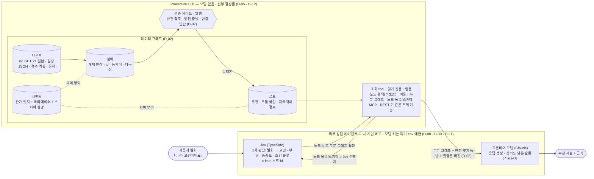

# Procedure Hub 데이터 그래프 + 외부 상담 에이전트 — 메달리온 매핑 · Hub 경계 · 로컬 1차

**정한 것.** 「○○가 고민이에요」 상담을 위해 Procedure Hub 데이터를 메달리온 4레이어
(브론즈 원천 · 실버 개체 원장 · 시맨틱 관계 엣지 · 골드 목적별 조회)로 다시 세우고,
시술↔시술 관계(시너지 · 같은 날 · 순서 · 간격 · 금기)는 **엣지 하나의 속성**으로 모은다.
Hub 는 **데이터 그래프와 읽기 전용 범용 조회 tool(MCP · REST)만** 맡고 **모델을 부르지 않는다.**
질의 해석 · 추천 판단 · 설명은 전부 외부 상담 에이전트(Jev 1차 판단 → Hub tool → 프론티어 모델)가 한다.
1차는 Hub(PROCEDURE-HUB 새 브랜치)와 에이전트(새 개인 레포) 모두 로컬에서 세우고,
데이터는 stg 공개 GET 21개를 브론즈로 받는다. 로컬 E2E 를 위한 **임시 기본값**(D-13)은
전부 사용자 확인 대기이며 같은 내용을 OQ 에 두어 뒤집을 자리를 남긴다.

> 기능 계약(스키마 · 테이블 · API 필드 · 알고리즘)은 다음 SPEC 이 갖는다. 이 문서는 무엇을 정했고
> 무엇이 열려 있는지만 갖는다. 결정의 정본은 `_RESUME.md` §2 이고, 이 문서는 그것을 풀어 쓴 것이다.

## Context

- 관련 입력: `research-report.md`(researcher · 2026-10-26, PROCEDURE-HUB `release/v1.2.0` @ `5b9af03` · stg GET 21개 실측) · `_RESUME.md` §2 결정 표 · 2026-10-26 사용자 합의
- 문제
  - 고민→시술 연결이 **시술군(17) 단위에서 끝난다.** 시술 항목 521개로 가는 연결 0 · 고민 항목 117 중 26 은 시술 연결이 비어 있음(리포트 요약 1 · Q3 3-1)
  - 고민 어휘가 최소 5벌 따로 있고 서로 이어지지 않는다(고민 어휘 간 연결 0, Q3 3-4). 표기만 달라도 첫 홉에서 끊긴다(「처짐」 0건 ↔ 데이터 「쳐짐」, Q4 4-3)
  - 시너지 · 순서 · 금기가 **서로 다른 원장에 따로** 있다 — synergy 115 · contraindications 27쌍 · treatment-sequence(텍스트, modality FK 없음)(Q2 2-1 · Q3 3-4). 원천끼리 어긋난다 — 보톡스·필러 순서가 원천끼리 반대(코디 stg 확인, 2026-10-26)
  - 엣지에 가중치 · 출처가 없고 「왜 이 시술인가」는 자유 텍스트뿐이다(요약 2 · 4 · Q5 5-2)
  - 추천 경로를 읽는 코드가 호출되지 않는다 — `recommendations()` 호출 0(`persistence.py:489`, 리포트 요약 5 · Q4 F). retrieve 는 어휘 검색이고 게시 release 가 없으면 `unavailable`(Q4 4-2)
- 결정이 필요한 이유: 다음 단계 SPEC 두 갈래(Hub 그래프·tool / 상담 에이전트)가 기댈 방향 · 경계 · 1차 범위를 고정한다

## Options

| Option | Description | 판단 |
|---|---|---|
| A | Hub 안에 모델(Jev)을 넣어 질의 해석 · 노드 매칭까지 Hub 가 한다 | **기각** — 사용자 정정(「코디가 Jev 를 Hub 에 넣자고 한 것 정정」, `_RESUME` §2) |
| B | Hub = 데이터 그래프 + 범용 조회 tool, LLM 은 전부 외부 상담 에이전트 | **채택** — `_RESUME` §2 경계 · LLM 행 |
| C | 지금 있는 경로(retrieve 어휘 검색 · 미호출 `recommendations()`)를 살려 추천에 쓴다 | 이번 결정 아님 → OQ-109 · OQ-110. 지금 상태로는 고민→시술 탐색이 안 됨(리포트 요약 5 · Q4) |

## Decision

### 목표 · 데이터 구조

| ID | 결정 | 근거 |
|---|---|---|
| D-01 | **목표** — 「○○가 고민이에요」 질의에 데이터 그래프를 탐색해 **추천 시술과 근거**를 돌려주는 상담. 먼저 로컬에서 세운다 | `_RESUME` §2 「목표」 행 · 사용자 합의(2026-10-26) |
| D-02 | **메달리온 매핑** — **브론즈** = 원천(원장 JSON · 검수 엑셀 · 문헌) 원본 보존 / **실버** = 개체 원장(고민 · 시술 · 제품 · 부작용 · 부위 · 근거), 각 노드에 id · 동의어 · 다국어 이름 / **시맨틱** = 개체 간 관계 엣지 + 스키마 설명 / **골드** = 사용 목적별 조회(추천 · 조합 확인 · 치료계획 경로). 시맨틱은 순차 단계가 아니라 실버·골드에 의미를 붙이는 별도 책임이다 | `_RESUME` §2 「방향: 메달리온」 행 · `para/resources/note/db/2026-09-10-data-medallion-overview.md` 4레이어 정의 · 동의어가 없어 끊기는 실측(리포트 Q4 4-3 「처짐」) |
| D-03 | **시술↔시술 관계는 엣지 하나** — 시너지 · 같은 날 가능 · 순서 · 최소 간격 · 금기 수준을 한 엣지의 속성으로 둔다. 지금의 synergy · treatment-sequence · contraindications 는 이 엣지의 **브론즈 원천**이 된다 | `_RESUME` §2 「시너지·순서·간격·금기는 시술↔시술 엣지 하나의 속성」 · 세 원장이 따로 있음(리포트 Q2 2-1) · 보톡스·필러 순서 원천 간 반대(코디 stg 확인) |
| D-04 | **엣지 메타데이터** — 엣지마다 근거(출처) · 강도 · 조건(부위 · 중증도 등) · 검수 상태 · 원천(리니지)을 단다 | `_RESUME` §2 「시맨틱(관계 엣지 + 메타데이터)」 · 지금 엣지에 출처·가중치 없음(리포트 요약 2 · Q5 5-2) |

### Hub 경계

| ID | 결정 | 근거 |
|---|---|---|
| D-05 | **Hub 의 책임 = 데이터 그래프 + 범용 조회 tool.** Hub 는 **모델을 부르지 않는다.** tool 은 읽기 전용 · 범용 — 노드 검색(별칭 · 검색으로 **후보만**, 결정론) · 이웃 조회 · 부분 그래프 · 노드 목록/스키마 설명. MCP 와 REST 가 **같은 조회 계층**을 읽는다. 추천 판단 · 질의 해석 · 설명 생성은 Hub 가 하지 않는다 | `_RESUME` §2 「경계」 · 「LLM 은 전부 외부」 행 |
| D-06 | **안전 엣지 동반 · 버전 표기** — 시술 노드를 내보낼 때 금기 · 간격 · 부작용 엣지를 **항상 같이** 낸다. 응답에 그래프 **발행본 버전**을 싣는다 | `_RESUME` §2 「안전 엣지(금기·간격·부작용)는 시술 노드와 항상 같이 내보낸다」 · 버전은 리니지 요구 — 응답이 어느 발행본에서 나왔는지 거슬러 올라갈 수 있어야 한다([[data-lineage]]) |
| D-07 | **Hub 가 해야 할 일 다섯** — ① 원천 보존 ② 개체 원장 ③ 관계 엣지 ④ 검증 게이트(끊긴 참조 · 원천 충돌 · 연결 빈칸)와 발행 ⑤ 조회 tool. 검사 항목은 리포트 Q3 수치다(예: 고민 항목 시술 연결 빈칸 26/117 · synergy 끝점 불일치 67/230 · optimization 조합 불일치 48/74 · CC 조합 부분집합 위반 36/277). 그래프를 사람이 고치고 검수하는 **운영 화면도 필요하다** — 범위는 OQ-115 | 사용자 합의(2026-10-26) · 리포트 Q3 3-1 · 3-3 |

### 외부 상담 에이전트

| ID | 결정 | 근거 |
|---|---|---|
| D-08 | **LLM 은 전부 외부.** 외부 상담 에이전트가 `Jev(TypeSafe, 1차 판단: 발화 → 고민 · 부위 · 중증도 · 조건 슬롯을 Hub 노드 id 로) → Hub tool(부분 그래프) → 프론티어 모델(Claude, 응답 생성)` 순서로 돈다. Jev 의 선택지는 Hub 의 노드 목록/스키마 tool 로 만든다. Jev 가 신뢰도 낮다고 낸 슬롯은 프론티어 모델이 **되묻는 데** 쓴다. 참고: https://docs.typesafe.ai · https://simonwillison.net/2026/Sep/21/jev/ | `_RESUME` §2 「LLM 은 전부 외부」 행 · 사용자 합의 |

### 작업 형태 · 로컬

| ID | 결정 | 근거 |
|---|---|---|
| D-09 | **작업 형태** — ① Hub: PROCEDURE-HUB 를 `release/v1.2.0` 에서 새 브랜치로 따서 로컬 실행 ② 상담 채팅 에이전트: 새 개인 레포(kknaksss 계정), 로컬 실행. 레포 이름 · 생성은 사용자 확인 후 | `_RESUME` §2 「작업 형태」 행 · `_RESUME` 머리 「다음」 |
| D-10 | **로컬 데이터 원천** — 로컬 DB 에는 dump 가 없으므로 stg 공개 GET 목록 엔드포인트 21개(리포트 Q3 수집 목록 · 부록)를 받아 **브론즈로 보관**하고 거기서 실버 · 시맨틱을 만든다 | `_RESUME` §2 「로컬 데이터」 행 · 새 환경은 dump 수동 복원(리포트 Q1 1-3) |
| D-11 | **모델 키** — Jev · Claude 키는 사용자가 보유하고 **상담 에이전트에서만** 쓴다. 값은 env 로만, 문서 · 레포에 쓰지 않는다 | `_RESUME` §2 「모델 키 Jev · Claude 사용자 보유(env 로만)」 |
| D-12 | **Hub 에는 LLM 이 없다(재확인)** — 브론즈 적재 · 실버/시맨틱 생성 · 검증 · tool 전부 결정론(규칙 · 정규화 · 사전). **이름 매칭에도 모델을 쓰지 않는다.** 안 맞는 것은 검증 리포트에 남긴다 | `_RESUME` §2 「Hub 는 모델을 부르지 않는다 — 노드 검색도 결정론」 · 사용자 합의 |

### 로컬 1차 임시 기본값

사용자가 「Hub 를 먼저 로컬 E2E 까지 세우고 다음 날 고친다」고 했다. 아래는 그걸 위한 **임시 기본값**이다.
각 줄은 **임시 — 사용자 확인 대기**이고, 같은 질문을 OQ 에 열어 두었다.

| ID | 임시 기본값 | 상태 | 뒤집을 자리 | 근거 |
|---|---|---|---|---|
| D-13a | ~~**노드 단위** — 시술군(17)과 시술 항목(521)을 **둘 다** 노드로, 둘 사이는 계층 엣지. 데이터가 시술군까지만 있는 연결은 시술군에 붙인다~~ → DEC-002 로 대체(2026-10-27) | 대체됨 — DEC-002 | OQ-101 | 모든 FK 가 시술군에서 끝남 · 시술 항목 연결 0(리포트 요약 2 · Q3 3-2) |
| D-13b | **원천 충돌**(예: 보톡스·필러 순서) — 자동으로 고르지 않는다. 원천별 값을 엣지에 모두 남기고 검수 상태를 「충돌」로 표시한다 | 임시 — 사용자 확인 대기 | OQ-102 | D-04 검수 상태 · D-12 결정론 · 코디 stg 확인 |
| D-13c | **저장** — 같은 PostgreSQL 안에 **새 그래프 모듈 · 새 테이블.** 레거시 · canonical 테이블은 읽지도 고치지도 않는다(브론즈는 stg JSON 에서 받는다) | 임시 — 사용자 확인 대기 | OQ-103 | D-10 · canonical 경로 미호출(리포트 요약 5) |
| D-13d | **고민 노드** — taxonomy 고민 트리(problem · subcategory · item)를 고민 노드로. 다른 어휘(optimization 고민 · synergy target 등)는 별도 노드로 두고, **정규화 완전 일치일 때만** 동의어 엣지로 잇는다. 안 이어진 것은 검증 리포트로 | 임시 — 사용자 확인 대기 | OQ-104 · OQ-105 | 고민 어휘 5벌 · 어휘 간 연결 0(리포트 요약 2 · Q3 3-4) · 정규화 완전 일치 판정(리포트 Q3 머리) · D-12 |
| D-13e | **큐레이션 3종** — 전부 적재하고 엣지에 원천을 표시한다. 합치지 않는다 | 임시 — 사용자 확인 대기 | OQ-106 | 「기미」 하나에 세 원장이 다른 답(리포트 Q4 4-3) · D-04 원천 |
| D-13f | ~~**부위** — 위험 부위 11곳만 부위 노드로. 나머지는 OQ~~ → DEC-002 로 대체(2026-10-27) | 대체됨 — DEC-002 | OQ-107 | 부위 엔티티 0 · 위험 부위 11곳(리포트 Q2 2-1 · Q3 3-4) |
| D-13g | **E2E 표면** — REST(Swagger) + MCP. 프론트 화면은 이번 범위 밖 | 임시 — 사용자 확인 대기 | OQ-115 | D-05 MCP · REST 같은 조회 계층 |

## Hub 경계

경계선은 하나다 — **모델은 에이전트 쪽에만 있고, Hub 쪽에는 그래프와 결정론 tool 만 있다.** 화살표가
경계를 넘는 것은 tool 호출과 그 응답뿐이다.

## Rationale

- 판단 기준
  - 고민→시술 연결이 끊긴 자리(시술군 종착 · 어휘 분열 · 표기 불일치)가 실측으로 드러났다(리포트 요약 1~3). 원본 보존 · 개체 표준화 · 관계 의미를 한 단계에서 섞지 않고 레이어로 나눠야 끊긴 자리를 검증 게이트에서 셀 수 있다([[medallion-architecture]])
  - 시술↔시술 관계가 원장 셋에 흩어져 서로 어긋난다(Q2 2-1 · 보톡스·필러 순서). 엣지 하나로 모으고 원천을 리니지로 남기면 충돌이 「어디서 왔나」로 보인다([[data-lineage]])
- 대안 대비 이유
  - Option A 기각: 사용자 정정. Hub 를 결정론으로 두면 같은 입력에 같은 후보가 나오고, 판단은 에이전트 쪽에서 바꿀 수 있다
  - Option C 보류: 지금 경로는 어휘 검색(retrieve)이거나 호출되지 않는 코드(`recommendations()`)라 그대로는 탐색이 안 된다(리포트 Q4)
- 리스크
  - D-13 임시 기본값은 사용자 확인 전이다. 뒤집히면 SPEC 이 따라 바뀐다(OQ-101~107 · OQ-115)
  - 외부 API 로 발화가 나간다 — 데이터 정책 미정(OQ-112)
  - 안전 엣지 원천 자체에 빈칸이 있다 — 시술 간 금기 시술군 11/17 · 합병증 10/17(리포트 Q3 3-4). D-06 은 있는 엣지를 늘 같이 내는 것이지 빈칸을 채우는 것이 아니다(OQ-119)

## 근거 개념

- [[medallion-architecture]] — 브론즈 · 실버 · 골드의 책임 분리(D-02 · D-07 ①~④). 시맨틱 레이어의 정의는 출처 노트 `para/resources/note/db/2026-09-10-data-medallion-overview.md`(실버·골드에 의미를 붙이는 별도 책임)를 따른다
- [[data-lineage]] — 엣지의 원천 표시(D-04) · 원천 충돌 보존(D-13b) · 응답의 발행본 버전(D-06)

## Scope

- In: D-01 ~ D-13 — Hub 그래프(브론즈 적재 · 실버 · 시맨틱 · 검증 게이트 · 발행) · Hub 조회 tool(MCP · REST) · 외부 상담 에이전트 로컬 실행
- Out: Hub 프론트 화면(D-13g) · 운영 화면 범위 결정(OQ-115) · 레거시 · canonical 테이블 변경(D-13c) · 회사 기획 문서(mediness `products/procedure-hub/`) 반영(OQ-117) · 회사 org 반영(OQ-118) · 배포
- 영향을 받는 spec 후보: 아래 「Resulting Spec」 두 갈래

## Open Questions

결정하지 않는다. 질문 · 왜 정해야 하나 · 영향받는 D 만 적는다. Owner 는 전부 사용자(의료 판단이 걸린 것은 의료진 검수 여부가 함께 열려 있다).

| ID | 질문 | 왜 정해야 하나 | 영향 D | 출처 |
|---|---|---|---|---|
| OQ-101 | **노드 단위** — 시술군(17) · 시술 항목(521) · 제품 중 추천의 도착 단위와 노드 단위는 무엇인가 | 지금 모든 연결이 시술군에서 끝나 「어떤 시술」이 안 나온다. 단위가 엣지 수 · 검증 항목 · tool 응답 크기를 정한다 | D-02 · D-03 · D-13a | 브리프 · 리포트 Q7-4 |
| OQ-102 | **원천 충돌 정리 주체** — 원천끼리 다른 값(보톡스·필러 순서 등)을 누가 정리하나, 의료진 검수를 거치나 | 「충돌」로 남겨 둔 엣지를 상담에서 어떻게 다룰지, 발행 조건이 무엇인지가 여기서 갈린다 | D-04 · D-07 ④ · D-13b | 브리프 |
| OQ-103 | **저장 위치** — canonical 계층을 확장하나, 새로 세우나. 저장 기술(관계형 · 그래프 DB 등)은 무엇인가 | 임시로 새 모듈 · 새 테이블을 골랐다. canonical 확장이면 release 발행(의사 검수)이 선행 조건인지도 같이 정해야 한다 | D-05 · D-13c | 브리프 · 리포트 Q7-10 |
| OQ-104 | **고민 어휘 정본** — taxonomy `problem` · subcategory · `optimization_concern` · synergy `target` · canonical `catalog_concern` 중 무엇, 또는 새로 | 정본이 고민 노드 집합과 Jev 선택지(D-08)를 정한다 | D-02 · D-08 · D-13d | 브리프 · 리포트 Q7-1 |
| OQ-105 | **고민이 아닌 항목** — 「쁘띠시술」「제모」「얼굴윤곽」「반영구화장」처럼 시술 범주가 고민 트리에 섞인 것을 어떻게 다루나 | 고민 노드로 두면 「고민 → 시술」 엣지의 의미가 흐려진다(리포트 Q5 5-1) | D-02 · D-13d | 브리프 · 리포트 Q7-2 |
| OQ-106 | **큐레이션 원장 3종**(problem-combos · problem-packages · treatment-optimization) — 무엇을 원천으로 삼나, 같은 고민에 다른 답을 내는 상태를 어떻게 다루나 | 임시로 전부 적재 · 원천 표시 · 합치지 않음. 상담 응답이 어느 원장을 따르는지가 정해지지 않았다 | D-03 · D-04 · D-13e | 브리프 · 리포트 Q7-5 |
| OQ-107 | **부위 엔티티** — 위험 부위 11곳 외에 부위를 노드로 세우나. 고민 · 시술 · 가격 · 위험 부위 중 어디와 잇나 | 부위는 Jev 슬롯(D-08)과 엣지 조건(D-04)에 들어가는데 원장에 부위 마스터가 없다 | D-02 · D-04 · D-08 · D-13f | 브리프 · 리포트 Q7-8 |
| OQ-108 | **표기 · 동의어 관리** — 「처짐/쳐짐」 같은 동의어를 누가 어디서 관리하나 | 결정론 매칭(D-12)은 사전에 기댄다. 사전의 주인이 없으면 끊긴 표기가 계속 남는다 | D-02 · D-12 · D-13d | 리포트 Q7-3 |
| OQ-109 | **기존 코드 처리** — `RecommendationEligibilityPolicy`(테스트만)와 미호출 `recommendations()` 를 살리나 | 새 그래프 모듈과 겹치는 책임이 레포에 남는다 | D-05 · D-13c | 리포트 Q7-11 |
| OQ-110 | **텍스트로만 있는 고민 신호** — 적응증 문장 2,110개를 엣지로 끌어올리나, 검색으로 쓰나 | 시술 항목(521)과 고민을 잇는 유일한 실마리가 이 문장이다(리포트 Q3 3-2) | D-03 · D-12 · D-13a | 리포트 Q7-7 |
| OQ-111 | **엣지 근거 · 강도의 원천** — 문헌 · 전문가 합의 · AI 컨센서스 중 무엇을 근거로 치고, 강도는 어디서 오나 | D-04 가 자리를 정했지만 채울 원천이 없다. 지금 고민–시술 근거는 자유 텍스트뿐이다(리포트 요약 4) | D-04 | 리포트 Q7-6 |
| OQ-112 | **Jev 한국어 성능 · 데이터 정책** — Jev 의 한국어 슬롯 추출을 어떻게 평가하나, 외부 API 로 발화가 나가는 것을 어떤 정책으로 허용하나 | 1차 판단의 품질과 개인정보 경계가 여기 걸린다 | D-08 · D-11 | 브리프 |
| OQ-113 | **Noul 안전 슬롯의 기준값** | 되묻기 · 안전 판단의 문턱이 정해지지 않았다 | D-06 · D-08 | 브리프 |
| OQ-114 | **조건 입력** — 중증도 · 연령을 추천 입력으로 받나. 받는다면 도메인에만 있는 `severity_scope` 등은 어떻게 하나 | D-04 엣지 조건 · D-08 슬롯에 중증도가 있는데 원장에는 일부만 있다(리포트 Q6) | D-04 · D-08 | 리포트 Q7-9 |
| OQ-115 | **운영 화면 범위 · Hub 프론트** — 그래프를 사람이 고치고 검수하는 화면을 어디까지 만드나. 1차 E2E 표면(REST + MCP)을 넘는 화면은 언제 | D-07 이 운영 화면을 요구하지만 범위가 없다 | D-07 · D-13g | 브리프 |
| OQ-116 | **채팅 UI 형태** — 상담 에이전트의 화면을 어떤 형태로 하나 | 에이전트 SPEC 의 표면이 정해진다 | D-08 · D-09 | 브리프 |
| OQ-117 | **회사 기획 문서 반영 시점** — mediness `products/procedure-hub/`(v1.1.0)에 언제 반영하나, 이번 설계의 기준 문서는 무엇인가 | 기획은 v1.1.0 에서 멈췄고 코드는 v1.2.0 이다(리포트 Q6) | D-09 | 브리프 · 리포트 Q7-14 |
| OQ-118 | **회사 org 반영 여부** — 개인 레포 에이전트 · Hub 새 브랜치를 회사 org 로 올리나 | 레포 위치와 키 · 데이터 정책이 갈린다 | D-09 · D-11 | 브리프 |
| OQ-119 | **안전 필터 빈칸** — 시술 간 금기 27쌍(시술군 11/17) · 합병증(10/17)의 빈칸을 추천 전에 채워야 하나 | D-06 은 있는 안전 엣지를 같이 낼 뿐, 없는 엣지를 만들지 않는다 | D-06 · D-07 ④ | 리포트 Q7-12 · Q3 3-4 |
| OQ-120 | **추천 결과 승인** — 큐레이션(사람) 원장만 내보내나, 경로 탐색으로 생긴 후보도 내보내나 | 상담 응답에 실을 수 있는 것의 경계가 정해진다 | D-05 · D-07 ④ · D-08 | 리포트 Q7-13 |

## Resulting Spec

이 문서가 낳을 SPEC 두 갈래. 내용은 SPEC 이 쓴다.

| Spec | Action | Notes |
|---|---|---|
| SPEC — Hub 그래프 · 조회 tool | create | 브론즈 적재 · 실버 · 시맨틱 · 검증 게이트 · 발행 · MCP/REST tool (D-02 ~ D-07 · D-10 · D-12 · D-13) |
| SPEC — 외부 상담 에이전트 | create | Jev → Hub tool → 프론티어 모델 흐름 · 되묻기 · 키 env (D-08 · D-09 · D-11) |
