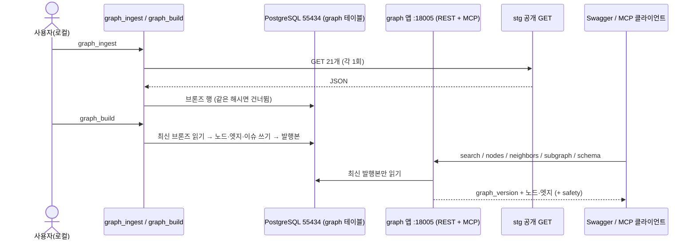
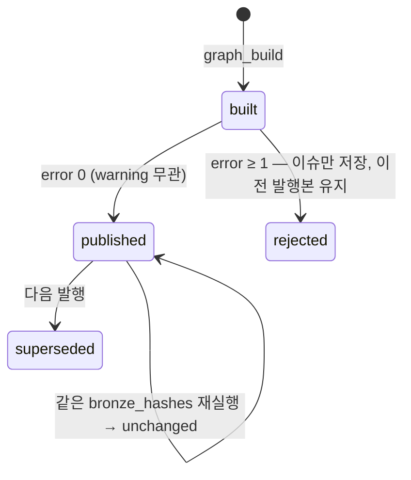

# Hub 데이터 그래프 + 조회 tool — 로컬 E2E 1차

Procedure Hub 가 stg 공개 데이터를 원본 그대로 보관하고(브론즈), 개체 원장(실버 노드)과 관계(시맨틱 엣지)를
**결정론으로** 만들고, 검증 리포트와 함께 발행한 뒤, 외부 LLM 이 읽을 **읽기 전용 범용 조회 tool**을
REST 와 MCP 로 같은 서비스 계층에서 내보낸다. 이 문서만 보고 백엔드 워커가 구현하고, 사용자가 다음 날
Swagger 와 MCP 클라이언트로 §6 시나리오를 따라 확인할 수 있어야 한다.

> **변경 이력**
> - 0.2.1 (2026-10-26) 재검수 반영 — R1 · WARN-n(`review-spec-001-v2-report.md`): 시술 항목 끝점의 안전 엣지를 이웃 · 부분 그래프 safety 에 싣는 규칙(R1) · Mount 예시에 stateless/json 옵션 · 이소트레티노인 줄 실측대로 · 검색 점수에 `names.en` 명시
> - 0.2.0 (2026-10-26) 검수 반영 — F1~F7(`review-spec-001-report.md`): 시술↔시술 끝점 · 자기쌍 · 순서 주장 범위 규칙 명시(F1) · `coverage_gap` 정의 재정의(F2) · `treats` 엣지 단위와 `edge_id` 원천 키(F3) · products `category_id` 배열(F4) · CC 매칭 동률 규칙(F5) · 부분 그래프 방향 · 상한(F6, `has_procedure` 분리) · import 허용 목록 일치(F7) · WARN W2~W8 · 알려진 이상 §6.3. 기대값은 바뀐 규칙으로 다시 셌다
> - 0.1.0 (2026-10-26) 초안

> 템플릿은 내부 구현(테이블 · 파일 경로)을 SPEC 에 두지 말라고 하지만, 이번 브리프는 모듈 위치 · 로컬 실행을
> SPEC 이 정하라고 했다(브리프 §3-7 · §3-8). 그래서 §5 에 **위치와 경계만** 두고, 테이블 컬럼 · 클래스 구조는
> 관련 work 와 코드 · migration 이 갖는다.

## 1. Context

### Meta

- Decision reference: `DEC-001` — D-02 ~ D-07 · D-10 · D-12 · D-13a~g
- Baseline reference: 없음 — 원천 사실은 `research-report.md`(이하 「리포트」)
- 근거 개념: [[medallion-architecture]](레이어마다 입력 · 출력 계약 · 허용 변환 · 품질 검사) · [[data-lineage]](엣지 → 원천 브론즈 행까지 역추적)
- 수치 검산: 이 SPEC 의 기대값은 2026-10-26 stg GET 응답 10개(taxonomy · products · problem-combos · problem-packages · synergy · contraindications · treatment-sequence · treatment-optimization · complications · anatomy-danger-zones, 각 1회)에 §3 규칙을 그대로 적용해 셌다. 셈 방법: 응답 JSON 을 스크래치 스크립트(레포 밖)로 읽어 §3 의 노드 · 엣지 · 검사 규칙을 그대로 구현하고 타입 · 원천 · 코드별로 센다. 리포트 Q3 수치와 겹치는 것은 전부 같게 나왔다(§6 표). stg 데이터가 바뀌면 숫자도 바뀐다
- Open questions: §7

### Business Requirement

「○○가 고민이에요」 상담을 외부 에이전트가 하려면, Hub 가 고민 → 시술 → 안전 정보를 **끊기지 않는 그래프로**
내줘야 한다. 지금은 연결이 시술군에서 끝나고(리포트 요약 1~3), 시너지 · 순서 · 금기가 원장 셋에 따로 있어
서로 어긋나며(DEC D-03), 끊긴 곳이 어디인지 세는 장치가 없다(DEC D-07 ④). 이 SPEC 은 그 세 가지를
**로컬에서 눈으로 확인할 수 있는 상태**를 보장한다. 데이터 결함을 고치는 것이 아니라 **결함이 보이게** 하는 것이 1차 목표다(DEC D-13 머리 「다음 날 고친다」).

### Scope

In scope:

- 브론즈 적재 CLI(stg GET 21개 · 파일 디렉토리) — §3.1
- 실버 노드 10종 · 시맨틱 엣지 9종 빌드 — §3.2 · §3.3
- 검증 게이트 · 발행 — §3.4
- 조회 tool 7종 REST + 6종 MCP(같은 서비스 계층) — §4
- 새 진입점 · 모듈 · migration 위치, 로컬 실행 순서 — §5
- E2E 수용 기준 — §6

Out of scope:

- 상담 에이전트 · LLM · Jev · 프론트 화면(DEC D-08 · D-12 · D-13g) — 상담 에이전트 쪽 spec 에서
- 레거시 · canonical 테이블과 그 코드의 읽기 · 수정(DEC D-13c)
- 그래프를 사람이 고치는 운영 화면 · 검수 상태 변경 API(DEC D-07 · OQ-115) — 1차는 읽기 전용
- 근거(문헌) 노드 · 적응증 문장 구조화 · 부위 11곳 외 부위(DEC OQ-110 · OQ-111 · D-13f)
- 배포 · 인증(로컬 전용)

## 2. UX Contract

해당 없음 — 화면 없음(DEC D-13g). 사용자 표면은 Swagger UI(FastAPI 기본)와 MCP 클라이언트다(§5.4).

## 3. 데이터 계약 — 레이어별 입력 · 출력 · 허용 변환 · 품질 검사

레이어 책임은 DEC D-02 를 따른다. 시맨틱은 순차 단계가 아니라 실버 노드에 의미(관계 · 타입 설명)를 붙이는 책임이다
(`para/resources/note/db/2026-09-10-data-medallion-overview.md` · DEC D-02).

| 레이어 | 입력 | 출력 | 허용 변환 | 금지 | 품질 검사 |
|---|---|---|---|---|---|
| 브론즈 | stg GET 응답 21개(또는 같은 이름의 JSON 파일) | 엔드포인트별 원본 JSON 행 | 없음(파싱 가능 여부 확인 · 해시 계산만) | 필드 가공 · 병합 | HTTP 200 · JSON 파싱 · 같은 해시 중복 금지 |
| 실버(노드) | 엔드포인트별 **최신** 브론즈 행 | 노드(안정 id · 이름 · 다국어 이름 · 동의어 · 속성 · 원천 참조) | 필드 선택 · 이름 정규화 · id 부여 | 서로 다른 원천 노드 병합(D-13d · D-13e) | 중복 id · 필수 엔드포인트 부재 |
| 시맨틱(엣지 · 스키마 설명) | 같은 브론즈 행 + 실버 노드 | 엣지(타입 · 양끝 · 원천별 주장 · 메타) + 타입 설명 | 결정론 이름 해석(§3.3.1) · 원천별 주장 보존 | 모델 호출(D-12) · 원천 값 하나만 고르기(D-13b) | 끊긴 이름 참조 · 원천 충돌 · 연결 빈칸 · 고아 노드(§3.4) |
| 골드 | **최신 발행본**의 노드 · 엣지 | 조회 응답(검색 · 상세 · 이웃 · 부분 그래프 · 목록 · 스키마) | 조회 시 조합 · 안전 엣지 동반(D-06) | 발행 전 버전 읽기 · 브론즈 직접 참조 | 응답마다 발행본 버전 |

1차에서 골드는 **조회 시점 조합**이다(별도 집계 테이블을 만들지 않는다). 쓰기 팬아웃보다 조회 조합을 고른 것은
[[medallion-architecture]] 「골드 — 공통 데이터와 개별 데이터를 분리해 두고 조회 시 조합하는 선택도 가능」을 따른 것이고,
데이터가 천 단위 규모(노드 941 · 엣지 1,504 — §6 S-6)라 조회 비용이 문제 되지 않는다.

### 3.1 브론즈 — 적재 명령

| 항목 | 계약 | 근거 |
|---|---|---|
| 대상 | 리포트 Q3 수집 목록의 21개: `taxonomy` · `products` · `problem-combos` · `problem-packages` · `combo-recipes` · `synergy` · `contraindications` · `complications` · `treatment-optimization` · `treatment-sequence` · `procedure-profiles` · `market-pricing` · `patient-education` · `procedure-comparison` · `pih-risk` · `post-procedure-timeline` · `literature-evidence` · `consent-checklist` · `anatomy-danger-zones` · `pre-procedure-checklist` · `extracted` | DEC D-10 · 리포트 Q3 머리 · 부록 |
| 빌드에 쓰는 것 | 위 중 10개(§3.2 · §3.3 표의 원천). 나머지 11개는 **보관만** 한다 — 근거 노드 · 운영 정보는 열린 것(§7) | DEC D-02 브론즈 = 원본 보존 |
| 주소 | env `PHUB_GRAPH_SOURCE_BASE_URL` = stg 의 `/procedure-hub/api/v1` 까지(값은 리포트 머리의 stg 주소). 요청은 `GET {base}/{endpoint}` 1회씩 | 브리프 §3-1 |
| 두 입력 모드 | ① `--source http`(기본): 위 주소에서 받는다. `--save-dir <경로>` 를 주면 받은 원본을 `<경로>/<endpoint>.json` 으로도 쓴다(레포 밖 경로) ② `--from-dir <경로>`: `<경로>/<endpoint>.json` 파일을 읽는다(테스트 · 오프라인 재현 · 재적재). 파일이 없는 엔드포인트는 「없음」으로 보고 | 테스트는 stg 를 부르지 않는다(브리프 §4) · 재적재가 stg 를 다시 부르지 않게(검수 W8) |
| 행 내용 | 엔드포인트 · 수집 시각(UTC) · 내용 해시 · HTTP 상태 · 원본 JSON · 입력 모드 · 원천 위치(URL 또는 파일 경로) | 브리프 §3-1 · [[medallion-architecture]] 브론즈 「로드 시각 · 프로세스 ID 같은 메타데이터」 |
| 내용 해시 | `sha256:` + 정규화 JSON(키 정렬 · 공백 없는 구분자 · `ensure_ascii=False` · UTF-8)의 SHA-256 hex. 수집 시각 · 순서 바뀐 키는 해시에 영향 없음 | 브리프 §3-1 「같은 해시는 새 행을 만들지 않는다」 |
| 멱등 | (엔드포인트, 내용 해시)가 이미 있으면 새 행을 만들지 않고 결과에 `unchanged` 로 센다 | 같음 |
| 실패 | 200 이 아니거나 JSON 이 아니면 행을 만들지 않고 `failed` 로 센다. 성공한 엔드포인트는 저장한다. 하나라도 실패면 종료 코드 1 | 부분 실패도 원인이 보여야 한다 |
| 출력 | 엔드포인트별 `inserted` · `unchanged` · `failed`(사유) 표 + 합계를 stdout 에 | 사용자 E2E 확인용 |
| 「최신」 | 엔드포인트마다 수집 시각이 가장 늦은 행. 빌드는 이것만 읽는다 | §3.4 발행본 브론즈 해시 집합 |

### 3.2 실버 — 노드 타입

모든 노드는 아래 공통 필드를 갖는다.

| 필드 | 뜻 |
|---|---|
| `node_id` | 안정 id = `<type>:<원천 키>`. 원천 키는 원천의 id 를 그대로 쓰고, id 가 없는 원천은 정규화 이름(§3.3.1)을 쓴다. 같은 브론즈면 언제 빌드해도 같은 id |
| `type` | 아래 10종 |
| `name` | 한국어 표시 이름 — 아래 표 「name ←」 필드의 원천 문자열 그대로 |
| `names` | `{"ko": name, "en": …}` — `en` 은 아래 표 「names.en ←」 필드가 있을 때만. 없으면 키 생략(DEC D-02 다국어 이름) |
| `synonyms` | 1차에는 **빈 배열**이다 — 사람이 넣는 동의어 사전이 없다(§7 · DEC OQ-108). 검색은 `names.en` 을 synonym 점수로 함께 본다(§4 검색) |
| `attributes` | 타입별 속성(아래 표). 원천 문자열 그대로 |
| `source_refs` | `[{"endpoint", "bronze_id", "content_hash", "json_path"}]` — 이 노드를 만든 브론즈 행과 그 안의 위치(JSONPath). 리니지([[data-lineage]]) |

| 타입 | 뜻 | 원천(엔드포인트 · 위치) | 원천 키 | name ← | names.en ← | 주요 속성 | 개수(§6) | 근거 |
|---|---|---|---|---|---|---|---|---|
| `concern` | 고민 대분류 | `taxonomy` `problem[]` | `id`(P1~P14) | `category` | `category_en` | — | 14 | DEC D-13d |
| `concern_subcategory` | 고민 하위 | `taxonomy` `problem[].subcategories[]` | `id`(P3-1 등) | `label` | — | `parent`(P id) | 53 | D-13d |
| `concern_item` | 고민 항목 | `taxonomy` `problem[].subcategories[].items[]` | `id`(원천 id 그대로 — 117개 전부 `auto-<n>-<timestamp>` 형식) | `name` | — | `detail` · `subcategory_id` · `subcategory_label` | 117 | D-13d |
| `opt_concern` | 다른 고민 어휘 — 최적화 고민 | `treatment-optimization` `by_concern[]` | 정규화 `concern` | `concern` | `concern_en` | `icon` | 8 | D-13d · 리포트 Q3 3-4 |
| `synergy_target` | 다른 고민 어휘 — 시너지 목표 효과 | `synergy` `links[].target`(고유값) | 정규화 `target` | `target` | — | `link_count` | 17 | D-13d · 리포트 Q3 3-4 |
| `procedure_group` | 시술군 | `taxonomy` `modality[]` | `id`(M1~M17) | `category`(`name` 과 같은 값) | `category_en` | `group` · `extracted.overview` · `extracted.contraindications`(absolute/relative 문장) · `extracted.safety` · `extracted.onset_duration` · `session_phase_order`(아래) | 17 | D-13a |
| `procedure` | 시술 항목 | `taxonomy` `modality[].subcategories[].items[]` | `id`(M1-2-1 등) | `name` | — | `group_id` · `subcategory_id` · `subcategory_label` · `detail` · `extracted.indications` · `extracted.safety` | 521 | D-13a |
| `product` | 제품 | ① `taxonomy` `modality[].products[]` ② `products` `<분류 키>.products[]`(분류 키 = `botulinum_toxin` 등 최상위 키) | ① `id`(M1-P-0 등) ② `products:<분류 키>:<정규화 name>` | `name` | `name_en` | `manufacturer` · `country` · `mfds` · `group_ids`(아래) | ① 59 + ② 59 = 118 | 리포트 Q2 2-1(두 원장, 서로 FK 없음) |
| `complication` | 부작용(합병증) | `complications` `categories[].complications[]` | `<categories[].id>:<정규화 name>` | `name` | — | `severity` · `incidence` · `onset` · `evidence`(URL 문자열) | 65 | 리포트 Q3 3-4 |
| `site` | 부위(위험 부위) | `anatomy-danger-zones` `zones[]` | `id`(forehead 등) | `name_ko` | `name_en` | `danger_level` · `botox_specific` · `filler_specific` | 11 | D-13f |

- 제품 `group_ids` — ① 은 그 제품을 품은 `modality[].id` 하나 ② 는 분류의 `category_id`. **`category_id` 는 문자열 또는 배열이다** — stg 에서 `energy_device` 만 `["M8", "M9", "M11"]`(제품 18개), 나머지 7개 분류는 문자열. 배열이면 원소마다 시술군으로 편다(검수 F4). ② 노드 키에 `category_id` 대신 **분류 키**를 쓰는 것도 이 때문이다 — 분류 키는 하나라 배열이어도 키가 하나로 정해진다
- 제품 두 원장은 **합치지 않는다.** ② 제품과 ① 제품이 정규화 이름이 완전 일치하고 `group_ids` 가 하나라도 겹치면 `synonym` 엣지(§3.3)로 잇는다 — D-13d 의 「다른 어휘는 별도 노드, 완전 일치만 동의어 엣지」를 제품에도 같은 규칙으로 쓴다. stg 기준 57쌍(§6.3 알려진 이상)
- `session_phase_order` — `treatment-sequence.sequence_order[]` 에서 `categories` 가 `M<숫자>` 로 시작하는 항목의 `order` 를 그 시술군 속성으로 둔다(같은 시술군이 여러 번이면 가장 작은 값). 시술군 10개(M1 · M2 · M3 · M4 · M5 · M8 · M9 · M11 · M12 · M15)가 값을 갖는다. 시술↔시술 엣지의 「순서」 주장에도 쓴다(§3.3 `procedure_relation`)
- 시술군 하위 분류(74, 리포트 Q1)는 노드로 세우지 않고 `procedure` 속성으로 둔다 — D-13a 는 시술군 · 시술 항목 둘만 노드로 정했다

### 3.3 시맨틱 — 엣지 타입

모든 엣지는 아래 공통 필드를 갖는다(DEC D-04).

| 필드 | 뜻 |
|---|---|
| `edge_id` | 안정 id = `<type>:` + `sha256("<type>|<from>|<to>|<원천 키>")` hex 앞 16자. **원천 키는 엣지 타입마다 아래 표 「원천 키」 열**이다. 원천 키가 「없음」이면 빈 문자열. 같은 브론즈면 같은 id |
| `type` | 아래 9종 |
| `from` · `to` | 노드 id. `procedure_relation` · `synonym` 은 방향이 없으므로 두 id 를 사전순으로 놓는다 |
| `claims` | 주장 목록 — **원천 행 하나 = 주장 하나.** 같은 `edge_id` 로 모이는 원천 행들은 한 엣지의 주장 여러 개가 되고, 값은 합치거나 고르지 않는다(D-13b · D-13e). 주장마다 `source`(엔드포인트) · `bronze_ref`(`bronze_id` · `content_hash` · `json_path`) · `evidence_text`(원천의 이유 · 근거 문자열, 없으면 생략) · `strength`(원천에 있을 때만, 아래) · `conditions`(아래) · 타입별 값 |
| `review_status` | `unreviewed` 또는 `conflict`. 1차는 사람 검수가 없으므로 `reviewed` 가 생기지 않는다(운영 화면은 OQ-115) |

`strength` 는 원천이 준 등급만 옮긴다 — `treatment-optimization` 의 `evidence_level`(high/moderate/low), `contraindications` 의 `level`(safe/caution/warning).
없는 원천에 강도를 만들지 않는다(DEC D-04 「강도」 · OQ-111 「강도의 원천」).
`conditions` 는 원천에 있는 조건만 옮긴다 — 중증도(`severity_levels[].level`) · 패키지(`package_id` · `tier`) · CC 묶음(`cc_group`) · 시기(`timing` · `interval`).

| 타입 | 뜻 | from → to | 원천 · 규칙 | 원천 키 | 엣지 수 / 주장 수(§6) | 근거 |
|---|---|---|---|---|---|---|
| `has_child` | 고민 트리 | `concern`→`concern_subcategory`→`concern_item` | taxonomy 중첩 구조 그대로 | 없음 | 170(53 + 117) | D-13d |
| `has_procedure` | 시술군 ⊃ 시술 항목 | `procedure_group`→`procedure` | taxonomy `modality[].subcategories[].items[]` | 없음 | 521 | D-13a |
| `treats` | 고민 → 시술 | 아래 4 원천. **원천이 다르면 다른 엣지**(원천 키 = 엔드포인트), 같은 원천 · 같은 양끝의 행들은 한 엣지의 주장 여러 개 | ① `taxonomy` `items[].modality_ref[]` : `concern_item`→`procedure_group` ② `problem-combos` `combos[].packages[].procedures[]` : `concern`→`procedure_group`, conditions `package_id` · `tier` · evidence `clinicalRationale` ③ `problem-packages` `problems[].complaints[].procedures[]` : CC 를 고민 항목으로 찾고(아래 「CC → 고민 항목」) `concern_item`→`procedure_group`(`category`), conditions `cc_group` · evidence `role` ④ `treatment-optimization` `by_concern[].severity_levels[].optimal_combo[]` : `opt_concern`→ §3.3.1 로 해석한 시술 항목 또는 시술군(제품으로 풀리면 그 제품의 `group_ids` 가 하나일 때 그 시술군, 여럿이면 `unresolved_name_ref` — stg 0건), strength `evidence_level` · conditions 중증도 · evidence `rationale` | 엔드포인트 이름 | ① 105 / 105 ② 32 / 63 ③ 244 / 254 ④ 19 / 26 — 합 400 / 448 | D-13e · D-04 · 리포트 Q2 2-1 · Q3 3-1 |
| `procedure_relation` | **시술↔시술 단일 엣지** — 시너지 · 같은 날 · 순서 · 최소 간격 · 금기 수준 | 무방향 쌍(양 끝은 `procedure_group` 또는 `procedure` 만) | 아래 「시술↔시술 주장」 | 없음(원천이 달라도 같은 쌍이면 한 엣지 — D-03) | 106 / 167 | DEC D-03 |
| `has_complication` | 시술 → 부작용 | `procedure_group`→`complication` | `complications.categories[].id` | 없음 | 65 | DEC D-06 |
| `has_product` | 시술 → 제품 | `procedure_group`→`product` | 제품의 `group_ids` 원소마다 하나(① 59 · ② 95 — `energy_device` 18개 × 3) | 엔드포인트 이름 | 154 | 리포트 Q2 2-1 · 검수 F4 |
| `site_caution` | 부위 → 시술(부위별 주의) | `site`→`procedure_group`(M1 · M2) | `zones[].botox_specific` 이 있으면 M1, `filler_specific` 이 있으면 M2. 값(object)을 주장 값으로 | 없음 | 22 | 리포트 Q2 2-1(위험 부위→시술은 보톡스/필러 스펙만) |
| `synonym` | 어휘 간 같은 말 | `opt_concern` · `synergy_target` ↔ 고민 트리 노드 / ② 제품 ↔ ① 제품 | 정규화 이름 **완전 일치만**(D-13d). 고민 트리 쪽은 `concern` → `concern_subcategory` → `concern_item` 순, 같은 타입 안에서는 `node_id` 사전순으로 처음 맞는 하나. 제품은 §3.2 규칙 | 없음 | 66(고민 9 + 제품 57) | D-13d |
| — | (의도적으로 없음) | 고민 트리(`concern` · `concern_subcategory` · `concern_item`) → 시술 항목 | 원천에 없다. 만들지 않는다. 시술 항목으로 가는 고민 연결은 ④ `opt_concern` → 시술 항목뿐이다(12 주장 · 시술 항목 8개) | — | 0 | 리포트 Q3 3-2 · 검수 F2 |

**CC → 고민 항목(`treats` ③)** — ① 같은 `problem_id` 아래 `concern_item` 중 정규화 `name` == 정규화 `cc` 인 것 ② 후보가 둘 이상이면 그 항목이 속한 `concern_subcategory` 의 정규화 `label` == 정규화 `cc_group` 인 것만 남긴다 ③ 남은 것이 정확히 하나면 그것, 아니면 **엣지를 만들지 않고** `ambiguous_cc_match`(후보 둘 이상) 또는 `unresolved_name_ref`(후보 0) 이슈로 남긴다(D-12).
stg 에서 ② 가 쓰이는 CC 는 4건(P9 「니들RF」 · 「프락셔널레이저」 가 「여드름흉터」 · 「수술흉터/화상흉터」 · 「튼살」 묶음에 같은 이름으로 있음)이고 4건 모두 하나로 갈린다 — `ambiguous_cc_match` 0 · `unresolved` 0 / 115(검수 F5).

#### 시술↔시술 주장 (`procedure_relation.claims`)

| 원천 | 쌍을 정하는 법 | 주장 값 |
|---|---|---|
| `synergy` `links[]` | `from`/`to` 의 `M?-이름` 에서 이름 부분을 §3.3.1 로 해석. 그 끝은 — 시술 항목 · 시술군으로 풀리면 그것 / **제품으로 풀리거나 못 풀면 `*_category` 시술군**(D-13a 「시술군까지만 있으면 시술군에」). 못 푼 것만 `unresolved_name_ref` 로 센다(제품으로 풀린 5개는 센 대상이 아니다 — 리포트 Q3 3-3 셈과 같게) | `synergy_type`(함께/다음에/대신) · `timing` · `target` · evidence `reason`. `type=다음에` 이면 `first` = from 쪽 |
| `contraindications` `rules[]` | `from`·`to` 시술군 FK 그대로 | `contraindication_level`(=strength) · `interval` · evidence `note`. `note`+`interval` 안에 `<from_name 또는 to_name> 먼저` 가 있으면 `first` = 그 쪽 |
| `treatment-sequence` `minimum_intervals[]` · `incompatible_same_day[]` | `from`/`to`, `pair[0]`/`pair[1]` 을 §3.3.1 로 해석. 제품으로 풀리면 그 제품의 `group_ids` 가 하나일 때 그 시술군(여럿이면 못 푼 것으로 — stg 0건). 양 끝 다 풀린 것만 | `min_days`/`min_months` · `first`(=from) · evidence `reason` · `source` 문자열 / `same_day=false` · evidence `reason` |
| `treatment-sequence` `sequence_order[]` | 위 세 원천으로 **이미 생긴 쌍** 중 **양 끝이 모두 `procedure_group` 노드**이고 둘의 `session_phase_order` 가 다를 때만. 끝이 시술 항목이면 그 항목의 시술군 값을 빌려 오지 않는다 | `first` = order 가 작은 쪽 · `phase` · evidence `reason` |

- **자기 자신과의 쌍은 만들지 않는다** — 위 규칙으로 양 끝이 같은 노드가 되면(stg: synergy 「M11-시크릿 → M11-인트라셀」 둘 다 제품 → `procedure_group:M11`) 주장을 버리고 `self_relation_skipped` 이슈로 남긴다(1건)
- `review_status = conflict` — 한 엣지의 `first` 값이 둘 이상 갈리면(원천 사이든 같은 원천 안이든). 값은 전부 남긴다(D-13b)
- 위 규칙(제품 끝점 → `*_category` · 자기쌍 제외 · `sequence_order` 는 시술군끼리만)으로 stg 를 세면 **106쌍 · 주장 167 · 충돌 7** 이다. 규칙을 글자 그대로 넓게 읽으면(제품 끝점 유지 · 시술 항목에 시술군 순서 상속) 108쌍 · 충돌 12 가 나온다(검수 F1) — 구현은 이 표의 좁은 규칙을 따른다
- `sequence_order` 를 이미 있는 쌍에만 붙이는 이유: 단계 순서는 시술군 10개의 **전역 순서**라 모든 쌍(45)에 엣지를 만들면 관계가 없는 쌍까지 이웃이 된다. 전역 순서는 `procedure_group.session_phase_order` 속성으로 보존한다. 쌍을 전부 만들지 여부는 열린 것(§7 OQ-S03)
- 「같은 날 가능」 판정은 원천 문자열을 그대로 둔다(`timing` · `interval` · `same_day`). 문자열을 해석해 하나의 값으로 만들지 않는다 — 해석은 외부 에이전트 몫(DEC D-05)

#### 3.3.1 이름 해석 규칙(결정론)

1. 정규화 `normalize(s) = re.sub(r"[^0-9A-Za-z가-힣]+", "", s).casefold()` — 리포트 Q3 머리 · 코드 `backend/app/modules/retrieval/domain.py:55-59` `normalize_term` 과 같은 규칙. 새 모듈은 이 함수를 **복사해서** 갖는다(retrieval 모듈을 import 하지 않는다 — D-13c 경계)
2. 해석 대상 사전 — 타입 순서 **시술 항목(521) → 시술군(17) → 제품(118)**. 앞 타입에서 완전 일치가 하나라도 있으면 뒤 타입은 보지 않는다
3. 같은 타입 안에서 후보가 여럿이면(같은 정규화 이름):
   - 시술 항목 · 시술군: 원천이 준 시술군(`*_category` 등)에 속한 것 → 없으면 `node_id` 사전순 첫 번째
   - 제품: 원천이 준 시술군이 `group_ids` 에 있는 것 → 그중 ① taxonomy 제품(`product:M…`) 우선 → `node_id` 사전순 첫 번째. 원천이 시술군을 안 주면 ① 우선 → `node_id` 사전순(두 원장에 같은 이름이 57쌍이라 이 규칙이 자주 쓰인다)
4. 풀린 노드를 어느 엣지 끝으로 쓰는지는 엣지 표가 정한다(`procedure_relation` 은 제품 끝을 받지 않는다 — 위 표)
5. 부분 일치 · 편집 거리 · 모델은 쓰지 않는다(D-12). 못 풀면 **엣지를 만들지 않고** `unresolved_name_ref` 이슈로 남긴다(§3.4). 예외는 synergy 처럼 원천이 시술군 FK 를 함께 준 경우뿐(위 표)

### 3.4 검증 게이트 · 발행

빌드 명령 한 번 = 최신 브론즈 읽기 → 노드 · 엣지 생성 → 검사 → 이슈 저장 → 발행.

| 코드 | 등급 | 무엇을 | 기대(§6) | 근거 |
|---|---|---|---|---|
| `missing_bronze` | error | 빌드에 쓰는 10개 엔드포인트 중 브론즈 행이 없는 것 | 0 | §3.1 |
| `parse_error` | error | 원천 JSON 이 §3.2 · §3.3 이 기대한 위치에 배열/객체가 없음 | 0 | 같음 |
| `duplicate_node_id` | error | 같은 `node_id` 가 두 번 만들어짐 | 0 | §3.2 안정 id |
| `unresolved_name_ref` | warning | §3.3.1 로 못 푼 이름. `detail` 에 원천 · 필드 · 원문 · 정규화값 | 아래 표 | DEC D-07 ④ 「끊긴 참조」 · D-12 |
| `ambiguous_cc_match` | warning | CC → 고민 항목이 동률 규칙(§3.3 「CC → 고민 항목」) 뒤에도 후보 둘 이상 | 0 | 검수 F5 · D-12 |
| `self_relation_skipped` | warning | `procedure_relation` 양 끝이 같은 노드가 돼 버린 주장 | 1 | §3.3 · 검수 F1 |
| `combo_not_in_procedures` | warning | problem-packages CC 조합 구성(`combos[].combo[]`)이 같은 CC 권장 시술명에 없음 | 36 / 277 | 리포트 Q3 3-3(SPEC-018 INV-4) |
| `source_conflict` | warning | `review_status=conflict` 인 엣지 | 7 | DEC D-07 ④ 「원천 충돌」 · D-13b |
| `coverage_gap` | warning | 연결 빈칸 — 하위 종류(`subject_kind`)별로 센다. 정의는 아래 표 | 아래 표 | DEC D-07 ④ 「연결 빈칸」 · 리포트 Q3 3-1 · 3-2 · 3-4 |
| `unlinked_vocabulary` | warning | `synonym` 엣지가 없는 `opt_concern` · `synergy_target` | 16 / 25 | D-13d 「안 이어진 것은 검증 리포트로」 |
| `orphan_node` | warning | `has_child` · `has_procedure` 를 빼면 엣지가 하나도 없는 노드 | 565(시술 항목 500 · 고민 하위 52 · 시너지 목표 10 · 고민 대분류 2 · 고민 항목 1) | 브리프 §3-4 |

`coverage_gap` 하위 종류 — **고른 쪽: 정의를 원천별로 쪼갰다.** 기대값 26 은 리포트 Q3 3-1(taxonomy `modality_ref` 빈칸)과 대조하려고 남기고, 「어떤 원천으로도 연결이 없다」는 뜻의 칸을 따로 둔다. 한 칸에 두 뜻을 섞으면 26 과 1 중 무엇이 맞는지 다시 갈린다(검수 F2).

| `subject_kind` | 정의 | 기대 |
|---|---|---|
| `concern_item_without_taxonomy_ref` | `treats` ① taxonomy 원천 엣지가 없는 `concern_item` | 26 / 117 |
| `concern_item_without_any_treats` | 어느 원천의 `treats` 도 나가지 않는 `concern_item`(③ problem-packages 가 25개를 채운다) | 1 / 117 |
| `concern_without_curated_package` | `treats` ② problem-combos 엣지가 없는 `concern` | 6(P6 · P8 · P10 · P12 · P13 · P14) |
| `procedure_group_without_concern` | 들어오는 `treats` 가 하나도 없는 `procedure_group` | 1(M13) |
| `procedure_without_concern` | 들어오는 `treats` 가 하나도 없는 `procedure`(④ 가 8개를 잇는다) | 513 / 521 |
| `procedure_group_without_contraindication_rule` | `contraindications` 주장을 가진 `procedure_relation` 이 없는 `procedure_group` | 6(M10 · M13 · M14 · M15 · M16 · M17) |
| `procedure_group_without_complication` | `has_complication` 이 없는 `procedure_group` | 7(M4 · M5 · M6 · M10 · M12 · M13 · M17) |

`unresolved_name_ref` 원천별 기대:

| 원천 · 필드 | 기대(못 푼 수 / 전체) | 리포트 대조 |
|---|---|---|
| `synergy.endpoints` — 끝점 이름 | 67 / 230 | Q3 3-3 같음 |
| `treatment-optimization.optimal_combo` | 48 / 74 | Q3 3-3 같음 |
| `problem-packages.procedures.name` — CC 권장 시술 이름(엣지는 `category` FK 로 만들므로 참고 지표) | 66 / 254 | Q3 3-1 같음 |
| `treatment-sequence.names` — `minimum_intervals` · `incompatible_same_day` 이름 | 22 / 34(원소 1개짜리 `pair` 1건은 `parse_error` 가 아니라 이 이슈로 1회 센다 → 23 / 35) | 리포트에 없음 — 이 SPEC 이 새로 센 값 |
| `problem-packages.cc` — CC `cc` → `concern_item`(동률 규칙 적용 뒤) | 0 / 115 · 동률 규칙이 쓰인 CC 4 | Q2 2-1 「stg 115/115 일치」 |

**발행 정책 — error 만 발행을 막고, warning 은 막지 않는다.**
근거: 1차의 목적이 결함을 「보이게」 하는 것이고(§1 Business Requirement · DEC D-13 머리), 위 warning 은 리포트가 이미 센 원천 결함이라
막으면 E2E 자체가 불가능하다. 반대로 error 는 빌드 결과 자체를 믿을 수 없게 만드는 구조 결함이다.
warning 을 언제부터 차단으로 올릴지는 열린 것(§7 OQ-S01).

**발행본** — 발행할 때마다 하나 남긴다.

| 필드 | 뜻 |
|---|---|
| `graph_version` | 정수, 1 부터 1씩 증가. 응답에는 `"v3"` 처럼 문자열로 싣는다 |
| `published_at` | UTC 시각 |
| `bronze_hashes` | `{endpoint: content_hash}` — 빌드가 읽은 10개 |
| `check_summary` | `{code: count}` + `coverage_gap` 하위 종류별 수 |
| `counts` | 노드 · 엣지 타입별 수 |

- **같은 `bronze_hashes` 로 이미 발행된 것이 있으면 새 발행본을 만들지 않고 `unchanged` 로 끝난다**(재실행 멱등). `--force` 면 새 번호로 다시 만든다
- error 가 있으면 발행본을 만들지 않고 이슈만 저장하고 종료 코드 1. 이전 발행본은 그대로 서빙된다
- tool 은 **최신 발행본만** 읽는다(브리프 §3-4). 지난 발행본의 노드 · 엣지 · 이슈는 지우지 않는다 — 응답의 `graph_version` 으로 거슬러 볼 수 있게([[data-lineage]] · DEC D-06)

## 4. Interface Contract

### API Contract

공통: 앞머리 `/procedure-hub`(코드 관례 `docs/guides/api.md:3` · `backend/app/core/config.py:65`), 경로 `/api/v1/graph/…`, 전부 **GET · 읽기 전용** · 인증 없음(로컬).
응답은 snake_case JSON, 공통 envelope 을 씌우지 않는다(`docs/guides/api.md:5-11` 의 응답 원칙). 에러는 기존 형태 `{"detail": str}`(`backend/app/core/exceptions.py:6-7 · 40-42`).

| Method | Path | 요약 | MCP tool |
|---|---|---|---|
| GET | `/procedure-hub/api/v1/graph/search` | 노드 검색 — 후보 목록 | `graph_search` |
| GET | `/procedure-hub/api/v1/graph/nodes/{node_id}` | 노드 상세 | `graph_get_node` |
| GET | `/procedure-hub/api/v1/graph/nodes/{node_id}/neighbors` | 이웃(엣지 타입 · 방향 필터) | `graph_neighbors` |
| GET | `/procedure-hub/api/v1/graph/subgraph` | 부분 그래프(시작 노드 · 홉 · 엣지 타입) | `graph_subgraph` |
| GET | `/procedure-hub/api/v1/graph/nodes` | 노드 목록(타입별) — 외부 1차 판단기의 선택지 | `graph_list_nodes` |
| GET | `/procedure-hub/api/v1/graph/schema` | 노드 · 엣지 타입의 뜻 · 수 · 원천 · 발행본 | `graph_schema` |
| GET | `/procedure-hub/api/v1/graph/validation` | 최신 발행본의 검증 이슈 | (REST 만 — 사람용) |

### Request / Response

모든 응답 최상위에 `graph_version`(문자열)과 `published_at` 이 있다(DEC D-06).
**노드 내용을 내보내는 모든 응답(상세 · 이웃 · 부분 그래프)은 그 안의 `procedure_group` · `procedure` 노드마다 `safety` 를 함께 싣는다**(DEC D-06).
검색 · 목록은 노드 내용이 아니라 참조(id · 이름)만 내므로 `safety` 를 싣지 않는다 — 이 해석은 열린 것(§7 OQ-S04).

**공통 객체**

```text
NodeSummary = { node_id, type, name }
Node        = { node_id, type, name, names{ko?,en?}, synonyms[], attributes{}, source_refs[ {endpoint, bronze_id, content_hash, json_path} ] }
Claim       = { source, bronze_ref{bronze_id, content_hash, json_path}, evidence_text?, strength?, conditions{}?, ...타입별 값 }
Edge        = { edge_id, type, from, to, review_status, claims[Claim] }
Safety      = {
  for_node,                       # 이 safety 가 붙은 노드 id
  inherited_from?,                # procedure 노드면 그 시술군 id — 시술 간 금기 · 부작용은 시술군 단위에만 있다(리포트 Q2 2-1)
  procedure_relations[Edge],      # 이 노드 자신 + (procedure 노드면) inherited_from 시술군 노드의 procedure_relation 중 — 둘의 합집합 contraindications 주장 · treatment-sequence minimum_intervals 주장 · incompatible_same_day 주장이 하나라도 있는 엣지(엣지는 claims 전체를 싣는다). 시너지 · sequence_order 주장만 있는 엣지는 넣지 않는다(검수 §7 — 「안전」 칸에 시너지가 섞임)
  complications[ {node_id, name, severity, incidence} ],
  patient_contraindications{ absolute[str], relative[str] },   # 시술군 extracted.contraindications 원문
  gaps[str]                       # 원천에 없어서 비어 있는 칸: "no_contraindication_rule" · "no_complication". 비어 있음 ≠ 안전
}
```

`gaps` 를 두는 이유: 시술 간 금기 규칙은 시술군 11/17, 합병증은 10/17 에만 있다(리포트 Q3 3-4). 빈 배열만 보내면 받는 쪽이 「안전」으로 읽을 수 있다(DEC OQ-119).

**응답 크기** — 이웃 · 부분 그래프 응답의 `safety` 는 **시술군 단위로 한 번씩만** 싣는다: `safety` 맵의 키는 응답에 나온 `procedure_group` 노드 id 와 응답에 나온 `procedure` 노드의 시술군 id 이고, `procedure` 노드 자신은 `Node.attributes.group_id` 로 그 묶음을 가리킨다. 그래서 시술 항목이 100개 나와도 묶음은 시술군 수만큼이다(검수 §7 「응답이 크다」). 상세(`/nodes/{id}`)는 노드 하나라 시술 항목도 묶음 전체를 `inherited_from` 과 함께 싣는다.
**예외 — 시술 항목이 자기 이름으로 안전 엣지를 가지면**(그 항목이 끝점인 `procedure_relation` 에 위 포함 조건의 주장이 있으면) 그 항목 id 도 `safety` 맵의 키가 된다. 그 값은 `{for_node, inherited_from, procedure_relations: 그 항목이 끝점인 안전 엣지만}` 이고, 시술군 쪽 내용은 `inherited_from` 키의 묶음에 있다. 받는 쪽은 두 키를 합쳐 읽는다 — 합친 결과는 상세(`/nodes/{id}`)의 `safety` 와 같다(DEC D-06 「항상 같이」 · 재검수 R1). stg 에서 이런 항목은 1개: `procedure:M8-2-1`「CO2 프락셔널」 ↔ `procedure_group:M2`(`incompatible_same_day` 「열린 상처에 필러 주입 감염 위험」).

**1. 검색 `GET /graph/search`**

| 파라미터 | 뜻 | 기본 |
|---|---|---|
| `q` | 검색어 | 필수 |
| `types` | 노드 타입 콤마 목록 | 전체 |
| `limit` | 최대 후보 수 | 20 |

점수(결정론 · DEC D-05 · D-12) — `normalize(q)` 와 노드 `name` · `synonyms` · `names.en` 각각의 정규화값을 비교해 가장 높은 것 하나. 아래 표의 `synonyms` 열은 `synonyms` 와 `names.en` 둘 다에 쓰고, `match.field` 는 둘 다 `"synonym"` 으로 낸다(1차에는 `synonyms` 가 비어 있어 실제로는 `names.en` 만 이 열에 걸린다):

| 일치 | `name` | `synonyms` |
|---|---|---|
| 완전 일치 `exact` | 1.0 | 0.9 |
| 앞부분 일치 `prefix`(노드 값이 q 로 시작) | 0.7 | 0.65 |
| 포함 `contains`(노드 값 안에 q) | 0.5 | 0.45 |

- 위 셋 외(q 안에 노드 이름이 들어 있는 경우 · 오타 · 띄어쓰기 외 표기 차이)는 후보가 아니다. 발화 전체를 넣어 고민을 찾는 일은 외부 1차 판단기의 몫이다(DEC D-08)
- 정렬: 점수 내림차순 → 타입 순서(`concern` · `concern_subcategory` · `concern_item` · `opt_concern` · `synergy_target` · `procedure_group` · `procedure` · `product` · `complication` · `site`) → `node_id` 사전순
- 응답: `{graph_version, published_at, query, normalized_query, candidates[ {node_id, type, name, score, match{field: "name"|"synonym", kind: "exact"|"prefix"|"contains", value}} ], truncated}`

**2. 상세 `GET /graph/nodes/{node_id}`** → `{graph_version, published_at, node: Node, safety?: Safety}` (`safety` 는 시술 노드일 때만)

**3. 이웃 `GET /graph/nodes/{node_id}/neighbors`**

| 파라미터 | 뜻 | 기본 |
|---|---|---|
| `edge_types` | 엣지 타입 콤마 목록 | 전체 |
| `direction` | `out` · `in` · `both`(무방향 엣지는 항상 포함 — 부분 그래프 규칙 1과 같다) | `both` |
| `limit` | 최대 엣지 수 | 200 |

→ `{graph_version, published_at, node_id, edges[Edge], nodes[Node], safety{node_id: Safety}, truncated}` — `nodes` 는 엣지 반대편 노드 전부

**4. 부분 그래프 `GET /graph/subgraph`**

| 파라미터 | 뜻 | 기본 |
|---|---|---|
| `start` | 시작 노드 id(반복 가능, 최대 10) | 필수 |
| `hops` | 1 ~ 3 | 2 |
| `edge_types` | 엣지 타입 콤마 목록(따라갈 것) | 전체 |
| `direction` | `out`(from→to 만) · `in`(to→from 만) · `both` | **`out`** |
| `max_nodes` | 상한(시작 노드 포함) | 300(최대 1000) |

→ `{graph_version, published_at, start[], hops, direction, nodes[Node], edges[Edge], safety{node_id: Safety}, truncated}`

펼치는 규칙(검수 F6):

1. 방향 — 방향 있는 엣지(`has_child` · `has_procedure` · `treats` · `has_complication` · `has_product` · `site_caution`)는 `direction` 대로만 따라간다. 무방향 엣지(`procedure_relation` · `synonym`)는 `direction` 과 상관없이 양쪽으로 따라간다
2. 순서 — 너비 우선. 홉 k 의 노드들을 `node_id` 사전순으로 돌고, 각 노드에서 엣지를 `edge_id` 사전순으로 본다. 새 노드는 처음 닿은 순서로 추가한다
3. 상한 — 노드 수가 `max_nodes` 에 닿으면 그 뒤로 **새 노드를 추가하지 않고** `truncated=true`. 이미 들어온 노드끼리를 잇는 엣지는 계속 넣는다. 응답의 엣지는 양 끝이 모두 `nodes` 에 있는 것만
4. 기본을 `out` 으로 둔 이유: 고민 → 시술 탐색이 정방향이고, `both` 로 펼치면 `concern:P7` 3홉이 325 노드로 상한에 걸려 다른 고민 항목 92개가 섞인다(검수 F6 실측). 시술군 ⊃ 시술 항목은 `has_procedure` 로 따로 두어 `edge_types=has_child,treats` 탐색에 시술 항목 100여 개가 끌려오지 않게 했다

**5. 목록 `GET /graph/nodes`**

| 파라미터 | 뜻 | 기본 |
|---|---|---|
| `type` | 노드 타입 하나 | 필수 |
| `offset` · `limit` | 쪽 나눔 | 0 · 100(최대 1000) |

→ `{graph_version, published_at, type, total, items[ {node_id, name, names, synonyms} ]}` — `node_id` 사전순

**6. 스키마 `GET /graph/schema`** → `{graph_version, published_at, node_types[ {type, description, count, attributes[]} ], edge_types[ {type, description, from_types[], to_types[], directed, count, claim_fields[]} ], review_statuses[ {value, description} ], sources[ {endpoint, content_hash, used_for_build} ], normalization: "<§3.3.1 규칙 한 줄>", score_table: "<검색 점수 표>"}`
`description` 은 §3.2 · §3.3 표의 「뜻」 열을 한국어 한두 문장으로 — **외부 LLM 이 이것만 읽고 tool 을 쓸 수 있어야 한다**(DEC D-02 「스키마 설명」 · D-08 「Jev 선택지는 노드 목록/스키마 tool 로」).

**7. 검증 `GET /graph/validation`**

| 파라미터 | 뜻 | 기본 |
|---|---|---|
| `code` | 이슈 코드 | 전체 |
| `severity` | `error` · `warning` | 전체 |
| `build` | `published`(최신 발행본의 빌드) · `latest`(가장 최근 빌드 — `rejected` 포함) | `published` |
| `offset` | 건너뛸 이슈 수(0 이상) | 0 |
| `limit` | 이슈 수 **0 ~ 1000**. 0 이면 `issues` 를 비우고 집계만 낸다 | 100 |

→ `{graph_version, published_at, build_id, build_status, summary{code: count}, coverage_gap{subject_kind: count}, unresolved_by_source{"<§3.4 표의 키>": {unresolved, total}}, total, issues[ {code, severity, subject_kind?, subject, detail{}, bronze_ref?} ]}`
`build=latest` 이고 그 빌드가 `rejected` 면 `graph_version` · `published_at` 은 서빙 중인 발행본의 값이고 `build_status="rejected"` 다. 발행본이 하나도 없어도 `build=latest` 는 503 이 아니라 그 빌드의 이슈를 준다(검수 W3).

### Validation

| 필드 | 규칙 |
|---|---|
| `q` | 정규화 후 1자 이상 · 원문 100자 이하 |
| `types` · `edge_types` · `type` | §3.2 · §3.3 의 타입 이름만 |
| `node_id` · `start` | 문자열 · 최신 발행본에 있어야 함 |
| `hops` | 1 ~ 3 정수 |
| `limit` · `max_nodes` · `offset` | 위 표의 범위 정수. `limit` 하한은 검증 API 만 0, 나머지는 1(검수 W4) |
| `direction` | `out` · `in` · `both` |
| `build` | `published` · `latest` |

### Case Matrix

| 에러 코드 | 백엔드 출력 | 표시(소비자) |
|---|---|---|
| 발행본 없음 | 503 `{"detail": "graph not published — run graph_build"}` | 모든 조회 tool. MCP 는 같은 문구의 tool 오류 |
| 노드 없음 | 404 `{"detail": "node not found: <id>"}` | 상세 · 이웃 · 부분 그래프 |
| 알 수 없는 타입 · 범위 밖 숫자 · 빈 `q` | 422(FastAPI 검증) / MCP 입력 스키마 오류 | 전부 |
| 검색 결과 0 | 200 `candidates: []` | 검색 — 오류가 아니다(「처짐」 시나리오 §6 S-3) |

### Flow



### State / Lifecycle



엣지 `review_status`: `unreviewed` · `conflict` 두 값. 1차에는 바꾸는 API 가 없다.

## 5. Implementation Rules

### 5.1 MCP — 전송 방식과 붙는 위치

- **SDK**: 공식 MCP Python SDK `mcp` 2.x(2026-10-26 PyPI 최신 2.3.0 · Python ≥3.10). 서버 클래스 `from mcp.server import MCPServer` — https://py.sdk.modelcontextprotocol.io/run/asgi/
- **전송: Streamable HTTP.** 공식 문서가 HTTP 배포의 표준으로 두고 SSE 는 「2025-03-26 프로토콜 개정에서 Streamable HTTP 로 대체」라고 적는다 — https://py.sdk.modelcontextprotocol.io/run/
- **옵션: `stateless_http=True` · `json_response=True`.** tool 이 전부 읽기 전용 단발 조회라 세션 · 서버→클라이언트 콜백이 필요 없다. `json_response` 는 요청 중 콜백 시 `NoBackChannelError` 를 내는데 이 SPEC 의 tool 은 콜백을 쓰지 않는다 — https://py.sdk.modelcontextprotocol.io/run/ . 두 옵션은 `MCPServer(...)` 생성자가 아니라 `streamable_http_app(...)` 키워드로 준다(같은 페이지 「Transport options go to run(), not to MCPServer(...)」 · https://py.sdk.modelcontextprotocol.io/run/asgi/ 「streamable_http_app() takes the same keyword arguments as mcp.run("streamable-http", ...)」 — 검수 §4 확인)
- **위치: graph 앱(FastAPI)에 마운트 — 같은 프로세스 · 같은 포트 18005.** 경로 `/procedure-hub/graph-mcp/mcp`(`Mount("/procedure-hub/graph-mcp", app=mcp.streamable_http_app(stateless_http=True, json_response=True))`, 기본 경로 `/mcp`). `streamable_http_app()` 은 **이 한 번만** 부른다 — `mcp.session_manager` 는 이 호출 때 만들어진다(https://py.sdk.modelcontextprotocol.io/run/asgi/ 「mcp.session_manager only exists after streamable_http_app() has been called」). 같은 프로세스라야 REST 와 MCP 가 **같은 서비스 인스턴스 · 같은 트랜잭션 규칙**을 쓴다(DEC D-05). 별도 프로세스(18006)는 만들지 않는다
  - 앱 lifespan 이 `mcp.session_manager.run()` 에 들어가야 한다 — 공식 문서 경고 「A mounted sub-application's lifespan never runs」 · 안 하면 `RuntimeError: Task group is not initialized` — https://py.sdk.modelcontextprotocol.io/run/asgi/
  - 기본값은 localhost 요청만 받는다(다른 호스트명은 421). 로컬 1차라 `transport_security` 를 건드리지 않는다 — 같은 문서 「Security: Localhost Default」
  - 마운트 경로를 REST 와 겹치지 않는 하위 경로로 둔 것은, `/procedure-hub` 전체를 마운트하면 REST 경로와 라우팅이 겹치기 때문이다
- **tool 6개**(입력은 REST 파라미터와 같은 이름 · 같은 검증 · 같은 기본값, 출력은 REST 응답 JSON 그대로 — structured output):

| tool | 입력 스키마 | 설명 문구(외부 LLM 이 읽는다) |
|---|---|---|
| `graph_search` | `q: str` · `types: list[str] \| None` · `limit: int = 20` | 「Procedure Hub 그래프에서 이름 · 동의어로 노드 후보를 찾는다. 정규화(공백 · 기호 제거, 소문자) 후 완전 · 앞부분 · 포함 일치만 본다 — 오타 · 다른 표기는 찾지 못한다. 결과는 후보일 뿐 판단이 아니다. 고른 node_id 로 graph_get_node · graph_subgraph 를 부른다.」 |
| `graph_get_node` | `node_id: str` | 「노드 하나의 이름 · 다국어 이름 · 동의어 · 속성 · 원천을 준다. 시술 노드(procedure_group · procedure)는 safety(시술 간 금기 · 간격 · 부작용 · 환자 금기 · 빈칸 표시)를 항상 같이 준다. gaps 에 있는 항목은 원천에 데이터가 없다는 뜻이지 안전하다는 뜻이 아니다.」 |
| `graph_neighbors` | `node_id: str` · `edge_types: list[str] \| None` · `direction: "out"\|"in"\|"both" = "both"` · `limit: int = 200` | 「노드에 붙은 엣지와 반대편 노드를 준다. 엣지의 claims 는 원천별 주장이며 합쳐지지 않았다. review_status=conflict 는 원천끼리 값이 갈린다는 뜻이다.」 |
| `graph_subgraph` | `start: list[str]` · `hops: int = 2` · `edge_types: list[str] \| None` · `direction: "out"\|"in"\|"both" = "out"` · `max_nodes: int = 300` | 「시작 노드에서 hops 만큼 너비 우선으로 펼친 부분 그래프를 준다. 방향 있는 엣지는 기본 정방향(from→to)만 따라가고 procedure_relation · synonym 은 양쪽으로 따라간다. 고민 → 시술은 edge_types=has_child,treats 로, 시술군 아래 시술 항목은 has_procedure 로, 시술 간 관계는 procedure_relation 으로 좁힌다. safety 는 시술군마다 한 번 붙고 시술 항목은 attributes.group_id 로 그것을 가리킨다. max_nodes 에 닿으면 truncated=true.」 |
| `graph_list_nodes` | `type: str` · `offset: int = 0` · `limit: int = 100` | 「한 타입의 노드 id · 이름 · 동의어 목록. 발화에서 고민 · 부위 슬롯을 뽑을 때 선택지로 쓴다.」 |
| `graph_schema` | 없음 | 「노드 · 엣지 타입의 뜻 · 개수 · 원천, 검수 상태 값, 정규화 규칙, 검색 점수표, 발행본 버전을 준다. 다른 tool 을 쓰기 전에 먼저 읽는다.」 |

### 5.2 모듈 위치와 경계

| 무엇 | 위치 | 근거(관례) |
|---|---|---|
| graph 앱 진입점(새 FastAPI 앱 — REST + MCP 마운트) | `backend/app/graph_main.py` → `uvicorn app.graph_main:app` | 기존 앱 `backend/app/main.py:6-8` 과 같은 모양. **기존 앱에는 graph 라우터를 붙이지 않는다** — 아래 |
| 도메인 · 빌드 · 검증 · 조회 서비스 · 저장소 · MCP 서버 · DI 컨테이너 | `backend/app/modules/graph/` | 모듈 구조 `backend/app/modules/publication/{application,domain,repository}.py` · DI `backend/app/core/container.py:57-68` 의 `DeclarativeContainer` 모양을 graph 전용 컨테이너로 |
| REST 라우터 · 응답 스키마 · Swagger 설명 | `backend/app/router/graph.py` · `backend/app/schema/graph.py` · `backend/app/swagger_docs/graph.py` | `backend/app/router/knowledge.py:22-39` · `docs/guides/api.md:16-25`(Swagger 설명 분리) |
| ORM 모델 | `backend/app/model/graph.py` + `backend/app/model/__init__.py` 에 import 한 줄 | `backend/app/model/__init__.py:2`(「alembic autogenerate 감지용」) · `backend/alembic/env.py:22-24` |
| migration | `backend/alembic/versions/b202610260001_graph_schema.py`(down = `b202609030001`) | 유일한 기존 revision `b202609030001_initial_schema.py` |
| CLI | `backend/scripts/graph_ingest.py` · `backend/scripts/graph_build.py` | `backend/scripts/manage_canonical_release.py:19-44`(sys.path · argparse · `--database-url`) |
| 로컬 실행 문서 | `backend/docs/graph-local.md` | 브리프 §4 「backend/ 하위 문서 1개」 |
| 로컬 DB compose · env 예시 | `backend/graph-local.compose.yml` · `backend/envs/graph.env.example` | `.gitignore` 가 `.env*` 를 막고 `backend/envs/.env.example` 만 연다 — 예시는 `.env` 로 시작하지 않는 이름으로, 실제 값은 `backend/envs/.env.graph`(무시됨) |

**왜 별도 앱인가** — `backend/tests/test_public_api_contract.py:239-246` 이 `/procedure-hub/` 아래 공개 operation 42개의 목록과 해시를
동결한다(`docs/guides/api.md:27-30` 「승인 없이 변경하지 않는다」). 기존 앱에 라우터를 붙이면 이 테스트가 깨지고 공개 계약 변경이 된다.
별도 진입점이면 기존 앱 · 기존 테스트 · CHARTY/Linky 계약이 그대로다(브리프 §3-7 「기존 테스트가 깨지지 않을 것」).

**경계(D-13c)**

- **import 허용 목록**(graph 코드 = `app/modules/graph/**` · `app/router/graph.py` · `app/schema/graph.py` · `app/swagger_docs/graph.py` · `app/model/graph.py` · `app/graph_main.py` · `scripts/graph_*.py`가 `app.*` 에서 import 할 수 있는 것은 이것뿐 — 검수 F7):

  | 허용 | 왜 |
  |---|---|
  | graph 코드끼리 | — |
  | `app.core.config` · `app.core.tx`(하위 전부) · `app.core.exceptions` · `app.core.app_builder` · `app.core.logging` | 설정 · 트랜잭션 · 도메인 예외 · 앱 조립 · 로깅(`app/core/lifespan.py:20` 이 쓰는 `configure_logging`) |
  | `app.core.db` | `db_provider.initialize()` 가 안에서 읽는다(`app/core/tx/provider.py:36`) — 직접 import 는 필요할 때만 |
  | `app.model.base` | `Base` · naming convention(`app/model/base.py:8-18`) |
  | `app.repository.base` | `BaseRepository`(`app/modules/publication/repository.py:27 · 36-38` 선례) |
  | `app.schema.base` | `ItemBase` · `ResponseBase`(`app/schema/base.py`) |

  그 밖의 `app.*`(다른 `app.model.*` · `app.repository.*` · `app.service.*` · 다른 `app.modules.*` · 다른 `app.router.*` · `app.schema.*` · `app.swagger_docs.*` · `app.core.container` · `app.core.app_factory` · `app.core.lifespan` · `app.main`)은 금지다. graph 앱 lifespan 은 `app.core.lifespan` 을 쓰지 않고 `graph_main.py` 안에 따로 둔다(MCP `session_manager.run()` 을 함께 들어가야 하므로 — §5.1). 예외: 테스트 파일은 비교용으로 `app.modules.retrieval.domain.normalize_term` 을 import 할 수 있다
- 새 테이블은 이름이 전부 `graph_` 로 시작한다. 레거시 · canonical 테이블에 FK 를 걸지 않는다
- 기존 파일에 손대는 곳은 셋뿐이고 전부 추가만 한다: `app/model/__init__.py`(import 한 줄) · `pyproject.toml`(의존성) · `uv.lock`
- 이 경계를 지키는지 테스트로 막는다(관련 work 참조): graph 코드의 import 를 AST 로 읽어 **위 허용 목록 밖이 0** 인지 + 기존 테스트 전체 통과. 허용 목록은 이 표 하나가 SoT 다 — work 의 경계 테스트도 이 표를 그대로 옮긴다

### 5.3 트랜잭션 · 멱등 · 결정론

- 적재 · 빌드는 CLI 한 번이 트랜잭션 하나다(`backend/app/core/tx/transaction.py:41-47` `@transactional`). 빌드 중 실패하면 그 빌드의 노드 · 엣지 · 발행본이 남지 않는다(이슈 기록은 별도 트랜잭션으로 남긴다 — rejected 원인 조회용)
- 같은 브론즈로 두 번 빌드하면 노드 · 엣지 id 와 수, 이슈 수가 같다(§3.2 · §3.3 안정 id). 테스트로 확인한다
- 조회는 읽기 전용. 쓰기 API 없음

### 5.4 로컬 실행

| 항목 | 값 | 근거 |
|---|---|---|
| PostgreSQL | 호스트 포트 **55434** → 컨테이너 5432 · 컨테이너 `phub-graph-postgres` · 볼륨 `phub-graph-pgdata` · 이미지 `postgres:16`(초기 migration 이 `pg_trgm` 을 만든다 — `b202609030001_initial_schema.py:22`, 공식 이미지에 포함) | 브리프 §3-8(사용자 포트 3700 · 3800 · 8700 · 8800 · 54329 · 5000번대 회피) |
| graph 앱 | **18005** (REST · Swagger · MCP 한 포트) | 같음. 기존 앱 기본 8005(`backend/README.md:13`)와도 안 겹침 |
| env | `DATABASE_URL=postgresql+asyncpg://…@localhost:55434/…` · `PHUB_GRAPH_SOURCE_BASE_URL=<stg api/v1>` — 값은 `backend/envs/.env.graph` 에만 | `backend/app/core/config.py:39-47` · `backend/app/core/db.py:15-20` |

순서(전부 `backend/` 에서):

```bash
docker compose -f graph-local.compose.yml up -d                         # 빈 DB
uv run --env-file envs/.env.graph alembic upgrade head                   # 기존 166 + graph 테이블
uv run --env-file envs/.env.graph python scripts/graph_ingest.py         # 브론즈 (stg GET 21)
uv run --env-file envs/.env.graph python scripts/graph_build.py          # 빌드 · 검증 · 발행
uv run --env-file envs/.env.graph uvicorn app.graph_main:app --port 18005
```

- Swagger: `http://127.0.0.1:18005/procedure-hub/api-docs`(기존 앱과 같은 docs 경로 규칙 — `backend/app/core/app_factory.py:39-41`)
- MCP: `http://127.0.0.1:18005/procedure-hub/graph-mcp/mcp` — 예: `claude mcp add --transport http phub-graph <이 주소>` 또는 MCP Inspector(`npx @modelcontextprotocol/inspector`)
- 기존 레거시 테이블은 비어 있다(dump 없음 — 리포트 Q1 1-3). graph 앱은 그것을 읽지 않으므로 상관없다

## 6. Verification

### 6.1 수용 시나리오 (사용자가 Swagger · MCP 로 그대로 따라 한다)

기대값은 2026-10-26 stg 응답 기준(§1 Meta). 숫자가 다르면 「stg 데이터가 바뀌었나 / 규칙 구현이 다른가」를 검증 리포트로 먼저 본다.
셈 방법(0.2.0): stg 응답 10개를 받아 둔 JSON 에 §3 규칙(엣지 단위 · 끝점 · 자기쌍 · 순서 범위 · CC 동률 · 제품 `group_ids`)과 §4 부분 그래프 규칙(정방향 · 너비 우선 · 상한)을 스크래치 스크립트로 구현해 셌다. 레포에는 남기지 않는다.

#### S-1. 「모공」 → 고민 노드 → 원천별 엣지

1. `GET /graph/search?q=모공` → 후보 5개, 1위 `concern:P7`「모공」(`exact`, 1.0). 나머지 0.5 `contains`: `concern_subcategory:P6-2`「피지/모공」· `concern_subcategory:P7-3`「흉터형(열린모공)」· `opt_concern:피부결모공`「피부결/모공」· `synergy_target:여드름모공`「여드름/모공」(정렬은 §4 규칙)
2. `GET /graph/subgraph?start=concern:P7&hops=3&edge_types=has_child,treats`(기본 `direction=out`) → 노드 **16개**(`concern` 1 · `concern_subcategory` 3 · `concern_item` 6 · `procedure_group` 6 = M1 · M4 · M5 · M8 · M9 · M11), 엣지 34개, `truncated=false`. `treats` 엣지는 원천별로 따로다 — `taxonomy` 5 · `problem-combos` 5 · `problem-packages` 15(D-13e). 시술 항목은 나오지 않는다(`has_procedure` 를 안 따라갔으므로)
3. `safety` 맵에 시술군 6개의 묶음이 하나씩 있다

#### S-2. 「기미」 → 하위 고민 → 세 원천이 다른 엣지로

1. `GET /graph/search?q=기미` → 후보 2개: `concern_subcategory:P5-1`「기미」(1.0) · `opt_concern:색소기미`「색소/기미」(0.5)
2. `GET /graph/subgraph?start=concern_subcategory:P5-1&hops=2&edge_types=has_child,treats` → 노드 7개(하위 1 · 고민 항목 3 「레이저토닝」「피코토닝」「미백필링」 · 시술군 3 = M4 · M8 · M15), 엣지 12개. `treats` 는 `taxonomy` 3(→ M8 · M8 · M15) · `problem-packages` 6(세 항목 모두 → M8 · M4)
3. `GET /graph/subgraph?start=concern:P5&hops=1&edge_types=treats` → `problem-combos` 원천 엣지 4개(→ M4 · M5 · M8 · M11). 엣지마다 tier 별 행이 주장 여러 개로 들어 있다(`conditions.tier` entry/recommended/premium)
4. `GET /graph/subgraph?start=opt_concern:색소기미&hops=1&edge_types=treats` → `treatment-optimization` 원천 엣지 **3개 · 주장 4개**(해석된 것만): `procedure:M8-1-2`「피코토닝」(주장 2 — 경미 · 중등도) · `procedure:M8-3-1`「IPL」(경미) · `procedure_group:M4`「스킨부스터」(중증), 주장마다 `strength=evidence_level` · `conditions.severity`. 「트라넥삼산(경구/국소)」 등 7개 이름은 S-6 의 `unresolved_name_ref` 로. 세 원천의 답이 합쳐지지 않고 따로 보인다(리포트 Q4 4-3)

#### S-3. 「처짐」 — 이어지지 않는 것을 있는 그대로

1. `GET /graph/search?q=처짐` → 후보 **1개**: `opt_concern:처짐탄력`「처짐/탄력」(`prefix`, 0.7). 고민 트리(`concern:P3`「쳐짐」 등)는 **나오지 않는다** — 「처짐」과 「쳐짐」은 정규화로 같아지지 않고, 동의어 사전이 없다(D-13d · DEC OQ-108)
2. `GET /graph/nodes/opt_concern:처짐탄력/neighbors?edge_types=synonym` → 엣지 0
3. `GET /graph/search?q=쳐짐` → 후보 6개, 1위 `concern:P3`「쳐짐」
4. `GET /graph/validation?code=unlinked_vocabulary` 에 `opt_concern:처짐탄력` 이 있다

#### S-4. 보톡스 ↔ 필러 — 원천별 순서와 「충돌」

1. `GET /graph/nodes/procedure_group:M1/neighbors?edge_types=procedure_relation` → `procedure_relation` 엣지 **17개**. 그중 `procedure_group:M1` ↔ `procedure_group:M2` 는 **하나**다(원천이 셋이어도 한 엣지 — D-03)(검수 W7)
2. 그 엣지: `review_status = "conflict"`, `claims` 6개 —
   - `contraindications`: `contraindication_level=safe`(strength) · `interval="같은 날 가능"` · `first=procedure_group:M1` · evidence 「동일 부위는 보톡스 먼저 → 필러 순서 권장. 주입 부위가 다르면 순서 무관」
   - `treatment-sequence`(sequence_order): `first=procedure_group:M2` · `phase="주사-필러"` · evidence 「같은 날 조합 시 필러 먼저 …」
   - `synergy` 4개: `synergy_type=함께` · `timing="같은 날 시술 가능"`(M1→M2 · 사각턱보톡스→턱필러 · M2→M1 · 코필러→보톡스(코끝) — 뒤 셋은 이름이 시술 항목과 안 맞아 시술군으로 붙음)
3. `GET /graph/validation?code=source_conflict` → 7건, 이 엣지 포함

#### S-5. 시술 노드 상세 — 안전 동반 · 버전

1. `GET /graph/nodes/procedure_group:M1` → `graph_version` · `published_at` 이 있고, `safety.procedure_relations` 에 엣지 **6개**(§4 Safety 포함 조건 — contraindications · minimum_intervals · incompatible_same_day 주장이 있는 것. M1↔M2 포함, 시너지 · 순서 주장만 있는 나머지 11개는 빠짐), `safety.complications` 에 M1 합병증, `safety.patient_contraindications.absolute`/`relative` 에 taxonomy 원문, `safety.gaps = []`
2. `GET /graph/nodes/procedure_group:M4` → `safety.gaps = ["no_complication"]`(금기 규칙은 있고 합병증이 없는 시술군 — 리포트 Q3 3-4). `procedure_group:M13` → `["no_contraindication_rule", "no_complication"]`
3. `GET /graph/nodes/procedure:M1-2-1`「보톡스(엘러간)」 → `safety.inherited_from = "procedure_group:M1"`, `safety.procedure_relations` 6개(M1 시술군 것 그대로 — 이 항목 자신의 안전 엣지는 없다)
3-1. `GET /graph/nodes/procedure:M8-2-1`「CO2 프락셔널」 → `safety.procedure_relations` **11개** = M8 시술군의 10 + 이 항목 자신의 1(↔ `procedure_group:M2` 같은 날 불가). `GET /graph/nodes/procedure_group:M8/neighbors?edge_types=has_procedure` 응답의 `safety` 맵에는 `procedure_group:M8`(10)과 `procedure:M8-2-1`(1) 두 키가 있다(R1)
4. MCP `graph_get_node` 로 같은 id → REST 와 같은 JSON

#### S-6. 검증 리포트 — 리포트 Q3 와 대조

`GET /graph/validation?limit=0`:

| 확인 | 기대 | 리포트 |
|---|---|---|
| `error` 수 | 0 | — |
| `coverage_gap.concern_item_without_taxonomy_ref` | 26 | Q3 3-1 26/117 |
| `coverage_gap.concern_item_without_any_treats` | 1 | (새 값 — problem-packages 가 25개를 채움) |
| `coverage_gap.concern_without_curated_package` | 6 (P6 · P8 · P10 · P12 · P13 · P14) | Q3 3-1 |
| `coverage_gap.procedure_group_without_concern` | 1 (M13) | Q3 3-2 |
| `coverage_gap.procedure_without_concern` | 513 | Q3 3-2 는 521(고민 트리 기준). 차이 8 = treatment-optimization 이 잇는 시술 항목 |
| `coverage_gap.procedure_group_without_contraindication_rule` | 6 | Q3 3-4 시술군 11/17 |
| `coverage_gap.procedure_group_without_complication` | 7 (M4 · M5 · M6 · M10 · M12 · M13 · M17) | Q3 3-4 |
| `unresolved_by_source["synergy.endpoints"]` | 67 / 230 | Q3 3-3 |
| `unresolved_by_source["treatment-optimization.optimal_combo"]` | 48 / 74 | Q3 3-3 |
| `unresolved_by_source["problem-packages.procedures.name"]` | 66 / 254 | Q3 3-1 |
| `unresolved_by_source["treatment-sequence.names"]` | 23 / 35 | (새 값) |
| `combo_not_in_procedures` | 36 / 277 | Q3 3-3 |
| `source_conflict` | 7 | — |
| `unlinked_vocabulary` | 16 / 25 | Q3 3-4 「고민 어휘 간 연결 0」 대비 — 완전 일치로 9 개만 이어짐 |
| `ambiguous_cc_match` | 0(동률 규칙이 쓰인 CC 4) | — |
| `self_relation_skipped` | 1 | — |
| `orphan_node` | 565 | — |
| 노드 · 엣지 수(`/graph/schema` `count`) | 노드 941 · 엣지 1,504(`has_child` 170 · `has_procedure` 521 · `treats` 400 · `procedure_relation` 106 · `has_complication` 65 · `has_product` 154 · `site_caution` 22 · `synonym` 66) | — |

#### S-7. 재실행 멱등

1. 처음 적재할 때 `graph_ingest --save-dir <레포 밖 경로>` 로 원본을 남겨 둔다
2. `graph_ingest --from-dir <그 경로>` 로 다시 → 21개 모두 `unchanged`(내용 해시가 같으므로). **stg 를 두 번 부르지 않는다**(검수 W8). http 모드로 다시 받아도 되지만 그 사이 stg 가 바뀌면 `inserted` 가 나올 수 있다
3. `graph_build` 를 다시 → `unchanged`, `graph_version` 그대로
4. 이 시나리오는 CLI 를 돌려야 하므로 `graph_e2e_check.py` 가 CLI 를 대신 부르지 않는다 — 사용자가 1~3 을 손으로 하고 출력의 `unchanged` 를 본다

### 6.2 Acceptance Criteria

- [ ] S-1 ~ S-6 이 Swagger 에서, S-7 이 CLI 출력으로 그대로 재현된다. S-1 · S-3 · S-4 · S-5 는 MCP 클라이언트로도 같은 결과
- [ ] 모든 조회 응답에 `graph_version` · `published_at`, 노드 내용을 내는 응답의 시술 노드마다 `safety`(D-06)
- [ ] 같은 브론즈로 두 번 빌드하면 노드 · 엣지 id 집합과 이슈 수가 같다
- [ ] graph 모듈이 레거시 · canonical 코드를 import 하지 않는다 · 새 테이블은 `graph_` 접두 · 기존 테스트 전부 통과(`backend/README.md:41-47`)
- [ ] 빌드 · 조회 경로 어디에도 모델 호출이 없다(D-12)
- [ ] 키 · 토큰 값이 코드 · 문서에 없다(env 예시는 빈 값 또는 자리표시)

### 6.3 알려진 이상 — 막히지는 않지만 처음 보면 이상해 보이는 곳

원천 데이터 그대로라서 생기는 것이다. 이 SPEC 은 고치지 않는다(D-13 「다음 날 고친다」). 출처: 검수 리포트 §7.

| 어디서 | 무엇이 보이나 | 왜 |
|---|---|---|
| 큰 시술군의 이웃 · 부분 그래프 | 응답이 수백 KB ~ 수 MB 가 될 수 있다 — 예: `procedure_group:M8` 은 `has_procedure` 72개, `edge_types` 없이 펼치면 시술 항목 · 제품 · 부작용 · 관계 엣지 claims 가 전부 실린다 | 시술 항목이 많고 claims 를 합치지 않는다(D-13e). `safety` 는 시술군당 한 번으로 줄였다(§4 응답 크기). MCP 로 LLM 에 넘길 때는 `edge_types` · `hops` · `max_nodes` 로 좁힌다 |
| 제품 검색 | 「보톡스」를 찾으면 `product:M1-P-0` 과 `product:products:botulinum_toxin:보톡스` 가 같은 점수로 나란히 나온다(시술군 `procedure_group:M1` · 고민 항목도 1.0). 이렇게 같은 이름 제품이 **57쌍** | 두 제품 원장을 합치지 않는다(§3.2 · D-13e). 둘은 `synonym` 엣지로 이어져 있다 |
| 시술 항목 목록 | 약물 「이소트레티노인」이 시술 항목 `procedure:auto-M15-1775361878302` 로 있다. **노드는 있지만 간격 엣지는 없다** — treatment-sequence `minimum_intervals` 의 상대편(「프락셔널/얕은 필링」 · 「박리성(ablative) 레이저/심부 필링」)이 풀리지 않아 「양 끝 다 풀린 것만」(§3.3) 규칙으로 엣지가 안 생긴다. 이 노드의 `procedure_relation` 은 0 이고, 상대편 이름은 `unresolved_name_ref` 에 있다 | taxonomy 원천 그대로 · 재검수 W-n3 |
| M2 ↔ M7 | contraindications `note` 「실 먼저 → 필러」 가 순서(`first`)로 읽히지 않는다 | 규칙은 `from_name`/`to_name` + 「먼저」만 본다. 「실」 ≠ 「실리프팅」(OQ-S05) |
| M1 ↔ M2 `conflict` | 「동일 부위」 조건의 순서와 「같은 날」 조건의 순서가 충돌로 잡힌다 | 조건이 다른 주장을 구분하지 않는다(OQ-S05 · OQ-S06) |
| 고민 항목 id | 117개 전부 `auto-<n>-<timestamp>` 라 손으로 치기 어렵다 | 원천 id 그대로(§3.2). 검색 결과에서 복사한다 |

## 7. Open Questions

DEC OQ 중 이 SPEC 이 **임시값으로 넘어간 것**(뒤집으면 이 SPEC 이 바뀐다):

| DEC OQ | 이 SPEC 의 임시값 | 영향 절 |
|---|---|---|
| OQ-101 노드 단위 | 시술군 17 + 시술 항목 521 둘 다 노드, 고민 연결은 시술군까지(D-13a) | §3.2 · §3.3 `treats` |
| OQ-102 원천 충돌 정리 주체 | 값 전부 보존 + `conflict` 표시, 정리하지 않음(D-13b) | §3.3 · §3.4 |
| OQ-103 저장 위치 | 같은 PostgreSQL · `graph_` 새 테이블 · 별도 앱(D-13c) | §5.2 |
| OQ-104 · OQ-105 고민 어휘 정본 · 고민 아닌 항목 | taxonomy 트리 그대로 노드(「쁘띠시술」 등 포함), 다른 어휘는 별도 노드 + 완전 일치 동의어(D-13d) | §3.2 · §3.3 `synonym` |
| OQ-106 큐레이션 3종 | 전부 적재 · 원천별 별도 엣지(D-13e) | §3.3 `treats` |
| OQ-107 부위 | 위험 부위 11곳만(D-13f) | §3.2 `site` |
| OQ-108 동의어 관리 | 사람이 넣는 사전 없음 — 「처짐」은 안 이어진다 | §3.3.1 · S-3 |
| OQ-111 강도의 원천 | 원천 등급만 옮김(`evidence_level` · `level`) | §3.3 |
| OQ-115 운영 화면 | 없음. 검수 상태 변경 API 없음(D-13g) | §1 Scope |
| OQ-119 안전 빈칸 | 채우지 않고 `safety.gaps` 로 표시 | §4 Safety |

이 SPEC 을 쓰며 **새로 나온 것**:

| ID | 질문 | 왜 정해야 하나 | 이 SPEC 의 임시값 |
|---|---|---|---|
| OQ-S01 | 검증 warning 을 언제부터 발행 차단으로 올리나(예: `source_conflict` · `unresolved_name_ref`) | 의료 정보가 결함을 안고 서빙된다. 1차는 결함을 보는 게 목적이라 막지 않았다 | error 만 차단(§3.4) |
| OQ-S02 | 빌드에 안 쓰는 브론즈 11개(literature-evidence · pih-risk · market-pricing · procedure-comparison 등)를 노드 · 엣지로 언제 올리나 | DEC D-02 실버의 「근거」 노드 · 가격 · 비교가 비어 있다 | 보관만(§3.1) |
| OQ-S03 | `sequence_order` 순서를 모든 시술군 쌍(45)에 엣지로 만들까 · 시술 항목 끝점에도 시술군 순서를 빌려 줄까 | 지금은 다른 원천으로 이미 있는 **시술군끼리** 쌍에만 붙여 충돌 수(7)가 그 범위에서만 센 값이다. 시술 항목에 빌려 주면 12 가 된다(검수 F1) | 기존 시술군 쌍에만 + 시술군 속성(§3.3) |
| OQ-S04 | 검색 · 목록(참조만 내는 응답)에도 `safety` 를 실어야 하나 | DEC D-06 「시술 노드를 내보낼 때」의 범위 해석 | 싣지 않음(§4) |
| OQ-S05 | contraindications `note` 에서 「○○ 먼저」만 순서로 읽는 규칙이 충분한가 | 자유 문장 속 순서 · 조건(「동일 부위」 「같은 날」)은 이 규칙으로 못 읽는다. 조건이 다른 주장끼리도 `conflict` 로 잡힌다(M1↔M2 는 「동일 부위」 vs 「같은 날」) | 「○○ 먼저」 패턴만(§3.3) |
| OQ-S06 | treatment-sequence `principles` 문장(같은 날 vs 별도 세션 순서가 다름)을 주장으로 올리나 | M1↔M2 의 진짜 기준이 이 문장에 있다 — 지금은 쌍과 연결이 없어 빠진다 | 올리지 않음(브론즈에만) |
| OQ-S07 | graph 앱을 기존 앱으로 합칠 때(공개 계약 42개 동결 해제 승인) 경로 · 태그를 어떻게 하나 | 별도 앱은 로컬 1차의 우회다. 운영 반영 때 결정 필요 | 별도 진입점(§5.2) |
| OQ-S08 | 정규화 같은 시술 항목 이름이 여러 시술군에 있을 때 고르는 규칙(원천 시술군 우선 → id 순)이 맞나 | 「서브시전」 M8 ↔ M15 처럼 원천끼리 소속이 갈린다(리포트 Q3 3-3) | §3.3.1 3번 |
| OQ-S09 | CC → 고민 항목 동률을 `cc_group` = 하위 분류 `label` 로 가르는 규칙이 맞나 | stg 4건이 이 규칙으로 갈린다. 원천이 이름이 같은 항목을 여러 하위 분류에 둔 이유(「튼살」 묶음)는 확인 안 됨 | §3.3 「CC → 고민 항목」 |
| OQ-S10 | 제품으로 풀린 synergy 끝점을 `*_category` 시술군으로 되돌리는 대신 `has_product` 를 거쳐 제품 노드에 관계를 둘까 | 「시크릿」「인트라셀」「피코웨이」처럼 시너지가 장비 단위로 적혀 있다. 지금은 시술군으로 뭉개져 M11 자기쌍 1건이 버려진다 | §3.3 synergy 행 |
