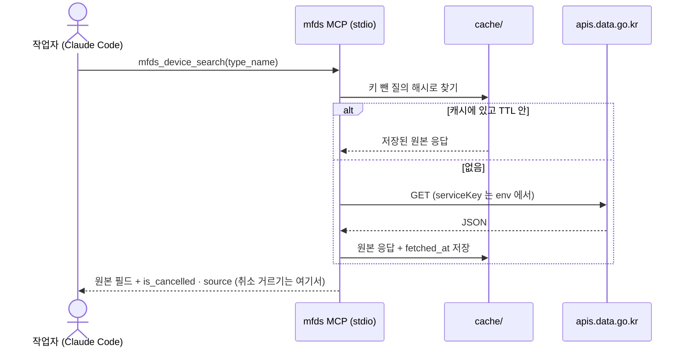

# 작업용 식약처 조회 MCP

작업자(코디 · 워커 · 사용자)가 Claude Code 에 붙여 쓰는 **조회 전용 MCP 서버**다. 식약처 공개 허가 정보(공공데이터포털)를 tool 로 내보내고, 제조사 · 제품/장비 · 규격 원장(DEC-003 D-01)을 매칭하고 확인할 때 쓴다.
위치는 프로필 `reference/2026-10-27-mfds-mcp/` 이다(DEC-003 D-04 ②). 나중에 상담 에이전트가 DUR(병용 · 임부 · 연령 금기) 조회에 다시 쓴다.
Hub 와는 별개다. Hub 는 이 MCP 를 부르지 않고 API 를 직접 부른다(SPEC-003).

> 이 레포는 **public** 이다. 키 값 · 사람 실명은 코드 · 문서 · 캐시 · 로그 어디에도 남기지 않는다. 캐시는 gitignore 한다.
> 필드 근거: `NOTES.md`(10-27 실호출 기록) · 이 SPEC 을 쓰며 **다시 부른 9회** · 검수가 부른 8회(`review-spec-002-003-report.md` R1~R8) · 검수 반영 때 부른 4회(2026-10-27, 아래 §1 「실호출 확인」 #10~#13). 「응답 미확인」 칸은 키 등록이 반영된 뒤 실호출로 채운다.

> **변경 이력**
> - 0.2.0 (2026-10-27) 검수 반영 — F-1 · F-2 · WARN(`review-spec-002-003-report.md`): 서비스별 items 모양 · 출력은 한 겹 벗긴 항목(W-1) · S-1 유효 1건(W-2) · T-1 을 상세 오퍼레이션 하나로 합치고 목록 오퍼레이션 · 소문자 `entrps` 를 없앰(W-8 · W-9) · T-2 는 허가번호만 · `not_in_cache` 경로 없앰 · OQ-M03 닫음(W-8) · 키 누출 길 막기(W-13). F-1 · F-2 는 SPEC-003 쪽이다
> - 0.1.0 (2026-10-27) 초안

## 1. Context

### Meta

- Decision reference: `DEC-003` — D-03(의약품 / 의료기기 API 배정 · 승인 게이트) · D-04 ②(작업용 MCP · 키 env · 캐시 gitignore · DUR)
- `_RESUME` §2 10-27: 「식약처 조회 MCP 를 작업용으로 직접 만든다」 · 「DEC-003 OQ 처리」(원어명 = 의료기기 `MANUF_NM` · 제조/수입 역할 둘 다 · 취소는 상태로 남김) · 「외국어 이름은 오타가 섞일 수 있다 → 정확히 일치하지 않는 것은 승인 게이트」
- 기본값(코디 결정, 사용자 통보): **Python + 공식 MCP SDK · stdio**
- Open questions: §7

### 실호출 확인 (2026-10-27, 9회 + 검수 반영 4회 — 키 값은 기록하지 않음)

| # | 서비스 / 오퍼레이션 | 보낸 필터 | 결과 | 알게 된 것 |
|---|---|---|---|---|
| 1 | 의료기기 품목허가 `getMdlpPrdlstPrmisnList05` | `ENTRPS=<업체 일부>`(대문자) | 200 · total 214,377 | **목록 오퍼레이션은 대문자 `ENTRPS` 를 무시한다**(전체가 나온다). NOTES 의 「`entrps`/`ENTRPS`」를 이렇게 바로잡는다 |
| 2 | 같음 | `entrps=<업체 일부>`(소문자) | 200 · total 18 | 목록 오퍼레이션의 업체 필터는 **소문자 `entrps`**, **부분 일치**(「…코리아」로 「…코리아 유한회사」가 잡힘) |
| 3 | 의료기기 품목허가 `getMdlpPrdlstPrmisnItem05` | `TYPE_NAME=Thermage` | 200 · total 3 | 모델명은 **부분 일치**(「Thermage Deep Skin외 4건」이 잡힘). 업체는 대리점 수입분 |
| 4 | 같음 | `TYPE_NAME=thermage` | 200 · total 0 | **모델명 필터는 대소문자를 가린다** |
| 5 | 같음 | `ENTRPS=<업체 전체 이름>` | 200 · total 18 | 상세 오퍼레이션의 업체 필터는 **대문자 `ENTRPS`** |
| 6 | 같음 | `ENTRPS=<업체 앞부분>` | 200 · total 18 | 상세 오퍼레이션 업체 필터도 **부분 일치**. 같은 업체의 목록(#2) total 과 같다 |
| 7 | 의료기기 수입·제조허가 상세 `getMdeqMnftPrmsnDtlInq01` | `BSSH_NM=<업체 일부>` | 200 · total 1 | 업체명 **부분 일치**. `COB_FLAG_CODE_NAME` = 「수입업」 |
| 8 | 의약품 제품 허가 `DrugPrdtPrmsnInfoService07/getDrugPrdtPrmsnInq07` | `item_name=<제품명>` | **403** · `SERVICE_KEY_IS_NOT_REGISTERED_ERROR` · `returnReasonCode` 30 | 아직 활용 미등록. 오퍼레이션 이름이 맞는지도 확인되지 않았다 |
| 9 | DUR `DURPrdlstInfoService03/getUsjntTabooInfoList03` | `itemName=<제품명>` | **403** · 같은 에러 | DUR 은 활용신청 전이다 |
| 10 | 의료기기 품목허가 `getMdlpPrdlstPrmisnItem05` | `TYPE_NAME=Thermage` | 200 · total 3 · 유효 1 · 취소 2(`RTRCN_DSCTN_DIVS_CD` 「2」 · 「5」) | 검수 R1 과 같다. 기본값(취소 뺌)이면 1건이다 |
| 11 | 같음 | `TYPE_NAME=Thermage` + `ENTRPS=<업체 일부>` | 200 · total 1 | 상세 오퍼레이션의 필터는 **AND** 로 걸린다(#10 의 3건 → 1건) |
| 12 | 같음 | `TYPE_NAME=Thermage` + `PRDUCT=조직수복용생체재료` | 200 · total 0 | `PRDUCT` 도 다른 필터와 **AND**. 상세 오퍼레이션이 `PRDUCT` 를 받는다(검수 R5 · total 606) |
| 13 | 같음 | `MDEQ_PRDLST_SN=<품목일련번호>` | 200 · total 214,377 | **`MDEQ_PRDLST_SN` 필터는 무시된다**(전체가 나온다). 허가번호 `PRDUCT_PRMISN_NO` 는 받는다(검수 R4 · total 1) |

응답에서 본 것(#1~#7):

- 정상 응답 모양: `header{resultCode:"00", resultMsg}` · `body{pageNo, totalCount, numOfRows, items[]}`. 결과가 0건이면 `body` 에 `items` 키가 없다(#4)
- **`items` 모양이 서비스마다 다르다**(검수 R1' · R3 · R6 · #10): 의료기기 품목허가(목록 · 상세)는 `items: [{"item": {…}}]` — 항목마다 한 겹 더 싸여 있다. 의료기기 업체 상세는 `items: [{…}]` — 평평하다. 의약품 · DUR 은 응답 미확인
- **무시되는 필터는 에러 없이 전체를 낸다**(#1 · #13): 받지 않는 파라미터를 보내면 200 · total 21만이다. 필터가 먹었는지는 `totalCount` 로만 안다
- 에러 모양: HTTP 403 · `OpenAPI_ServiceResponse.cmmMsgHeader{errMsg, returnAuthMsg, returnReasonCode}`(#8 · #9)
- 취소 · 취하: `RTRCN_DSCTN_DIVS_CD`(예 「5」)와 `RTRCN_DSCTN_DT` 가 차 있는 허가가 같은 업체 결과에 섞여 있다(#2)
- 제조원 원어명 `MANUF_NM` 은 같은 회사인데도 표기가 갈린다: 「Solta Medical Inc.」(#2) · 「Solta Medical, Inc.」(#5). 업체가 국내 제조사이면 `MANUF_NM` 이 비어 있다(#1). 외국어 이름이 정확히 같지 않을 수 있다는 `_RESUME` 결정의 실제 사례다
- 상세 오퍼레이션(#3 · #5)은 목록 오퍼레이션의 필드를 모두 갖고 `GRADE` · `USE_PURPS` · `MEA_CLASS_NO` · `TYPE_NAME` · `BRNO` 가 더 있다. 목록에만 있는 필드: `PRMISN_STTEMNT` · `TRCK_MNG_TRGT_YN`. 상세가 `TYPE_NAME` · `ENTRPS` · `PRDUCT` · `PRDUCT_PRMISN_NO` 를 모두 받으므로(#5 · #11 · #12 · R4) **이 MCP 는 목록 오퍼레이션을 쓰지 않는다**
- 품목허가의 `BRNO` 는 **허가 보유 업체(`ENTRPS`)의 사업자번호**다. 같은 업체의 행은 `MANUF_NM` 이 달라도 모두 같은 값이다(검수 R2)
- 업체 필터는 부분 일치라 관계없는 업체도 함께 잡힌다(검수 R2 · R3: 「솔타」 → 수입 업체 18건 + 관계없는 국내 제조사 2건)

### Business Requirement

DEC-003 원장 초안과 분류표 재판정(반려 ① 137건)은 「이 이름이 식약처에 무엇으로 허가돼 있나」를 수백 번 물어야 한다. 매번 브라우저로 공공데이터포털을 열 수는 없다.
이 MCP 는 그 질문을 Claude Code 안에서 **같은 규칙으로, 출처와 함께, 키를 노출하지 않고** 답하게 한다. 같은 질문은 캐시로 답해 호출 수를 아낀다.

### Scope

In scope:

- tool 7종(§4): 의료기기 품목 검색 · 의료기기 품목 상세 · 의료기기 업체 조회 · 의약품 검색 · 의약품 상세(응답 미확인) · DUR(나중) · 상태
- 파라미터 매핑(대문자 · 소문자 구분 포함) · 페이지 처리 · 취소 허가 걸러내기 · 응답 캐시 · 호출 횟수 · 에러 처리 · 키 env
- 폴더 구성 · 실행 · Claude Code 등록 방법(§5)

Out of scope:

- 매칭 판정(어느 허가가 어느 원장 행인지 정하기) — 사람과 승인 게이트의 일이다. Hub 쪽 매칭은 SPEC-003
- 적재 · 저장 · DB. 이 MCP 는 캐시 파일 말고는 아무것도 저장하지 않는다
- 응답 필드 가공 · 번역. 원본 필드 이름과 값을 그대로 낸다(파생 표시 2개만 덧붙임 — §4 공통 출력)

## 2. UX Contract

해당 없음 — 화면 없음. 사용자 표면은 Claude Code 의 MCP tool 호출이다(§5).

## 3. User Scenario

### S-1. 워커 — 장비 브랜드를 허가에 대 본다

1. `mfds_status` 를 부른다 → 의료기기 서비스 2개 「사용 가능」, 의약품 · DUR 「미등록」이 보인다
2. `mfds_device_search(type_name="Thermage")` → `total_count` 3 · `returned` 1 · `filtered_out_cancelled` 2(기본값은 취소를 뺀다 — 실호출 #10). 남은 1건은 국내 제조 「Thermage Deep Skin외 4건」이다. 각 행에 업체 · 모델명 · 허가번호 · 허가일 · 사용목적 · 제조원 원어명
3. 대소문자를 바꿔 `type_name="thermage"` → 0건. tool 설명에 「모델명은 대소문자를 가린다」가 적혀 있다
4. 같은 질의를 다시 부르면 `from_cache=true` 로 답하고 호출 수는 늘지 않는다

### S-2. 코디 — 업체로 좁혀 원어명을 확인한다

1. `mfds_device_company(name="<업체 일부>")` → 업체 1건 · 「수입업」
2. `mfds_device_search(entrps="<업체 일부>", include_cancelled=true)` → 18건. `is_cancelled=true` 인 행이 섞여 있고, `MANUF_NM` 표기가 행마다 다를 수 있다. 업체 이름 일부가 짧으면 관계없는 업체 행도 섞인다(검수 R2 — 20건 중 2건)
3. 원어명을 원장에 옮길지는 사람이 승인 게이트에서 정한다(이 tool 은 판정하지 않는다)

### S-3. 키가 등록되지 않은 서비스

1. `mfds_drug_search(item_name="…")` → tool 에러 `key_not_registered`(서비스 이름 · 원문 `errMsg` · 「공공데이터포털에서 활용신청 · 반영 대기(1시간 안팎)」 안내). 키 값은 에러에 없다
2. `mfds_dur_check(...)` → `not_available_yet`(DUR 활용신청 전 — 「나중」)

### S-4. 키가 없을 때

1. `.env` 가 없거나 `MFDS_API_KEY` 가 비었으면 모든 조회 tool 이 `missing_key` 를 낸다. `mfds_status` 만 동작하고 「키 없음」을 보여 준다

## 4. Interface Contract

### 공통

| 항목 | 계약 |
|---|---|
| 기본 주소 | `https://apis.data.go.kr/1471000/<서비스>/<오퍼레이션>` · GET · `type=json` 고정 · `serviceKey` 는 env 에서 넣는다(Decoding 키 — `.env.example` 주석과 같게) |
| 페이지 입력 | `page: int = 1` · `rows: int = 100`(1 이상 100 이하). `all_pages: bool = false` 이면 `totalCount` 까지 이어 받되 **최대 `MFDS_MAX_PAGES`(기본 10) 페이지**에서 멈추고 `truncated=true` |
| 공통 출력 | `{service, operation, query(키 뺀 보낸 파라미터), total_count, page, rows, returned, filtered_out_cancelled, truncated, from_cache, fetched_at(UTC), items[]}` |
| items | 원본 항목을 **한 겹 벗긴 것**(품목허가의 `{"item": {…}}` → `{…}` · 업체 상세는 원래 평평하다 — §1 「응답에서 본 것」)의 **필드 이름 · 값 그대로**(대문자 키). 캐시에는 벗기기 전 원본을 둔다. 덧붙이는 파생 표시는 둘뿐: `is_cancelled`(의료기기: `RTRCN_DSCTN_DIVS_CD` 또는 `RTRCN_DSCTN_DT` 가 비어 있지 않음) · `source`(`{service, operation, query}` — DEC-003 D-03 「출처」에 그대로 옮겨 적을 수 있게) |
| 취소 허가 걸러내기 | `include_cancelled: bool = false`. **받은 뒤 서버(MCP) 쪽에서** 거른다(API 에 그런 필터가 있는지 확인되지 않았다). 그래서 `total_count` 는 API 값 그대로이고, 거른 수는 `filtered_out_cancelled` 로 따로 낸다 |
| 빈 결과 | `items: []` · `total_count: 0` — 에러가 아니다(API 가 `items` 키를 빼고 보내는 경우 포함) |
| 결정론 | 같은 입력이면 같은 출력. 정렬은 API 순서 그대로(재정렬하지 않음) |

### Tool 목록

설명 문구는 tool description 으로 들어간다(작업자의 Claude 가 읽는다).

#### T-1. `mfds_device_search` — 의료기기 품목 검색

- 설명: 「식약처 의료기기 품목허가를 모델명 · 업체 · 품목명(일반명칭)으로 찾는다. 셋 다 부분 일치이고, 여러 개를 주면 모두 만족하는 것만 나온다(AND). 업체 이름 일부가 짧으면 관계없는 업체도 섞인다. 모델명은 대소문자를 가리고, 품목명은 '조직수복용생체재료' 같은 일반명칭이라 브랜드로는 거의 안 걸린다. 브랜드는 모델명에 있을 때만 걸린다. 기본값으로 취소 · 취하된 허가는 뺀다. 결과는 후보일 뿐 매칭 판정이 아니다.」
- 입력: `type_name: str | None` · `entrps: str | None` · `prduct: str | None` · `include_cancelled` · 페이지 입력. 셋 중 하나 이상 필수

| 입력 | 오퍼레이션 | 실제 파라미터 | 확인 |
|---|---|---|---|
| 어떤 조합이든(하나 · 둘 · 셋) | `MdlpPrdlstPrmisnInfoService06/getMdlpPrdlstPrmisnItem05`(상세 — 사용목적 · 모델명이 있다) | 받은 것만 `TYPE_NAME` · `ENTRPS` · `PRDUCT`(**전부 대문자**)로 한 요청에 함께 보낸다 | 실호출 #3~#6 · #11 · #12(AND) · 검수 R5(`PRDUCT`) |

- 목록 오퍼레이션 `getMdlpPrdlstPrmisnList05` 와 소문자 `entrps` 는 **쓰지 않는다.** 상세가 같은 필터를 모두 받고 필드가 더 많다. 목록 쪽 파라미터 이름(소문자 `entrps`)은 §1 #1 · #2 기록으로만 남긴다
- 출력 items 필드(실호출 확인): `ENTRPS` · `PRDUCT` · `GRADE` · `PRDUCT_PRMISN_NO` · `PRMISN_DT` · `USE_PURPS` · `MEA_CLASS_NO` · `TYPE_NAME` · `RTRCN_DSCTN_DIVS_CD` · `RTRCN_DSCTN_DT` · `MDEQ_PRDLST_SN` · `BRNO`(허가 보유 업체의 사업자번호) · `MNFT_CLNT_NM` · `MANUF_NM` · `CHG_DT`

#### T-2. `mfds_device_detail` — 의료기기 품목 하나

- 설명: 「허가번호(PRDUCT_PRMISN_NO)로 의료기기 허가 한 건을 준다. 품목일련번호(MDEQ_PRDLST_SN)로는 찾을 수 없다.」
- 입력: `prmisn_no: str`(필수 · `PRDUCT_PRMISN_NO`)
- 오퍼레이션: `getMdlpPrdlstPrmisnItem05` · `PRDUCT_PRMISN_NO`(검수 R4 — total 1). 캐시 대체 경로는 두지 않는다
- 품목일련번호 입력은 두지 않는다. `MDEQ_PRDLST_SN` 필터는 무시되고 전체 21만 건이 나온다(실호출 #13)
- `total_count` 가 1 이 아니면 항목을 내지 않고 `filter_ignored`(받은 `total_count` 를 싣는다). 필터가 조용히 무시된 응답(#1 · #13)을 결과로 내지 않기 위해서다
- 출력: T-1 의 항목 하나 + 공통 출력

#### T-3. `mfds_device_company` — 의료기기 업체

- 설명: 「식약처 의료기기 제조 · 수입업 허가 업체를 이름 일부로 찾는다. 업체가 제조업인지 수입업인지(COB_FLAG_CODE_NAME), 허가일, 휴 · 폐업 여부를 본다.」
- 입력: `name: str`(필수) · 페이지 입력
- 오퍼레이션 · 파라미터: `MdeqMnftPrmsnDtlService01/getMdeqMnftPrmsnDtlInq01` · `BSSH_NM`(부분 일치 — 실호출 #7)
- 출력 items 필드(실호출 확인): `BSSH_NM` · `INDT_CD` · `COB_FLAG_CODE_NAME` · `PRMSN_DCLR_DIVS_CD` · `PERMIT_STATE_CODE_NAME` · `PRMSN_YMD` · `OSBD_DAGNS_MDEQ_YN` · `SAMP_BSSH_YN` · `CPTC_AREA_CD` · `KFDA_MANAGE_CODE_NAME` · `TCBIZ_CLSBIZ_RESM_DIVS_CD` · `SHUTDOWN_CLOSE_REOPEN_NAME` · `CLSBIZ_YMD` · `TCBIZ_BGNG_PRARR_DT` · `TCBIZ_END_PRARR_DT` · `RESM_DT` · `BRNO`. 응답에는 업체 주소(`ENTP_ADDR`) · `SRVC_TRGT_*` 도 오지만 **출력에서 뺀다**. 원장 필드(DEC-003 D-01)에 쓰지 않고, 캐시 말고는 남길 이유가 없다
- 걸러내기: 이 서비스에는 취소 필드가 없다. `include_cancelled` 를 받지 않는다. 휴 · 폐업은 필드 그대로 보여 준다

#### T-4. `mfds_drug_search` — 의약품 검색 (응답 미확인)

- 설명: 「식약처 의약품 제품 허가정보를 제품명 · 업체명 · 성분으로 찾는다(톡신 · 수액 성분 · 약).」
- 입력: `item_name: str | None` · `entp_name: str | None` · `ingredient: str | None` · 페이지 입력
- 오퍼레이션: `DrugPrdtPrmsnInfoService07/getDrugPrdtPrmsnInq07`(실호출 #8 은 403 이라 이름이 맞는지 확인되지 않았다)
- **실호출 후 채울 칸**

| 채울 것 | 지금 | 확인 방법 |
|---|---|---|
| 오퍼레이션 이름(목록 · 상세) | `getDrugPrdtPrmsnInq07` 가정 · 상세는 모름 | 키 반영 후 1회 호출 + 공공데이터포털 활용가이드 |
| 필터 파라미터 이름과 대소문자 | `item_name` · `entp_name` 가정(대소문자 미확인) | 의료기기처럼 대문자 · 소문자를 둘 다 1회씩 보내 total 이 줄어드는지 본다(실호출 #1 · #2 와 같은 방법) |
| 출력 필드 — 제품명 · 업체명 · 허가번호 · 허가일 · 효능효과 · 주성분 · 용법(투여 경로) · 취소 일자 | 모름 | 응답 1건의 키 목록 |
| 원어명(제조원) 필드 | 모름 | 같음. 없으면 SPEC-003 OQ |
| 취소 판정 필드 | 모름 | 같음. 정해지면 `is_cancelled` 규칙에 더한다 |

- 키가 미등록이면 `key_not_registered`(S-3)

#### T-5. `mfds_drug_detail` — 의약품 한 건 (응답 미확인)

- 입력: 허가번호 또는 품목기준코드(필드 이름은 T-4 확인 후). 그 필터를 받는지도 키 반영 후 확인한다. 받으면 T-2 와 같은 규칙(`total_count` ≠ 1 이면 `filter_ignored`). 받지 않으면 캐시에 있는 검색 결과에서 찾고, 없으면 `not_in_cache`(API 를 전체 페이지로 훑지 않는다)
- 효능효과 · 용법 같은 긴 본문이 상세에만 있다면 이 tool 이 그것을 낸다. 수액 투여 경로(`_RESUME` 「수액 경로는 허가 용법 확인 후」)는 이 응답으로 확인한다

#### T-6. `mfds_dur_check` — DUR (나중)

- 상태: **나중.** DUR 은 활용신청 전이다(실호출 #9 403). 상담 에이전트 단계에서 쓴다(DEC-003 D-04)
- 자리만 둔다: 입력 `item_name` · `kind: "usjnt" | "pregnancy" | "age"`(병용 · 임부 · 연령). 오퍼레이션 후보 `DURPrdlstInfoService03` 의 병용금기 · 임부금기 · 연령금기 목록 — 이름은 활용신청 후 확인
- 활용신청 전에는 tool 을 등록은 하되 부르면 `not_available_yet` 를 낸다. 이렇게 하면 tool 목록이 바뀌지 않는다

#### T-7. `mfds_status` — 상태

- 설명: 「키가 있는지, 서비스별로 쓸 수 있는지, 오늘 호출 수, 캐시 크기를 보여 준다. 다른 tool 을 쓰기 전에 먼저 부른다.」
- 출력: `{key_present: bool, services: [{service, operation, state: "usable"|"not_registered"|"not_applied"|"unknown", last_checked_at, last_error}], calls_today, daily_limit, cache: {entries, bytes, ttl_days}}`
- `state` 는 **마지막 실제 호출 결과**로 정한다. `mfds_status` 자신은 API 를 부르지 않는다. 확인용 호출은 `refresh: bool = false` 일 때만 서비스마다 1회(`rows=1`) 보낸다

### Validation

| 필드 | 규칙 |
|---|---|
| 검색 입력 | 앞뒤 공백을 자른 뒤 빈 문자열이면 없는 것으로 본다. T-1 은 셋 중 하나 이상 필요 |
| `rows` | 1 이상 100 이하 정수 |
| `page` | 1 이상 정수 |
| 입력 값 | 그대로 보낸다. 대소문자 변환 · 공백 정리 · 번역을 하지 않는다(모델명이 대소문자를 가리므로 바꾸면 결과가 달라진다 — 실호출 #3 · #4) |

### Case Matrix

| 에러 코드 | 언제 | tool 출력 |
|---|---|---|
| `missing_key` | env 에 키가 없거나 빈 값 | 「`.env` 의 MFDS_API_KEY 를 채운다」 |
| `key_not_registered` | HTTP 403 + `errMsg` = `SERVICE_KEY_IS_NOT_REGISTERED_ERROR` | 서비스 이름 · 원문 `errMsg` · `returnReasonCode` · 「활용신청 · 반영 대기」 안내 |
| `api_error` | HTTP 200 인데 `resultCode` ≠ `"00"`, 또는 그 밖의 `cmmMsgHeader` 에러 | 원문 `resultCode` · `resultMsg`(또는 `errMsg`) |
| `service_not_found` | HTTP 404, 또는 오퍼레이션 이름 오류로 보이는 응답 | 서비스 · 오퍼레이션 이름 |
| `upstream_unreachable` | 연결 실패 · 시간 초과(`MFDS_TIMEOUT_SECONDS`, 기본 30) | 재시도하지 않는다. 사유만 낸다 |
| `daily_limit_reached` | 오늘 호출 수가 `MFDS_DAILY_LIMIT` 에 닿음 | 캐시에 있는 질의만 답한다 |
| `not_available_yet` | T-6(DUR) — 활용신청 전 | 「나중」 |
| `filter_ignored` | T-2 · T-5 — 한 건 조회인데 `total_count` ≠ 1(필터가 무시됐거나 값이 틀림) | 받은 `total_count` · 보낸 파라미터 이름 |
| `not_in_cache` | T-5 — 필터를 받지 않는 오퍼레이션으로 확인됐고 캐시에도 없음 | 「먼저 검색 tool 로 찾는다」 |
| `invalid_input` | Validation 위반 | 어긴 규칙 |

어떤 에러 문구 · 로그에도 요청 URL 을 그대로 싣지 않는다. 싣는다면 `serviceKey` 를 뺀 질의만 싣는다. 구현 규칙은 §5.4.

### Flow



### State / Lifecycle

서비스 상태(`mfds_status.services[].state`): `unknown` → 첫 호출 결과에 따라 `usable` / `not_registered` / `not_applied`. 같은 프로세스 안에서 다시 부르면 그 결과로 바뀐다(키가 반영되면 `not_registered` → `usable`).

### Data Contract — 캐시

| 항목 | 계약 |
|---|---|
| 위치 | `reference/2026-10-27-mfds-mcp/cache/`(이미 gitignore — `.gitignore` 에 `cache/` 있음) |
| 키 | `sha256(서비스 | 오퍼레이션 | 키 뺀 파라미터를 이름순으로 정렬한 질의 문자열)`. **파일 이름은 이 해시 + 페이지 번호뿐**이다(질의 문자열 · URL 을 파일 이름에 쓰지 않는다) |
| 내용 | **API 원본 응답 JSON 그대로**(페이지마다 한 파일) + `fetched_at` · 키 뺀 `query`. 걸러내기 전 원본이다. `include_cancelled` 는 캐시 키에 넣지 않는다 |
| TTL | `MFDS_CACHE_TTL_DAYS`(기본 7). 지나면 다음 호출에서 새로 받는다. `no_cache: bool = false` 입력이면 캐시를 건너뛰고 받은 뒤 덮어쓴다 |
| 호출 수 | `cache/_calls/<YYYY-MM-DD>.json` 에 서비스별 실제 HTTP 호출 수(캐시 적중은 세지 않는다). `MFDS_DAILY_LIMIT`(기본 1000)에서 멈춘다 |
| 에러 응답 | 캐시하지 않는다(키가 반영되면 바로 다시 시도할 수 있게) |

## 5. Implementation Rules

### 5.1 언어 · SDK · 전송

- **Python + 공식 MCP Python SDK `mcp` 2.x · stdio.** Hub 가 쓰는 SDK(`backend/pyproject.toml` `mcp>=2.3,<3` · SPEC-001 §5.1 `from mcp.server import MCPServer`)와 같은 것을 쓴다. 작업용이라 HTTP 서버를 띄울 이유가 없다. Claude Code 가 프로세스를 직접 띄우는 stdio 가 가장 단순하다
- HTTP 클라이언트는 표준 라이브러리 또는 `httpx`(Hub 와 같음) 하나만 쓴다. 다른 의존성은 SDK 뿐이다
- 모델을 부르지 않는다. 판정 · 요약 · 번역 tool 은 두지 않는다

### 5.2 폴더 구성 (`reference/2026-10-27-mfds-mcp/`)

| 파일 | 무엇 | git |
|---|---|---|
| `server.py` | MCP 서버 — tool 7종 · 캐시 · 호출 수 | 포함 |
| `pyproject.toml` · `uv.lock` | 의존성(`mcp`, 선택 `httpx`) | 포함 |
| `README.md` | 실행 · 등록 · tool 목록 · 실호출 확인표(§1) | 포함 |
| `NOTES.md` | 실호출 기록(있음). 미확인 칸이 채워지면 여기에 더한다 | 포함 |
| `.env.example` | `MFDS_API_KEY=` (빈 값 — 있음) + 선택 env 4개(`MFDS_CACHE_TTL_DAYS` · `MFDS_DAILY_LIMIT` · `MFDS_MAX_PAGES` · `MFDS_TIMEOUT_SECONDS`) | 포함 |
| `.env` | 실제 키 | **제외**(있음 — `.gitignore` 확인) |
| `cache/` | 응답 캐시 · 호출 수 | **제외**(있음) |

### 5.3 실행 · 등록

```bash
# 폴더 안에서
uv run python server.py            # stdio 로 뜬다(직접 칠 일은 없다)

# Claude Code 에 등록 (프로필 워크트리 루트에서)
claude mcp add mfds -- uv run --directory reference/2026-10-27-mfds-mcp python server.py
```

- 키는 서버가 시작할 때 **같은 폴더의 `.env`** 에서 읽는다(프로세스 env 가 있으면 그것이 먼저). `claude mcp add` 명령에 키를 넣지 않는다 — 넣으면 Claude Code 설정 파일에 키가 남는다
- 워커 워크트리가 다르면 `--directory` 에 절대 경로를 준다. 캐시는 폴더마다 따로 생긴다

### 5.4 키 · 로그

- 키는 요청을 만드는 함수 하나에서만 읽는다. 로그 · 에러 · 캐시 · tool 출력의 `query` 에는 `serviceKey` 를 넣지 않는다
- **`httpx` · `httpcore` 로거를 WARNING 이상으로 둔다.** `httpx` 는 INFO 로 요청 URL 전체(= `serviceKey=` 포함)를 남긴다. 표준 라이브러리 클라이언트를 쓰면 `urllib3` 등 해당 로거에 같은 규칙
- **에러 사유에는 예외 클래스 이름과 HTTP 상태 코드만 싣는다.** `str(exc)` · `repr(exc)` · `exc.request.url` · traceback 을 tool 출력 · 로그에 싣지 않는다(`HTTPStatusError` · `ConnectError` 의 문자열에 URL 이 들어간다)
- 캐시 파일 · 호출 수 파일의 이름과 내용에 키가 없다(§4 캐시 「키」)
- stdio 서버는 stdout 이 프로토콜 채널이다. 로그는 stderr 로만 보낸다

## 6. Verification

### Acceptance Criteria

- [ ] `claude mcp add` 로 등록한 뒤 Claude Code 에서 tool 7개가 보인다
- [ ] S-1: `mfds_device_search(type_name="Thermage")` 가 `total_count` 3 · `returned` 1 · `filtered_out_cancelled` 2 를 내고(실호출 #10), 두 번째 호출은 `from_cache=true` · 호출 수 그대로
- [ ] 품목허가 tool 의 items 는 한 겹 벗긴 항목이다(`item` 키가 없다). 캐시 파일은 원본 그대로 `{"item": …}` 를 갖는다
- [ ] S-1-3: `type_name="thermage"` 가 0건이고 에러가 아니다
- [ ] S-2: `entrps` 로 찾으면 실호출 #5 · #6 과 같은 total 이 나온다. `include_cancelled=false` 면 취소 행이 빠지고 `filtered_out_cancelled` 가 그 수다
- [ ] `type_name` + `entrps` 를 함께 주면 상세 오퍼레이션 한 요청에 대문자 `TYPE_NAME` · `ENTRPS` 로 나가고 total 이 1 이다(실호출 #11 — AND). 어떤 입력으로도 목록 오퍼레이션을 부르지 않는다
- [ ] `mfds_device_detail(prmisn_no=<허가번호>)` 가 1건을 낸다. 응답 `total_count` 가 1 이 아니면 `filter_ignored`
- [ ] S-3: 의약품 · DUR 이 403 이면 `key_not_registered` · `not_available_yet` 로 끝나고, 서버가 죽지 않는다
- [ ] S-4: 키가 없으면 `missing_key`. `mfds_status` 는 동작
- [ ] `git status` 에 `.env` · `cache/` 가 안 보인다. `grep` 으로 레포에서 키 값 0건
- [ ] tool 출력 · 에러 · stderr 로그 어디에도 `serviceKey` 값이 없다. 시험: `MFDS_API_KEY` 를 가짜 값으로 두고 401 · 403 을, 잘못된 `MFDS` 주소로 연결 실패를 일으킨 뒤 stderr · 로그 · `cache/` 파일 이름과 내용에서 그 가짜 값을 grep → 0
- [ ] 키 반영 후: T-4 「실호출 후 채울 칸」 표를 실제 값으로 채우고 NOTES 에 기록한다

## 7. Open Questions

| ID | 질문 | 왜 | 지금 값 |
|---|---|---|---|
| OQ-M01 | 의약품 · DUR 활용신청과 반영 확인은 누가 언제 하나 | T-4 · T-5 · T-6 이 이것에 막혀 있다 | 사용자 — 반영되면 T-4 표를 채운다 |
| OQ-M02 | 캐시 TTL 과 일일 호출 상한 기본값(7일 · 1,000회)이 맞나. 공공데이터포털 계정의 실제 일일 한도는 확인하지 않았다 | 원장 초안 작성이 몇백 질의라 한도에 닿을 수 있다 | 7일 · 1,000 |
| ~~OQ-M03~~ | `mfds_device_detail` 이 허가번호 · 품목일련번호 필터를 받는지 | — | **닫힘(10-27)**: 허가번호 `PRDUCT_PRMISN_NO` 는 받는다(검수 R4 · total 1) · 품목일련번호 `MDEQ_PRDLST_SN` 는 무시된다(실호출 #13). T-2 는 허가번호만 받는다 |
| OQ-M04 | 업체 주소처럼 원장에 쓰지 않는 필드를 출력에서 빼는 범위가 맞나 | public 레포라 남기는 것을 줄였다. 출력에서 빼도 캐시 원본에는 남는다(gitignore) | `ENTP_ADDR` · `SRVC_TRGT_*` 제외 |
