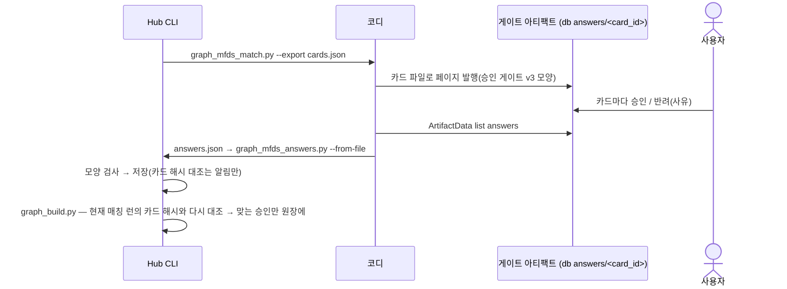

# Hub 식약처 원천 적재 · 매칭 · 원장

Procedure Hub 가 식약처 공개 허가 정보를 **원본 그대로 브론즈에 쌓는다**(SPEC-001 브론즈와 같은 규칙: 원본 · 수집 시각 · 해시 · 멱등).
API 는 전부 받지 않는다. 분류표의 제품 · 장비 항목이 가리키는 업체 · 모델로 좁혀서 받는다.
원장 이름과 허가를 **정규화했을 때 완전히 일치하는 것만 자동으로 잇는다.** 나머지는 후보로 묶어 승인 게이트(아티팩트)에 올리고, 받은 답을 Hub 로 되들인다.
승인된 매칭으로 실버 원장 셋(제조사 · 제품/장비 · 규격 — DEC-003 D-01)을 빌드 단계에서 만들고, 검증 게이트에 식약처 항목을 더해 발행한다. 모델은 부르지 않는다(DEC-001 D-12).
위치는 PROCEDURE-HUB 브랜치 `kknaksss/phub-recommend` 의 graph 모듈이다(SPEC-001 §5.2 를 넓힌다). 레거시 · canonical 은 건드리지 않는다.

> 템플릿은 테이블을 SPEC 에 두지 말라고 하지만, 이번 브리프는 「스키마는 이 SPEC 이 정한다」고 했다. 그래서 §5 에 **테이블 단위의 뜻 · 키 · 멱등 조건**까지만 두고, 컬럼 타입 · 인덱스는 migration 이 갖는다(SPEC-001 과 같은 선).
> API 필드 근거는 SPEC-002 §1 「실호출 확인」(2026-10-27 · #1~#13)과 검수 실호출(`review-spec-002-003-report.md` R1~R8) · `NOTES.md` 다. 의약품 API 는 아직 키 미등록(403)이라 **의약품 쪽 칸은 전부 「응답 미확인」**이다. 키가 반영되면 SPEC-002 T-4 표를 채운 뒤 이 SPEC 의 같은 칸을 채운다.

> **변경 이력**
> - 0.2.0 (2026-10-27) 검수 반영 — F-1 · F-2 · WARN(`review-spec-002-003-report.md`): 옛 답은 빌드가 매칭 런의 카드 해시와 다시 대조해 거른다 · 「현재 매칭 런」 정의(F-1) · 대상 항목 파일에 products.json 연결 키 `products_key` 와 업체 문자열을 둔다(F-2) · items 한 겹 벗기기 · 픽스처는 실호출 저장본(W-1) · 넓은 질의는 그 질의만 빼고 매칭(W-4) · `brno` 는 허가 보유 업체 쪽만(W-5) · 역할은 `BRNO` 로 잇는다(W-6) · 조회 tool 설명에 status 규칙 · OQ 둘(W-7) · `service` 배정 표(W-10) · 질의를 `service` 로 나눔(W-11) · 후보 내용 해시 정의(W-12) · 키 누출 길 막기(W-13). W-3(정규화 일치 = 자동)은 OQ-I08 에 질문으로 남겼다
> - 0.1.0 (2026-10-27) 초안

## 1. Context

### Meta

- Decision reference: `DEC-003` D-01(원장 셋) · D-03(공식 원천 = 식약처 · API 배정 · 출처 · 승인 게이트) · D-04 ①(Hub 는 API 를 직접 부르고 응답을 브론즈로, LLM 없음) · D-06(반려 ① → 원장 생긴 뒤 재판정) / `DEC-002` D-03 · D-04 / `DEC-001` D-12
- `_RESUME` §2 10-27 행:
  - 「DEC-003 OQ 처리」: 원어명 = 의료기기 `MANUF_NM` · 제조 / 수입 역할 둘 다 · 미허가 · 취소는 상태로 남기고 추천 제외 · 규격 = 숫자 + 단위(ml → cc), 회차 · 양 분리 · 수액 경로는 허가 용법 확인 후 · 제품 노드 이름 = 상담 용어, 공식 품목명 = 속성 · 동의어
  - 「외국어 이름(원어명 · 모델명)은 오타가 섞일 수 있다 → 식약처 매칭이 정확히 일치하지 않는 것은 승인 게이트로」
  - 「분류표 · 원천 수정 목록은 승인 게이트」(승인 / 반려 · 사유 필수 · 승인된 것만 다음 단계)
- 기반 관례: SPEC-001 §3.1(브론즈) · §3.3.1(정규화) · §3.4(검증 · 발행) · §5.2(모듈 경계 · import 허용 목록) · §5.3(트랜잭션 · 멱등)
- 근거 개념: [[medallion-architecture]] · [[data-lineage]]
- Open questions: §7

### Business Requirement

분류표 반려 가운데 가장 큰 덩어리(① 정체 확인 불가 137 — DEC-003)는 공식 허가 정보가 없어서 생겼다. 원장 셋이 생겨야 그것을 다시 판정할 수 있다.
이 SPEC 은 세 가지를 보장한다. ① 식약처 응답을 원본 그대로 다시 볼 수 있다(브론즈). ② 어떤 원장 행이 어떤 허가에 이어졌는지, 자동이었는지 사람이 승인했는지를 행마다 추적할 수 있다. ③ 이어지지 않은 것 · 취소된 것 · 원어명이 빈 것은 검증 리포트에 숫자로 보인다.

### Scope

In scope:

- 질의 목록을 만드는 규칙(§3.1) · 식약처 브론즈 적재(§3.2)
- 매칭 — 자동 · 후보 · 게이트 카드 내보내기 · 답 되들이기(§3.3 · §3.4)
- 실버 원장 셋의 노드 · 엣지 · 빌드 단계(§3.5)
- 검증 게이트 항목 추가 · 발행본 해시 확장(§3.6)
- CLI · 테이블 · 모듈 위치(§5)

Out of scope:

- **시술 1회(단위 시술 + 제품 + 규격·양)와 가격 엣지** — 단위 시술 노드는 SPEC-001 개정(DEC-002 D-08)에서 생긴다. 이 SPEC 은 그 개정이 쓸 제품 · 규격 원장까지만 만든다
- 분류표 재판정 자체(반려 ① ~ ⑤) — 원장이 나온 뒤 따로 하는 작업이다
- DUR(상담 에이전트 단계 — SPEC-002 T-6)
- REST · MCP 조회 tool 의 새 엔드포인트. 원장 노드는 SPEC-001 의 기존 조회 tool(`graph_search` · `graph_get_node` · `graph_list_nodes` · `graph_schema`)에 노드 타입이 늘어나는 것으로만 보인다
- 아티팩트 페이지 자체(게이트 화면) — 코디가 만든다. 이 SPEC 은 카드 파일과 답 파일의 모양만 정한다

## 2. UX Contract

해당 없음 — Hub 에는 화면이 없다. 사람이 보는 곳은 둘이다. 게이트 아티팩트(카드 파일 → 코디가 페이지로 만든다 · §3.4)와 SPEC-001 의 Swagger · MCP(원장 노드 조회).

## 3. 데이터 계약

| 단계 | 입력 | 출력 | 허용 변환 | 금지 |
|---|---|---|---|---|
| 질의 목록 | 대상 항목 파일(§3.1) + 최신 브론즈 `taxonomy` · `products` | 질의 목록(그 자체도 브론즈 행) | 결정론 토막 내기 · 중복 제거 | 이름 추측 · 번역 · 대소문자 바꾸기 |
| 식약처 브론즈 | 질의 목록 | 질의 × 페이지별 원본 응답 | 없음(해시만) | 필드 가공 · 키 저장 |
| 매칭 | 최신 식약처 브론즈 + 질의 목록 + 대상 항목 | 대상 항목마다 자동 결과 또는 후보 묶음(카드) | 정규화(§3.3) · 완전 일치 | 부분 일치 · 편집 거리 · 모델로 자동 확정 |
| 게이트 답 | 답 파일(§3.4) | 대상 항목마다 승인 / 반려(저장만) | 모양 검사 · 카드 해시 대조(알림용) | — |
| 실버 원장 | 현재 매칭 런의 자동 결과 + 그 런의 카드 해시와 다시 대조해 맞는 승인 답 + 식약처 브론즈 + stg 브론즈(`products` · `market-pricing`) | 노드 3종 · 엣지 4종(§3.5) | 필드 선택 · 정규화 · 규격 파싱 | 승인 안 된 후보로 원장 만들기 · **카드가 바뀐 뒤의 옛 답 적용** |

### 3.1 질의 목록 — 무엇을 받나

**대상 항목 파일**(입력, 코디가 만든다): 분류표 `taxonomy-classify.json` 의 kind `product` · `device` 항목 + 1차 검수 반려 ③ 에서 kind 가 제품 · 장비로 **바뀐** 항목 − ③ 에서 제품 · 장비가 **아니라고** 고쳐진 항목.
Hub 에는 분류표가 없다(브론즈는 taxonomy · products 원천뿐). 그래서 매칭에 쓰는 분류표 값은 **전부 이 파일에 싣는다.**

```json
{"basis": "taxonomy-classify.json@<generated_at> + review-3 fixes",
 "subjects": [{"item_id": "M9-2-1", "kind": "device", "service": "device",
               "product_name": "써마지FLX", "maker_texts": ["솔타"],
               "products_key": "energy_device:써마지flx"}]}
```

| 필드 | 뜻 | 만드는 규칙(코디 · 결정론) |
|---|---|---|
| `item_id` | taxonomy 시술 항목 id(= SPEC-001 `procedure:<id>` 의 원천 키) | 분류표 `items[].id` |
| `kind` | `product` / `device` | 분류표 kind(③ 반영) |
| `service` | DEC-003 D-03 API 배정 | 아래 「`service` 배정 표」. 표와 다르게 둘 항목은 이 필드에 직접 적는다 |
| `product_name` | 분류표가 뽑은 제품 · 장비 이름 | 분류표 `items[].product.name` 원문 |
| `maker_texts` | 업체 문자열 원문 | 분류표 `product.maker` · `product.maker_products_json` 가운데 있는 것(원문 그대로 · 중복 제거) |
| `products_key` | products.json 제품을 가리키는 **결정론 연결 키** — `<category_key>:<normalize(name)>` | `normalize(product_name)` 와 `normalize(products.json name)` 이 **완전히 같은** 제품이 **정확히 하나**일 때만 채운다. 없거나 둘 이상이면 `null`. 키 모양은 SPEC-001 products 노드 id 의 원천 키와 같다(`product:products:<category_key>:<normalize(name)>` — `sources.py` `products_nodes`) |

- `products_key` 를 두는 이유: SPEC-001 `synonym` 엣지는 products 사전 제품 ↔ taxonomy **제품**(`product`) 사이에만 있고(`domain.py:230-236`), 매칭 대상의 키는 시술 항목 `procedure:<id>` 다. 그래서 그래프를 따라가서는 대상 항목에서 products.json 제품에 닿지 않는다. 연결은 이 키 하나로만 한다(DEC-001 D-12 — 정규화 후 완전 일치)
- 지금 값(10-27, stg 스냅샷 `phub-stg-2026-10-26` products.json 59 제품 · 전부 `name_en` 있음 · 정규화 이름 중복 0): **`products_key` 가 차는 대상 37**(제품 24 · 장비 13). 분류표에 `maker_products_json` 이 있는 22 는 전부 여기에 든다. 나머지 303 은 `null` 이라 Q-M ② 가 없다
- Hub 는 질의 목록을 만들 때 `products_key` 를 **최신 `products` 브론즈에서 다시 찾는다.** 찾으면 그 제품의 `name_en` · `country` · `manufacturer` 를 쓴다(Q-M ② · §3.5 `country` · 제조사 국문명). 못 찾으면(브론즈가 바뀜) 그 항목은 ② 없이 질의하고 `mfds_products_key_unresolved`(warning)로 센다

**`service` 배정 표**(DEC-003 D-03 — 시술군 × kind. 지금 분류표 기준 수):

| 시술군 | kind `product` | kind `device` |
|---|---|---|
| M1 톡신 | `drug` 18 | — |
| M16 | `drug` 13 | `device` 1(「LDM초음파관리」) |
| M2 · M3 · M4 · M7 | `device` 107 | `device` 1(M4 「볼뉴머」) |
| M8 ~ M14 | — | `device` 127 |
| M15 | `undecided` 43(필링 41 + 「물톡스」 · 「라라닥터」 — 필링이 아닌 것도 이 칸이다) | `device` 28 |
| M5 · M17 | `undecided`(M5 0 · M17 2) | — |

- 합: `drug` 31 · `device` 264 · `undecided` 45 = 340(③ 반영 전). 표에 없는 조합이 생기면 코디가 `service` 를 직접 적는다. 적지 않은 항목이 표에도 없으면 Hub 는 그 항목을 `no_service` 로 센다
- `undecided` 는 질의하지 않고 `mfds_unmatched_product`(subject_kind `no_service`)로 바로 센다(§7 OQ-I01)

**질의를 만드는 규칙**(대상 항목 하나마다, 결정론):

| 질의 | 언제 | 오퍼레이션 · 파라미터 | 값 |
|---|---|---|---|
| Q-M 모델명 | `service=device` | 의료기기 상세 `getMdlpPrdlstPrmisnItem05` · `TYPE_NAME` | ① taxonomy `name` 원문 ② `products_key` 로 찾은 products.json 제품의 `name_en` 원문(키가 있고 찾았을 때 — 지금 37 항목) ③ `name` 안 괄호 속 라틴 문자열(예 「보톡스(엘러간)」 → 없음) — **대소문자를 바꾸지 않는다**(실호출: 대소문자를 가린다) |
| Q-E 업체 | `service=device` 이고 `maker_texts` 가 있을 때 | 같은 오퍼레이션 · `ENTRPS`(대문자 — 상세 오퍼레이션은 대문자) | `maker_texts` 를 ` · ` · `/` · `(` · `)` · `,` · 공백으로 자른 토막 가운데 **한글 2자 이상**인 것(예 「멀츠 · 신형」 → 「멀츠」 「신형」, 「클래시스(Classys)」 → 「클래시스」). 라틴 토막(「Classys」)은 질의하지 않고 매칭의 원어명 비교에만 쓴다(`MANUF_NM` 필터는 확인되지 않음) |
| Q-C 업체 상세 | Q-E 를 만든 토막마다 | 수입·제조허가 상세 `getMdeqMnftPrmsnDtlInq01` · `BSSH_NM` | 같은 토막 — 제조 / 수입 역할(`COB_FLAG_CODE_NAME`)을 얻는다 |
| Q-D 의약품 | `service=drug` 일 때만 | **응답 미확인** — SPEC-002 T-4 확인 후 | 제품명 · 업체 토막 |

- **질의는 `service` 로 나뉜다.** `drug` 항목에는 Q-M · Q-E · Q-C 를 보내지 않고, `device` 항목에는 Q-D 를 보내지 않는다. 한 카드에 의약품 후보와 의료기기 후보가 섞이지 않고, 의약품 항목이 의료기기 허가로 자동 확정되지 않는다

- 같은 (오퍼레이션, 파라미터)는 하나로 합친다. 질의 하나가 대상 항목 여럿을 가리킬 수 있다
- **넓은 질의 막기**: 첫 페이지의 `totalCount` 가 `MFDS_QUERY_MAX_TOTAL`(기본 300)을 넘으면 나머지 페이지를 받지 않고 `mfds_query_too_broad` 로 남긴다(「신형」 같은 짧은 토막이 수천 건에 걸리는 것을 막는다). 원칙은 「전체 21만 건을 받지 않는다」(브리프). 넓은 질의는 **매칭에서 그 질의만 뺀다**(§3.3) — 항목 전체를 막지 않는다. 넓은 질의 판정은 결정론이라 다시 적재해도 다시 넓다
- 페이지: `numOfRows=100` 으로 `totalCount` 까지 받는다
- 질의 목록은 **브론즈 행 하나로 저장**한다(`plan` · 내용 해시). 매칭 결과는 어느 질의 목록에서 나왔는지를 이 해시로 가리킨다

### 3.2 식약처 브론즈

SPEC-001 §3.1 의 규칙을 그대로 따르되 단위가 「엔드포인트」가 아니라 **「질의 × 페이지」**다.

| 항목 | 계약 |
|---|---|
| 행 내용 | 서비스 · 오퍼레이션 · 질의 키(키 뺀 파라미터를 이름순으로 정렬한 문자열) · 페이지 번호 · 수집 시각(UTC) · 내용 해시 · HTTP 상태 · `resultCode` · 원본 JSON · 입력 모드(`http` / `dir`) |
| 내용 해시 | SPEC-001 §3.1 과 같은 함수(정규화 JSON 의 SHA-256) |
| 멱등 | (질의 키, 페이지, 내용 해시)가 이미 있으면 새 행을 만들지 않고 `unchanged` |
| 키 | **저장하지 않는다.** URL · 질의 키 · 로그 어디에도 `serviceKey` 가 없다. 키는 env `MFDS_API_KEY`(graph 설정 — `backend/envs/.env.graph`, git 제외)에서만 읽는다. `--save-dir` 파일 이름은 질의 키 해시 + 페이지 번호뿐이다(질의 문자열 · URL 을 쓰지 않는다). 로그 · 예외 규칙은 §5.3 |
| 실패 | HTTP 200 이 아니거나 `resultCode` ≠ `"00"` 이면 **행을 만들지 않고** `failed`(사유: `key_not_registered` · `api_error` · `upstream_unreachable` — SPEC-002 Case Matrix 와 같은 이름)로 센다. 하나라도 실패면 종료 코드 1, 성공한 질의는 저장한다 |
| 두 입력 모드 | ① `http`(기본) — `--save-dir` 로 원본 파일도 남긴다(레포 밖) ② `--from-dir` — 저장해 둔 파일로 다시 적재(API 를 부르지 않는다 · 테스트 · 재현). **테스트 픽스처는 실호출 `--save-dir` 저장본에서 만든다**(손으로 만들지 않는다 — 서비스마다 `items` 모양이 달라 손으로 만든 픽스처는 틀린 채로 통과할 수 있다). 저장본에서 키는 처음부터 없다 |
| 원본 모양 | 품목허가는 `items: [{"item": {…}}]`(한 겹 더 쌈) · 업체 상세는 `items: [{…}]` · 0건이면 `items` 키 없음(SPEC-002 §1). 브론즈에는 **원본 그대로** 둔다. 매칭 · 카드 · 원장은 한 겹 벗긴 항목을 읽는다 |
| 「최신」 | 질의 키 · 페이지마다 수집 시각이 가장 늦은 행 |
| 서비스 선택 | `--services device,company,drug`(기본 `device,company`). 의약품 키가 반영되기 전에는 `drug` 을 빼고 돌린다 |

### 3.3 매칭 — 자동과 후보

**정규화**: SPEC-001 §3.3.1 의 `normalize(s)`(영숫자 · 한글만 남기고 casefold)를 그대로 쓴다. 예: 「Solta Medical Inc.」와 「Solta Medical, Inc.」 → 둘 다 `soltamedicalinc`(실호출에서 같은 회사가 두 표기로 나온 사례).
업체 이름의 법인 표기(「유한회사」 · 「(주)」 · 「Inc」 등)를 떼는 규칙은 두지 않는다. 떼지 않으면 업체 이름이 완전 일치하는 경우는 드물다. 이 손해는 알고 받아들인다(§7 OQ-I02).

**허가 한 건의 키**: 의료기기 `device:<MDEQ_PRDLST_SN>`. 의약품은 응답 미확인(품목기준코드류 — SPEC-002 T-4).

**대상 항목 하나의 후보 허가** = 그 항목을 가리킨 질의(§3.1) 가운데 **넓은 질의를 뺀 것**들의 최신 브론즈 응답에 든 허가 전부(한 겹 벗긴 항목 · 허가 키로 중복 제거).
업체 질의는 부분 일치라 관계없는 업체의 허가도 후보에 든다(검수 R2: 「솔타」 → 관계없는 국내 제조사 2건). 걸러내지 않는다 — 자동 확정 조건 2(업체 일치)와 사람이 가린다.

**후보 내용 해시** = 한 겹 벗긴 허가 항목 하나의 정규화 JSON SHA-256(SPEC-001 §3.1 과 같은 함수). 페이지 해시를 쓰지 않는다 — 같은 허가가 여러 질의 · 페이지에 들어 있어도 값이 하나다.

**자동 확정** — 아래를 **모두** 만족하는 허가가 **정확히 하나**일 때만:

1. 모델명: `normalize(TYPE_NAME)` 이 Q-M 값 ①~③ 가운데 하나의 `normalize` 와 같다. 「Thermage Deep Skin외 4건」처럼 `TYPE_NAME` 이 여러 모델을 묶은 표기면 같지 않다 → 후보
2. 업체: `normalize(ENTRPS)` 또는 `normalize(MANUF_NM)` 이 업체 문자열 토막(한글 · 라틴 모두) 가운데 하나의 `normalize` 와 같다
3. 결과가 하나뿐이다. 둘 이상이면(수입사 여럿 등) 후보로 보낸다
4. 그 항목을 가리킨 질의 가운데 넓은 질의로 빠진 것이 없다. 빠진 질의가 있으면 후보가 다 모이지 않았을 수 있으므로 `candidates` 로 보낸다

자동 확정된 것도 취소 허가일 수 있다. 이때 원장 상태는 `cancelled` 다(§3.5). 사용목적(`USE_PURPS`)은 자유 문장이라 자동 조건에 쓰지 않고 카드에만 보인다.

**결과 상태**(대상 항목마다):

넓은 질의로 빠진 질의가 있어도 남은 질의가 하나 이상이면 매칭한다. 카드의 `query_notes` 에 「제외됨(too_broad · totalCount N)」으로 보인다.

| 상태 | 뜻 | 다음 |
|---|---|---|
| `auto` | 위 자동 확정 | 원장으로(게이트 없음 — `_RESUME` 「정확히 일치하지 않는 것은 게이트」. 이 읽기는 §7 OQ-I08 에서 사용자 확인 중) |
| `candidates` | 후보 1건 이상, 자동 아님 | 카드 → 게이트 |
| `no_candidate` | 질의는 성공했는데 후보 0 | 카드 → 게이트(사람이 「허가 없음」으로 승인하거나, 질의 다시 짜기로 반려) |
| `query_failed` | 가리킨 질의 중 **실패**(`failed` — 키 미등록 · API 에러 · 연결 실패)가 하나라도 있음, 또는 넓은 질의를 빼고 나니 남은 질의가 없음 | 실패면 다시 적재한 뒤 다시 매칭. 남은 질의가 없으면 OQ-I06 값을 바꾸거나 대상 항목의 `maker_texts` · `service` 를 고친 뒤 다시 만든다. 카드로 내보내지 않는다 |
| `no_service` | `service=undecided` | OQ-I01 |

매칭은 같은 입력(질의 목록 해시 · 브론즈 해시 집합 · 대상 항목 파일 해시)이면 같은 결과를 낸다. 실행 한 번 = 매칭 런 하나.

**현재 매칭 런** = `graph_mfds_match_run` 가운데 **만든 시각이 가장 늦은 것** 하나. 카드 내보내기(§3.4) · 빌드(§3.5)는 모두 이 런을 쓴다. 빌드 결과에 그 런 id 를 남긴다.

### 3.4 게이트 — 카드 내보내기 · 답 되들이기

Hub 는 claude.ai 를 부르지 않는다. 파일 둘이 오간다.



**카드 파일**(Hub → 코디):

| 필드 | 뜻 |
|---|---|
| `match_run` · `plan_hash` · `generated_at` | 어느 매칭 런 · 질의 목록에서 나왔나 |
| `cards[].card_id` | 대상 항목 `item_id` |
| `cards[].card_hash` | `sha256(card_id | 후보 허가 키를 정렬한 목록 | 같은 순서의 후보 내용 해시(§3.3 — 허가 항목 단위))` 앞 16자. 후보가 바뀌면 바뀐다 |
| `cards[].subject` | 원장 쪽: taxonomy `name` · `product_name` · `maker_texts` · products.json `name_en`(`products_key` 로 찾았을 때만) · 시술군 · 분류표 kind · `service` |
| `cards[].status` | `candidates` · `no_candidate` |
| `cards[].candidates[]` | 허가 키 · 업체(`ENTRPS`) · 제조원(`MANUF_NM`) · 모델명(`TYPE_NAME`) · 품목명(`PRDUCT`) · 등급 · 허가번호 · 허가일 · 사용목적 · `is_cancelled` · 역할(Q-C 결과의 제조업 / 수입업 — **허가 행 `BRNO` = 업체 행 `BRNO`** 로 잇는다. 같은 `BRNO` 의 업체 행이 없으면 빈칸. 이름으로 잇지 않는다 — 업체 질의가 관계없는 업체도 끌어오기 때문이다) · 어느 질의로 잡혔나 · 정규화 비교 결과(모델명 같음 / 업체 같음 — 참고 표시. 점수는 매기지 않는다) |
| `cards[].query_notes` | 이 항목을 가리킨 질의와 결과 수(0건 · 넓은 질의 제외 포함) |

카드 정렬은 `card_id` 순, 후보 정렬은 유효 허가 먼저 → 허가일 최신 순 → 허가 키 순(결정론).

**답 파일**(코디 → Hub) — 아티팩트 db `answers/<card_id>` 를 그대로 옮긴 것:

```json
{"answers": {"M9-2-1": {"decision": "approve", "picks": ["device:2013005142"], "reason": "", "card_hash": "…", "updated_at": "…"}}}
```

| decision | picks | 뜻 → 원장 |
|---|---|---|
| `approve` | 1개 이상 | 고른 허가가 그 원장 행의 허가다. 여럿이면 전부 잇는다(같은 제품의 수입사 여럿 — 「제조 / 수입 역할 둘 다」) |
| `approve` | 빈 배열 | **「식약처 허가 없음」으로 승인.** 사유 필수. 원장 상태 `unlicensed`(추천 제외 — `_RESUME` OQ 처리) |
| `reject` | — | 사유 필수. 원장에 반영하지 않는다. 질의 다시 짜기 · 대상 항목 고치기로 재작업한 뒤 다시 매칭 → 새 카드 |

되들이기 규칙(`graph_mfds_answers.py` — **저장만** 한다. 원장 반영 여부는 빌드가 정한다):

- 모양 검사: 사유가 빈 `reject` · 빈 `picks` 의 `approve` 는 `invalid` 로 저장한다(적용될 일이 없다)
- 카드 해시 대조는 **즉시 알리는 용도**다. 되들이는 순간의 현재 매칭 런 카드 해시와 다르면 출력에 `stale` 로 센다. 저장은 한다(대조 결과를 함께 남김). 이 값으로 원장을 정하지 않는다
- 같은 `card_id` 의 답이 다시 들어오면 `updated_at` 이 늦은 것이 이긴다. 옛 답은 지우지 않고 남긴다(누가 언제 무엇을 승인했는지 거슬러 볼 수 있게)
- 답 파일도 내용 해시로 멱등이다. 같은 파일을 두 번 넣으면 `unchanged` — 저장할 것이 없을 뿐이다. 옛 답이 걸러지는 것은 빌드의 대조(§3.5) 덕이라, 같은 파일을 다시 넣었는지와 관계없다

빌드의 대조(§3.5 — 원장을 정하는 유일한 곳). 대상 항목마다 `updated_at` 이 가장 늦은 답 **하나**를 보고:

| 조건 | 결과 | 검증 코드 |
|---|---|---|
| 현재 매칭 런에 그 항목의 카드가 없음(`auto` · `query_failed` · `no_service` 이거나 대상에서 빠짐) | 적용 안 함. `auto` 면 자동 결과가 원장으로 간다 | `auto` 가 아니면 `mfds_answer_stale` |
| 답의 `card_hash` ≠ 현재 매칭 런의 그 카드 `card_hash` | 적용 안 함(후보가 바뀐 뒤의 옛 답) | `mfds_answer_stale` |
| `picks` 에 현재 카드 후보에 없는 허가 키가 있음 · 모양 검사 `invalid` | 그 답 전체 적용 안 함 | `mfds_answer_invalid` |
| 위 셋이 아니고 `approve` | 적용 | — |
| 위 셋이 아니고 `reject` | 원장에 넣지 않음 | `mfds_unmatched_product`(`rejected`) |

가장 늦은 답이 걸러지면 그보다 앞선 답으로 내려가지 않는다(앞선 답은 더 옛 카드에 대한 것이다).

### 3.5 실버 원장 — 빌드 단계에서 만든다

**언제**: SPEC-001 의 `graph_build.py` 한 번 안에서, 기존 노드 · 엣지를 만든 **뒤에** 원장 셋을 만든다. 원장은 그 빌드가 읽은 **현재 매칭 런**(§3.3) · 답 · 그 런이 가리킨 브론즈 해시로 정해진다. 빌드를 다시 해도 같은 입력이면 같은 노드 · 엣지다.
매칭과 답이 하나도 없어도 빌드는 된다. 그때 원장 노드는 0 이고, 검증 리포트가 「매칭 안 됨 340」을 보인다.

**원장에 들어가는 대상 항목** = 현재 매칭 런에서 상태 `auto` 인 것 + 빌드의 대조(§3.4 표)를 통과한 `approve` 답이 있는 것. 되들이기 때 저장된 대조 결과는 쓰지 않는다 — 빌드가 다시 대조한다.

#### 노드 3종(SPEC-001 §3.2 공통 필드를 그대로 갖는다)

| 타입 | 뜻 | `node_id` | `name` | 주요 `attributes`(DEC-003 D-01 필드) | `synonyms` |
|---|---|---|---|---|---|
| `manufacturer` | 제조사 · 허가 보유 업체 | `manufacturer:<normalize(키 이름)>` — 키 이름 = 원어명이 있으면 원어명(`MANUF_NM`), 없으면 국문명(`ENTRPS`) | 국문명: 국내 업체는 `ENTRPS`, 해외 제조원은 원천의 국문 표기(`maker_texts` 토막 · `products_key` 로 찾은 products.json `manufacturer`). 원천에 국문 표기가 없으면 원어명 | `name_original`(원어명 = `MANUF_NM`) · `country`(`products_key` 로 찾은 products.json 제품의 `country` — 그 제품의 허가에서 `MANUF_NM` 쪽 노드에만, 있을 때만) · `roles`(`manufacturer` 제조원 / `license_holder` 허가 보유 · `import` 수입업 / `domestic` 제조업 — Q-C `COB_FLAG_CODE_NAME`, 허가 행 `BRNO` = 업체 행 `BRNO` 로 이은 것만) · `brno`(사업자번호 — 같은 업체 판별용. **`licensed_to` 쪽(`ENTRPS`) 노드에만** 붙인다. 품목허가의 `BRNO` 는 허가 보유 업체의 값이다(검수 R2). 해외 제조원(`MANUF_NM` 쪽) 노드는 `brno` 가 비어 있다. 국내 제조사는 한 노드가 두 역할이라 붙는다) | 같은 노드로 모인 원문 표기 전부(예 「Solta Medical Inc.」 · 「Solta Medical, Inc.」) · 원천 업체 문자열 |
| `product_entry` | 제품 · 장비 원장 | `product_entry:<item_id>` | **상담 용어 = taxonomy `name`**(`_RESUME` OQ-318 처리) | `official_names`(허가 `TYPE_NAME` · 의약품 제품명) · `license_kind`(`device` / `drug`) · `licenses[]`(허가 키 · 허가번호 · 허가일 · 등급 · 사용목적 · 취소 코드 · 취소일 · 품목명 `PRDUCT` · 출처 브론즈) · `ingredient_or_principle`(의료기기 = 사용목적 · products.json `ingredient` / `material` / `type`, 의약품 = 응답 미확인) · `efficacy`(의료기기 = 사용목적, 의약품 = 효능효과 — 응답 미확인) · `group_id`(taxonomy 시술군 — DEC-002 「무엇을」 계열은 SPEC-001 개정 뒤 바꾼다) · `status` · `match_basis`(`auto` / `gate` + 답 `updated_at`) | 공식 품목명(`official_names`) · `products_key` 로 찾은 products.json `name` · `name_en` · 분류표 반려 사유에 적힌 공식 이름은 **넣지 않는다**(답에서 고른 허가만 쓴다) |
| `product_spec` | 규격 | `product_spec:<item_id>:<normalize(규격 원문)>` | 규격 원문(예 「1바이알」) | `amount` · `unit`(cc · 바이알 · 샷 · 줄 · 개 · 유닛) · `sessions`(회차 — 「3회」) · `scope_text`(「양쪽」 · 「1부위」처럼 양이 아닌 범위 표현, 원문 그대로) · `source_items[]`(시장가 항목 이름 · 브론즈 참조) | — |

**`status`(product_entry)** — 외부에 보이는 값:

| 값 | 언제 | 추천 |
|---|---|---|
| `licensed` | 이어진 허가 중 취소 안 된 것이 하나 이상 | 대상 |
| `cancelled` | 이어진 허가가 전부 취소 · 취하 | **제외**(노드는 남는다) |
| `unlicensed` | 게이트에서 「허가 없음」으로 승인 | **제외**(노드는 남는다) |

추천에서 빼는 일 자체는 조회 · 추천 쪽이 이 값을 보고 한다. 이 SPEC 은 값을 보장하고, 받는 쪽이 그 규칙을 알 수 있게 **조회 tool 설명에 한 줄을 더한다**(§4 「조회 tool 에 보이는 것」).

**규격 파싱**(`market-pricing` 브론즈 — SPEC-001 에서는 보관만 하던 것을 이 빌드가 읽는다):

1. 항목 이름에서 첫 `(` 앞을 제품 이름으로 본다. `normalize` 가 `product_entry` 의 `name` 이나 `synonyms` 가운데 하나와 같으면 그 제품의 규격이다(완전 일치만). 아니면 `spec_without_product`(예 「팔자주름 (HA 1cc)」 — 제품 이름이 없는 등급 표기)
2. `unit` 필드와 괄호 속 표현에서 `^(\d+(?:\.\d+)?)\s*(cc|ml|바이알|샷|줄|개|유닛|U)$` 를 찾는다. `ml` → `cc`(1:1), `U` → `유닛`. 맞으면 `amount` · `unit`
3. `(\d+)\s*회` 는 `sessions` 로 둔다. 「1회」만 있고 양이 없으면 규격 노드를 만들지 않는다(양이 없다)
4. 「양쪽」 · 「1부위」 · 「부위/1회」 · 「N줄 이상」 같은 나머지는 `scope_text` 에 원문 그대로 두고, 숫자 양이 없으면 `spec_unparsed` 로 센다

#### 엣지 4종(SPEC-001 §3.3 공통 필드)

| 타입 | from → to | 주장 값 | 원천 키 |
|---|---|---|---|
| `has_ledger` | `procedure:<item_id>`(SPEC-001 시술 항목 노드) → `product_entry:<item_id>` | `match_basis` | 없음 |
| `manufactured_by` | `product_entry` → `manufacturer`(`MANUF_NM` 쪽) | 허가 키 · 출처 브론즈 | 허가 키 |
| `licensed_to` | `product_entry` → `manufacturer`(`ENTRPS` 쪽) | 허가 키 · 역할 · 출처 브론즈 | 허가 키 |
| `has_spec` | `product_entry` → `product_spec` | 시장가 항목 이름 · 출처 브론즈 | 시장가 항목 이름 |

- 국내 제조사는 `MANUF_NM` 이 비어 있어 `ENTRPS` 하나가 두 역할을 한다. 이때 `manufactured_by` 와 `licensed_to` 가 같은 노드를 가리킨다
- SPEC-001 `product` 노드(원천 제품 118)와 `product_entry` 는 합치지 않는다. 엣지로도 잇지 않는다. products.json 제품은 대상 항목 파일의 `products_key` 로만 찾아 위 `synonyms` · `country` · 제조사 국문명의 원천으로 쓴다(SPEC-001 `synonym` 엣지를 따라가지 않는다 — §3.1)

### 3.6 검증 게이트 · 발행

SPEC-001 §3.4 표에 더한다. 발행 정책은 같다 — **error 만 막고 warning 은 막지 않는다.** 의약품 키가 미등록인 지금은 의약품 대상이 전부 warning 이다.

| 코드 | 등급 | 무엇을 | 기대 |
|---|---|---|---|
| `mfds_unmatched_product` | warning | 원장에 못 들어간 대상 항목. `subject_kind`: `pending_gate`(카드 답 없음 · 답이 `stale` · `invalid` 로 걸러짐) · `rejected`(반려 — 재작업) · `query_failed` · `no_service` | 첫 적재 뒤에 센다. 합 + 원장 수 = 대상 항목 수(340, ③ 반영 전) |
| `mfds_service_unavailable` | warning | 질의가 `key_not_registered` 등으로 실패한 서비스와 질의 수 | 지금 의약품 1(키 반영 전) |
| `mfds_query_too_broad` | warning | §3.1 넓은 질의 제외 | 첫 적재 뒤에 센다 |
| `mfds_answer_stale` | warning | **빌드의 대조**(§3.4 표)에서 현재 매칭 런의 카드 해시와 다르거나 카드가 없어 적용하지 않은 답 | 0 이 정상 |
| `mfds_answer_invalid` | warning | 빌드의 대조에서 규칙 위반으로 적용하지 않은 답 | 0 |
| `mfds_products_key_unresolved` | warning | §3.1 `products_key` 가 최신 `products` 브론즈에서 찾아지지 않은 대상 항목 | 0 |
| `mfds_cancelled_license` | warning | `status=cancelled` 인 원장 | 셈 |
| `mfds_unlicensed_product` | warning | `status=unlicensed` 인 원장 | 셈 |
| `manufacturer_missing_original_name` | warning | 원어명이 빈 제조사. `subject_kind`: `domestic`(국내 업체라 `MANUF_NM` 이 원래 빔) · `foreign_or_unknown` | 셈 |
| `manufacturer_missing_country` | warning | 국가가 빈 제조사 | 셈 |
| `manufacturer_brno_split` | warning | 같은 `brno` 인데 정규화 이름이 달라 노드가 둘 이상 생긴 업체(오타 · 표기 차이 신호 — 합치지 않는다). `brno` 는 허가 보유 업체 노드에만 있으므로(§3.5) 해외 제조원 이름이 갈려도 울리지 않는다 | 셈 |
| `spec_without_product` | warning | §3.5 규격 파싱 1 — 제품에 못 붙은 시장가 항목 | 셈 |
| `spec_unparsed` | warning | §3.5 규격 파싱 4 | 셈 |
| `duplicate_node_id` | error | (기존) 원장 노드 id 중복 | 0 |

**발행본** — SPEC-001 의 `bronze_hashes` 에 키를 더한다: `mfds:plan` · `mfds:match_run`(현재 매칭 런의 입력 해시) · `mfds:answers`(그 빌드가 **적용한** 답 — `item_id` · `card_hash` · decision · picks — 의 정렬 목록 해시) · `mfds:bronze`(쓰인 식약처 브론즈 해시 집합의 해시). 이 셋까지 같으면 「같은 입력 → `unchanged`」(SPEC-001 재실행 멱등).

## 4. Interface Contract

### CLI (전부 `backend/` 에서 · `uv run --env-file envs/.env.graph python scripts/<…>`)

| 명령 | 하는 일 | 주요 옵션 | 출력 · 종료 코드 |
|---|---|---|---|
| `graph_mfds_ingest.py` | §3.1 질의 목록을 만들고(브론즈에 저장) §3.2 대로 받는다 | `--subjects <파일>`(필수) · `--services` · `--from-dir` · `--save-dir` · `--dry-run`(질의 목록만 출력, API 안 부름) | 질의별 `inserted` · `unchanged` · `failed`(사유) · `too_broad` 표 + 합계. 실패 있으면 1 |
| `graph_mfds_match.py` | §3.3 매칭 런 · §3.4 카드 내보내기 | `--export <cards.json>`(레포 밖 경로) | 상태별 수(`auto` · `candidates` · `no_candidate` · `query_failed` · `no_service`) |
| `graph_mfds_answers.py` | §3.4 답 되들이기(저장만) | `--from-file <answers.json>` | 저장 · `stale`(알림 — 지금 런과 해시 다름) · `invalid` · `unchanged` 수. 적용 수는 빌드가 낸다 |
| `graph_build.py`(기존) | §3.5 원장 · §3.6 검사를 포함해 빌드 · 발행 | (기존 그대로) | (기존 그대로) + 현재 매칭 런 id · 답 적용 · `stale` · `invalid` 수 · 원장 노드 · 엣지 수 |

### env (graph 설정 — `backend/envs/.env.graph`, 예시는 `backend/envs/graph.env.example` 에 빈 값)

| 이름 | 뜻 | 기본 |
|---|---|---|
| `MFDS_API_KEY` | 공공데이터포털 일반 인증키(Decoding) | 없음(필수 — http 모드) |
| `MFDS_BASE_URL` | `https://apis.data.go.kr/1471000` | 그 값 |
| `MFDS_HTTP_TIMEOUT_SECONDS` | 요청 시간 초과 | 30 |
| `MFDS_QUERY_MAX_TOTAL` | §3.1 넓은 질의 기준 | 300 |

### 조회 tool 에 보이는 것

SPEC-001 조회 tool 의 입력 · 출력 모양은 바꾸지 않는다. 노드 타입 3 · 엣지 타입 4 가 늘어나 `graph_schema` · `graph_list_nodes(type="product_entry")` · `graph_search`(이름 · 동의어 — 공식 품목명이 동의어라 검색된다) · `graph_get_node` 로 보인다.

- **tool 설명(description)에 한 줄을 더한다** — `graph_search` · `graph_get_node`(REST 문서 문구도 같게): 「`product_entry` 는 `attributes.status` 가 `licensed` 가 아니면(`cancelled` · `unlicensed`) 추천하지 않는다. 검색 결과에는 상태가 없으니 `graph_get_node` 로 확인한다.」 `_RESUME` 「미허가 · 취소는 상태로 남기고 추천 제외」를 받는 쪽이 지킬 수 있게 하는 표면 계약이다
- 검색 결과 항목에 `status` 를 실을지는 §7 OQ-I09. 기존 `product` 노드의 허가 상태는 §7 OQ-I10(SPEC-001 개정 쪽)

### Case Matrix

| 상황 | 출력 |
|---|---|
| `MFDS_API_KEY` 없음(http 모드) | 시작 전에 멈춤 · 종료 코드 2 · 「envs/.env.graph 에 MFDS_API_KEY」 |
| 대상 항목 파일의 `item_id` 가 최신 taxonomy 브론즈에 없음 | 그 항목은 질의하지 않고 `mfds_unmatched_product`(subject_kind `unknown_item`) · 종료 코드는 0 |
| 403 `SERVICE_KEY_IS_NOT_REGISTERED_ERROR` | 그 질의 `failed: key_not_registered` · 나머지는 계속 |
| 넓은 질의 | `too_broad` 로 센다 · 첫 페이지만 저장 · 매칭은 그 질의만 빼고 한다(그 항목은 자동 확정 없이 카드로 — §3.3 조건 4). 남은 질의가 없는 항목만 `query_failed` |
| 답 파일 모양 오류(JSON 아님 · `answers` 없음) | 아무것도 저장하지 않음 · 종료 코드 1 |

## 5. Implementation Rules

### 5.1 모듈 위치와 경계 — SPEC-001 §5.2 를 넓힌다

| 무엇 | 위치 |
|---|---|
| 질의 목록 · 식약처 HTTP · 매칭 · 카드 · 답 · 원장 빌드 · 규격 파싱 | `backend/app/modules/graph/` 안(파일 이름은 관련 work 가 정한다) |
| CLI 3개 | `backend/scripts/graph_mfds_ingest.py` · `graph_mfds_match.py` · `graph_mfds_answers.py` |
| ORM · migration | `backend/app/model/graph.py`(추가) · 새 revision 하나(down = `b202610260001`) |
| 설정 | `app/modules/graph/config.py` 의 `GraphSettings` 에 §4 env 추가 |

- SPEC-001 §5.2 의 **import 허용 목록을 그대로** 따른다. 새 외부 의존성은 없다(`httpx` 는 이미 있다)
- `app/core/config.py` · 레거시 · canonical 은 건드리지 않는다

### 5.2 테이블 — 뜻 · 키 · 멱등 (전부 `graph_` 접두 · 레거시 FK 없음)

| 테이블 | 한 행 = | 유일 키(멱등) | 지우나 |
|---|---|---|---|
| `graph_mfds_plan` | 질의 목록 하나(대상 항목 파일 해시 · 질의 배열 · 내용 해시) | 내용 해시 | 안 지움 |
| `graph_mfds_bronze` | 질의 × 페이지 원본 응답(§3.2 행 내용) | (질의 키, 페이지, 내용 해시) | 안 지움 |
| `graph_mfds_match_run` | 매칭 런 하나(plan 해시 · 브론즈 해시 집합 · 대상 항목 파일 해시 · 상태별 수) | 입력 해시 셋 | 안 지움 |
| `graph_mfds_match` | 매칭 런 × 대상 항목(상태 · 자동 확정 허가 키 · 후보 허가 키 목록 · 카드 해시) | (런, `item_id`) | 안 지움 |
| `graph_mfds_answer` | 답 하나(`item_id` · `card_hash` · decision · picks · reason · `updated_at` · 답 파일 해시 · 되들이기 때의 모양 검사 · 카드 해시 대조 결과(알림용 — 원장을 정하지 않는다)) | (답 파일 해시, `item_id`) | 안 지움 — 최신 `updated_at` 이 이긴다. 적용 여부는 빌드마다 다시 정하고 빌드 리포트에 남는다 |

원장 노드 · 엣지는 SPEC-001 의 `graph_node` · `graph_edge`(빌드 id 단위)에 들어간다. 새 테이블을 만들지 않는다. 기존 `graph_bronze_snapshot` 은 「엔드포인트 × 해시」 유일 키라, 서로 다른 질의가 같은 빈 응답을 내면 한 행으로 뭉개진다. 그래서 식약처 브론즈는 따로 둔다.

### 5.3 트랜잭션 · 결정론 · 호출

- CLI 한 번 = 트랜잭션 하나(SPEC-001 §5.3). 적재 중 실패한 질의는 행이 없고, 성공한 질의는 남는다
- 매칭 · 원장 빌드에 모델 · 부분 일치 · 편집 거리가 없다. 같은 입력이면 같은 상태 · 카드 해시 · 노드 id
- 호출: 질의는 순차로 보내고 재시도하지 않는다(실패는 다시 적재로 해결 — 멱등이라 성공한 것은 `unchanged`). 테스트는 `--from-dir` 만 쓰고 API 를 부르지 않는다
- **키 누출 막기**(public 레포 · 로그는 남는다):
  - `httpx` · `httpcore` 로거를 WARNING 이상으로 둔다. `httpx` 는 INFO 로 요청 URL 전체(`serviceKey=` 포함)를 남긴다
  - 실패 사유(`failed` 표 · 브론즈 · 로그)에는 SPEC-002 Case Matrix 이름 · 예외 클래스 이름 · HTTP 상태 코드만 싣는다. `str(exc)` · `repr(exc)` · `exc.request.url` · traceback 을 싣지 않는다(`HTTPStatusError` · `ConnectError` 의 문자열에 URL 이 들어간다)
  - `--save-dir` 파일 이름 · 브론즈 질의 키에 키가 없다(§3.2)

## 6. Verification

### 6.1 수용 시나리오

#### S-1. 써마지 — 자동이 아니라 카드로

1. 대상 항목 `M9-2-1`(써마지FLX · `maker_texts` 「솔타」 · `products_key` `energy_device:써마지flx` · `device`)으로 `--dry-run` → Q-M `TYPE_NAME=써마지FLX` · `TYPE_NAME=Thermage FLX`(products.json `name_en`) · Q-E `ENTRPS=솔타` · Q-C `BSSH_NM=솔타`
2. 적재 → `ENTRPS=솔타` 는 부분 일치라 20건(검수 R2)을 받는다 — 그 수입 업체의 허가 18건 + 관계없는 국내 제조사 2건. 취소 허가가 섞여 있다. Q-C 도 관계없는 업체를 함께 낸다(검수 R3)
3. 매칭 → 모델명이 모델 코드(예 「TF-3-60」)나 묶음 표기(「Thermage Deep Skin외 4건」)라 완전 일치가 없다 → `candidates`. 관계없는 업체 2건도 후보에 있고, 역할 칸은 `BRNO` 가 같은 업체 행에서만 찬다. 카드에 유효 허가가 먼저 오고, `MANUF_NM` 표기가 둘(「Solta Medical Inc.」 · 「Solta Medical, Inc.」)이어도 정규화하면 같으므로 제조사 노드는 하나다
4. 답 `approve` + picks → 빌드 → `product_entry:M9-2-1` · `status=licensed` · `manufactured_by` → `manufacturer:soltamedicalinc` · `licensed_to` → 수입 업체 노드 · `roles` 에 「수입업」

#### S-2. 의약품 — 키 미등록

1. `service=drug` 대상(M1 톡신 · M16)이 있는 상태로 `--services device,company,drug` 적재 → 의약품 질의 전부 `failed: key_not_registered` · 종료 코드 1 · 의료기기 질의는 저장됨
2. 빌드 → `mfds_service_unavailable`(의약품) · `mfds_unmatched_product`(`query_failed`) 가 그 수만큼 · 발행은 된다(warning)

#### S-3. 옛 답 — 다시 넣지 않아도 빌드가 거른다

1. 답 파일 A(`approve`)를 넣는다 → 그때 카드 해시가 같아 `stale` 0 으로 저장된다 → 빌드 → 원장에 그 항목이 들어간다
2. 다시 적재해 후보가 하나 늘어남 → 매칭(새 런이 현재 매칭 런) → 그 카드의 `card_hash` 가 바뀜
3. **답 파일을 다시 넣지 않고** 빌드 → `mfds_answer_stale` 1 · 원장에 그 항목이 들어가지 않음(이전 발행본에는 남아 있다) · 그 항목은 `mfds_unmatched_product`(`pending_gate`)
4. 같은 파일 A 를 다시 넣어도 `unchanged` 이고, 빌드 결과는 3 과 같다
5. 새 카드에 대한 답 B 를 넣고 빌드 → 적용 · `stale` 0

#### S-4. 허가 없음

1. `no_candidate` 카드에 `approve` + 빈 picks + 사유 → `product_entry` · `status=unlicensed` · `mfds_unlicensed_product` 1

#### S-5. 규격

1. 시장가 「스컬트라 (1바이알)」 → 원장 `스컬트라` 가 있으면 `product_spec:<id>:1바이알` · `amount=1` · `unit=바이알`
2. 「프로파일로 (2ml)」 → `amount=2` · `unit=cc`
3. 「스컬트라 (3회 패키지)」 → 규격 노드 없음(양이 없음), `sessions=3` 은 `spec_unparsed` 의 상세에 남음
4. 「팔자주름 (HA 1cc)」 → `spec_without_product`

#### S-6. 넓은 질의 하나가 항목을 막지 않는다

1. `maker_texts` 토막 하나가 넓은 질의(`totalCount` > `MFDS_QUERY_MAX_TOTAL`)인 항목 → 그 질의는 `too_broad` · 나머지 질의로 매칭 → 자동 확정 없이 카드(`candidates` 또는 `no_candidate`) · `query_notes` 에 「제외됨(too_broad)」

#### S-7. 재실행 멱등

1. 같은 `--from-dir` · 같은 답 파일로 적재 · 매칭 · 답 · 빌드를 두 번 → 두 번째는 전부 `unchanged`, 발행본도 `unchanged`

### 6.2 Acceptance Criteria

- [ ] S-1 ~ S-7 을 `--from-dir`(실호출 `--save-dir` 저장본 — 손으로 만든 픽스처 금지)로 재현한다. S-1 · S-2 는 http 모드로도 1회
- [ ] 키 값이 DB · 브론즈 · 로그 · 카드 파일 · `--save-dir` 파일 이름과 내용 · 레포 어디에도 없다(`grep` 0). 시험: `MFDS_API_KEY` 를 가짜 값으로 두고 401 · 403 을, 잘못된 `MFDS_BASE_URL` 로 연결 실패를 일으킨 뒤 stdout · stderr · 로그 · 브론즈 · `--save-dir` 에서 그 가짜 값을 grep → 0
- [ ] `service=drug` 항목에는 의료기기 질의가, `device` 항목에는 의약품 질의가 질의 목록에 없다
- [ ] `products_key` 가 있는 항목의 질의 목록에 그 제품의 `name_en` Q-M 이 있다(S-1-1 「Thermage FLX」). 키가 브론즈에서 안 찾아지면 `mfds_products_key_unresolved`
- [ ] 후보 내용 해시는 허가 항목 단위다: 같은 허가가 두 질의에 들어 있어도 카드 해시가 질의 순서와 관계없이 같다
- [ ] 자동 확정은 §3.3 세 조건을 모두 만족할 때뿐이다. 테스트: 대소문자만 다른 모델명은 정규화 뒤 같아 자동(조건 1) · 업체 토막이 다르면 후보 · 정확한 허가가 둘이면 후보
- [ ] 원장에 들어간 모든 `product_entry` 가 `match_basis` 와 허가 출처 브론즈를 갖는다
- [ ] 같은 입력이면 매칭 상태 · 카드 해시 · 원장 노드 id 가 같다
- [ ] SPEC-001 기존 시나리오(S-1 ~ S-7)와 기존 테스트가 그대로 통과한다(원장 노드가 0 이어도 빌드 · 발행이 된다)
- [ ] import 경계 테스트(SPEC-001 §5.2)에 새 파일이 포함되고 통과한다

## 7. Open Questions

| ID | 질문 | 왜 | 이 SPEC 의 임시값 |
|---|---|---|---|
| OQ-I01 | `service=undecided` 계열(M5 PRP 키트 · M15 필링 제품 · M17 배양액 · 엑소좀)은 어느 API 로 확인하나. 화장품이면 식약처 화장품 API 를 따로 둘까 | DEC-003 D-03 은 의약품 · 의료기기만 배정했다 | 질의하지 않고 `no_service` 로 센다 |
| OQ-I02 | 업체 이름에서 법인 표기(「유한회사」 · 「(주)」 · 「Inc」 · 「Co., Ltd.」)를 떼는 규칙을 정규화에 넣을까 | 지금 규칙으로는 업체 조건(§3.3-2)이 「솔타」 ↔ 「솔타메디칼코리아 유한회사」처럼 거의 안 맞아 자동이 드물다. 넣으면 자동이 늘지만 「완전 일치」의 범위가 넓어진다 | 넣지 않음 — 게이트가 받는다 |
| OQ-I03 | 의약품의 허가 키 · 원어명 · 취소 필드 · 효능효과 · 용법(투여 경로) | 응답 미확인(403) | 키 반영 후 SPEC-002 T-4 표 → 이 SPEC §3.3 · §3.5 칸 채움 |
| OQ-I04 | `product_entry` 에 허가가 여럿일 때(수입사 여럿) 「대표」 공식 품목명 · 허가일을 하나로 정할까 | 지금은 전부 목록으로 둔다. 조회 · 상담에서 한 줄로 보여 줄 값이 없다 | 목록 |
| OQ-I05 | 대상 항목 파일을 만들 때 반려 ③ 의 kind 수정만 반영할까, ①(정체 확인 불가)도 kind 가 바뀔 수 있으니 재판정 뒤 다시 만들까 | 대상이 바뀌면 질의 목록 · 카드가 바뀐다 | ③ 만 반영 — 재판정 뒤 다시 만들면 새 질의 목록 · 새 카드(옛 답은 해시로 걸러진다) |
| OQ-I06 | `MFDS_QUERY_MAX_TOTAL` 300 이 맞나 | 「신형」 같은 짧은 토막을 막는 값이다. 너무 낮으면 큰 업체(허가 수백 건)의 허가를 못 받는다 | 300 — 첫 적재 리포트를 보고 정한다 |
| OQ-I07 | 해외 제조원의 국문명을 원천 표기(분류표 업체 토막 · products.json)로 채우는 것이 맞나 | 식약처 응답에는 해외 제조원의 국문명이 없다(`MANUF_NM` 은 원어) | 원천 국문 표기 → 없으면 원어명 |
| OQ-I08 | ① **「정규화 후 완전 일치」(casefold + 기호 · 공백 제거)를 `_RESUME` 의 「정확히 일치」로 보는가.** 예: 「Thermage FLX」 · 「thermageflx」 · 「THERMAGE-FLX」 를 사람이 보지 않고 자동 확정한다. ② 자동 확정도 게이트에 「확인만」 카드로 보여 줄까 | DEC-003 D-03 은 「매칭 결과를 승인 게이트로」, 뒤의 `_RESUME` 결정은 「정확히 일치하지 않는 것은 게이트로」. 이 SPEC 은 SPEC-001 synonym 규칙(DEC-001 D-12)과 같은 선으로 읽었다. 모델명 + 업체 두 조건 + 유일성 + 넓은 질의 없음이 함께 걸려 위험은 낮지만, 사용자 결정의 범위를 정하는 문제다(검수 W-3 — 코디가 사용자에게 묻는 중) | ① 본다(지금 §3.3 그대로) ② 게이트 밖 — `match_basis=auto` 로 구분 |
| OQ-I09 | `graph_search` 결과 항목(`ListItemView` — `node_id · name · names · synonyms`)에 `product_entry` 의 `status` 를 실을까 | 지금은 `graph_get_node` 까지 가야 취소 · 미허가가 보인다. 실으면 SPEC-001 출력 모양이 바뀐다 | 싣지 않음 — tool 설명 한 줄(§4)로 받는 쪽에 알린다 |
| OQ-I10 | SPEC-001 의 기존 `product` 노드(products.json `mfds` False 6 포함)의 허가 상태를 어떻게 보이나 | 이 SPEC 은 `product` 노드를 손대지 않는다(§3.5). 「쓰는 제품」 쪽 길은 허가 상태 없이 열려 있다 | SPEC-001 개정(DEC-002 D-08) 쪽으로 넘긴다 |
