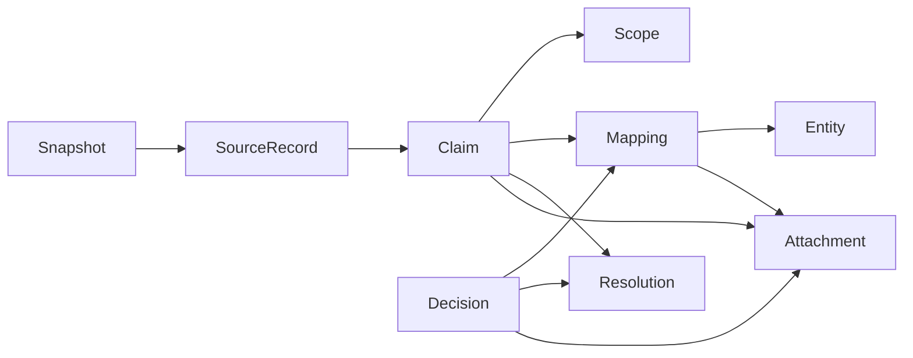

# 원장 → 실버 의미·미정·범위 조사와 데이터 구조 제안

2026-11-03 KST · Task `task_fdd1e8d422f1` · Dispatch `ctx_258a920c0ae0`.

## 1. 결론과 판정 범위

**원장에 명확한 값을 옮기며 잃거나 다른 고민으로 연결한 사례가 실제로 있다.** 안전 필드 정규화가 세 원장 행의 원문 10잎을 덮어썼고, CC 이름의 첫 일치 항목을 사용하는 7단계 규칙은 `튼살` 두 원장 행을 다른 흉터 그룹으로 연결했다. 이 다섯 원장 행은 추정이나 기존 WP 보고서의 재인용이 아니라 snapshot 원문·현재 실버·생성기 분기를 직접 대조한 결과다.

그와 별도로 원장 자체의 상충, 실버 표현 부족, 아직 결정되지 않은 후보, Gold 노출 부족이 함께 존재한다. 팔자 CC 안의 목주름 문장은 원장부터 존재한다. 비교표의 필러 U5-082..089는 현재 실버에서도 `ambiguous` 후보다. 기존 문제의 `step8_notes` 일곱 개는 **원장에 pair가 없는 것이 아니다. 원장 구성 배열과 대응 R8 주장 일곱 개가 이미 있는데 메모에 연결 참조가 없다.** K8 두 항목 역시 target/빈 conditions/kind가 실버에 이미 있다.

따라서 권고 구조는 기존 엔터티를 폐기하는 재구성이 아니라 **원문행 identity, 원천별 claim, scope, 후보 mapping, 판정 이력, 보수 resolution, attachment를 분리하는 보강**이다. 원장에 없는 임상 적용값은 빈 배열·기본 부위·자동 상태로 채우지 않는다.

완료한 것은 읽기 전용 조사와 구조 제안이다. 원장·실버·결정·생성기·스킬·semantic·Gold·스펙·앱·서버·DB·env를 수정하지 않았고 생성기를 실행하지 않았다. 네트워크/외부 모델/의료 자료 조회/commit/push/PR/하위 워커는 사용하지 않았다. 작성물은 이 조사 폴더 안에만 있다.

## 2. 현재 위치·원본·소비 경로

| 역할 | 확인한 실물 |
|---|---|
| 원문 snapshot | `/Users/kknaks/orca/workspaces/PROCEDURE-HUB/phub-stg-2026-10-26/*.json` — 21파일 |
| 조사 기준 실버·결정·생성기 | profile `orchestration/work/phub-recommend/step1..9-*`, `source-map.json`, `semantic.json` |
| 사용자 지정 스킬 | profile `reference/2026-10-27-skills-procedure-hub/` |
| 소비 backend | `/Users/kknaks/orca/workspaces/PROCEDURE-HUB/phub-recommend/backend/` |
| 보조 선행 보고서 | profile `reference/2026-10-30-hub-evals/build-out/wp11-response-review-scope-contract-report.md` §5~9 |

코디네이터는 경로 질문에 “현재 확인한 profile 실버·사용자 지정 reference 스킬·backend가 참조하는 원문21 snapshot을 이번 읽기 전용 조사의 기준”으로 확정했다. 별도 이관 목적지, 정본 권한, 이관 완료 여부는 확인되지 않았다. 검색에서 발견한 `quality-v1/2/3/inputs`는 과거 판 사본으로 분리했고 현재 정답으로 사용하지 않았다. 경로 탐색은 이 답변 뒤 중단했다.

원문 21개는 backend `raw-manifest.json`의 bytes와 sha16 모두 **21/21 일치**했다. 비밀을 제외한 허용 경로 키만 읽어 backend raw 입력이 위 snapshot인 것을 확인했다. `semantic.json.inputs`의 파일 hash는 현재 실물과 **12/12 일치**했다. 이는 파일 판 정합이며 의미 품질 합격은 아니다. full SHA256·크기·역할을 147개 입력/규칙/소비 파일에 대해 [inventory.json](inventory.json)에 기록했다.

```text
원문21 snapshot
 ├ 1단계: frozen 합본 + 외부 허가/유통/KPIC 조사와 결정 → step1-products
 ├ 2단계: step1 + step2-research/open-resolve + 원문/보강결정 → step2-families
 └ 3~9단계: 각 decisions + 원문 + 앞 단계 실버 + apply → 각 단계 실버
실버1~9 + step7/8 decisions + step3 lexicon → semantic-build → semantic.json
Gold ingest --from-dir (명시13파일) → DB source snapshots → Gold build의 snapshot 입력
```

1단계의 허가 사실은 snapshot 원문만에서 나온 것이 아니므로 이 조사에서 현재 허가의 진위를 재인증하지 않는다. 1단계 생성기는 작업 디렉터리 `W='.'`, 2단계는 snapshot 절대경로, 3~9단계는 decisions의 source.path 및 스크립트 인접 canon을 사용한다. 이 경로·작동 방식도 이관 시 갱신 대상이다. Gold ingest는 `--from-dir`로 입력을 받고 build는 DB snapshot을 읽는다. **현재 profile 파일이 활성 DB publication과 같은 판인지는 조회하지 않았다.** 로컬 Gold export를 원장 대체 정답으로 사용하지 않았다.

## 3. Coverage: 전수 집계와 원문 검토를 구분

### 3.1 완료한 전수 범위

- 1~9단계 전체 JSON의 모든 scalar 경로와 dictionary-row 배열을 순회했다. 정규화 필드 경로 3,793개, 실제 배열 위치 5,076개에 대해 관측/키 누락/null/[]/false를 [field-census.json](field-census.json)에 기록했다. 배열 위치 수에는 한 행 안의 중첩 배열이 포함되므로 업무 레코드 수가 아니다.
- 모든 scalar 값에서 미정/ambiguous/후보전부/계열만/조건부/부위없음/해석안됨/원천질문/근거약/충돌·보수를 집계했다. 8,756개의 **표현 hit**와 원래 JSONpath/원문/중첩 marker를 [uncertainty-hits.json](uncertainty-hits.json)에 보존했다. 역사 문장·규칙·부정문도 포함되며 labels가 중복된다. 이를 “미해결 8,756건”으로 읽지 않는다. 결정 파일도 같은 방식으로 별도 [decision-uncertainty-hits.json](decision-uncertainty-hits.json)에 전수 보존했다.
- 아래 실제 상태 필드를 별도로 다시 세었다. [stage-metrics.json](stage-metrics.json)은 현 summary와 독립 recount를 구분한다. “자동/정상/붙음/처리됨”을 의미 확정으로 해석하지 않는다.
- 정규화 키 충돌을 원장 extracted 521행 + taxonomy products 59행 전체에서 찾았다. alias 변경만 있는 정상 rename과 같은 normalized key에 원천 값 둘이 들어오는 collision을 구분했다. 충돌은 3행이다.
- 이름을 identity로 쓰는 위험은 원장/시장가/제품/부위/기법/단위/CC 이름을 전수 그룹화했고, 각 생성기의 first/last match 사용 위치를 정적으로 확인했다. 전체 충돌 목록은 [identity-collisions.json](identity-collisions.json)이다.

### 3.2 원문 직접 대조 분모

독립 원문은 위 snapshot이다. apply 재생성 결과와 자신을 대조하지 않았다. 다음 **9,785개 필드 비교**를 [direct-comparisons.json](direct-comparisons.json)에 전부 기록했다. 한 행의 여러 필드와 중복 검사가 있으므로 유일 행 수나 임상 사실 수가 아니다.

| 직접 비교한 필드 | 비교 수 | 결과 |
|---|---:|---|
| step5 ledger name / detail | 521 + 521 | 원문과 동일 |
| step5 extracted / taxonomy_products의 safety·aftercare 필드 묶음 | 521 + 59 | 3행 차이; 아래에서 정상 rename과 실제 손실 분리 |
| step9 records.text ↔ 원문 exact path | 5,847 | 텍스트 동일; attach·emit의 의미 정확도를 뜻하지 않음 |
| step7 비교 anchor title/subtitle | 18 | 동일 |
| step7 비교 member name / attrs_text 필드 | 39 + 353 | 동일 |
| step7 CC note text / where | 146 + 146 | 원문 join과 동일; kind/적용 범위 정확도와 별개 |
| step8 category_specific label(초기 독립 검사) | 123 | 동일; 아래 전체 K8 검사의 부분집합 |
| step8 관계395의 text / reason·target·min값 등 해당 원문 필드 | 395 + 571 | 동일; 원천 locator 중복은 별도 표시 |
| step8 사람 조건336의 text / 추가 원문필드 | 336 + 118 | 동일 |
| step8 not_condition37의 text / 추가 원문필드 | 37 + 34 | 동일 |

step8의 생성 text는 원천 구조의 결정론적 문자열 조립과 비교했다. 문장 패턴 행은 원문 detail 또는 fallback 제목을 그대로 보존하는지 확인했다. 768개 관계/조건 레코드의 exact 원장 locator는 [step8-origin-locators.json](step8-origin-locators.json)에 있다. legacy locator가 두 원문행을 가리키는 경우 **content를 대조해 조사용으로 찾았다는 표지와 모든 후보 locator**를 남겼다. 동일 text인 두 원문은 내용만으로 유일해지지 않는다.

### 3.3 아직 전수 완료라 할 수 없는 범위

모든 1~9단계 필드의 존재/상태 집계는 전수다. 그러나 모든 원문 잎의 임상 해석, 모든 437개 고민 엣지의 부위·계열 판정, 모든 1,379개 제품 상속쌍의 임상 호환성, 모든 4,791개 관계쌍 해석을 사람처럼 전수 재판정하지는 않았다. 5·7·8단계의 원문 보존 검사는 위 분모만 완료했다. 1~4·6단계는 전수 inventory/미정 집계와 생성·소비 규칙 검토이며 전체 원문 의미 재검증은 아니다. 단계9 text 5,847개가 같아도 잘못된 노드 attachment나 보수 emit 정책이 정답이라는 뜻은 아니다.

새 API/DB/실제 응답은 수신하지 않았다. 기존 9 held / 326 추가 inventory는 문제 탐색의 시작점으로만 썼으며 새 조사 결함 수에 더하지 않았다.

## 4. 단계별 실제 미정·후보·충돌 상태

| 단계·분모 | 실제 필드별 현재 상태 |
|---|---|
| 1 제품395 / active354 | `open[]`31항목·30행. active 허가상태: 정상196, 확인불가86, 미허가15, 취소이력17, 허가대상아님33, 허가번호미확인7. `summary.origin_questions`86, item 미정 라인4. 1단계부터 open0이 아니다. |
| 2 제품계열354 / 계열27 | `family=null`3, `pending_director`3, `evidence_level=약`9, `conflict`6, verdict 판단필요3·여러19·옮김71·계열밖5. `open=[]`와 별개다. |
| 3 문자열176 / 부위53 | `weak=true`문자열4, `anatomical_name.level` 강20/중4/약29, 의료진질문35, deferred23. 이름 칸 밖 설명의 부위 적합성 검증은 이 단계 범위 밖이다. |
| 4 표현181 / 기법26 | conflicts6, not_done3, 넘김59, 중복17, 속성/근거형64, 기법노드/근거41. 표현의 처리 완료와 임상 조건 승인 구분 필요. |
| 5 원장521 / unit162 / 제품연결354 | ledger role 후보19, market122 중 후보3, 메뉴17 중 후보2. extracted attach 단위후보19, 원문보관37. 원천질문20·staff질문1. 상속후보1,379쌍, 저장44쌍. 저장도 실제 환자에 제품을 선택했다는 뜻은 아니다. |
| 6 package24 / contains49 / slots8 | contains 근거약5, slots8(키 없음1), 원천질문13. 8단계 넘김37 중 다름12/시너지링크없음13/계열참고2/같음9/대조없음1. |
| 7 correspondence249 / edges437 / combos79 | correspondence 자동완전151·자동규칙98·사람게이트0. edges target 단위352/계열만84/대상없음1. `resolve_flag` null255, ambiguous100, concern_without_site39, ambiguous+site없음1, unresolved19, no_unit_at_site13, sub_undecided3, check5, not_procedure2. 별도 unresolved2·check_flags6·원천질문3. |
| 7 조합 구성 | components199: ambiguous75/site없음60/unresolved2/not_procedure1/null61. members39: ambiguous18/site없음4/null17. upgrade5: ambiguous1/ambiguous+sitegap1/site없음1/null2. schedule 안의 구성도 field-census의 실제 경로에 집계했다. summary 구성581은 components/members/upgrade의 **unit 연결 수**이고 구성행 수가 아니다. |
| 8 관계395 / 엣지230 | gate 전부 자동(규칙)395, `resolved=true`394. 그러나 review staff_check75·conservative15·ok305. 엣지는 staff_check59·conservative24·ok147. 옛 conflict 엣지0이어도 의료진확인59·보수선택24가 남는다. nested 끝점 중 해석안됨1. |
| 8 조건·안전 | 조건claims336/not_condition37/nodes53. grade_conflicts76, wait_conflicts1, conditions.resolved241 중 보수139/하나102, wait 보수1. scope_conditional 관계2/피함3/조건1. 원천질문18, 합병증원천 gap12계열, 부작용 gap10계열, side_effect staff 예외9. gap은 안전함이 아니다. |
| 9 records5847 / node_slots2946 | 붙음5161, 대조본같음324, source_conflict12, 기타 붙이지않음350. attach 단위후보155. slots 한원천2317/같음33/①43/②196/③357. ②의 처리: 짧은쪽66/늦은쪽68/원천우선순위62, alternatives343. `open=[]`·human_check0과 상충 원천343개 소멸은 같은 뜻이 아니다. |

이 표의 중첩 상태는 합산하지 않는다. 전체 실제 필드별 분모·missing/null/[]는 field-census, 미정 원문은 uncertainty-hits의 exact path를 본다. 예컨대 7단계 `unresolved19` 엣지와 별도 `unresolved[]`2는 서로 다른 분모다.

provenance·scope는 이름이 다른 필드를 섞어 “있음”으로 세지 않고 [provenance-coverage.json](provenance-coverage.json)의18개 레코드 집합에서 literal 필드 경로별로 검사했다. 대표 결과는 다음과 같다. 이는 현재 스키마가 그 필드를 요구한다는 뜻이나 모든 행의 provenance가 전혀 없다는 뜻은 아니다.

| 실제 필드 | 존재/분모 | missing / null / 명시 [] |
|---|---:|---|
| step4 expressions `file`·`key` | 각각181/181 | 0 / 0 / 0 — 자체 locator 표기 사용 |
| step7 edges `source.file`·`source.path` | 각각0/437 | 각각437 missing — source label/id/basis는 별도 존재 |
| step7 edges `anchor_sites` | 437/437 | 0 / 0 / 267 |
| step7 notes `source_index`·`source.path` | 각각0/245 | 각각245 missing — source/where/text만으로 원문 재식별 필요 |
| step8 claims `source_index` | 395/395 | 0 / 0 / 0 — 그중4개 주장 locator는 원문행 중복 |
| step8 claims `condition` | 240/395 | 155 / 27 / 0 |
| step8 claims `scope_conditional` | 23/395 | 372 / 0 / 0 — 명시 true2·false21 |
| step8 조건373 `conditions` | 373/373 | 0 / 0 / 31 |
| step8 조건373 `scope_conditional` | 14/373 | 359 / 0 / 0 — 명시 true1·false13 |
| step9 records `source.file`·`source.path` | 각각5847/5847 | 각각0 / 0 / 0 |
| 위 step4·7·8·9 행들의 `source.sha256` | 모두0 | hash는 행에 없으며 이번 inventory에서 원문 파일판을 외부 대조함 |

이처럼 existing flag가 없다는 이유로 false를 채우면 `조건 미분류`와 `명시 조건없음`을 섞을 수 있다. exact path가 있는9단계의 장점은 유지하되 source snapshot 참조를 더하고,7단계와8단계의 source label/native id 기반 경로를 같은 provenance 계약으로 연결하는 편이 낫다.

## 5. 직접 확인한 오류와 남은 의미 문제

### 5.1 안전 원문 손실: 정규화 충돌3행 / 10잎

`step5-decisions.extracted_rule.key_normalize`는 `safety.common_adverse_effects`와 `safety.common_side_effects`를 `safety.common`으로 정규화한다. `step5-apply.py:613–621`의 `flat()`은 `out[normalized_key] = value`로 마지막 값을 덮어쓴다. 같은 행에 원래 `common`도 있으면 이전 목록을 잃는다.

| 원장 exact 행 | 현 실버 exact 행 | 손실된 원문 |
|---|---|---|
| taxonomy `$.modality[0].subcategories[1].items[3]` 코어톡스 M1-1-3 | `$.extracted[7].source_text` | 주입 부위 부종 / 경미한 통증 / 일시적 발적 |
| taxonomy `$.modality[0].subcategories[2].items[7]` 턱선보톡스 auto-2-1774737181584 | `$.extracted[25].source_text` | 일시적 근력 약화 / 주입 부위 부종/발적 / 두통 |
| taxonomy `$.modality[6].products[1]` 에버라인 M7-P-1 | `$.taxonomy_products[36].source_text` | 부종 / 경미한 통증 / 일시적 울퉁불퉁함 / 스레드 촉지감 |

세 행의 현재 common은 모두 `시술 부위 발적 / 일시적 부종` 두 잎이다. serious_adverse_effects → serious는 이 두 해당 행에서 정상 rename이며 serious 원문 손실로 세지 않았다. 모든 extracted 580행에서 **전체 key_normalize 표**를 적용하기 전의 목적키 충돌을 조사한 결과가 [normalization-collisions.json](normalization-collisions.json)이다. onset peak 등 다른 키의 현재 충돌은 없었다.

같은 `flat()`은 extracted.keys, taxonomy_products.keys, safety_text에 쓰인다. 이미 덮인 source_text로부터 side_effect_override 값을 복사하므로 해당 원문 주장의 provenance가 override에도 전달되지 않는다. Gold `build.py`의 source_text·override fact 생성도 그 입력 손실을 되살리지 못한다. 이 영향은 **해당 원장행의 원문 10잎 손실**이며 같은 문자열이 다른 계열 문장에 전혀 없다는 주장은 아니다.

Before: `{common_adverse_effects:[A,B,C], common:[D,E]}` → 현재 `{common:[D,E]}`.
After 제안: 원천필드별 claim 둘을 보존하고 둘 다 normalized predicate `safety.common`에 매핑한다. raw_value와 raw_pointer를 유지한다. 값의 의미 동일 여부·중복 합침은 별도 검토이며 원장 목록 중 하나를 지워서 해결하지 않는다.

### 5.2 CC identity/first-match: 명확한 튼살2행의 그룹 오연결

원문 problem-packages complaints는115행이다. `(problem_id, cc)`113키 중 중복은2키/4행뿐이다.

- `P9:프락셔널레이저`: complaints[8] CO2/어븀·수술흉터/화상흉터, complaints[10] 성장선/임신선·튼살.
- `P9:니들RF`: complaints[4] 포텐자/시크릿·여드름흉터, complaints[11] 콜라겐리모델링·튼살.

7단계 correspondence[82]/[83]는 detail까지 보아 taxonomy 튼살 항목 auto-138/139를 정확히 찾는다. 그러나 ③ 엣지 생성 `step7-apply.py:1186–1190`은 category+name으로 찾은 `cands[0]`를 사용한다. 이후 R27 합침에서 다른 그룹과 함께 접히며8단계도 이 결과를 재사용한다.

| 원장 | 현재 Silver 관계 | 원문 그룹 / 현재 그룹 |
|---|---|---|
| `$.problems[8].complaints[10].combos[0]` | `step8 $.claims[365]` R8-0366 | 튼살(P9-4) / 수술흉터·화상흉터(P9-3) |
| `$.problems[8].complaints[11].combos[0]` | `step8 $.claims[366]` R8-0367 | 튼살(P9-4) / 여드름흉터(P9-1) |

이 두 원장 complaint에 procedure는 각각2행이므로 원문 procedure행으로는4행 영향이다. 원장그룹 변경 근거는 없다. 별도로 legacy source_index `P9:CC#0`는 R8-0353/0367 및 R8-0364/0366에서 원문을 유일하게 가리키지 못한다. 4개 주장에 해당한다. 한 원천 n-ary를 쌍으로 전개해 동일 source_index를 공유하는 합법적 중복과 이 원문행 identity 충돌을 구분했다.

전체 이름충돌 역검사: modality 항목521 중 `볼뉴머`2행/1키, taxonomy products59·시장가122·active 제품354·부위53·기법26·단위162의 대표 이름은 각각 중복0. stage9 CC2의 `CC [detail]`115키도 중복0이다. 볼뉴머의 step9 fallback은 후보 product가 전부 같은 product인지 검사한다. 현재 이 경로의 새 오연결은 입증하지 않았다. 이 결과는 동의어·정규화/부분문자열 해석까지 임상적으로 모두 안전하다는 보장은 아니다.

After 제안: `source_record_id = snapshot + file + /problems/8/complaints/11`를 사용하고, 해당 correspondence mapping을 직접 참조한다. CC/group/detail은 이름 속성이다. lookup 실패 시 첫 행으로 대체하지 않고 unresolved로 남긴다.

### 5.3 메모 kind와 pair provenance는 별개 문제

CC 원문 combos146개는 구성원1개21 / 2개119 / 3개6이다. 7단계는 전부 `시너지(쌍 주장)`으로 적는다. 8단계는1개21행을 attrs로, 2·3개125원천행을 총137개 pair claim으로 처리한다. 그러므로21개 메모의 pair label은 실제 원장 구조와 다르다. 다만8단계가 singleton에서 pair를 생성했다고 주장하지 않는다. 21개 exact 증거행이 issues의 `ARITY-*`다.

기존 note7의 관계는 다음처럼 이미 존재한다.

| step7 note index | 원장 location | 기존 step8 claim |
|---|---|---|
| 109 / 110 / 111 | `problems[1].complaints[3].combos[0/1/2]` | R8-0277 / R8-0278 / R8-0279 |
| 132 / 133 | `problems[3].complaints[3].combos[0/1]` | R8-0298 / R8-0299 |
| 134 / 135 | `problems[3].complaints[4].combos[0/1]` | R8-0300 / R8-0301 |

※ exact location은 issues.json의 원문 locator를 기준으로 한다. 원천 pair가 있다는 사실과 단독 팔자 시술에 모든 잎이 적용된다는 판단은 구분한다. 메모 전체245행에 exact 원문 path/source_index가 없으며 `source/where/text`로만 묶인다. After는 메모의 source_record_ref·claim_refs·arity를 추가하고, 기존 R8 끝점/조건을 연결한다. 새 pair를 LLM·정규식으로 발명할 필요가 없다.

### 5.4 원장 상충과 범위 표현 부족

- **팔자 CC의 목주름**: 원장 `problems[1].complaints[3].procedures[3].role`과 `combos[2].reason`에 목주름이 명시돼 있다. Silver는 그대로 보존했다. 컨테이너 scope=팔자, statement scope 원문=목주름을 분리하고 원천 담당자에게 복사 오류인지 묻는다. 팔자효능 또는 목 단위로 확정 이동하지 않는다.
- **비교 필러 후보8개**: volume/wrinkle의 member들은 `flag=ambiguous`, units082..089다. volume subtitle은 볼/관자/이마, wrinkle subtitle은 이마/미간/눈가이며 wrinkle filler best_for에는 팔자·마리오넷·정적주름이 있다. 원문 부위 표현이 전혀 없다는 뜻으로 “부위 없음”을 읽으면 틀린다. 현재 flag는 member 이름만으로 exact unit을 고르지 못했다는 뜻이다. 비교 맥락의 부위와 개별 member/field 적용 부위를 따로 보관해야 한다. subtitle만으로 모든 member를 확정 승인하지 않는다.
- **R8-0001의 동일 부위 순서**: 원문은 “동일 부위는 보톡스 먼저 … 주입 부위가 다르면 순서 무관”이다. 현재 reason에는 남지만 interval은 first=a / condition=null / options=null이다. 조건을 읽지 않는 구조 소비에 충분하지 않다. 같은 날 가능 claim과 same_site일 때의 first, different_site일 때의 순서무관 claim을 나눈다. 현재 review=staff_check이므로 “이미 무조건 추천돼 실행됐다”고 확대하지 않는다.
- **제품×계열 override**: 바이리즌 auto-M4-1775361378128은 M4 주/M2 보조이며 제품 상속후보에082..089가 있지만 원문 안전 override_of는 family:M4다. 이는 후보 연결이 틀렸다는 증거가 아니라 claim scope를 제품의 모든 계열로 확대하면 안 된다는 사례다. 기존376 product override와248 unit override 행의 level/priority/source id를 유지하고 실제 제품 선택은 별도 상태로 둔다.
- **K8-0028/0029**: 실버 `conditions.not_condition[]`에 family:M2, conditions=[], 시술준비/상담 kind가 명시된다. 새 임상조건을 만들 일이 아니다. Gold 내부 metadata와 공개 `_walk_row`의 source file/path 투영 차이는 소비층 보강 항목이며 실버 원문 결함으로 분류하지 않았다.
- **patient 언어 잎**: 원장 ST-M2-adverse_effects-03에 대응하는 ko는 수개월 뒤 지연성이라는 문구를 포함하지만 statement·다른 언어 잎에는 그 절이 없다. Silver는 보존했다. 이들을 동등 번역으로 자동 접어 경고를 버릴 근거는 없다. 언어·variant_of·equivalence 검토상태가 필요하다.

### 5.5 보수 resolution을 원천 확정과 분리

8단계는22 관계충돌을 의료진확인16/보수3/조건분리3으로 처리하고, 등급충돌76·대기충돌1은 보수규칙으로 접는다. 엣지의 conflict0 또는 “자동(규칙)”395는 원천 상충0을 뜻하지 않는다. 이소트레티노인 wait_resolved의 “조건 모름 →12개월”은 기존 승인된 R6 정책의 결과이며 새 원장사실이 아니다.

9단계 M10-1-1 duration은 원장 두 행에 `3-6개월 유지, 정기적 시술로 지속 효과` / `6-9개월`로 있다. node_slots[280]은 짧은쪽 규칙으로 전자만 emit하고 후자를 alternatives에 남긴다. 이 처리는 현 결정대로이며 이번에 임의의 잘못된 임상정답으로 단정하지 않는다. 그러나 원천 주장과 보수 view를 분리하지 않으면 downstream은 상충이 없었다고 오해한다. 전체②196슬롯/alternatives343개가 같은 가시성 규약 대상이다.

## 6. 제안 데이터 구조와 필드 계약

### 6.1 유지할 것과 분리할 것

기존 product/family/unit/site/concern/technique ID, unit key, 주·보조 계열, 부위트리, exact source text, R8/K8 주장, 9단계 records/alternatives는 유지할 근거가 있다. 이미 원문 보존과 후보/결정의 재료가 상당 부분 존재한다. 모든 단계 출력을 새 문서 양식으로 통째로 옮길 필요는 없다.



이 그림은 논리 타입이며 모두 별도 DB table이어야 한다는 구현 명령이 아니다. 최소 구분은 다음과 같다.

| 타입 | 보존할 역할 | 현재 값의 대응 |
|---|---|---|
| Snapshot / SourceRecord | 파일판/hash와 원문행/잎 identity | raw21, native id, exact JSONpointer; 이름은 identity 밖 |
| Entity | 실제 제품·계열·단위·부위·고민 등 | 기존 IDs/key/tree/주·보조 계열 |
| Claim | 원천별 subject–predicate–object와 원문 | safety/role/limitations/K8/R8/ST/S9 각각 |
| Scope | 제품·계열·부위·용법·환자조건·제외·용도·시간 | container 범위와 문장 범위, same_site 등 필드조건 분리 |
| Mapping | 원천 표현이 가리키는 후보/확정 대상과 근거 | inherited_candidates/to_units/role/flag/resolver 규칙 |
| Decision | 검토자·승인유형·사유·변경이력 | decided_by/원천질문/사용자결정/retired/delta |
| Resolution | 여러 claim을 보수 정책으로 접은 view | resolved/from/options/by_direction/alternatives |
| Attachment | 검색/노출을 위해 어느 노드에 붙였나 | owner와 분리, CC/product/combo 경로 witness, 적용판정 별도 |

### 6.2 각 필드의 의미·타입·필수·빈값·출처·책임·migration

전체 필드 계약은 [schema-proposal.json](schema-proposal.json)에 있다. **각 필드마다** `meaning/type/required/missing/null/empty_array/origin/responsibility/migration`을 기재했다. 제안서이며 현 스키마가 이미 이 필드를 지원한다고 주장하지 않는다.

핵심 필드는 source snapshot 파일/full hash, 원문 native_id/file/pointer/parent/raw_value, entity ID/type/names/unit_key/memberships, claim 원문·subject/predicate/object·원천참조·variant·qualifiers·numeric_value·override, relation members/arity/direction/field_conditions/interval, scope 축별 knowledge/included/excluded/raw_refs, mapping state/candidates/selection/rule version·code hash/evidence, decision target/status/reviewer/reason/time/supersedes, resolution input_claims/rule/output/alternatives/review_state, attachment target/claim/rule/witness/application_state/판정참조/unknown_reasons다.

책임은 분리한다. 추출기는 원문·위치·타입·판을 손실 없이 보존한다. 정규화 담당은 정해진 사전/규칙과 후보를 만든다. 사람은 identity 충돌·새 의미/범위·임상 적용·상충 원천을 확인한다. 규칙 실행을 승인자명으로 기록하거나 generated_at를 과거 승인일로 추정하지 않는다. 원천에 없는 임상 적용값은 새 필드를 만들었다고 채워지지 않는다.

빈값 의미:

1. 필수 필드의 **missing**은 구조 오류다. 원천 미기재는 필드를 생략해 숨기지 않고 `knowledge=not_declared`로 표현한다.
2. **null**은 해당 필드 계약에서 허용한 미확정/해당없음이며 reason/state를 갖는다. “제약 없음”이 아니다.
3. **[]**는 필드에 따라 명시 빈값 또는 아직 값이 없는 목록이다. scope의 `knowledge`가 의미를 결정한다. `not_declared + []`는 무제한을 뜻하지 않는다. 후보목록 []도 “추천 없음 확정”과 다르다.
4. **false**는 명시 부정값이며 missing/null과 교환하지 않는다. K8의 conditions=[]는 그 항목이 사람조건 유형이 아니라는 의미와 함께 보존한다. 환자에게 조건이 없다는 결론이 아니다.

### 6.3 실제 행의 migration 예

issues.json의 각 행에 before(원장/실버)와 제안 record를 함께 적었다. 대표적으로:

- 코어톡스: 원래 common_adverse_effects claim과 common claim을 각각 원문 pointer로 보존 → 둘이 같은 predicate로 매핑됨을 기록 → 해석/병합 미검토로 유지.
- 튼살 니들RF: `/problems/8/complaints/11` → 기존 대응 auto-139 → concern P9-4 범위 → 관계의 구성후보를 보존. P9:니들RF 이름키를 원문행 키로 쓰지 않는다.
- 비교 필러: candidate082..089 / selected=null / 비교 subtitle 원문 / member scope=unresolved → attachment는 허용해도 개별 unit 적용상태는 unknown.
- note111: 원장 combo 구성과 R8-0279를 연결 → container=팔자/문장 목주름의 scope_conflict 유지 → 적용승인 대신 source question.
- K8: target=family:M2 / kind=준비 또는 상담 / conditions knowledge=not_applicable → 원문과 이미 있는 metadata를 전달.
- 다계열 제품: 제품 mapping 후보와 override family:M4를 분리 → 제품 미선택이면 M2 적용승인은 unknown.
- R8-0001: first 필드의 same_site 조건을 별도 scope에 보존 → different_site 문장을 별도 claim으로 유지 → 현재 staff_check를 유지.
- duration resolution: 원천기간 두 claim 그대로 → 규칙/버전/선택/대안이 있는 resolution view → clinical_consensus=false.

### 6.4 고유 ID가 없어서 생긴 일인가: 현재 확인과 ID 계층

기존 데이터 전체에 ID가 없는 것은 아니다. 이번에 원장 항목521·원장 products59, 실버 제품395·계열27·제품계열354·부위53·기법26·unit162·패키지24·조합79·관계주장395·조건주장373·관계엣지230·설명레코드5847의 **14개 논리 집합별 primary ID를 전수 검사했고 집합 안 중복0**이었다. 다른 파일에 같은 M코드가 있는 것은 namespace/참조 관계에 따른 반복이며 곧바로 ID 충돌이 아니다. 반대로 complaints115행에는 행별 native id가 없고, 일부 변환은 이미 있는 taxonomy 항목 ID·detail 대응을 쓰지 않고 `P9:CC이름`으로 다시 합쳤다. **ID 존재, source occurrence의 유일성, 의미 대응의 정확성은 별개다.**

실측과 설계 예시는 [id-design.json](id-design.json)에 있다. 아래는 제안이며 원장·현재 ID를 재발급하지 않았다.

| 계층 | ID 및 변경 규약 | 이름/정렬/분할·합병 처리 |
|---|---|---|
| Source snapshot | 정렬한 파일명+full SHA256 manifest의 content digest. 같은 내용은 경로 이동 뒤에도 같은 snapshot ID. 파일 하나라도 바뀌면 새 ID. | 경로가 바뀌어도 bytes가 같으면 같음. 이름/행순서 수정으로 파일 bytes가 바뀌면 새 snapshot. 과거 snapshot 덮어쓰기 금지. |
| Source record occurrence | `hash(snapshot_id, file, exact JSONpointer)` + 원장 native_id를 별도 속성. 이 ID는 특정 판의 원문행을 가리킨다. | 행 재정렬은 새 snapshot/occurrence. 이름이 같아도 서로 다른 pointer는 다른 행. 다른 판의 동일 행은 `continuity_ref`와 검토된 매핑으로만 잇는다. |
| Entity | 기존 namespace+ID 유지. 새 엔터티는 이름·배열번호와 독립적인 불투명 식별자를 배정한다. | 이름 변경은 동일 entity의 이름 revision. 분할은 새 child entities와 `split_from`, 합병은 새/존속 entity와 `merged_from` 결정. 옛 ID를 다른 뜻으로 재사용하지 않는다. |
| Atomic claim | source occurrence+원문 필드/잎/절 locator를 기반으로 식별. 원천 주장 한 개와 그 판을 고정한다. 추출기 버전/분해판은 별도 기록. | 원문이 바뀌면 새 claim revision과 supersedes. 동일 문구가 다른 행에 있으면 별도 claim. 같은 원문을 절로 분할하면 parent claim을 보존하고 새 atomic claims를 생성. content hash만으로 다른 출처를 합치지 않는다. |
| Mapping / Decision | mapping은 source 표현·대상 후보·scope·rule판을 고정한 판정 레코드. decision은 대상/검토자/사유/시각을 가진 append-only 기록. | 규칙·scope·후보선택이 바뀌면 새 mapping revision/decision. 이름이 바뀌어도 옛 판정 이력을 유지. 결정 철회/병합은 supersedes로 기록하며 과거 승인값 수정 금지. |
| Resolution / Attachment | resolution은 input claim set+rule판+scope, attachment는 claim+target+rule+witness를 식별한다. | 원천·scope·판정이 달라지면 새 결과. 단순 ID 동일성을 적용 승인 재사용의 근거로 쓰지 않는다. |

실제 before/after: 현재 `P9:니들RF` 하나는 원장 `/problems/8/complaints/4`(여드름흉터)와 `/problems/8/complaints/11`(튼살)을 구분하지 못한다. 제안 source occurrence ID는 snapshot은 같고 pointer가 달라 서로 다르며, 정확한 full digest 입력/결과를 id-design.json에 보존했다. 두 occurrence가 같은 시술 entity나 같은 후보 unit을 참조할 수는 있어도 **claim의 concern scope까지 합치지 않는다.** 프락셔널레이저의8/10행도 동일하다.

Legacy 대응은 `old_namespace + old_id + snapshot → target ID 집합`으로 보존한다. 기존 U5-/R8-/K8-/S9:는 alias 또는 현행 entity/claim ID로 유지할 수 있다. `P9:니들RF`, 배열순서로 만든 `treats:NNNN`, note index처럼 불안정하거나 중복인 값은 유일키로 승격하지 않는다. alias가 여러 대상을 가리키면 ambiguity를 반환하고 source locator/scope를 요구한다. “ID 하나 붙임”만으로 튼살→여드름흉터 오연결이나 후보8개→8개 확정의 의미 오류가 해결되지는 않는다.

ID 검수는 (1) namespace 내 uniqueness, (2) 참조가 동일 snapshot의 실물에 도달, (3) source raw값/hash 일치, (4) mapping의 대상과 원문 group/detail/scope 정합, (5) 후보/판정 상태 보존을 함께 통과해야 한다. 여러 소스에 이미 있는 ID를 무조건 새 UUID로 갈아끼우는 작업은 제안하지 않는다.

## 7. 불변식과 검수 기준

1. `snapshot + file + pointer`는 하나의 원문값만 가리켜야 한다. 이름 중복으로 덮어쓰지 않는다. 배열 변경은 새 snapshot이며 native id가 있어도 이전 pointer를 무검증 재사용하지 않는다.
2. 정규화는 다대일 원천값을 사라지게 만들 수 없다. alias가 목적키와 충돌하면 원천 claim들을 보존하고 충돌/동일 검토를 기록한다. 원문10잎이 해당 provenance로 복원되는지 검증한다.
3. candidate mapping은 approved application을 생성할 수 없다. `resolved`가 “이름해석됨”인지 “보수계산됨”인지 “사람승인됨”인지 타입으로 분리한다. 자동(규칙)과 open0은 각각 처리상태다.
4. container scope와 statement scope가 다르면 scope_conflict를 남긴다. scope 미기재/null/[]를 제한없음으로 변환하지 않는다. CC group/detail은 원문 row identity에 매달린다.
5. 관계 arity는 원문 구성과 같아야 한다. singleton은 pair로 세지 않는다. n-ary에서 pair를 만들면 원래 구성/전개규칙/공유 claim을 보존한다. 방향·간격·first·same_day의 조건은 필드별로 검사한다.
6. 제품 family membership·제품↔unit 호환후보·실제 선택·그 제품의 claim scope는 서로 다른 관계다. override는 원래 family/subfamily/priority 범위 안에서만 평가한다.
7. source claims는 immutable이고 resolution은 input claim 집합/rule/version을 참조한다. alternatives/상충/의료진질문을 지운 채 “단일 fact”로 내보내지 않는다. 숫자/상한/단위/한정이 달라지면 이전 판정의 재사용을 막는다.
8. attachment에는 생성 rule과 witness가 있어야 한다. owner=scope:all이나 attached_to=unit은 단독 unit 적용 승인 근거가 아니다. unknown 중 필수 경고·반대 근거에 영향을 주는 행을 조용히 제외하지 않는다.
9. 환자 언어 variant는 semantic equivalence 검토 전 독립 원문이다. 필수 경고를 번역 중복이라는 이유로 제거하지 않는다.

후속 수정 검수는 재생성 바이트 동일/스키마 통과와 **독립 원문 fidelity**를 모두 요구한다. 이번 세 alias 충돌, 두 CC 동명이행, 21 singleton, same_site 순서 조건, 다계열 override를 실제 원문 fixture로 삼는다. 이 제안서 작성에서 테스트용 가상 임상 문장을 만들지는 않았다. 기존 errors0/selftest 통과 기록은 위 의미 검수의 대체물이 아니다.

## 8. 수정 목록·순서와 원천 질문

| 우선순위 | 조치 종류 | 구체 범위 / 완료 판정 |
|---|---|---|
| P0 | 실버 생성 수정(별도 승인 작업) | step5 `flat` alias collision 원문 보존. 580 extracted 행 전수, 충돌3/10잎 + 정상 rename 보존, source_text→override→Gold 경로 검사. |
| P0 | 실버 매핑 수정 | step7 CC행 identity/대응 재사용. complaint115행·중복2키4행, 원천 튼살2행의 P9-4 일치, stage8 locator4개 모호성 해소. 이후 step7/8/9 영향·R27 합침 회귀 확인. |
| P1 | 스키마·metadata 보강 | source_record/snapshot/claim/scope/mapping/decision 최소 계약 확정; step7 note245의 원문 locator/claim_refs, singleton21 kind·arity, 관계 필드조건 보존. |
| P1 | 원장 재확인 | 팔자 CC의 목주름 문장. 확인 전 container/statement 불일치와 원문 둘 다 유지. |
| P1 | 원천/의료진 질문 | 비교 subtitle/member별 exact 범위, 다계열 제품의 M4 안전원문이 M2 제품에도 적용되는지, patient.ko의 지연성 설명의 승인 여부. 없는 값을 추정하지 않음. |
| P2 | 보수정책 가시성 | step8 review/conditional/options/대기정책, step9②196·alternatives343의 source claim과 resolution view를 분리. 기존 정책을 임상 원천사실로 포장하지 않음. |
| P2 | Gold 변환/노출 수정(현재 보류) | K8·combo member·note claim_refs·product override·variant metadata를 유지해 소비. 실버 계약/우선 수정 검수 뒤 별도 작업으로 다룬다. 앱 보정으로 원문 손실을 우회하지 않음. |

기존 미정 목록은 단계별로 유지한다: 1단계 허가·정체·유통질문, 2단계 pending/약근거, 3단계 해부학명, 5단계 성분/투여방식, 6단계 구성/단위, 7단계 unresolved·check, 8단계 진짜 순서반대/원천질문. 이번 구조 제안이 그 임상답을 새로 채웠다고 주장하지 않는다.

## 9. 산출물·집계 해석·남은 한계

- [issues.json](issues.json): **42개 증거행**. 원문손실3, 고민오연결2, singleton 표기21, scope metadata2, 원장상충1, 미확정 매핑2, note provenance7, Gold metadata2, 언어한정차이1, resolution 가시성1. 서로 다른 층위이며 일부는 같은 원문을 다른 관점에서 다룬다. 독립 임상 결함42개라는 뜻은 아니다.
- 우선 확인된 의미 손상은 **안전 원문3행/10잎 + 고민 그룹2행**이다. 별도 표현 오류는 **singleton21메모**, 추가 범위 조건 구조 공백은 R8-0001 등이다. 기존9/326을 합산하지 않았다.
- [inventory.json](inventory.json): 147개 파일 full hash와 단계 분모·lineage·원문21/semantic12 hash 검증.
- [stage-metrics.json](stage-metrics.json), [field-census.json](field-census.json), [uncertainty-hits.json](uncertainty-hits.json), [decision-uncertainty-hits.json](decision-uncertainty-hits.json): 전수 상태/빈값/표현 원문.
- [direct-comparisons.json](direct-comparisons.json), [normalization-collisions.json](normalization-collisions.json), [identity-collisions.json](identity-collisions.json), [duplicate-cc-evidence.json](duplicate-cc-evidence.json), [step8-origin-locators.json](step8-origin-locators.json): 재현 가능한 비교·충돌·원문 locator.
- [schema-proposal.json](schema-proposal.json): 필드별 의미/타입/필수/빈값/원천/책임/migration 계약. [audit.py](audit.py), [curate.py](curate.py), [propose.py](propose.py)는 읽기 전용 입력 분석과 이 폴더 내 보고서 생성만 한다.
- [id-design.json](id-design.json): 14개 primary ID 집합 전수 검사와 snapshot/행 occurrence ID의 실제 충돌 예시·legacy alias 규약.
- [provenance-coverage.json](provenance-coverage.json): 18개 레코드 집합의 source/scope/status 필드별 존재·누락·null·[]·false 전수 검사.
- [verification.json](verification.json): 입력 hash 보존, issue 원문/실버 JSONpath의 exact 값, 필드 계약·집계·링크를 검증한 결과. 임상 검증과 구분한다.

미확인: 별도 이관 정본 권한·활성 publication 판·전수 임상 해석·현재 허가 진위·원천 질문 답. 이 조사 결과는 데이터 수정 완료나 앱/Hub 적용 승인이 아니다.
