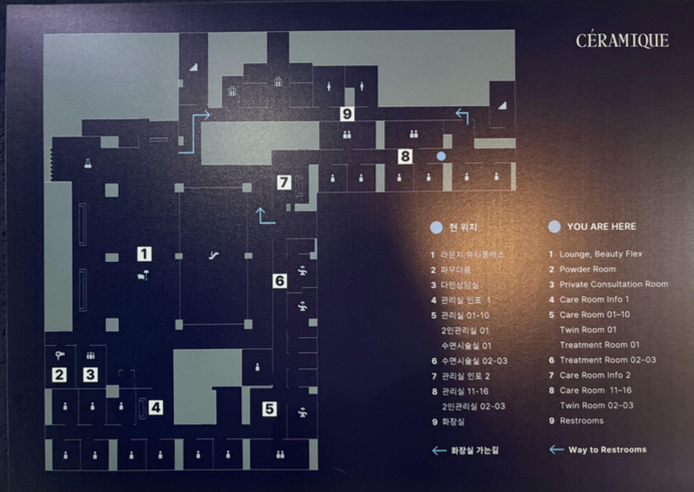

# cc — 병원 현황판: 도면 위에 직원·의사·상담사·고객 위치를 실시간으로

> 아이디어 노트다. 아직 아무것도 정하지 않았다. 정하는 것은 cc 의 DEC 가 갖는다.

## 아이디어

병원 **현황판**. 병원 도면 위에 **병원 직원 · 의사 · 상담사 · 고객**이 지금 어디 있는지 실시간으로 표시한다.

### 사용자 원문 (2026-10-10)

> 생각해보니 cc 에 다 통합 될거 같은데
>
> 새로운 아이디어 넣어줘 cc 는 병원 현황판인데
> [도면 사진] 이런 도면에 병원직원 의사 상다사 고객의 위치를 실시간으로 표시 해주는거야

- 「cc 에 다 통합」 — sts(BASE-002)도 cc 안으로 들어갈 수 있다는 뜻으로 받았다. 어떻게 묶이는지는 아직 말하지 않았다.

## 참고 도면

`assets/cc-floorplan-ceramique.png` — 실제 병원(CÉRAMIQUE) 층 안내판 사진. 「이런 도면」의 예시다.

### 도면에서 읽히는 것 (사진 관측)

| 번호 | 구역 |
|---|---|
| 1 | 라운지 · 뷰티플렉스 |
| 2 | 파우더룸 |
| 3 | 다인상담실 |
| 4 | 관리실 인포 1 |
| 5 | 관리실 01–10 · 2인관리실 01 · 수면시술실 01 |
| 6 | 수면시술실 02–03 |
| 7 | 관리실 인포 2 |
| 8 | 관리실 11–16 · 2인관리실 02–03 |
| 9 | 화장실 |

- 사용자 「도면이랑 시술실 정보는 나중에 매칭 할거야」(2026-10-10) — 이 도면·방 목록은 예시이고, 실제 도면과 시술실 정보는 나중에 맞춘다.
- 방 단위로 칸이 나뉘어 있다 — 위치를 **좌표**가 아니라 **방(구역)** 단위로 보여 줘도 현황판이 성립할 수 있다.
- 안내판의 「현 위치」 점처럼, 사람마다 점(아이콘)을 찍는 표현이 자연스럽다.

## 열린 질문

- **위치를 어떻게 아나** — 실내 측위(BLE 비콘 · UWB · Wi-Fi), 태그/카드 체크인, 직원이 직접 상태 입력, 예약·차트 시스템 연동(어느 방에 배정됐나), 데모용 모의 데이터 중 무엇
- 위치 단위 — 방(구역) 단위인가, 도면 위 좌표인가
- 도면 — 이미지 위에 방 영역을 그려 넣나, 도면을 직접 그리나(SVG)
- 역할별로 무엇을 보여 주나 — 직원·의사·상담사·고객의 표시 구분, 고객은 이름을 보여 주나(개인정보)
- 누가 보나 — 데스크 대형 화면 / 직원 PC·태블릿
- 「실시간」의 정도 — 몇 초 단위 갱신이면 되나
- sts 가 cc 에 어떻게 통합되나 — 예: 외국인 고객 상담 통역을 현황판에서 연다?
- 고객 데모에서 보여 줄 장면 — 무엇을 보면 「됐다」인가
