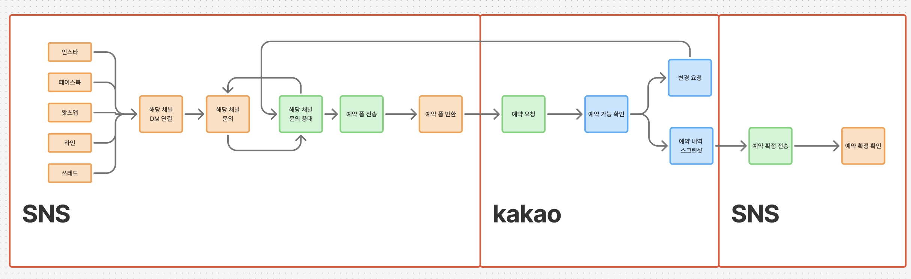
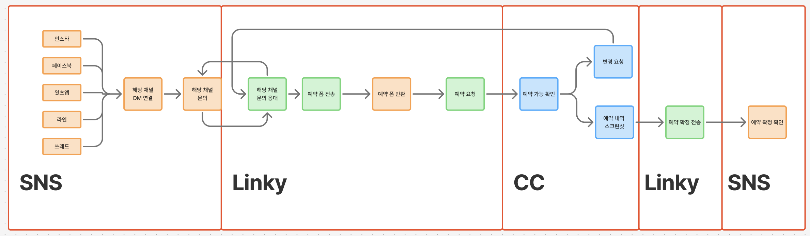

# 예약 — Linky 가 예약폼을 cc 로, 병원은 cc 에서 KOS 등록·결과 저장

> 아이디어 노트다. 아직 아무것도 정하지 않았다. 정하는 것은 cc 의 DEC 가 갖는다.

## 아이디어

고객 – 본사 – 병원 사이의 예약을 SNS 여러 개와 카카오톡으로 주고받는 지금 구조를 바꾼다.
본사는 통합 SNS 플랫폼 **Linky**(우리가 개발)에서 고객을 응대하고 예약폼을 **cc** 로 보낸다.
병원은 **cc 만 보고** 예약을 **KOS(CRM)** 에 등록하고, 결과를 cc 에 저장한다.

### 사용자 원문 (2026-10-10)

> 또 예약 관련 아이디어는 [AS-IS 흐름도] 현재 이런 식인데
> 고객 - 본사 - 병원 구조로 예약을 sns 여러개 , 카카오톡 으로 소통 하는 구조라 운영 입장에서 불편해
>
> 그래서 우리가 통합 sns 플랫폼 linky를 개발 했어
> 이제 linky를 고도화 해서 cc에 예약폼을 전송해주고
> 병원에서는 cc 만 보면 예약을 kos(crm) 에 전송해주고 결과를 저장 하는 구조가 될거야
> [TO-BE 흐름도] 이런 구조로
>
> 지금 카톡을 쓰는이유는 예약폼을 병원에 전달하고 병원은 그 답장으로 예약 된걸 스크린 샷 찍어서 하고 잇어
> 이게 너무 비효율이야

## 흐름도

색: **주황 = 고객 · 초록 = 본사 · 파랑 = 병원** (사용자 확인 2026-10-10)

### AS-IS — SNS · 카카오톡 · SNS

| 구간 | 흐름 |
|---|---|
| SNS | 고객이 인스타 · 페이스북 · 왓츠앱 · 라인 · 쓰레드 중 하나로 DM → 문의 → 본사가 **그 채널에서** 응대 → 예약폼 전송 → 고객이 예약폼 반환 |
| 카카오톡 | 본사가 병원에 예약 요청 → 병원이 예약 가능 확인 → ① 안 되면 **변경 요청**(본사 → 고객 재응대로 되돌아감) ② 되면 **예약 내역을 스크린샷**으로 회신 |
| SNS | 본사가 고객에게 예약 확정 전송 → 고객 확인 |

불편한 자리: 고객 채널이 다섯 갈래, 병원과는 카톡, 예약 결과가 **스크린샷**(검색·집계·재사용 불가), 변경 요청이 사람 손으로 왕복.

### TO-BE — SNS · Linky · CC · Linky · SNS

| 구간 | 흐름 |
|---|---|
| SNS | 고객 DM · 문의 (그대로) |
| **Linky** | 본사가 모든 채널 문의를 Linky 한 곳에서 응대 → 예약폼 전송 · 반환 → **cc 로 예약 요청** |
| **CC** | 병원이 예약 가능 확인 → ① 변경 요청 → Linky 응대로 되돌아감 ② 확정 → **KOS(CRM)에 등록하고 결과를 cc 에 저장** |
| **Linky** | 예약 확정 전송 |
| SNS | 고객 확인 |

바뀌는 것: 카카오톡 구간이 cc 로 대체되고, 스크린샷 대신 **KOS 등록 결과가 데이터로** 남는다.

## 이해한 것 — 사용자 확인 (2026-10-10 「응 맞아」)

- cc 는 병원 쪽 화면이다. 병원은 **cc 하나만** 본다(카톡·KOS 를 따로 오가지 않는다).
- Linky ↔ cc 는 양방향이다: Linky → cc (예약 요청), cc → Linky (변경 요청 · 확정 결과).
- TO-BE 흐름도의 CC 구간에 「예약 내역 스크린샷」 상자가 남아 있다 → **스냅샷 성격의 기록은 필요하다. 형태는 기능 구현 때 정한다.**

  > 응 맞아 스크린샷은 나중에 기능 구현 할때 생각하자 사실 api가 잇으면 스냅샷으로 쓸수도 잇고
  > 예약 요청 변경 올때도 생각을 해야해서 스냅샷성격에 스크린샷은 필요할거같긴혀
  > — 사용자 (2026-10-10)

  - KOS API 가 있으면 API 응답을 스냅샷으로 남길 수 있다
  - 예약 변경 요청이 올 때 「변경 전 예약이 무엇이었나」를 보여 줄 근거가 된다

## 열린 질문

- **KOS 연동 방식** — KOS 에 API 가 있나, 없으면 병원 직원이 KOS 에 넣고 결과만 cc 에 기록하나. 데모에서는 모의 KOS?
- **Linky ↔ cc 연동** — Linky 고도화 범위(누가·어느 레포). 이 레포의 cc 가 Linky API 를 받나, 데모에선 Linky 를 흉내 내나
- 예약폼 항목 — 지금 쓰는 폼 실물
- 예약 스냅샷의 형태 — KOS API 응답 저장 / 화면 캡처 / 둘 다. 변경 요청 때 어떻게 보여 주나 (기능 구현 때)
- 예약 상태 — 요청 · 확인 중 · 변경 요청 · 확정 · 취소 … 상태 목록
- 병원이 여러 곳인가 — 본사 하나에 병원 N 개면 cc 는 병원별로 따로 보이나
- 현황판(BASE-003) · 통역(BASE-002) 과 cc 화면 안에서 어떻게 묶이나 — 예: 예약 확정 고객이 내원하면 현황판에 뜬다?
