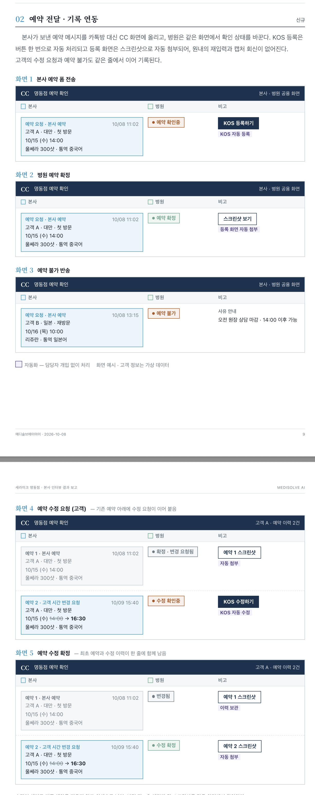

# cc 2차 — 헤더 세 갈래 · 기기별 현황판 · 예약관리 데모

> 요청 기록이다. 아직 아무것도 정하지 않았다. 정하는 것은 DEC 가 갖는다.
> 1차(SPEC-001 · WORK-001)는 2026-10-14 마감됐다.

## 사용자 원문 (2026-10-14)

> 1. 헤더에 현황판|예약관리|내 스케쥴 이렇게
> 2. 현황판은 지금 현황판
> 3. 예약관리는 새로만들어야해
> 4. 내 스케쥴은 탭, 폰 버전 자기 페이지 우리 만든거
>
> 탭, 폰, 에서도 현황판을 볼 수 잇으면 좋겟어
> 탭 - 현황판 도면
> 폰 - 현황판 말고 목록 정도만 ?

> 링키에서 나중에 연결 되면 링키에서 예약 요청 하기가 생길거야
> 그럼 cc 예약관리에서 [와이어프레임] 이런식으로 전달 될거야
> 여기는 그냥 데모로만 보여 주면돼. 저거는 와이어프레임이고 우리가 디자인 시안부터 다시 할거야
>
> 데모는
> 1. [버튼 : 링키 예약 요청 생성](데모에서만)
> 2. 예약 테이블 생성
> 3. 병원에서 Kos 등록하기 버튼 누르기
> 4. 미리보기 생성 (모달)
> 5. 등록하기 버튼 클릭
> 6. 스크린샷(지금은 Html 로 만들기) 스크린샷은 내가 줄게
> 7. 상태 변경
>
> 지금 보니까 kos등록하기|변경요청하기| 수정 기능도 시안이 필요하네

## 요청 갈래

| # | 갈래 | 지금 |
|---|---|---|
| 1 | 헤더 `현황판 \| 예약관리 \| 내 스케쥴` | 없음 — `/desk` · `/staff` 가 따로 있다 |
| 2 | 현황판 = 지금 `/desk` | 있음(SPEC-001) |
| 3 | 예약관리 — 새 화면, 데모 | 없음. 아이디어는 BASE-004 |
| 4 | 내 스케쥴 = 1차 직원 페이지(`/staff`, 5직군) — 탭 · 폰 | 있음(SPEC-001) |
| 5 | 기기별 현황판 — 탭 = 도면 · 폰 = 목록 | 없음 — `/desk` 는 데스크톱 기준 |

## 예약관리 와이어프레임

**와이어프레임이다 — 시안은 다시 만든다**(사용자). 읽히는 구조만 적는다.

- 한 줄 = 예약 하나. 칸은 `본사`(예약 요청 카드: 요청 종류 · 시각 · 고객 · 국적 · 첫 방문/재방문 · 예약 일시 · 시술 · 통역 언어) · `병원`(상태 배지) · `비고`(버튼 · 사유)
- 화면 1 본사 예약 폼 전송 — 상태 「예약 확인중」 · [KOS 등록하기]
- 화면 2 병원 예약 확정 — 「예약 확정」 · [스크린샷 보기](등록 화면 자동 첨부)
- 화면 3 예약 불가 반송 — 「예약 불가」 · 사유 안내 문구
- 화면 4 예약 수정 요청(고객) — 기존 예약 아래 수정 요청이 이어 붙음(바뀐 값은 취소선 → 새 값) · 기존 「확정 · 변경 요청됨」 · 새 줄 「수정 확인중」 · [KOS 수정하기]
- 화면 5 예약 수정 확정 — 기존 「변경됨」(스크린샷 이력 보관) · 새 줄 「수정 확정」 · [예약 2 스크린샷]

## 데모 흐름 (사용자 원문 순서)

1. [링키 예약 요청 생성] 버튼 — 데모에서만. Linky 연동 자리를 대신한다
2. 예약 테이블에 줄이 생긴다
3. 병원이 [KOS 등록하기]
4. 미리보기 모달
5. [등록하기]
6. 스크린샷 — 지금은 HTML 로 만든다. **스크린샷 원본은 사용자가 준다**
7. 상태 변경

## 사용자가 짚은 것

- 비고 칸 버튼이 `KOS 등록하기 | 변경 요청하기` 로 갈린다 → **수정(변경) 흐름도 시안이 필요하다**

## 열린 질문 (DEC 로 넘긴다)

- 내 스케쥴 — 데스크톱에서 누르면 무엇이 뜨나(데스크 직원의 화면이 따로 있나)
- 폰 현황판 목록 — 묶음 기준(방별 / 고객별 한 줄)
- 헤더 — 폰 · 탭에서도 세 갈래를 다 보이나
- 예약관리 데모 범위 — 와이어 화면 1~5 중 어디까지(불가 반송 · 수정 요청 포함?) · 수정 요청도 데모 버튼으로 만드나
- 예약 요청 카드 항목 · 상태 목록 — 와이어의 값으로 가나
- 스크린샷 원본 — 사용자 제공(받을 것)
- 일정 — 10-16 시연에 넣나
