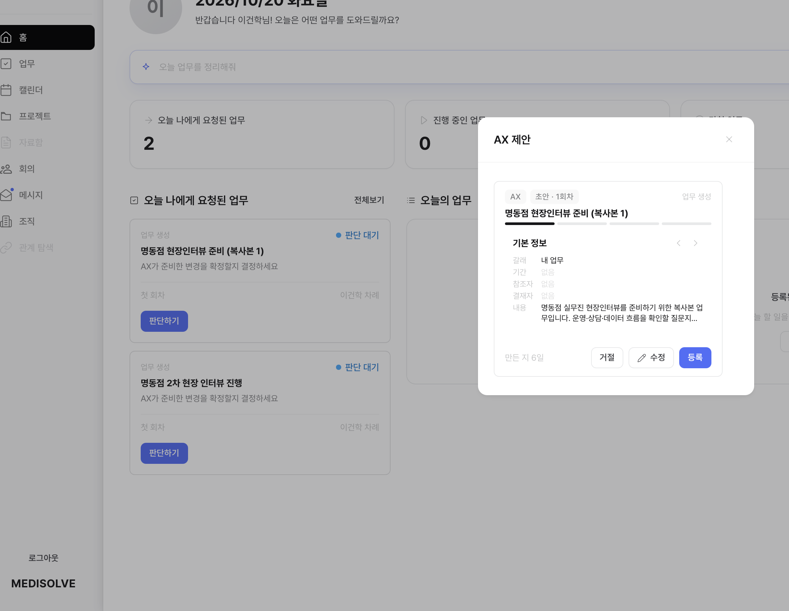
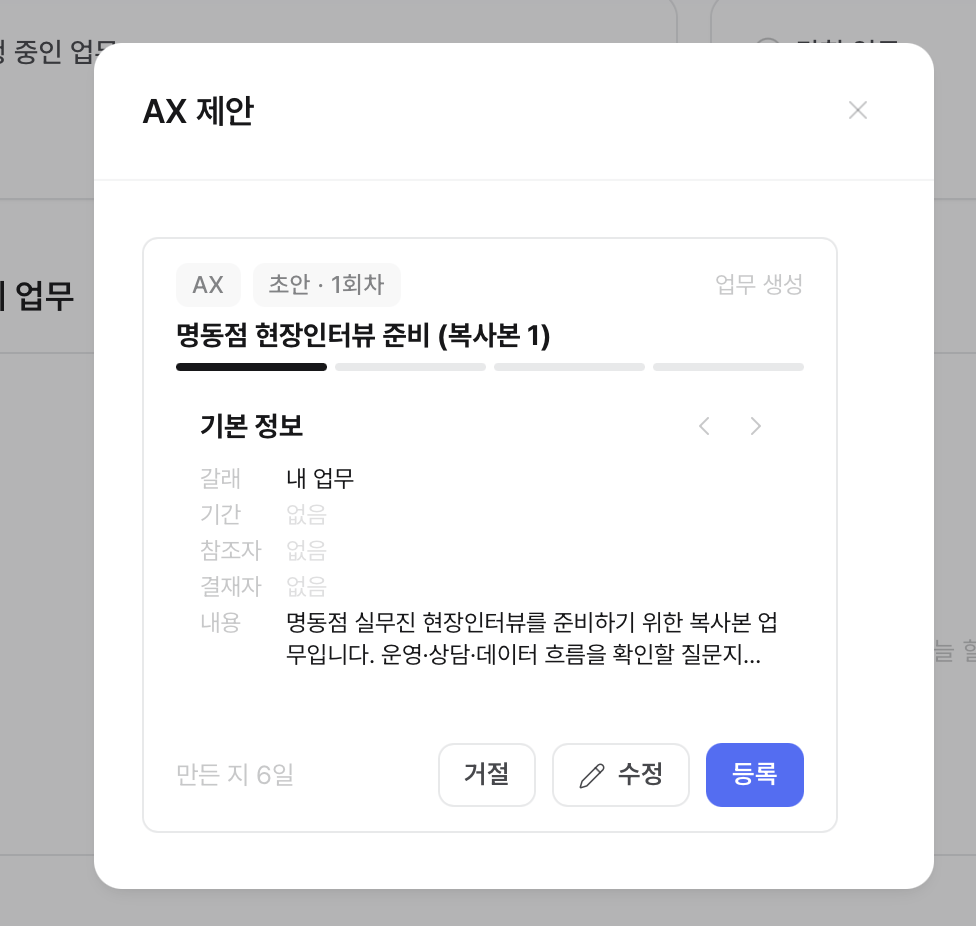
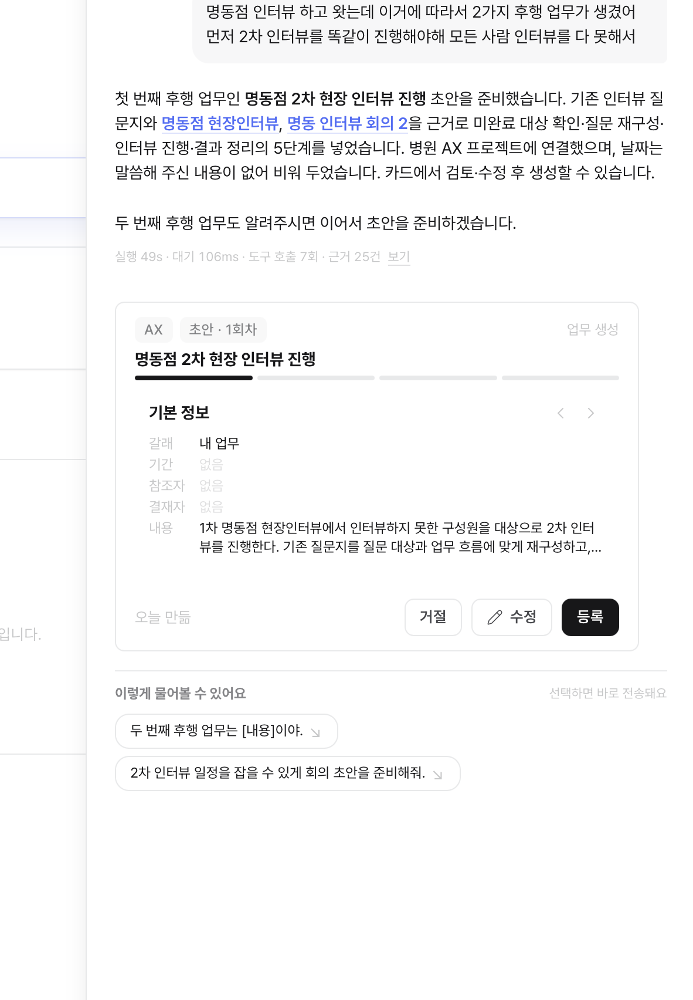

# SH-IMP-024 — 홈의 「AX 제안」 모달이 채팅 카드를 그대로 끼워 넣어 어색하다

상태: 미착수  
생성일: 2026-10-20  
갱신일: 2026-10-20  
출처: 사용자 2026-10-20 (AX 가 만든 업무 생성 제안을 홈에서 「판단하기」로 열었을 때)

## 문제

홈 「오늘 나에게 요청된 업무」의 판단 대기 카드(업무 생성 · AX가 준비한 변경을 확정할지 결정하세요)에서
「판단하기」를 누르면 「AX 제안」 모달이 뜬다. 모달 안에 **AX 채팅의 제안 카드가 테두리째 그대로** 들어가 있다 —
모달 틀 안에 또 카드 틀(AX · 초안 · 1회차 칩, 단계 진행 막대, 기본 정보 ‹ ›, 거절 · 수정 · 등록)이 겹쳐 보인다.

채팅에서는 이 카드 모양이 맞다(대화 흐름 속 제안 하나). 사용자 질문: **화면 모달까지 채팅과 똑같이 보여야 하나.**

## 화면 (2026-10-20)

| 홈 → 「판단하기」 | 모달 확대 | 채팅의 같은 카드(기준) |
|---|---|---|
|  |  |  |

## 원하는 방향 (정할 것)

- 모달은 모달답게 — 카드 틀을 벗기고 모달 자체가 그 내용(제목 · 단계 · 기본 정보 · 행동)을 담는 모양
- 채팅 카드와 같은 데이터 · 같은 행동(거절 · 수정 · 등록)은 유지 — 모양만 다름
- 시안 유무 확인(없으면 DS-gaps 기록 후 기본안)

## 같이 본 것

- 같은 화면의 홈 모달에서 「등록」 버튼은 파랑, 채팅 카드는 검정 — 같은 행동의 색이 표면마다 다르다
- 모달 하단 「만든 지 6일」 — 판단 대기가 6일째 남아 있다(SH-IMP-025 와 연결: 수신함에 안 보여 놓쳤을 수 있다)

## 진행 관리

- [ ] 시안 확인 · 모달 형태 결정
- [ ] FE 고침 → 앱에서 확인
