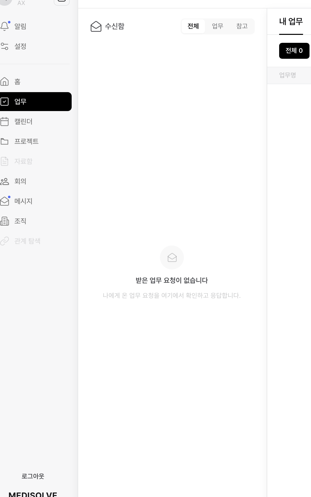

# SH-IMP-025 — AX 제안(판단 대기)이 업무 탭 수신함에 안 들어온다

상태: 미착수  
생성일: 2026-10-20  
갱신일: 2026-10-20  
출처: 사용자 2026-10-20

## 문제

AX 가 만든 업무 생성 제안 두 건(「명동점 현장인터뷰 준비 (복사본 1)」 · 「명동점 2차 현장 인터뷰 진행」)이
홈의 「오늘 나에게 요청된 업무 2」에는 **판단 대기**로 보이는데, 업무 탭 **수신함(전체 · 업무 · 참고)은 비어 있다**
(「받은 업무 요청이 없습니다」).

사용자 판단: **AX 제안도 업무 탭 수신함에 들어와야 하는 것 아닌가.** 홈에서 요청된 업무로 세는 것을
업무 탭에서는 받은 요청으로 안 세니, 두 표면이 「나에게 온 것」을 다르게 센다.

## 화면 (2026-10-20)

| 홈 — 요청된 업무 2(판단 대기) | 업무 탭 — 수신함 비어 있음 |
|---|---|
|  |  |

## 정할 것

- 수신함에 넣는다면 어느 탭(전체 · 업무 · 참고 / 「AX 제안」 갈래 신설)인가
- 수신함의 행동은 무엇인가 — 홈과 같은 「판단하기」(→ SH-IMP-024 모달)인가
- 근거 계약 확인: 수신함이 받는 대상(업무 요청)과 AX 제안(proposal)이 SPEC 상 같은 「요청」인지 — 다르면 SPEC 개정

## 진행 관리

- [ ] 현재 수신함 · 홈 「요청된 업무」의 조회 기준 조사(코드)
- [ ] 계약 결정 → BE/FE → 앱에서 확인
