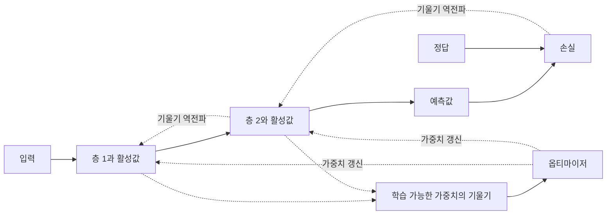
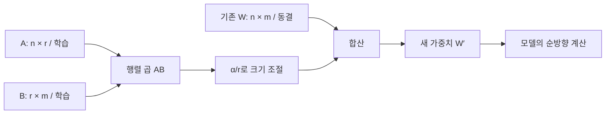

# 7장 파인튜닝

> 출처: Chip Huyen, 『AI Engineering』, Chapter 7 “Finetuning”, 책 p.307–362. 아래 보충 상자는 이해를 위한 개념 설명이며, 도식은 원문 그림의 핵심 흐름을 다시 그렸다.

## 개요

- 프롬프트 엔지니어링과 RAG는 모델에 주는 입력을 바꾼다. 파인튜닝은 추가 학습으로 모델의 가중치를 바꾼다.
- 파인튜닝으로 도메인 역량과 안전성을 높일 수 있다. 특히 지시를 따르는 방식, 출력 형식, 문체를 작업에 맞추는 데 많이 사용한다.
- 먼저 결정할 것은 「어떤 파인튜닝을 할까」보다 「파인튜닝이 필요한 문제인가」다. 정보가 부족한 문제와 행동이 잘못된 문제를 구분해야 한다.
- 학습에는 추론보다 많은 메모리가 필요하다. 이 장은 메모리가 어디에 쓰이는지 살펴본 뒤, 학습 가능한 파라미터를 줄이는 PEFT와 값 하나를 저장하는 비트 수를 줄이는 양자화를 설명한다.
- 마지막으로 LoRA의 작동·구성·서빙 방식, 여러 모델을 합치는 모델 병합, 실제 실험에서 고르는 설정을 다룬다.

## 7.1 파인튜닝 개요

- **파인튜닝(finetuning)**: 이미 학습된 모델의 전체 또는 일부를 추가 학습해 특정 작업에 맞추는 과정이다. 무작위 가중치에서 출발하는 학습과 달리, 필요한 능력의 일부를 가진 모델에서 시작한다.
- 이 장에서 파인튜닝은 지도학습만을 뜻하지 않는다. 사전학습 이후의 자기지도학습, 지시 학습, 선호 학습, 컨텍스트 확장까지 포함한다.
- **전이학습(transfer learning)**: 한 작업에서 얻은 지식을 관련된 다른 작업을 배우는 데 활용하는 것이다. 피아노를 배운 사람이 다른 악기를 더 쉽게 배우는 것과 비슷하다.
  - **방법**: 파인튜닝은 기존 모델을 추가 학습하는 전이학습 방법이다. 기존 모델이 추출한 특성을 다른 모델에 제공하는 특성 기반 전이도 있다.
  - **활용 예**: 언어모델은 대량의 텍스트 완성으로 배운 지식을 법률 질의응답이나 자연어→SQL 같은 작업으로 옮긴다.
  - **기대 효과 — 표본효율성 향상**: 표본효율성(sample efficiency)은 같은 수준의 행동을 배우는 데 필요한 예시가 얼마나 적은가를 나타낸다. 좋은 기본 모델의 지식을 활용하면 처음부터 학습할 때보다 적은 예시로 작업에 적응할 수 있다. 필요한 데이터 수와 개선 정도는 모델과 작업에 따라 다르다.

> **관계 구분**: 전이학습은 지식을 재사용하는 방법이고, 표본효율성은 학습의 데이터 효율을 나타내는 성질이다. 여기서는 전이학습으로 기대할 수 있는 효과를 설명하기 위해 표본효율성을 함께 다룬다.

> **특성 기반 전이란**
>
> 파인튜닝 외에도 전이학습을 하는 방법이 있다. 기존 모델로 데이터의 특성, 보통 임베딩을 추출하고 다른 모델이 그 특성을 이용하도록 하는 것이다.
>
> 예를 들어 사전학습된 이미지 모델로 사진의 특성을 뽑고, 그 위에 분류기를 붙여 새 분류 작업을 수행한다. 추출기가 이미 배운 시각적 패턴을 재사용하는 셈이다. 기존 가중치를 추가 학습하는 방식과 구분해 **특성 기반 전이(feature-based transfer)**라고 부른다.

- 주요 파인튜닝 형태

  | 형태 | 데이터·목표 | 예시 |
  |---|---|---|
  | 지속적 사전학습 | 라벨 없는 작업 관련 데이터로 자기지도학습을 이어 간다 | 법률 질의응답 전에 법률 원문을 학습 |
  | 지도 파인튜닝(SFT) | `(입력, 출력)` 쌍으로 원하는 응답을 학습한다 | 지시→요약, 질문→답변, 문장→분류 |
  | 선호 파인튜닝 | 선호 비교 데이터를 이용해 더 선호되는 응답을 생성하도록 조정한다 | `(지시, 선호 응답, 비선호 응답)` |
  | 인필링 파인튜닝 | 앞뒤 문맥을 보고 중간의 빈 부분을 채우게 한다 | 문서 부분 수정, 코드 디버깅 |
  | 롱컨텍스트 파인튜닝 | 더 긴 입력을 처리하도록 모델을 조정한다 | 긴 코드 파일·문서 처리 |

- **지속적 사전학습(continued pre-training)**: 비싼 정답 데이터를 쓰기 전에 저렴한 관련 원문으로 학습을 이어 가는 방법이다. 법률 문서를 먼저 학습한 뒤 `(법률 질문, 답변)`으로 지도 파인튜닝할 수 있다.
- **인필링(infilling)**: 다음 토큰을 이어 쓰는 대신 앞뒤 내용을 보고 중간을 채운다. 자기회귀 방식으로 사전학습한 모델도 인필링을 하도록 추가 학습할 수 있다.
- **롱컨텍스트 파인튜닝**: 긴 시퀀스의 위치를 다룰 수 있도록 위치 임베딩 등 모델 구성을 조정하고 학습한다. 다른 파인튜닝보다 어렵고, 긴 입력 성능을 얻는 대신 짧은 입력 성능이 낮아질 수도 있다.
- 책의 Code Llama 사례는 Llama 2에서 출발해 코드 학습·지시 학습·롱컨텍스트 학습을 조합한다. 컨텍스트 길이도 4,096토큰에서 16,384토큰으로 늘렸다.
- 애플리케이션 개발자는 사전학습 직후의 모델뿐 아니라 이미 사후학습된 모델을 출발점으로 쓸 수 있다. 우리 작업과 관련된 능력이 갖춰져 있을수록 추가로 배워야 할 것이 줄어든다.

## 7.2 파인튜닝이 필요한 경우

- 파인튜닝은 프롬프트 기반 방법보다 데이터·하드웨어·ML 인력에 대한 초기 투자가 크다. 대체로 프롬프트 실험을 충분히 진행한 뒤에 검토한다.
- 프롬프팅과 파인튜닝은 함께 쓸 수 있다. 파인튜닝을 했더라도 적절한 지시와 컨텍스트는 필요하다.
- 판단의 출발점은 평가다. 실제 입력에서 무엇이 실패하는지 알아야 학습으로 고칠 문제인지, 검색으로 해결할 문제인지 구분할 수 있다.

### 7.2.1 파인튜닝을 해야 하는 이유

- **작업 품질 개선**: 범용 벤치마크 성능이 좋아도 우리 작업에 충분히 노출되지 않았을 수 있다. 표준 SQL은 잘 생성하지만 드문 SQL 방언이나 고객 특유의 쿼리에 실패한다면 해당 예시로 추가 학습할 수 있다.
- **출력 형식과 문체 조정**: JSON·YAML 같은 구조, 조직이 요구하는 상세 수준, 응답 스타일을 더 안정적으로 따르게 한다.
- **편향 완화**: 기본 모델이 학습 데이터의 편향을 반복할 때 이를 상쇄하는 데이터를 선별해 학습한다. CEO 이름을 남성 이름으로만 생성하는 모델에 다양한 성별의 CEO 사례를 보여 주는 식이다. 어떤 데이터를 쓰느냐에 따라 편향이 더 커질 수도 있다.
- **증류(distillation)**: 큰 모델이 만든 응답을 작은 모델의 학습 데이터로 사용해 큰 모델의 행동을 옮긴다. 특정 작업에 필요한 품질을 유지하면서 추론 비용과 지연 시간을 줄이는 것이 목적이다.
- 작은 모델은 메모리를 덜 사용해 학습과 서빙이 쉽다. 특정 작업에서는 파인튜닝한 작은 모델이 훨씬 큰 범용 모델보다 나을 수 있다.
- 책의 Grammarly 사례에서는 82,000개의 `(지시, 출력)` 쌍으로 학습한 Flan-T5가, 비교 대상인 텍스트 편집용 GPT-3 변형보다 60배 작으면서 여러 글쓰기 보조 작업에서 더 좋은 결과를 냈다. 이 비교는 해당 작업과 실험에 한정된다.

### 7.2.2 파인튜닝을 하지 말아야 하는 이유

- **범용성 저하**: 한 작업을 개선하면서 다른 작업의 성능을 떨어뜨릴 수 있다. 주문 변경 데이터만 학습하면 주문 변경은 잘하지만 상품 추천이나 일반 피드백에는 약해질 수 있다.
- 여러 작업을 계속 수행해야 한다면 그 작업들의 데이터도 함께 고려한다. 하나의 모델로 모두 만족시키기 어렵다면 작업별 모델을 두거나 모델 병합을 검토한다.
- **프로젝트 초기에는 준비 비용이 크다.**

  | 필요한 것 | 확인할 내용 |
  |---|---|
  | 학습 데이터 | 원하는 행동을 담은 고품질 예시가 있는가. 전문 지식이 필요한 정답을 누가 만드는가 |
  | 학습 지식 | 기본 모델 선택, 옵티마이저, 학습률, 과적합·과소적합, 평가를 이해하는가 |
  | 서빙 방법 | 직접 호스팅할지 API를 쓸지, 학습한 모델을 어떻게 운영할지 정했는가 |
  | 비용과 유지보수 | 학습뿐 아니라 모니터링·업데이트·새 기본 모델로의 전환 비용도 감당할 수 있는가 |

- 파인튜닝 API가 학습 단계를 자동화해도 실패 원인 분석과 품질 판단까지 대신하지는 않는다.
- 새 기본 모델이 우리 파인튜닝 모델보다 빠르게 좋아질 수도 있다. 어느 정도 개선되면 교체할지, 새 모델에도 다시 파인튜닝할지에 대한 기준이 필요하다.
- 프롬프트를 몇 번 바꿔 보고 안 된다고 판단하지 않는다. 불명확한 지시, 실제 입력을 대표하지 않는 예시, 불분명한 지표를 먼저 고친다. 이때 만든 평가 파이프라인과 실험 기록은 이후 파인튜닝에도 쓴다.

> **도메인 특화 작업이면 반드시 파인튜닝해야 할까**
>
> 도메인 특화 작업이라는 이유만으로 전용 모델이 필요하다고 단정할 수는 없다. 범용 모델이 발전하면 해당 분야에서도 더 좋은 성능을 낼 수 있다.
>
> 책의 금융 벤치마크 비교에서는 GPT-4-0314의 제로샷 성능이 BloombergGPT보다 높았다. 다만 공개 벤치마크만으로 Bloomberg 내부 작업의 성능까지 판단할 수는 없다. 실제 요구사항과 평가 데이터로 비교해야 한다.

- 프롬프트 캐싱이 없던 초기에는 예시를 매 요청마다 넣는 대신 파인튜닝해 입력 토큰을 줄이는 이점이 컸다.
- 반복되는 프롬프트 구간을 캐싱할 수 있으면 이 비용상의 이점은 줄어든다. 책은 캐싱의 도입으로 「프롬프트를 짧게 만든다」는 이유만으로 파인튜닝을 선택할 근거가 약해졌다고 설명한다.
- 파인튜닝은 한 요청의 컨텍스트 길이에 묶이지 않고 많은 학습 예시를 사용할 수 있다는 차이가 남는다. 그렇다고 모든 예시를 정확히 암기하거나 학습 비용이 사라지는 것은 아니다.

### 7.2.3 파인튜닝과 RAG

- 오류가 **정보 부족**에서 오는지, **행동 방식**에서 오는지 먼저 구분한다.

  | 실패 원인 | 예시 | 우선 검토할 방법 |
  |---|---|---|
  | 모델이 정보를 갖고 있지 않음 | 사내 규정·고객별 계약 내용을 모른다 | 관련 원문을 제공하는 RAG |
  | 모델의 정보가 오래됨 | 변경된 정책 대신 이전 정책을 답한다 | 최신 자료를 검색하는 RAG |
  | 필요한 내용을 골라 표현하지 못함 | 사실은 맞지만 개발팀이 필요한 상세가 빠진다 | 잘 작성된 산출물로 파인튜닝 |
  | 원하는 형식·구문을 따르지 못함 | 전용 DSL이나 복잡한 쿼리 문법을 반복해서 틀린다 | 해당 출력 예시로 파인튜닝 |

- **시맨틱 파싱(semantic parsing)**: 자연어의 의미를 JSON, SQL, 도메인 전용 언어처럼 구조화된 표현으로 바꾸는 작업이다. 흔한 JSON 형식보다 드문 도구의 문법이나 복잡한 구문에서 추가 학습이 필요할 수 있다.
- 책은 선택 기준을 「파인튜닝은 형식, RAG는 사실」로 정리한다. RAG는 답을 만드는 데 필요한 외부 지식을 공급하고, 파인튜닝은 구문·문체·행동을 조정한다. 실제로는 파인튜닝도 지식에 영향을 주므로 절대적인 경계는 아니다.
- 좋은 데이터로 파인튜닝하면 환각을 줄일 수 있지만, 나쁜 데이터로 학습하면 환각을 늘릴 수도 있다.
- 정보와 행동 문제가 함께 있다면 보통 RAG부터 시도한다. 학습 데이터와 파인튜닝 모델의 호스팅을 먼저 준비하지 않아도 되기 때문이다. 검색도 BM25 같은 단순한 용어 기반 방법에서 시작할 수 있다.
- 두 방법을 함께 쓴다고 항상 더 좋아지지는 않는다. 책에 소개된 Ovadia 등의 실험에서도 파인튜닝 위에 RAG를 더한 결과가 RAG만 사용한 결과보다 좋지 않은 경우가 있었다.

> **개발 순서**
>
> 모든 단계에서 같은 평가 기준으로 개선을 확인한다. 아래는 가능한 경로이며, 모든 프로젝트가 전부 거쳐야 하는 고정 절차는 아니다.
>
> 1. **프롬프트**: 명확한 지시로 시작하고 버전을 관리한다.
> 2. **예시 추가**: 실제 작업을 대표하는 예시를 프롬프트에 넣는다.
> 3. **단순한 RAG**: 정보 부족이 반복되면 관련 데이터 소스를 연결한다.
> 4. **실패 원인에 따라 분기**: 정보 문제가 남으면 검색을 개선하고, 형식·관련성·안전성 문제가 남으면 파인튜닝을 검토한다.
> 5. **조합**: 필요하면 RAG와 파인튜닝을 함께 사용하고 효과를 다시 측정한다.

- 고도화된 RAG는 검색기·벡터 저장소 등 추론 파이프라인의 구성요소를 늘린다. 파인튜닝은 모델 개발 과정을 복잡하게 만들지만, 병합한 가중치로 서빙한다면 별도 검색 단계를 요구하지 않는다.

## 7.3 메모리 병목 현상

- 큰 모델은 가중치를 올리는 것만으로 많은 메모리를 쓴다. 학습에는 가중치 외에 기울기와 옵티마이저 상태, 역전파에 필요한 중간 계산값도 필요하다.
- 이 메모리가 한 GPU의 용량을 넘으면 학습이 어려워지거나 더 비싼 장비·분산 구성이 필요해진다. 많은 파인튜닝 기법이 메모리를 줄이는 데 집중하는 이유다.

> **메모리 병목을 이해하는 핵심**
>
> - 전체 파라미터 수는 가중치를 저장하는 비용에 영향을 준다.
> - 학습 가능한 파라미터 수는 기울기·옵티마이저 상태를 저장하는 비용에 영향을 준다.
> - 값 하나에 사용하는 비트 수를 줄이면 저장 공간도 줄어든다.
> - 긴 입력과 큰 배치는 활성값·KV 캐시 등의 메모리를 늘린다.
> - **PEFT는 갱신할 파라미터 수를 줄이고, 양자화는 값 하나를 표현하는 비트 수를 줄인다.** 두 방법은 함께 쓸 수 있다.

### 7.3.1 역전파와 학습 가능한 파라미터

- **학습 가능한 파라미터(trainable parameter)**: 학습 중 값이 갱신되는 파라미터다. 갱신하지 않도록 고정한 파라미터는 **동결된 파라미터(frozen parameter)**라고 한다.
- 사전학습에서는 보통 전체 파라미터를 학습하고, 추론에서는 갱신하지 않는다. 파인튜닝에서는 전체 또는 일부만 갱신할 수 있다.
- 학습 가능한 파라미터가 많을수록 기울기와 옵티마이저 상태를 저장할 공간도 커진다. 다만 동결한 가중치 역시 모델을 실행하기 위해 메모리에 있어야 한다.

> **역전파 메커니즘이란 — 개념 보충**
>
> 모델이 낸 답의 오차를 줄이려면 어느 가중치를 어느 방향으로 바꿀지 알아야 한다. 역전파(backpropagation)는 손실에서 출발해 계산 경로를 거슬러 올라가며 그 정보를 구하는 방법이다.
>
> 1. **순방향(forward pass)**: 입력을 각 층에 통과시켜 예측값과 중간 활성값을 계산한다.
> 2. **손실 계산**: 예측값을 정답과 비교해 오차를 수치화한다.
> 3. **역방향(backward pass)**: 미분의 연쇄법칙으로 각 학습 가능한 가중치에 대한 손실의 기울기를 계산한다.
> 4. **갱신(optimizer step)**: 옵티마이저가 기울기와 학습률 등을 이용해 가중치를 바꾼다. 역전파는 기울기 계산, 옵티마이저는 그 기울기를 이용한 갱신을 맡는다.
>
> 단순한 SGD의 갱신식은 `새 가중치 = 기존 가중치 - 학습률 × 기울기`다. 기울기는 그 지점에서 가중치가 조금 변할 때 손실이 얼마나, 어느 방향으로 변하는지를 나타낸다.

*원문 그림 7-4의 순방향·역방향 흐름을 단순화한 도식. 실선은 순방향 계산과 갱신에 필요한 입력, 점선은 역전파와 갱신을 나타낸다.*

- 추론은 순방향만 실행한다. 학습은 역방향과 가중치 갱신도 수행하므로 추가 메모리가 필요하다.
- 옵티마이저에 따라 저장하는 상태도 다르다. 기본 SGD는 별도 상태가 없고, 모멘텀은 파라미터당 상태 하나, Adam은 두 개를 저장한다.
- 동결된 파라미터의 갱신용 기울기는 저장하지 않아도 된다. 다만 동결된 층을 지나 다른 학습 대상까지 기울기를 전달해야 한다면 그 경로의 역전파 계산 자체는 필요할 수 있다.

### 7.3.2 메모리 계산

- 아래 식은 장비 용량을 가늠하는 근사치다. 실제 사용량은 모델 구조, 시퀀스 길이, 배치 크기, 정밀도, 구현과 최적화 방식에 따라 달라진다.
- `N`은 전체 파라미터 수, `T`는 학습 가능한 파라미터 수, `M`은 값 하나를 저장하는 바이트 수다. 여기서 GB는 십진 단위로 계산한다.

#### 추론에 필요한 메모리

- 가중치 저장 공간: `N × M`
- 총 추론 메모리: `가중치 + 활성값 + KV 캐시 + 기타 실행 공간`
- 책은 간단한 계산을 위해 활성값과 KV 캐시를 가중치 메모리의 약 20%로 가정한다. 이때 근사치는 `N × M × 1.2`다. 긴 컨텍스트나 큰 배치에는 이 가정을 그대로 적용할 수 없다.

  | 모델·표현 | 가중치만 저장 | 20% 여유를 가정한 추론 근사치 |
  |---|---|---|
  | 13B, 값당 2바이트 | `13 × 10⁹ × 2 = 26GB` | `26 × 1.2 = 31.2GB` |
  | 70B, 값당 2바이트 | `70 × 10⁹ × 2 = 140GB` | `140 × 1.2 = 168GB` |

- 가중치가 들어간다고 실제 요청까지 처리할 수 있는 것은 아니다. 활성값과 KV 캐시를 위한 공간이 남아야 한다.

#### 학습에 필요한 메모리

- 기본 구성: `가중치 + 활성값 + 기울기 + 옵티마이저 상태`
- Adam을 쓰고 기울기·상태를 각각 2바이트로 저장한다고 가정하면, 학습 가능한 파라미터당 기울기 하나와 상태 둘이 필요하므로 추가 공간은 `T × 3 × 2바이트`다.
- 13B 모델 전체를 학습하면 기울기·상태에만 `13 × 10⁹ × 3 × 2 = 78GB`가 필요하다. 가중치 26GB를 합치면 **활성값을 빼고도 104GB**다.
- 같은 모델에서 1B만 학습하면 기울기·상태는 6GB로 줄어든다. 전체 가중치는 여전히 필요하지만 학습 대상에 붙는 추가 비용을 줄일 수 있다.

> **계산할 때 주의할 점**
>
> 위 예시는 모든 관련 값이 2바이트라는 가정이다. 실제 혼합 정밀도 학습에서는 FP32 가중치 사본이나 FP32 옵티마이저 상태를 보관해 더 많은 공간이 필요할 수 있다.
>
> 활성값도 작은 부가 비용이라고 단정할 수 없다. 역전파용 중간값을 저장하면 가중치보다 더 큰 메모리를 차지하기도 한다.

- **그래디언트 체크포인팅(gradient checkpointing)**: 중간 활성값을 전부 보관하는 대신 일부만 저장하고, 필요할 때 다시 계산한다. 메모리를 줄이는 대신 재계산 때문에 학습 시간이 늘어난다. 활성값 재계산(activation recomputation)이라고도 한다.

### 7.3.3 수치 표현 방식

- 파라미터 수가 같아도 값당 4바이트를 쓰는지 2바이트를 쓰는지에 따라 가중치 메모리는 두 배 차이가 난다.
- 신경망의 값은 주로 부동소수점으로 표현하며, 더 낮은 비트 수의 정수 표현도 사용한다.

> **부동소수점은 어떻게 수를 저장할까 — 개념 보충**
>
> `1.234 × 10⁵`처럼 수를 유효숫자와 지수로 나누는 과학적 표기법과 비슷하다. 컴퓨터에서는 2진수의 **부호·지수·유효숫자**로 나누어 저장한다.
>
> - **지수 비트**가 많으면 아주 작거나 큰 수까지 표현할 수 있다. 표현 범위가 넓어진다.
> - **유효숫자 비트**가 많으면 비슷한 수를 더 세밀하게 구분한다. 정밀도가 높아진다.
> - 전체 비트 수가 같으면 범위와 정밀도 사이에서 공간을 나눠 써야 한다.

| 표현 | 저장 크기 | 특징 |
|---|---|---|
| FP64 | 64비트, 8바이트 | 높은 정밀도지만 신경망에서는 메모리 부담이 크다 |
| FP32 | 32비트, 4바이트 | 단정밀도. 비교 기준으로 자주 쓰인다 |
| FP16 | 16비트, 2바이트 | 메모리가 줄지만 표현 범위가 좁다 |
| BF16 | 16비트, 2바이트 | FP16보다 범위가 넓고 유효숫자의 정밀도는 낮다 |
| INT8 | 8비트, 1바이트 | 정수 기반 양자화에 사용한다 |
| INT4 | 4비트, 0.5바이트 | 더 작은 저장 공간을 쓰지만 오차 관리가 중요하다 |

- FP16과 BF16은 모두 16비트지만 같은 표현이 아니다. FP16은 지수 5비트·유효숫자 부분 10비트, BF16은 지수 8비트·유효숫자 부분 7비트다. 나머지 1비트는 부호다.
- 책의 예시에서 `1234.56789`는 FP16으로 약 `1235`, BF16으로 약 `1232`가 된다. 반면 FP16의 범위를 넘는 큰 값은 BF16에서 표현될 수 있다.
- TF32는 NVIDIA GPU의 연산 형식이다. 이름만 보고 일반적인 32비트 저장 형식으로 이해하지 않도록 주의한다.
- 모델이 의도한 수치 형식으로 로드해야 한다. 같은 16비트라는 이유로 BF16을 FP16으로 바꾸면 값의 범위가 달라져 품질에 영향을 줄 수 있다.

### 7.3.4 양자화

- **양자화(quantization)**: 이 장에서는 높은 정밀도의 값을 더 적은 비트의 표현으로 바꾸는 방법을 넓게 가리킨다. 정수로의 변환뿐 아니라 FP32→FP16 같은 정밀도 축소도 함께 다룬다.
- 10B 모델의 가중치는 FP32에서 40GB, 16비트에서 20GB다. 파라미터 수를 바꾸지 않아도 저장 공간을 줄일 수 있다.
- 무엇을, 언제 양자화할지 결정해야 한다.

  | 결정 | 선택 기준 |
  |---|---|
  | 무엇을 양자화할까 | 가중치·활성값 등 메모리를 많이 쓰면서 품질 저하를 감당할 수 있는 대상 |
  | 언제 양자화할까 | 학습 완료 후 변환하는 PTQ, 학습 중 저정밀도 동작을 고려하는 QAT, 실제 저정밀도 학습 |

#### 추론 양자화

- **PTQ(post-training quantization)**: 학습이 끝난 모델을 양자화해 서빙하는 방법이다. 모델을 처음부터 학습하지 않는 애플리케이션 개발자도 적용할 수 있다.
- 가중치 양자화는 활성값 양자화보다 품질 영향을 다루기 쉬워 더 흔하게 사용된다. 필요한 부분은 높은 정밀도로 남기는 혼합 정밀도도 가능하다.
- 적은 비트로 저장하면 더 큰 배치를 넣을 수 있고, 하드웨어가 해당 연산을 잘 지원하면 계산도 빨라질 수 있다.
- **메모리가 줄었다고 지연 시간까지 반드시 줄지는 않는다.** 양자화·역양자화 변환 비용이나 하드웨어 지원 여부에 따라 속도 이점이 달라진다.
- 반올림 오차가 누적되거나 표현 범위를 넘으면 품질이 떨어질 수 있다. 비트 수를 낮춘 뒤 실제 작업에서 다시 평가해야 한다.

#### 학습 양자화

- 목적은 두 가지다. ① 추론 때 낮은 정밀도에서도 품질이 유지되는 모델을 만들기, ② 학습 자체의 메모리·시간·비용을 줄이기다.
- **QAT(quantization-aware training)**: 학습 중 저정밀도 변환의 영향을 모사해 모델이 양자화 오차에 적응하도록 한다. 계산은 높은 정밀도로 수행할 수 있어 학습 메모리나 시간이 반드시 줄지는 않는다. 모사 비용으로 더 오래 걸릴 수도 있다.
- **실제 저정밀도 학습**: 계산과 저장의 일부를 낮은 정밀도로 수행한다. 비용을 줄일 수 있지만, 역전파는 작은 수치 오차에 민감해 안정적으로 학습하기 어렵다.
- **혼합 정밀도(mixed precision)**: 민감한 값·연산은 높은 정밀도로 유지하고, 나머지는 낮은 정밀도로 처리한다. 예를 들어 높은 정밀도의 가중치 사본을 유지하면서 일부 활성값·기울기 계산을 낮은 정밀도로 할 수 있다.
- AMP(automatic mixed precision)는 프레임워크가 정한 규칙에 따라 연산별 정밀도 선택을 자동화한다.
- 사전학습과 파인튜닝의 정밀도를 다르게 할 수도 있다. 자원이 많은 조직이 높은 정밀도로 사전학습한 모델을 공개하면, 개발자는 더 적은 자원으로 저정밀도 파인튜닝을 시도한다.

## 7.4 파인튜닝 기법

- 파인튜닝 기법을 이해할 때는 「어떤 메모리를 줄이는가」를 함께 본다. PEFT는 기울기·옵티마이저 상태가 필요한 파라미터 수를 줄이고, 양자화는 저장 형식의 크기를 줄인다.
- CPU 오프로딩처럼 GPU에 담기 어려운 값을 CPU 메모리로 옮기는 방법도 있다. 이는 필요한 값을 없애기보다 하드웨어 메모리를 나누어 사용하는 방식이다.
- 모델 병합은 일반적으로 파인튜닝 자체로 분류하지 않지만, 여러 파인튜닝 모델을 조합하는 수단이라 함께 다룬다.

### 7.4.1 파라미터 효율적 파인튜닝

- **전체 파인튜닝(full finetuning)**: 모델의 모든 파라미터를 갱신한다. 표현의 자유도가 크지만 기울기·옵티마이저 상태도 전체 파라미터에 필요하다.
- 7B 모델에서 가중치와 Adam 관련 값을 모두 16비트로 가정하면 가중치 14GB와 기울기·상태 42GB, 합계 56GB가 필요하다. 이 값에는 활성값이 포함되지 않는다.
- **부분 파인튜닝(partial finetuning)**: 기존 파라미터 중 일부만 갱신한다. 예를 들어 열 개 층 중 앞의 아홉 개를 동결하고 마지막 층만 학습한다.
- 부분 파인튜닝은 메모리를 줄이지만, 전체 파인튜닝에 가까운 품질을 얻으려면 여전히 많은 파라미터를 갱신해야 할 수 있다.
- **PEFT(parameter-efficient finetuning)**: 훨씬 적은 학습 가능한 파라미터로 전체 파인튜닝에 가까운 성능을 얻으려는 방법이다. 단순히 일부만 학습한다는 뜻을 넘어, 적은 파라미터로 얼마나 효과적으로 적응하는지가 중요하다.

> **어댑터는 어떤 역할을 하나**
>
> 기본 모델이 이미 가진 능력을 특정 작업에 맞게 조정하는 작은 학습 모듈이다. 기본 모델 전체를 새로 저장하는 대신 작업별로 작은 변경분을 보관할 수 있다.
>
> 초기 방식은 트랜스포머 블록 안에 작은 층을 넣고 그 층만 학습했다. 다만 추가 층을 매번 통과해야 하므로 추론 지연이 늘어난다. 뒤에서 다룰 LoRA는 학습한 변경분을 기존 가중치에 합칠 수 있도록 구성한다.

- 책이 소개한 Houlsby 등의 BERT 실험에서는 학습 가능한 파라미터를 전체의 약 3%로 줄이고 GLUE 성능은 전체 파인튜닝과 0.4% 이내 차이를 보였다. 모든 모델·작업에서 같은 결과가 보장되는 것은 아니다.
- PEFT는 메모리뿐 아니라 데이터 효율에서도 유리할 수 있다. 필요한 예시 수는 기본 모델과 작업에 따라 달라진다.

#### PEFT 기법들

- 책은 크게 **어댑터 기반**과 **소프트 프롬프트 기반**으로 나누어 설명한다.

| 구분 | 바꾸는 것 | 기존 모델 가중치 | 예시 |
|---|---|---|---|
| 어댑터 기반 | 모델 내부의 작은 모듈·가중치 변경분 | 주로 동결 | 병목 어댑터, LoRA, IA³ |
| 소프트 프롬프트 기반 | 입력 또는 중간 층에 넣는 연속 벡터 | 주로 동결 | Prompt tuning, Prefix-tuning, P-Tuning |

- **어댑터 기반**: 기존 모델에 작은 학습 대상을 마련하고 그 부분으로 작업별 변화를 표현한다. 병목 어댑터는 작은 차원으로 줄였다가 다시 늘리는 모듈을 넣고, LoRA는 작은 두 행렬의 곱으로 가중치의 변경분을 만든다.
- IA³는 내부 활성값에 작용하는 학습 가능한 스케일 벡터로 모델의 동작을 조절한다. LongLoRA는 LoRA에 어텐션 관련 변경 등을 결합해 긴 컨텍스트를 다루는 변형이다.
- 책은 BitFit도 함께 소개한다. BitFit은 새 모듈을 더하는 방식과 달리 기존 편향(bias) 파라미터 위주로 학습하는 방법이므로, 모든 PEFT가 새 층을 넣는 것은 아니다.
- **소프트 프롬프트 기반**: 사람이 쓰는 문장 대신 학습 가능한 연속 벡터를 입력과 함께 넣는다. 벡터를 역전파로 조정하지만 자연어 문장으로 읽을 수는 없다.
- 사람이 작성하는 하드 프롬프트는 텍스트로 수정하고, 소프트 프롬프트는 학습으로 수정한다. 두 가지를 함께 사용할 수도 있다.
- Prompt tuning은 임베딩된 입력 앞에 학습 벡터를 붙인다. Prefix-tuning은 각 트랜스포머 층에 학습 가능한 접두 정보를 넣는다. 기법별 차이는 주로 학습 벡터를 어느 위치에, 어떤 방식으로 넣느냐에 있다.

#### LoRA

- **LoRA(Low-Rank Adaptation)**: 기존 가중치 행렬을 동결하고, 가중치에 더할 변경분을 작은 두 행렬의 곱으로 학습하는 방법이다.
- 기존 행렬 `W`를 작은 행렬로 대체해 원래 정보를 버리는 것이 아니다. **원래 가중치 W는 유지하고 변경분 ΔW만 저랭크로 제한한다.**
- 원문의 표기처럼 `W`의 크기를 `n × m`으로 두면 다음과 같이 구성한다.

  1. 랭크 `r`을 정하고 `A(n × r)`, `B(r × m)`을 만든다. 보통 `r`은 `n`, `m`보다 훨씬 작다.
  2. 두 행렬의 곱 `AB`는 `W`와 같은 `n × m` 크기의 변경분을 나타낸다.
  3. `W′ = W + (α/r)AB`를 사용한다. `α`는 변경분의 기여도를 조절한다.
  4. 학습 중 `W`는 동결하고 `A`, `B`만 갱신한다.

*원문 그림 7-11을 다시 그린 도식. 합쳐진 W′를 별도의 학습 대상으로 두는 것이 아니라 A와 B를 통해 변경분을 학습한다.*

- 원래 행렬 전체를 학습하면 파라미터가 `nm`개다. LoRA에서 학습하는 값은 `nr + rm = r(n+m)`개다.
- `4096 × 4096` 행렬은 약 1,678만 개의 값을 가진다. `r=8`이면 `A`, `B`를 합쳐 65,536개만 학습한다. 이 비교는 해당 행렬의 학습 가능한 파라미터 수에 대한 것이다.
- 학습 후 `AB`를 계산해 `W`에 더하면 원래와 같은 크기의 행렬로 실행할 수 있다. 이처럼 **미리 병합하면 어댑터로 인한 추가 추론 연산을 없앨 수 있다.**

#### 왜 LoRA가 효과적일까?

- 사전학습은 언어와 작업에 쓸 수 있는 능력을 이미 모델 안에 형성한다. 특정 작업에 맞추는 단계에서 그 모든 능력을 다시 배울 필요는 없다.
- 책은 이를 **낮은 내재 차원(intrinsic dimension)**으로 설명하는 연구를 소개한다. 파라미터 공간은 크더라도 작업에 적응하는 데 필요한 변화는 더 적은 자유도로 표현할 수 있다는 것이다.
- 이 관점에서 사전학습은 이후 작업을 적은 파라미터·데이터로 배울 수 있게 만드는 역할을 한다.
- 이것이 모든 작업의 변경분이 완벽하게 저랭크라는 증명은 아니다. 원래 모델에 없는 능력을 많이 학습해야 하거나 큰 변화가 필요한 작업에서는 LoRA가 전체 파인튜닝에 미치지 못할 수 있다.
- 처음부터 저랭크 모델로 사전학습하는 문제도 별개다. 이미 학습된 능력을 조정하는 것과 그 능력 자체를 처음 형성하는 데 필요한 자유도는 다를 수 있다.

#### LoRA 구성

- 크게 **어느 행렬에 적용할지**, **랭크 r을 얼마로 할지**, **α를 얼마로 할지** 정한다.

  | 설정 | 의미 | 고려할 점 |
  |---|---|---|
  | 적용 대상 | 어텐션의 Q·K·V·O, 피드포워드 행렬 등 | 적용 범위를 넓히면 학습 가능한 파라미터와 메모리도 늘어난다 |
  | 랭크 r | 변경분을 표현하는 작은 행렬의 중간 차원 | 커질수록 자유도가 늘지만 품질이 계속 좋아진다는 보장은 없다 |
  | 스케일 α | 변경분의 기여도 `α/r` 조절 | r과 함께 실험해야 한다 |

- 같은 종류의 행렬에는 여러 층에 걸쳐 LoRA를 적용하는 경우가 많다. Q에 적용한다면 한 층의 Q만이 아니라 각 층의 Q를 대상으로 삼는 식이다.
- 같은 학습 파라미터 예산에서도 한 행렬에 높은 랭크를 쓰거나 여러 행렬에 낮은 랭크를 쓸 수 있다. 책의 GPT-3 실험에서는 여러 어텐션 행렬에 낮은 랭크를 적용한 구성이 좋은 결과를 보였다.
- 피드포워드 행렬까지 적용해 이득을 본 실험도 있다. 모델 구조와 작업에 따라 달라지므로 어텐션에만 적용하는 설정을 정답으로 고정하지 않는다.
- 책은 여러 작업에서 `r=4~64`처럼 작은 랭크가 충분한 경우를 소개한다. 더 높은 랭크가 필요한 사례도 있고, 랭크를 높여도 품질이 늘지 않거나 과적합할 수도 있다.
- `r`과 `α`는 검증 데이터로 고른다. 책의 범위와 사례를 모든 모델에 통하는 기본값으로 받아들이지는 않는다.

#### LoRA 어댑터 서빙

- 방법은 두 가지다.

| 방식 | 실행 방법 | 장점 | 비용 |
|---|---|---|---|
| 미리 병합 | 학습한 변경분을 W에 더해 W′로 서빙 | 추가 어댑터 연산이 없다 | 작업마다 전체 모델을 저장하면 중복이 커진다 |
| 분리 유지 | W를 공유하고 요청에 맞는 A·B로 변경분을 계산 | 여러 작업·고객의 어댑터를 작게 저장하고 교체할 수 있다 | 어댑터 계산과 전환을 처리할 서빙 구현이 필요하다 |

- 한 모델만 서빙하면 미리 병합하는 방식이 단순하다. 같은 기본 모델에서 만든 어댑터가 많으면 분리해 공유하는 **다중 LoRA 서빙(multi-LoRA serving)**이 유리할 수 있다.
- 앞의 `4096 × 4096`, `r=8` 예시에서 고객 100명의 전체 행렬을 따로 저장하면 약 16.8억 파라미터다. 기본 행렬 하나와 어댑터 100개를 저장하면 약 2,333만 파라미터다.
- 고객을 바꿀 때 전체 모델 대신 작은 어댑터만 불러오면 전환 비용도 줄일 수 있다. 다만 어댑터는 호환되는 기본 모델과 함께 사용해야 한다.
- LoRA가 항상 전체 파인튜닝과 같은 품질을 내지는 않는다. 잘 지원되지 않는 모델에서는 어댑터를 삽입할 위치와 모델 구현도 이해해야 한다.

#### 양자화된 LoRA

- LoRA로 학습 가능한 파라미터를 많이 줄여도 기본 모델의 가중치는 여전히 메모리에 올라간다. 어댑터를 조금 더 줄이는 것보다 **기본 가중치를 양자화하는 편이 전체 메모리를 크게 줄일 수 있다.**
- **QLoRA**는 양자화한 기본 가중치를 동결하고 LoRA 어댑터를 학습한다.
- 기본 가중치는 **4비트 NF4(NormalFloat-4)**로 저장한다. 실제 순방향·역방향 계산에서는 필요한 가중치를 BF16으로 역양자화해 사용한다. 전체 학습이 4비트 연산으로만 이루어진다는 뜻은 아니다.
- NF4는 사전학습된 가중치가 대체로 0을 중심으로 분포한다는 특성을 이용하는 표현 방식이다.
- **페이지드 옵티마이저(paged optimizer)**는 긴 시퀀스 등으로 GPU 메모리 사용이 급증할 때 CPU와 GPU 사이에서 데이터를 옮겨 메모리 급증을 처리한다.
- 책에 소개된 QLoRA 실험은 65B 모델을 단일 48GB GPU에서 파인튜닝했다. 해당 실험의 설정과 최적화를 포함한 결과이며, 같은 모델 크기의 모든 학습이 48GB에 들어간다는 뜻은 아니다.
- 양자화·역양자화에는 계산 비용이 든다. **QLoRA는 메모리를 줄이지만 학습 시간을 늘릴 수도 있다.**

### 7.4.2 모델 병합과 다중 작업 파인튜닝

- **모델 병합(model merging)**: 여러 모델의 파라미터나 구성요소를 합쳐 하나의 모델을 만드는 방법이다. 서로 잘하는 부분을 결합하거나, 여러 모델을 따로 서빙하는 비용을 줄이는 것이 목적이다.
- 일부 병합은 추가 학습 없이 할 수 있다. 다만 병합 결과가 항상 좋아지는 것은 아니며, 병합 방식에 따라 후속 파인튜닝이 필요하다.
- 다중 작업을 학습하는 경로는 다음과 같다.

  | 방법 | 과정 | 주요 부담 |
  |---|---|---|
  | 동시 파인튜닝 | 여러 작업의 데이터를 섞어 한 번에 학습 | 여러 능력을 함께 배우기 위한 데이터와 학습량 |
  | 순차 파인튜닝 | 작업 A를 학습한 모델에 작업 B를 이어 학습 | 앞서 배운 작업을 잊는 파국적 망각 |
  | 작업별 파인튜닝 후 병합 | 같은 기본 모델을 작업별로 따로 학습하고 결과를 합침 | 작업 간 변경분의 간섭과 병합 후 평가 |

- **파국적 망각(catastrophic forgetting)**: 새 작업을 학습하면서 이전 작업의 성능이 크게 떨어지는 현상이다. 작업별로 따로 학습한 뒤 합치면 순차 학습에서 생기는 망각을 피할 수 있지만, 병합 과정의 간섭은 별도로 다뤄야 한다.
- 온디바이스 환경에서는 여러 모델을 하나로 줄여 메모리·추론 비용을 아끼는 데 활용할 수 있다. 여러 기기에서 따로 학습한 모델을 합치는 연합학습(federated learning)에도 연결된다.
- **앙상블(ensemble)**과는 합치는 대상이 다르다.

  | 구분 | 합치는 대상 | 요청을 처리하는 방식 |
  |---|---|---|
  | 앙상블 | 여러 모델의 출력 | 모델별로 추론한 뒤 투표·결합 |
  | 모델 병합 | 가중치·층·어댑터 | 합쳐진 모델로 추론 |

- 앙상블은 개별 모델을 그대로 두지만 요청마다 여러 번 추론해야 한다. 병합은 단일 모델로 만들 수 있지만, 합친 결과가 각 모델의 장점을 유지하는지 검증해야 한다.
- 책은 병합을 실험적인 영역으로 설명한다. 주요 방식은 **합산·레이어 쌓기·연결**이며 서로 조합할 수도 있다.

#### 합산

- 대응하는 가중치 값을 더하거나 평균을 내는 방식이다. 모델 간 값의 규모가 크게 다르면 합치기 전에 크기를 조정할 수 있다.
- 대개 대응하는 구성요소의 구조와 크기가 맞아야 한다. 구조가 다르면 차원 투영이나 정렬 같은 추가 처리가 필요하다.

#### 선형 결합

- 단순 평균과 가중평균이 여기에 속한다. 두 모델의 가중치를 `W_A`, `W_B`, 결합 계수를 `a`, `b`라고 하면 `W_merge = (aW_A + bW_B) / (a+b)`다.
- 전체 가중치를 평균 낼 수도 있고 어댑터 등 일부 구성요소만 합칠 수도 있다. 특히 **같은 기본 모델에서 파인튜닝한 모델끼리** 효과적인 경우가 많다.
- **작업 벡터(task vector)**는 파인튜닝 전후의 차이다. `τ_A = W_A - W_base`로 나타낸다. 델타 파라미터(delta parameters)라고도 한다.
- 작업 벡터를 더해 능력을 결합하거나 빼서 특정 행동을 줄이는 접근을 **작업 산술(task arithmetic)**이라고 한다. 이는 조합을 시도하는 방법이며 원하는 능력이 정확히 더해지고 빠진다고 보장하지는 않는다.

#### 구면 선형 보간법(SLERP)

- **SLERP(spherical linear interpolation)**는 두 벡터를 구면 위의 점으로 보고, 구면을 따라 잇는 짧은 경로에서 중간값을 구하는 방식이다. 직선 위에서 평균을 구하는 선형 결합과 경로가 다르다.
- **보간(interpolation)**은 이미 아는 값 사이의 값을 추정하는 것이다. 여기서는 두 모델의 벡터 사이에서 병합 결과를 정한다.
- 보간 계수로 어느 쪽에 더 가깝게 합칠지 정한다. 책의 설명에서 0.5는 중간 지점, 0.5보다 작으면 첫 번째 벡터에 가까운 지점이다.
- 기본적으로 두 벡터를 합치는 연산이므로 세 개 이상은 두 개씩 순차적으로 합치는 등의 방법이 필요하다.

#### 불필요한 파라미터 가지치기

- 파인튜닝 때 바뀐 값 중에는 작업 성능에 거의 기여하지 않는 변경분도 있다. 이 변경분이 다른 작업의 변경분과 합쳐지면 간섭을 만들 수 있다.
- TIES·DARE 같은 방법은 작업 벡터의 불필요한 변경분을 제거한 뒤 병합한다. 제거한 위치의 작업 벡터 값은 0이 되어 해당 가중치가 기본 모델 값으로 돌아간다.
- 여기서 가지치기하는 것은 **작업 벡터의 변경분**이다. 최종 모델의 가중치 수를 줄이거나 추론을 빠르게 만드는 것이 주목적은 아니다.
- 합칠 모델이 많아질수록 작업 간 간섭 가능성도 커지므로 이런 처리가 중요해질 수 있다.

#### 레이어 쌓기

- 한 모델의 일부 층과 다른 모델의 일부 층을 골라 새로운 순서로 쌓는다. 패스스루(passthrough) 또는 프랑켄머징(frankenmerging)이라고도 한다.
- 원래와 다른 깊이와 파라미터 수를 가진 모델을 만들 수 있다. 합산 방식과 달리 좋은 성능을 얻기 위해 후속 학습이 필요한 경우가 많다.
- 기존 모델에서 더 큰 모델을 만드는 **모델 업스케일링(model upscaling)**에도 사용할 수 있다. 책은 기존 7B 모델의 층을 재사용해 더 깊은 모델을 만든 SOLAR 10.7B 사례를 소개한다.
- 사전학습된 모듈을 여러 개 복사하고 라우터를 붙여 MoE로 확장하는 접근도 관련 사례다. 복사만으로 완성되는 것이 아니라 라우터와 모델을 추가 학습해 성능을 다듬는다.

#### 연결

- **연결(concatenation)**은 구성요소를 이어 붙이는 방식이다. LoRA 어댑터 두 개의 랭크가 `r₁`, `r₂`이면 연결한 어댑터의 랭크는 `r₁+r₂`가 된다.
- 대응하는 작은 행렬들을 이어 붙여 각 변경분을 함께 표현한다. 단순 평균과 달리 파라미터 수가 늘어난다.
- 성능이 좋아질 수는 있지만 합친 구성요소의 파라미터 수를 줄여 주지는 않는다. 책은 늘어난 비용에 비해 품질 이득이 충분한지 확인해야 한다고 설명한다.

### 7.4.3 파인튜닝 전술

#### 파인튜닝 프레임워크와 기본 모델

- 실제 학습을 시작하려면 **기본 모델·파인튜닝 방법·프레임워크**를 고른다.
- 프레임워크가 학습을 자동화해도 파인튜닝의 필요성 판단, 데이터 확보, 평가와 유지보수는 여전히 개발자의 일이다.

#### 기본 모델

- 모델 크기, 라이선스, 작업 성능, 서빙 가능성, 사용 가능한 자원을 함께 본다.
- 프로젝트의 가능성을 확인할 때는 감당할 수 있는 강한 모델로 먼저 시험한다. 그 모델도 작업을 못 한다면 약한 모델에서 더 좋은 결과를 얻기 어려울 수 있다. 만족스러운 결과를 얻으면 이를 기준으로 더 저렴한 모델을 비교한다.
- 책은 파인튜닝 개발 경로를 두 가지로 소개한다.

> **진행 경로(progression path)**
>
> 1. 가장 싸고 빠른 모델로 코드가 정상 실행되고 결과를 저장하는지 확인한다.
> 2. 중간 수준의 모델을 파인튜닝해 데이터가 유효한 학습 신호를 주는지 확인한다. 데이터가 늘어도 손실이 내려가지 않으면 원인을 조사한다.
> 3. 가장 좋은 모델로 실험해 도달 가능한 품질을 확인한다.
> 4. 후보 모델들을 학습·평가해 비용 대비 성능을 비교하고 사용할 모델을 고른다.

> **증류 경로(distillation path)**
>
> 1. 작은 고품질 데이터셋과 감당할 수 있는 가장 강한 모델로 시작해 좋은 모델을 만든다.
> 2. 그 모델로 더 많은 학습 데이터를 생성한다.
> 3. 생성한 데이터를 선별·검증해 더 저렴한 모델을 학습한다.

- 어느 경로든 앞선 프롬프트 실험에서 파악한 모델의 강점과 약점을 활용한다. 생성 데이터 역시 오류와 편향을 포함할 수 있으므로 검증이 필요하다.

#### 파인튜닝 방법

- 처음에는 LoRA처럼 비용이 적은 방법부터 시도하고, 품질 한계와 자원이 확인되면 전체 파인튜닝을 검토한다.
- 데이터가 수백 개 정도라면 전체 파인튜닝이 LoRA보다 낫지 않을 수 있다. 전체 파인튜닝에 충분한 데이터인지, 검증 데이터에서 과적합하지 않는지 확인한다.
- 학습 품질뿐 아니라 서빙할 모델 수도 고려한다. 같은 기본 모델을 공유하는 작업별 모델이 많으면 어댑터 방식의 저장·전환 비용이 유리할 수 있다.
- 메모리가 부족하면 양자화, 체크포인팅, 오프로딩 등을 검토한다. 각각 품질·시간·구현 복잡도에 미치는 영향을 함께 측정한다.

#### 파인튜닝 프레임워크

- **파인튜닝 API**는 데이터를 올리고 기본 모델을 선택하는 방식으로 시작하기 쉽다. 대신 지원 모델과 노출된 설정 범위에 제약이 있다.
- **직접 실행하는 프레임워크**는 설정과 구현을 더 세밀하게 조정할 수 있지만, 컴퓨팅 자원과 실행 환경을 직접 준비해야 한다.
- 책이 예로 든 프레임워크는 LLaMA-Factory, Unsloth, Hugging Face PEFT, Axolotl, LitGPT다. 여기서는 책에 등장하는 선택지로 기록하며 현재 지원 범위를 비교한 목록은 아니다.
- 여러 장비에 걸쳐 학습한다면 분산 학습 지원도 필요하다. 책은 DeepSpeed, PyTorch Distributed, ColossalAI 등을 소개한다.
- 선택할 때는 기본 모델 지원, 원하는 학습 방법, 분산 학습·메모리 최적화, 결과 모델의 서빙 경로가 맞는지 확인한다.

#### 파인튜닝 하이퍼파라미터

> **하이퍼파라미터란 — 개념 보충**
>
> 학습 중 모델이 배우는 가중치와 달리, 학습을 어떻게 진행할지 정하는 설정이다. 학습률·배치 크기·에폭 수·LoRA 랭크 등이 해당한다.
>
> 모델과 작업에 공통으로 통하는 최적값은 없다. 기본 설정에서 시작해 검증 성능과 손실 곡선을 보며 조정한다. 실험별 설정과 결과를 함께 남겨야 변화의 효과를 비교할 수 있다.

- **학습률(learning rate)**
  - 한 번 갱신할 때 파라미터를 얼마나 크게 바꿀지 결정한다.
  - 너무 작으면 학습이 느리고, 너무 크면 좋은 지점을 지나치거나 손실이 불안정해질 수 있다.
  - 책은 `1e-7~1e-3`처럼 넓은 실험 범위를 제시한다. 이를 모든 모델에 그대로 적용할 권장값으로 보지는 않는다.
  - 손실이 크게 흔들리면 학습률이 너무 큰지, 안정적이지만 거의 줄지 않으면 너무 작은지 점검한다. 손실 곡선의 원인이 학습률 하나라고 단정할 수는 없다.
  - 학습 초반과 후반의 학습률을 다르게 정하는 규칙을 **학습률 스케줄(learning rate schedule)**이라고 한다.

- **배치 크기(batch size)**
  - 한 번의 가중치 갱신에 몇 개의 예시를 사용할지 정한다. 큰 배치는 여러 예시의 신호를 모을 수 있지만 더 많은 메모리가 필요하다.
  - 메모리 때문에 작은 배치만 처리할 수 있다면 **기울기 누적(gradient accumulation)**을 사용한다. 여러 미니배치의 기울기를 누적한 뒤 가중치를 한 번 갱신한다.
  - 예를 들어 장비 한 개에서 미니배치 2개씩 8번 누적하면 한 번의 갱신에 16개 예시의 신호를 사용한다. 16개를 한꺼번에 메모리에 올릴 필요는 없다.
  - 무조건 크게 잡기보다 메모리·처리량·검증 품질을 함께 본다.

- **에폭 수(number of epochs)**
  - 전체 학습 데이터를 몇 번 반복해서 볼지 정한다. 1에폭은 전체 데이터를 한 번 통과하는 것이다.
  - 작은 데이터셋은 더 여러 번 볼 필요가 있을 수 있다. 책은 수백만 예시에 1~2에폭, 수천 예시에 4~10에폭을 사례 범위로 제시하지만 정답 횟수는 검증으로 고른다.
  - 학습 손실과 검증 손실이 함께 내려가면 더 학습할 여지가 있다.
  - 학습 손실은 내려가는데 검증 손실이 올라가면 과적합 신호다. 에폭 수를 줄이거나 더 이른 체크포인트를 선택하는 것을 검토한다.

- **프롬프트 손실 가중치(prompt loss weight)**
  - 지시 파인튜닝의 예시는 프롬프트와 응답으로 구성된다. 학습 손실을 계산할 때 프롬프트 토큰을 응답 토큰에 비해 얼마나 반영할지 정하는 값이다.
  - 추론에서는 보통 사용자가 프롬프트를 주고 모델이 응답을 생성하므로, 응답 쪽 학습 신호를 더 중요하게 둘 수 있다.
  - 100%면 두 구간을 같은 비중으로 반영하고, 0%면 프롬프트 토큰 자체의 예측 손실을 제외해 응답 손실만 사용한다. 그래도 응답을 만들기 위한 입력 컨텍스트로 프롬프트를 읽는다.
  - 책은 10%를 일반적인 기본값의 예로 들지만 실제 기본값과 지원 여부는 학습 도구에 따라 다르다.
