# DAY v2 테이블 설계

2026-11-03 시작. cc-prototype(`kknaksss/cc-prototype` `procedure/back` main `bf30db4`, SQLite 34개 테이블)의 기능을
DAY v2(CENTURION_DAY `v2-dev`)로 옮기면서 **테이블을 처음부터 다시 정한다.** 중요한 테이블부터 주제 하나씩 정하고,
정해진 것만 이 폴더에 적는다. 열린 것은 각 문서 맨 아래 「정할 것」에 둔다.

- 구조 · 계층 규칙의 정본 = CENTURION_DAY `AGENTS.md`(v2-dev)
- cc-prototype 원본 스키마 검토표 = https://claude.ai/artifact/VVckD2XhJWLZrdAeeUtnoS · 원본 관계도 = https://claude.ai/artifact/SLNv6hzoXTkTAwTd2BRsw4
- KOS 실제 응답 확인(조회만) = `orchestration/config/projects/day.json` `repos.reference_kos`

## 1차 범위

```text
KOS  ── 데스크 · 그 밖의 직원 (예약 · 접수 · 수납 · 고객 등록)
 │        ▲
 │ 조회   │ DAY 에서 고친 것은 KOS 에 먼저 쓰고 다음 조회로 확인
 ▼        │
DAY  ── 시술실 · 의국 (현황판 · 직원 앱)
```

같은 병원에서 두 화면을 같이 쓰므로 늘 맞아 있어야 한다(사용자 2026-11-03). 1차는 폴링 — 오늘 일정 10초(그 고객도 함께) ·
방 · 직원 · 코드 1시간. 데스크에서 고친 것은 최대 한 주기 늦게 보인다.

나중에 따로 조사: KOS 웹이 쓰는 실시간 소켓(`wss://schedule-socket.kos-solution.com` · 토큰 `schedule/socket/v1/commands/issue-schedule-socket-token`,
`har/고객상세.har`)에서 무엇이 오는지 — 폴링을 줄일 수 있는지(사용자 2026-11-03).

## 주제 순서

| # | 주제 | 문서 | 상태 |
|---|---|---|---|
| 1 | 브랜드 · 병원 · 외부 CRM 연결 | [01-hospital.md](01-hospital.md) | 정함(2026-11-03) · 열린 것 1(Vegas — 붙일 때) |
| 2 | 고객 | [02-customer.md](02-customer.md) | 정함(2026-11-03 · 검토 승인 53 · 반려 4 처리) · 열린 것 1 |
| 3 | 예약 / 방문 | [03-visit.md](03-visit.md) | 정함(2026-11-03) · 상담 시술 칸 추가(검수 F2) |
| 4 | 직원 · 계정 · 로그인 · 역할 | [04-staff.md](04-staff.md) | 정함(2026-11-03) · 열린 것 2 |
| 4-1 | 상품 · 시술 메뉴 | [04-1-menu.md](04-1-menu.md) | 설계만 — **1차에서는 만들지 않음**(작업 등은 스냅샷만 · cc 방식) |
| 5 | 시술 현황(작업) | [05-task.md](05-task.md) | 정함(2026-11-03) · 확인할 것 1 |
| 6 | 방 · 구역 · 예약 그룹 | [06-room.md](06-room.md) | 정함(2026-11-03) · 지정 의사 칸 추가(검수 F2) |
| 7 | 알림 · 접수 · 채팅 (호출 · 마취는 05 에서 정함) | [07-misc.md](07-misc.md) | 정함(2026-11-03 · 바로 적용 — 검토는 이후) |

## 모든 테이블에 공통

| 규칙 | 내용 | 근거 |
|---|---|---|
| DB | PostgreSQL · **스키마 이름은 env(`DB_SCHEMA` — dev `day_dev` / prod `day_prod`)** · SQLAlchemy 2 async · alembic (2026-11-05 — DB 1개라 스키마로 환경 분리, system/README 7) | AGENTS.md 「계층 규칙」 · centurion `crm/db.py` |
| id | `uuid` | centurion |
| 시각 | `timestamptz` — **UTC 로 통일**. KST 변환 · 날짜 계산은 프론트가 한다 | 사용자 2026-11-03 · cc 의 TEXT 시각을 쓰지 않는다 |
| 병원 | 업무 테이블에 `hospital_id` (→ `hospital.id`). 브랜드 조회는 `hospital.brand_id` 로 묶는다 — 업무 테이블에 `brand_id` 를 따로 두지 않는다 | 01 — 한 서버가 여러 병원을 받고, 브랜드는 소속 지점 전체를 본다 |
| 외부 CRM 흔적 | 핵심 테이블에 업체 칸(`vendor` · `external_id` · 업체 차트번호 · `kos_id` 등)을 두지 않는다. 외부 id 는 **`external_ref` 한 테이블**에만 둔다(`entity_type` + `entity_id` 로 어느 DAY 행인지) | 02 — 최종 목표는 DAY 자체만 쓰는 것. KOS · Vegas 를 뗄 때 `external_ref` · `crm_connection` · `emr/` 만 지운다(사용자 2026-11-03) |
| 원장(주인) | 병원마다 단계가 둘이다. **연동 기간**: 외부 CRM 연결이 있는 병원은 외부 CRM 이 원장, DAY 는 사본(동기화로 받고, DAY 에서 고친 것은 외부에 먼저 쓰고 돌려받는다 · 다르면 외부가 이긴다). **자체 운영**: 연결이 없는 병원은 DAY 가 원장 | 사용자 2026-11-03 |
| 목록 | JSON 문자열에 id 목록을 담지 않는다 — 연결 테이블 | cc `procedure.*_staff_ids` · `board_order.visit_ids` 를 되풀이하지 않는다 |
| 동기화 | 같은 병원에서 데스크는 외부 CRM, 시술실은 DAY 를 쓴다 — 계속 맞아야 한다. 읽기는 주기 조회(일정 10초 · 기준 정보 1시간), 쓰기는 외부에 먼저(outbox) → 다음 조회로 확인 · 재전송, 확인 전 「반영 중」. 충돌은 외부가 이긴다 | 사용자 2026-11-03 · cc `kos/sync.py` · `kos_op` |
| DAY 테이블이 더 크다 | DAY 가 결국 원장이므로 외부 CRM 이 가진 정보를 처음부터 전부 DAY 칸으로 두고 동기화한다(+ DAY 에만 필요한 칸). 「필요할 때 외부를 읽는다」로 비워 두지 않는다 — ref 를 지우면 볼 곳이 없어진다. `external_ref` 에는 외부에만 의미 있는 값(외부 id · 외부 차트번호)과 **동기화 칸**(`synced_at` · `linked_at` · `is_present_in_source` · `external_updated_at`)만 | 사용자 2026-11-03 |
| 민감 정보 | 주민번호 · 외국인등록번호 · 여권번호 등은 암호화해 저장 | 사용자 2026-11-03 |
| 생성 · 수정 · 삭제 시각 | DAY 테이블에는 `created_at` · `updated_at` · `deleted_at` 만. 동기화 칸은 `external_ref` 에만 둔다. DAY 에서 먼저 만들고 외부에 보내면, 외부가 받아 준 id 를 `external_ref` 에 등록한다 | 사용자 2026-11-03 |
| 참조 + 스냅샷 | 메뉴(상품 옵션 · 진료항목 등)를 가리키는 기록은 **참조 id 와 그때 값(이름 · 가격 · 진료항목)을 함께** 둔다. **1차는 메뉴 테이블이 없어 스냅샷만**(참조는 자체 운영 단계에서). 메뉴가 바뀌어도 기록은 그때 값이 남는다. KOS 와 같은 구조(구매 항목 · 시술권 · 작업이 옵션을 복사해 둔다) | 사용자 2026-11-03 · HAR `add-pending-purchase-items` · `add-flow-tasks` |
| 삭제 | **소프트 딜리트** — 행을 지우지 않는다. 모든 테이블에 `deleted_at`(timestamptz, **NULL 허용** — null = 살아 있음)을 두고 조회는 기본으로 `deleted_at IS NULL` 만 본다. 외부에서 지워진 것도 `deleted_at` 을 채운다 | 사용자 2026-11-03 — 기본 원칙 |

## 전체 관계도

정해진 테이블만 그린다. 주제가 정해질 때마다 더한다.

```mermaid
erDiagram
  brand ||--|{ hospital : "지점 1..N"
  hospital ||--o| crm_connection : "연결 0..1"
  hospital ||--o{ external_ref : "외부 id (entity_type + entity_id 로 모든 테이블을 가리킴)"
  hospital ||--o{ customer : "고객"
  hospital ||--o{ customer_category : "고객분류"
  customer ||--o{ customer_category_link : ""
  customer_category ||--o{ customer_category_link : ""
  hospital ||--o{ customer_type : "수가 유형"
  customer_type ||--o{ customer : ""
  hospital ||--o{ funnel_category : ""
  funnel_category ||--o{ funnel : ""
  funnel ||--o{ customer : "최초 유입"
  hospital ||--o{ visit : ""
  customer ||--o{ visit : "예약 + 방문"
  funnel ||--o{ visit : "이번 예약 유입"
  visit ||--o{ visit_requested_procedure : "희망 시술"
  visit ||--o{ consultation : "상담"
  consultation ||--o{ consultation_procedure : "상담 시술"
  visit ||--o{ visit_flow_log : "단계 이력"
  account ||--o{ staff : "병원별 직원"
  hospital ||--o{ staff : ""
  hospital ||--o{ job_role : "직무 = 역할"
  job_role ||--o{ staff : ""
  job_role ||--o{ job_role_permission : "DAY 권한"
  account ||--o{ account_brand_access : "본사 조회"
  brand ||--o{ account_brand_access : ""
  account ||--o{ login_session : ""
  login_session ||--o| external_session : "KOS 토큰"
  product_category ||--o{ product_category_link : ""
  product ||--o{ product_category_link : ""
  product ||--o{ product_option : "옵션"
  product_option ||--o{ product_option_price : "수가 유형별"
  customer_type ||--o{ product_option_price : ""
  product_option ||--o{ product_option_composition : "코스 구성"
  medical_service ||--o{ product_option : ""
  procedure ||--o{ medical_service : ""
  product_option ||--o{ visit_requested_procedure : "희망 시술"
  visit ||--o{ visit_task : "작업 = 시술 현황"
  visit_task ||--o{ visit_task_staff : "담당 · 집도 · 호출된 의사"
  staff ||--o{ visit_task_staff : ""
  visit ||--o{ doctor_call : "의사 호출"
  doctor_call ||--o{ doctor_call_task : ""
  visit_task ||--o{ doctor_call_task : ""
  doctor_call ||--o{ doctor_call_accept : "수락"
  visit ||--o{ visit_anesthesia : "마취"
  visit ||--o{ board_card_order : "카드 순서"
  hospital ||--o{ event_log : "동작 기록"
  hospital ||--o{ external_outbox : "외부 쓰기 큐"
  hospital ||--o{ zone : "구역(층)"
  zone ||--o{ room : "방"
  room ||--o{ visit_task : ""
  hospital ||--o{ reservation_group : "예약 그룹"
  reservation_group ||--o{ reservation_group_capacity : "구역별 정원"
  zone ||--o{ reservation_group_capacity : ""
  reservation_group ||--o{ reservation_group_timetable : "요일 시간표"
  visit ||--o{ visit_occupied_resource : "잡은 예약 칸"
  reservation_group ||--o{ visit_occupied_resource : ""
  visit_occupied_resource ||--o{ visit_occupied_resource_doctor : "지정 의사"
  staff ||--o{ visit_occupied_resource_doctor : ""
  account ||--o{ device : "푸시 기기"
  account ||--o{ notification : "알림함"
  doctor_call ||--o{ notification : ""
  account ||--o{ notification_setting : ""
  notification ||--o{ push_log : "푸시 내역"
  visit ||--o{ display_request : "화면 띄우기"
  customer ||--o{ identity_check : "신분 확인"
  customer ||--o{ id_photo : "신분증 사진"
  customer ||--o{ questionnaire_history : "문진"
  hospital ||--o{ chat_room : "채팅방"
  chat_room ||--o{ chat_member : ""
  account ||--o{ chat_member : ""
  chat_room ||--o{ chat_message : ""
  chat_message ||--o| chat_attachment : "첨부"
  hospital ||--o{ notice : "KOS 공지 사본"
```


