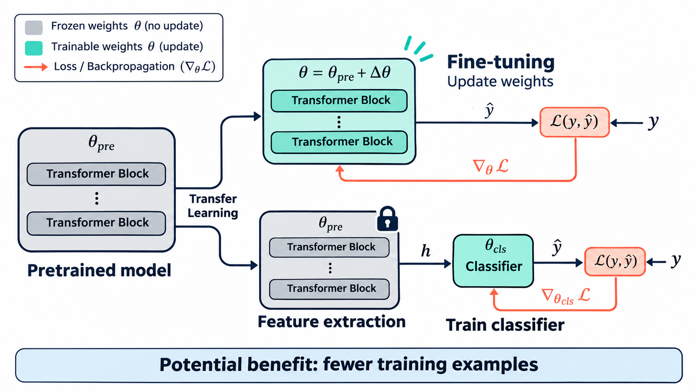
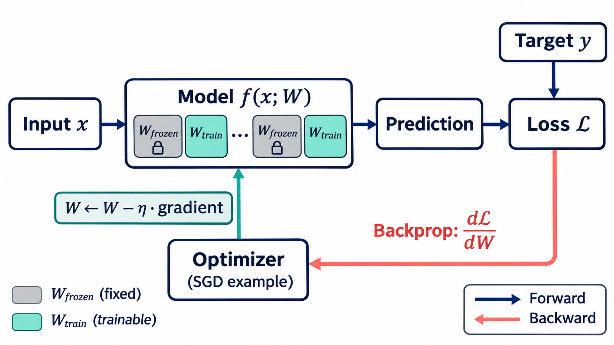
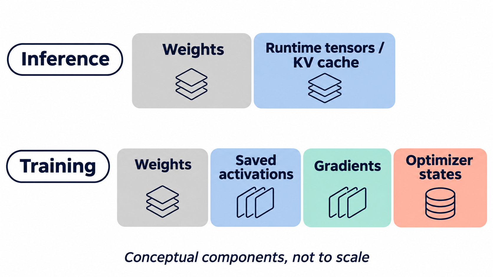
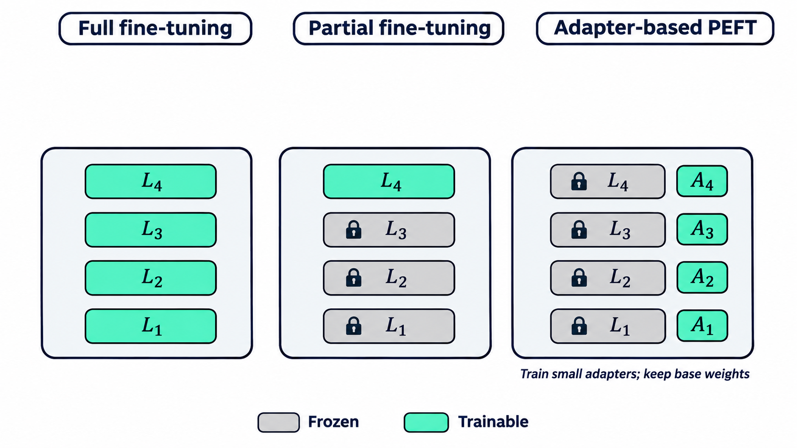
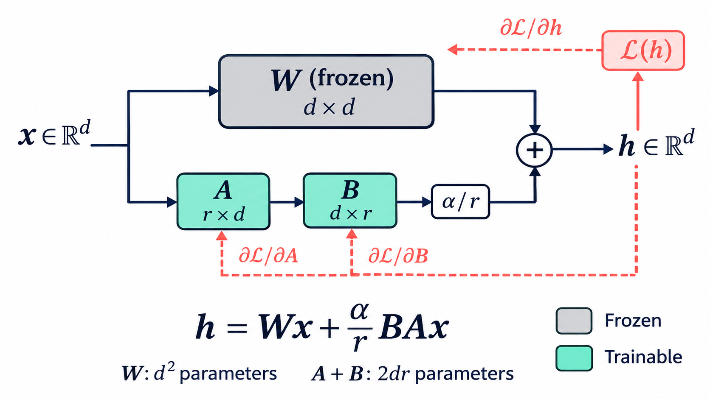
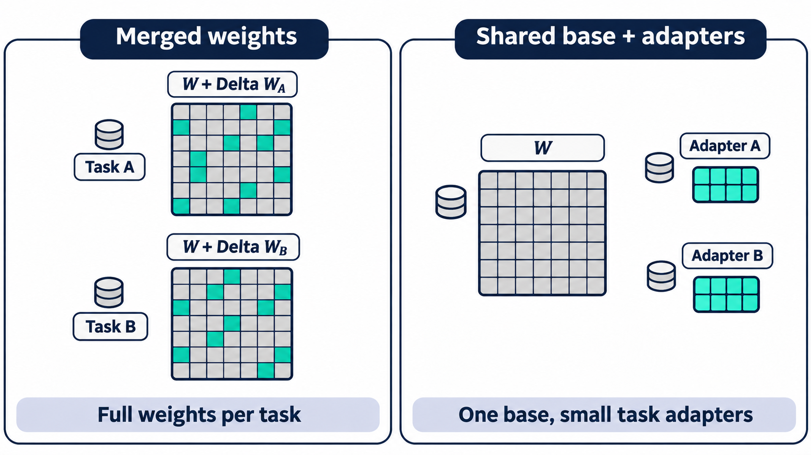
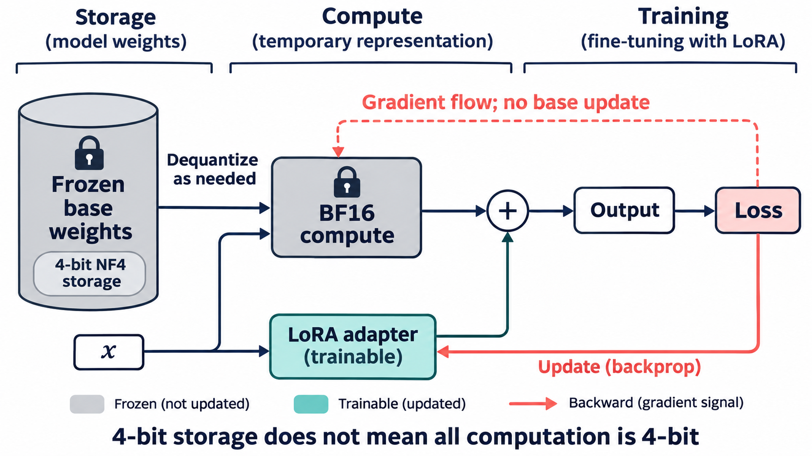

# AI Engineering 7장 — 파인튜닝 발표 내용 구성안

기준 자료: [7장 학습 노트](../../para/resources/note/ai/2026-11-11-ai-engineering-ch7.md), 책 7장 원문 p.307–362.

## 작성 방향

대상은 행렬·미분·경사하강법의 기초를 아는 컴공과 대학생이다. 파인튜닝을 처음 접하는 사람이 **무엇을 바꾸는 학습인지 → 어떤 데이터를 쓰는지 → 실제로 어떻게 갱신하는지 → 비용을 어떻게 줄이는지** 이해하도록 구성한다. 별도 표지 없이 01페이지부터 개념 설명을 시작하며 총 19페이지다.

각 페이지의 ‘개념’과 ‘예시·모식도’가 발표 내용이다. 이어지는 ‘예시 해석’은 그 예시에서 무엇을 읽어내야 하는지 풀어 쓴 설명이다. ‘다음으로’는 앞 개념이 다음 개념을 왜 필요로 하는지 연결하는 말이다. 표나 그림을 제시한 뒤 설명을 생략하지 않는다. 배치·좌표·크기 지시는 두지 않는다.

전이학습은 기존 지식을 새 작업에 활용하는 상위 접근이고, 파인튜닝과 특성 기반 전이는 그 방법이다. 표본효율성은 그 과정에서 개선될 수 있는 성질이다. 파인튜닝 아래에 전이학습을 넣거나, 표본효율성을 별도 학습 기법으로 나열하지 않는다.

고객 문의를 `유형 / 요약`으로 정리하는 작업을 공통 예시로 사용한다. 이후 계산·수치 표현·학습 설정에서는 해당 원리를 확인할 수 있는 별도 예시를 사용한다. 직접 만든 입력·출력, 작은 수치 계산, 모형의 동작은 모두 설명용이며 실제 모델의 실험 결과가 아니다. 설명용 출력은 학습 목표를 보여주는 것이며 달성된 성능을 뜻하지 않는다.

## 전체 흐름

| 페이지 | 설명할 개념 | 이어서 확인할 예시 |
| --- | --- | --- |
| 01 | 파인튜닝의 정의 | 문의 정리 모델의 추가 학습과 사용 |
| 02 | 전이학습·특성 기반 전이·표본효율성 | 같은 기존 모델을 활용하는 두 경로 |
| 03 | 프롬프트·RAG와의 차이 | 지시 부족·정보 부족·행동 문제 |
| 04 | 지속적 사전학습·SFT·선호 학습 | 법률 원문·정답쌍·응답 비교 |
| 05 | 파인튜닝의 이점과 부담 | 작은 모델로 증류, 다른 작업의 성능 저하 |
| 06 | 학습 데이터와 평가 데이터 | 학습하지 않은 문의 표현 |
| 07 | 역전파와 옵티마이저 | 한 가중치를 실제로 갱신하는 계산 |
| 08 | 메모리 병목 | 13B 모델의 가중치·기울기·Adam 상태 |
| 09 | 수치 표현 | FP16·BF16의 범위와 정밀도 차이 |
| 10 | 양자화 | 저장 크기와 반올림 오차 |
| 11 | 전체·부분·PEFT | 같은 모델에서 무엇을 갱신하는가 |
| 12 | 어댑터·소프트 프롬프트 | 작은 모듈과 학습 가능한 입력 벡터 |
| 13 | LoRA의 계산 | 동결된 W와 저랭크 변경분의 합 |
| 14 | LoRA 설정 | r을 바꾸면 달라지는 파라미터 수 |
| 15 | LoRA 서빙 | 작업별 전체 가중치와 공유 기본 모델 |
| 16 | QLoRA | 4비트 저장·BF16 계산·어댑터 갱신 |
| 17 | 다중 작업과 모델 병합 | 순차 학습의 망각·작업 벡터의 결합 |
| 18 | 하이퍼파라미터·과적합 | 갱신 크기·누적 배치·검증 손실 |
| 19 | 실험 설계 | 공통 예시에 방법을 선택하고 검증하기 |

---

## 01. 파인튜닝은 이미 학습된 모델을 추가 학습하는 것이다

**개념**

파인튜닝은 **이미 학습된 모델의 가중치 전체 또는 일부를 추가로 학습해 특정 작업에 맞추는 과정**이다. 언어 능력부터 처음 만드는 대신, 기존 모델에 우리가 원하는 처리 방식과 출력 예시를 더 학습시킨다.

예를 들어 문장을 이해하고 답변할 수 있는 모델을 가져와, 고객 문의를 회사가 정한 유형과 요약으로 바꾸도록 학습할 수 있다. 바뀌는 것은 매번 입력하는 지시만이 아니라 모델의 파라미터다. 여기서는 입력·목표 출력 쌍으로 가르치는 지도 파인튜닝을 먼저 생각한다.

**예시·모식도**

```text
이미 학습된 모델 + 학습 예시
  입력: "배송지를 바꾸고 싶어요"
  목표: "배송지변경 / 주소 변경 요청"
                    ↓ 추가 학습: 가중치 갱신
             작업에 맞춘 모델
                    ↓ 새 문의 입력
  "다른 주소로 보내 주세요"
                    ↓ 목표로 하는 처리
  "배송지변경 / 주소 변경 요청"
```

**예시 해석**

윗부분은 모델을 바꾸는 학습 단계이고, 아랫부분은 학습한 모델을 사용하는 추론 단계다. 추론 요청이 들어올 때마다 다시 학습하는 것은 아니다. 또 학습 예시 한 문장을 외우는 것만으로는 부족하다. 표현이 다른 새 문의에도 같은 분류 기준을 적용하는 것이 목표다.

**다음으로**: 이렇게 적은 작업 예시로 적응을 시도할 수 있는 이유는, 기존 모델이 이미 배운 능력을 재사용하기 때문이다. 이를 전이학습이라는 관점에서 보자.

**근거**: 노트 개요·7.1.

---

## 02. 파인튜닝은 전이학습을 구현하는 한 방법이다

**개념**

**전이학습**은 한 작업에서 얻은 지식을 관련된 다른 작업에 활용하는 접근이다. 파인튜닝은 기존 모델을 추가 학습하는 방법이고, **특성 기반 전이**는 기존 모델이 추출한 표현을 다른 모델의 입력으로 쓰는 방법이다.

기존 능력을 활용해 같은 성능에 필요한 학습 예시가 줄어들면 **표본효율성이 높아졌다**고 한다. 표본효율성은 전이학습과 같은 종류의 기법이 아니라 학습의 데이터 효율을 나타내는 성질이다.

**예시·모식도**



문의 분류를 만든다고 할 때 두 경로를 비교한다.

| 경로 | 기존 모델의 역할 | 새 작업에서 학습하는 것 |
| --- | --- | --- |
| 파인튜닝 | 문의를 이해하고 분류하는 모델로 적응 | 기존 가중치 일부·전체 또는 추가 파라미터 |
| 특성 기반 전이 | 문의를 임베딩 벡터로 변환 | 벡터를 받아 유형을 고르는 별도 분류기 |

**예시 해석**

특성 기반 전이에서는 기존 모델을 고정하고 `문의 → 임베딩 → 분류기`로 연결할 수 있다. 분류기의 파라미터는 학습하지만 기존 추출기를 반드시 바꿔야 하는 것은 아니다. 파인튜닝은 기존 모델 쪽의 표현·동작까지 작업에 맞게 조정할 수 있다. 둘 다 기존 지식을 사용한다는 점에서 전이학습이다.

**다음으로**: 기존 모델을 작업에 맞춘다고 해서 항상 학습해야 하는 것은 아니다. 입력을 조정하는 프롬프트·RAG와 비교해 보자.

**근거**: 노트 7.1 전이학습·특성 기반 전이·표본효율성.

---

## 03. 입력을 바꾸는 방법과 가중치를 바꾸는 방법을 구분한다

**개념**

프롬프트는 지시와 예시를 입력에 넣고, RAG는 검색한 참고 자료를 입력에 넣는다. 두 방법은 모델의 가중치를 갱신하지 않는다. 파인튜닝은 예시를 이용한 학습으로 가중치를 바꾼다.

선택할 때는 결과가 틀렸다는 사실만 보지 말고 **무엇이 부족해서 틀렸는지** 확인한다. 정보가 없는 문제와, 정보를 줘도 원하는 방식으로 처리하지 못하는 문제는 개선 방법이 다를 수 있다.

**예시·모식도**

| 문제 상황 | 먼저 시도할 것 | 이유 |
| --- | --- | --- |
| 문의에 답변만 하고 유형을 안 붙임 | 프롬프트에 유형·예시 명시 | 요구가 불명확했을 수 있음 |
| 바뀐 반품 정책을 모름 | 최신 정책을 검색해 제공 | 필요한 사실이 없음 |
| 지시·예시를 개선해도 사내 분류 기준을 반복해서 틀림 | 정답 데이터로 파인튜닝 검토 | 작업 수행 방식의 학습 필요 가능성 |

**예시 해석**

두 번째 상황에서 정책을 가중치에 학습시켜도 다음 정책 변경을 자동으로 알지는 못한다. 반대로 올바른 정책을 검색했다고 사내 분류 기준을 반드시 따르는 것도 아니다. 두 문제가 함께 있으면 RAG와 파인튜닝을 결합할 수 있다. 실제 주문 상태처럼 실시간 값이 필요하면 조회 도구 연결도 고려한다.

**다음으로**: 가중치를 추가 학습하기로 했다면, 무엇을 배우게 하느냐에 따라 데이터 형식도 달라진다.

**근거**: 노트 7.2.3.

---

## 04. 원문·정답쌍·선호 비교는 서로 다른 학습 신호다

**개념**

파인튜닝은 한 종류의 데이터로만 하는 학습이 아니다. **지속적 사전학습**은 관련 원문으로 자기지도학습을 이어 가고, **지도 파인튜닝(SFT)**은 입력과 목표 출력의 쌍으로 작업 수행을 학습한다. **선호 파인튜닝**은 같은 지시에 대해 어떤 응답이 더 나은지 비교한 정보를 활용한다.

이들을 모든 모델이 거쳐야 하는 필수 순서로 이해하지 않는다. 학습 목적과 가지고 있는 데이터에 맞게 선택하거나 조합한다.

**예시·모식도**

법률 보조 모델을 만든다고 가정한다.

| 방법 | 학습 데이터 예시 | 가르치려는 것 |
| --- | --- | --- |
| 지속적 사전학습 | 법률·판결문 원문 | 법률 표현과 문서의 패턴 |
| SFT | 질문 + 근거를 설명하는 답변 | 질문에 답하는 방식 |
| 선호 학습 | 같은 질문 + 근거가 명확한 답 / 근거 없는 단정 | 어떤 응답을 더 선호할지 |

**예시 해석**

판결문을 많이 읽히는 것만으로 질문에 답하는 형식까지 충분히 학습된다고 보장할 수 없다. 반대로 질문·답변 쌍은 처음부터 원문의 모든 지식을 체계적으로 가르치는 방식도 아니다. 인필링은 앞뒤 문맥으로 중간을 채우는 과제, 롱컨텍스트 학습은 더 긴 입력을 다루는 목표로, 위 데이터 분류와 다른 축이다.

**다음으로**: 목적에 맞는 학습을 할 수 있다 해도, 그 투자가 필요한지는 따로 판단해야 한다.

**근거**: 노트 7.1.

---

## 05. 특정 작업의 개선에는 데이터와 운영 비용이 따른다

**개념**

파인튜닝은 응답 방식·도메인 작업·편향을 조정하는 데 활용할 수 있다. 큰 모델의 응답으로 작은 모델을 학습하는 **증류**도 중요한 활용이다. 특정 작업의 품질을 확보하면서 추론 비용을 줄이려는 목적이다.

그러나 특정 작업을 더 잘하게 되면서 다른 작업이 나빠질 수 있다. 학습 데이터 확보뿐 아니라 학습한 모델의 서빙·평가·업데이트까지 필요하므로, 프롬프트로 충분한 작업에도 무조건 적용하지 않는다.

**예시·모식도**

- **증류**: 강한 모델로 문의별 정답 유형·요약을 생성하고 검수한다. 이 데이터로 작은 모델을 학습해 같은 작업을 더 저렴하게 처리할 수 있는지 비교한다.
- **다른 작업의 성능 저하**: 주문 변경 예시만 집중 학습한 뒤 주문 변경은 좋아져도, 원래 잘하던 상품 추천이 나빠질 수 있다.
- **편향 완화**: CEO를 남성 이름으로만 표현하던 모델에 다양한 성별의 CEO 사례를 학습시켜 응답 편향의 변화를 평가한다.

**예시 해석**

좋아져야 할 작업과 유지돼야 할 작업을 함께 평가해야 한다. 증류 데이터에는 큰 모델의 오류가 들어갈 수 있고, 편향 완화 데이터도 선별 기준에 따라 새 편향을 만들 수 있다. ‘학습을 했다’는 사실보다 실제 품질·비용 변화가 선택의 근거다.

**다음으로**: 그러면 원하는 행동을 보여주는 데이터는 어떻게 만들고, 효과는 무엇으로 확인할까?

**근거**: 노트 7.2.1~7.2.2.

---

## 06. 원하는 행동을 예시로 보여주고, 다른 예시로 확인한다

**개념**

SFT의 학습 예시는 `입력 → 목표 출력` 쌍이다. 목표 출력은 모델이 실제로 해야 하는 행동을 보여줘야 한다. 유형 이름과 요약 기준이 예시마다 달라지면 모델에도 일관되지 않은 학습 신호를 준다.

학습 데이터와 평가 데이터는 분리한다. 학습에 쓴 문장을 잘 재현하는지보다, 새로운 입력에서도 같은 기준으로 처리하는지를 확인해야 한다.

**예시·모식도**

| 용도 | 입력 | 목표 출력 |
| --- | --- | --- |
| 학습 | 도착일이 언제인가요? | 배송조회 / 도착일 문의 |
| 학습 | 주소를 바꾸고 싶어요 | 배송지변경 / 주소 변경 요청 |
| 평가 | 며칠에 받을 수 있나요? | 배송조회 / 도착일 문의 |
| 평가 | 받는 곳을 회사로 해 주세요 | 배송지변경 / 수령 주소 변경 요청 |

**예시 해석**

학습 예시의 ‘주소를 바꾼다’와 평가 예시의 ‘받는 곳을 회사로 한다’는 표현은 다르지만 같은 처리 기준에 속한다. 이런 일반화가 되는지 확인한다. 실제 평가에는 애매한 문의와 다른 유형도 넣어야 하며, 설정 선택용 검증셋과 최종 평가셋의 역할도 구분한다.

**다음으로**: 이제 입력·목표 출력 한 쌍이 어떻게 가중치를 바꾸는지 계산 과정을 보자.

**근거**: 노트 7.1 SFT·7.2.3 평가·7.4.3 과적합. 데이터는 설명용.

---

## 07. 역전파는 기울기를 계산하고, 옵티마이저는 가중치를 바꾼다

**개념**

순방향 계산으로 예측값을 만들고 목표와 비교해 손실을 구한다. 역전파는 연쇄법칙으로 각 학습 가능한 파라미터에 대한 손실의 기울기를 계산한다. 옵티마이저는 그 기울기와 학습률 등을 이용해 가중치를 갱신한다.

언어모델의 SFT에서는 목표 응답의 토큰 예측 손실을 사용한다. 아래 작은 회귀 계산은 그 갱신 원리만 확인하기 위한 예시다.

**예시·모식도**



`ŷ = wx`, `L = (ŷ − y)²`, 입력 `x=2`, 목표 `y=4`, 초기 `w=1`로 둔다.

| 단계 | 계산 |
| --- | --- |
| 예측·손실 | `ŷ=2`, `L=(2−4)²=4` |
| 기울기 | `∂L/∂w = 2(wx−y)x = −8` |
| SGD 갱신 | `η=0.1`일 때 `w=1−0.1×(−8)=1.8` |
| 갱신 후 | `ŷ=3.6`, `L=(3.6−4)²=0.16` |

**예시 해석**

손실을 줄이는 방향으로 가중치가 바뀌었다. 실제 모델은 파라미터가 많고 Adam 같은 옵티마이저를 사용하지만, 기울기 계산과 갱신을 구분하는 원리는 같다. 동결한 가중치는 갱신하지 않아도 다른 학습 대상으로 기울기를 전달하는 경로 계산은 필요할 수 있다.

**다음으로**: 이 과정에서는 가중치뿐 아니라 기울기와 갱신에 필요한 상태도 저장해야 한다.

**근거**: 노트 7.3.1. 수치 계산은 원리를 설명하는 별도 예시.

---

## 08. 학습할 파라미터마다 추가 메모리가 붙는다

**개념**

추론에는 가중치와 실행 중 계산값·KV 캐시 등의 메모리가 필요하다. 학습에는 여기에 역전파용 활성값, 기울기, 옵티마이저 상태가 추가된다. Adam은 학습 가능한 파라미터마다 상태 두 개를 저장한다.

따라서 전체 파라미터 수뿐 아니라 **몇 개를 학습할지**가 메모리에 영향을 준다. 모델이 GPU에 올라간다고 전체 파인튜닝까지 가능한 것은 아니다.

**예시·모식도**



13B 모델에서 가중치·기울기·Adam 상태를 각각 2바이트로 저장한다고 가정한다.

| 항목 | 전체 13B 학습 | 1B만 학습 |
| --- | --- | --- |
| 전체 가중치 | 26GB | 26GB |
| 기울기 + Adam 상태 둘 | `13B×3×2 = 78GB` | `1B×3×2 = 6GB` |
| 활성값 제외 합계 | 104GB | 32GB |

**예시 해석**

학습 대상을 줄이면 기울기·상태는 줄지만 전체 가중치는 여전히 필요하다. 위 값은 십진 GB 기준의 단순화된 계산이며 실제로는 활성값과 FP32 사본·상태 등으로 더 필요할 수 있다. 체크포인팅은 활성값 일부를 다시 계산해 메모리를 줄이고, 오프로딩은 CPU 메모리를 활용한다.

**다음으로**: 메모리를 줄이는 방법을 두 축으로 볼 수 있다. 먼저 값 하나를 저장하는 비트 수를 줄이는 방법부터 보자.

**근거**: 노트 7.3.1~7.3.2.

---

## 09. 수치 표현은 범위와 정밀도를 나눠 갖는다

**개념**

부동소수점은 부호·지수·유효숫자로 값을 표현한다. 지수 비트는 표현 범위에, 유효숫자 비트는 값을 얼마나 세밀하게 구분하는지에 영향을 준다. 같은 16비트인 FP16과 BF16도 이 배분이 다르다.

비트 수를 줄이면 저장 공간은 줄지만 값이 반올림되거나 범위를 벗어날 수 있다. 모델을 같은 비트 수의 다른 형식으로 바꾸는 것도 동작에 영향을 줄 수 있다.

**예시·모식도**

| 형식 | 저장 크기 | 지수 / 유효숫자 부분 |
| --- | --- | --- |
| FP32 | 4바이트 | 8 / 23비트 |
| FP16 | 2바이트 | 5 / 10비트 |
| BF16 | 2바이트 | 8 / 7비트 |

- `1234.56789`는 FP16에서 약 `1235`, BF16에서 약 `1232`가 된다.
- 더 큰 `123456.789`는 FP16의 범위를 넘어 무한대로 변환될 수 있지만 BF16에서는 근사값으로 표현할 수 있다.

**예시 해석**

첫 숫자에서는 FP16이 더 세밀하지만, 두 번째 숫자에서는 BF16의 넓은 범위가 유리하다. 그러므로 ‘둘 다 2바이트니까 같겠지’라고 바꿀 수 없다. 가중치·활성값의 분포와 하드웨어 지원을 함께 고려해야 한다.

**다음으로**: 이런 표현의 차이를 이용해 모델의 저장·실행 비용을 줄이는 것이 양자화다.

**근거**: 노트 7.3.3, 원문 표 7-3.

---

## 10. 양자화는 메모리를 줄이는 대신 오차를 관리하는 일이다

**개념**

이 장은 높은 정밀도의 값을 적은 비트의 표현으로 바꾸는 방법을 넓게 양자화라고 부른다. 가중치나 활성값 등을 대상으로 하며, 줄어든 비트 수만큼 저장 공간을 아낄 수 있다.

학습이 끝난 뒤 바꾸는 PTQ와, 학습 중 양자화의 영향을 모사하는 QAT는 목적과 시점이 다르다. QAT는 낮은 정밀도에서의 추론 품질을 준비하며, 학습 계산 자체가 낮은 정밀도라는 뜻은 아니다.

**예시·모식도**

10B 가중치만 저장하는 단순 계산이다.

| 표현 | 가중치 저장 공간 |
| --- | --- |
| FP32 | `10B×4바이트 = 40GB` |
| 16비트 | `10B×2바이트 = 20GB` |
| 4비트 | `10B×0.5바이트 = 5GB` + 부가 정보 |

오차의 개념 예시로, 간격 `0.1`의 표현에 `0.126`을 반올림하면 `0.1`이 된다. 실제 양자화는 표현 형식과 스케일 등에 따라 다르게 매핑한다.

**예시 해석**

메모리는 줄었지만 원래 값이 정확하게 유지되지는 않는다. 수많은 값의 변화가 작업 품질에 미치는 영향을 평가해야 한다. 변환 비용과 연산 지원 때문에 낮은 비트 수가 항상 더 빠른 실행을 뜻하지도 않는다. 학습에서는 민감한 연산을 높은 정밀도로 유지하는 혼합 정밀도를 사용할 수 있다.

**다음으로**: 값당 비트 수를 줄이는 것 외에, 갱신할 값의 개수를 줄이는 방법도 있다.

**근거**: 노트 7.3.4. 저장 공간은 메타데이터·실행 메모리를 제외한 계산.

---

## 11. 전체·부분·PEFT는 학습 대상을 다르게 정한다

**개념**

전체 파인튜닝은 기존 모델의 모든 가중치를 갱신한다. 부분 파인튜닝은 기존 층이나 파라미터 일부만 선택해 갱신한다. **PEFT**는 훨씬 적은 학습 가능한 파라미터로 작업에 효과적으로 적응하려는 접근이다.

PEFT의 관심은 단순히 일부만 학습하는 데서 끝나지 않는다. 작은 학습 대상에 작업별 변화를 어떻게 표현해 충분한 성능을 얻을지가 중요하다.

**예시·모식도**



같은 기본 모델로 문의 분류를 학습한다고 가정한다.

| 방식 | 학습 대상 |
| --- | --- |
| 전체 | 모델의 모든 기존 층 |
| 부분 | 마지막 층 등 선택한 기존 부분 |
| 어댑터 기반 PEFT | 기존 가중치는 고정하고 작은 모듈 |

**예시 해석**

부분 학습에서 마지막 층만 바꾸는 것과, 여러 층에 작은 학습 모듈을 두는 것은 표현할 수 있는 변화가 다르다. PEFT는 적은 수의 학습 대상으로 유용한 변화를 만들도록 설계한다. 오른쪽 그림은 어댑터 기반 예시이며 모든 PEFT가 새 모듈을 넣는 것은 아니다.

**다음으로**: 작은 학습 대상을 모델 내부에 둘 수도 있고, 입력 쪽의 벡터로 둘 수도 있다.

**근거**: 노트 7.4.1.

---

## 12. 작은 모듈을 학습하거나, 입력 벡터를 학습한다

**개념**

어댑터 기반 방법은 모델 내부에 작은 모듈이나 가중치 변경분을 학습한다. 소프트 프롬프트 기반 방법은 입력이나 중간 층에 주는 연속 벡터를 학습한다. 기존 모델의 가중치는 대체로 고정한다.

소프트 프롬프트는 사람이 읽는 지시문을 고쳐 쓰는 것과 다르다. 벡터 값 자체를 역전파로 조정하기 때문에 자연어로 읽을 수 없는 학습 파라미터다.

**예시·모식도**

```text
하드 프롬프트
  "문의를 유형 / 요약으로 정리해" + 고객 문의 → 모델
  사람이 텍스트를 수정

소프트 프롬프트
  [학습 벡터 v1, v2, ...] + 고객 문의의 임베딩 → 동결된 모델
  역전파로 v1, v2, ...를 갱신

어댑터
  고객 문의 → 동결된 모델의 층 + 작은 학습 모듈 → 출력
  작은 모듈의 가중치를 갱신
```

**예시 해석**

소프트 프롬프트도 모델 동작을 유도하지만 학습 대상은 입력 쪽 벡터다. Prompt tuning은 입력 임베딩 앞에 벡터를 붙이고, Prefix-tuning은 각 층에 접두 정보를 넣는다. 초기 병목 어댑터는 추가 연산이 필요하다. LoRA는 변경분을 기존 가중치에 합칠 수 있게 만드는 어댑터 계열 방법이다.

**다음으로**: LoRA가 큰 가중치의 변경분을 어떻게 작은 파라미터로 표현하는지 보자.

**근거**: 노트 7.4.1 PEFT 기법들.

---

## 13. LoRA는 원래 가중치를 유지하고 저랭크 변경분을 더한다

**개념**

LoRA는 가중치 행렬 `W`를 동결하고, 그 위에 더할 변경분을 작은 두 행렬의 곱으로 학습한다. 열벡터 입력에서 `W ∈ R^(d×d)`, `A ∈ R^(r×d)`, `B ∈ R^(d×r)`라면 `W′ = W + (α/r)BA`다.

`r`을 `d`보다 작게 두면 학습 대상은 기존 행렬의 `d²`개 대신 `A·B`의 `2dr`개가 된다. W를 작은 행렬로 대체하는 것이 아니라 W에 더할 변화의 자유도를 제한한다.

**예시·모식도**



작게 `d=4`, `r=1`, `α/r=1`로 두면 다음과 같다.

```text
W: 4×4 → 16개 값, 동결
A: 1×4 →  4개 값, 학습
B: 4×1 →  4개 값, 학습

h = Wx + BAx
학습하는 값은 16개 대신 8개
```

**예시 해석**

입력은 원래 W 경로와 A·B 경로를 함께 지나고 두 결과가 더해진다. 역전파로 A·B를 바꾸면 출력도 바뀌지만 W의 값은 유지된다. 사전학습으로 얻은 능력을 조정하는 데 필요한 변화가 적은 자유도로 표현될 수 있다는 점을 활용한다. 단, 모든 작업의 변화가 낮은 랭크로 충분하다고 보장되지는 않는다.

**다음으로**: 실제 행렬에서는 얼마나 줄어들고, 랭크를 바꾸면 무엇이 달라질까?

**근거**: 노트 7.4.1 LoRA. 노트의 AB와 행렬 이름·차원 배치만 다른 표기.

---

## 14. LoRA의 랭크와 적용 위치는 학습 예산을 정한다

**개념**

LoRA에서는 어떤 가중치 행렬에 적용할지, 랭크 `r`을 얼마로 할지, 변경분의 스케일 `α/r`을 얼마로 할지 고른다. r이 크면 더 많은 변화를 표현할 수 있지만 학습 파라미터와 상태 메모리도 늘어난다.

적용할 행렬을 늘리는 것과 한 행렬의 r을 높이는 것은 서로 다른 선택이다. 같은 예산을 어디에 배분하는지가 성능에 영향을 준다.

**예시·모식도**

`4096×4096` 행렬 하나에 적용한다.

| 설정 | 학습 가능한 값 수 |
| --- | --- |
| 전체 행렬 | `4096² = 16,777,216` |
| LoRA r=8 | `2×4096×8 = 65,536` |
| LoRA r=16 | `2×4096×16 = 131,072` |

예를 들어 Q·V에 적용할지, Q·K·V·O와 피드포워드까지 적용할지도 선택한다. 같은 `α=16`이면 r=8의 스케일은 2, r=16의 스케일은 1이다.

**예시 해석**

r을 두 배로 하면 이 행렬의 학습 대상도 두 배가 되지만 품질이 두 배가 되는 것은 아니다. α를 고정하면 스케일도 바뀌므로 r만 따로 보지 않는다. 검증 데이터로 적용 범위·r·α를 함께 비교한다. 이 수치는 전체 모델의 저장 공간이 아니라 행렬 하나의 학습 대상 수다.

**다음으로**: 학습한 변경분은 그대로 따로 둘 수도, 기존 가중치에 합칠 수도 있다.

**근거**: 노트 7.4.1 LoRA 구성.

---

## 15. 하나만 서빙할 때와 여러 작업을 서빙할 때는 선택이 다르다

**개념**

학습한 변경분을 W에 미리 더하면 `W′` 하나로 실행할 수 있어 어댑터의 추가 추론 연산이 없다. 반대로 W와 어댑터를 분리하면 같은 기본 모델을 공유하면서 작업별 변경분을 선택할 수 있다.

분리 방식은 여러 작업·고객의 모델을 저장하고 바꾸는 데 유리할 수 있지만, 실행 중 어댑터 계산과 이를 지원하는 서빙 구현이 필요하다.

**예시·모식도**



```text
문의 분류와 문장 요약, 두 작업을 운영

미리 병합: [기본 모델+분류 변경분] / [기본 모델+요약 변경분]
분리 유지: [공유 기본 모델] + [분류 어댑터] 또는 [요약 어댑터]
```

**예시 해석**

첫 방식은 작업마다 전체 가중치를 저장한다. 둘째 방식은 큰 기본 가중치를 공유하고 작은 변경분만 작업별로 둔다. 분류에서 요약으로 바꿀 때 전체 모델 대신 어댑터만 교체할 수 있다. 어댑터는 호환되는 기본 모델에 적용해야 하며, 두 어댑터를 무조건 차례로 통과시키는 구조가 아니다.

**다음으로**: 어댑터가 작아도 기본 가중치 W의 메모리가 여전히 크다. 여기에 양자화를 결합하면 어떨까?

**근거**: 노트 7.4.1 LoRA 어댑터 서빙.

---

## 16. QLoRA는 기본 가중치를 작게 저장하고 LoRA를 학습한다

**개념**

QLoRA는 기본 가중치를 4비트 NF4로 저장해 동결하고, 필요한 계산에서는 BF16으로 역양자화해 사용하면서 LoRA 어댑터를 학습한다. LoRA가 학습 대상 수를 줄인다면 QLoRA는 큰 기본 가중치의 저장 비용도 줄인다.

저장 정밀도와 계산 정밀도를 구분해야 한다. ‘4비트 모델로 파인튜닝한다’는 말이 모든 학습 연산을 4비트로 한다는 뜻은 아니다.

**예시·모식도**



```text
기본 가중치: NF4로 저장, 갱신하지 않음
           ↓ 필요한 부분을 역양자화
입력 → BF16으로 계산하는 기본 경로 ─┐
입력 → 학습 가능한 LoRA 경로 ─────┴→ 출력·손실
                                      ↓
                             어댑터 가중치 갱신
```

**예시 해석**

10페이지의 양자화와 13페이지의 작은 학습 경로를 결합한 것이다. NF4는 가중치 분포를 고려하는 표현으로 INT4와 다르다. 페이지드 옵티마이저는 메모리 급증을 다룬다. 변환에 추가 시간이 들 수 있으므로 메모리 절감과 학습 속도를 함께 측정한다. 책의 65B·48GB 결과는 해당 실험 설정에서의 사례다.

**다음으로**: 여러 작업에 맞춘 모델이 생기면, 이를 각각 운영할지 결합할지도 고민하게 된다.

**근거**: 노트 7.4.1 양자화된 LoRA.

---

## 17. 여러 작업은 함께 배우거나, 따로 배워 합칠 수 있다

**개념**

다중 작업을 지원하려면 여러 작업의 데이터를 섞어 학습하거나, 작업을 순서대로 학습하거나, 같은 기본 모델에서 작업별로 학습한 결과를 병합할 수 있다. 순차 학습에는 이전 작업을 잊는 **파국적 망각**이, 병합에는 변경분 간 간섭이 생길 수 있다.

모델 병합은 가중치·층 등을 결합한다. 여러 모델을 각각 실행하고 출력을 합치는 앙상블과 구분한다.

**예시·모식도**

```text
동시 학습: [문의 분류 데이터 + 요약 데이터] → 한 모델 학습
순차 학습: 기본 모델 → 분류 학습 → 요약 학습
작업별 병합: 기본 모델 → 분류 모델 ─┐
                    → 요약 모델 ─┴→ 병합 모델
```

변경분의 결합만 보는 두 파라미터 예시다.

```text
기본 W₀ = (1, 1)
작업 A의 W_A = (1.4, 1)   → 변경분 τ_A = (0.4, 0)
작업 B의 W_B = (1, 1.6)   → 변경분 τ_B = (0, 0.6)
W₀ + τ_A + τ_B = (1.4, 1.6)
```

**예시 해석**

이 차이를 작업 벡터라고 한다. 예시는 변경 방향이 겹치지 않는 단순한 경우이며 실제 능력이 정확히 더해진다는 보장은 없다. 같은 좌표를 반대 방향으로 바꾸면 간섭할 수 있다. 평균·SLERP·가지치기 같은 방법은 이런 결합을 다루고, 레이어 쌓기·연결은 구조나 파라미터 수까지 바꿀 수 있다. 병합 후에도 작업별 평가가 필요하다.

**다음으로**: 어떤 방식으로 학습하든 갱신 크기와 데이터 반복을 조절하고 과적합을 관찰해야 한다.

**근거**: 노트 7.4.2. 파라미터 두 개는 설명용 계산.

---

## 18. 학습 설정은 손실과 검증 결과를 보며 고른다

**개념**

학습률은 갱신 크기, 배치 크기는 한 갱신에 반영할 예시 수, 에폭은 전체 데이터를 반복하는 횟수를 정한다. 메모리가 부족하면 여러 미니배치의 기울기를 누적한 뒤 한 번 갱신할 수 있다.

학습 손실이 내려가는 것만으로 성공을 판단하지 않는다. 검증 손실이 함께 좋아지는지 확인해야 하며, 학습 손실은 내려가는데 검증 손실이 오르면 과적합을 의심한다.

**예시·모식도**

- **학습률**: 07페이지의 기울기 −8에서 η=0.1이면 w가 0.8만큼, η=0.01이면 0.08만큼 바뀐다. 한 번의 갱신 크기가 다르다.
- **기울기 누적**: 단일 장비에서 예시 2개씩 8회 처리한 뒤 갱신하면 한 갱신에 16개 예시의 신호를 반영한다.
- **과적합의 설명용 관찰**:

| 에폭 | 학습 손실 | 검증 손실 |
| --- | --- | --- |
| 1 | 1.0 | 1.1 |
| 2 | 0.7 | 0.8 |
| 3 | 0.5 | 0.9 |

**예시 해석**

3에폭에서 학습 예시는 더 잘 맞히지만 검증 결과는 나빠졌다. 이 경우 더 반복하기보다 앞선 체크포인트를 검토한다. 실제 수치·최적 횟수는 작업별로 다르다. 프롬프트 손실 가중치는 입력 토큰의 예측 손실 비중을 정한다. 0으로 해도 프롬프트는 응답을 만드는 문맥으로 사용하며 입력 자체를 지우는 것은 아니다.

**다음으로**: 이제 문의 정리 작업을 실제로 시작한다면 어떤 판단과 실험을 할지 연결해 보자.

**근거**: 노트 7.4.3. 손실 수치는 실제 실험이 아닌 설명용.

---

## 19. 첫 실험은 문제 원인과 기준 성능을 확인하는 데서 시작한다

**개념**

파인튜닝은 목적이 아니라 작업 품질을 개선하는 선택지다. 평가셋과 현재 성능을 먼저 확보하고, 오류가 정보 부족인지 행동 문제인지 분류한다. 학습이 필요하다면 좋은 예시와 적절한 기본 모델로 작은 실험을 한다.

학습한 모델은 같은 평가 기준으로 기존 방식과 비교한다. 품질 개선뿐 아니라 유지돼야 할 능력, 서빙 비용, 유지보수까지 감당할 수 있는지 보고 채택한다.

**예시·모식도**

고객 문의 정리 작업에 지금까지의 개념을 적용한다.

| 관찰·준비 상태 | 다음 행동 |
| --- | --- |
| 유형과 요약을 지시하니 충분히 잘함 | 프롬프트 방식 유지 |
| 정책을 몰라 잘못 분류함 | 관련 자료 검색·조회 연결 |
| 예시를 줘도 분류 기준을 반복해서 틀림 | 검수된 정답쌍으로 작은 SFT 실험 |
| 메모리 예산이 작음 | LoRA·QLoRA 등 비교 |
| 새 모델이 평가셋에서 좋아짐 | 다른 작업의 회귀·서빙 비용까지 확인 |

**예시 해석**

코드가 도는지 검증할 때는 싼 모델을, 작업의 가능성을 탐색할 때는 강한 모델을 사용할 수 있다. API는 시작이 쉽지만 지원 모델·설정에 제약이 있고 직접 프레임워크를 쓰면 자원 운영을 맡아야 한다. 어떤 경로든 개선 근거는 학습 여부가 아니라 새로운 입력에 대한 평가다.

**마무리**: 파인튜닝은 이미 배운 모델의 가중치를 작업 예시로 조정하는 학습이다. 무엇을 학습할지, 어떤 비용을 줄일지, 효과를 무엇으로 확인할지를 함께 정해야 한다.

**근거**: 노트 7.2.3·7.4.3.

---

## 그림 원본

그림은 내장 이미지 생성 도구로 만든 개념 설명용 PNG이며, 원문 실험 결과를 나타내는 정량 그래프가 아니다. 위 각 페이지에 예시와 함께 삽입했다. 생성 프롬프트는 [생성 기록](ch7-images/generation-prompts.json)에 남겨 두었다.

| 그림 | 파일 |
| --- | --- |
| 전이학습 | [02-transfer-learning.png](ch7-images/02-transfer-learning.png) |
| 역전파 | [07-backpropagation.png](ch7-images/07-backpropagation.png) |
| 메모리 항목 | [08-training-memory-v2.png](ch7-images/08-training-memory-v2.png) |
| 전체·부분·PEFT | [11-full-partial-peft-v2.png](ch7-images/11-full-partial-peft-v2.png) |
| LoRA | [13-lora.png](ch7-images/13-lora.png) |
| LoRA 서빙 | [15-lora-serving-v2.png](ch7-images/15-lora-serving-v2.png) |
| QLoRA | [16-qlora.png](ch7-images/16-qlora.png) |
