# 통키 아이디어 — 단계별 모식도 · 목업

- 작성 2026-11-12 · **아이디어 문서**다. 구현 · 일정 · 결정은 다루지 않는다. 목업은 「이런 모습」을 보여 주는 와이어프레임이다.
- 단계 정의는 사용자 말 그대로(§1). 정해지지 않은 곳은 **선택지 목업**으로 나란히 그렸다(§6 목록).
- 목업 속 한국어 · 외국어 문장은 전부 **가짜 일반 예시**다. 방 이름 · 동선 단계도 일반적인 피부과 흐름을 **예시**로 그렸다(특정 병원 데이터 아님).
- 원가 · 요금은 여기서 다루지 않는다 → `pricing-design.md`.
- 그림 생성: `orchestration/work/interpreter-idea/idea-src/make_svgs.py`
- 원천: 지금 통키 화면 = 코드 `interpret-pwa/front` main `17c26b5`(`components/interpret/*`) · 설계 `para/projects/summer-star/interpret-pwa/10-decision/decision-001-interpret-pwa.md` / 외부 제안서 2건(호텔 · 의료관광)은 아이디어만 — 쪽 번호로 출처(§5) / 대표 대화(코디 요약): 「원격으로 — 환자가 방에서 말하고 로비에서 듣는 것」

## 1. 요약 — 단계별 한 줄

| 단계 | 한 줄 |
|---|---|
| **0 · 지금** | 통역앱 — 마주 보고 통역(기기 1대) |
| **1단계** | 통역 + **원격 통역**. **QR 1단계** — QR = **고객 화면**: 고객이 QR 을 찍으면 자기 폰이 고객 쪽 통역 화면이 된다. 고객은 방에서 말하고 직원은 로비에서 듣고 답한다 |
| **2단계** | 통역 + 원격 통역 + **오늘 피부과 동선 안내 · 호출**. **QR 2단계** — 같은 고객 화면에 동선 안내 · 호출이 더해진다. **병원 CRM 연동 필수**(고객별 오늘 동선 · 지금 단계를 CRM 에서 받음) |

## 2. 0 · 지금 — 마주 보고 통역(기기 1대)

### 모식도

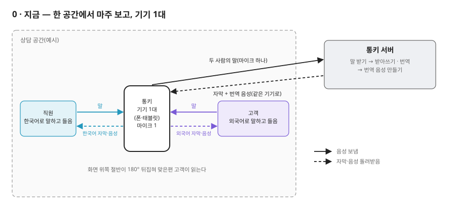

- 누가 · 어디서: 직원과 고객이 **같은 공간에서 마주 본다**. 기기 1대(폰 · 태블릿)를 사이에 둔다.
- 말이 가는 길: 두 사람의 말이 **같은 마이크 하나**로 통키 서버에 가고, 서버가 받아쓰기 · 번역 · 번역 음성을 만들어 **같은 기기**로 돌려준다. 번역 음성이 나오는 동안은 마이크를 멈춘다(반이중 — decision D-03).

### 화면 목업 — 지금 통키 통역 화면

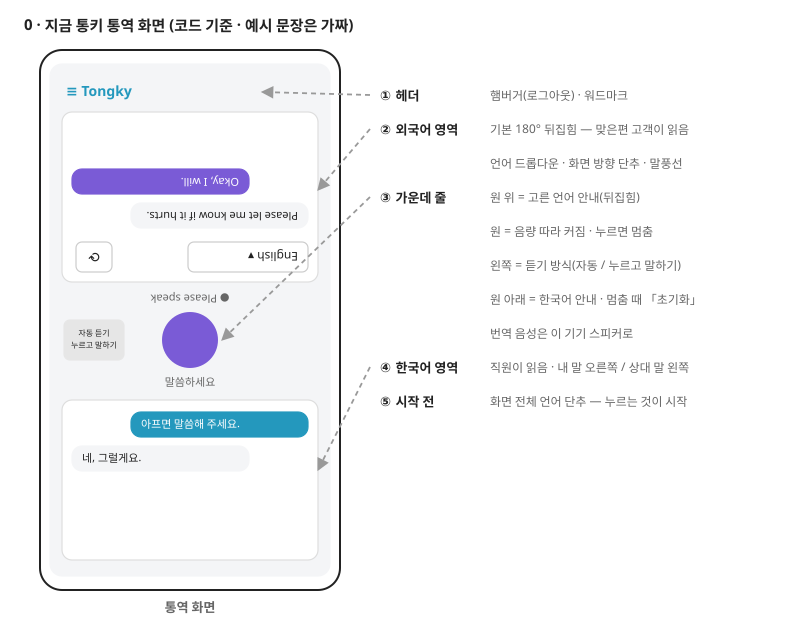

코드에서 읽은 구성(`InterpretScreen.tsx` 위에서부터):

- 헤더 — 햄버거(메뉴는 로그아웃만) · 워드마크 「Tongky」
- 외국어 영역 — **기본 180° 뒤집힘**(맞은편 고객이 읽는 방향 · D-08). 언어 드롭다운 · 화면 방향 단추 · 말풍선(그 영역을 보는 사람 기준 내 말 오른쪽 · D-24)
- 가운데 줄 — 원 위 = 고른 언어 안내(뒤집힘 따라감) · 원 = 음량 따라 커짐 · 누르면 멈춤 · 원 왼쪽 = 듣기 방식(자동 듣기 / 누르고 말하기 · D-36) · 원 아래 = 한국어 안내 · 멈춤 때 「초기화」(D-29)
- 한국어 영역 — 직원이 읽는 자막
- 시작 전 — 화면 전체를 덮는 언어 단추 목록 · 언어를 누르는 것이 시작(D-34)
- 로그인은 계정 하나(D-06) — 직원 쪽 기기만 로그인한다

### 새로 필요한 것

- 없음 — 지금 상태.

## 3. 1단계 — 통역 + 원격 통역(QR = 고객 화면)

### 모식도

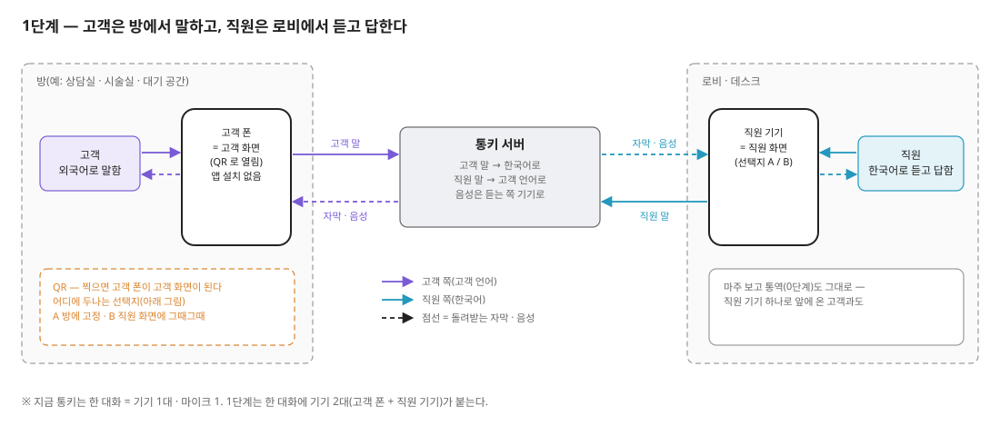

- 누가 · 어디서: **고객은 방**(예: 상담실 · 시술실 · 대기 공간)에서 **자기 폰**으로 말한다. **직원은 로비 · 데스크**의 직원 기기로 듣고 답한다.
- 화면: 고객 폰 = **고객 화면**(QR 을 찍으면 열림 · 앱 설치 · 가입 없음) / 직원 기기 = **직원 화면**(선택지 A · B).
- 말이 가는 길: 고객 말 → 통키 서버 → 한국어 자막 · 음성이 **직원 기기**로 / 직원 말 → 통키 서버 → 고객 언어 자막 · 음성이 **고객 폰**으로. 음성은 **듣는 쪽 기기**에서 나온다.
- 0단계(마주 보고 통역)는 그대로 쓴다 — 데스크 앞에 온 고객과는 직원 기기 하나로.

### QR 을 어디에 두나 — 선택지

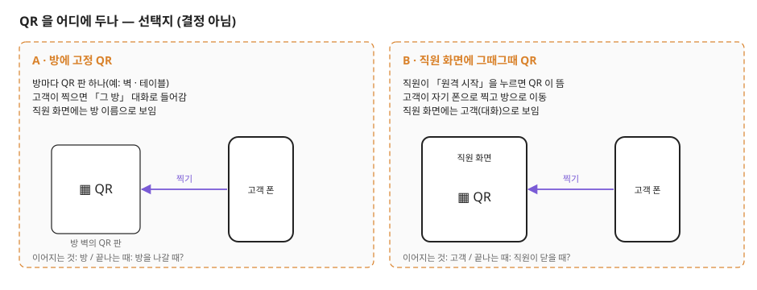

- **A · 방에 고정 QR** — 방마다 QR 판. 찍으면 「그 방」 대화로 들어간다. 직원 화면에는 방 이름으로 보인다.
- **B · 직원 화면에 그때그때 QR** — 직원이 「원격 시작」을 누르면 QR 이 뜨고, 고객이 찍고 방으로 간다. 직원 화면에는 고객(대화)으로 보인다.

### 화면 목업 — 고객 화면(QR)

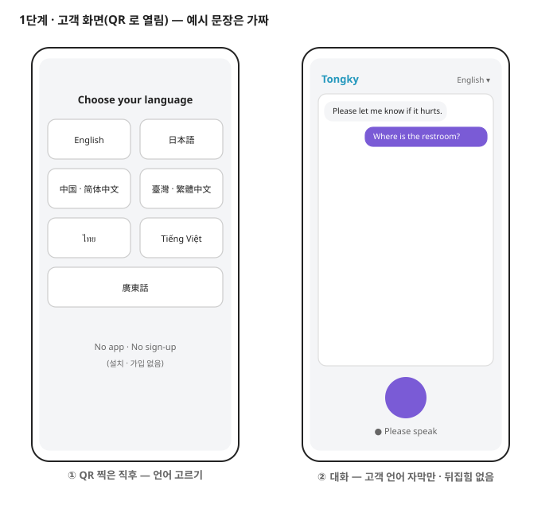

- ① QR 을 찍은 직후 — 고객이 자기 언어를 고른다(지금 통키의 시작 오버레이와 같은 언어 목록).
- ② 대화 — 고객 언어 자막만 크게. 자기 폰이라 **뒤집지 않는다**. 원 · 안내 문구는 고객 언어로.

### 화면 목업 — 직원 화면(선택지 2개)

**A · 지금 통키 화면 그대로**

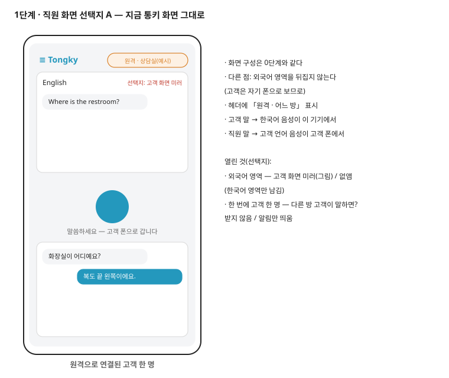

- 0단계 화면과 같은 구성. 다른 점은 외국어 영역을 뒤집지 않는 것(고객이 자기 폰으로 보므로)과 헤더의 「원격 · 어느 방」 표시.
- 외국어 영역은 선택지 — 그림은 **고객 화면 미러**(고객 폰에 뜨는 외국어 자막을 직원 기기에도 그대로 보여 줌) / **없앰**(한국어 영역만 남김) (§6 #13).
- 한 번에 고객 한 명. 그 사이 다른 방 고객이 말하면 — 받지 않음 / 알림만 띄움 (§6 #11).

**B · 여러 방 콘솔(태블릿 · PC)**

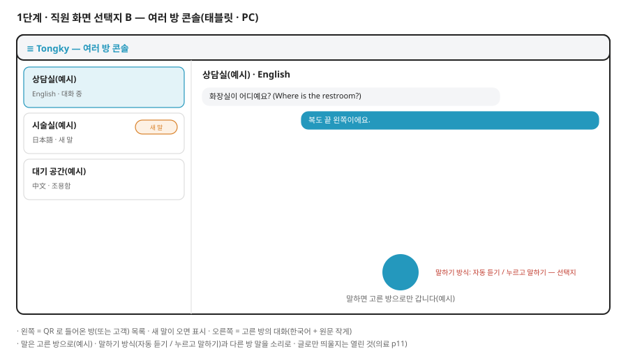

- 왼쪽 = QR 로 들어온 방(또는 고객) 목록 · 새 말 표시 / 오른쪽 = 고른 방의 대화.
- 직원 말은 고른 방으로 가는 모습으로 그렸다(예시). 말하기 방식(자동 듣기 / 누르고 말하기 — 지금 통키 D-36 의 두 방식)은 선택지(§6 #14). 다른 방에서 온 말을 소리로 들려줄지 · 글로만 띄울지도 선택지(§6 #3).

### 새로 필요한 것

- 로그인 없이 QR 링크로 들어오는 **고객 화면**(고객 언어 고르기 · 자막 · 원)
- **QR 만들기 · 연결** — 어느 직원 기기(또는 어느 방)와 짝인지
- **한 대화에 기기 2대** — 지금은 한 대화 = 기기 1대 · 마이크 1
- **음성을 듣는 쪽 기기로** — 말한 쪽에 따라 고객 폰 / 직원 기기에서 재생
- **직원 화면** — 선택지 A(지금 화면 + 원격 표시 · 외국어 영역 미러 또는 없앰) 또는 B(여러 대화를 동시에 보는 콘솔)
- **원격 대화 끝내기** — 누가 · 언제 닫나
- 고객 폰의 **마이크 · 소리 허용 안내**(처음 보는 사람이 바로 쓰게)

## 4. 2단계 — 통역 + 원격 통역 + 오늘 동선 안내 · 호출

### 모식도

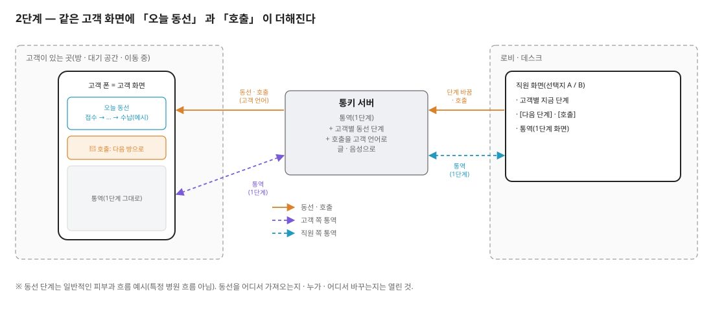

- 누가 · 어디서: 고객은 방 · 대기 공간 · 이동 중에 **같은 고객 화면**(1단계 QR 화면)을 계속 쓴다. 직원은 로비 · 데스크에서.
- 더해지는 것: 고객 화면에 **오늘 동선**(예시: 접수 → 상담 → 세안 → 시술 → 진정 → 수납)과 **호출**(예: 「시술실로 와 주세요」를 고객 언어 글 · 음성으로).
- 말이 가는 길: 통역은 1단계 그대로. 직원이 단계를 바꾸거나 호출을 보내면 → 통키 서버 → 고객 언어로 → 고객 화면.
- **병원 CRM 연동 필수**(사용자 2026-11-14): 고객별 오늘 동선 · 지금 단계는 병원 CRM(예약 · 접수 · 시술 진행)에서 받아온다.

### 화면 목업 — 고객 화면(선택지 2개)

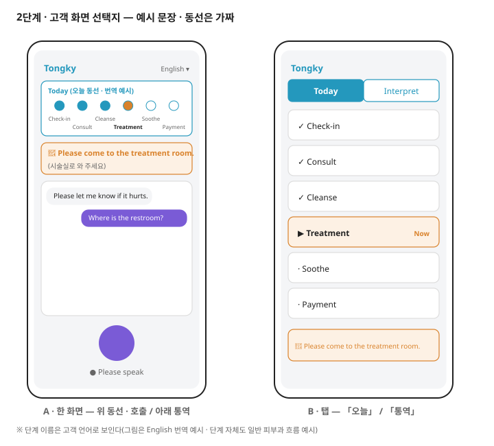

- **A · 한 화면** — 위 = 오늘 동선 · 호출 배너 / 아래 = 통역.
- **B · 탭** — 「오늘」(단계 목록 · 지금 단계 표시 · 호출) / 「통역」.
- 단계 이름은 고객 화면에서 고객 언어로 보인다 — 그림은 English 번역 예시.

### 호출 방향 — 선택지

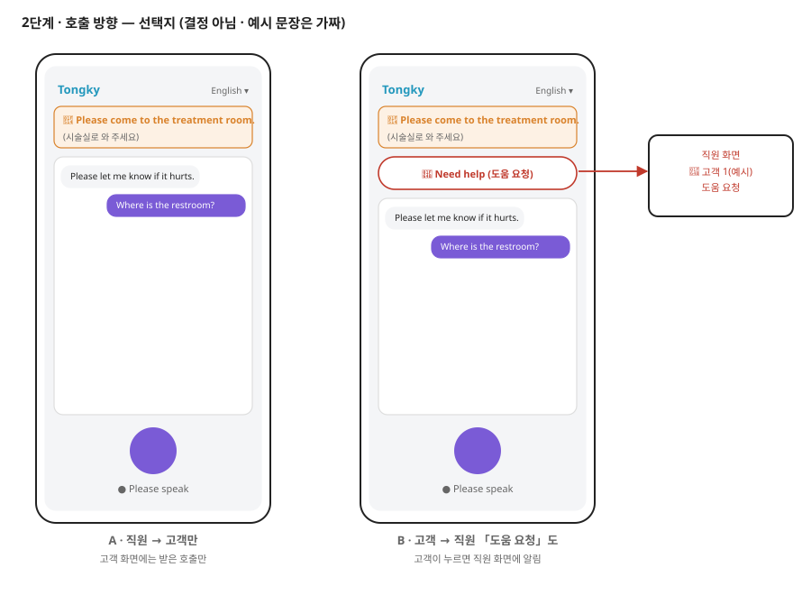

- **A · 직원 → 고객만** — 고객 화면에는 받은 호출만.
- **B · 고객 → 직원 「도움 요청」도** — 고객 화면에 「도움 요청」 단추 · 누르면 직원 화면에 알림.

### 화면 목업 — 직원 화면(선택지 2개)

**A · 1단계 콘솔에 동선 · 호출을 더함**

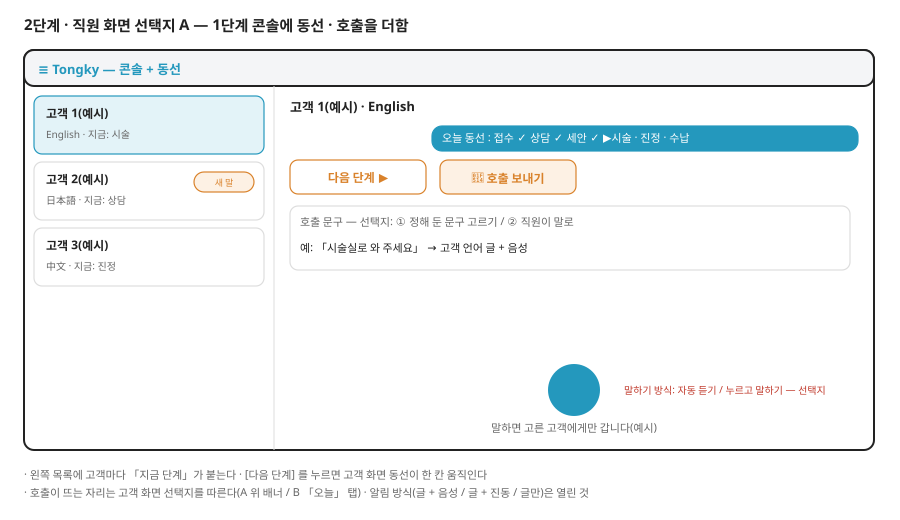

- 목록에 고객마다 「지금 단계」 · [다음 단계] · [호출 보내기].
- 호출 문구는 선택지 — ① 정해 둔 문구 고르기 / ② 직원이 말로.
- 호출이 고객 화면 어디에 뜨나는 고객 화면 선택지를 따른다(A 위 배너 / B 「오늘」 탭) · 알림 방식은 선택지(§6 #12).

**B · 동선 보드(단계별 칸에 고객 카드)**

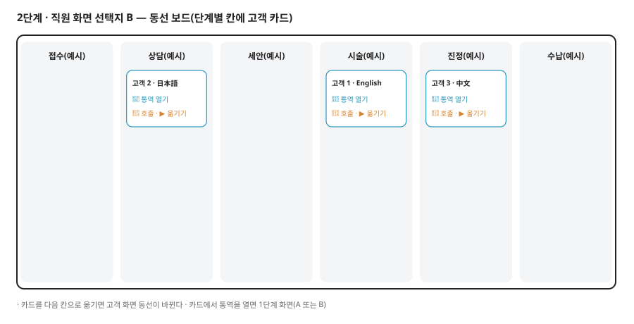

- 카드를 다음 칸으로 옮기면 고객 화면 동선이 바뀐다. 카드에서 통역을 열면 1단계 직원 화면(A 또는 B).

### 새로 필요한 것

- **병원 CRM 연동** — 고객별 오늘 동선(단계 목록 · 지금 단계)을 CRM 에서 받아오고 단계 변화를 따라간다 · 어느 CRM · 어떤 값인지는 열린 것(§6 #10)
- **CRM 의 고객 ↔ QR 고객 화면 짝짓기**
- **단계 바꾸기** — 직원 화면에서(또는 다른 길로)
- **호출 보내기** — 고객 언어로 번역한 글을 고객 화면에 · 함께 울리는 방식은 열린 것(§6 #12)
- **동선 단계 이름 번역** — 고객 화면에 고객 언어로
- 고객 화면을 **오래 열어 두는 동안**의 연결 · 알림(이동 중에도 호출이 닿게)

## 5. 제안서에서 가져온 아이디어

문구 · 수치 · 그림은 옮기지 않았다. 아이디어만 우리 말로 적고 쪽 번호로 출처를 단다(호텔 = `TAMION_Hotel_Proposal_v2.pdf` · 의료 = `TAMION_MEDICAL_의료관광_제안서_v2.pdf`).

| 아이디어 | 제안서 쪽 | 우리 단계 |
|---|---|---|
| 데스크에 기기 하나를 두고 마주 앉아 통역 | 호텔 p3 · p4 / 의료 p5 · p8 | 0 |
| 마주 보는 곳과 떨어진 곳을 다른 도구로 나눔(떨어진 곳 = 「H」) | 의료 p1 · p5 | 1 |
| 화면의 QR 을 찍으면 각자 폰이 통역 창이 됨 · 설치 · 가입 없이 웹으로 | 호텔 p5 · p11 / 의료 p14 | 1 |
| 공간마다 고정 QR(객실 · 병실 · 대기석) | 호텔 p6 / 의료 p9 | 1 (QR 선택지 A) |
| 사람에게 QR 을 주어 장소를 옮겨도 대화가 따라감 | 의료 p9 | 1 (QR 선택지 B 와 가까움) · 2 |
| 한 사람이 여러 곳을 한 콘솔에서 동시에 응대 | 의료 p3 · p5 · p9 · p11 | 1 (직원 화면 B) |
| 다른 곳 말은 글로만 띄우고, 돌아가면 안 읽은 것만 재생 | 의료 p11 | 1 (직원 화면 B 의 열린 것) |
| 부를 대상을 이름으로 말해 전환 · 부르는 말은 통역에서 뺌 | 의료 p11 · p14 | 1 (직원 화면 B 의 열린 것) |
| 방문 여정을 단계로 나누고 단계마다 맞는 통역 접점 | 의료 p6 / 호텔 p8 | 2 (오늘 동선) |
| 대기 중인 사람에게 「곧 들어갑니다」류 안내를 그곳에만 | 의료 p9 · p11 | 2 (호출) |
| 나갈 때 · 귀가할 때 연결 자동 종료 | 의료 p9 | 1 (원격 대화 끝내기 — 열린 것) |
| 중요한 안내에 고객이 「이해했어요」 확인 | 의료 p13 | 해당 없음 |
| 멀리 있는 가족을 링크로 대화에 합류 | 의료 p6 · p12 | 해당 없음 |
| 큰 글씨 · 고대비 화면 | 호텔 p11 / 의료 p14 | 해당 없음 |
| 같은 공간 여러 폰 중 자기 말만 인식 | 호텔 p10 | 해당 없음 |
| 국내 서버 · 사내 설치 선택 | 호텔 p10 / 의료 p3 · p13 | 해당 없음 |
| 기다리는 동안 화면에 안내 · 홍보 | 의료 p8 | 해당 없음 |
| 직원 교육을 여러 언어 자막으로 | 호텔 p9 | 해당 없음 |

## 6. 열린 것 — 선택지로 그린 것들(결정 아님)

| # | 열린 것 | 선택지 | 그림 |
|---|---|---|---|
| 1 | QR 을 어디에 두나 | A 방에 고정 / B 직원 화면에 그때그때 | idea-1-qr-options |
| 2 | 1단계 직원 화면 | A 지금 통키 화면 그대로 / B 여러 방 콘솔 | idea-1-staff-a · b |
| 3 | 여러 대화 중 고르지 않은 곳에서 온 말 | 소리로 들려줌 / 글로만 띄움 | idea-1-staff-b 주석 |
| 4 | 원격 대화를 언제 끝내나 | 직원이 닫음 / 방을 나갈 때 / 고객이 닫음 | idea-1-qr-options 주석 |
| 5 | 2단계 고객 화면 배치 | A 한 화면 위아래 / B 탭 나눔 | idea-2-customer |
| 6 | 2단계 직원 화면 | A 콘솔에 동선 · 호출 더함 / B 동선 보드 | idea-2-staff-a · b |
| 7 | 호출 문구 | 정해 둔 문구 고르기 / 직원이 말로 | idea-2-staff-a |
| 8 | 호출 방향 | 직원 → 고객만 / 고객 → 직원 「도움 요청」도 | idea-2-call-direction |
| 9 | 오늘 동선 단계는 누가 · 어디서 바꾸나 | 직원 화면에서 손으로 / 다른 길 | idea-2-diagram 주석 |
| 10 | CRM 연동 방식(2026-11-14 — 동선은 CRM 에서 받는 것으로 정함) | 어느 CRM · 어떤 값(예약 · 접수 · 시술 단계)을 받나 · 단계 변경을 통키에서도 하나 | idea-2-diagram |
| 11 | 직원 화면 A(한 번에 한 명)에서 다른 방 고객이 말하면 | 받지 않음 / 알림만 띄움 | idea-1-staff-a 주석 |
| 12 | 호출 알림 방식 | 글 + 음성 / 글 + 진동 / 글만 | idea-2-staff-a 주석 |
| 13 | 원격 때 직원 기기의 외국어 영역 | 고객 화면 미러 / 없앰(한국어 영역만) | idea-1-staff-a |
| 14 | 콘솔의 말하기 방식 | 자동 듣기 / 누르고 말하기 | idea-1-staff-b · idea-2-staff-a |
