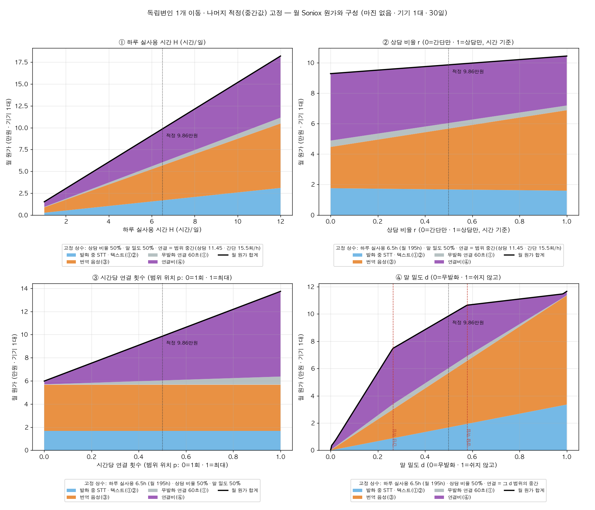
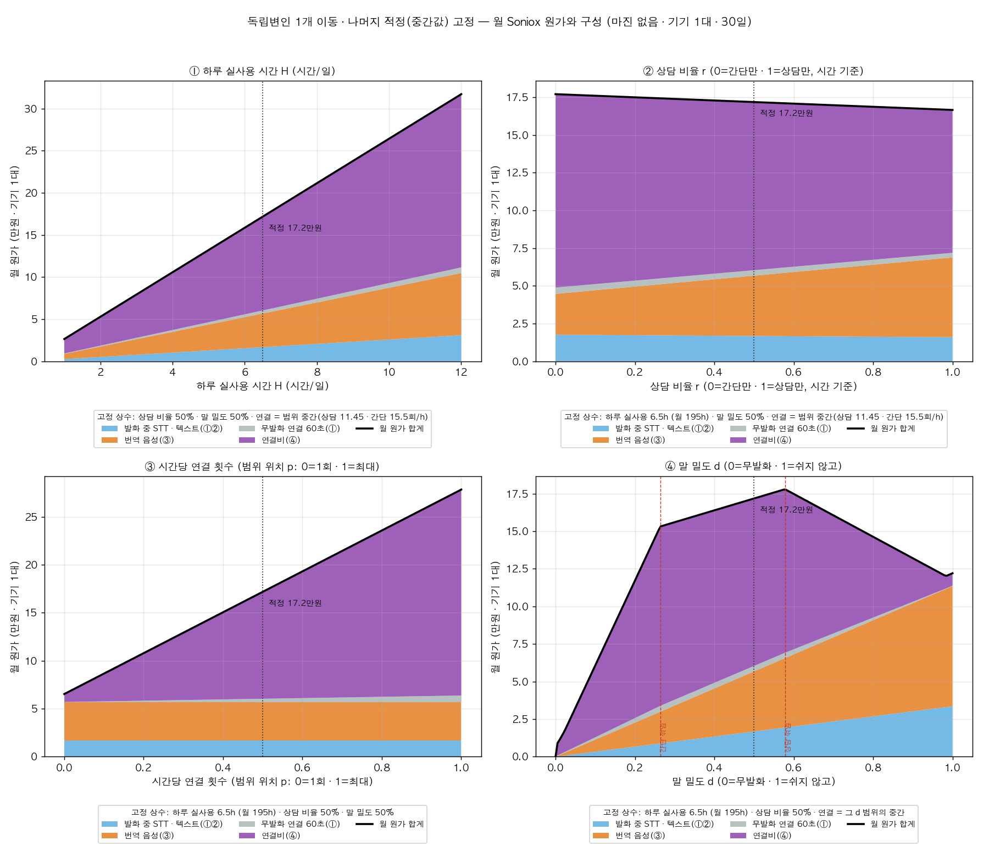

# 통키 요금 설계 v2

- 작성: 2026-11-16 (price.md 2026-11-12 를 복사해 시작 · 갱신 2026-11-16 · 원본 price.md 는 그대로 둠)
- 바뀐 것: 연결 1회(context) 비용을 오늘 실기기 세션의 실제 청구액으로 바꾸고, 2 ~ 5절을 새 연결비로 다시 계산
  - 11-12 값은 지우지 않고 「11-12(시드 .6)」으로 나란히 적음
- 근거 표기
  - 〔공식〕 Soniox 가격 페이지 https://soniox.com/pricing (2026-11-12 조회 · 2026-11-16 다시 조회 — 단가 같음)
  - 〔실측〕 Soniox usage-logs
    - 11-12: 시험 호출 2건(시드 .6 · `stt-rt-v5`)
    - 11-16: 운영 실기기 세션 7개(시드 `2026-11-16.11` · `stt-rt-v6`) — `GET /v1/usage-logs` 2026-11-16T10:15Z ~ 10:40Z, 75줄
  - 〔계산〕 식 병기
  - 〔가정〕 미정 값
- 환율: 1달러 = 1,400원 〔가정〕
- 계산 스크립트(11-16): `price2/`(measure.py · compare.py · sec2.py · sec3.py · sec4.py · sec5.py · `raw/page1.json` 원본) — `_archive/interpret-pwa/interpreter-idea/price-calc/` 복사본에서 연결비만 바꿈
  - 위치: `/private/tmp/claude-501/-Users-kknaks-orca-workspaces-kknaks-profile--------/6b7f4a9c-bfce-487f-8c42-08de89fd57d4/scratchpad/price2/` (임시 폴더 — 옮길 곳은 정할 것)
  - 복사본에 연결비 42.4원을 넣으면 11-12 값(적정 월 원가 171,784원 등)이 그대로 나옴 〔계산〕

## 1. 초당 원가 산정

### 1.1 과금 구조

- 통역 1회 = STT 연결 1개 + TTS 연결 1개
  - STT: 듣기 · 받아쓰기 · 번역
  - TTS: 번역문 음성 출력
- 과금 항목 6개 (11-12 은 5개 · agent text 가 더해짐)

| 과금 항목 | 늘어나는 요인 | 단가 | 공식 환산 | 근거 |
|---|---|--:|---|---|
| STT 입력 오디오 | **STT 연결이 열린 시간**(무발화 포함) | $2.00 / 100만 토큰 | 1시간 ≈ 30,000 토큰 | 〔공식〕 · 연결 시간 전체 과금: https://soniox.com/docs/stt/rt/connection-keepalive |
| STT 출력 텍스트 | **말한 양**(받아쓰기 + 번역문) | $4.00 / 100만 토큰 | 말 1시간 ≈ 15,000 토큰 · 1글자 ≈ 0.3 토큰 | 〔공식〕 |
| STT 입력 텍스트(context) | **연결 횟수** — 연결마다 용어집 1회 전송 | $4.00 / 100만 토큰 | — | 단가 〔공식〕 · 연결마다 〔실측〕 |
| STT 입력 agent text | **재생한 번역문 양** — 재생 중 STT 로 보내는 번역문 | $4.00 / 100만 토큰 | — | 〔공식〕 「same rate as other input text tokens」 https://soniox.com/docs/stt/rt/agent-text-input (Pricing) · 과금됨 〔실측〕 11-16 1,316 토큰 · 7.37원 |
| TTS 입력 텍스트 | **읽어 줄 번역문 양** | $4.00 / 100만 토큰 | 생성 음성 1시간 ≈ 15,000 토큰 | 〔공식〕 |
| TTS 출력 오디오 | **번역 음성 재생 시간** | $21.50 / 100만 토큰 | TTS 합계 생성 음성 1시간 ≈ $0.70 | 〔공식〕 |

- agent text: 통키는 11-16 부터 켬(세 참여자 · 재생 중에도 STT 송신). usage-logs 의 `input_agent_text_tokens` · `input_agent_text_cost_usd` 에 따로 찍히고 `cost_usd` 에 들어감 〔실측〕

### 1.2 초당 원가

- 산식: 단가 × 공식 환산 ÷ 3,600초 〔계산〕
- 4개 축으로 정리 — 시간 3종 + 연결 횟수

| 축 | 포함 항목 | 1시간 원가 | **1초 원가** | 비고 |
|---|---|--:|--:|---|
| ① STT 연결 1초 | STT 입력 오디오 | $0.06 (84원) | **0.023원** | 30,000 토큰 × $2/100만 |
| ② 말한 1초 | 받아쓰기 + 번역문 텍스트 | $0.12 (168원) | **0.047원** | 15,000 + 15,000 토큰 × $4/100만 · 번역문 분량 = 받아쓰기 분량 〔가정〕 |
| ③ 번역 음성 재생 1초 | TTS 입력 텍스트 + TTS 출력 오디오 | $0.70 (980원) | **0.272원** | 〔공식〕 합계 |
| ④ 연결 1회 — **11-16(시드 .11)** | context | — | **14.5원 / 회** | 2,598 토큰 × $4/100만 = 14.55원 · 실측 4개 언어 중 최대(일본어) 〔실측〕 |
| ④ 연결 1회 — 11-12(시드 .6) | context | — | 42.4원 / 회 | 약 7,576 토큰 × $4/100만 · 7개 언어 중 최대(번체 중국어) 추정 〔가정〕 |

- ④ 11-16 언어별 실측 (연결 1회 = STT 줄의 `input_text_tokens` · `input_text_cost_usd`)

| 언어 | context 글자(시드 .11) | **11-16 토큰 〔실측〕** | **11-16 비용 〔실측〕** | 글자당 토큰 〔계산〕 | 11-12(시드 .6) 토큰 | 11-12 비용 |
|---|--:|--:|--:|--:|--:|--:|
| zh-Hant | 6,916 | 2,355 | 13.19원 | 0.341 | — | 42.4원 추정(7,576 토큰 〔가정〕) |
| zh | 7,277 | 2,424 | 13.57원 | 0.333 | 6,494 〔실측〕 | 36.4원 〔실측〕 |
| en | 7,694 | 2,472 | 13.84원 | 0.321 | 5,698 〔실측〕 | 31.9원 〔실측〕 |
| ja | 7,364 | **2,598** | **14.55원** | 0.353 | — | — |
| th | 7,768 | 실측 없음 | 약 15.4원 〔가정〕 | — | — | — |
| vi | 7,698 | 실측 없음 | 약 15.2원 〔가정〕 | — | — | — |
| yue | 7,328 | 실측 없음 | 약 14.5원 〔가정〕 | — | — | — |

- 글자 수: `orchestration/work/tongky-quality-re1/wp33-context-report.md` 언어별 표
- th · vi · yue: 11-16 세션 없음 → 실측 글자당 토큰 최대(0.353)× 글자 수로 추정 〔가정〕 — 태국어는 글자당 토큰이 다를 수 있어 정할 것
- ④ 기준값: **실측 최대 14.55원(ja)** — 추정이 섞인 th(15.4원)는 기준에 넣지 않음 〔가정 — 정할 것〕
- zh 연결비 11-12 → 11-16: 6,494 → 2,424 토큰(−63%) — context 글자가 줄어든 만큼(글자당 토큰 0.35 → 0.33으로 거의 같음) 〔계산〕
  - 11-12 시드 .6 zh context 18,565자 · 같은 날 STT 모델 v5 → v6 도 바뀌어 모델 몫은 따로 가를 수 없음

- 시간 단위별 원가 — 해당 축이 그 시간 내내 계속될 때 〔계산〕

| 축 | 1초 | 1분 | 1시간 | 하루(근무 12시간) |
|---|--:|--:|--:|--:|
| ① STT 연결 | 0.023원 | 1.4원 | 84원 | 1,008원 |
| ② 말한 시간 | 0.047원 | 2.8원 | 168원 | 2,016원 |
| ③ 번역 음성 재생 | 0.272원 | 16.3원 | 980원 | 11,760원 |
| ④ 연결 | — | — | — | — |

- 1분 = 1시간 ÷ 60 · 하루 = 1시간 × 12 (하루 근무 12시간 〔사용자 지정〕)
- ④ 연결은 시간이 아니라 **횟수**에 붙는 비용 — 1회 14.5원(11-12: 42.4원), 시간 단위로 환산하지 않음
- 하루 값은 그 축이 12시간 쉬지 않고 이어지는 상한 — 실제 하루 원가는 3절

### 1.3 원가 식

```text
원가(원) = 0.023 × STT 연결 시간(초)
         + 0.047 × 말한 시간(초)
         + 0.272 × 번역 음성 재생 시간(초)
         + 14.5  × 연결 횟수          ← 11-12(시드 .6): 42.4
```

- agent text 는 식 밖 — 11-16 실측 발화 1개당 0.11원(7.37원 ÷ 69발화) 〔실측 · 계산〕

### 1.4 실측 대조

#### 11-12(시드 .6) — 시험 호출 2건

- 실측 방법
  - 통키와 같은 설정(같은 용어집 context · 양방향 번역 · 같은 TTS)으로 Soniox 1회씩 호출
  - 입력 음성: 아래 문장을 Soniox TTS 로 합성해 흘림 — 합성 비용은 원가에서 제외
  - 청구액: usage-logs 의 `cost_usd` 〔실측〕
- 실측 문장

| 케이스 | 문장 | 글자 | 번역 언어 |
|---|---|--:|---|
| **상담 1발화** | 여기 눌러보시면은, 이 오늘 결제하신 시술 건들에 대한 내용이 다 뜨고요. 그다음에 이제 이거랑 오더 메모를 확인을 해가지고, 이제 혹시 뭐 누락이 된 건은 없는지, 혹시 뭔가 좀 결제는 이렇게 하셨는데 다른 시술 건이 들어가 있지 않는지, 그런 거 다 확인하고, 크로스 체크하고, 그다음에 이제 시술을 들어가게 되고요. 저희가 그래서 이거에 맞춰가지고, 써마지라든지, 울쎄라라든지, 보톡스 어떤 거, 그 보톡스도 항목에 따라서 이제 국산, 외국산, 그리고 수입산이 있고, 그리고 또 국산에서도 국산 프리미엄이 있기 때문에, 그런 거 다 확인해가지고 이제 부위별로 들어가게 됩니다. | 325 | 중국어(zh) |
| **간단 통역 1발화** | 지금부터 울쎄라 시작할 건데, 이건 턱라인을 날렵하게 만들어 주는 리프팅이에요. 집중. | 48 | 영어(en) |

- 대조 결과

| 케이스 | STT 연결 | 말한 시간 | 번역 음성 | 실측 청구액(연결비 제외) | 식 계산 | 차이 |
|---|--:|--:|--:|--:|--:|--:|
| 상담 1발화 | 87.6초 〔실측〕 | 36.7초 〔실측〕 | 45.5초 〔실측〕 | **17.4원** 〔실측〕 | **16.1원** 〔계산〕 | −7% |
| 간단 통역 1발화 | 15.4초 〔실측〕 | 기록 없음 | 6.1초 〔실측〕 | **2.5원** 〔실측〕 | 대조 불가 | — |

- 상담 1발화 계산: 0.023 × 87.6 + 0.047 × 36.7 + 0.272 × 45.5 = 2.0 + 1.7 + 12.4 = 16.1원 〔계산〕
  - 7% 차이 원인: 출력 텍스트 실측 515 토큰 > 공식 환산 약 306 토큰 — 중국어 번역문의 토큰 과다
- 간단 통역 1발화: 말한 시간이 호출 기록에 남지 않아 식 대조 불가
- 유의
  - 시간 = 실측 토큰 ÷ 8.33 토큰/초(30,000 ÷ 3,600) 환산 〔계산〕
  - 실측 연결 시간은 합성 음성 입력 방식의 시험값 — 실제 상담과 다를 수 있음

#### 11-16(시드 .11) — 운영 실기기 세션 7개

- 배포(KST 19:19) 뒤 사용자가 실기기로 시험한 세션 — 실제 목소리 · 실제 기기 · 운영 서버
- 맞추는 법 〔실측〕
  - STT 줄 ↔ 세션: STT 줄 시작이 운영 기록 `session_start` 뒤 0 ~ 3초 — 6줄 모두 한 세션에만 맞음
  - TTS 줄 ↔ 세션: TTS 줄 시작이 운영 기록 발화 시각 뒤 0 ~ 3초(최대 2.0초) — 69줄 모두 한 세션의 발화에만 맞음 · 겹친 세션(ja 36044aa4 ↔ en · zh)도 갈림
  - 75줄 = STT 6 + TTS 69 · 맞추지 못한 줄 0
  - f5869adc(연결 시간 초과 · 오류)는 usage-logs 에 줄이 없음 → 청구 0
  - TTS 69줄 중 1줄은 토큰 0 · 0원(58b03042 · 54ms 차이로 기록된 두 발화 중 하나)
- 세션별 청구액 〔실측〕 (원 · `cost_usd` × 1,400)

| 세션 | 언어 | 발화 | 세션 길이 | STT 연결 | context | STT 오디오 | STT 출력 | agent text | TTS(입력 + 음성) | 번역 음성 | **합계** |
|---|---|--:|--:|--:|--:|--:|--:|--:|--:|--:|--:|
| bc701e27 | zh-Hant | 4 | 47.4초 | 46.6초 | 13.19 | 1.09 | 0.56 | 0.19 | 0.20 + 1.54 | 5.9초 | **16.76** |
| e4c67c3f | zh | 17 | 202.4초 | 201.5초 | 13.57 | 4.70 | 3.98 | 1.63 | 1.67 + 14.75 | 57.7초 | **40.30** |
| 11f17f7b | en | 18 | 307.8초 | 307.1초 | 13.84 | 7.17 | 5.15 | 2.19 | 2.25 + 19.23 | 75.6초 | **49.84** |
| 36044aa4 | ja | 2 | 85.0초 | 84.1초 | 14.55 | 1.96 | 1.01 | 0.01 | 0.45 + 4.09 | 16.1초 | **22.08** |
| f5869adc | zh | 0 | 10.0초 | — | 0 | 0 | 0 | 0 | 0 | — | **0** (오류 · 줄 없음) |
| b7ed7ed2 | zh | 13 | 168.3초 | 167.6초 | 13.57 | 3.91 | 3.67 | 1.56 | 1.56 + 13.61 | 53.4초 | **37.88** |
| 58b03042 | ja | 15 | 187.6초 | 186.9초 | 14.55 | 4.36 | 4.44 | 1.79 | 1.83 + 14.87 | 58.4초 | **41.84** |
| **합계** | | **69** | **16.8분** | 993.9초 | **83.28** | 23.19 | 18.80 | **7.37** | 7.96 + 68.09 | 267.2초 | **208.69** |

- 세션 길이 = 운영 기록 `session_start` ~ `session_end` · STT 연결 = `input_audio_duration_ms` 〔실측〕
- context 가 합계의 40%(83.28 ÷ 208.69) 〔계산〕 — 11-12 상담 1발화는 68%(36.4 ÷ 53.7) 〔계산〕
- 대조 — 1.3 원가 식(시간 3축) vs 실측 청구액(context · agent text 제외) 〔compare.py〕

| 세션 | STT 연결 | 말한 시간(출력 토큰 ÷ 8.33) | 번역 음성 | 실측(연결비 · agent 제외) | 식 계산 | 차이 |
|---|--:|--:|--:|--:|--:|--:|
| bc701e27 | 46.6초 | 12.0초 | 5.9초 | 3.38원 | 3.24원 | −4.1% |
| e4c67c3f | 201.5초 | 85.2초 | 57.7초 | 25.10원 | 24.33원 | −3.1% |
| 11f17f7b | 307.1초 | 110.4초 | 75.6초 | 33.81원 | 32.82원 | −2.9% |
| 36044aa4 | 84.1초 | 21.6초 | 16.1초 | 7.52원 | 7.34원 | −2.4% |
| b7ed7ed2 | 167.6초 | 78.7초 | 53.4초 | 22.75원 | 22.08원 | −2.9% |
| 58b03042 | 186.9초 | 95.0초 | 58.4초 | 25.50원 | 24.67원 | −3.3% |
| **합계** | 993.9초 | 403.0초 | 267.2초 | **118.04원** | **114.47원** | **−3.0%** |

- 식이 실측보다 3% 낮음 — 번역 음성 실측 단가 0.285원/초(TTS 76.05원 ÷ 267.2초) > 식 0.272원/초 〔계산〕
- 말한 시간은 기록에 없어 출력 토큰을 8.33 토큰/초로 나눈 환산 〔계산〕 — 이 환산에선 ② 가 식과 실측이 늘 같음

### 1.5 소결

- 1발화 원가 — 1.3 원가 식에 1.4 실측 시간 대입 〔계산〕 (11-12 시험 1발화 기준 · 연결비만 바꿈)

| 케이스 | ① STT 연결 | ② 말한 시간 | ③ 번역 음성 | 시간 원가 소계 | ④ 연결 1회 11-16 / 11-12 | **1발화 원가 11-16** | 1발화 원가 11-12(시드 .6) | 실측 청구액(참고 · 11-12) |
|---|--:|--:|--:|--:|--:|--:|--:|--:|
| 상담 1발화 | 87.6초 → 2.0원 | 36.7초 → 1.7원 | 45.5초 → 12.4원 | 16.1원 | 14.5원 / 42.4원 | **30.7원** | 58.5원 | 53.7원 (zh context) |
| 간단 통역 1발화 | 15.4초 → 0.4원 | 15.4초 → 0.7원 〔가정〕 | 6.1초 → 1.7원 | 2.7원 | 14.5원 / 42.4원 | **17.3원** | 45.1원 | 34.4원 (en context) |

- 간단 통역 말한 시간: 기록 없음 → STT 연결 시간(15.4초) 전체를 말한 시간으로 가정 〔가정〕
- 11-16 실기기 단위 원가 〔실측 · 계산〕 — 세션 6개(청구 있는 것) · 발화 69 · 16.8분

| 단위 | 11-16 실기기 | 연결비(context) 빼면 |
|---|--:|--:|
| 발화 1개 | **3.02원** (208.69 ÷ 69) | 1.82원 |
| 사용 1분(세션이 열린 시간) | **12.42원** (208.69 ÷ 16.8분) | 7.46원 |
| 세션 1회 | **34.78원** (208.69 ÷ 6) | — |

- 실기기 세션은 짧고(평균 약 2.8분) 말이 촘촘함 — 1분 원가에 연결비 몫이 큼 · 실제 병원 사용 길이는 미확인
- 발화 1초당 원가 = 시간 원가 소계 ÷ (말 + 번역 음성 재생 시간) 〔계산〕 — 연결비와 무관해 11-12 그대로

| 케이스 | 말 + 재생 | 시간 원가 소계 | **발화 1초당 원가** |
|---|--:|--:|--:|
| 상담 1발화 | 82.2초 | 16.1원 | **0.20원/초** |
| 간단 통역 1발화 | 21.5초 | 2.7원 | **0.13원/초** |

- 1시간 원가 식 〔계산〕

```text
1시간 원가(원) = 발화 1초당 원가 × 말 + 번역 음성 재생 시간(초)   ← 상담 0.20 · 간단 통역 0.13
              + 0.023 × 말 없이 연결만 열린 시간(초)
              + 14.5  × 연결 횟수                                ← 11-12: 42.4
```

- 예: 상담을 연결 1번으로 1시간 쉬지 않고 → 705.8(0.196 × 3,600) + 14.55 × 1 ≈ **720원** (11-12: 748원) 〔계산 — sec2.json coef_d〕
- 원가 최대 요인: **번역 음성 재생 시간**(0.272원/초) — 11-16 실기기 청구액의 36%(TTS 76.05 ÷ 208.69) 〔계산〕
- 시간과 무관한 고정비: **연결 1회 14.5원**(11-12: 42.4원)
  - 번역 음성 약 53초어치(11-12: 약 156초) 〔계산〕 14.55 ÷ 0.272
- 시사점: 요금 축은 「통역 시간」 + 「연결 횟수」 2개 — 연결 횟수의 무게는 11-12 의 약 1/3

## 2. 분석 기준 — 독립변인 1개 · 나머지 상수 고정

- 2절 숫자: `price2/sec2.py` → `sec2.json` 〔계산〕 — 연결비만 14.55원으로 바꾸고 나머지 상수는 11-12 그대로

### 2.1 분석 방식

- 변인 1개만 범위 안에서 이동 · 나머지 변인은 상수로 고정
- 결과: 변인별 월 원가 구간(3절) → 요금 구조별 마진 비교(4절)
- 기기: **1대 기준** — 대수는 원가를 그대로 곱할 뿐이라 변인에서 제외 〔사용자 지정〕
  - 단, 동시 사용은 Soniox 동시 연결 한도(STT 10 · TTS 3, 계정 전체)에 걸림 — 운영 사항으로 별도 관리
- 원가 식: 1.5 「1시간 원가 식」 〔계산〕

### 2.2 1시간의 구성

- 실사용 1시간 = 아래 3구간 〔정의〕

| 구간 | 길이 | 원가 |
|---|---|---|
| 발화 시간(말 + 번역 음성 재생) | 말 밀도 d × 3,600초 | 발화 1초당 원가(상담 0.20 · 간단 0.13원/초) |
| 무발화 연결 시간 | 연결마다 60초 — 무발화 1분 종료 〔사용자 지정〕 | 0.023원/초 |
| 연결 안 된 시간 | 나머지 | 0원 |

- 연결 1회 고정 원가 = 무발화 60초 × 0.023 + 연결비 14.55 = **15.93원/회** (11-12: 43.78원/회) 〔계산〕
  - 무발화 종료 시간은 11-16 운영 설정과 같은지 확인 안 함 — 계산 틀은 11-12 그대로
- 1시간 원가(상담 · 간단 각각) 〔계산〕

```text
C(d, k) = 발화 1초당 원가 × 3,600 × d + 15.93 × k
        = 705.8 × d + 15.93 × k    ← 상담      (11-12: 706.0 × d + 43.78 × k)
        = 458.3 × d + 15.93 × k    ← 간단 통역 (11-12: 458.8 × d + 43.78 × k)
```

- 705.8 · 458.3 = 스크립트 값(반올림 전 초당 원가 × 3,600) — 11-12 문서의 706.0 · 458.8 은 반올림 차이
- 연결 횟수 k 의 제약 〔계산〕 — 연결비와 무관해 11-12 그대로
  - 시간: 발화 시간 + 무발화 60초 × k ≤ 3,600초 → k ≤ 60 × (1 − d)
  - 발화: 연결마다 발화 1개 이상(말 없는 연결은 무발화 정책으로 제외) → k ≤ 시간당 발화 수 = 3,600 × d ÷ 발화 1회 시간
  - 최소: 말이 있으면 연결 1회 이상
  - **k 범위 = 1 ~ k최대(d) = min(3,600 × d ÷ 발화 1회 시간, 60 × (1 − d))** — 1 미만이면 1

| 유형 | 발화 1회 시간 | 시간당 발화 수 | k최대(d) | 두 제약이 바뀌는 d |
|---|--:|--:|---|--:|
| 상담 | 82.2초 〔실측〕 | 43.80 × d | min(43.80d, 60(1 − d)) | 57.8% |
| 간단 통역 | 21.5초 〔실측〕 | 167.4 × d | min(167.4d, 60(1 − d)) | 26.4% |

### 2.3 독립변인

| # | 변인 | 기호 | 단위 | 범위 | 범위 근거 |
|---|---|---|---|---|---|
| 1 | 하루 실사용 시간 | H | 시간/일 | 1 ~ 12 | 〔사용자 지정〕 근무 12h · 30일/월 |
| 2 | 상담 비율 | r | % (시간 기준) | 0 ~ 100 | 〔사용자 지정〕 |
| 3 | 시간당 연결 횟수 | k | 회/시간 | 1 ~ k최대(d) | 2.2 제약 〔계산〕 |
| 4 | 말 밀도 | d | % — 실사용 1시간 중 발화 시간 비율 | 0 ~ 100 | 100% = 쉬지 않고 통역 〔정의〕 |

- 월 원가 〔계산〕

```text
월 원가 = 30일 × H × [ r × C상담(d, k상담) + (1 − r) × C간단(d, k간단) ]
```

### 2.4 고정 상수 세트

- 적정 세트 = **각 변인 범위의 중간값** 〔사용자 지정〕
- 해피 · 워스트 = 각 변인의 원가 최저 · 최고 끝 — 범위 확인용

| 변인 | 해피 | **적정(중간값)** | 워스트 | 비고 |
|---|--:|--:|--:|---|
| 하루 실사용 시간 H | 1h | **6.5h** | 12h | (1 + 12) ÷ 2 |
| 상담 비율 r | — | **50%** | — | 원가가 낮은 쪽은 2.5 식으로 판단 |
| 말 밀도 d | 0% | **50%** | 100% | (0 + 100) ÷ 2 |
| 연결 횟수 k — 상담 (d = 50%) | 1회 | **11.45회** | 21.90회 | k최대 = min(21.90, 30) |
| 연결 횟수 k — 간단 통역 (d = 50%) | 1회 | **15.50회** | 30.00회 | k최대 = min(83.72, 30) |

- 연결 횟수의 적정 = 그때 d 에서의 범위 중간 = (1 + k최대(d)) ÷ 2 — d 가 바뀌면 같이 바뀜
- 중간값은 데이터 근거가 아닌 범위의 가운데 — 실사용 데이터가 생기면 교체 대상

- 적정 세트 1시간 원가 〔계산〕

| 유형 | 발화 시간 | 무발화 연결 | 연결비 11-16 (11-12) | **1시간 원가 11-16** | 1시간 원가 11-12(시드 .6) |
|---|--:|--:|--:|--:|--:|
| 상담 | 352.9원 | 15.8원 | 166.6원 (485.5원) | **535.3원** | 854.3원 |
| 간단 통역 | 229.2원 | 21.4원 | 225.5원 (657.2원) | **476.1원** | 908.0원 |
| 상담 비율 50% 가중 | | | | **505.7원** | 881.1원 |

- 11-16 은 **상담이 간단 통역보다 비쌈** — 연결비가 작아져 연결이 잦은 간단 통역의 불리함이 줄고, 번역 음성이 긴 상담이 앞섬 (11-12 은 반대)

### 2.5 변인별 산식 — 1개 이동 · 나머지 적정

- 각 식은 2.3 월 원가 식에 2.4 적정값을 넣은 결과 〔계산〕

**① 하루 실사용 시간 H** (r = 50% · d = 50% · k = 적정)

```text
월 원가 = 30 × H × 505.7 = 15,170 × H        (11-12: 26,434 × H)
```

- 1h 15,170원 · 6.5h 98,604원 · 12h 182,038원 — 직선

**② 상담 비율 r** (H = 6.5h · d = 50% · k = 적정)

```text
월 원가 = 195시간 × [ r × 535.3 + (1 − r) × 476.1 ] = 92,831 + 11,546 × r      (11-12: 177,057 − 10,482 × r)
```

- 간단 통역만 92,831원 · 상담만 104,377원 — 11-16 은 상담이 비쌈(번역 음성이 김)

**③ 시간당 연결 횟수 k** (H = 6.5h · r = 50% · d = 50%) — 범위 위치 p = 0(1회) ~ 1(최대)

```text
k상담 = 1 + 20.90 × p        k간단 = 1 + 29.00 × p
월 원가 = 195 × [ 0.5 × (352.9 + 15.93 × k상담) + 0.5 × (229.2 + 15.93 × k간단) ]
        = 59,857 + 77,494 × p      (11-12: 65,320 + 212,992 × p)
```

- 1회 59,857원 · 적정 98,604원 · 최대 137,351원 — 직선

**④ 말 밀도 d** (H = 6.5h · r = 50% · k = 그 d 에서의 범위 중간)

```text
k(d) = (1 + k최대(d)) ÷ 2
월 원가 = 195 × [ 0.5 × (705.8 × d + 15.93 × k상담(d)) + 0.5 × (458.3 × d + 15.93 × k간단(d)) ]
```

- k최대(d)가 꺾이는 점(상담 57.8% · 간단 26.4%)에서 기울기가 바뀌는 꺾은선
- d = 0 → 발화 · 연결 없음 → 0원
- 끝값 · 꺾임 값은 3절에서 계산

## 3. 변인별 원가 — 1개 이동 · 나머지 적정 고정 (마진 없음)

- **Soniox 실제 원가만** 계산 · 마진 · 가격은 4절
- 산식: 2.5 변인별 산식 그대로 · 계산 스크립트 `price2/sec3.py`(11-12 `_archive/…/price-calc/sec3.py` 복사 · 연결비만 바꿈) 〔계산〕
- 원가 구성 4개
  - 발화 중 STT · 텍스트(①②) — 발화 시간 동안 STT 연결 + 받아쓰기 · 번역문
  - 번역 음성(③)
  - 무발화 연결 60초(①) — 연결마다 꼬리 60초
  - 연결비(④) — 연결 1회 14.55원 (11-12: 42.4원)
- agent text(발화 1개당 약 0.11원 〔실측〕)는 이 틀에 없음 — 11-16 실기기 청구액의 3.5%(7.37 ÷ 208.69) 〔실측 · 계산〕 · 이 틀에 넣지 않아 3 ~ 5절 시간 원가는 그만큼 낮게 나옴

### 3.1 적정 세트 원가 (기기 1대 · 월)

| 항목 | **11-16** | 11-12(시드 .6) | 근거 |
|---|--:|--:|---|
| 월 사용 시간 | 195시간 | 195시간 | 30일 × 6.5h 〔계산〕 |
| 시간당 연결 | 상담 11.45회 · 간단 15.50회 | 같음 | 2.4 〔계산〕 |
| 월 연결 횟수 | 2,628회 | 2,628회 | 〔계산〕 |
| **월 원가** | **98,604원** | 171,784원 | 〔계산〕 |
| 사용 1시간당 원가 | 506원 | 881원 | 〔계산〕 |

| 원가 구성 | 11-16 월(원) | 비중 | 11-12 월(원) | 비중 |
|---|--:|--:|--:|--:|
| 발화 중 STT · 텍스트(①②) | 16,784 | 17% | 16,784 | 10% |
| 번역 음성(③) | 39,967 | **41%** | 39,967 | 23% |
| 무발화 연결 60초(①) | 3,626 | 4% | 3,626 | 2% |
| 연결비(④) | 38,227 | 39% | 111,407 | **65%** |

### 3.2 그래프

- 11-16 판: 
- 11-12 판: 
- 쌓인 면적 = 원가 구성 4개 · 검은 실선 = 월 원가 합계 · 세로 점선 = 적정값
- 각 칸 아래 범례 제목 = 그 칸의 고정 상수
- ④ 말 밀도의 빨간 점선 = 연결 횟수 최대가 꺾이는 점(간단 26.4% · 상담 57.8%)

### 3.3 변인별 끝값 (11-16)

| 변인 | 값 | 시간당 연결(상담 · 간단) | 월 원가(원) | 1시간당(원) | ①② | ③ | 무발화 ① | ④ 연결비 | 11-12 월 원가 |
|---|---|--:|--:|--:|--:|--:|--:|--:|--:|
| ① 하루 실사용 H | 1h | 11.45 · 15.50 | 15,170 | 506 | 2,582 | 6,149 | 558 | 5,881 (39%) | 26,428 |
| | **6.5h** | 11.45 · 15.50 | **98,604** | 506 | 16,784 | 39,967 | 3,626 | 38,227 (39%) | 171,784 |
| | 12h | 11.45 · 15.50 | 182,038 | 506 | 30,986 | 73,785 | 6,694 | 70,573 (39%) | 317,139 |
| ② 상담 비율 r | 0% (간단만) | 11.45 · 15.50 | 92,831 | 476 | 17,599 | 27,087 | 4,171 | 43,974 (47%) | 177,011 |
| | **50%** | 11.45 · 15.50 | **98,604** | 506 | 16,784 | 39,967 | 3,626 | 38,227 (39%) | 171,784 |
| | 100% (상담만) | 11.45 · 15.50 | 104,377 | 535 | 15,969 | 52,846 | 3,081 | 32,481 (31%) | 166,556 |
| ③ 연결 횟수 p | 0 (1회) | 1.00 · 1.00 | 59,857 | 307 | 16,784 | 39,967 | 269 | 2,837 (5%) | 65,288 |
| | **0.5** | 11.45 · 15.50 | **98,604** | 506 | 16,784 | 39,967 | 3,626 | 38,227 (39%) | 171,784 |
| | 1 (최대) | 21.90 · 30.00 | 137,351 | 704 | 16,784 | 39,967 | 6,983 | 73,617 (54%) | 278,279 |
| ④ 말 밀도 d | 0% | 0 · 0 | 0 | 0 | 0 | 0 | 0 | 0 | 0 |
| | 26.4% (간단 꺾임) | 6.28 · 22.59 | 74,766 | 383 | 8,855 | 21,087 | 3,883 | 40,941 (55%) | 153,142 |
| | **50%** | 11.45 · 15.50 | **98,604** | 506 | 16,784 | 39,967 | 3,626 | 38,227 (39%) | 171,784 |
| | 57.8% (상담 꺾임) | 13.16 · 13.16 | 106,482 | 546 | 19,406 | 46,210 | 3,541 | 37,327 (35%) | 177,938 |
| | 100% (최고) | 1.00 · 1.00 | 116,608 | 598 | 33,568 | 79,934 | 269 | 2,837 (2%) | 122,039 |

- 단위 원 · 기기 1대 · 30일 〔계산〕 · 괄호 = 월 원가 중 연결비 비중
- ③ 연결 횟수를 움직여도 ①② · ③ 은 그대로 — 발화량은 말 밀도로만 정해짐

### 3.4 소결

- 기기 1대 월 원가: 적정 **약 9.9만 원**(사용 1시간당 506원) · 변인 범위 안에서 **약 1.5만 ~ 18.2만 원** (11-12: 적정 약 17만 원 · 2.6만 ~ 31.7만 원)
- **① 하루 실사용 시간**: 원가가 시간에 정비례 — 1시간당 506원 고정 · 범위 가장 넓음(12배)
- **③ 시간당 연결 횟수**: 1회 6.0만 원 ~ 최대 13.7만 원(2.3배 · 11-12 은 4.3배)
  - 연결 1회면 연결비 비중 5% · 최대면 54%
- **④ 말 밀도**: 11-16 은 **d = 100%(쉬지 않고 통역)에서 최고** 11.7만 원 — 11-12 은 57.8% 에서 최고(d 를 0.1% 간격으로 훑은 최댓값 〔계산〕)
  - 연결비가 작아져, 말이 늘어 생기는 번역 음성 증가가 연결 횟수 감소보다 큼
- **② 상담 비율**: 영향 작음(9.3만 ~ 10.4만 원) — 11-16 은 상담이 약간 비쌈(11-12 은 간단 통역이 비쌈)
- 원가 최대 구성이 **연결비(65%) → 번역 음성(41%)** 으로 바뀜 — 연결비는 39%
- 연결 횟수의 적정(범위 중간)은 여전히 데이터 근거 없음

## 4. 요금제 — 시간제 · 정액제(2만 원) · 토큰제 × 마진 30 · 50 · 70%

- 마진율 m = 30 · 50 · 70% 〔가정 — 비교용〕 · 마진 = (매출 − 원가) ÷ 매출
- 원가: 1.5 · 3절 값 · 계산 스크립트 `price2/sec4.py`(11-12 복사 · 연결비 · context 축소 기준만 바꿈) 〔계산〕
- 월 2만 원 = 대표 투표 결과(4명 전원 「잘만 되면 월 2만 원도 가능」) — 정액제 가격으로 고정 〔사용자 지정〕

### 4.1 요금 구조

| 요금제 | 매출 식 | 가격 정하는 법 |
|---|---|---|
| 시간제 | 사용 1시간당 p원 × 사용 시간 | p = 적정 1시간 원가 506원 ÷ (1 − m) |
| 정액제 | 월 20,000원 · **포함 대화 N건** · 초과 시 건당 요금 | N = 20,000 × (1 − m) ÷ 대화 1건 원가 |
| 토큰제 | Soniox 원가 ÷ (1 − m) | 원가를 그대로 따라감 |

- 대화 1건 = 연결 1회 + 1발화 〔정의〕 — 2만 원 정액제의 포함량 단위
  - 상담 대화 1건 원가 = 16.12(1발화 시간 원가) + 15.93(연결 1회 + 무발화 60초) = **32.0원** (11-12: 59.9원) 〔계산〕
  - 간단 통역 대화 1건 원가 = 2.74 + 15.93 = **18.7원** (11-12: 46.5원) 〔계산〕
  - 연결 1회에 발화가 여러 개면 대화 1건 원가 하락 — 이 표는 1발화 기준(보수)
  - 참고: 11-16 실기기는 세션 1회 34.78원 · 세션당 발화 11.5개(69 ÷ 6) 〔실측 · 계산〕

### 4.2 시간제

| 마진 | 1시간 가격 | 적정 사용 시 월(195h) | 최악 1시간 원가(704원)에서 마진 | 최저 1시간 원가(307원)에서 마진 | 11-12: 1시간 가격 · 최악 마진 |
|---|--:|--:|--:|--:|--:|
| 30% | 722원 | 140,863원 | 2.5% | 57.5% | 1,259원 · −13.4%(적자) |
| 50% | 1,011원 | 197,208원 | 30.4% | 69.6% | 1,762원 · 19.0% |
| 70% | 1,686원 | 328,680원 | 58.2% | 81.8% | 2,937원 · 51.4% |

- 최악 · 최저 1시간 원가 = 3절 변인 끝값 중 1시간 원가 최고(연결 횟수 최대) · 최저(연결 1회) 〔계산〕
- 11-16 은 마진 30% 에서도 최악 원가가 적자가 아님(2.5%) — 연결비가 작아 연결 횟수에 덜 흔들림

### 4.3 정액제 (월 2만 원)

- 적정 사용(월 원가 98,604원)이면 월 **78,604원 적자** (11-12: 151,784원 적자) — 2만 원은 여전히 적정 사용량을 못 감당 〔계산〕
- → 포함 대화 수로 사용량 제한

| 마진 | 원가 예산(월) | 포함 — 상담 대화 | 포함 — 간단 통역 대화 | 초과 1건 — 상담 | 초과 1건 — 간단 | 11-12 포함(하루 · 상담 · 간단) |
|---|--:|--:|--:|--:|--:|--:|
| 30% | 14,000원 | 월 437건 (하루 14.6건) | 월 750건 (하루 25.0건) | 46원 | 27원 | 7.8 · 10.0 |
| 50% | 10,000원 | 월 312건 (하루 10.4건) | 월 536건 (하루 17.9건) | 64원 | 37원 | 5.6 · 7.2 |
| 70% | 6,000원 | 월 187건 (하루 6.2건) | 월 321건 (하루 10.7건) | 107원 | 62원 | 3.3 · 4.3 |

- 초과 1건 요금 = 대화 1건 원가 ÷ (1 − m) 〔계산〕
- context 를 더 줄이면 — 연결비 14.55원의 절반 · 1/4 일 때 〔공식 단가 · 계산〕

| 마진 | 포함 하루 대화 — 지금 context(시드 .11) | context 절반 | context 1/4 |
|---|--:|--:|--:|
| 30% | 상담 14.6 · 간단 25.0 | 상담 18.8 · 간단 41.0 | 상담 22.1 · 간단 60.2 |
| 50% | 상담 10.4 · 간단 17.9 | 상담 13.5 · 간단 29.3 | 상담 15.8 · 간단 43.0 |
| 70% | 상담 6.2 · 간단 10.7 | 상담 8.1 · 간단 17.6 | 상담 9.5 · 간단 25.8 |

- 11-12 의 「context 1/4」(연결비 10.6원)에 가까운 상태가 지금(14.55원) — 11-12 표의 「context 절반 · 1/4」 열은 시드 .11 로 이미 대부분 실현됨 〔계산〕
- 더 줄일 때 번역 품질 영향은 확인 안 됨 〔미정〕

### 4.4 토큰제

| 마진 | 원가 배수 | 상담 대화 1건 | 간단 통역 대화 1건 | 적정 사용 시 월 | 11-12 적정 사용 시 월 |
|---|--:|--:|--:|--:|--:|
| 30% | × 1.43 | 46원 | 27원 | 140,863원 | 245,405원 |
| 50% | × 2.00 | 64원 | 37원 | 197,208원 | 343,567원 |
| 70% | × 3.33 | 107원 | 62원 | 328,680원 | 572,612원 |

- 원가를 그대로 따라가므로 모든 변인에서 마진 m 유지 〔계산〕
- 고객 쪽에선 월 금액을 미리 알 수 없음

### 4.5 비교

| 항목 | 시간제 | 정액제 2만 원 | 토큰제 |
|---|---|---|---|
| 고객 쪽 월 금액 (적정 사용 · 마진 50%) | 197,208원 (11-12: 343,567원) | 20,000원 (포함량 안) | 197,208원 (11-12: 343,567원) |
| 고객이 미리 아는가 | 사용 시간만 알면 앎 | 앎 | 모름 |
| 적자 위험 | 11-16 은 마진 30% 에서도 최악 2.5% (11-12 은 적자) | 포함량 없으면 큼 · 포함량 있으면 없음 | 없음 |
| 깨지는 변인 | 연결 횟수 · 말 밀도 | 사용량 전체 → 대화 수 제한으로 막음 | 없음 |

### 4.6 소결

- **2만 원 정액제는 여전히 대화 수를 제한해야 성립** — 마진 50% 기준 하루 상담 10.4건 · 간단 통역 17.9건(1발화 1연결 기준 · 11-12: 5.6 · 7.2건)
- 대화 1건 원가 중 연결비(연결 1회 + 무발화 60초) 비중: 상담 50% · 간단 85% (11-12: 73% · 94%) 〔계산〕
  - 포함량을 늘리는 길은 여전히 연결 1회에 발화 여러 개 — 무발화 종료 시간 조정의 손익분기는 약 10.5분(14.55 ÷ 0.023초 · 11-12: 약 30분) 〔계산〕 · 단 Soniox 동시 연결 한도 점유
- 시간제는 11-16 연결비로는 마진 30% 에서도 적자 구간이 없어짐 · 토큰제는 안전하지만 고객이 월 금액을 모름
- 11-12 안: **정액 2만 원 + 포함 대화 수 + 초과분 토큰제(건당)** — 연결비가 바뀌어도 이 구조를 바꿀 근거는 나오지 않음 · 고르는 것은 정할 것
- 정할 것: 마진율 · 포함 대화 수 · context 를 더 줄일지 · 무발화 종료 시간

## 5. 결론 — 월 2만 원으로 쓸 수 있는 양

- 판매 기준: **월 2만 원** 〔사용자 지정〕 · 초과분 요금은 옵션으로 따로 제안
- 상담 · 간단 통역은 원가 측정용 케이스 — 판매 단위는 **토큰 · 시간 · 발화** 셋 (11-16 실기기 단위 「사용 1분 · 세션 1회」를 더함)
- 계산 스크립트 `price2/sec5.py`(11-12 복사 · 11-16 실기기 단위를 더함) 〔계산〕

### 5.1 1단위 원가

| 단위 | **11-16 실기기(시드 .11)** | 11-12(시드 .6) | 근거 |
|---|--:|--:|---|
| 토큰 1,000개 | **6.62원** | 5.75 ~ 6.47원 | 11-16: 청구액 208.69원 ÷ 토큰 합계(STT · TTS 입력 · 출력 전부 · usage-logs 75줄) 〔실측 · 계산〕 · 11-12: 1.4 실측 2건 |
| 사용 1시간 | 506원 (3절 적정) · 실기기 745원(12.42 × 60) | 881원 | 3.1 적정 세트 〔계산〕 · 범위 307 ~ 704원(3.3 끝값) |
| 사용 1분 | **12.42원** | — | 11-16 실기기 208.69원 ÷ 세션 길이 합 16.8분 〔실측 · 계산〕 |
| 발화 1개 | **3.02원** | 14.16원 | 11-16: 208.69원 ÷ 69발화 〔실측 · 계산〕 · 11-12: 베타 실사용 11-11 ~ 11-14(세션 43 · 발화 137) 추정 원가 1,940원 ÷ 137 〔실측 기록 · 계산 · 가정〕 |
| 세션 1회 | **34.78원** | — | 11-16: 208.69원 ÷ 청구 세션 6개 〔실측 · 계산〕 |

- 11-16 실기기 발화 원가는 **실제 청구액** — 11-12 발화 원가는 연결비 42.4원 × 세션 + 번역 음성 추정(번역문 글자 × 0.13초)으로 낸 **추정**이고, 말 없이 끝난 세션(43개 중 19개)의 연결비가 들어 있음
  - 11-16 실측 번역 음성: 번역문 1,908자 · 267.2초 = 글자당 0.14초 〔실측 · 계산〕 — 11-12 가정 0.13초와 비슷
- 11-16 토큰 중 context 비중: 청구액의 40% (11-12 「토큰의 약 80%」) 〔계산〕
- 11-16 실기기 사용 1시간(745원)이 3절 적정(506원)보다 높은 이유: 시험 세션이 짧고(평균 약 2.8분 → 1시간에 연결 약 21회 꼴) 말이 촘촘함 〔계산〕
- 11-16 실기기는 세션 7개 · 16.8분 · 사용자 1명의 시험 — 병원 실사용 패턴이 아님

### 5.2 마진별 2만 원 포함량

| 마진 | 원가 예산(월) | 토큰(월) 11-16 · 11-12 | 사용 시간(월 · 하루) — 3절 적정 | **발화(월 · 하루) 11-16 실기기** | 발화(월 · 하루) 11-12 | **사용 분(월 · 하루) 11-16 실기기** | **세션(월 · 하루) 11-16 실기기** |
|--:|--:|--:|--:|--:|--:|--:|--:|
| 30% | 14,000원 | 211만 · 216만 ~ 243만 | 27.7시간 · 55분 (11-12: 15.9시간 · 32분) | **4,629개 · 154개** | 989개 · 33개 | **1,128분 · 37.6분** | **403회 · 13.4회** |
| 40% | 12,000원 | 181만 · 185만 ~ 209만 | 23.7시간 · 47분 (11-12: 13.6시간 · 27분) | **3,968개 · 132개** | 848개 · 28개 | **967분 · 32.2분** | **345회 · 11.5회** |
| 50% | 10,000원 | 151만 · 154만 ~ 174만 | 19.8시간 · 40분 (11-12: 11.4시간 · 23분) | **3,306개 · 110개** | 706개 · 24개 | **805분 · 26.8분** | **288회 · 9.6회** |
| 60% | 8,000원 | 121만 · 124만 ~ 139만 | 15.8시간 · 32분 (11-12: 9.1시간 · 18분) | **2,645개 · 88개** | 565개 · 19개 | **644분 · 21.5분** | **230회 · 7.7회** |
| 70% | 6,000원 | 91만 · 93만 ~ 104만 | 11.9시간 · 24분 (11-12: 6.8시간 · 14분) | **1,984개 · 66개** | 424개 · 14개 | **483분 · 16.1분** | **173회 · 5.8회** |

- 원가 예산 = 20,000 × (1 − 마진) · 포함량 = 원가 예산 ÷ 1단위 원가 · 하루 = 월 ÷ 30 〔계산〕
- 11-16 실기기 단위는 세션당 발화 11.5개 · 세션당 2.8분 — 세션이 짧거나 발화가 적으면 발화 1개 원가가 올라감(연결비 14.55원이 세션마다 붙음)
- 참고: 11-12 베타 실사용은 하루 평균 34발화(137 ÷ 4일)

### 5.3 유의

- 11-16 실측은 사용자 시험 세션 7개(발화 69 · 16.8분) — 실제 병원 사용 데이터가 쌓이면 다시 계산
- 11-12 발화 원가(14.16원)는 연결비 42.4원 추정 · 번역 음성 추정에 기댄 값 — 11-16 실측(3.02원)과 4.7배 차이 중 상당 부분은 연결비 과대(42.4 → 14.5원)와 말 없는 세션 비중(43개 중 19개)
- th · vi · yue 연결비는 실측 없음(추정 약 14.5 ~ 15.4원)
- 시간 원가는 연결 횟수에 따라 2.3배 달라짐(307 ~ 704원) — 11-12 의 4.3배보다 작아짐
- 포함량을 늘리는 길: 연결 1회에 발화 여러 개(무발화 종료 시간 연장) · context 를 더 줄이기 — 4.3 · 4.6
