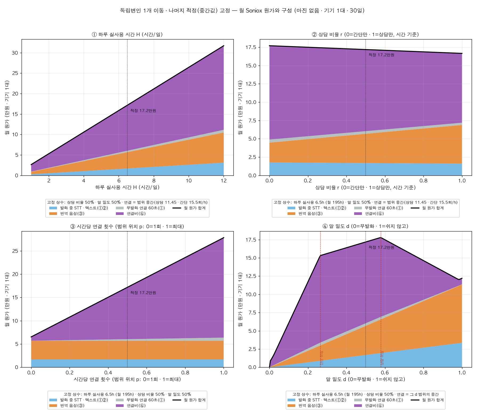

# 통키 요금 설계

- 작성: 2026-11-12
- 근거 표기
  - 〔공식〕 Soniox 가격 페이지 https://soniox.com/pricing (2026-11-12 조회)
  - 〔실측〕 Soniox usage-logs — 2026-11-12 실제 호출 2건
  - 〔계산〕 식 병기
  - 〔가정〕 미정 값
- 환율: 1달러 = 1,400원 〔가정〕

## 1. 초당 원가 산정

### 1.1 과금 구조

- 통역 1회 = STT 연결 1개 + TTS 연결 1개
  - STT: 듣기 · 받아쓰기 · 번역
  - TTS: 번역문 음성 출력
- 과금 항목 5개

| 과금 항목 | 늘어나는 요인 | 단가 | 공식 환산 | 근거 |
|---|---|--:|---|---|
| STT 입력 오디오 | **STT 연결이 열린 시간**(무발화 포함) | $2.00 / 100만 토큰 | 1시간 ≈ 30,000 토큰 | 〔공식〕 · 연결 시간 전체 과금: https://soniox.com/docs/stt/rt/connection-keepalive |
| STT 출력 텍스트 | **말한 양**(받아쓰기 + 번역문) | $4.00 / 100만 토큰 | 말 1시간 ≈ 15,000 토큰 · 1글자 ≈ 0.3 토큰 | 〔공식〕 |
| STT 입력 텍스트(context) | **연결 횟수** — 연결마다 용어집 1회 전송 | $4.00 / 100만 토큰 | — | 단가 〔공식〕 · 연결마다 〔실측〕 |
| TTS 입력 텍스트 | **읽어 줄 번역문 양** | $4.00 / 100만 토큰 | 생성 음성 1시간 ≈ 15,000 토큰 | 〔공식〕 |
| TTS 출력 오디오 | **번역 음성 재생 시간** | $21.50 / 100만 토큰 | TTS 합계 생성 음성 1시간 ≈ $0.70 | 〔공식〕 |

### 1.2 초당 원가

- 산식: 단가 × 공식 환산 ÷ 3,600초 〔계산〕
- 4개 축으로 정리 — 시간 3종 + 연결 횟수

| 축 | 포함 항목 | 1시간 원가 | **1초 원가** | 비고 |
|---|---|--:|--:|---|
| ① STT 연결 1초 | STT 입력 오디오 | $0.06 (84원) | **0.023원** | 30,000 토큰 × $2/100만 |
| ② 말한 1초 | 받아쓰기 + 번역문 텍스트 | $0.12 (168원) | **0.047원** | 15,000 + 15,000 토큰 × $4/100만 · 번역문 분량 = 받아쓰기 분량 〔가정〕 |
| ③ 번역 음성 재생 1초 | TTS 입력 텍스트 + TTS 출력 오디오 | $0.70 (980원) | **0.272원** | 〔공식〕 합계 |
| ④ 연결 1회 | context | — | **42.4원 / 회** | 약 7,576 토큰 × $4/100만 · 7개 언어 중 최대(번체 중국어) 기준 통일 · 토큰 수는 실측 언어(영어 · 중국어)의 글자당 토큰으로 추정 〔가정〕 |

- 시간 단위별 원가 — 해당 축이 그 시간 내내 계속될 때 〔계산〕

| 축 | 1초 | 1분 | 1시간 | 하루(근무 12시간) |
|---|--:|--:|--:|--:|
| ① STT 연결 | 0.023원 | 1.4원 | 84원 | 1,008원 |
| ② 말한 시간 | 0.047원 | 2.8원 | 168원 | 2,016원 |
| ③ 번역 음성 재생 | 0.272원 | 16.3원 | 980원 | 11,760원 |
| ④ 연결 | — | — | — | — |

- 1분 = 1시간 ÷ 60 · 하루 = 1시간 × 12 (하루 근무 12시간 〔사용자 지정〕)
- ④ 연결은 시간이 아니라 **횟수**에 붙는 비용 — 1회 42.4원, 시간 단위로 환산하지 않음
- 하루 값은 그 축이 12시간 쉬지 않고 이어지는 상한 — 실제 하루 원가는 3절

### 1.3 원가 식

```text
원가(원) = 0.023 × STT 연결 시간(초)
         + 0.047 × 말한 시간(초)
         + 0.272 × 번역 음성 재생 시간(초)
         + 42.4  × 연결 횟수
```

### 1.4 실측 대조

- 실측 방법
  - 통키와 같은 설정(같은 용어집 context · 양방향 번역 · 같은 TTS)으로 Soniox 1회씩 호출
  - 입력 음성: 아래 문장을 Soniox TTS 로 합성해 흘림 — 합성 비용은 원가에서 제외
  - 청구액: usage-logs 의 `cost_usd` 〔실측〕
- 실측 문장

| 케이스 | 문장 | 글자 | 번역 언어 |
|---|---|--:|---|
| **상담 1발화** | 여기 눌러보시면은, 이 오늘 결제하신 시술 건들에 대한 내용이 다 뜨고요. 그다음에 이제 이거랑 오더 메모를 확인을 해가지고, 이제 혹시 뭐 누락이 된 건은 없는지, 혹시 뭔가 좀 결제는 이렇게 하셨는데 다른 시술 건이 들어가 있지 않는지, 그런 거 다 확인하고, 크로스 체크하고, 그다음에 이제 시술을 들어가게 되고요. 저희가 그래서 이거에 맞춰가지고, 써마지라든지, 울쎄라라든지, 보톡스 어떤 거, 그 보톡스도 항목에 따라서 이제 국산, 외국산, 그리고 수입산이 있고, 그리고 또 국산에서도 국산 프리미엄이 있기 때문에, 그런 거 다 확인해가지고 이제 부위별로 들어가게 됩니다. | 325 | 중국어(zh) |
| **간단 통역 1발화** | 지금부터 울쎄라 시작할 건데, 이건 턱라인을 날렵하게 만들어 주는 리프팅이에요. 집중. | 48 | 영어(en) |

- 대조 결과

| 케이스 | STT 연결 | 말한 시간 | 번역 음성 | 실측 청구액(연결비 제외) | 식 계산 | 차이 |
|---|--:|--:|--:|--:|--:|--:|
| 상담 1발화 | 87.6초 〔실측〕 | 36.7초 〔실측〕 | 45.5초 〔실측〕 | **17.4원** 〔실측〕 | **16.1원** 〔계산〕 | −7% |
| 간단 통역 1발화 | 15.4초 〔실측〕 | 기록 없음 | 6.1초 〔실측〕 | **2.5원** 〔실측〕 | 대조 불가 | — |

- 상담 1발화 계산: 0.023 × 87.6 + 0.047 × 36.7 + 0.272 × 45.5 = 2.0 + 1.7 + 12.4 = 16.1원 〔계산〕
  - 7% 차이 원인: 출력 텍스트 실측 515 토큰 > 공식 환산 약 306 토큰 — 중국어 번역문의 토큰 과다
- 간단 통역 1발화: 말한 시간이 호출 기록에 남지 않아 식 대조 불가
- 유의
  - 시간 = 실측 토큰 ÷ 8.33 토큰/초(30,000 ÷ 3,600) 환산 〔계산〕
  - 실측 연결 시간은 합성 음성 입력 방식의 시험값 — 실제 상담과 다를 수 있음

### 1.5 소결

- 1발화 원가 — 1.3 원가 식에 1.4 실측 시간 대입 〔계산〕

| 케이스 | ① STT 연결 | ② 말한 시간 | ③ 번역 음성 | 시간 원가 소계 | ④ 연결 1회 | **1발화 원가** | 실측 청구액(참고) |
|---|--:|--:|--:|--:|--:|--:|--:|
| 상담 1발화 | 87.6초 → 2.0원 | 36.7초 → 1.7원 | 45.5초 → 12.4원 | 16.1원 | 42.4원 | **58.5원** | 53.7원 (zh context) |
| 간단 통역 1발화 | 15.4초 → 0.4원 | 15.4초 → 0.7원 〔가정〕 | 6.1초 → 1.7원 | 2.7원 | 42.4원 | **45.1원** | 34.4원 (en context) |

- 간단 통역 말한 시간: 기록 없음 → STT 연결 시간(15.4초) 전체를 말한 시간으로 가정 〔가정〕
- 연결 고정비는 최대 context(번체 중국어 42.4원) 기준이라 실측보다 높음 — 상담 +4.8원 · 간단 +10.7원
- 발화 1초당 원가 = 시간 원가 소계 ÷ (말 + 번역 음성 재생 시간) 〔계산〕
  - 연결비는 시간이 아니라 연결 횟수에 붙음 → 초당 원가에 넣지 않고 따로 더함

| 케이스 | 말 + 재생 | 시간 원가 소계 | **발화 1초당 원가** |
|---|--:|--:|--:|
| 상담 1발화 | 82.2초 | 16.1원 | **0.20원/초** |
| 간단 통역 1발화 | 21.5초 | 2.7원 | **0.13원/초** |

- 1시간 원가 식 〔계산〕

```text
1시간 원가(원) = 발화 1초당 원가 × 말 + 번역 음성 재생 시간(초)   ← 상담 0.20 · 간단 통역 0.13
              + 0.023 × 말 없이 연결만 열린 시간(초)
              + 42.4  × 연결 횟수
```

- 예: 상담을 연결 1번으로 1시간 쉬지 않고 → 0.20 × 3,600 + 42.4 × 1 ≈ **748원**
  - 0.20원/초에 실측 연결 시간 87.6초(말 + 재생 82.2초보다 5.4초 김)가 포함되어 정밀 계산(743원)보다 약간 높음

- 원가 최대 요인: **번역 음성 재생 시간**(0.272원/초)
  - 말한 시간의 약 6배 · 연결 시간의 약 12배
- 시간과 무관한 고정비: **연결 1회 42.4원**
  - 번역 음성 약 156초어치 〔계산〕 42.4 ÷ 0.272
- 시사점: 요금 축은 「통역 시간」 + 「연결 횟수」 2개가 원가 구조와 일치 → 2절에서 설계

## 2. 분석 기준 — 독립변인 1개 · 나머지 상수 고정

### 2.1 분석 방식

- 변인 1개만 범위 안에서 이동 · 나머지 변인은 상수로 고정
- 결과: 변인별 월 원가 구간(3절) → 요금 구조별 마진 비교(4절)
- 기기: **1대 기준** — 대수는 원가를 그대로 곱할 뿐이라 변인에서 제외 〔사용자 지정〕
  - 단, 동시 사용은 Soniox 동시 연결 한도(STT 10 · TTS 3, 계정 전체)에 걸림 — 운영 사항으로 별도 관리
- 원가 식: 1.5 「1시간 원가 식」 〔계산〕

### 2.2 1시간의 구성

- 실사용 1시간 = 아래 3구간 〔정의〕

| 구간 | 길이 | 원가 |
|---|---|---|
| 발화 시간(말 + 번역 음성 재생) | 말 밀도 d × 3,600초 | 발화 1초당 원가(상담 0.20 · 간단 0.13원/초) |
| 무발화 연결 시간 | 연결마다 60초 — 무발화 1분 종료 〔사용자 지정〕 | 0.023원/초 |
| 연결 안 된 시간 | 나머지 | 0원 |

- 연결 1회 고정 원가 = 무발화 60초 × 0.023 + 연결비 42.4 = **43.78원/회** 〔계산〕
- 1시간 원가(상담 · 간단 각각) 〔계산〕

```text
C(d, k) = 발화 1초당 원가 × 3,600 × d + 43.78 × k
        = 706.0 × d + 43.78 × k    ← 상담
        = 458.8 × d + 43.78 × k    ← 간단 통역
```

- 연결 횟수 k 의 제약 〔계산〕
  - 시간: 발화 시간 + 무발화 60초 × k ≤ 3,600초 → k ≤ 60 × (1 − d)
  - 발화: 연결마다 발화 1개 이상(말 없는 연결은 무발화 정책으로 제외) → k ≤ 시간당 발화 수 = 3,600 × d ÷ 발화 1회 시간
  - 최소: 말이 있으면 연결 1회 이상
  - **k 범위 = 1 ~ k최대(d) = min(3,600 × d ÷ 발화 1회 시간, 60 × (1 − d))** — 1 미만이면 1

| 유형 | 발화 1회 시간 | 시간당 발화 수 | k최대(d) | 두 제약이 바뀌는 d |
|---|--:|--:|---|--:|
| 상담 | 82.2초 〔실측〕 | 43.80 × d | min(43.80d, 60(1 − d)) | 57.8% |
| 간단 통역 | 21.5초 〔실측〕 | 167.4 × d | min(167.4d, 60(1 − d)) | 26.4% |

### 2.3 독립변인

| # | 변인 | 기호 | 단위 | 범위 | 범위 근거 |
|---|---|---|---|---|---|
| 1 | 하루 실사용 시간 | H | 시간/일 | 1 ~ 12 | 〔사용자 지정〕 근무 12h · 30일/월 |
| 2 | 상담 비율 | r | % (시간 기준) | 0 ~ 100 | 〔사용자 지정〕 |
| 3 | 시간당 연결 횟수 | k | 회/시간 | 1 ~ k최대(d) | 2.2 제약 〔계산〕 |
| 4 | 말 밀도 | d | % — 실사용 1시간 중 발화 시간 비율 | 0 ~ 100 | 100% = 쉬지 않고 통역 〔정의〕 |

- 월 원가 〔계산〕

```text
월 원가 = 30일 × H × [ r × C상담(d, k상담) + (1 − r) × C간단(d, k간단) ]
```

### 2.4 고정 상수 세트

- 적정 세트 = **각 변인 범위의 중간값** 〔사용자 지정〕
- 해피 · 워스트 = 각 변인의 원가 최저 · 최고 끝 — 범위 확인용

| 변인 | 해피 | **적정(중간값)** | 워스트 | 비고 |
|---|--:|--:|--:|---|
| 하루 실사용 시간 H | 1h | **6.5h** | 12h | (1 + 12) ÷ 2 |
| 상담 비율 r | — | **50%** | — | 원가가 낮은 쪽은 2.5 식으로 판단 |
| 말 밀도 d | 0% | **50%** | 100% | (0 + 100) ÷ 2 |
| 연결 횟수 k — 상담 (d = 50%) | 1회 | **11.45회** | 21.90회 | k최대 = min(21.90, 30) |
| 연결 횟수 k — 간단 통역 (d = 50%) | 1회 | **15.50회** | 30.00회 | k최대 = min(83.72, 30) |

- 연결 횟수의 적정 = 그때 d 에서의 범위 중간 = (1 + k최대(d)) ÷ 2 — d 가 바뀌면 같이 바뀜
- 중간값은 데이터 근거가 아닌 범위의 가운데 — 실사용 데이터가 생기면 교체 대상

- 적정 세트 1시간 원가 〔계산〕

| 유형 | 발화 시간 | 무발화 연결 | 연결비 | **1시간 원가** |
|---|--:|--:|--:|--:|
| 상담 | 353.0원 | 15.8원 | 485.5원 | **854.3원** |
| 간단 통역 | 229.4원 | 21.4원 | 657.2원 | **908.0원** |
| 상담 비율 50% 가중 | | | | **881.1원** |

### 2.5 변인별 산식 — 1개 이동 · 나머지 적정

- 각 식은 2.3 월 원가 식에 2.4 적정값을 넣은 결과 〔계산〕

**① 하루 실사용 시간 H** (r = 50% · d = 50% · k = 적정)

```text
월 원가 = 30 × H × 881.1 = 26,434 × H
```

- 1h 26,434원 · 6.5h 171,820원 · 12h 317,207원 — 직선

**② 상담 비율 r** (H = 6.5h · d = 50% · k = 적정)

```text
월 원가 = 195시간 × [ r × 854.3 + (1 − r) × 908.0 ] = 177,057 − 10,482 × r
```

- 간단 통역만 177,057원 · 상담만 166,575원 — 간단 통역이 1시간에 연결이 더 많아 비쌈

**③ 시간당 연결 횟수 k** (H = 6.5h · r = 50% · d = 50%) — 범위 위치 p = 0(1회) ~ 1(최대)

```text
k상담 = 1 + 20.90 × p        k간단 = 1 + 29.00 × p
월 원가 = 195 × [ 0.5 × (353.0 + 43.78 × k상담) + 0.5 × (229.4 + 43.78 × k간단) ]
        = 65,320 + 212,992 × p
```

- 1회 65,320원 · 적정 171,816원 · 최대 278,312원 — 직선 (적정이 ①과 4원 다른 건 k 반올림)

**④ 말 밀도 d** (H = 6.5h · r = 50% · k = 그 d 에서의 범위 중간)

```text
k(d) = (1 + k최대(d)) ÷ 2
월 원가 = 195 × [ 0.5 × (706.0 × d + 43.78 × k상담(d)) + 0.5 × (458.8 × d + 43.78 × k간단(d)) ]
```

- k최대(d)가 꺾이는 점(상담 57.8% · 간단 26.4%)에서 기울기가 바뀌는 꺾은선
- d = 0 → 발화 · 연결 없음 → 0원
- 끝값 · 꺾임 값은 3절에서 계산

## 3. 변인별 원가 — 1개 이동 · 나머지 적정 고정 (마진 없음)

- **Soniox 실제 원가만** 계산 · 마진 · 가격은 4절
- 산식: 2.5 변인별 산식 그대로 · 계산 스크립트 `orchestration/work/interpreter-idea/price-calc/sec3.py` 〔계산〕
- 원가 구성 4개
  - 발화 중 STT · 텍스트(①②) — 발화 시간 동안 STT 연결 + 받아쓰기 · 번역문
  - 번역 음성(③)
  - 무발화 연결 60초(①) — 연결마다 꼬리 60초
  - 연결비(④) — 연결 1회 42.4원

### 3.1 적정 세트 원가 (기기 1대 · 월)

| 항목 | 값 | 근거 |
|---|--:|---|
| 월 사용 시간 | 195시간 | 30일 × 6.5h 〔계산〕 |
| 시간당 연결 | 상담 11.45회 · 간단 15.50회 | 2.4 〔계산〕 |
| 월 연결 횟수 | 2,628회 | 〔계산〕 |
| **월 원가** | **171,784원** | 〔계산〕 |
| 사용 1시간당 원가 | 881원 | 〔계산〕 |

| 원가 구성 | 월(원) | 비중 |
|---|--:|--:|
| 발화 중 STT · 텍스트(①②) | 16,784 | 10% |
| 번역 음성(③) | 39,967 | 23% |
| 무발화 연결 60초(①) | 3,626 | 2% |
| 연결비(④) | 111,407 | **65%** |

### 3.2 그래프



- 쌓인 면적 = 원가 구성 4개 · 검은 실선 = 월 원가 합계 · 세로 점선 = 적정값
- 각 칸 아래 범례 제목 = 그 칸의 고정 상수
- ④ 말 밀도의 빨간 점선 = 연결 횟수 최대가 꺾이는 점(간단 26.4% · 상담 57.8%)

### 3.3 변인별 끝값

| 변인 | 값 | 시간당 연결(상담 · 간단) | 월 원가(원) | 1시간당(원) | ①② | ③ | 무발화 ① | ④ 연결비 |
|---|---|--:|--:|--:|--:|--:|--:|--:|
| ① 하루 실사용 H | 1h | 11.45 · 15.50 | 26,428 | 881 | 2,582 | 6,149 | 558 | 17,140 (65%) |
| | **6.5h** | 11.45 · 15.50 | **171,784** | 881 | 16,784 | 39,967 | 3,626 | 111,407 (65%) |
| | 12h | 11.45 · 15.50 | 317,139 | 881 | 30,986 | 73,785 | 6,694 | 205,674 (65%) |
| ② 상담 비율 r | 0% (간단만) | 11.45 · 15.50 | 177,011 | 908 | 17,599 | 27,087 | 4,171 | 128,154 (72%) |
| | **50%** | 11.45 · 15.50 | **171,784** | 881 | 16,784 | 39,967 | 3,626 | 111,407 (65%) |
| | 100% (상담만) | 11.45 · 15.50 | 166,556 | 854 | 15,969 | 52,846 | 3,081 | 94,660 (57%) |
| ③ 연결 횟수 p | 0 (1회) | 1.00 · 1.00 | 65,288 | 335 | 16,784 | 39,967 | 269 | 8,268 (13%) |
| | **0.5** | 11.45 · 15.50 | **171,784** | 881 | 16,784 | 39,967 | 3,626 | 111,407 (65%) |
| | 1 (최대) | 21.90 · 30.00 | 278,279 | 1,427 | 16,784 | 39,967 | 6,983 | 214,546 (77%) |
| ④ 말 밀도 d | 0% | 0 · 0 | 0 | 0 | 0 | 0 | 0 | 0 |
| | 26.4% (간단 꺾임) | 6.28 · 22.59 | 153,142 | 785 | 8,855 | 21,087 | 3,883 | 119,316 (78%) |
| | **50%** | 11.45 · 15.50 | **171,784** | 881 | 16,784 | 39,967 | 3,626 | 111,407 (65%) |
| | 57.8% (상담 꺾임 · 최고) | 13.16 · 13.16 | 177,938 | 913 | 19,406 | 46,210 | 3,541 | 108,782 (61%) |
| | 100% | 1.00 · 1.00 | 122,039 | 626 | 33,568 | 79,934 | 269 | 8,268 (7%) |

- 단위 원 · 기기 1대 · 30일 〔계산〕 · 괄호 = 월 원가 중 연결비 비중
- ③ 연결 횟수를 움직여도 ①② · ③ 은 그대로 — 발화량은 말 밀도로만 정해짐

### 3.4 소결

- 기기 1대 월 원가: 적정 **약 17만 원**(사용 1시간당 881원) · 변인 범위 안에서 **약 2.6만 ~ 31.7만 원**
- **① 하루 실사용 시간**: 원가가 시간에 정비례 — 1시간당 881원 고정 · 범위 가장 넓음(12배)
- **③ 시간당 연결 횟수**: 사용 시간 고정 변인 중 가장 크게 흔듦 — 1회 6.5만 원 ~ 최대 27.8만 원(4.3배)
  - 연결 1회면 연결비 비중 13% · 최대면 77%
- **④ 말 밀도**: 단조 증가가 아님 — 57.8% 에서 최고(17.8만 원) 후 감소
  - 말이 늘면 번역 음성(③)이 늘지만, 무발화 60초가 들어갈 틈이 줄어 연결 횟수 최대가 감소 → 연결비 감소
  - 100%(쉬지 않고 통역) = 연결 1회 · 12.2만 원 — 번역 음성이 원가의 65%
  - 98% 부근 작은 꺾임: 연결 횟수 최대가 하한 1회에 닿는 점
- **② 상담 비율**: 영향 작음(16.7만 ~ 17.7만 원) — 간단 통역이 연결이 잦아 약간 비쌈
- 원가의 대부분은 **연결비** — 연결 횟수의 적정(범위 중간)은 데이터 근거 없음 → 실제 연결 빈도 확인이 가장 중요

## 4. 요금제 — 시간제 · 정액제(2만 원) · 토큰제 × 마진 30 · 50 · 70%

- 마진율 m = 30 · 50 · 70% 〔가정 — 비교용〕 · 마진 = (매출 − 원가) ÷ 매출
- 원가: 1.5 · 3절 값 · 계산 스크립트 `orchestration/work/interpreter-idea/price-calc/sec4.py` 〔계산〕
- 월 2만 원 = 대표 투표 결과(4명 전원 「잘만 되면 월 2만 원도 가능」) — 정액제 가격으로 고정 〔사용자 지정〕

### 4.1 요금 구조

| 요금제 | 매출 식 | 가격 정하는 법 |
|---|---|---|
| 시간제 | 사용 1시간당 p원 × 사용 시간 | p = 적정 1시간 원가 881원 ÷ (1 − m) |
| 정액제 | 월 20,000원 · **포함 대화 N건** · 초과 시 건당 요금 | N = 20,000 × (1 − m) ÷ 대화 1건 원가 |
| 토큰제 | Soniox 원가 ÷ (1 − m) | 원가를 그대로 따라감 |

- 대화 1건 = 연결 1회 + 1발화 〔정의〕 — 2만 원 정액제의 포함량 단위
  - 상담 대화 1건 원가 = 16.1(1발화 시간 원가) + 43.78(연결 1회 + 무발화 60초) = **59.9원** 〔계산〕
  - 간단 통역 대화 1건 원가 = 2.7 + 43.78 = **46.5원** 〔계산〕
  - 연결 1회에 발화가 여러 개면 대화 1건 원가 하락 — 이 표는 1발화 기준(보수)

### 4.2 시간제

| 마진 | 1시간 가격 | 적정 사용 시 월(195h) | 최악 1시간 원가(1,427원)에서 마진 | 최저 1시간 원가(335원)에서 마진 |
|---|--:|--:|--:|--:|
| 30% | 1,259원 | 245,405원 | **−13.4% (적자)** | 73.4% |
| 50% | 1,762원 | 343,567원 | 19.0% | 81.0% |
| 70% | 2,937원 | 572,612원 | 51.4% | 88.6% |

- 최악 · 최저 1시간 원가 = 3절 변인 끝값 중 1시간 원가 최고(연결 횟수 최대) · 최저(연결 1회) 〔계산〕
- 사용 시간만 세므로 연결 횟수가 늘어도 매출 그대로 → 마진 30% 에선 적자 구간 발생

### 4.3 정액제 (월 2만 원)

- 적정 사용(월 원가 171,784원)이면 월 **151,784원 적자** — 2만 원은 적정 사용량을 못 감당 〔계산〕
- → 포함 대화 수로 사용량 제한

| 마진 | 원가 예산(월) | 포함 — 상담 대화 | 포함 — 간단 통역 대화 | 초과 1건 — 상담 | 초과 1건 — 간단 |
|---|--:|--:|--:|--:|--:|
| 30% | 14,000원 | 월 234건 (하루 7.8건) | 월 301건 (하루 10.0건) | 86원 | 67원 |
| 50% | 10,000원 | 월 167건 (하루 5.6건) | 월 215건 (하루 7.2건) | 120원 | 93원 |
| 70% | 6,000원 | 월 100건 (하루 3.3건) | 월 129건 (하루 4.3건) | 200원 | 155원 |

- 초과 1건 요금 = 대화 1건 원가 ÷ (1 − m) 〔계산〕
- 원가를 줄여 포함량을 늘리는 방법: context(용어집) 축소 — 연결비 42.4원이 context 토큰에 비례 〔공식 단가 · 계산〕

| 마진 | 포함 하루 대화 — 지금 context | context 절반 | context 1/4 |
|---|--:|--:|--:|
| 30% | 상담 7.8 · 간단 10.0 | 상담 12.1 · 간단 18.4 | 상담 16.6 · 간단 31.7 |
| 50% | 상담 5.6 · 간단 7.2 | 상담 8.6 · 간단 13.2 | 상담 11.9 · 간단 22.6 |
| 70% | 상담 3.3 · 간단 4.3 | 상담 5.2 · 간단 7.9 | 상담 7.1 · 간단 13.6 |

- context 축소 시 번역 품질 영향은 확인 안 됨 〔미정〕

### 4.4 토큰제

| 마진 | 원가 배수 | 상담 대화 1건 | 간단 통역 대화 1건 | 적정 사용 시 월 |
|---|--:|--:|--:|--:|
| 30% | × 1.43 | 86원 | 67원 | 245,405원 |
| 50% | × 2.00 | 120원 | 93원 | 343,567원 |
| 70% | × 3.33 | 200원 | 155원 | 572,612원 |

- 원가를 그대로 따라가므로 모든 변인에서 마진 m 유지 〔계산〕
- 고객 쪽에선 월 금액을 미리 알 수 없음

### 4.5 비교

| 항목 | 시간제 | 정액제 2만 원 | 토큰제 |
|---|---|---|---|
| 고객 쪽 월 금액 (적정 사용 · 마진 50%) | 343,567원 | 20,000원 (포함량 안) | 343,567원 |
| 고객이 미리 아는가 | 사용 시간만 알면 앎 | 앎 | 모름 |
| 적자 위험 | 연결 횟수 많을 때 (마진 30% 이하에서 적자) | 포함량 없으면 큼 · 포함량 있으면 없음 | 없음 |
| 깨지는 변인 | 연결 횟수 · 말 밀도 | 사용량 전체 → 대화 수 제한으로 막음 | 없음 |

### 4.6 소결

- **2만 원 정액제는 대화 수를 제한해야 성립** — 마진 50% 기준 하루 상담 5.6건 · 간단 통역 7.2건(1발화 1연결 기준)
- 포함량을 늘리는 길은 연결비 축소 — 원가의 65 ~ 94% 가 연결비
  - context 축소(절반이면 포함량 약 1.5 ~ 1.8배)
  - 연결 1회에 발화 여러 개 — 무발화 종료 시간 조정(1분 → 길게, 손익분기 약 30분) · 단 Soniox 동시 연결 한도 점유
- 시간제는 연결비를 못 따라가 마진 30% 에서 적자 구간 · 토큰제는 안전하지만 고객이 월 금액을 모름
- 안: **정액 2만 원 + 포함 대화 수 + 초과분 토큰제(건당)** — 고객은 기본 금액을 알고, 초과분은 원가를 따라감
- 정할 것: 마진율 · 포함 대화 수 · context 축소 여부 · 무발화 종료 시간

## 5. 결론 — 월 2만 원으로 쓸 수 있는 양

- 판매 기준: **월 2만 원** 〔사용자 지정〕 · 초과분 요금은 옵션으로 따로 제안
- 상담 · 간단 통역은 원가 측정용 케이스 — 판매 단위는 **토큰 · 시간 · 발화** 셋
- 계산 스크립트 `orchestration/work/interpreter-idea/price-calc/sec5.py` 〔계산〕

### 5.1 1단위 원가

| 단위 | 1단위 원가 | 근거 |
|---|--:|---|
| 토큰 1,000개 | 5.75 ~ 6.47원 | 1.4 실측 2건 — 청구액 ÷ 토큰 합계(간단 34.44원 / 5,990토큰 · 상담 53.73원 / 8,301토큰) 〔실측 · 계산〕 |
| 사용 1시간 | 881원 | 3.1 적정 세트 1시간 원가 〔계산〕 · 범위 335 ~ 1,427원(3.3 끝값) |
| 발화 1개 | 14.16원 | 베타 실사용 — 운영 통역 기록 11-11 ~ 11-14(세션 43 · 발화 137) 추정 원가 1,940원 ÷ 137 〔실측 기록 · 계산〕 |

- 발화 1개 원가에는 말 없이 끝난 세션의 연결비도 포함(세션 43개 중 19개가 발화 0)
- 발화 원가 추정: 세션마다 연결비 42.4원 + STT 0.023원 × 연결 초 + (0.272 + 0.047)원 × 번역 음성 초 — 번역 음성 초는 기록에 없어 **번역문 글자 × 0.13초로 추정**(1.4 실측 상담 45.5초 / 325자 · 간단 6.1초 / 48자 근사) 〔가정〕
- 토큰의 약 80%는 연결마다 보내는 용어집(context) — 말을 안 해도 연결하면 쓰임

### 5.2 마진별 2만 원 포함량

| 마진 | 원가 예산(월) | 토큰(월) | 사용 시간(월 · 하루) | 발화(월 · 하루) |
|--:|--:|--:|--:|--:|
| 30% | 14,000원 | 216만 ~ 243만 | 15.9시간 · 32분 | 989개 · 33개 |
| 40% | 12,000원 | 185만 ~ 209만 | 13.6시간 · 27분 | 848개 · 28개 |
| 50% | 10,000원 | 154만 ~ 174만 | 11.4시간 · 23분 | 706개 · 24개 |
| 60% | 8,000원 | 124만 ~ 139만 | 9.1시간 · 18분 | 565개 · 19개 |
| 70% | 6,000원 | 93만 ~ 104만 | 6.8시간 · 14분 | 424개 · 14개 |

- 원가 예산 = 20,000 × (1 − 마진) · 포함량 = 원가 예산 ÷ 1단위 원가 · 하루 = 월 ÷ 30 〔계산〕
- 참고: 베타 실사용은 하루 평균 34발화(137 ÷ 4일) — 마진 30% 포함량(하루 33개)과 비슷

### 5.3 유의

- 발화 원가는 베타 4일 · 가벼운 시험 사용 기준 — 실제 병원 사용 데이터가 쌓이면 다시 계산
- 시간 원가는 연결 횟수에 따라 4배 넘게 달라짐(335 ~ 1,427원) — 시간 기준은 적자 위험이 가장 큼
- 포함량을 늘리는 길: 용어집(context) 축소 · 무발화 종료 시간 연장(연결 횟수 감소) — 4.3 · 4.6
