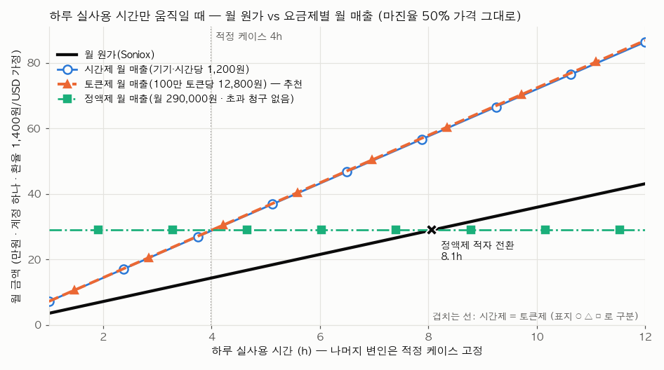
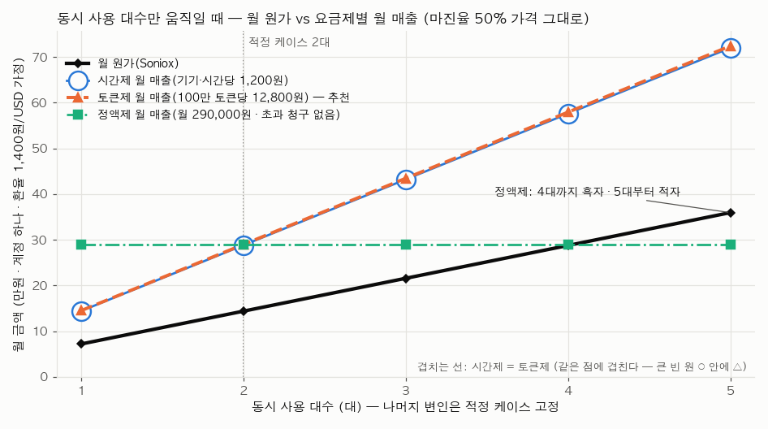
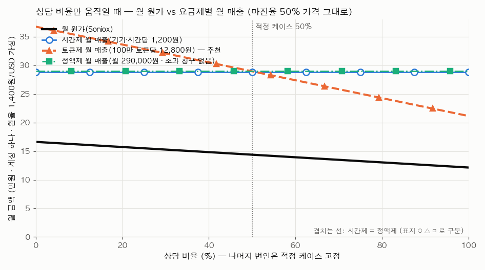
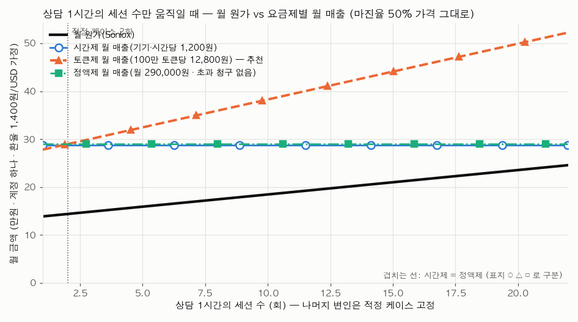
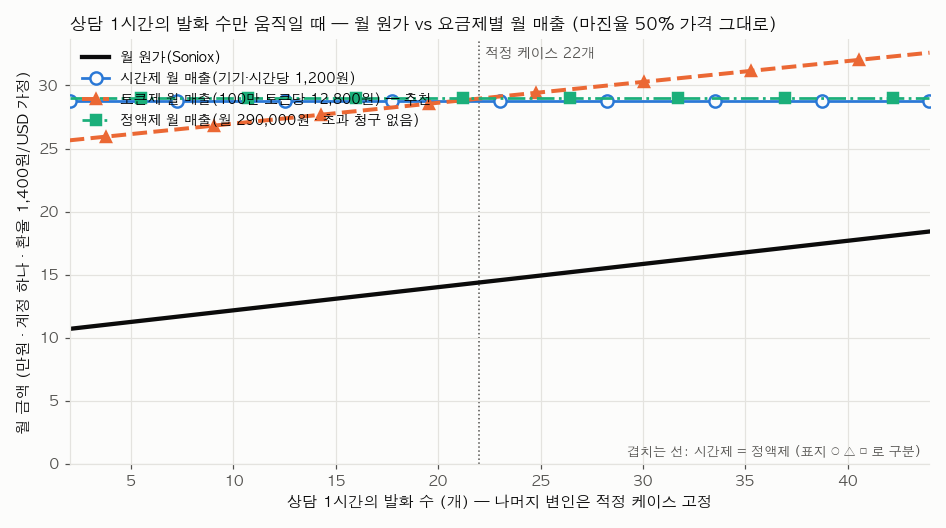
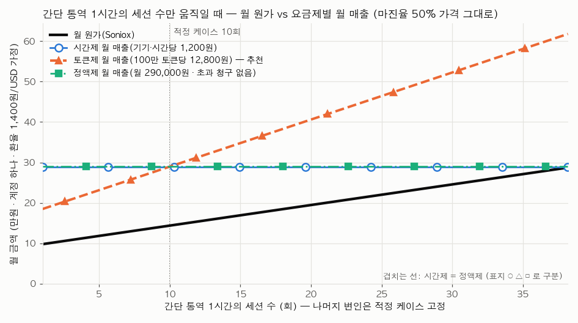
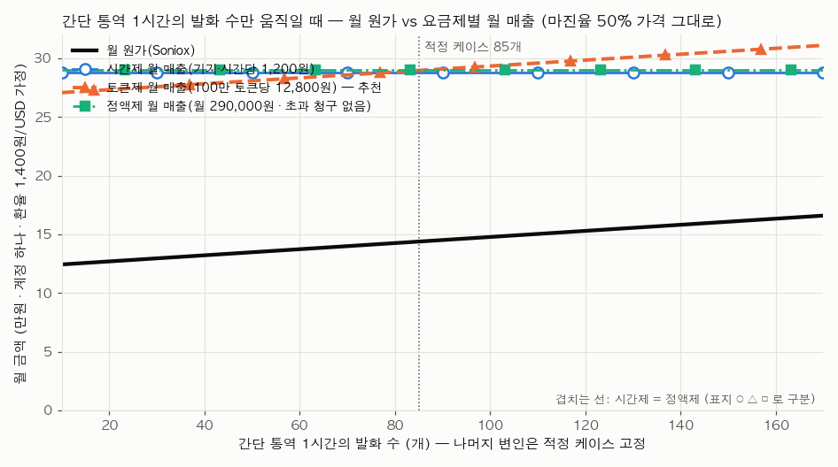

# 통키 요금제 설계 — 적정 케이스에서 가격을 정한다

- 작성 2026-11-12 · 2판(1판은 `orchestration/work/interpreter-idea/pricing-design-v1.md`) · 실측 조회일 2026-11-12 · 단가 출처 https://soniox.com/pricing 〔공식〕
- 숫자 · 그래프는 전부 `orchestration/work/interpreter-idea/pricing-calc2/calc2.py` 가 뽑았다(손 편집 없음). 맨 위 「적정 케이스」 블록을 고치고 다시 돌리면 이 문서 전체가 다시 나온다.
- 근거 표기: 〔실측〕 Soniox usage-logs · 〔공식〕 Soniox 문서 · 〔사용자 지정〕 사용자가 정한 값 · 〔가정〕 근거가 약한 값(「사용자 승인」이 붙으면 사용자가 확정한 적정 케이스) · 〔계산〕 식을 같이 적음.
- 금액은 원으로 적는다 — USD 원가 × 환율 1,400원/USD 〔가정〕. 특정 병원 · 지점 데이터는 쓰지 않았다.

## 0. 결론

**추천: 토큰제 — 그 달에 쓴 Soniox 토큰 100만 개당 12,800원**(1,000개당 12.8원 · 계정별로 합산해 월말 청구) 〔계산〕 §4 · 마진율 50% 〔가정〕.

**왜 토큰제인가** — 실사용 데이터가 하나도 없는 지금, 재지 못한 것에 마진이 걸리지 않는 안이라서다.

1. **변인 하나를 범위 끝까지 밀었을 때 가장 낮은 마진이 42.6%다.** 같은 조건에서 시간제는 0.2%(간단 통역 1시간의 세션 수 38.2회) · 정액제는 -48.8%(하루 실사용 12h)다. 세션 · 발화 · 상담 비율을 한꺼번에 가장 나쁜 쪽으로 몰아도 토큰제는 28.4% · 시간제는 -84.3%다 〔계산〕 §5.
2. **세션 정책이 바뀌어도 버틴다.** 수동 stop 을 허용해 발화마다 세션이 새로 열리면 시간제 -117.9% · 정액제 -116.4% · 토큰제 55.0%다 — 세션이 늘면 context 토큰이 같이 늘어 매출이 원가를 따라간다 〔계산〕 §6.
3. **무엇을 재서 청구하는지가 이미 정해져 있다.** 토큰은 Soniox 사용 기록의 숫자 그대로다 — 단 그 숫자를 고객 계정별로 가르는 집계는 아직 안 된다(확인 전 · §7 #6). 시간제는 「1시간」을 무엇으로 재느냐(실사용 · 스트림 · 발화 시간)에 따라 같은 1,200원에서 마진이 53.2% ~ -11.1%로 갈리고, 그 정의는 아직 없다 〔계산〕 §4.2.

**치르는 값**: 고객이 청구액을 미리 셈하기 어렵다. 같은 1시간을 써도 세션 · 발화가 얼마나 잦으냐에 따라 770원에서 2,573원까지 나온다(적정 케이스 1,207원) 〔계산〕 §5. 그래서 고객 안내는 「보통 1시간에 약 1,200원」 같은 환산과 사용량 화면으로 덧붙여야 한다 〔가정〕.

이 표가 보여 주는 것: 세 요금제를 같은 잣대로 놓은 것 — 적정 케이스 청구액은 같고, 적정 케이스를 벗어날 때의 마진과 고객의 셈이 갈린다.

| 요금제 | 가격 | 적정 케이스 월 청구액 | 변인 1개를 범위 끝까지 — 최저 마진 | 한꺼번에 최악 | 수동 stop 허용 시 | 고객이 미리 셈할 수 있나 | 근거 |
|---|--:|--:|--:|--:|--:|---|---|
| **토큰제(추천)** | 100만 토큰당 12,800원 | 289,607원 | 42.6% | 28.4% | 55.0% | 어렵다 — 실사용 1시간에 770원 ~ 2,573원 | 〔계산〕 §4 · §5 · §6 |
| 시간제 | 기기·시간당 1,200원 | 288,000원 | 0.2% | -84.3% | -117.9% | 청구 시계가 실사용 시간이면 된다(시간 × 1,200원) · 스트림 시간이면 어렵다 | 〔계산〕 §4 · §5 · §6 |
| 정액제 | 계정당 월 290,000원 | 290,000원 | -48.8% | -83.0% | -116.4% | 된다 — 매달 같은 금액 | 〔계산〕 §4 · §5 · §6 |

이 표가 보여 주는 것: 적정 케이스 고객(하루 4h · 2대 · 상담 반반) 한 계정이 토큰제로 한 달에 내는 돈과 우리 원가 〔계산〕 · 조건 〔가정 — 사용자 승인〕.

| 항목 | 값 | 근거 |
|---|--:|---|
| 월 사용량 | 240 기기·시간 · 22.63 백만 토큰 | 〔계산〕 30일 × 2대 × 4h × 1시간 94,273 토큰 · 값은 〔가정 — 사용자 승인〕 |
| 월 청구액 | 289,607원 | 〔계산〕 22.63 백만 토큰 × 12,800원 |
| 월 원가(Soniox) | 143,802원 | 〔계산〕 §3 |
| 월 이익 | 145,805원 | 〔계산〕 청구액 − 원가 |
| 마진 | 50.3% | 〔계산〕 이익 ÷ 청구액 |

- **월 2만원과의 관계**: 적정 케이스 청구액 29.0만원은 2만원의 14.5배다. 2만원으로는 1.56 백만 토큰 — 적정 케이스 쓰임새로 월 16.6 기기·시간(1대로 하루 33분)을 쓴다. 원가만 따져도 2만원은 월 33.4 기기·시간어치라, 「월 2만원 정액」은 적정 케이스에서 매달 123,802원 적자다 〔계산〕 · 2만원은 대표 투표 참고선 〔사용자 지정〕.
- **시간제를 고를 수 있게 되는 조건**: ① 청구 시계를 정하고 ② 세션이 무발화 1분 자동 종료로만 끝나며 ③ 실제 세션 수를 재서 간단 통역 1시간 38.2회 같은 끝이 안 나온다는 것을 확인한 뒤다. 그때는 고객이 셈할 수 있다는 장점이 살아난다 〔계산〕 §4.2 · §5 · 정책 〔사용자 지정〕.
- 이 결론은 §1 적정 케이스 표 위에 서 있다. 표의 값이 바뀌면 단가가 바뀐다 — 「하루 4h」는 근거가 약하다고 사용자가 밝힌 값이지만, 하루 실사용 시간 · 대수는 토큰제 단가를 바꾸지 않고 월 청구액만 바꾼다 〔가정 — 사용자 승인〕.
- 2판 첫 원고는 시간제를 추천했다. 검수에서 그 이유 둘(시간 · 대수에 마진 고정 · 범위 안 적자 없음)이 토큰제에도 똑같이 맞고 최저 마진은 토큰제가 높다는 점(42.6% 대 0.2%)이 드러나 추천을 바꿨다 〔계산〕.

## 1. 적정 케이스 가정 표

**이 표만 고치면 결론이 바뀐다.** 아래 값은 스크립트 맨 위 블록에 그대로 들어 있다.

이 표가 보여 주는 것: 변인마다 「적정 케이스는 이것」으로 놓은 값 · 사용자가 준 범위 · 그렇게 놓은 이유.

| 변인 | 적정 | 범위 | 이유 | 근거 |
|---|--:|---|---|---|
| 하루 실사용 시간(기기 1대) | 4h | 1 ~ 12h | 근무 12h 중 외국인 응대 약 1/3 — **근거 약함** | 적정 〔가정 — 사용자 승인〕 · 범위 〔사용자 지정〕 |
| 동시 사용 대수 | 2대 | 1 ~ 5대 | 상담실 1대 + 데스크 1대 | 적정 〔가정 — 사용자 승인〕 · 범위 〔사용자 지정〕 |
| 상담 비율(시간 기준) | 50% | 0 ~ 100% | 범위 가운데 | 적정 〔가정 — 사용자 승인〕 · 범위 〔사용자 지정〕 |
| 상담 1시간 | 세션 2회 · 발화 22개 | 세션 1회 ~ 최대 · 발화 ~ 44개 | 1분 넘는 공백 1번 · 밀도 최대(44개)의 절반 | 적정 〔가정 — 사용자 승인〕 · 범위 〔사용자 지정〕 |
| 간단 통역 1시간 | 세션 10회 · 발화 85개 | 세션 1회 ~ 최대 · 발화 ~ 170개 | 짧은 응대 6분에 1번 · 밀도 최대(170개)의 절반 | 적정 〔가정 — 사용자 승인〕 · 범위 〔사용자 지정〕 |
| 세션 종료 | 무발화 1분 자동 종료만 | 정책 | 수동 stop 은 넣지 않는다 | 〔사용자 지정〕 |
| 한 달 | 30일 | — | — | 〔사용자 지정〕 |
| 환율 | 1,400원/USD | — | 사용자 미정 | 〔가정〕 |
| 마진율 | 50% 기준 · 30% · 70% 병기 | — | 사용자 미정 | 〔가정〕 |

- 낱말: **세션** = STT 연결 한 번(열 때마다 context 를 보내 연결 고정비가 든다) · **발화** = 한 사람이 한 번 말하고 통역이 나오는 한 덩이 · **기기·시간** = 기기 1대가 1시간 쓴 양(2대가 4h 쓰면 8 기기·시간) 〔계산〕.
- **적정 케이스 표에 없어 이 문서가 더한 가정 1개**: 「실사용 1시간」 동안 STT 스트림은 60분 내내 열려 있다고 본다 〔가정〕(미승인 · §3.3 에서 다른 셈법과 비교 · §7 #5).
- 발화 범위 끝(44개 · 170개)은 사용자 지정값이다. 실측 연결 시간으로 1시간에 들어가는 최대는 상담 41.1개 · 간단 통역 233.8개 〔계산〕 3,600초 ÷ 발화 하나 연결 시간(§2) — 상담 44개는 실측 기준으로는 1시간에 다 들어가지 않는다.

## 2. 원가 함수

이 표가 보여 주는 것: Soniox 가 돈을 받는 다섯 항목의 단가.

| 과금 항목 | 단가(USD / 100만 토큰) | 근거 |
|---|--:|---|
| STT 입력 오디오(실시간) | 2.00 | 〔공식〕 https://soniox.com/pricing |
| STT 입력 텍스트(context) | 4.00 | 〔공식〕 https://soniox.com/pricing |
| STT 출력 텍스트(전사 + 번역) | 4.00 | 〔공식〕 https://soniox.com/pricing |
| TTS 입력 텍스트 | 4.00 | 〔공식〕 https://soniox.com/pricing |
| TTS 출력 오디오 | 21.50 | 〔공식〕 https://soniox.com/pricing |

- 실시간 오디오는 1시간에 30,000 토큰으로 환산한다 〔공식〕 https://soniox.com/pricing. STT 는 스트림이 열려 있는 전체 시간을 과금한다 〔공식〕 https://docs.soniox.com/stt/rt/connection-keepalive.

```text
한 연결의 원가(USD) = 2.00 × 입력 오디오 토큰 + 4.00 × context 토큰 + 4.00 × 출력 텍스트 토큰      〔공식〕 단가
                     + 4.00 × TTS 입력 토큰 + 21.50 × TTS 출력 오디오 토큰      (각 항 ÷ 100만)   〔공식〕 단가 × 토큰
```

이 표가 보여 주는 것: 실측 2건의 토큰을 위 식에 넣으면 Soniox 가 청구한 금액과 같다(식이 맞다는 확인) 〔실측〕 · 〔계산〕.

| 실측 | 언어쌍 | context 토큰 | 입력 오디오 토큰 | 출력 텍스트 토큰 | TTS 입력 토큰 | TTS 출력 오디오 토큰 | 스트림 시간 | 식으로 계산 | 로그 청구액 | 근거 |
|---|---|--:|--:|--:|--:|--:|--:|--:|--:|---|
| 상담 1발화 | ko→zh | 6,494개 | 730개 | 515개 | 183개 | 379개 | 87.6초 | $0.0383765 | $0.0383765 | 토큰 · 시간 · 청구액 〔실측〕 · 식 〔계산〕 |
| 간단 통역 1발화 | ko→en | 5,698개 | 128개 | 82개 | 31개 | 51개 | 15.4초 | $0.0245965 | $0.0245965 | 토큰 · 시간 · 청구액 〔실측〕 · 식 〔계산〕 |

이 표가 보여 주는 것: 1시간 원가를 만드는 세 부품 — 시간에 붙는 것 · 세션에 붙는 것 · 발화에 붙는 것 〔계산〕.

| 부품 | 무엇에 비례 | 값(USD) | 값(원) | 근거 |
|---|---|--:|--:|---|
| 스트림 오디오비 | 스트림이 열린 시간 | $0.0600 / 시간 | 84.0원 / 시간 | 〔계산〕 30,000 토큰 × $2.00 ÷ 100만 · 단가 〔공식〕 |
| 연결 고정비 | 세션 수 | $0.030304 / 세션 | 42.4원 / 세션 | 〔계산〕 context 7,576 토큰 × $4.00 ÷ 100만 — 토큰 수는 context 가 가장 큰 번체 중국어 기준 〔가정〕(추정 · 1판 §1.4) |
| 상담 발화 변동비 | 상담 발화 수 | $0.0109405 / 발화 | 15.3원 / 발화 | 〔계산〕 실측 토큰 × 단가(출력 텍스트 + TTS 입력 + TTS 출력) · 토큰 〔실측〕 |
| 간단 통역 발화 변동비 | 간단 통역 발화 수 | $0.0015485 / 발화 | 2.2원 / 발화 | 〔계산〕 같은 식 · 토큰 〔실측〕 |

- 브리프에 적힌 발화 단가(상담 17.4원 · 간단 통역 2.5원)와 위 표가 다른 이유: 브리프 값은 그 발화의 입력 오디오(상담 730 토큰 = 2.0원 · 간단 통역 128 토큰 = 0.4원)를 발화에 넣은 것이고, 이 문서는 그것을 스트림 오디오비로 옮겨 셌다. 넣어서 세면 17.4원 · 2.5원이 되어 브리프와 같다 〔계산〕 · 토큰 〔실측〕.

```text
기기 1대 · 실사용 1시간 원가 = 스트림 오디오비 + 세션 수 × 연결 고정비 + 발화 수 × 발화 변동비      〔계산〕
월 원가 = 30일 × 동시 사용 대수 × 하루 실사용 시간 × (상담 비율 × 상담 1시간 원가 + (1 − 상담 비율) × 간단 통역 1시간 원가)   〔계산〕
```

## 3. 적정 케이스 원가

### 3.1 1시간 원가

이 표가 보여 주는 것: 적정 케이스의 1시간 원가를 부품별로 쌓은 것(기기 1대 · 원) 〔계산〕.

| 종류 | 스트림 오디오비 | 연결 고정비 | 발화 변동비 | **1시간 원가** | 근거 |
|---|--:|--:|--:|--:|---|
| 상담 1시간 | 84.0원 | 2회 × 42.4원 = 84.9원 | 22개 × 15.3원 = 337.0원 | **506원** | 〔계산〕 세 부품의 합 · 세션 · 발화 수 〔가정 — 사용자 승인〕 |
| 간단 통역 1시간 | 84.0원 | 10회 × 42.4원 = 424.3원 | 85개 × 2.2원 = 184.3원 | **693원** | 〔계산〕 세 부품의 합 · 세션 · 발화 수 〔가정 — 사용자 승인〕 |
| 섞음(상담 50%) | — | — | — | **599원** | 〔계산〕 0.5 × 506원 + 0.5 × 693원 |

- 간단 통역이 상담보다 비싸다 — 세션이 1시간에 10회라 연결 고정비가 1시간 원가의 61%를 차지한다. 섞음 기준으로도 연결 고정비가 42%다 〔계산〕.

### 3.2 월 원가

```text
월 사용량 = 30일 × 2대 × 4h = 240 기기·시간                         〔계산〕 값은 〔가정 — 사용자 승인〕
월 원가   = 240 기기·시간 × 599원 = 143,802원 (약 14.4만원)              〔계산〕
월 토큰   = 240 기기·시간 × 94,273 토큰 = 22.63 백만 토큰                  〔계산〕 토큰제에 쓴다
```

### 3.3 코디 계산과의 차이 — 스트림 오디오비를 세는 법

코디가 브리프에 적은 값은 상담 467원 · 간단 639원 · 섞음 553원 / 월 약 13.3만원이다 〔가정〕(코디 계산). 이 문서의 값과 다른 이유는 **하나** — 스트림이 열려 있는 시간을 얼마로 보느냐다. 연결 고정비 · 발화 변동비는 같다 〔계산〕.

이 표가 보여 주는 것: 스트림 시간을 세는 세 가지 법과 그때의 원가. 이 문서는 맨 윗줄을 쓴다.

| 셈법 | 상담 스트림 | 간단 스트림 | 상담 1시간 | 간단 1시간 | 섞음 1시간 | 월 원가 | 근거 |
|---|--:|--:|--:|--:|--:|--:|---|
| **60분 내내 열림(이 문서)** | 60.0분 | 60.0분 | 506원 | 693원 | 599원 | 143,802원 | 〔계산〕 |
| 하한 — 발화 연결 시간 + 세션마다 60초 꼬리 | 34.1분 | 31.8분 | 470원 | 653원 | 561원 | 134,715원 | 〔계산〕 |
| 발화 연결 시간만(코디 계산과 같음) | 32.1분 | 21.8분 | 467원 | 639원 | 553원 | 132,699원 | 〔계산〕 |

- 셋째 줄이 코디 값(467원 · 639원 · 553원)과 맞는다 — 검산 일치 〔계산〕.
- 그 셈법을 쓰지 않은 이유: Soniox 는 발화 사이에도 스트림이 열려 있으면 과금하고 〔공식〕 https://docs.soniox.com/stt/rt/connection-keepalive, 무발화 1분 자동 종료 〔사용자 지정〕 는 세션마다 끝에 60초를 더 열어 둔다. 그래서 실제 값은 첫째 줄과 둘째 줄 사이다 〔계산〕.
- 첫째 줄(상한)을 고른 것은 원가를 낮게 잡지 않기 위해서다 〔가정〕. 둘째 줄이 맞다면 월 원가는 6.3% 낮고, 토큰제 12,800원에서 마진은 45.7%다(오디오 토큰이 줄어 매출도 같이 준다). 시간제는 청구 시계에 따라 갈린다 — §4.2 〔계산〕.

## 4. 요금제 3안 — 적정 케이스 기준

### 4.1 세 안의 가격

가격은 「적정 케이스 고객에게서 마진율을 지키는 값」으로 정한다: **가격 = 적정 케이스 원가 ÷ (1 − 마진율)**, 그리고 시간제 · 토큰제는 100원, 정액제는 10,000원 단위로 올림 〔계산〕 · 올림 단위 〔가정〕.

이 표가 보여 주는 것: 세 요금제의 과금 공식 · 마진율 50% 가격 · 적정 케이스 고객의 월 청구액과 마진 〔계산〕 · 마진율 〔가정〕.

| 요금제 | 과금 공식 | 올림 전 가격 | **가격** | 적정 케이스 월 청구액 | 월 원가 | 마진 | 근거 |
|---|---|--:|--:|--:|--:|--:|---|
| 시간제 | 월 청구 = 기기·시간 × 단가 | 1,198.3원 | **기기·시간당 1,200원** | 288,000원 | 143,802원 | 50.1% | 〔계산〕 599원 ÷ (1 − 0.5) |
| 토큰제 | 월 청구 = 쓴 Soniox 토큰(100만 단위) × 단가 | 12,711.4원 | **100만 토큰당 12,800원** | 289,607원 | 143,802원 | 50.3% | 〔계산〕 토큰 100만 개 원가 6,356원 ÷ (1 − 0.5) |
| 정액제 | 월 청구 = 고정액(포함량 240 기기·시간) | 287,603.1원 | **계정당 월 290,000원** | 290,000원 | 143,802원 | 50.4% | 〔계산〕 143,802원 ÷ (1 − 0.5) · 포함량 = 적정 케이스 사용량 |

- 적정 케이스에서는 세 요금제의 청구액이 거의 같다(그렇게 맞춘 가격이라서). **차이는 고객이 적정 케이스에서 벗어날 때** 난다 — §5 〔계산〕.
- 토큰제의 「토큰」은 Soniox 가 세는 다섯 종류 토큰의 합이다. 종류마다 원가가 100만 개당 $2.00 ~ $21.50 로 달라 〔공식〕, 한 단가로 받으면 고객이 무엇을 많이 쓰느냐에 따라 마진이 움직인다 〔계산〕 §5.
- 정액제의 포함량을 넘는 사용을 어떻게 할지는 정하지 않았다(§7 #8). §5 는 「넘어도 추가 청구 없음」으로 계산한다 — 넘는 만큼 시간제 단가로 받으면 그 구간은 시간제와 같아진다 〔가정〕 · 240 기기·시간 〔계산〕.

이 표가 보여 주는 것: 마진율을 30% · 50% · 70% 로 바꿨을 때의 가격과, 올림 때문에 실제로 남는 마진 〔계산〕 · 마진율 〔가정〕.

| 목표 마진율 | 시간제(기기·시간당) | 실제 마진 | 토큰제(100만 토큰당) | 실제 마진 | 정액제(계정 · 월) | 실제 마진 | 토큰제 월 청구액 | 월 2만원 대비 | 근거 |
|--:|--:|--:|--:|--:|--:|--:|--:|--:|---|
| 30% | 900원 | 33.4% | 9,100원 | 30.2% | 210,000원 | 31.5% | 205,892원 | 10.3배 | 〔계산〕 원가 ÷ (1 − 마진율) 뒤 올림 · 마진율 〔가정〕 |
| 50% | 1,200원 | 50.1% | 12,800원 | 50.3% | 290,000원 | 50.4% | 289,607원 | 14.5배 | 〔계산〕 원가 ÷ (1 − 마진율) 뒤 올림 · 마진율 〔가정〕 |
| 70% | 2,000원 | 70.0% | 21,200원 | 70.0% | 480,000원 | 70.0% | 479,661원 | 24.0배 | 〔계산〕 원가 ÷ (1 − 마진율) 뒤 올림 · 마진율 〔가정〕 |

- 올림이 마진을 가장 크게 움직이는 곳은 목표 30% 의 시간제다 — 올림 전 856.0원이 900원이 되어 실제 마진 33.4%(+3.4%p) 〔계산〕 · 올림 단위 〔가정〕.

### 4.2 시간제의 청구 시계 — 무엇을 「1시간」으로 재나

시간제는 가격만으로 끝나지 않는다. **무엇을 재서 「1시간」이라 부를지**가 정해져야 하고, 지금은 정해져 있지 않다 〔가정〕(미승인 · §7 #5). 후보는 셋이다. 원가 쪽에도 미승인 가정(스트림이 60분 내내 열리나 · §3.3)이 있어 둘을 곱한 표로 본다 〔계산〕 · 단가 1,200원 그대로.

이 표가 보여 주는 것: 청구 시계 정의 × 스트림 셈법마다, 실사용 1시간에 청구되는 분 · 매출 · 원가 · 마진 · 마진율 50% 을 지키려면 필요한 단가(적정 케이스 섞음 · 기기 1대) 〔계산〕.

| 청구 시계 | 스트림 셈법(§3.3) | 실사용 1시간에 청구되는 시간 | 매출 | 원가 | 마진 | 마진율을 지키는 단가(청구 시간 1시간당) | 근거 |
|---|---|--:|--:|--:|--:|--:|---|
| 실사용 시간 — 통역 화면을 켜고 응대한 시간(적정 케이스의 「하루 실사용 시간」과 같은 시계) | 60분 내내 열림 | 60.0분 | 1,200원 | 599원 | 50.1% | 1,200원 | 〔계산〕 청구 분 ÷ 60 × 1,200원 |
| 실사용 시간 — 통역 화면을 켜고 응대한 시간(적정 케이스의 「하루 실사용 시간」과 같은 시계) | 하한 | 60.0분 | 1,200원 | 561원 | 53.2% | 1,200원 | 〔계산〕 청구 분 ÷ 60 × 1,200원 |
| 스트림 시간 — STT 연결이 열려 있던 시간(서버가 재는 값 · 원가 시계와 같다) | 60분 내내 열림 | 60.0분 | 1,200원 | 599원 | 50.1% | 1,200원 | 〔계산〕 청구 분 ÷ 60 × 1,200원 |
| 스트림 시간 — STT 연결이 열려 있던 시간(서버가 재는 값 · 원가 시계와 같다) | 하한 | 33.0분 | 659원 | 561원 | 14.8% | 2,100원 | 〔계산〕 청구 분 ÷ 60 × 1,200원 |
| 발화 시간 — 발화 연결 시간만(발화 사이 공백 · 60초 꼬리 제외) | 60분 내내 열림 | 27.0분 | 539원 | 599원 | -11.1% | 2,700원 | 〔계산〕 청구 분 ÷ 60 × 1,200원 |
| 발화 시간 — 발화 연결 시간만(발화 사이 공백 · 60초 꼬리 제외) | 하한 | 27.0분 | 539원 | 561원 | -4.1% | 2,500원 | 〔계산〕 청구 분 ÷ 60 × 1,200원 |

- **스트림 시간으로 재면** 스트림이 실제로 얼마나 열려 있느냐에 따라 같은 단가의 마진이 50.1% ~ 14.8%로 벌어진다 — 필요한 단가가 1,200원 ~ 2,100원 사이 어디인지 데이터 없이는 모른다 〔계산〕.
- **발화 시간으로 재면** 1,200원은 어느 셈법에서도 적자다(-11.1% · -4.1%) 〔계산〕.
- **실사용 시간으로 재면** 마진은 50.1% ~ 53.2%로 안정되지만, 서버가 바로 잴 수 있는 값이 아니다 — 화면을 켜 둔 시간으로 대신하면 응대하지 않은 시간까지 청구된다 〔가정〕 · 마진 〔계산〕.
- 같은 두 셈법에서 토큰제 마진은 50.3% · 45.7% — 청구 시계를 따로 정할 필요가 없다 〔계산〕.
- 이 문서의 시간제 숫자(§4.1 · §5 · §6)는 첫 줄(청구 시계 = 실사용 시간 · 스트림 60분)로 계산했다 〔가정〕(미승인) · 〔계산〕.

## 5. 민감도 — 변인 1개만 움직인다

읽는 법: 변인 하나를 범위 끝에서 끝까지 움직이고 **나머지는 적정 케이스에 고정**한다. 가격은 §4 의 마진율 50% 가격 그대로다. 마진이 0% 아래면 적자다. 정액제는 포함량을 넘어도 추가 청구가 없다고 본다 〔가정〕 · 가격 〔계산〕 §4.

### 5.1 한눈에 — 어느 값에서 적자로 넘어가나

이 표가 보여 주는 것: 변인 × 요금제마다 적자로 넘어가는 값(변인의 단위로). 없으면 범위 안에서 가장 낮은 마진.

| 변인(범위) | 적정 | 시간제 | 토큰제 | 정액제 | 근거 |
|---|--:|---|---|---|---|
| 하루 실사용 시간(1h ~ 12h) | 4h | 범위 안 적자 없음(마진 최저 50.1%) | 범위 안 적자 없음(마진 최저 50.3%) | **8.1h 초과에서 적자** | 〔계산〕 매출 = 원가가 되는 점 |
| 동시 사용 대수(1대 ~ 5대) | 2대 | 범위 안 적자 없음(마진 최저 50.1%) | 범위 안 적자 없음(마진 최저 50.3%) | **4대까지 흑자(마진 0.8%) · 5대부터 적자(-24.0%)** | 〔계산〕 매출 = 원가가 되는 점 |
| 상담 비율(0% ~ 100%) | 50% | 범위 안 적자 없음(마진 최저 42.3%) | 범위 안 적자 없음(마진 최저 42.6%) | 범위 안 적자 없음(마진 최저 42.7%) | 〔계산〕 매출 = 원가가 되는 점 |
| 상담 1시간의 세션 수(1회 ~ 22회) | 2회 | 범위 안 적자 없음(마진 최저 14.7%) | 범위 안 적자 없음(마진 최저 50.1%) | 범위 안 적자 없음(마진 최저 15.3%) | 〔계산〕 매출 = 원가가 되는 점 |
| 상담 1시간의 발화 수(2개 ~ 44개) | 22개 | 범위 안 적자 없음(마진 최저 36.0%) | 범위 안 적자 없음(마진 최저 43.5%) | 범위 안 적자 없음(마진 최저 36.5%) | 〔계산〕 매출 = 원가가 되는 점 |
| 간단 통역 1시간의 세션 수(1회 ~ 38.2회) | 10회 | 범위 안 적자 없음(마진 최저 0.2%) | 범위 안 적자 없음(마진 최저 47.0%) | 범위 안 적자 없음(마진 최저 0.9%) | 〔계산〕 매출 = 원가가 되는 점 |
| 간단 통역 1시간의 발화 수(10개 ~ 170개) | 85개 | 범위 안 적자 없음(마진 최저 42.4%) | 범위 안 적자 없음(마진 최저 46.7%) | 범위 안 적자 없음(마진 최저 42.8%) | 〔계산〕 매출 = 원가가 되는 점 |

- 한꺼번에 최악(결론 표의 그 열): 세션 · 발화 수를 실현 가능한 조합(세션 ≤ 발화 · 발화 연결 시간 + 세션마다 60초 ≤ 3,600초) 안에서 가장 나쁜 쪽으로 몬 것이다. 시간제 · 정액제는 1시간 원가가 가장 큰 간단 통역만 · 세션 47.7회 · 발화 48개(1시간 원가 2,211원), 토큰제는 토큰당 원가가 가장 큰 상담만 · 세션 1.0회 · 발화 40개(100만 토큰 원가 9,164원 · 단가 12,800원)에서 난다 〔계산〕.
- 범위 안에서 적자가 나는 변인 수: 시간제 0개 · 토큰제 0개 · 정액제 2개(변인 7개 중) 〔계산〕.

### 5.2 하루 실사용 시간

범위 1h ~ 12h — 〔사용자 지정〕 범위 · 적정 4h 〔가정 — 사용자 승인〕.

이 표가 보여 주는 것: 하루 실사용 시간만 범위 양 끝으로 보냈을 때의 월 원가와 요금제별 월 매출 · 마진 〔계산〕.

| 값 | 월 원가 | 시간제 매출 | 시간제 마진 | 토큰제 매출 | 토큰제 마진 | 정액제 매출 | 정액제 마진 | 근거 |
|--:|--:|--:|--:|--:|--:|--:|--:|---|
| 범위 아래 끝 1h | 35,950원 | 72,000원 | 50.1% | 72,402원 | 50.3% | 290,000원 | 87.6% | 〔계산〕 |
| 적정 4h | 143,802원 | 288,000원 | 50.1% | 289,607원 | 50.3% | 290,000원 | 50.4% | 〔계산〕 |
| 범위 위 끝 12h | 431,405원 | 864,000원 | 50.1% | 868,820원 | 50.3% | 290,000원 | -48.8% | 〔계산〕 |

- 적자 전환: 시간제 — 범위 안 적자 없음(마진 최저 50.1%) · 토큰제 — 범위 안 적자 없음(마진 최저 50.3%) · 정액제 — **8.1h 초과에서 적자** 〔계산〕.



그래프 읽는 법: 가로축 = 하루 실사용 시간(h) · 세로축 = 월 금액(만원). 검은 굵은 실선(월 원가)이 요금제 선 위로 올라가는 구간이 적자다. 요금제 선은 표지로 가른다 — 시간제 ○(빈 원 · 실선) · 토큰제 △(굵은 점선) · 정액제 □(일점쇄선). 세로 점선 = 적정 케이스 〔계산〕.

- 이 그래프에서 겹치는 선: 시간제와 토큰제 — 적정 케이스 청구액을 같게 맞춘 가격이라 그렇다. 표지가 엇갈려 찍혀 있다 〔계산〕.

### 5.3 동시 사용 대수

범위 1대 ~ 5대 — 〔사용자 지정〕 범위 · 적정 2대 〔가정 — 사용자 승인〕.

이 표가 보여 주는 것: 동시 사용 대수만 범위 양 끝으로 보냈을 때의 월 원가와 요금제별 월 매출 · 마진 〔계산〕.

| 값 | 월 원가 | 시간제 매출 | 시간제 마진 | 토큰제 매출 | 토큰제 마진 | 정액제 매출 | 정액제 마진 | 근거 |
|--:|--:|--:|--:|--:|--:|--:|--:|---|
| 범위 아래 끝 1대 | 71,901원 | 144,000원 | 50.1% | 144,803원 | 50.3% | 290,000원 | 75.2% | 〔계산〕 |
| 적정 2대 | 143,802원 | 288,000원 | 50.1% | 289,607원 | 50.3% | 290,000원 | 50.4% | 〔계산〕 |
| 범위 위 끝 5대 | 359,504원 | 720,000원 | 50.1% | 724,017원 | 50.3% | 290,000원 | -24.0% | 〔계산〕 |

- 적자 전환: 시간제 — 범위 안 적자 없음(마진 최저 50.1%) · 토큰제 — 범위 안 적자 없음(마진 최저 50.3%) · 정액제 — **4대까지 흑자(마진 0.8%) · 5대부터 적자(-24.0%)** 〔계산〕.



그래프 읽는 법: 가로축 = 동시 사용 대수(대) · 세로축 = 월 금액(만원). 검은 굵은 실선(월 원가)이 요금제 선 위로 올라가는 구간이 적자다. 요금제 선은 표지로 가른다 — 시간제 ○(빈 원 · 실선) · 토큰제 △(굵은 점선) · 정액제 □(일점쇄선). 세로 점선 = 적정 케이스 〔계산〕.

- 이 그래프에서 겹치는 선: 시간제와 토큰제 — 적정 케이스 청구액을 같게 맞춘 가격이라 그렇다. 표지를 정수 대수(1 ~ 5대)에만 찍어 두 표지가 같은 점에 겹친다 — 큰 빈 원 ○ 안에 △ 가 들어가 보인다 〔계산〕.

### 5.4 상담 비율

범위 0% ~ 100% — 〔사용자 지정〕 범위 · 적정 50% 〔가정 — 사용자 승인〕.

이 표가 보여 주는 것: 상담 비율만 범위 양 끝으로 보냈을 때의 월 원가와 요금제별 월 매출 · 마진 〔계산〕.

| 값 | 월 원가 | 시간제 매출 | 시간제 마진 | 토큰제 매출 | 토큰제 마진 | 정액제 매출 | 정액제 마진 | 근거 |
|--:|--:|--:|--:|--:|--:|--:|--:|---|
| 범위 아래 끝 0% | 166,207원 | 288,000원 | 42.3% | 367,718원 | 54.8% | 290,000원 | 42.7% | 〔계산〕 |
| 적정 50% | 143,802원 | 288,000원 | 50.1% | 289,607원 | 50.3% | 290,000원 | 50.4% | 〔계산〕 |
| 범위 위 끝 100% | 121,396원 | 288,000원 | 57.8% | 211,495원 | 42.6% | 290,000원 | 58.1% | 〔계산〕 |

- 적자 전환: 시간제 — 범위 안 적자 없음(마진 최저 42.3%) · 토큰제 — 범위 안 적자 없음(마진 최저 42.6%) · 정액제 — 범위 안 적자 없음(마진 최저 42.7%) 〔계산〕.



그래프 읽는 법: 가로축 = 상담 비율(%) · 세로축 = 월 금액(만원). 검은 굵은 실선(월 원가)이 요금제 선 위로 올라가는 구간이 적자다. 요금제 선은 표지로 가른다 — 시간제 ○(빈 원 · 실선) · 토큰제 △(굵은 점선) · 정액제 □(일점쇄선). 세로 점선 = 적정 케이스 〔계산〕.

- 이 그래프에서 겹치는 선: 시간제와 정액제 — 적정 케이스 청구액을 같게 맞춘 가격이라 그렇다. 표지가 엇갈려 찍혀 있다 〔계산〕.

### 5.5 상담 1시간의 세션 수

범위 1회 ~ 22회 — 〔사용자 지정〕 1 ~ 최대 · 최대 〔계산〕 = 발화 수(세션은 발화보다 많을 수 없다) · 적정 2회 〔가정 — 사용자 승인〕.

이 표가 보여 주는 것: 상담 1시간의 세션 수만 범위 양 끝으로 보냈을 때의 월 원가와 요금제별 월 매출 · 마진 〔계산〕.

| 값 | 월 원가 | 시간제 매출 | 시간제 마진 | 토큰제 매출 | 토큰제 마진 | 정액제 매출 | 정액제 마진 | 근거 |
|--:|--:|--:|--:|--:|--:|--:|--:|---|
| 범위 아래 끝 1회 | 138,710원 | 288,000원 | 51.8% | 277,970원 | 50.1% | 290,000원 | 52.2% | 〔계산〕 |
| 적정 2회 | 143,802원 | 288,000원 | 50.1% | 289,607원 | 50.3% | 290,000원 | 50.4% | 〔계산〕 |
| 범위 위 끝 22회 | 245,623원 | 288,000원 | 14.7% | 522,341원 | 53.0% | 290,000원 | 15.3% | 〔계산〕 |

- 적자 전환: 시간제 — 범위 안 적자 없음(마진 최저 14.7%) · 토큰제 — 범위 안 적자 없음(마진 최저 50.1%) · 정액제 — 범위 안 적자 없음(마진 최저 15.3%) 〔계산〕.



그래프 읽는 법: 가로축 = 상담 1시간의 세션 수(회) · 세로축 = 월 금액(만원). 검은 굵은 실선(월 원가)이 요금제 선 위로 올라가는 구간이 적자다. 요금제 선은 표지로 가른다 — 시간제 ○(빈 원 · 실선) · 토큰제 △(굵은 점선) · 정액제 □(일점쇄선). 세로 점선 = 적정 케이스 〔계산〕.

- 이 그래프에서 겹치는 선: 시간제와 정액제 — 적정 케이스 청구액을 같게 맞춘 가격이라 그렇다. 표지가 엇갈려 찍혀 있다 〔계산〕.

### 5.6 상담 1시간의 발화 수

범위 2개 ~ 44개 — 〔사용자 지정〕 ~ 44개 · 아래 끝 〔계산〕 = 세션 수 · 적정 22개 〔가정 — 사용자 승인〕.

이 표가 보여 주는 것: 상담 1시간의 발화 수만 범위 양 끝으로 보냈을 때의 월 원가와 요금제별 월 매출 · 마진 〔계산〕.

| 값 | 월 원가 | 시간제 매출 | 시간제 마진 | 토큰제 매출 | 토큰제 마진 | 정액제 매출 | 정액제 마진 | 근거 |
|--:|--:|--:|--:|--:|--:|--:|--:|---|
| 범위 아래 끝 2개 | 107,041원 | 288,000원 | 62.8% | 256,521원 | 58.3% | 290,000원 | 63.1% | 〔계산〕 |
| 적정 22개 | 143,802원 | 288,000원 | 50.1% | 289,607원 | 50.3% | 290,000원 | 50.4% | 〔계산〕 |
| 범위 위 끝 44개 | 184,238원 | 288,000원 | 36.0% | 326,001원 | 43.5% | 290,000원 | 36.5% | 〔계산〕 |

- 적자 전환: 시간제 — 범위 안 적자 없음(마진 최저 36.0%) · 토큰제 — 범위 안 적자 없음(마진 최저 43.5%) · 정액제 — 범위 안 적자 없음(마진 최저 36.5%) 〔계산〕.
- 실측 연결 시간으로는 상담 발화가 1시간에 41.1개까지만 들어간다 — 그 오른쪽은 사용자 지정 범위(44개)를 그대로 그린 것이다 〔계산〕.



그래프 읽는 법: 가로축 = 상담 1시간의 발화 수(개) · 세로축 = 월 금액(만원). 검은 굵은 실선(월 원가)이 요금제 선 위로 올라가는 구간이 적자다. 요금제 선은 표지로 가른다 — 시간제 ○(빈 원 · 실선) · 토큰제 △(굵은 점선) · 정액제 □(일점쇄선). 세로 점선 = 적정 케이스 〔계산〕.

- 이 그래프에서 겹치는 선: 시간제와 정액제 — 적정 케이스 청구액을 같게 맞춘 가격이라 그렇다. 표지가 엇갈려 찍혀 있다 〔계산〕.

### 5.7 간단 통역 1시간의 세션 수

범위 1회 ~ 38.2회 — 〔사용자 지정〕 1 ~ 최대 · 최대 〔계산〕 = (3,600초 − 발화 연결 시간) ÷ 60초 · 적정 10회 〔가정 — 사용자 승인〕.

이 표가 보여 주는 것: 간단 통역 1시간의 세션 수만 범위 양 끝으로 보냈을 때의 월 원가와 요금제별 월 매출 · 마진 〔계산〕.

| 값 | 월 원가 | 시간제 매출 | 시간제 마진 | 토큰제 매출 | 토큰제 마진 | 정액제 매출 | 정액제 마진 | 근거 |
|--:|--:|--:|--:|--:|--:|--:|--:|---|
| 범위 아래 끝 1회 | 97,982원 | 288,000원 | 66.0% | 184,876원 | 47.0% | 290,000원 | 66.2% | 〔계산〕 |
| 적정 10회 | 143,802원 | 288,000원 | 50.1% | 289,607원 | 50.3% | 290,000원 | 50.4% | 〔계산〕 |
| 범위 위 끝 38.2회 | 287,307원 | 288,000원 | 0.2% | 617,618원 | 53.5% | 290,000원 | 0.9% | 〔계산〕 |

- 적자 전환: 시간제 — 범위 안 적자 없음(마진 최저 0.2%) · 토큰제 — 범위 안 적자 없음(마진 최저 47.0%) · 정액제 — 범위 안 적자 없음(마진 최저 0.9%) 〔계산〕.
- 범위 위 끝 38.2회는 발화 85개의 연결 시간을 뺀 나머지를 60초 꼬리로 다 채운 값이다 — 수동 stop 을 허용하면 이 끝이 발화 수(85회)까지 늘어난다(§6) 〔계산〕.
- 범위의 끝은 하한 셈법(세션마다 60초 꼬리)으로 「1시간에 들어가는가」를 본 값이고, 원가는 60분 셈법으로 쟀다 — 두 셈법이 이 표에 같이 쓰였다(§3.3) 〔계산〕.



그래프 읽는 법: 가로축 = 간단 통역 1시간의 세션 수(회) · 세로축 = 월 금액(만원). 검은 굵은 실선(월 원가)이 요금제 선 위로 올라가는 구간이 적자다. 요금제 선은 표지로 가른다 — 시간제 ○(빈 원 · 실선) · 토큰제 △(굵은 점선) · 정액제 □(일점쇄선). 세로 점선 = 적정 케이스 〔계산〕.

- 이 그래프에서 겹치는 선: 시간제와 정액제 — 적정 케이스 청구액을 같게 맞춘 가격이라 그렇다. 표지가 엇갈려 찍혀 있다 〔계산〕.

### 5.8 간단 통역 1시간의 발화 수

범위 10개 ~ 170개 — 〔사용자 지정〕 ~ 170개 · 아래 끝 〔계산〕 = 세션 수 · 적정 85개 〔가정 — 사용자 승인〕.

이 표가 보여 주는 것: 간단 통역 1시간의 발화 수만 범위 양 끝으로 보냈을 때의 월 원가와 요금제별 월 매출 · 마진 〔계산〕.

| 값 | 월 원가 | 시간제 매출 | 시간제 마진 | 토큰제 매출 | 토큰제 마진 | 정액제 매출 | 정액제 마진 | 근거 |
|--:|--:|--:|--:|--:|--:|--:|--:|---|
| 범위 아래 끝 10개 | 124,290원 | 288,000원 | 56.8% | 270,714원 | 54.1% | 290,000원 | 57.1% | 〔계산〕 |
| 적정 85개 | 143,802원 | 288,000원 | 50.1% | 289,607원 | 50.3% | 290,000원 | 50.4% | 〔계산〕 |
| 범위 위 끝 170개 | 165,914원 | 288,000원 | 42.4% | 311,018원 | 46.7% | 290,000원 | 42.8% | 〔계산〕 |

- 적자 전환: 시간제 — 범위 안 적자 없음(마진 최저 42.4%) · 토큰제 — 범위 안 적자 없음(마진 최저 46.7%) · 정액제 — 범위 안 적자 없음(마진 최저 42.8%) 〔계산〕.



그래프 읽는 법: 가로축 = 간단 통역 1시간의 발화 수(개) · 세로축 = 월 금액(만원). 검은 굵은 실선(월 원가)이 요금제 선 위로 올라가는 구간이 적자다. 요금제 선은 표지로 가른다 — 시간제 ○(빈 원 · 실선) · 토큰제 △(굵은 점선) · 정액제 □(일점쇄선). 세로 점선 = 적정 케이스 〔계산〕.

- 이 그래프에서 겹치는 선: 시간제와 정액제 — 적정 케이스 청구액을 같게 맞춘 가격이라 그렇다. 표지가 엇갈려 찍혀 있다 〔계산〕.

## 6. 결론을 뒤집는 것

1. **고객이 토큰 단위 청구를 받아들이지 않는다** — 그러면 시간제(1,200원)로 가야 하고, 그 대가로 마진이 세션 수와 청구 시계에 걸린다: 간단 통역 세션 38.2회/시간에서 0.2% · 수동 stop 허용 시 섞음 1시간 원가가 599원에서 2,614원까지 뛰어 -117.9%(토큰제는 55.0%) · 청구 시계가 스트림 시간이면 14.8%까지 〔계산〕 §4.2 · §5.
2. **계정별 토큰을 잴 수 없다** — 토큰제는 고객 계정마다 Soniox 토큰을 갈라 세야 청구할 수 있다. 통키가 지금 사용 기록에 계정 표시를 넣는지는 확인하지 않았다 〔가정〕(§7 #6). 안 되면 서버가 재는 스트림 시간 기준 시간제가 남고, 그 단가는 1,200원 ~ 2,100원 사이다 〔계산〕 §4.2.
3. **고객이 낼 수 있는 돈이 정말 월 2만원 근처다** — 그러면 요금제 종류가 아니라 사용량이 문제다. 2만원으로 원가를 덮는 사용량은 월 33.4 기기·시간(1대 · 하루 1.1h)뿐이고, 적정 케이스는 그 7.2배를 쓴다. 가격이 아니라 원가를 먼저 줄여야 한다 — 섞음 1시간 원가의 42%가 세션마다 드는 context 다 〔계산〕 · 2만원 〔사용자 지정〕.

## 7. 정할 것 · 조사할 것

이 표가 보여 주는 것: 사용자가 정해야 결론이 굳는 것과, 데이터를 모아야 좁혀지는 것.

| # | 항목 | 지금 넣은 값 | 바뀌면 | 누가 · 무엇으로 | 근거 |
|--:|---|---|---|---|---|
| 1 | 마진율 | 50% | 토큰제 단가 9,100원(30%) ~ 21,200원(70%) / 100만 토큰 | 사용자 결정 | 〔가정〕 · 〔계산〕 §4.1 |
| 2 | 환율 | 1,400원/USD | 원 금액 전부가 환율에 비례 | 사용자 결정 | 〔가정〕 |
| 3 | 수동 stop 정책 | 넣지 않음(무발화 1분 자동 종료만) | 허용하면 시간제 -117.9% · 정액제 -116.4% · 토큰제 55.0% — 토큰제 추천은 그대로, 고객 청구액은 세션만큼 는다 | 사용자 결정(허용 여부 · 재연결 횟수 제한) | 〔사용자 지정〕 · 〔계산〕 |
| 4 | 실사용 데이터 | 없음 — 적정 케이스 7개 값 전부 가정 | 하루 실사용 시간 · 대수는 청구액을, 세션 · 발화 수는 단가를 바꾼다 | 계정 · 기기별로 세션 시작 · 끝 시각과 발화 수를 서버에 기록(2 ~ 4주) | 〔가정 — 사용자 승인〕 |
| 5 | 시간제의 청구 시계 · 「실사용 1시간」 = 스트림 60분 | 청구 시계 = 실사용 시간 · 스트림 60분 내내 열림(상한) | 시간제 마진 53.2% ~ -11.1% · 스트림 시간 기준 단가 1,200원 ~ 2,100원 — §4.2. 결론(토큰제)은 바뀌지 않는다: 토큰제 마진 50.3% ~ 45.7% · 월 원가는 하한이면 6.3% 감소 | 사용자 결정(시간제를 고를 때) + 4번 기록으로 실제 스트림 시간 측정 | 〔가정〕(미승인) · 〔계산〕 |
| 6 | 계정별 토큰 집계 | 된다고 보고 계산 | 안 되면 토큰제로 청구할 수 없다 — §6 둘째 | 통키 서버가 Soniox 연결에 계정 표시를 넣는지 코드 확인 · 필요하면 구현 | 〔가정〕 |
| 7 | 토큰제 고객 안내 방식 | 정하지 않음 | 고객이 보는 것은 1시간 770원 ~ 2,573원의 폭 — 환산 안내 · 사용량 화면 · 선불 충전 여부 | 사용자 결정 | 〔가정〕 · 폭 〔계산〕 |
| 8 | 정액제 포함량 초과 처리 | 추가 청구 없음으로 계산 | 초과분을 시간제 단가로 받으면 §5 정액제 적자가 사라진다 | 사용자 결정(정액제를 고를 때) | 〔가정〕 · 포함량 240 기기·시간 〔계산〕 |
| 9 | 가격 올림 단위 | 시간제 · 토큰제 100원 · 정액제 10,000원 | 목표 50% · 70% 에서는 1%p 안쪽이지만, 목표 30% 에서는 시간제 실제 마진 33.4%(+3.4%p) · 정액제 31.5%(+1.5%p) · 토큰제 30.2% — §4.1 | 사용자 결정 | 〔가정〕 · 〔계산〕 |
| 10 | 무발화 1분 자동 종료 구현 | 구현된 것으로 계산 | 통키 main `17c26b5` 는 멈춘 동안에도 연결을 유지한다 — 그대로면 멈춘 시간도 시간당 84.0원 원가 · 토큰제에서는 그 오디오 토큰이 고객 청구에도 들어간다 | 구현 · 배포 | 〔사용자 지정〕 정책 · 〔계산〕 · 〔공식〕 https://docs.soniox.com/stt/rt/connection-keepalive |
| 11 | context 가 세션마다 같은 양으로 과금되는가 | 매 세션 7,576 토큰(번체 중국어 추정) | 연결 고정비(섞음 원가의 42%) 전체 | 같은 언어로 2회 이상 연결한 usage-log 확인 | 〔가정〕 · 문서는 「세션 시작 때 한 번」 〔공식〕 https://docs.soniox.com/stt/concepts/context |
| 12 | 실측이 종류별 1건뿐 | 상담 87.6초 · 간단 15.4초짜리 발화 1건씩 | 발화 변동비 · 1시간에 들어가는 발화 수 | 발화 길이 분포 실측 | 〔실측〕 1건씩 |
| 13 | STT 모델 교체 | `stt-rt-v5` 단가 | v5 는 2026-12-15 제거 예정 — 종류별 단가가 바뀌면 단가를 다시 계산 | 전환 뒤 usage-log | 〔공식〕 https://docs.soniox.com/stt/models |
| 14 | 부가세 · 결제 수수료 · 서버비 | 0원(Soniox 원가만) | 원가가 올라 같은 단가의 마진이 줄어든다 | 사용자 · 회계 결정 | 〔가정〕 |

