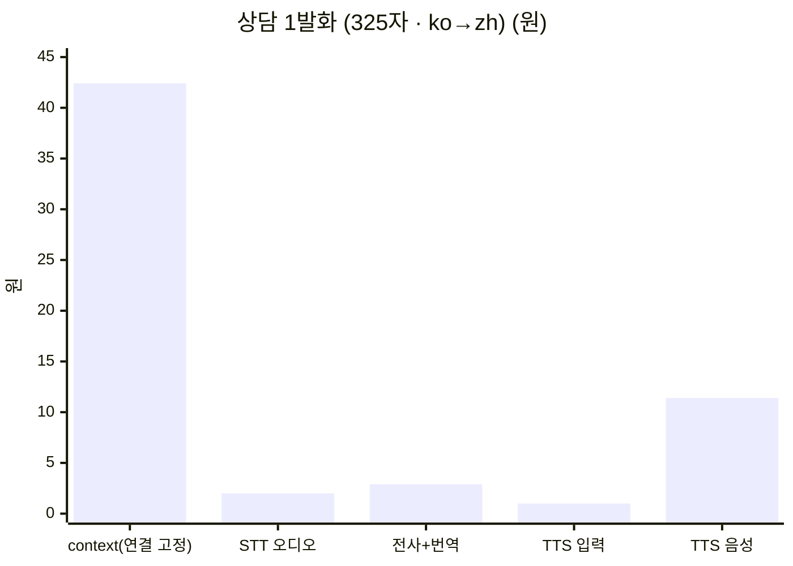
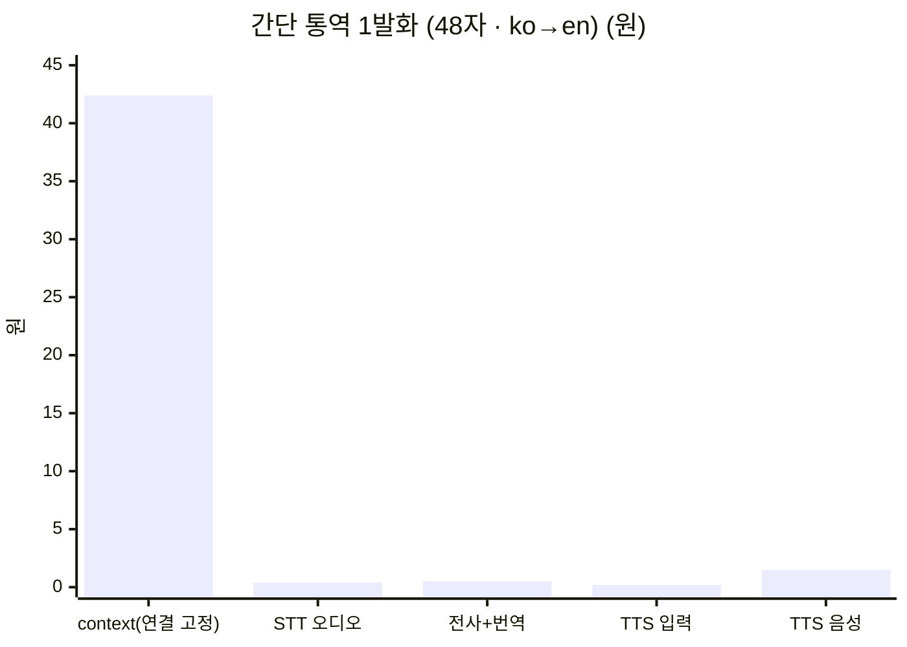
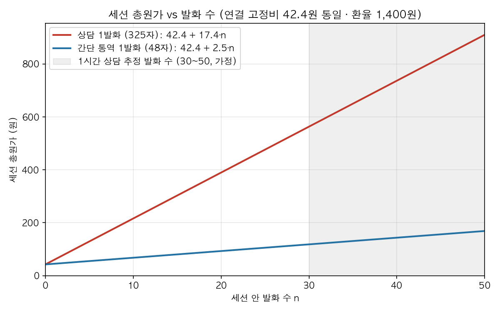
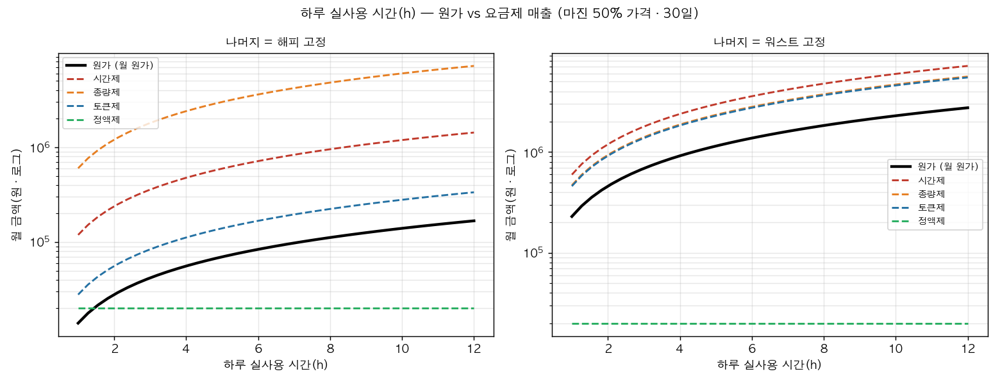
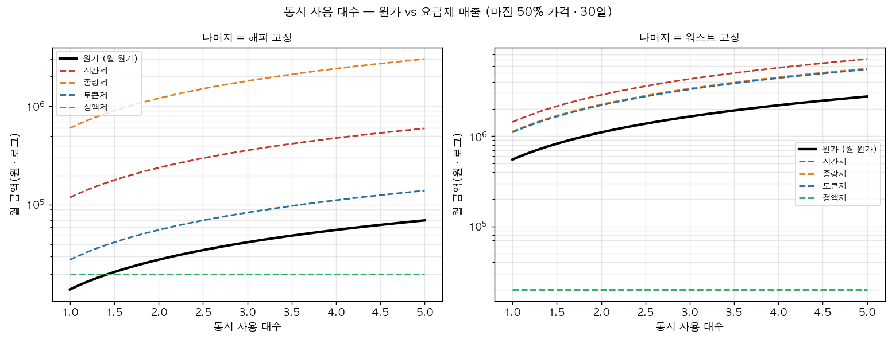
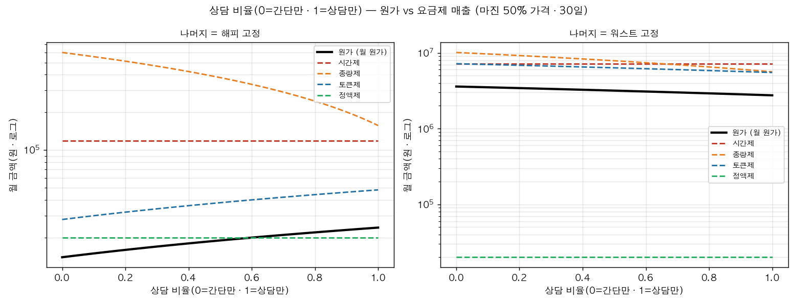
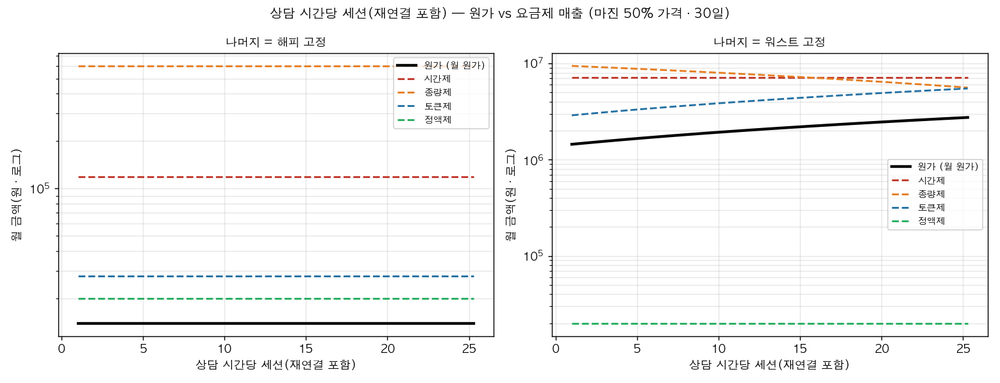
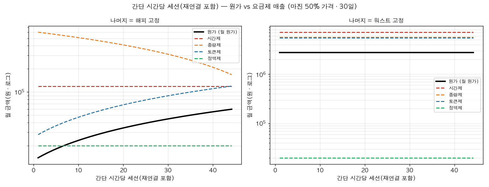

# 통키 원가 함수 · 기본 그래프

- 작성 2026-11-12 · 원천: Soniox 공식 단가(https://soniox.com/pricing) + 실측 2건(usage-logs `cost_usd`) · 환율 1달러 = 1,400원(가정)

## 1. 원가 함수

```text
cost($) = 2.0e-6 · A_in            STT 입력 오디오 토큰(스트림 열린 시간 전체 · 약 8.33토큰/초)
        + 4.0e-6 · (C·k + T_out)   C = 연결당 context 토큰 · k = 연결 수 · T_out = 전사+번역 토큰
        + 4.0e-6 · T_tts            TTS 입력 텍스트 토큰
        + 21.5e-6 · A_tts           TTS 출력 오디오 토큰(약 8.33토큰/초)

f(원) = 0.0056·(C·k + T_out + T_tts) + 0.0233·t_stream(초) + 0.251·t_tts(초)
```

## 1.5 연결 고정비 — 가장 큰 context 로 통일

context 크기는 번역 언어마다 다르다(용어집 별칭 수 · 글자 종류). **요금 계산은 가장 큰 언어 기준 하나로 통일한다.**

| 언어 | context 글자 | context 토큰 | 연결 1번 |
|---|--:|--:|--:|
| 영어 en | 17,589 | 5,698 (실측) | 31.9원 |
| 중국어 zh | 18,565 | 6,494 (실측) | 36.4원 |
| 일본어 ja | 19,408 | 6,994 (로그) | 39.2원 |
| **번체 zh-Hant (최대)** | **21,658** | **≈ 7,576 (추정 — 글자당 0.35토큰)** | **≈ 42.4원** |

→ **연결 고정비 = 42.4원** (번체 실측 1회로 확정 필요).

## 2. 실측 2건 — 함수 = 청구액

실측한 문장(같은 설정 · 같은 용어집 context 로 Soniox 에 1회씩 호출):

| 케이스 | 문장 | 글자 · 말 길이 | 번역 언어 |
|---|---|---|---|
| **상담 1발화** | 여기 눌러보시면은, 이 오늘 결제하신 시술 건들에 대한 내용이 다 뜨고요. 그다음에 이제 이거랑 오더 메모를 확인을 해가지고, 이제 혹시 뭐 누락이 된 건은 없는지, 혹시 뭔가 좀 결제는 이렇게 하셨는데 다른 시술 건이 들어가 있지 않는지, 그런 거 다 확인하고, 크로스 체크하고, 그다음에 이제 시술을 들어가게 되고요. 저희가 그래서 이거에 맞춰가지고, 써마지라든지, 울쎄라라든지, 보톡스 어떤 거, 그 보톡스도 항목에 따라서 이제 국산, 외국산, 그리고 수입산이 있고, 그리고 또 국산에서도 국산 프리미엄이 있기 때문에, 그런 거 다 확인해가지고 이제 부위별로 들어가게 됩니다. | 325자 · 36.7초 | 중국어(zh) |
| **간단 통역 1발화** | 지금부터 울쎄라 시작할 건데, 이건 턱라인을 날렵하게 만들어 주는 리프팅이에요. 집중. | 48자 | 영어(en) |

- 상담 1발화 = 피부과 직원이 시술 확인 절차를 길게 설명한 실제 발화(긴 설명의 예).
- 간단 통역 1발화 = 통키 실제 통역 기록(11-11 ~ 11-12)에서 가장 긴 발화.
- 입력 음성은 이 문장을 Soniox TTS 로 합성해 흘렸다(합성 비용은 원가에서 뺌).

| 케이스 | C | A_in | T_out | T_tts | A_tts | 함수 계산 | 실제 cost_usd | 원 |
|---|--:|--:|--:|--:|--:|--:|--:|--:|
| 상담 1발화 (325자 · ko→zh) | 6,494 | 730 | 515 | 183 | 379 | $0.038377 | $0.038377 | 53.7 |
| 간단 통역 1발화 (48자 · ko→en) | 5,698 | 128 | 82 | 31 | 51 | $0.024597 | $0.024597 | 34.4 |

## 3. 그래프

### G1 · 1회 발화 원가 구성(context = 통일값) — 상담 1발화 (325자 · ko→zh)



### G1 · 1회 발화 원가 구성(context = 통일값) — 간단 통역 1발화 (48자 · ko→en)



### G2 · 연결 1번(세션)의 총원가 — 발화 수 n

총원가 = 연결 고정비 + 발화 변동비 × n. **발화가 늘면 총원가는 직선으로 오른다.**

- 상담 1발화로만: 42.4 + 17.4·n (원)
- 간단 통역 1발화로만: 42.4 + 2.5·n (원)



| n | 0 | 5 | 10 | 20 | 30 | 40 | 50 |
|---|--:|--:|--:|--:|--:|--:|--:|
| 상담 | 42 | 129 | 216 | 390 | 563 | 737 | 910 |
| 간단 통역 | 42 | 55 | 68 | 93 | 118 | 143 | 169 |

## 4. 정책

- **무발화 1분이면 세션(연결)을 끊는다.** 그래서 「말 없이 열어 둔 연결」은 원가 계산에서 뺀다(최대 1분 × 0.0233원/초 ≈ 1.4원 + 연결 고정비).
- 대신 상담 중 1분 넘게 말이 없으면 연결이 끊기고, 다시 말할 때 새 연결 = 연결 고정비(42.4원)가 한 번 더 든다.

## 5. 데이터 현황 — 요금제를 데이터로 정할 수 없다

| 있는 것 | 내용 | 쓸 수 있나 |
|---|---|---|
| 통키 통역 기록 | 11-11 ~ 11-12 이틀 · 세션 26 · 발화 43 · 시험 사용 섞임 · 7일 보존이라 이전 기록 없음 | ✗ 사용 패턴을 정하기에 부족 |
| Soniox 사용 로그 | 10월부터 · 대부분 개발 테스트 호출 · 세션 id(`client_reference_id`) 없음 | ✗ 세션 · 기기와 연결 안 됨 |
| 실측 2건 | §2 — 상담 1발화 · 간단 통역 1발화 | ○ 발화 단위 원가의 근거 |

→ 하루 사용 시간 · 동시 대수 · 시간당 세션 수 · 상담 비율은 **데이터가 없다.** 그래서 아래는 「어떤 사용 패턴이 나와도 적자가 안 나는 가격」으로 설계한다.

## 6. 근거로 쓰는 값

| 값 | 숫자 | 근거 |
|---|--:|---|
| 연결 고정비 | 42.4원 | §1.5 — 가장 큰 context(번체) 기준 · 토큰 수는 추정 |
| 상담 발화 변동비 | 17.4원 | §2 실측(STT 오디오 730 · 출력 515 · TTS 입력 183 · TTS 음성 379 토큰) |
| 간단 통역 발화 변동비 | 2.5원 | §2 실측(128 · 82 · 31 · 51 토큰) |
| 상담 발화 1개 걸리는 시간 | 82.2초 | 실측 — 말 36.7초 + TTS 음성 379토큰 ÷ 8.33토큰/초 |
| 간단 통역 발화 1개 걸리는 시간 | 21.5초 | 실측 — STT 오디오 128토큰 ÷ 8.33 + TTS 음성 51토큰 ÷ 8.33 |
| 무발화 종료 | 60초 | §4 정책 |
| 하루 근무 | 12h · 30일/월 | 사용자 지정 |
| 하루 실사용 시간 | 1 ~ 12h | 사용자 지정(범위) |
| 동시 사용 대수 | 1 ~ 5대 | 사용자 지정(범위) |
| 상담 비율 | 0 ~ 100% | 사용자 지정(범위) |
| 환율 | 1,400원 | 가정 |

## 7. 1시간(말이 오가는 시간) 원가의 극값 — 계산

| | 최소 = 세션 1개로 쉬지 않고 | 최대 = 발화마다 1분 쉬어 매번 재연결 |
|---|---|---|
| 상담 | 1 × 42.4 + (3600 ÷ 82.2 = 44발화) × 17.4 = **803원** | (3600 ÷ (82.2+60) = 25.3세션) × (42.4 + 17.4) = **1,514원** |
| 간단 통역 | 1 × 42.4 + (3600 ÷ 21.5 = 168발화) × 2.5 = **466원** | (3600 ÷ (21.5+60) = 44.2세션) × (42.4 + 2.5) = **1,986원** |

**월 원가 극값** = 30일 × 동시 대수 × 하루 실사용 × 1시간 원가

| | 해피 | 워스트 |
|---|---|---|
| 조건 | 1대 · 1h · 1시간 원가 최소(466원) | 5대 · 12h · 1시간 원가 최대(1,986원) |
| 월 원가 | 30 × 1 × 1 × 466 = **13,970원** | 30 × 5 × 12 × 1,986 = **3,574,590원** |

데이터가 없어 극값 차이가 256배다. 이 범위 안 어디가 실제인지 모르므로 월 총액으로 가격을 정하지 않고 **단위당 워스트 원가**로 정한다.

## 8. 요금제 3안 — 단위당 워스트 원가 기준

단위당 워스트 원가:
- 1시간당 **1,986원** — §7 최대(간단 통역 · 발화마다 재연결)
- 발화 1개당 **59.8원** — 상담 발화 하나에 연결 하나(42.4 + 17.4)
- 토큰제는 실제 원가 × 배수라 워스트가 없다

가격 = 워스트 원가 ÷ (1 − 마진율). 이 가격이면 **어떤 사용 패턴이어도 마진율 이상이 남는다.**

| 요금제 | 마진 30% | 마진 50% | 마진 70% | 근거 |
|---|--:|--:|--:|---|
| 시간제(1시간) | 2,837원 | 3,972원 | 6,620원 | 1,986 ÷ (1 − m) |
| 종량제(발화 1개) | 85원 | 120원 | 199원 | 59.8 ÷ (1 − m) |
| 토큰제(원가 배수) | × 1.43 | × 2.00 | × 3.33 | 1 ÷ (1 − m) |
| 정액 월 2만원 — 포함 시간 | 7.0h | 5.0h | 3.0h | 2만 × (1 − m) ÷ 1,986 |
| 정액 월 2만원 — 포함 원가(크레딧) | 14,000원 | 10,000원 | 6,000원 | 2만 × (1 − m) |

- 월 2만원 = 대표 투표 결과(4명 전원 「잘만 되면 월 2만원도 가능」).
- 정액제 포함량을 **원가(크레딧)로 잡으면** 사용 패턴과 관계없이 마진이 지켜진다. 같은 크레딧(마진 50% · 1만원)으로 쓸 수 있는 시간은 1시간 원가 최소(466원)일 때 21.5h · 최대(1,986원)일 때 5.0h.

## 9. 아직 근거가 없는 것

- 실제 하루 사용 시간 · 동시 대수 · 시간당 세션 수 · 상담 비율 — 데이터 없음(§5). 쌓이면 §7 극값을 실제 분포로 바꾸고 §8 가격을 내린다.
- 번체 context 토큰 수(§1.5) — 추정. 실측 1회로 확정 가능.
- 부가세 · 결제 수수료 · 서버비 — 원가에 넣지 않음.

## 10. 독립변인별 범위 — 변인 1개만 움직이고 나머지는 해피 / 워스트 고정

**고정 세트**

| 변인 | 해피 | 워스트 | 범위 근거 |
|---|--:|--:|---|
| 하루 실사용 시간 | 1h | 12h | 사용자 지정 |
| 동시 사용 대수 | 1 | 5 | 사용자 지정 |
| 상담 비율 | 0% | 100% | 사용자 지정(0:100) |
| 상담 시간당 세션 | 1 | 25.3 | 1 = 끊김 없음 · 최대 = 3600 ÷ (발화 82.2초 + 공백 60초) — 무발화 1분 정책 |
| 간단 시간당 세션 | 1 | 44.2 | 같은 방식(발화 21.5초) |

- 1시간 = 말이 오가는 시간. 시간당 발화 수는 따로 두지 않고 세션 수에서 나온다: 발화 수 = (3600 − 60 × (세션 − 1)) ÷ 발화 1개 시간 — 재연결마다 60초 공백이 있으므로.
- 요금제 가격은 §8 마진 50%: 시간제 3,972원/h · 종량제 120원/발화 · 토큰제 원가 × 2 · 정액제 월 20,000원(포함량 제한 없이 그은 선).
- 그래프: 검은 실선 = 월 원가, 점선 = 요금제별 월 매출. **매출선이 원가선 아래로 내려가면 그 구간은 적자.**


### 하루 실사용 시간(h)



| 고정 | 하루 실사용 시간(h) | 월 원가 | 시간제 | 종량제 | 토큰제 | 정액제 |
|---|--:|--:|--:|--:|--:|--:|
| 해피 | 1 | 13,970 | 119,153 (+88%) | 600,963 (+98%) | 27,940 (+50%) | 20,000 (+30%) |
| 해피 | 12 | 167,637 | 1,429,836 (+88%) | 7,211,550 (+98%) | 335,274 (+50%) | 20,000 (-738%) |
| 워스트 | 1 | 228,865 | 595,765 (+62%) | 467,391 (+51%) | 457,731 (+50%) | 20,000 (-1044%) |
| 워스트 | 12 | 2,746,385 | 7,149,180 (+62%) | 5,608,689 (+51%) | 5,492,770 (+50%) | 20,000 (-13632%) |

### 동시 사용 대수



| 고정 | 동시 사용 대수 | 월 원가 | 시간제 | 종량제 | 토큰제 | 정액제 |
|---|--:|--:|--:|--:|--:|--:|
| 해피 | 1 | 13,970 | 119,153 (+88%) | 600,963 (+98%) | 27,940 (+50%) | 20,000 (+30%) |
| 해피 | 5 | 69,849 | 595,765 (+88%) | 3,004,813 (+98%) | 139,698 (+50%) | 20,000 (-249%) |
| 워스트 | 1 | 549,277 | 1,429,836 (+62%) | 1,121,738 (+51%) | 1,098,554 (+50%) | 20,000 (-2646%) |
| 워스트 | 5 | 2,746,385 | 7,149,180 (+62%) | 5,608,689 (+51%) | 5,492,770 (+50%) | 20,000 (-13632%) |

### 상담 비율(0=간단만 · 1=상담만)



| 고정 | 상담 비율(0=간단만 · 1=상담만) | 월 원가 | 시간제 | 종량제 | 토큰제 | 정액제 |
|---|--:|--:|--:|--:|--:|--:|
| 해피 | 0 | 13,970 | 119,153 (+88%) | 600,963 (+98%) | 27,940 (+50%) | 20,000 (+30%) |
| 해피 | 1 | 24,083 | 119,153 (+80%) | 157,106 (+85%) | 48,166 (+50%) | 20,000 (-20%) |
| 워스트 | 0 | 3,588,690 | 7,149,180 (+50%) | 10,096,171 (+64%) | 7,177,380 (+50%) | 20,000 (-17843%) |
| 워스트 | 1 | 2,746,385 | 7,149,180 (+62%) | 5,608,689 (+51%) | 5,492,770 (+50%) | 20,000 (-13632%) |

### 상담 시간당 세션(재연결 포함)



| 고정 | 상담 시간당 세션(재연결 포함) | 월 원가 | 시간제 | 종량제 | 토큰제 | 정액제 |
|---|--:|--:|--:|--:|--:|--:|
| 해피 | 1 | 13,970 | 119,153 (+88%) | 600,963 (+98%) | 27,940 (+50%) | 20,000 (+30%) |
| 해피 | 25.3 | 13,970 | 119,153 (+88%) | 600,963 (+98%) | 27,940 (+50%) | 20,000 (+30%) |
| 워스트 | 1 | 1,444,977 | 7,149,180 (+80%) | 9,426,368 (+85%) | 2,889,954 (+50%) | 20,000 (-7125%) |
| 워스트 | 25.3 | 2,746,385 | 7,149,180 (+62%) | 5,608,689 (+51%) | 5,492,770 (+50%) | 20,000 (-13632%) |

### 간단 시간당 세션(재연결 포함)



| 고정 | 간단 시간당 세션(재연결 포함) | 월 원가 | 시간제 | 종량제 | 토큰제 | 정액제 |
|---|--:|--:|--:|--:|--:|--:|
| 해피 | 1 | 13,970 | 119,153 (+88%) | 600,963 (+98%) | 27,940 (+50%) | 20,000 (+30%) |
| 해피 | 44.2 | 59,812 | 119,153 (+50%) | 168,270 (+64%) | 119,623 (+50%) | 20,000 (-199%) |
| 워스트 | 1 | 2,746,385 | 7,149,180 (+62%) | 5,608,689 (+51%) | 5,492,770 (+50%) | 20,000 (-13632%) |
| 워스트 | 44.2 | 2,746,385 | 7,149,180 (+62%) | 5,608,689 (+51%) | 5,492,770 (+50%) | 20,000 (-13632%) |

괄호 = 그 조건에서의 마진율(매출 − 원가) ÷ 매출.
