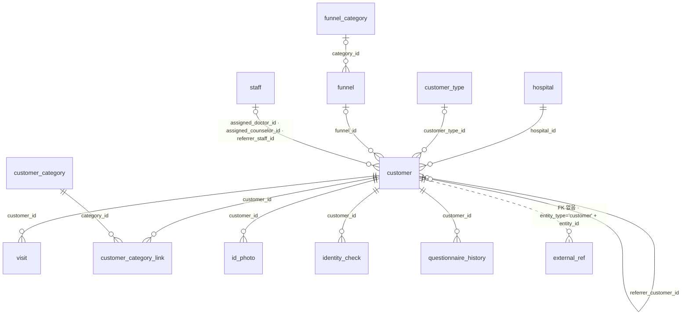

# DAY customer 연결 ERD (prod 기준)

원천: `MediSolveAIDev/CENTURION_DAY` prod `a6aa4ba5` · `backend/day/models/*.py` · migration 0002
범위: `customer` 와 FK 로 바로 이어진 테이블만 (테이블 이름만)

- customer 가 가리키는 테이블: hospital · customer_type · funnel(→ funnel_category) · staff · customer(자기 참조)
- customer 를 가리키는 테이블: visit · customer_category_link(→ customer_category, N:M) · id_photo · identity_check · questionnaire_history
- FK 없이 이어진 테이블: external_ref — 외부 CRM id 는 여기에만 둔다
