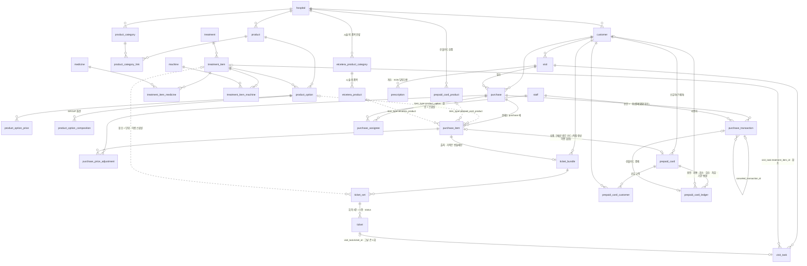

# DAY 고객 · 메뉴 · 결제 · 시술권 · 선불카드 ERD 초안 (v1 · 2026-11-18)

전제(사용자 11-18): 예약 구현 뒤 **DAY 가 고객 · 결제 데이터의 원천** → DAY 테이블 값을 KOS 로 쏜다.
시술권 · 선불카드는 **고객에 붙는다**(방문에서 샀어도 남은 회차 · 잔액은 고객 것).

원천
- 지금 prod 테이블: `CENTURION_DAY` prod `a6aa4ba5` (`customer-erd.md`)
- 메뉴: `reference/2026-11-03-cc-day/erd/04-1-menu.md`(데모 실측 · 1차 보류분) — 그대로 끌어옴
- 결제 · 시술권 · 선불카드: `har/*.har`(gitignore · 개인정보) — 검수 리포트 `orchestration/work/customer-erd/har-check-report{,-2,-3}.md`

범례: 실선 = DAY id FK · 점선 = FK 아닌 참조/스냅샷 · `hospital ||--o{ …` 는 메뉴 · 고객 쪽만 그림(모든 새 테이블이 병원에 속한다)

## KOS id 는 `external_ref` 에만 (지금 ERD 규칙 그대로)

- 위 새 테이블 어디에도 KOS id 칸을 두지 않는다. `visitorId` · `purchaseId` · `purchaseItemId` · `ticketGroupId` · `optionId` · 티켓 `id` · 카드 `id` · `chargingId` 등은
  전부 `external_ref(entity_type = 'purchase' | 'purchase_item' | 'ticket_bundle' | 'ticket_set' | 'ticket' | 'prepaid_card' | 'prepaid_card_ledger' | 'product_option' …, entity_id, vendor='kos', external_id)`.
- 테이블 사이 연결은 **DAY id FK** 로만(그림의 실선). KOS 를 떼면 `external_ref` 만 지우면 되고 나머지는 그대로 선다.
- 그림에 `external_ref` 를 그리지 않은 건 모든 테이블에 같은 방식으로 붙기 때문이다.

## 테이블별 핵심 칸 (그림에 못 담는 것)

### 결제

| 테이블 | 칸 | 정한 근거 |
|---|---|---|
| `purchase` | `customer_id` · `visit_id` NOT NULL · `status`(INITIALIZED · ACCEPTED · REFUNDED · PARTIALLY_REFUNDED) · `process`(PENDING · NOT_IN_PROCESS · REFUNDING) | 처음 1 · 2 · 3차 1 |
| `purchase_item` | `item_type`(product_option · prepaid_card_product · etcetera_product) · 종류별 참조 FK 하나(`product_option_id` · `prepaid_card_product_id` · `etcetera_product_id`) · 스냅샷(이름 · 단위 · 수량) · 가격(금액 · 공급가 · 면세 · 부가세 · 과세) · **조정 금액**(같은 다섯 칸 · 환불 때만 채움) | 2차 2 · 3차 2 |
| `purchase_transaction` | 부호 있는 금액 · `status`(APPROVED · CANCELED) · `canceled_transaction_id`(자기 참조) · `payment_type` + 수단별 설정 jsonb · `prepaid_card_id`(선불카드 결제만) · `staff_id` | 1차 2 · 3 · 4 |

### 선불카드

| 테이블 | 칸 | 정한 근거 |
|---|---|---|
| `prepaid_card_product` | 이름 · 가격 · 충전 금액 · 충전 포인트 · 유효 일수 · 순서 · 닫힘 · 설명 | 2차 1 (KOS `prepaid-card-product`) |
| `etcetera_product_category` | 이름 · 순서 · 닫힘 | `har/수납추가.har` (KOS 분류 3개: 약 처방 · 문서 발급 · 수면마취) |
| `etcetera_product` | `etcetera_product_category_id` · 이름 · 가격(금액 하나) — 과세 칸 없음 | 같은 HAR (11건 · 칸은 `title · category · price` 뿐) |
| `prepaid_card` | `customer_id`(소유자) · `purchase_item_id`(nullable) · 이름 · 잔액 · 포인트 잔액 · 만료 시각 · `deleted_at` · **총액 칸 없음**(이력에서 계산) | 1차 5 · 6 · 3차 6 · 7 |
| `prepaid_card_customer` | `prepaid_card_id` · `customer_id`(공유자만) · `deleted_at` | 1차 6 |
| `prepaid_card_ledger` | `prepaid_card_id` · `kind`(charge · use · cancel · revoke · deduct · expiry_change) · `pocket`(balance · point) · 부호 있는 금액 · `customer_id`(사용자) · `purchase_transaction_id`(nullable) · `staff_id` · 메모 · 시각 | 2차 3 · 4 |

### 시술권

| 테이블 | 칸 | 정한 근거 |
|---|---|---|
| `ticket_bundle` | `customer_id` · `purchase_item_id` · 이름 · **가격**(= 구매 항목 금액 · 여기에만) | 1차 9 |
| `ticket_set` | `ticket_bundle_id` · `treatment_item_id`(참조) · **단위 · 이름 스냅샷**(용량 변경값) | 2차 6 |
| `ticket` | `ticket_set_id` · `status`(AVAILABLE · IN_USE · USED) · 가격 칸 없음 | 처음 3 · 1차 9 |
| `visit_task` | `ticket_id` · `ticket_round_current/total` 스냅샷 | 처음 3 · 3차 실측 `round{5,1}` |

## 결제 취소 · 환불 — 다른 동작 (사용자 11-18)

| | 결제 취소 | 환불 |
|---|---|---|
| 되돌리는 것 | **결제 한 건** — 다시 결제해야 함(수단 변경 · 금액 정정) | **구매 자체**(항목 단위) |
| `purchase` | 그대로 ACCEPTED · 미수로 표시 | REFUNDING → REFUNDED / PARTIALLY_REFUNDED |
| 거래 | 음수 CANCELED 1행 | 전액 취소 + 남는 금액 재결제 |
| 시술권 · 선불카드 | **그대로** | 남은 것은 회수 |

- KOS 실측: 선불카드 상품 결제를 취소해도 카드 잔액 그대로(`har/결제취소2.har` — 취소 직후 조회 500,000 / 포인트 50,000). 구매는 ACCEPTED 로 남고 「부족합니다 · 이어서하기」.
  → DAY 도 같게: 취소는 카드를 건드리지 않는다. DAY 만 회수하면 KOS 에 잔액만 0 으로 만드는 명령이 없어 둘이 갈라진다.
- 환불 흐름(KOS 순서 그대로): 시작 → 항목마다 남길 금액 지정 → 받은 돈 전액 취소 → 남길 금액 재결제 → 완료.
  DAY 는 「환불 = 결제 취소 + 재결제 + 항목 조정 금액」을 묶은 동작으로 둔다.
- **선불카드 상품 환불 완료** → `prepaid_card_ledger` 에 `revoke`(잔액 · 포인트 0) + `prepaid_card.deleted_at` + KOS 에 환불 명령(KOS 이력). 그 카드로 이미 낸 거래의 `prepaid_card_id` 는 소프트 딜리트라 깨지지 않는다.

## 3차 HAR 확인 뒤 정한 것 (사용자 11-18 · `har-check-report-3.md` §7-3 — 추천대로)

1. 상태값: `status` 생성 · 확정 · 환불됨 · 부분환불 / `process` 대기 · 없음 · 환불중.
2. 조정 금액: `purchase_item` 에 금액 · 공급가 · 면세 · 부가세 · 과세 — 원래 가격 칸과 같은 모양. KOS `adjustedPrice` · `adjustPriceV2`.
3. 환불 중 표시: 별도 테이블 없음 — `purchase.process = REFUNDING` + 조정 금액이 채워진 항목 = 환불 대상.
4. 결제 완료 = 거래 합계 vs Σ(조정 금액 있으면 조정 금액, 없으면 가격). 넘거나 모자라도 막지 않는다 — 화면에 미수 · 과수 표시(KOS 도 안 막음 · 과수 구매 실측).
5. 부분 환불 금액: **계산값을 기본으로 채우고 직원이 고칠 수 있다.** 단일 시술권 = 번들 ÷ 회차 × 쓴 횟수 · 선불카드 상품 = 쓴 금액(KOS 440,000 실측) · 묶음 옵션 = KOS 배분 규칙 모름 → 직원 입력.
6. 선불카드 상품: 취소 ≠ 환불(위 절). 환불 완료만 회수 + 소프트 딜리트 + KOS 환불 명령.
7. 카드 총액 칸 없음 — 잔액만 · 총액은 이력에서.
8. 환불된 카드로 낸 거래: 따로 처리 없음(소프트 딜리트).

## 2차 HAR 확인 뒤 정한 것 (사용자 11-18 · `har-check-report-2.md` §9-3 — 추천대로)

1. 선불카드 상품 = 별도 메뉴 테이블 `prepaid_card_product`(시술 옵션과 칸이 다르다).
2. `purchase_item.item_type` + 종류별 참조 FK · 상품 구매로 생긴 카드는 `prepaid_card.purchase_item_id`.
3. 충전 출처 두 길 다 받는다: 화면 직접 생성(구매 없음 · `purchase_item_id` NULL · ledger `charge`) / 상품 구매 확정(카드 자동 생성 · ledger `charge`).
4. ledger 칸 = 위 표.
5. → 3차 6 으로 대체(취소는 그대로 · 환불만 회수).
6. `ticket_set` 에 단위 · 이름 스냅샷.
7. 티켓 가격 나머지 — 티켓 가격 칸이 없어 문제 없음(1차 9).
8. 카드 고객 목록 — 동기화 때 KOS `owner:true` 행은 `prepaid_card.customer_id`, 나머지는 `prepaid_card_customer`.

## 1차 HAR 확인 뒤 정한 것 (11-18 · `har-check-report.md` §5-3)

1. 결제 완료 = `purchase.status` + 거래 합계 — 결제액 칸 없이 계산(3차 4 로 기준 보강).
2. 취소 = 음수 `CANCELED` 거래 + 원거래 참조. 재결제 = 같은 구매에 거래 추가.
3. 거래마다 담당 직원(`purchase_transaction.staff_id`).
4. 결제 수단 = `payment_type` + 수단별 설정 jsonb 1칸 · 선불카드만 `prepaid_card_id` FK.
5. 선불카드 = 금액 · 포인트 두 주머니 + 이력은 DAY 가 `prepaid_card_ledger` 로 쌓는다.
6. 선불카드 유효기간 칸 둔다. 선물(구매자 ≠ 소유자)은 나중 기능. 소유자 = `prepaid_card.customer_id`.
   공유 고객은 `prepaid_card_customer` · 이력에 사용자(`customer_id`)(KOS `add-visitor-to-prepaid-card` · `get-prepaid-card-visitors`).
7. 충전 출처 → 2차 3.
8. 용량 변경 = 구매 항목은 바뀐 값만(스냅샷) · 원값은 `product_option` 참조 · `product_option` 에 옵션 단위 칸 추가.
9. 다회권 = ticket N행(KOS 도 N행). 가격은 번들에만 · 부분 환불은 환불 때 계산 → 조정 금액(3차 5).

## 처음 정한 것 (사용자 11-18)

1. 방문 없는 구매 없음 → `purchase.visit_id` NOT NULL (방문 1 : 구매 N).
2. 상태는 구매에 · 항목 상태 칸 없음 · **수납 필요 = 열린 구매(INITIALIZED)**(방문 중 담아 두고 귀가 때 결제). `visit_task.payment_required` 와는 별개 — 관계는 수납 흐름 SPEC 때.
3. `ticket` 1행 = 시술 1회 · `visit_task.ticket_id`. 3-1. 유효기간 칸은 병원 정책이 생기면 `ticket_bundle.expires_at` 추가.
4. 이름: KOS `procedure` = `treatment` · `medicalService` = `treatment_item`(피부과엔 「진료」 없음). KOS 이름은 동기화 매핑에만.
5. 작업 카드: `visit_task.treatment_item_id` FK + 스냅샷 `medicines`(있음) · `machines`(새 칸).

## 수납 추가 HAR 확인 (11-18 · `har/수납추가.har`)

- 「시술 외 품목」 탭: KOS `get-etcetera-products` → 11건 · `{title, category{name, order, closed}, price}` 뿐. 구매 항목 `type = ETCETRA_PRODUCT` + `etceteraConfiguration{id, title, price}` 스냅샷 · 가격 분해는 다른 항목과 같은 모양.
- 「상품 탐색」 탭: `get-products` 로 고른 것도 `PRODUCT_OPTION` — 시술 옵션 탭과 **같은 항목 종류**(같은 옵션 id). 새 종류 아님.
- → `purchase_item.item_type` 은 셋으로 닫힘: product_option · prepaid_card_product · etcetera_product. 시술 외 품목은 시술권을 안 만든다(그림 `purchase_item ||--o| ticket_bundle` 의 0 쪽).

## 처방 — 최소 테이블

- 처방은 KOS 에서 한다. DAY 예약 화면은 「처방전 N건」 + [처방전 출력](KOS 딥링크 `tab=etceteraWork`)만.
- `prescription`: `id` · `visit_id` · 생성 · 수정 · 삭제 시각만. KOS 처방 id 는 `external_ref`. OQ-03-1(`visit.prescription_ids`)을 이 테이블로 닫는다.

## 약품 · 기기 — 넣는다

- `medicine` · `machine` · `treatment_item_medicine` · `treatment_item_machine` — 설계는 `04-1-menu.md` 그대로.
- 근거: `상품 수납.har` 옵션 266건 — 약품 158건 · 41종 / 기기 86건 · 19종. 처방과는 별개(시술 약품 ≠ 처방).

## 열린 것 — ERD 모양은 안 바꾸는 세부 (동기화 매핑 · SPEC 때 확인)

| 무엇 | 필요한 HAR |
|---|---|
| 시술 외 품목의 과세 구분 출처 — 메뉴엔 과세 칸이 없는데 구매 항목엔 `TAXABLE` + 부가세 분해(표본 1건 · 비만약 처방) | 진단서 · 소견서 같은 문서 발급 품목 하나 담고 결제 |
| 환불 뒤 남은 티켓 상태 · 작업 추가만 했을 때 `IN_USE` 여부 | 시술권 탭 1회씩 |
| 공유 고객 해제 명령 · 공유 고객이 카드로 결제한 이력 | 선불카드 관리에서 [제거] · 공유 고객으로 결제 |
| 환불 금액 직원 수정 화면 | 환불 때 금액 고치기 1회 |
| 선불카드 상품 환불 뒤 충전 이벤트(회수 이벤트가 KOS 에 있나) | 환불한 카드 상세 1회 |
| `revokingItems` 뜻 | (화면 동작 미상 · 기록만) |
