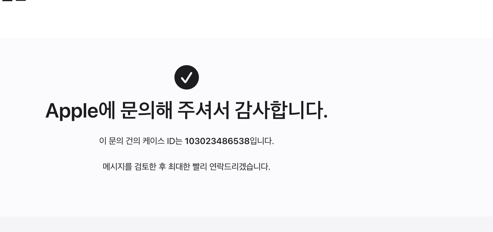

# DAY Unlisted 배포 지연 문의 — 2026-11-24

출처: 사용자가 공유한 Apple Developer Support 문의 접수 완료 화면 및 접수 메일·App Review 답변. 2026-11-24 기록.

## 접수 결과

- **이번 후속 문의 Case ID: `103023486538`**
- 문의 경로: Apple Developer Contact Us → Distribution(배포) → Other Distribution Questions(기타 배포 질문)
- 대상: 정식 앱 DAY · App Apple ID `6833456680` · Bundle ID `day.medisolveai`
- 접수 완료 화면: 「메시지를 검토한 후 최대한 빨리 연락드리겠습니다.」
- 이 번호는 **11월 24일에 접수한 지연 문의 번호**다. 11월 12일 원래 Unlisted 신청 번호로 확인된 것은 아니다.
- 이 화면은 문의 접수 완료이며, Unlisted 배포 승인 결과가 아니다. 접수 시점에는 승인 여부·지연 사유 미확인.

## 문의 배경

- 2026-11-12: Unlisted 배포 신청. 자동 접수 메일에서 영업일 3일 이내 회신을 안내했으나 메일 제목·본문에 Case ID가 없었다.
- 2026-11-24: 신청 후 12일 동안 승인 결과나 진행 상황 회신을 받지 못했다고 사용자가 확인했다.
- App Review는 Contact Us → Distribution → Other Distribution Questions로 신청 Case ID와 함께 진행 상황을 문의하라고 안내했다. Unlisted 승인 후 App Store Connect에서 앱을 다시 심사 제출하라는 답변도 받았다.
- 이번 문의에서는 원래 신청 조회, Case ID와 진행 상태 확인, 담당팀 전달 및 추가 정보·조치 필요 여부 확인을 요청하는 문안을 준비했다. 사용자가 이후 접수 완료 화면을 공유했다. 최종 전송 본문 자체는 별도 확인하지 않았다.

## 접수 증빙

## 관련 기록

- [[para/projects/company/day/log/2026-11-12-prod-deploy-re1|DAY 첫 운영 배포 · 정식 앱 심사 제출 · Unlisted 신청]]
